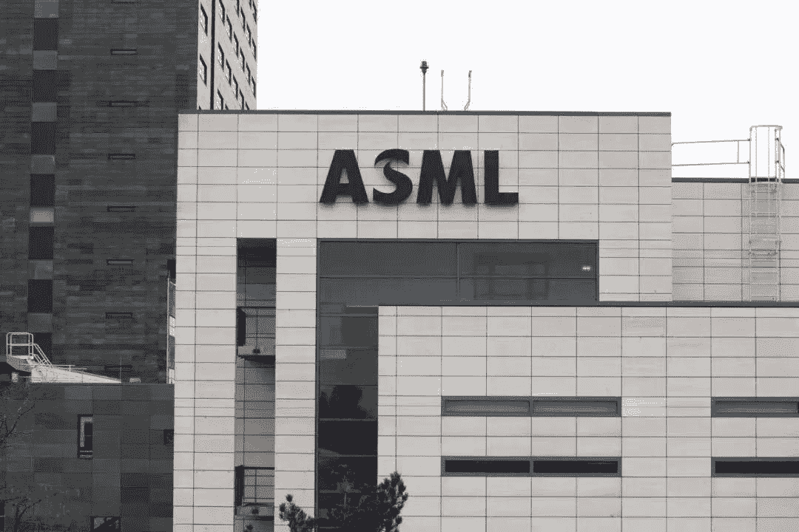
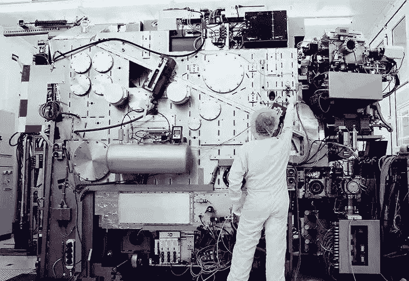
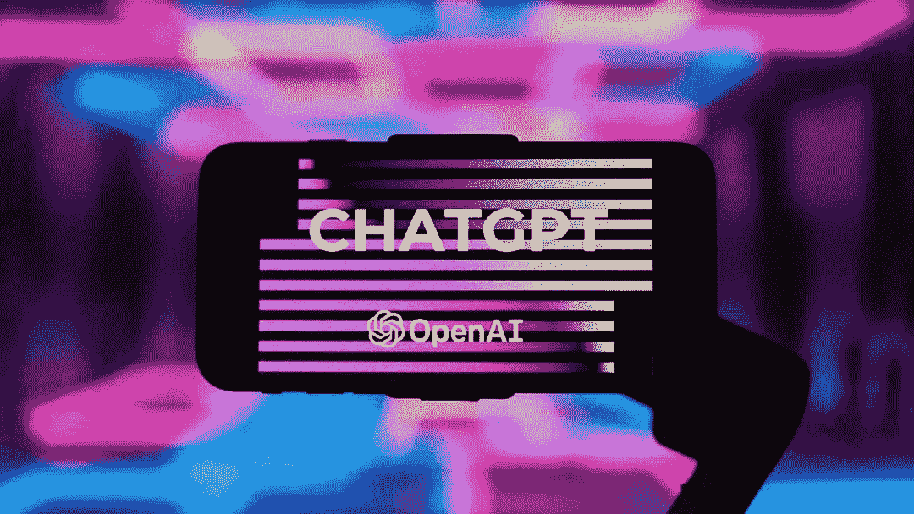

# 中国人工智能属于第几梯队？

> 来源：[https://aigcreative.feishu.cn/docx/NRbxd286Ro04RkxEQz6cGfdin2b](https://aigcreative.feishu.cn/docx/NRbxd286Ro04RkxEQz6cGfdin2b)

> 作者：贾铭

> 👸号：秦朔朋友圈

> 链接：https://mp.weixin.qq.com/s/p3ASMcAfzDfgZ_QyzdKKKQ

早在ChatGPT出现时，有很多人也讨论过“ChatGPT为什么没有首先出现在中国”。而当我们还在困扰为什么国内大模型没有GPT4好用的时候，Sora来了。

从通用人工智能（AGI）视角看，这意味着我们与OpenAI的差距又被拉大了。

中国人工智能发展的制约因素是什么？当前的发展到底处于第几梯队？2023年下半年，我密集调研了十几家人工智能企业，来宽泛地谈谈我自己的看法。

# **算力**

算力是人工智能竞争的核心，算力的背后是芯片。

Meta一家公司已经有50万块GPU，微软**也有几十万块，而且两家公司还在不断采购。国内所有的人工智**能公司加在一起，可能有50万块左右，所以在算力的存量层面，我们跟国外的差距很大。

芯片又分为芯片设计和芯片制造。中国的芯片设计能力在全球应该可以划分到第一梯队。在传统的CPU和GPU领域，与国外几乎没有差距。在人工智能芯片的细分领域，比如半定制化的FPGA、全定制化的ASIC、类脑芯片等领域，已经有个别很优秀的公司极度贴近甚至部分超越国际顶尖水平，但顶尖公司的数量和生态，总体上与国外发达国家还有不小的差距。

在芯片制造环节，面临卡脖子。

从制程上看，90nm以上制程的芯片，技术上我们已经几乎可以完全自主。有消息说，2023年下半年，28nm的国产（后道封装）光刻机也已经交付芯片制造厂商。但也有消息说，仍然正在研发，还没有交付。

即使已经交付芯片制造商，在一切顺利的情况下，参考阿斯麦（ASML）和台积电的经验，从安装完成、调试到可以稳定生产，至少需要2年的时间。考虑到这是中国首台全国产的28nm光刻机，以及光刻机的高度复杂性，所需时间大概率会更长。

｜荷兰光刻机巨头阿斯麦公司（ASML）总部

特别需要注意的是，光刻机完成实验室阶段的研发和在厂商完成产业化生产是完全不同的两个概念。

在研发阶段，只要成功流片，就算是研发成功，但在实际的产业应用阶段，要求在保证良率和产能的情况下，能够安全稳定地持续运营，这个过程是很难的。

所以，光刻机从实验研发到正式投产，花费十年八年都是很正常的。即使ASML，前几款光刻机，从研发成功到正式投产，也在5年以上。

至于28nm以下的芯片制造，必须还要依赖国外的光刻机。

当前全球的光刻机市场被荷兰阿斯麦（ASML）、日本尼康（Nikon）和佳能（Canon）三大巨头垄断。尼康的光刻机集中在中高端区域，佳能则集中在低端区域。

至于2023年某厂商成功制造5nm的芯片，业内普遍推测，芯片自主设计是没问题的，但在制造环节，使用的还是国外的设备，区别无非是ASML的还是Nikon或者Canon的。

光刻产业链具有极度复杂性。光刻机的制造研发绝不是某一个企业能够单独完成的（包括ASML也不是一家就能造DUV和EUV，很多核心零部件都要进口），需要很多顶尖的企业相互配合才可以完成。

光刻产业链的高度复杂性主要体现在两点：

**一是**作为光刻核心设备的光刻机组件复杂，包括光源系统、照明系统、物镜系统、浸入式系统、双工件台等在内的组件技术全球只有极少数几家公司能够掌握。比如物镜镜片被德国企业蔡司（ZEISS）垄断。

**二是**与光刻机配套的光刻胶、光刻气体、掩膜版等半导体材料和涂胶显影设备等同样要求很高的技术含量。比如，宽谱g/i/h线光刻胶基本完成国产替代，但高端KrF、ArF和EUV光刻胶基本被美国和日本的企业垄断，韩国企业占一点比重，中国大陆基本依靠进口。

现在的问题是ASML被限制向中国出口最新的光刻机，英伟达（NVIDIA）被限制向中国出口最新的芯片。

虽然我们还可以买到性能受限的“特供版”芯片，但限售既限制了企业的算力获取，又拉高了算力成本，而且扰乱了企业的研发预期。

短期来看，部分企业有储备算力可供使用，而且现在也没有到单纯拼算力的地步，算法依然有很大的优化提升空间。但长远来看，仅从技术的角度，人工智能竞争的本质还是算力的竞争。

尽管当前我们已经加大在半导体领域的研发投入，但短期内中国在芯片制造领域取得颠覆性突破的困难还比较大，所以未来在算力竞争层面，无论是国家还是企业，都要提前做好各方面的应对准备。

｜2006年全球首台EUV光刻机原型

# **数据**

数据是重要的基础性战略资源，高质量数据对人工智能的重要性无需赘言。

中国是世界上数据最丰富、也是最重视数据的国家之一，将数据的重要性提升到了前所未有的高度，专门设立了国家大数据局，并出台了系列法律法规和行业规范。

“数据二十条”针对数据要素与其他生产要素的不同特点，构建起“四梁八柱”的主要架构，从数据产权、流通交易、收益分配、安全治理四方面初步搭建了中国的数据基础制度体系。

当然，数据二十条只是纲领性文件，未来许多更具体的内容需要不断探索发展。数据交易所的建设效果如何，还有待观察。

就目前来看，至少存在三方面的问题——

**第一**是优质数据太少，很多企业需要花大成本重新清洗和标注数据。所以经常有人开玩笑说：人工智能，有多少人工就有多少智能。

**第二**，数据的灰色交易问题。有的行业或者企业可以更优先拿到部分受限的数据，由于数据复用的边际成本极低，所以很多企业就通过不合规的渠道以很低的价格买卖数据，导致不公平竞争。

**第三**，数据的保护和治理水平还有待提高。数据中敏感信息多，许多数据内容多层次多元化，可能承载了需要保护的个人信息和商业机密，即使匿名化和去标识化，也有可能被挖掘出来。

# **资本**

如果只看ChatGPT的技术路线的话，其实是一个大力出奇迹的过程。

很多公司都曾经实验过这一技术路线，但都受限于算力成本和数据量，在做了一段时间后就放弃了。

不仅是国内的很多公司没有做出来，Google也没有做出来。只有OpenAI不断地堆算力、堆数据，最终实现了由量变到质变。所以，ChatGPT的成功具有一定的偶然性。

但偶然中又蕴含着必然。仅就人工智能领域来说，中国好像并没有做出太杰出的原创性贡献。AlphaGo，ChatGPT是国外先出现的，智能音箱、智能驾驶、人脸识别，都是人工智能的工程应用，也不是中国的原创。

有很多人说，国外有成熟的投融资体系，所以可以支持OpenAI不断烧钱。

确实，原创性的科技创新投入大、周期长、成功概率低。OpenAI的资金密度、人才密度都很高。而中国的多层次资本市场仍不够健全，尤其是VC和PE市场建设比较滞后。未来还是需要花大力气完善。

但我觉得这不是根本原因。

一般的中小公司很难获得如OpenAI那么多的融资，但如果我们仔细统计，在2022年ChatGPT横空出世以前，中国有不少公司的融资额是比OpenAI还多的，但我们还是没有做出ChatGPT。

所以投融资很重要，资本市场很重要。但融资额多少不是创新成功与否的决定性因素。

# **人才**

颠覆性技术创新的核心要素是“人”。

如果让我们回顾一份具有世界影响力的科技创新者名单，可能会包括Bill Gates、Zuckerberg、Sam Altman、 Elon Mask等等。

中国人口基数这么大，我们缺的不是Altman和Mask这样的种子，缺的是让这些种子从生根发芽到长成参天大树的土壤。

深层次反思是需要勇气的，而且很不讨喜。当大家都沉浸在热烈的人工智能浪潮中，沉浸在中国人工智能处于世界领先行列的喜悦中，我非说我们这里不行，那里有短板，就很容易挨骂。

但我们的人才培养模式确实有问题。

高校是我们人才培养最重要的载体。但我们的**高等教育培养的大部分是落后于实践的人才。我们高校的环境鼓励**的是“边际创新”而不是“原创性成果”。我们的社会容不下坐几年十几年冷板凳的人才。

**第一**，高校都想做大，做综合类高校，开设最热门的学科，尽可能招更多的学生。因为学科建设、学生规模与能获得的经费支持直接相关。

最显著的一个表征就是，各类“xxx学院”都争相想改名成“xxx大学”。高校的数量要适应当地的经济发展程度和人口规模。有的省份经济发展水平比较高，人口规模也很大，但优质的教育资源不足，在能保障教学质量的情况下，可以考虑扩大供给，但学科设置不能脱离自己的比较优势。

前几年金融学是热门学科，所以很多学校就竞相设置经管学院、经济系。我知道有的专科院校，竟然也设置了诸如“金融工程”之类对师资力量要求很高的学科。这种情况下培养出来的人才，只是虚有其表。

据不完全统计，截至2023年，全国有440所高校建立了人工智能本科专业，有1016所职业院校备案了人工智能技术服务（应用）专业。

人工智能也是一个对师资力量要求很高的学科，如果专科院校开设人工智能专业，必须要找准自己的定位，稳扎稳打，侧重于应用开发和改进、应用测试、数据处理、产品运维、商务推广、产品销售、售后服务等实用技能型人才培养，与本科和研究生进行差异化竞争。

**第二**，人工智能对硬件和软件的要求都很高，高校的算力和数据资源、师资力量、课程设置和传授的知识落后于行业实践，背后是产教融合的问题。

一方面，大部分高校的算力和数据资源其实难以满足大模型的教学和研发需求。另一方面，无论是老师的教学能力还是课程设置，都落后于行业一线。这两方面的问题不仅在人工智能行业存在，在各行各业都存在。

我们在调研中，多家企业都反馈，招聘的算法类应届毕业生至少都要花费1～2年重新培养，而工作2年的员工离职率最高，所以有的企业选择不再招聘应届生，而直接高薪挖人，这就加剧了行业内卷。

集成电路企业对人才的要求更高。由于芯片设计的复杂性，从业5年才算上手，从业10年才算成熟人才。现在高校培养的大部分是通用型的传统集成电路设计人才，难以适应全定制和半定制化人工智能芯片的设计要求。

所以业内现状是，领军人才、成熟技术人才供不应求，而应届生和“转码”人才又存在过剩。

而在产学研方面，具有一定规模和技术实力的大企业数量有限，专精特新等中小型科技类企业具有技术优势，但由于很难给高校带来立竿见影的资金和就业支持，用人需求和技术优势，都难以触达高校。

美国顶尖大学的教授，除去必要的上课时间，其它时间可以到企业的实验室工作，因此了解产业界的真实需求。国内也有相应的产学结合制度，比如在企业设立院士工作站等等，但这个制度的效果还不够好，具体原因比较复杂。很多科研人员一辈子都没有下过工厂。

国内还有一个很不好的习惯：很多科技成果是为了转化而转化，也就是基于已经拥有的技术或者解决方案来开发新的应用场景，这就导致很多研究不仅没有解决已经存在的重要问题，反而又创造出新的问题。

长期以来，中国教育重传承、轻创新，重标准化教育、轻个性化教育，重知识吸收、轻价值塑造和创新创业，同时中国创新人才教育模式较单一，缺乏多元化投入机制，培养颠覆性技术创新型人才面临困难和挑战。

**第三**，科研工作者的职称考评压力很大，而职称考评是有量化标准的，大部分是“课题+论文发表”。近几年越来越卷，职称考评的标准越来越高。

一位来自知名双一流高校，在我看来很有才华和前途的年轻副教授跟我说：“我也想把所有的精力投入到科技创新中去，我的学院领导也已经是非常开明的领导了，不要求我每年发多少篇论文，支持我和团队花几年的时间搞一个大项目。但是他要求我承诺未来一定要做出什么样的成果。我只能承诺我全力以赴，但我怎么能预先确定科技创新的成败呢？”

当前的问题在于，无论是部委课题还是基金课题，大部分的研究期限很短，且必须承诺结题成果，这似乎可以保障科研质量，避免科研经费被浪费，但这同时导致学者只申请有把握能在短期内达标结题的课题，实际上限制了院校和学者进行基础研究的攻关热情。

这就导致，中国在人工智能领域的顶刊论文数量超过美国，但实际上大多数是对国际前沿理论的边际改善，产业应用价值较弱。

现在国家也在转变科研方式，比如指定或者征集重大问题、延长项目周期、增大重点项目投入。在科研考评体系方面，推进“破五维”。

一方面，像中国自然科学基金就有一整套匿名评审机制和同行评价制度，大家的认可度还比较高。除了项目评价，高校在选人方面也应该增加同行评价的比重。有的博士甚至一篇论文都没有，也可以在国外拿到教职。国外在选人时，更侧重评价一个青年学者的潜力，哪怕你还没研究出真正的成果，但我只要能判断出你研究的问题本身重要，就能评价一个人的科研品味。

**国外本质上更注重一个人的内涵和科研潜力，但国内习惯用公式一样的指标来**判断一个人，最后就导致所有的青年学者趋同，适应评价规则的同时，也扼杀了科研潜力。

现在已经有很多学校把招人的权力下放到了院系，但院系仍然沿用既往的选才制度。

“破五维”的效果不及预期，而且如果真的“破五维”之后，尚未建立起一套新的标准，可能会导致更多的问题。原因既包括既得利益格局的桎梏，也包括面临公平问题和舆论压力。

另一方面，就目前来看，指定或者征集重大问题、“揭榜挂帅”，是一种很好的措施，抓住了当前最迫切的问题，显著推进了问题的解决速度，是急国家之所急。但这更多的是促进了工程应用问题的解决，而不是真正意义上的“颠覆性创新”。

重大项目方面，虽然延长了项目周期、增加了项目额度，但这些重大项目还是主要集中在院士、教授手中。

但很多人评为教授、院士之后，实际上已经不再关注学术前沿，反而成了学术资源的主要提供方，成了一个巨大的利益焦点。院士手上的钱用不完，天天想着怎么花钱，而年轻的科学家找不到钱，无钱可用。所以，科学家共同体内部也需要一些机制来变革。

客观地说，经过多年的发展，综合来看，中国高校的师资力量、人才培养质量已经并不明显落后于西方发达国家。尤其是在人工智能领域，各国（包括美国），都存在顶尖人才短缺的情况，美国业界甚至采取“杀鸡取卵”的方式用高薪从高校挖教授。

中国部分高校开设的人工智能课程，在授课内容、方式、人才培养质量上已经达到了世界顶级水平。这与国家的重视有很大的关系，也与我们的激励制度导向有关。比如我们设立的青年长江学者，就很重视对教学的考核。学校对优秀教学教师的奖励力度也很大。我们有理由对中国人才培养的未来饱含希望。

# **环境**

**第**一，中国人的生活压力其实很大，整个社会环境比较急功近利，对科技创新的要求非常苛刻，个人的容错率非常低。

社会环境对基础创新非常重要。其一，基础研究短期很难出成果，无论是上级监管部门，还是科研院所，都很难承担这种“只烧钱但看不到成果”的考核压力；其二，公众的科学素养也有待提高，大家对很多研究领域的认知不到位，迫切的期待科学家短期做出重大成果，如果长时间不出成果，机构和个人都很难承受舆论压力；其三，个人收入、职业发展与科研成果挂钩。如果你想在高校/科研院所获得还说得过去的收入，得到学校和社会的认可，那你必须在有限的时间内把有限的精力投入到漫长的论文发表的事业中去。而且我们很多课题和“帽子”，都限制了申请者的年龄。这就导致大家只在前人的基础上进行有效的边际创新——因为这是“性价比”最高的方式。

所以，我们要花大力气提升大众的科学素养，社会上要有一种正确的风气，不要一窝蜂，好像重视一个科学家，某个领域的科学研究就要有重大的突破，如果科学家失败了，就觉得这个人有问题或者怎么样。

**第二，营商环境还有提升空间。**

我们过去很长一段时间内，都非常重视营商环境的建设，取得了很大的成效。无论是在国际组织还是国内组织编篡的各类营商环境国别榜单中，排名和评分都有显著的上升。

人工智能技术的发展对未来很多行业可能产生颠覆性影响，世界很多国家都将人工智能技术放在了战略重要性的地位，中国也是如此。

在这个背景下，中央政府、各部委不可谓不重视，出台了很多支持政策。各地方政府对人工智能的支持力度不可谓不大，只要头部企业愿意落户，要地给地、要钱给钱、要人给人，堪称全方位无死角的支持。

但我们对恶意负面舆情的治理力度还不够。有很多所谓的网络“大V”依旧很活跃，受众还很广。

恶意的负面舆情对企业的社会名誉影响很大，甚至扰乱企业的正常经营，对上市公司的影响更大。人工智能行业很有意思，大多数企业都是民营企业。在这种情况下，我们更应该重视恶意攻击民营企业和民营企业家的行为。

我当然知道，舆论不可能也不该禁绝，有时候舆论还是弱者维护自身权益的武器，正常的负面舆情对企业也是一种监督。所以我们要抓大放小，对打着爱国旗号，但实质上攻击企业正常经营行为、造成重大社会影响的恶性舆情和谣言要寻根问底，发现一起，惩治一起。最好是公开执法，一方面是保障执法的公开公正，另一方面是可以震慑宵小，以儆效尤。

# **总结**

一位科技企业的资深技术专家和管理者曾经跟**我说，中国的人工智能其**实准确来说应该叫做“人工智能的工程应用”，我们经常有种幻觉，很多技术我们应用得很好，我们就误认为我们掌握了某种技术。

在应用场景方面，不客气地说，中国的人工智能可以说是冠绝全球，一骑绝尘。

但对技术的应用只是“1到100”。“1到100”很重要，但“0到1”更重要。比如，你肯定比牛顿懂得多，但你跟牛顿谁伟大？

客观上来说，国外在人工智能方面可能确实有先发优势。二十世纪三个伟大的发现，无线电、计算机和互联网都出现在美国，一个重要原因就是它的基础、应用以及开发研究都非常强大。

但我们有很多机制、体制，甚至文化方面的因素，限制了我们0到1的创新。

在人工智能领域，尤其是在芯片制造等基础层，我们真正距离挤入世界顶尖梯队还任重道远。

但只要我们保持战略定力，实事求是、脚踏实地、一步一个脚印，我们就有一万个理由对未来充满希望。

<https://aigcreative.feishu.cn/sync/K4Gvd9vUQsy9Oubwqaeclu0Fnbg>