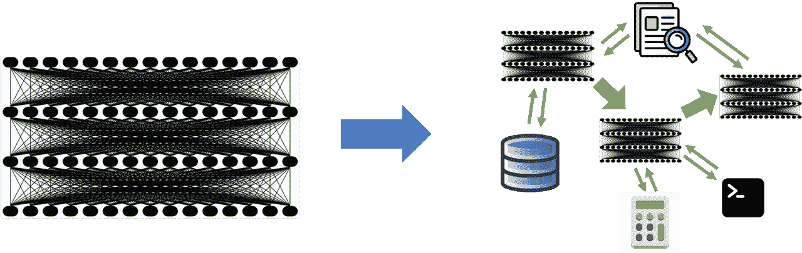

# 从单一模型到复合人工智能系统的转变

> 来源：[https://aigcreative.feishu.cn/docx/GMfTdLXheokGM1x1tWDcPR7pnkd](https://aigcreative.feishu.cn/docx/GMfTdLXheokGM1x1tWDcPR7pnkd)

> 来源：https://bair.berkeley.edu/blog/2024/02/18/compound-ai-systems/

> 翻译：创意猎人

2023** 年，人工智能凭借大型语言模型 (LLM**) 引起了所有人的关注，只需提示即可指示该模型执行一般任务，例如翻译或编码。这自然导致了人们对模型作为人工智能应用程序开发主要成分的强烈关注，每个人都想知道新的法学硕士将带来什么能力。然而，随着越来越多的开发人员开始使用法学硕士进行构建，我们相信这种关注点正在迅速发生变化：最先进的人工智能结果越来越多地通过具有多个组件的复合系统获得，而不仅仅是单一模型。

例如，Google 的[AlphaCode 2](https://storage.googleapis.com/deepmind-media/AlphaCode2/AlphaCode2_Tech_Report.pdf)通过精心设计的系统在编程方面取得了最先进的结果，该系统使用法学硕士[为一项任务生成多达 100](https://deepmind.google/discover/blog/alphageometry-an-olympiad-level-ai-system-for-geometry/) 万个可能的解决方案，然后筛选出该组解决方案。同样， AlphaG[eometry将法学硕士](https://arxiv.org/pdf/2005.11401.pdf)与传统的符号求解器相结合来解决奥林匹克问题。在企业中，我们 Databri[ck](https://www.microsoft.com/en-us/research/blog/the-power-of-prompting/)s 的同事发现 60% 的 LLM 应用程序使用某种形式的检索增强生成 (RAG)，30% 使用多步骤链。即使是从事传统语言模型任务的研究人员，他们过去只报告一次 LLM 调用的结果，现在也报告来自日益复杂的推理策略的结果：微软写了一篇链接策略，该策略比 GPT-4 在医学检查中的准确性高出 9%，并且Google 的 Gemini 发布帖子使用新的 CoT@32 推理策略测量了 MMLU 基准测试结果，该策略调用该模型 32 次，这引发了对其与仅一次调用 GPT-4 的比较的质疑。这种向复合系统的转变带来了许多有趣的设计问题，但也令人兴奋，因为这意味着领先的人工智能成果可以通过巧妙的工程来实现，而不仅仅是扩大培训规模。

在这篇文章中，我们分析了复合人工智能系统的趋势及其对人工智能开发人员的意义。为什么开发人员要构建复合系统？随着模型的改进，这种范式会继续存在吗？用于开发和优化此类系统的新兴工具是什么（该领域的研究远少于模型训练）？我们认为，复合人工智能系统可能是未来最大化人工智能成果的最佳方式，并且可能是 2024 年人工智能最有影响力的趋势之一。

越来越多的新人工智能成果来自复合系统。

# **为什么要使用复合人工智能系统？**

我[们将复合](https://en.wikipedia.org/wiki/Statistical_model)人工智能系统定义为使用多个交互组件（包括对模型、检索器或外部工具的多次调用）处理人工智能任务的系统。相比之下，AI 模型只是一个统计模型，例如预测文本中下一个标记的 Transformer。

尽管人工智能模型不断变得更好，并且其扩展还没有明显的终点，但使用复合系统获得了越来越多的最先进的结果。这是为什么？我们看到了几个不同的原因：

1.  有些任务更容易通过系统设计[来改进。](https://arxiv.org/pdf/2001.08361.pdf)虽然法学[硕士似乎遵循显着的](https://storage.googleapis.com/deepmind-media/AlphaCode2/AlphaCode2_Tech_Report.pdf)缩放法则，可以预见，通过更多的计算可以产生更好的结果，但在许多应用中，缩放提供的回报与成本比构建复合系统更低。例如，假设当前最好的 LLM 可以在 30% 的时间内解决编码竞赛问题，将其培训预算增加三倍将使该数字增加到 35%；这仍然不够可靠，不足以赢得编码比赛！相比之下，设计一个从模型中多次采样、测试每个样本等的系统可能会将当今模型的性能提高到 80%，如AlphaCode等工作所示。更重要的是，迭代系统设计通常比等待训练运行要快得多。我们相信，在任何高价值应用中，开发人员都会希望使用所有可用的工具来最大限度地提高人工智能质量，因此除了扩展之外，他们还会使用系统思想。我们经常在法学硕士用户身上看到这种情况，一个好的法学硕士会创建一个引人注目但令人沮丧的不可靠的第一个演示，然后工程团队继续系统地提高质量。

1.  **系统可以是动态的。**机器学习模型本质上是有限的，因为它们是在静态数据集上进行训练的，因此它们的“知识”是固定的。因此，开发人员需要将模型与其他组件（例如搜索和检索）结合起来，以合并及时的数据。此外，训练让模型“看到”整个训练集，因此需要更复杂的系统来构建具有访问控制的人工智能应用程序（例如，仅根据用户有权访问的文件回答用户的问题）。

1.  使用系[统可以更轻松](https://arxiv.org/pdf/2305.14292.pdf)地改善控制和信任。神经网络模型本身很难控制：虽然训练会影响它们，但几乎不可能保证模型会避免某些行为。使用人工智能系统而不是模型可以帮助开发人员更严格地控制行为，例如通过过滤模型输出。同样，即使是最好的法学硕士仍然会产生幻觉，但将法学硕士与检索相结合的系统可以通过提供引文或自动验证事实来增加用户信任。

1.  **绩效目标差异很大。**每个人工智能模型都有固定的质量水平和成本，但应用程序通常需要改变这些参数。在某些应用程序中，例如内联代码建议，最好的 AI 模型太昂贵，因此 Github Copilot 等工具使用精心调整的较小模型和各种搜索启发式方法来提供结果。在其他应用中，即使是最大的模型，如 GPT-4，也太便宜了！许多用户愿意支付几美元来获得正确的法律意见，而不是花几美分来询问 GPT-4，但开发人员需要设计一个 AI 系统来利用这一更大的预算。

生[成式](https://maithraraghu.com/blog/2023/does-one-model-rule-them-all/)人工智能向复合系统的转变也符合其他人工智能领域的行业趋势，例如自动驾驶汽车：大多数最先进的实现都是具有多个专用组件的系统（更多讨论请参见此处）。出于这些原因，我们相信即使模型不断改进，复合人工智能系统仍将是领先的范例。

# **开发复合人工智能系统**

虽然复合人工智能系统可以提供明显的好处，但设计、优化和操作它们的艺术仍在不断涌现。从表面上看，人工智能系统是传统软件和人工智能模型的结合，但其中存在许多有趣的设计问题。例如，整体“控制逻辑”应该用传统代码（例如调用LLM的Python代码）编写，还是应该由AI模型驱动（例如调用外部工具的LLM代理）？同样，在复合系统中，开发人员应该在哪里投入资源——例如，在 RAG 管道中，是在检索器上还是在 LLM 上花费更多的 FLOPS，甚至多次调用 LLM 更好？最后，我们如何才能像训练神经网络一样，端到端地优化具有离散组件的人工智能系统以最大化指标？在本节中，我们将详细介绍一些人工智能系统示例，然后讨论这些挑战以及最近的研究。

## **人工智能系统设计空间**

以下是一些最近的复合人工智能系统，展示了设计选择的广度：

## **复合人工智能系统的主要挑战**

与人工智能模型相比，复合人工智能系统在设计、优化和操作方面提出了新的挑战。

### **设计空间**

针对给[定任](https://arxiv.org/pdf/2305.14292.pdf)务的可能系统设计范围非常广泛。例如，即使在具有检索器和语言模型的检索增强生成（RAG）的简单情况下，也有：（i）许多检索和语言模型可供选择，（ii）其他提高检索质量的技术，例如查询扩展或重新排序模型，以及 (iii) 改进 LLM 生成输出的技术（例如，运行另一个 LLM 以检查输出是否与检索到的段落相关）。开发人员必须探索这个广阔的空间才能找到好的设计。

此外，开发人员需要在系统组件之间分配有限的资源，例如延迟和成本预算。例如，如果您想在 100 毫秒内回答 RAG 问题，您应该预算在检索器上花费 20 毫秒，在 LLM 上花费 80 毫秒，还是反之亦然？

### **优化**

通常，在机器学习中，要最大限度地提高复合系统的质量，需要共同优化各个组件，使其能够很好地协同工作。例如，考虑一个简单的 RAG 应用程序，其中法学硕士看到用户问题，生成搜索查询发送给检索器，然后生成答案。理想情况下，LLM 将被调整为生成适合该特定检索器的查询，并且检索器将被调整为更适合该 LLM 的答案。

在 PyTorch 的单一模型开发中，用户可以轻松地端到端优化模型，因为整个模型是可微分的。然而，复合人工智能系统[包含不可](https://arxiv.org/pdf/2310.03714.pdf)[微分的组件](https://arxiv.org/pdf/2201.08239.pdf)，[如搜索引擎或代码解释](https://arxiv.org/pdf/2302.04761.pdf)器[，因此需要新的优化方法。优](https://deepmind.google/discover/blog/alphageometry-an-olympiad-level-ai-system-for-geometry/)化这些复合人工智能系统仍然是一个新的研究领域；例如，DSPy为预训练的 LLM 和其他组件的管道提供通用优化器，而其他系统（如LaMDA、Toolformer和AlphaGeometry）在模型训练期间使用工具调用来优化这些工具的模型。

### **运营**

对于复合人工智能系统来说，机器学习操作 (MLOps) 变得更具挑战性。例如，虽然跟踪垃圾邮件分类器等传统 ML 模型的成功率很容易，但开发人员应如何跟踪和调试同一任务的 LLM 代理的性能，这可能会使用可变数量的“反射”步骤或外部 API 调用来对消息进行分类？我们相信新一代 MLOps 工具将会被开发出来来解决这些问题。有趣的问题包括：

+   **监控：**开发人员如何最有效地记录、分析和调试复杂人工智能系统的跟踪？

+   **DataOps：**由于许多人工智能系统涉及矢量数据库等数据服务组件，并且它们的行为取决于所服务数据的质量，因此对这些系统操作的任何关注都应该另外跨越数据管道。

+   **安全性：**研究表明，与单个模型相比，复合人工智能系统（例如带有内容[过滤器的 LLM ](https://arxiv.org/pdf/2309.05610.pdf)聊天机器人）可能会产生不可预见的安全风险。需要新的工具来保护这些系统。

## **新兴范式**

为了应对构建复合人工智能系统的挑战，行业和研究中出现了多种新方法。我们重点介绍了一些最广泛使用的方法以及我们应对这些挑战的研究中的示例。

### 设计人工智能系统：组合框架和策略。

许多开发人员现在使用[“语言模型编程”](https://www.twosigma.com/articles/a-guide-to-large-language-model-abstractions/)框架，使他们可以通过对人工智能模型和其他组件的多次调用来构建应[用程序。其中包括开](https://www.langchain.com/)发[人员从传统程序调用的](https://www.llamaindex.ai/)[LangCha](https://autogpt.net/)i[n和LlamaInd](https://www.guardrailsai.com/)e[x等组件库、让 ](https://outlines-dev.github.io/outlines/)L[LM 驱](https://lmql.ai/)动应用程序的AutoGPT和BabyAGI等代理框架，以及用于控制 LM 输出的工具，如Guardrails、Outlines、LMQL和SGLang。与此同时，研究人员正在开发许多新的推理策略，以便通过调用模型和工具（例如思想链、自我一致性、WikiChat、RAG等）来生成更好的输出。

### **自动优化质量：DSPy。**

[DSPy](https://arxiv.org/pdf/2310.03714.pdf)来自学术界，是第一个旨在优化由 LLM 调用和其他工具组成的系统以最大化目标指标的框架。用户通过对 LLM 和其他工具的调用编写应[用程序，并提供](https://pytorch.org/)目标指标，例如验证集的准确性，然后 DSPy 通过为每个模块创建提示指令、少量示例和其他参数选择来自动调整管道最大限度地提高端到端性能。效果类似于PyTorch中多层神经网络的端到端优化，只是 DSPy 中的模块并不总是可微层。为此，DSPy 以一种简洁的方式利用 LLM 的语言能力：为了指定每个模块，用户编写自然语言签名，例如user_question -> search_query，其中输入和输出字段的名称有意义，DSPy 会自动将其转换为合适的提示说明、少量示例，甚至是底层语言模型的权重更新。

### 优化成本：FrugalGPT 和 AI 网关。

可[用的人工智能模型和](https://arxiv.org/pdf/2305.05176.pdf)服务种类繁多，这使得为应用程序选择合适的模型和服务变得具有挑战性。此外，不同的模型可能在不同的输入上表现更好。FrugalGPT是一个框架，可自动将[输入路由到不同的 A](https://openrouter.ai/)I[ 模型级联，以](https://withmartian.com/)根据目标预算最大限度地提高质量。基于一小组示例，它学习了一种路由策略，该策略可以在相同成本下比最好的 LLM 服务高出多达 4%，或者在匹配其质量的同时将成本降低多达 90%。 FrugalGPT 是 AI 网关或路由器的更广泛新兴概念的一个示例，在Databricks AI Gateway、OpenRouter和Martian等软件中实现，以优化 AI 应用程序每个组件的性能。当人工智能任务在复合系统中被分解为更小的模块化步骤时，这些系统的工作效果会更好，并且网关可以为每个步骤单独优化路由。

### 操作：LLMOps 和 DataOps。

人工[智能应用程序始终需](https://www.langchain.com/langsmith)要[仔细监控模型输出和数据管道才](https://docs.arize.com/phoenix/quickstart/llm-traces)能可[靠运行。然而，对于复合人工智能](https://arxiv.org/pdf/2312.13382.pdf)系统，系统在每个输入上的行为可能要复杂得多，[因此跟踪应用程序](https://arxiv.org/pdf/2306.05685.pdf)和[中间输出](https://arxiv.org/pdf/2401.06855.pdf)所[采取的所有](https://arxiv.org/pdf/2311.09476.pdf)步骤非常重要。LangSmith、Phoenix Traces和Databricks Inference Tables等软件可以精细地跟踪、可视化和评估这些输出，在某些情况下还将它们与数据管道质量和下游指标相关联。在研究领域，DSPy Assertions寻求直接利用人工智能系统中的监控检查反馈来提高输出，而基于人工智能的质量评估方法（如MT-Bench、FAVA和ARES）旨在实现质量监控的自动化。

# **结论**

生成式人工智能通过自然语言提示解锁了广泛的功能，让每一位开发人员都兴奋不已。然而，随着开发人员的目标超越演示并最大限度地提高人工智能应用程序的质量，他们越来越多地转向复合人工智能系统，作为控制和增强法学硕士能力的自然方式。找出开发复合人工智能系统的最佳实践仍然是一个悬而未决的问题，但已经有令人兴奋的方法来帮助设计、端到端优化和操作。我们相信，复合人工智能系统仍将是最大限度提高人工智能应用质量和可靠性的最佳方式，并且可能是 2024 年人工智能最重要的趋势之一。

<https://aigcreative.feishu.cn/sync/K4Gvd9vUQsy9Oubwqaeclu0Fnbg>