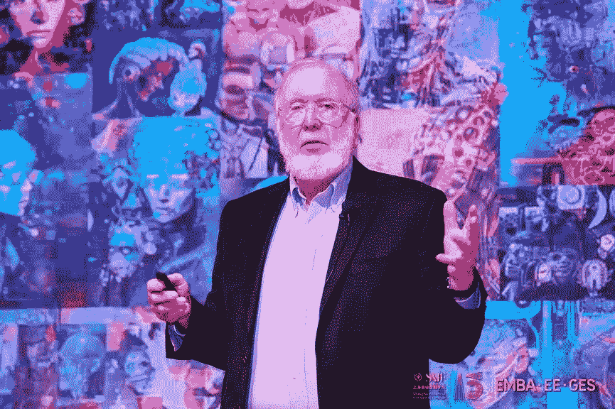
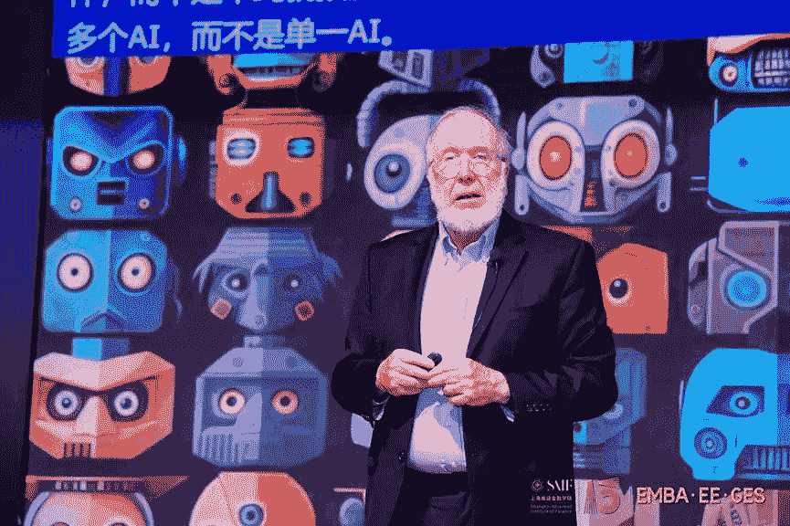
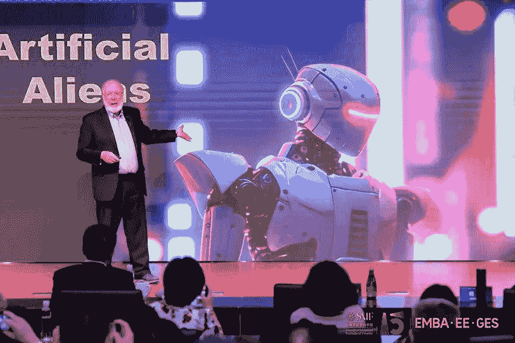
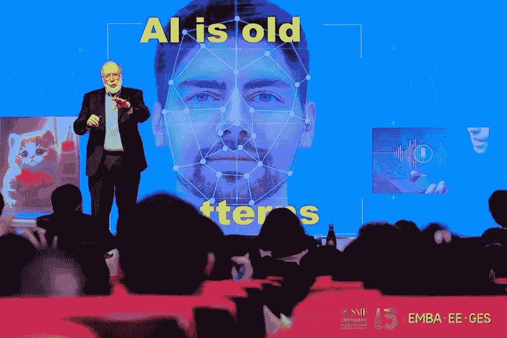

# 凯文·凯利2024最新演讲：从四个方向理解AI

> 来源：[https://aigcreative.feishu.cn/docx/FSoHdgDlzoa1Fwxoz0rcYcownug](https://aigcreative.feishu.cn/docx/FSoHdgDlzoa1Fwxoz0rcYcownug)

> 来源：腾讯研究院

> 链接：https://mp.weixin.qq.com/s/cV0y5QxGJRuO8-u-XCYmbA

** **3月29日，中信出版集团联合上海交通大学上海高级金融学院邀请到凯文·凯利（K.K.）来到中国，展开一场精彩的线下对谈。读者们熟悉的K.K.，是《连线》杂志的创始主编，是《失控》《必然》《5000天后的世界》等畅销书的作者。除了科技预言式写作，去年K.K.也正式出版了一本凝结了他 70 年人生经验的智慧箴言录——《宝贵的人生建议》。

现场，K.K. 以**《What's Next：in A**I and Digital World》为主题带来了他对于全球科技下一步发展趋势的深入思考和精彩见地，讨论了关于谁是AI的第一批使用者、AI与人类所产生的情感羁绊等问题。

以下是凯文·凯利演讲实录：

大家好，非常高兴能够见到各位。目前，技术领域的重要趋势，正在对全球的经济环境产生重大影响。大家可能都已经猜到了是什么——人工智能。

实际上我们对人工智能的了解并不深刻，并没有挖掘到人工智能实际存在的更多发展可能性。我们来谈论一种可能性，但需要注意的是，这是把技术置于场景下的可能性的延伸，并不是单纯的预测。有一点我们需要明确，世界上不只有一种AI，不同的行业行业有很多不同的想法和认知，也就意味着会有非常多纷繁各异的AI，这就像世界上存在各种物种的动物一样。

如果把众多截然不同的动物智能和机器智能汇总，我们会发现人类的智能发展并不是核心或者唯一。事实上，白痴和天才之间的区别并没有那么大。

在图谱当中存在着成千上百万的不同的智能，所以想拥有通用智能的想法是一种误导，就像我们在生物的谱系当中，也并不是处在最核心的位置，地球也并不在太阳系，或者是宇宙或者是银河系的核心，我们都是处在一个边缘的位置，智能也是一样。

我们与AI的关系可以从四种模式来思考。

# AI为人类提供完全跳脱的思维方式

**第一种叫人造外星人。**AI就像是降临到地球上的外星人一样，但是它是由人类来进行设计和编程制造的，可能超过了人类的智能，也有可能有认知。但最重要的一点是，他们并不像人，他们是一个硅基生物，有不同的认知和思维方式。

思维方式的不同，可能就构成了AI与人之间最大的不同，这并不是差错，而是特点，甚至是优势，他们可能会有创造性的思维，用完全不同于人的思维去做决策。

在新经济的时代，不同的思维方式是非常重要的，如果我们要在一个互联的世界生存，可能很难出现完全不同的、跳脱于所有人的思维方式，但是AI就可以做到，它可以帮助人们跳出常规思维，用一个全新的视角来去思考。所以我觉得AI中存在一些像ET这样的很聪明的智能体。

在过去的几年有一个让人们很惊喜或者惊讶的事情发生——以前我们会觉得电脑或机器是没有办法做有创造力的事情的，但随着新的A**I的应用，**人们发现机器也是可以产生创造力的。但是这些创造力并非是空穴来风，他们必须有人去给AI做出提示，那么这些人就叫做提示工程师。

在过去的几年我也一直在研究AI甚至是与AI共事，我尝试和AI共创一些东西。所以在新**的时代，可**能提示工程师将成为新一代的艺术家，他们和AI共同创造，我甚至把他们称为AI耳语者。

真正优秀的AI提示工程师或耳语者，他们可能要花一千个小时以上的时间和AI共事，他们用的AI和我们是一样的，但是他们却可以通过创造性的提示让AI去创作出非凡的东西，因为他们花了超过一千小时的时间去学习和练习，这就像是精通一门技艺一样，精益求精，熟能生巧。

同时他们也有一定的天赋，可以去了解AI背后的运作机制，现在招聘网站上已经可以看到这样的招聘信息了，年薪最高可以达到30万美元，这是给最优秀的人才所提供的机会。

之所以能给这么高的薪资，是因为要成为一个优秀的AI提示工程师是需要大量的练习和非常深厚的知识积淀和技术积淀的，大家现在也都会用一些开放的AI工具，你会发现提示确实非常的重要。

你需要去了解AI背后的思考链条，你需要让AI一步一步地去跟着你的思考。我们也发现了，现在AI的注意力非常短，他没有办法跟进一个很长的思维，所以你就必须把思维打碎，然后一步一步地喂给AI，这样才可以帮助AI实现一些复杂的任务。

# 你暂时不会被AI替代但会被更擅长使用AI的人替代

**第二点，如果说你给AI一些积极的情感反馈，比如你表扬他，**那么他就会给你一些更好的质量更高的答案。我们也不知道为什么，但是确实有这样的现象。你甚至可以告诉AI，你提的问题非常重要、生死攸关，请好好回答，这样AI就可以给你一个更高质量的答案。这些也是一些小小的窍门，帮助大家更好的运用AI。

我**认为这样的AI更像是一个普世的私人实习生，在座的各**位每一个人都可以拥有一个24小时的实习生，为大家服务，这就是AI可以做到的。比起助理，AI更像一个实习生，因为实习生不能独立完成任务，工作成果需要我们来做二次核验的。但即便如此也已经很好了，虽然这还不是我们最终的目标。

现在的大语言模型给我们的答案虽然不是最精确的，但是看上去已经非常合理了。有一些工程师每天的工作就是去设计一些合理的答案和输出，并不是最精确的答案，而是出最合理的答案，这也是设计和算法的策略。

他们是从大量人类语料中去提取信息来训练AI，其中包含了人类最精尖的信息，同时也有一些非常普通的，甚至是质量不高的信息。因此AI的水平就像是实习生一样，可以做一些初始性的工作，比如说设计一个大纲或草稿，这些任务他们可以完成得非常好。

通过研究发现，**对**知识型行业从业者来说，50%的任务都是可以由AI实习生来做到的。而其他50%的工作可以让AI去做一个草稿，然后由人来做提升。调查发现，如果使用copilot的话，程序员每天的生产力可以提升56%。

同样在其他的行业，比如说作者，他们使用AI的话，任务的完成速度会增加37%；比如律师、顾问，还有行政的工作，他们使用ChatGPT之后都有不同程度的效率的提升。最明显的效率提升，其实来自于低级别的工种或者是普通员工。

AI和其他的技艺一样，需要至少一千小时的练习和学习，才能够真正擅长，所以我认为未来人们的薪资将与你使用AI的能力挂钩。因此，人们不会简简单单地因为AI失去工作，但是确实有一些工作内容会改变。

**我相信在未来的5年以内人是不会被AI替代的，但是有可能会被一**个善于使用AI的人替代，这是普遍的趋势。如同现在看到的，即使有了自动驾驶，依然很少会有司机被自动驾驶所取代，但未来，司机的工作内容是会出现一定的变化的。

我给大家举个例子，美国有一个公司，他们用生成式AI去赋能服务台的工作人员，尤其是接线员，然后这些客服中心就可以去更加高效地服务客户。

在这个过程当中，他们确实也裁掉了一些人员，同时也招聘了更多技术支持人员。但是最常见的情况是接线员改变工作任务，会有一些AI没有办法处理的问题再转到人工。

与此同时，我们也看到正是因为AI把一些简单的工作都已经完成了，所以人可以专门处理一些比较棘手的问题，那么客户的满意度和服务质量都会提升。AI是相对平等的技术，即使是一些财力并不是很雄厚的企业或者是一些偏远的地区，他们没有充足的预算雇佣接线员，也可以运用AI提供客户服务。

除此以外，另一种AI应用趋势应运而生——艺术方面的提升。目前很少有画家、音乐家、或其他艺术从业者被AI完全替代，他们可能会用AI作为灵感来源。

因此从目前的生成式发展来看，我们很难在现阶段直接下定论AI会取代人。刚刚说到，AI的世界是基于规则的，因此，有时人觉得很简单的事情，对AI而言可能很难，换言之，AI觉得很容易的人可能会觉得非常困难，我们需要记住这个逻辑。

说到生成式AI与人之间的关系，我把它称之为+1关系。希腊神话中的半人马，其实是有点像人和AI的协作关系。科学家们发现，现阶段只靠人或只靠人工智能都不行，它们要结合在一起。

跟大家分享一个故事，埃斯特·佩雷尔是美国著名的治疗师，她做过很多公开的治疗，她有一个播客节目，记录了她上千上万小时的治疗过程。

有人根据她的治疗记录开发出了一个人工智能，人们可以直接去跟机器人沟通得到治疗，不知道埃斯特本人会不会喜欢这个AI版的她，她的书和播客节目都可以帮助到大家，但是人工智能会帮助更多。不过目前还涉及到宠物的治疗人工智能无法应对，但是确实开辟了一个新的路径。

不可否认，现在的人工智能医生还不如人类医生，但是人类医生与机器协作会做得更好。不过用AI来做医疗诊断是胜过没有医生的，一些遥远地区可能医疗资源短缺，无法接触到正常的医疗资源，在这种情况下，AI治疗总比没有医生好。

**这**就涉及到我们刚刚提到的第二个方面，人类和人工智能协作可以应用在各种领域，包括教育、法律、驾驶等，有的这些和人工智能相遇是1+1>2的概念。我们刚刚提到了实习生的概念，以后人工智能会成为合伙人、队友、教练、副驾驶助手等等。

就像我在《宝贵的人生建议》里说到的“如果你想走得快，就独自走；如果你想走得远，就一起走。”

# **当技术变得隐形时才是最强大的**

在过去一年里，生成式人工智能带来了许多激动人心的变化，比如神经网络技术得以与人工智能结合应用，**实际上神经网络技术不是新技术，网飞和亚马逊早就在使**用，这是一种识别+生成的技术。目前神经网络已经发展出两个全新的概念，一个就是大型语言模型，另一个叫做对话式用户交互界面。

大语言模型一开始是个非常简单的编程，10-15年前，我们其实是用它来做语言翻译的，因此当初训练它的目的是为了建立语言模型，将一种语言翻译成另外一种语言，用作训练的语料就是日常生活中的各种语言。

但是随着模型的不断练习，出现了一些有趣的变化。语言模型不仅做了翻译，同时还可以基于这些语料做推理。

因为语言不是单纯的进行信息的传递和传达，我们之所以会有语言，是希望语言表达思想，没有语言，思想也是匮乏的，所以语言跟推理能力密切相关。

当获得了语言能力时，它也在一定程度上获得了推理能力。这是开发人员们没有意识到的。所以推理是语言模型研究过程中获得的一个有趣副产物。

大语言模型在很多赛道有了全新的应用，基于大语言模型，他们获得了阅读推理的能力，人工智能可以帮助我们做很多测试，且高分通过。

回到刚刚的概念上，目前这些模型都是基于普通人的数据收集做的建模。我们也希望未来可以进一步优化，使用天才的语料进行训练。

还想给各位介绍一下**对话式用户用户界面**，这与20年前的图形用户界面有异曲同工之妙。在互联网之初，我们看到这些电脑就是这样的，只有一些单纯的文本，没有图形，而且很难用。很多人也没有觉得这样的应用有趣。现在已经截然不同了，随着万维网的使用，你可以看到有图片的交互形式，可以拖拽信息，这样更加贴合人类的诉求。

你不用再去上繁琐的编程和代码课也可以理解它呈现的信息。现在有了大语言模型后，你可以进行对话式沟通，从而生成图文，我们会发现文本信息转化成视觉信息非常符合人类的沟通诉求，这极大改变了现在的技术应用，包括语言理解、手势识别。比如目前很多设备可以采集你的唇语，你不用像以前一样用吼的方式来进行沟通了。

这些技术极大地改变了行业。**所以**我的建议是未来几年初创企业将变得非常的容易，只需要将一些东西添加到对话式使用界面中，比如你可以和面包机、汽车对话，AI也会变成商品的一种形式，AI交互页面会成为区别其质量的一个关键所在。现在有个很有名的引擎叫做perplexity，它做的不是AI本身，是AI的交互界面。就像是水是免费的，但装到瓶子里就有了矿泉水，它就是产品了。AI的交互界面是可以创造额外价值的。

回到我刚才所说的，当技术变得隐形的时候才是最强大的。我们现在在这个房间当中有大量的技术存在，比如电灯、水管、风扇、通风管道等，我们意识不到他们的存在，这意味着这些技术已经成功了。

同理，**我们一直在谈AI，说明它还没有成功，如果说我们已经无法意**识到AI的存在了，那么就说明AI成功了。在未来我是相信95%的AI应用我们都没有办法看到，他们就像管线系统一样在后台运行。未来我们将更熟悉它的前台界面，大多数人可能甚至不知道它背后由AI运行。

现在有很多技术公司试图用AI去预判、预测未来。在过去包括现在，如果要单纯靠人力来完成的话，它是一个非常耗时非常昂贵的工作。但是未来有了AI的介入，那么预判这件事情将变得非常简单。

AI的技术会存在于两个阶段，**一个是内部的流程阶段，**包括编程工作、金融分析，或者是传媒和沟通；另一个是外部使用AI来制作产品，这是大家在公众视野当中可以看到的，比如说自动驾驶汽车机器人。目前为止，内部运行的AI更为强大，我相信这也是未来AI重要的增长点。

**我们把AI类比成电力，你不能简单地认为把18世**纪的公司通电，它就会成为完全不同的公司。但是如果这家企业在诞生之初就有电力的加持，那么这一家企业和18世纪的其他企业相比，一定有巨大的飞跃。AI也是一样，下一代AI原生企业的商业模式一定是和AI发展前的企业是完全不一样的。

有些工作是人类不想做的，有些工作是人类可以做的，还有些工作甚至是人类完全未知的。AI能够起到最大作用的地方，不仅仅是在人类不能做的，更是在于去探求完全未知的工作。

# **社会中层往往是第一批AI使用者**

那么在商业场景中，第一批的AI使用者有哪些？

除了我刚刚介绍到的客服工作以外，还有程序员，现在程序员已经在使用微软copilot这样的AI辅助工具了。有了AI加持之后，这些程序员表示再也不想要回到没有AI的时代；同时在营销领域，工作人员也在大量使用AI去生成物料、图像、视频等等。

我觉得AI的第一批应用行业，包括软件、医疗、教育、营销和保险。保险大家显而易见了，AI可以设计保险政策、进行数据分析等等，在教育领域，最大的受益者就是学生，在医疗领域就是患者，在企业的环境当中应该是员工受益。

**但**其实我们发现事实与预想的恰恰相反，老师对于AI的热情远远要大于学生，医生的热情大于患者，领导者的热情大于普通员工。比如说老师，有了AI，他们每天可以节省几个小时的备课时间，医生和经理也是一样。所以我们发现在一个企业或者行业结构当中，中层反而是受益最大的，他们反而是第一批的AI使用者。

另外我们发现一点，年轻的初创企业往往最先运用AI。公司越小，运转就更加灵活，他们就更有机会全面使用AI。大公司的脚步就会相对落后。这是一个自然进化的过程，从18世纪开始，企业一步一步从工业模式一直进化到现在的数字模式，在数字时代，中国企业搭上东风，实现了快速的成长。

之**后是云计算的时代，现在我们正在全面拥抱AI，但云**计算这一步是不能略过的，我们需要去打好基础，实现完善的云计算部署。换句话说，企业要进行完善的云计算或者云平台的部署，然后才可以在云计算的基础上来发展他们的AI实力。

现在AI还可以生成视频。其实好几年前就已经在讨论这个趋势了，换句话说，它已经可以去生成世界的一个小片段或者小部分了。现在AI可以生成狗的视频，未来就不难想象AI可以生成一个完整的事件。这些在以前需要一整个技术团队才能够实现，而现在只需要一个人。

JK罗琳创造了哈利·波特的世界，她一个人创造了一个魔法世界，她是一个天才。但是即便她有如此大的想象力，也依然无法独自制作7部哈利·波特电影，但有了AI，一个人是可以实现这一点的。正如我们一开始所说的，即使AI现在所接受训练的语料和物料质量还不是最高的，但是从这些大量的训练当中依然可以产生出非常优秀的内容。

我们同时也意识到，AI素材可以实现增强现实的功能。苹果、谷歌也都推出了其现实增强的产品，我称之为“镜像世界”，我在《5000天后的世界》中也有详细说明，但是如果背后没有成本较低的AI技术的支持的话，那么这些终端产品是没有办法普及的。AI是增强现实产品的基础。我认为增强现实和AI是相挂钩的，它甚至可以说是AI的变相。

在我们需要AI协助的过程中，AI也在学习这个物理世界。现在苹果已经推出了Vision Pro，但是我觉得这个产品要普及可能还需要十年的时间，但有了AI增强的话，AI可以读取物理世界，快速生成数字孪生。有了VR产品，人们可以在虚拟世界遨游。

但是这些眼镜仍然有一个局限——每次使用的时候都需要扫描一下身边的环境，它需要去识别你处在哪个房间，哪里有窗户，哪里有房，哪里有门。但是如果有了AI加持的话，它就可以去自动理解身边的环境，不需要一遍一遍去扫描，最终将整个世界输入镜像世界中。世界上的任何电子设备都可以看见镜像世界，这是机器人和自动驾驶汽车所看见的世界。

未来，数据世界和人类世界交织在一起，我觉得镜像世界的社交属性很强，所以在这方面的培训工作潜力无限。未来，人们在某项工作或技术正式启用之前，可以在镜像世界里完成实训和试错。

# **AI将与人建立更多感情羁绊**

过去一年，很多翻天覆地的技术变化都是由人工智能来驱动的，人工智能带来了前所未有的创意。未来如果人工智能会产生情感属性，那可能会让很多人觉得匪夷所思。

AI为什么会产生情感属性呢？有以下几个原因。

**首**先，对话是人类沟通的自然表达，人们不自觉地代入情感，即使面对AI，我们也会用到这种原始情感，AI会通过你的语言和表情感受到原始情感的传递。比如说它看到了你的视线，就会知道你现在走神了，或者通过你语调的变化感觉到了情感的变化。在语言表达的同时读取并处理了人类信息，比如像爱、喜悦、恐惧、顾虑、惊喜。

人会跟宠物有很强的情感羁绊，比如狗狗或者小猫，可能在未来会跟人工智能有更强的羁绊，它就会像一个能够说话的小狗。你可以想象一下，如果你的小狗能够用你能理解的语言对话，你跟它的羁绊就会更深，所以这也会成为未来技术发展的趋势。虽然可能刚开始会让很多人觉得不习惯，但是随着情感嵌入技术的发展，你可能会发现这种羁绊感是超过了你的预期。

就像上面说的，AI的种类非常多，他们可能会有不同的性格，你需要找到跟你合得来的AI。在过去几年中，我们从生成式人工智能中获得的一切，都是基于已经有五十年发展基础的神经网络技术。迄今为止，我们就像拥有了一个人造大脑，这个大脑可以进行多种认知，目前我们对神经网络的开发十分有限，未来我们还有很长的路要走。很多AI专家认为，人类是不可能用一种技术覆盖所有的应用场景，除了神经网络之外，我们还可以加入像模糊逻辑、规则判断这些技术。我们正处于人工智能发展初期，还有一些AI是尚待开发，可能三十年后，未来的人类再回顾2024年，会觉得2024年的AI技术都不叫AI，当然这是后话，现在的AI专家展望过去也是一样的。

AI还处于一个萌芽期，未来三十年AI会有什么样的发展路径，没人能够预判。但是至少目前这些分析可以帮助我们更好地为未来做规划，AI能够帮助我们判断哪里AI做得好，哪里人类做得好，同时还可以剖析一下哪些是希望人来做的，帮助我们更好地认清现实、理清路径。

相信这些机器可以帮助人类成为更好的人类，这是我们的最终目标。

感谢各位的耐心聆听。

<https://aigcreative.feishu.cn/sync/K4Gvd9vUQsy9Oubwqaeclu0Fnbg>