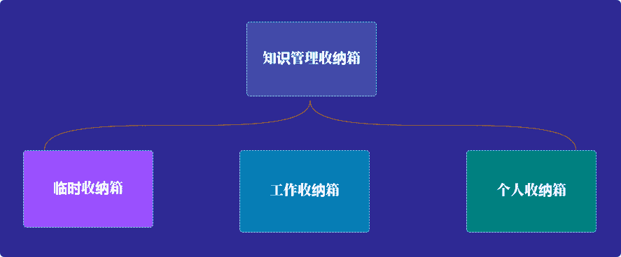
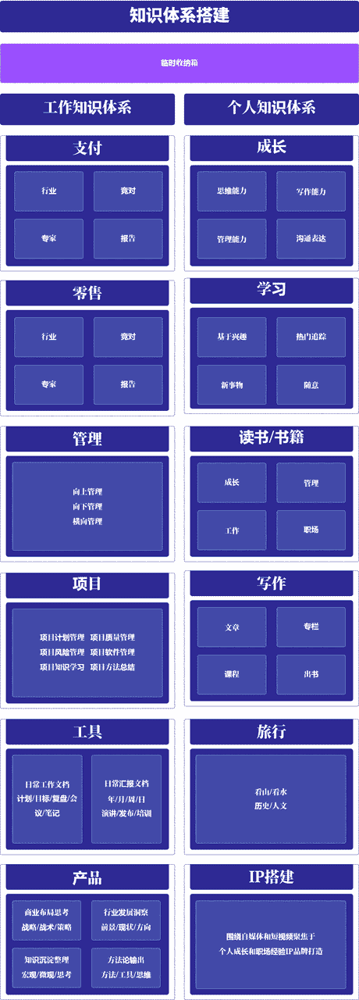
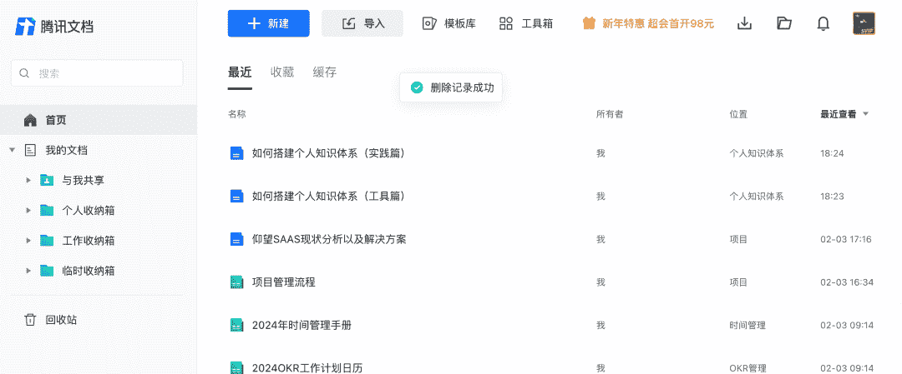

# 如何搭建个人知识体系？（实战篇）

> 来源：[https://aigcreative.feishu.cn/docx/M5KTdr8rHor3D1xglBXcd0K8nCC](https://aigcreative.feishu.cn/docx/M5KTdr8rHor3D1xglBXcd0K8nCC)

> 作者：孟埃里克      公众号：Mtian梦天

> 链接：https://mp.weixin.qq.com/s/C6hH3xVDwIofwqrRwW4o3A

# 引言

知识体系的搭建不是一蹴而就的事情，所有知识的搭建其实都是一个积累的过程，但往往很多人不知道如何去搭建自己的知识体系，主要原因还是缺少方法。因此，今天这篇文章就手把手告诉大家如何搭建。

# **一、  知识管理框架**

[在之前的文](http://mp.weixin.qq.com/s?__biz=MjM5MDc0MzgyMQ==&mid=2647604211&idx=1&sn=116b7cd491200baaf4f3823ddb6532c1&chksm=be7bb791890c3e87b7eba83b0207922cc617a5563226afac3552d5f1507b52c69927aa82ef06&scene=21#wechat_redirect)章[中我分享了](http://mp.weixin.qq.com/s?__biz=MjM5MDc0MzgyMQ==&mid=2647604214&idx=1&sn=b25038c42c564f3e13afe0b1a9df0eae&chksm=be7bb794890c3e82c1d2f54601d4ae4820dd81d308eeb51372fe5c9c366cacf50abacff658c1&scene=21#wechat_redirect)如[何搭建个人](http://mp.weixin.qq.com/s?__biz=MjM5MDc0MzgyMQ==&mid=2647604211&idx=1&sn=116b7cd491200baaf4f3823ddb6532c1&chksm=be7bb791890c3e87b7eba83b0207922cc617a5563226afac3552d5f1507b52c69927aa82ef06&scene=21#wechat_redirect)知识《方法篇》和《工具篇》，今天，我们继续给大家分享这个系列的最后一篇文章《实战篇》。下面是我搭建知识体系的框架模型——收纳箱模型，它也是我在《方法篇》文章中分享的一种搭建知识体系的方法，如下图。

这个方法的结构其实很简单，也很容易学习使用，大概的模式就是先创建一个临时收纳箱，然后把收集到的文档临时存放到这个文件中，一般在学习和使用后，我们需要甄别该文档是否有价值，如果有就将其移入工作和个人收纳箱中，否则就果断清理。

## **1.1临时收纳箱**

临时收纳箱，可以简单理解为它是一个知识的临时中转站，所有信息达到这里只有一个目的就是短暂的进行存储，然后供下一步的收纳整理。

## **1.2工作收纳箱**

工作收纳箱主要用于存放工作的最顶层文件夹，所有关于工作的文档都会存在这个文件下的下级文件夹，一般我会将其分组为公司，管理，项目，产品，日常，总结等二级文档，如果还有二级扩展，会在工作收纳箱中继续创建。

## **1.3个人收纳箱**

个人收纳箱主要用于存放个人相关的知识文档，一般会围绕成长，学习，课程，文章，协作等方向进行二级文档创建，同样，如果还有其他个人领域开创可以再继续创建二级收纳箱。

# **二、  知识管理实践**

下面，以我搭建的个人知识体系为例，给大家介绍一下使用收纳箱进行知识体系搭建，如下图。

我个人的收纳箱目前主要有三个，遵循临时收纳箱，工作收纳箱，个人收纳箱。下面是我在腾讯文档这个工具中搭建知识体系的截图。

临时收纳箱：存放临时获取的，有一定价值的知识内容。工作收纳箱：支付，零售，管理，工具，知识，产品。个人收纳箱：成长，学习，读书/书籍，协作，旅行，IP搭建。基于我的三个收纳箱经验分享一下如何使用收纳箱方法进行知识体系的搭建思路。主要包含建收纳箱，填充内容，定期更新。

## **2.1建收纳箱**

第一步：建立临时收纳箱。第二步：建立一级收纳箱（顶层收纳箱）。第三步：建立二级收纳箱（二级和三级）。当然，如果没有三级收纳箱也是可以的。使用收纳箱框架搭建知识体系，提供几点建议。建议一：顶层文件夹不宜过多，最好是根据自己长期需要用到的领域进行创建，但最好不要超过三个，否则会因为过多，在进行知识顶层收纳时不易存放。建议二：二级文件夹一定要独立，一个文件夹就是一个知识领域的文件。建议三：底层文件夹不要超过三层，否则会因为层级过深，不易存放也不易使用。

## **2.2内容填充**

内容填充非常关键，不是说把所有的内容都进行收纳箱存储，一定要基于我们在《方法篇》中分享的面线点方法和知识图谱方法，所有的知识都不应该独立存在，它们一定是相互关联的，因为只有这样，我们的知识体系搭建才有意义，也才能帮助我们更好的补充知识缺陷。

## **2.3定期更新**

在我们进行知识体系填充的过程中，有些知识有可能会存在过时，或者是有一些的新的知识可以替代一些旧的知识，因此，我们在搭建个人知识体系时，一定要学会定期更新。

# 最后的话

最后，简单来做个总结。其实，知识体系的搭建，不在于需要多么复杂的方法论，大家只需要采用收纳箱这个方法，然后遵循面线点和知识图谱的方法论就能轻松搭建自己的知识体系。

<https://aigcreative.feishu.cn/sync/K4Gvd9vUQsy9Oubwqaeclu0Fnbg>