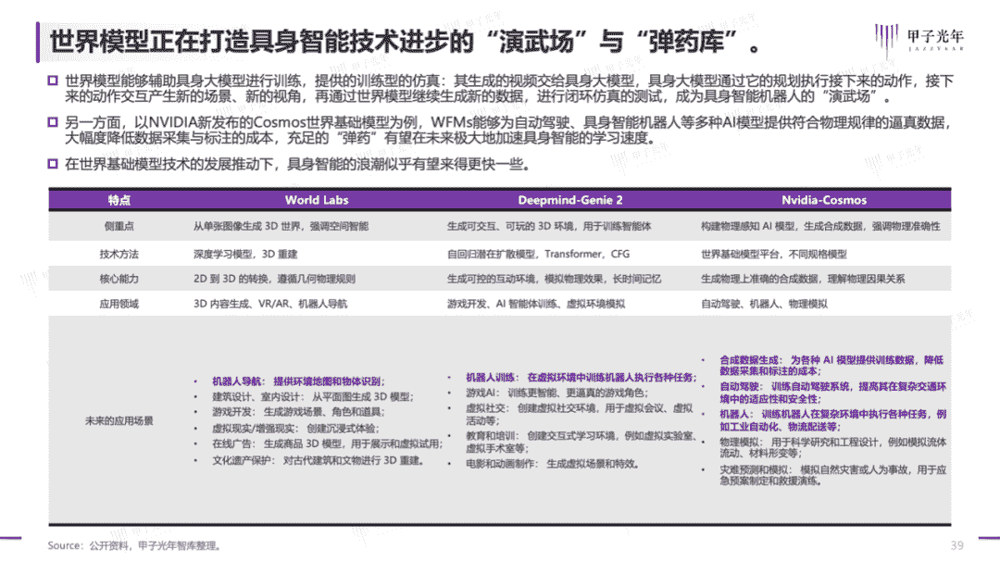

# 2025-具身智能行业发展研究报告 | 甲子光年智库

> 来源：[https://aigcreative.feishu.cn/docx/QkksdNk1SohLBJxYYh7cM0PonGx](https://aigcreative.feishu.cn/docx/QkksdNk1SohLBJxYYh7cM0PonGx)

> 原文链接： [https://mp.weixin.](https://mp.weixin.qq.com/s/iQAijqNa-wBJar429-2_KQ)qq.com/s/iQAijqNa...

> 👸号：甲子光年

AI的下一个浪潮，正在开始重塑物理世界。

在刚刚过去的2024年，具身智能无疑是科技领域最受瞩目的焦点。全球科技巨头纷纷布局，从OpenAI对Figure AI的战略投资，到特斯拉Optimus的持续迭代升级，再到英伟达积极构建具身智能与人形机器人生态，种种迹象表明，具身智能正处于快速发展的风口。

这一年，具身智能相关技术突破不断涌现。特斯拉Optimus在运动控制和任务执行方面取得了显著进展，展现出强大的迭代速度；Google DeepMind的RT系列模型，基于视觉-语言-动作（VLA）模型的端到端机器人控制学习，大幅提升了机器人的泛化能力，为复杂任务的执行奠定了基础；Figure AI的人形机器人在宝马工厂的成功应用，预示着具身智能商业化落地的可行性正在逐步提升。与此同时，国内的智元机器人、宇树科技、优必选等企业也在积极探索技术创新和商业化路径，并取得了阶段性成果，例如，宇树科技在四足、人形机器人领域持续深耕，推出了面向工业巡检等场景的解决方案；优必选则在人形机器人领域不断探索，其Walker系列机器人在运动控制和人机交互方面取得了显著进展。

从技术层面来看，多模态大模型的兴起为具身智能的发展注入强劲动力。通过融合视觉、语言、触觉、力觉等多模态信息，机器人能够更全面地感知和理解环境，进而做出更精准的决策。同时，世界模型（WFMs）的出现为具身智能的训练和测试提供了新的范式，通过在虚拟环境中进行模拟训练，有效降低了数据采集成本，并有望加快算法迭代速度，部分解决数据稀缺的瓶颈问题。此外，强化学习、模仿学习等算法的进步也为具身智能的发展提供了重要的技术支撑。

具身智能的应用前景广阔，涵盖工业、服务、特种、医疗等多个领域。目前，工业制造场景成为具身智能率先落地的主要领域，在自动化装配、焊接、喷涂、搬运等方面取得了良好的应用效果，如微亿智造等企业已推出面向工业场景的具身智能解决方案。在物流领域，AMR等机器人已广泛应用于仓储物流场景，结合其他上层模块，实现自动化分拣、搬运、配送，显著提高了物流效率。未来，随着技术的不断成熟，具身智能在服务场景，尤其人形机器人在家政服务、陪伴老人、照顾儿童等领域的应用潜力将得到充分释放，有望极大地解放人类劳动力，让人类聚焦更有价值的创造性事务。

在此背景下，甲子光年智库撰写了《2025具身智能行业发展研究报告：具身智能技术发展与行业应用简析》，旨在深入分析具身智能相关技术与应用情况，为智能机器人领域的研究者、决策者、观察者及广大爱好者提供一份全面深入的参考资料。

**报告核心观点：**

+   具身智能是人工智能与机器人技术的融合，是AI发展的下一个浪潮；

+

+   具身智能仍处于早期发展阶段，面临数据获取、模型泛化、成本控制、安全伦理等多重挑战；

+

+   分层模型还是一体化端到端，机器人面临与自动驾驶类似的技术路线选择；

+

+   工业制造场景是具身智能的先发落地领域，未来将逐步从工业场景的确定性任务走向服务场景的灵活性任务，价值潜力巨大；

+

+   具身智能的载体形态多样，场景需求决定其最终落地形态；

+

+   世界模型正在成为具身智能技术进步的“演武场”与“弹药库”。

+

**关**注👸号「 甲子光年 」，后台回复“2025具身智能”，获得高清版完整PDF。或者点击文末“阅读原文”，进入甲子光年官网下载。

<https://aigcreative.feishu.cn/sync/K4Gvd9vUQsy9Oubwqaeclu0Fnbg>