# 2025《TIME》时代杂志评选300+最佳发明

> 来源：[https://aigcreative.feishu.cn/docx/OmvJdNZ3SojUU7xv99DcZ5rtnze](https://aigcreative.feishu.cn/docx/OmvJdNZ3SojUU7xv99DcZ5rtnze)

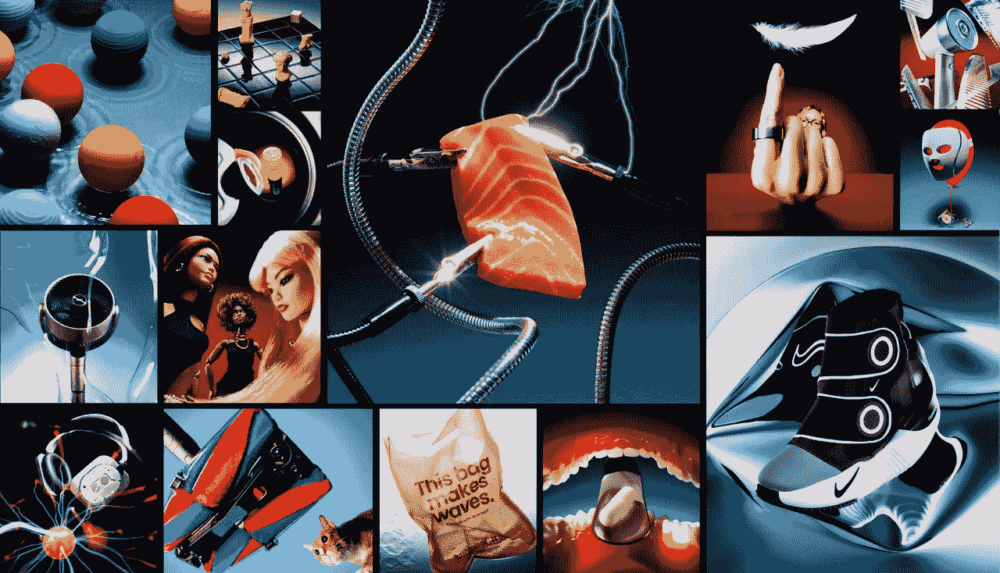

# **Robotics 机器人技术**

## **Figure 03** - 家用机器人

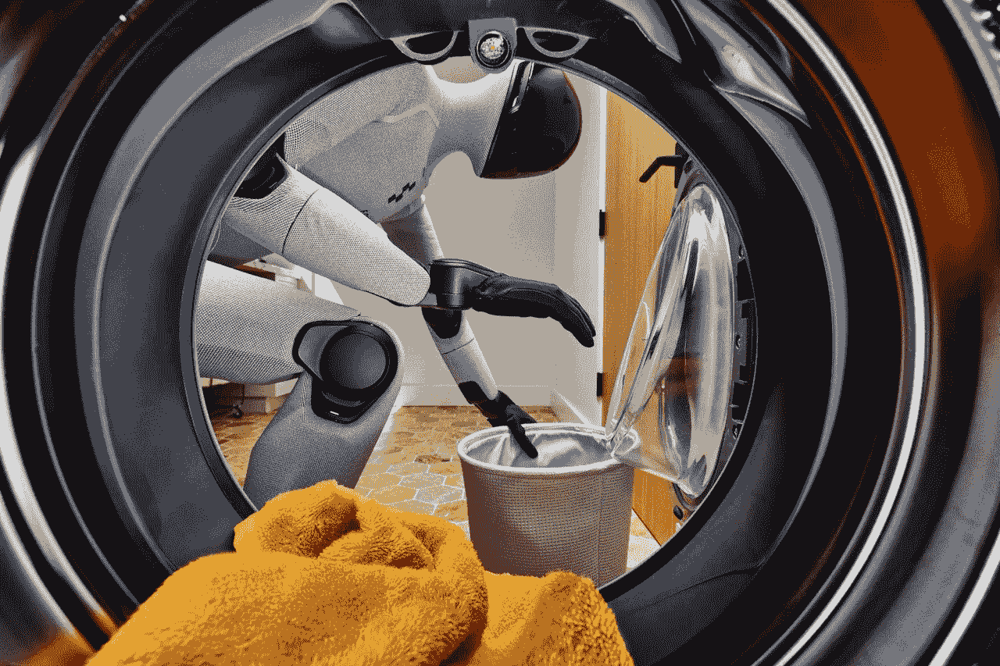

> The Figure 03 is a humanoid robot with a lofty goal. The company that makes it, Figure AI, wants to build a machine in the form of a human being, and put the bots to work across the global economy—including in homes. Upon its launch this October, the Figure 03 was capable of doing some domestic tasks like folding clothes and loading a dishwasher, but not without help (it can load the machine, but a human needs to start the wash and help if it drops something). Still, the company has embarked on a mass data collection drive to train the robots’ Helix neural network to better complete more types of tasks. CEO Brett Adcock says robotics is on a similar curve to digital AI—suggesting that big capability jumps are coming. He aims to have the Figure 03 in select homes next year.

> Figure 03 是一款有着远大目标的人形机器人。制造它的公司 Figure AI 希望制造出一款与人类相似的机器，并让这些机器人在全球经济中发挥作用，包括家庭。自今年 10 月推出以来，Figure 03 能够完成一些家务，比如折叠衣服和将餐具放入洗碗机，但这需要人工帮助（它可以将餐具放入洗碗机，但需要人工启动洗衣机并在它掉落物品时帮忙）。尽管如此，该公司已开始大规模数据收集，以训练机器人的 Helix 神经网络，使其更好地完成更多类型的任务。首席执行官 Brett Adcock 表示，机器人技术的发展轨迹与数字人工智能相似，这表明它们即将实现巨大的能力飞跃。他的目标是明年让 Figure 03 走进部分家庭。

## EufyMake E1 UV 打印机 - 在家打印纹理

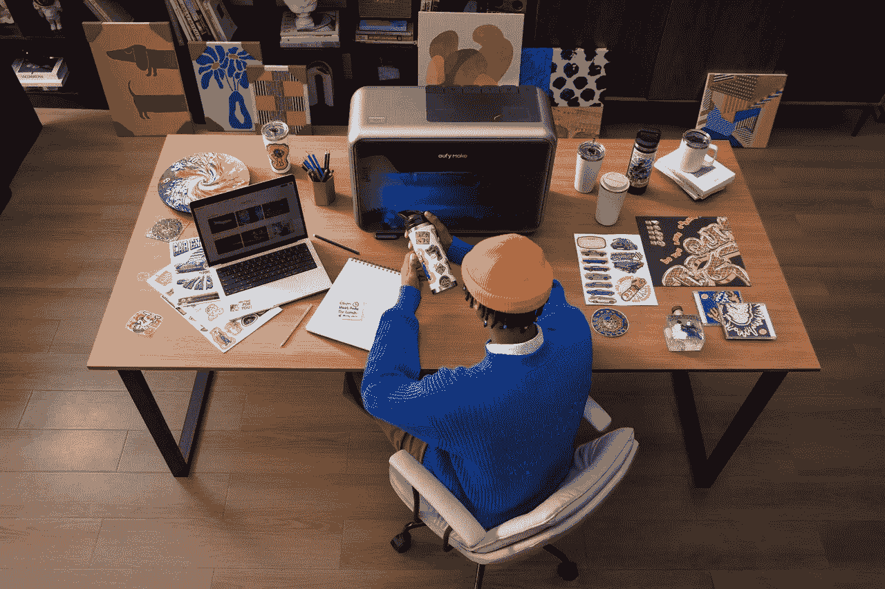

> UV pr[inting ](https://updates.kickstarter.com/eufymakes-breaks-the-all-time-funding-record/)uses ultraviolet lig[ht to](https://updates.kickstarter.com/eufymakes-breaks-the-all-time-funding-record/) [quickly dr](https://www.eufymake.com/eufymake-uv-printer-e1)y special ink on materials like metal, wood, and acrylic. This once complicated process is no longer exclusive to industrial settings, thanks to the largest online crowdfunding campaign in history. EufyMake raised nearly $47 million to develop the world’s first at-home UV printer, which is 90% smaller than traditional UV printers and can print 3D textures on over 300 materials. The product offers users millions of design templates to customize. “The E1 enables hobbyists, small business owners, and entrepreneurs to personalize everyday items or even launch side ventures,” says Frank Zhu of Anker Innovations, which owns eufy.

> UV 打印利用紫外线快速干燥金属、木材和亚克力等材料上的特殊油墨。得益于史上最大规模的在线众筹活动，这一曾经复杂的工艺如今已不再局限于工业领域。EufyMake 筹集了近 4700 万美元，用于开发全球首台家用 UV 打印机 。这款打印机比传统 UV 打印机小 90%，可在 300 多种材料上打印 3D 纹理。该产品为用户提供数百万个可定制的设计模板。eufy 母公司 Anker Innovations 的 Frank Zhu 表示：“E1 让业余爱好者、小企业主和创业者能够个性化定制日常用品，甚至可以开展副业。”

## HoverAir X1 ProMax - 您的个人摄像师

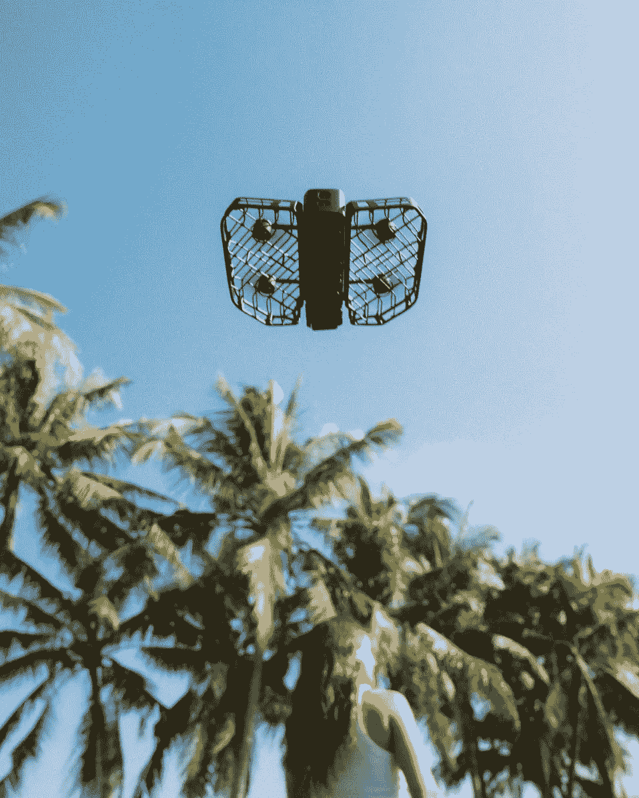

> The catch-22 of documenting life’s moments is that you have to step out of those moments to capture them. Not with the HOVERAir X1 PROMAX, an action camera that’s small enough to slip in a pocket. The device flies alongside users as they carve down a ski slope or run across a ridgeline, shooting 8k video and tracking them using AI. Built-in sensors help avoid collisions, but it’s also made from an aerospace-grade material that’s flexible and tough enough to survive an inevitable crash.

> 记录生活中的精彩瞬间，难就难在你必须跳出框框才能捕捉到它们。有了 HOVERAir X1 PROMAX，这台小巧便携的运动相机就能帮你轻松捕捉。无论用户在滑雪坡上滑行还是在山脊上奔跑，它都能与用户并肩飞行，拍摄 8K 视频并使用 AI 追踪。内置传感器有助于避免碰撞，同时它还采用了航空级材料制成，兼具柔韧性和韧性，足以抵御不可避免的碰撞。

## **Unitree R1** - 超灵活的人形机器人

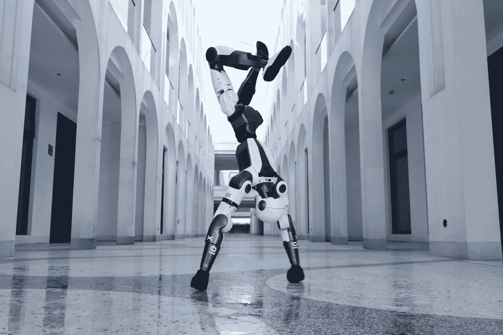

> From drones to self-driving cars, most robots today aren’t the humanoid versions imagined in science fiction. One exception is the R1 from China-based Unitree Robotics. Introduced in July with a shockingly low starting price of just $5,900, this bipedal programmable robot caters to researchers, educators, and software developers testing AI and robotics projects. It weighs just 55 pounds, features built-in AI that supports voice recognition and image processing, and has 26 joints (humans have some 300) that have allowed it to wow audiences with complex movements like boxing, running, and even cartwheeling.

> 从无人机到自动驾驶汽车，如今的大多数机器人并非科幻小说中想象的类人机器人。但中国宇树机器人公司（Unitree Robotics）的 R1 机器人却是个例外。这款双足可编程机器人于今年 7 月上市，起售价仅为 5900 美元，令人咋舌。它主要面向测试人工智能和机器人项目的研究人员、教育工作者和软件开发者。它重量仅为 55 磅（约 23 公斤），内置人工智能，支持语音识别和图像处理，并拥有 26 个关节（人类大约有 300 个关节），能够以拳击、跑步甚至侧手翻等复杂动作惊艳观众。

# Accessibility 无障碍

## American Printing House Monarch - 在平板电脑上提供盲文和图形

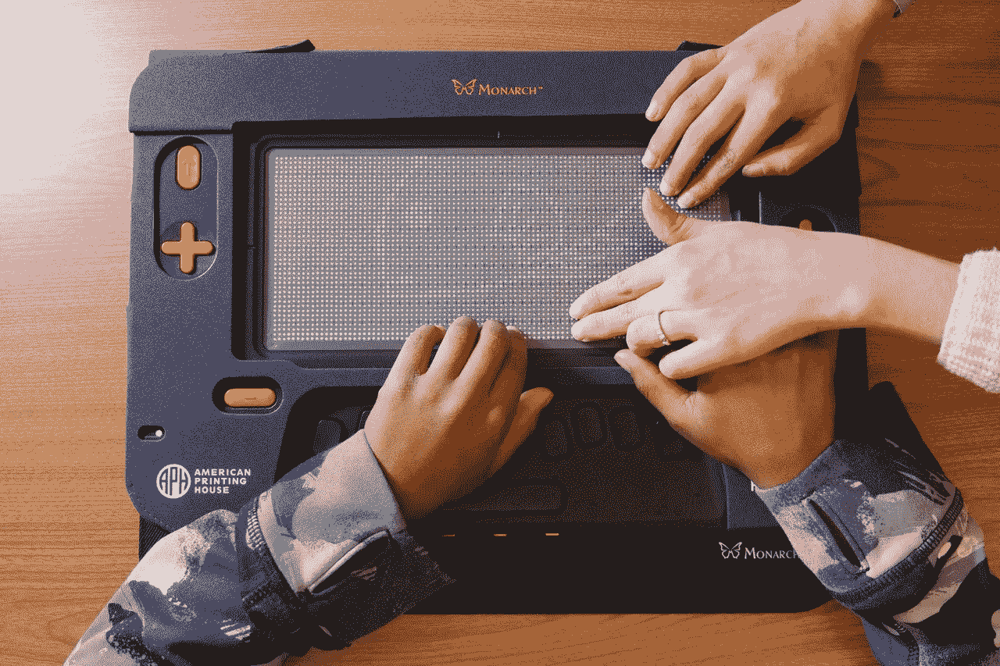

> Blin[d stude](https://www.aph.org/product/monarch/)nts often have to use old textbooks because it takes so long for new ones—not to mention all the other texts students use—to be translated into Braille. Monarch replaces them with a letter-size slate whose 3,840 electromagnetic pins rise to display multiline Braille or tactile graphics, on each of which a touch sensor lets users swipe and tap like on a regular tablet. “Our vision was to build an iPad for blind people,” says Greg Stilson, who leads product innovation at the American Printing House for the Blind. A stacked “Lego-style” cell array is the breakthrough that made it possible. Nearly 1,100 units are now in classrooms—assisting about 20% of the U.S. students who need one.

> [盲](https://www.aph.org/product/monarch/)人学生经常不得不使用旧教科书，因为新教科书（更不用说学生使用的所有其他教材）需要很长时间才能翻译成盲文。Monarch 用一块信纸大小的平板取代了旧教科书，其 3,840 个电磁针可以升起显示多行盲文或触觉图形，每个针上都有一个触摸传感器，用户可以像在普通平板电脑上一样滑动和点击。“我们的愿景是为盲人打造一款 iPad，”美国盲人印刷厂产品创新主管 Greg Stilson 说道。堆叠式“乐高式”单元阵列是实现这一目标的突破。目前，近 1,100 台设备已部署在各教室中，为约 20% 的美国学生提供帮助。

## **Lotus Ring** - 点击式智能家居戒指

> Dhava[l Pat](https://getlotus.com/)el has spent his life relying on crutches to walk, and would often leave lights on rather than struggle to get up to adjust them. Eventually, the former Apple engineer quit his job to build Lotus, an accessibility device that lets you turn on or off a lightswitch or TV simply by pointing at it. Press a button on the rechargeable ring—the battery lasts four to six months—and an infrared signal triggers specialized covers that flip switches without any rewiring, apps, or the need to get up. It’s like a universal remote you can wear.

> 达瓦尔·帕特尔（Dhaval Patel）一生都拄着拐杖行走，他[经常开着灯](https://getlotus.com/)，而不是费力地站起来调整。最终，这位前苹果工程师辞去了工作，转而开发 Lotus ，这是一款辅助设备，只需指向灯开关或电视，即可打开或关闭。按下可充电环上的按钮（电池续航时间为四到六个月），红外信号就会触发特制的盖子，无需重新布线、安装应用程序或起身即可切换开关。它就像一个可以佩戴的万能遥控器。

## **Tilt Grip Stick** - 适应性润唇膏

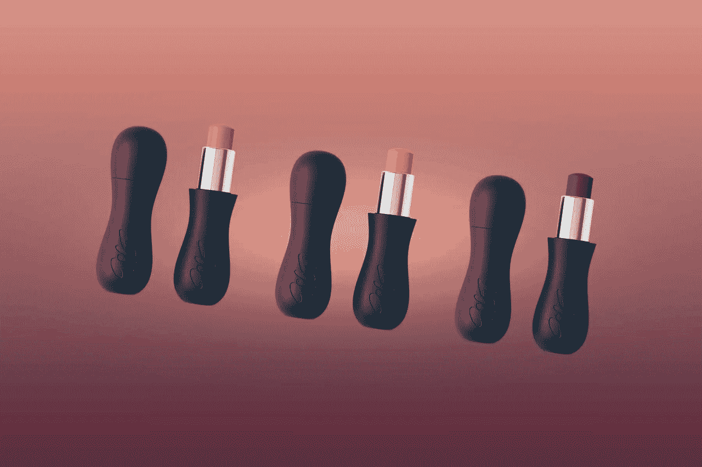

> One in four U.S. adults lives with a disability, yet only 4% of beauty brands cater to them. Tilt Beauty founder Aerin Glazer grew up with psoriatic arthritis, and created the Grip Stick lip balm for people with limited dexterity, chronic pain, and other accessibility needs. "Makeup should be easy to open, hold, and apply—for everyone," she says. The first lip product to earn the Arthritis Foundation's Ease of Use Certification, the Grip Stick features an oversized elastomer grip, a magnetic closure, and a patented easy-open tear strip, making it usable one-handed or with limited grip strength.

> 四分之一的美国成年人身患残疾，但只有 4%的美妆品牌为他们提供产品。Tilt Beauty 创始人 Aerin Glazer 从小就患有银屑病关节炎，她为行动不便、患有慢性疼痛和其他无障碍需求的人士设计了 Grip Stick 润唇膏。“化妆品应该易于打开、握持和涂抹——对每个人都适用，”她说。Grip Stick 是首款获得关节炎基金会易用性认证的唇部产品，采用超大弹性体握柄、磁力扣和获得专利的易开式撕条，即使单手或握力有限也能轻松使用。

# **Aerospace 航空航天**

## AST SpaceMobile BlueBird - 从太空传输的超高速互联网

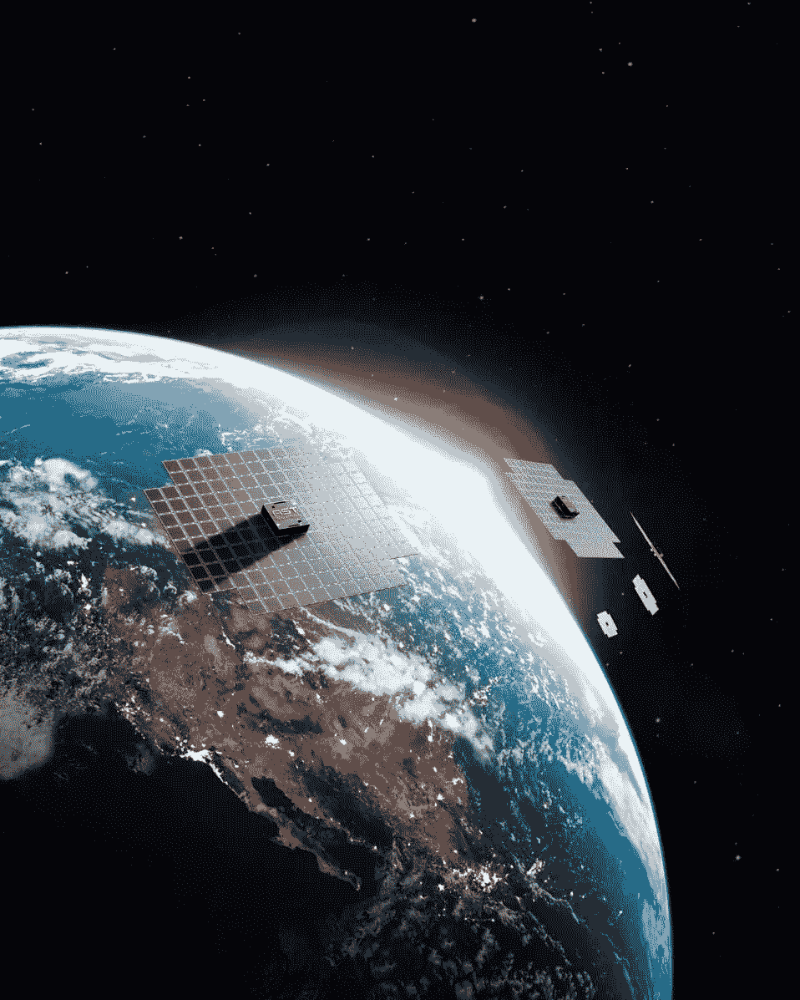

> While other space-internet empires are being built with thousands of small satellites, Abel Avellan is taking a different approach. "For a true broadband experience, you can only solve that with size," says Avellan, founder and CEO of AST SpaceMobile, which produces satellites with the largest commercial antennas ever deployed in low-Earth orbit. Five of its BlueBirds are already circling, and even larger satellites planned for launch in the coming months would enable peak transmission speeds of 120 Mbps, new benchmarks for space-beamed internet. Partnerships mean AT&T and Verizon customers will have satellite capabilities built in, while others can purchase variable-rate plans. AST plans to have intermittent service in the U.S. by the end of this year, with global reach in 2026.

> 当其他太空[互联网帝国正在](https://ast-science.com/spacemobile-network/direct-connection/)利用数千颗小型卫星构建时，阿贝尔·阿维兰却另辟蹊径。“要获得真正的宽带体验，只有尺寸才能解决这个问题，”AST SpaceMobile 的创始人兼首席执行官阿维兰说道。该公司生产的卫星拥有迄今为止在近地轨道部署的最大商用天线。该公司的五颗“蓝鸟”卫星已在轨道上运行，未来几个月计划发射的更大卫星将实现 120 Mbps 的峰值传输速度，这将为太空互联网树立新的标杆。通过合作， AT&T 和 Verizon 的客户将拥有内置的卫星功能，而其他客户则可以购买可变费率套餐 。AST 计划在今年年底前在美国推出间歇性服务，并于 2026 年实现全球覆盖。

## Firefly Blue Ghost - 月球探索的新进展

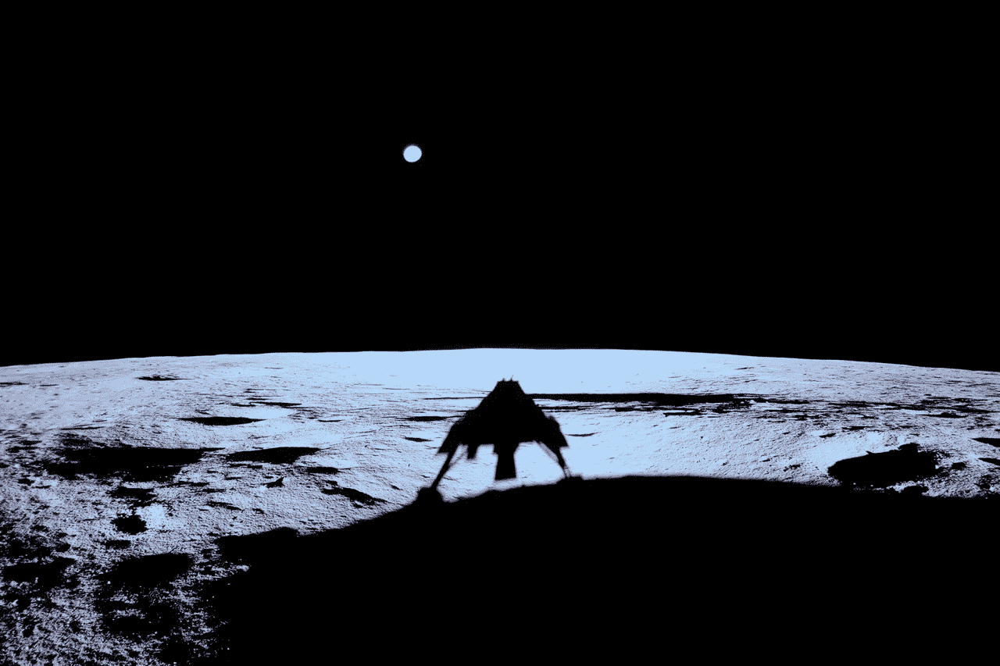

> In March, Firefly Aerospace’s Blue Ghost lander became the fi[rst private](https://www.nasa.gov/commercial-lunar-payload-services/) spacecraft to land successfully on the moon. In cooperation with NASA, Blu[e Gho](https://fireflyspace.com/missions/blue-ghost-mission-2/)st carried 10 scientific instruments, including a laser reflector to measure the moon’s shape and precise distance from Earth. Firefly plans to launch another lander next year to the moon’s far side, followed by launches in 2028 and 2029, with the goal of creating a path for humans to return to the lunar surface. “As more humans return to the moon,” says Firefly CEO Jason Kim, “we want them to have the supplies they need to sustain life.”

> 今[年 3 ](https://www.nasa.gov/commercial-lunar-payload-services/)月，萤火虫航天公司的“蓝色幽灵”着陆器成为首个成功登[陆月](https://fireflyspace.com/missions/blue-ghost-mission-2/)球的私人航天器。“蓝色幽灵”与美国国家航空航天局（NASA） 合作 ，搭载了 10 台科学仪器，其中包括一台用于测量月球形状和与地球精确距离的激光反射器。萤火虫计划明年向月球背面发射另一台着陆器，随后在 2028 年和 2029 年发射，目标是为人类重返月球表面开辟一条道路。“随着越来越多的人类重返月球，”萤火虫首席执行官杰森·金表示，“我们希望他们能够获得维持生命所需的物资。”

## **FireSat** - 早期火灾探测

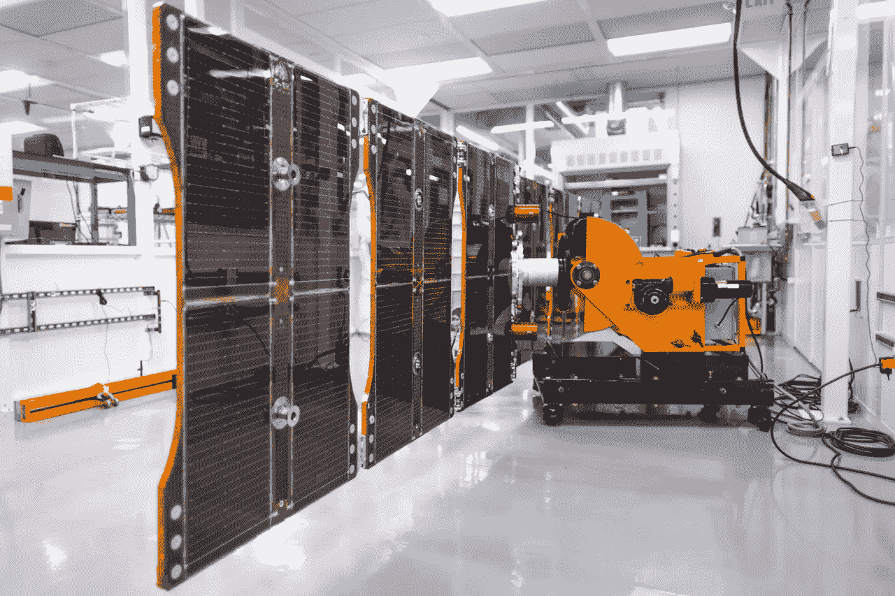

> E[arlier t](https://www.earthfirealliance.org/press-release/firesat-first-wildfire-images)his year, a small roadside fire in Oregon was detected by a newly launched satellite. It was proof of concept for FireSat, a next-level wildfire detection system that can identify “fires as small as 5-by-5 meters—about the size of a one-car garage—long before they grow into disaster fires,” says Brian Collins, executive director of Earth Fire Alliance (EFA). In collaboration with Muon Space and Google Research, the nonprofit plans to build by 2030 a constellation of 50 satellites outfitted with advanced infrared sensors that scan the planet’s most fire-prone regions every 20 minutes. Nine fire agencies on three continents are now using the system.

> 今年早些时候，一颗新发射的卫星[探测到了](https://www.earthfirealliance.org/press-release/firesat-first-wildfire-images)俄勒冈州的一场小型路边火灾。这验证了 FireSat 的概念。FireSat 是一种新一代的野火探测系统，能够“在火灾发展成灾难性火灾之前，就识别出小至 5 米乘 5 米（大约相当于一个车库的大小）的火灾”，地球火灾联盟（EFA）执行董事布莱恩·柯林斯（Brian Collins）说道。该非营利组织与 Muon Space 和谷歌研究院合作，计划到 2030 年建成一个由 50 颗配备先进红外传感器的卫星组成的卫星群，每 20 分钟扫描一次地球上最易发生火灾的地区。目前，三大洲的九个消防机构正在使用该系统。

## Vera C. Rubin 天文台 - 天空之眼

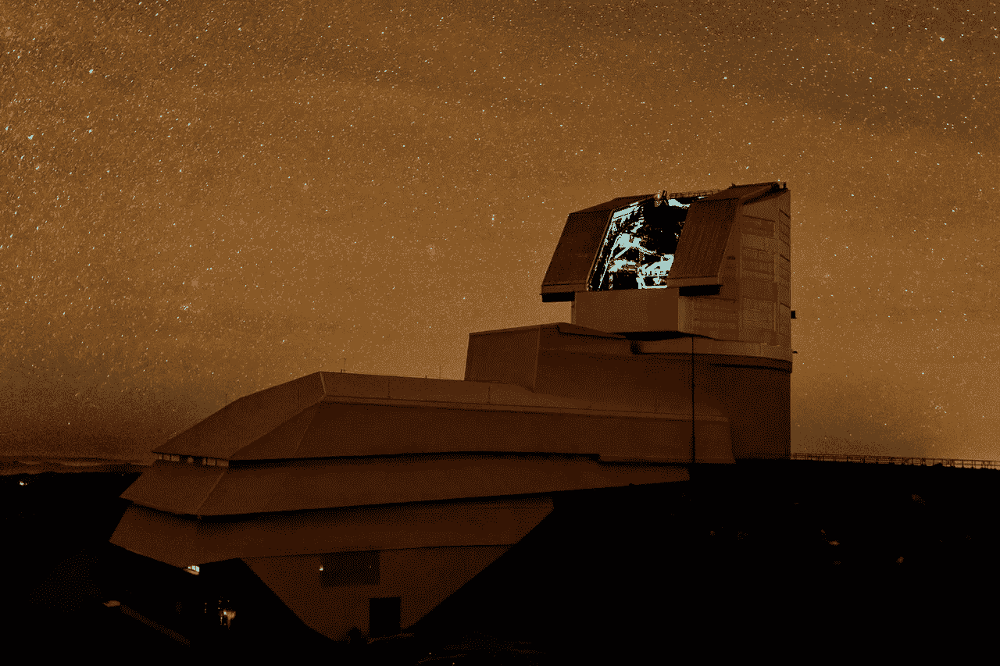

> Astronomy’s newest telescope is a cosmic paparazzi, taking about 1,000 pictures of the southern sky every night from a mountaintop in Chile. With giant mirrors concentrating starlight into a 3,200-megapixel camer[a, the Ve](https://rubinobservatory.org/news/rubin-first-look/swarm-asteroids)ra C. Rubin Observatory is expected to reveal billions of cosmic objects in the next decade, and could solve some tantalizing mysteries—including whether another planet exists beyond Pluto. Sandrine Thomas, the deputy director of Rubin's construction, calls it a "discovery machine;" in a preview this summer, Rubin snapped more than 2,000 never-before-seen asteroids. The observatory is expected to begin full operations by the end of the year.

> 天文学界最新的望远镜堪称宇宙狗仔队，每晚从智利的一座山顶拍摄约 1000 张南半球天空的[照片 。维拉·C·](https://www.nationalgeographic.com/science/article/vera-rubin-observatory-new-telescope-science-mysteries)鲁[宾天文台](https://rubinobservatory.org/news/rubin-first-look/swarm-asteroids)拥有巨大的镜面，将星光汇聚到一台 3200 万像素的相机中，预计在未来十年内将发现数十亿颗宇宙天体，并可能解开一些令人着迷的谜团——包括冥王星之外是否存在其他行星 。鲁宾天文台的建造副主任桑德琳·托马斯称其为“发现机器”；在今年夏天的一次预览中，鲁宾天文台拍摄到了 2000 多颗前所未见的小行星 。该天文台预计将于今年年底全面投入运营。

# **Agriculture 农业**

## FutureFeed Asparagopsis 补充剂 - 清理牛打嗝和甲烷排放

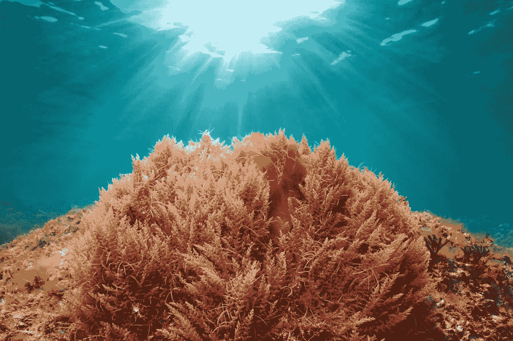

> Livestock burps and manure are a major source of methane, a potent greenhouse gas with nearly 80 times the global warming power of carbon dioxide over a two-decade period. To reduce those emissions, scientists fro[m CSIRO—th](https://agfundernews.com/symbrosia-submits-key-data-to-fda-for-seaweed-based-feed-supplements-for-livestock-methane-reduction-plans-new-15-acre-site)e Au[stralian g](https://agfundernews.com/symbrosia-submits-key-data-to-fda-for-seaweed-based-feed-supplements-for-livestock-methane-reduction-plans-new-15-acre-site)overnment’s research agency—developed a seaweed-based feed supplement for cattle called Asparagopsis that recent studies have shown can reduce emissions by up to 80 percent. FutureFeed, the company CSIRO created to commercialize Asparagopsis, is licensing the technology to seaweed growers in Hawaii, Australia, New Zealand, and Europe. It could be some time before Asparagopsis is commercially approved in the U.S.: A proposal to sell the supplement is undergoing FDA review.

> 牲畜的打嗝声和粪便是[甲烷的主要来源 ](https://openknowledge.fao.org/server/api/core/bitstreams/35d93105-3c0b-4cc8-8a99-7c7b504e233b/content)，甲[烷是一种强](https://www.future-feed.com/science)效[温室气体](https://agfundernews.com/symbrosia-submits-key-data-to-fda-for-seaweed-based-feed-supplements-for-livestock-methane-reduction-plans-new-15-acre-site)[，其全球变暖能力在](https://agfundernews.com/red-seaweed-was-billed-as-a-gamechanger-for-livestock-methane-reduction-so-when-will-it-deliver?utm_source=chatgpt.com)二[十年内几乎是二氧](https://agfundernews.com/symbrosia-submits-key-data-to-fda-for-seaweed-based-feed-supplements-for-livestock-methane-reduction-plans-new-15-acre-site)化碳的 80 倍。为了减少这些排放，澳大利亚政府研究机构 CSIRO 的科学家开发了一种名为 Asparagopsis 的海藻基牛饲料补充剂，最近的研究表明， 这种补充剂可以减少高达 80% 的排放。CSIRO 为商业化 Asparagopsis 而创建的 FutureFeed 公司正在向夏威夷、 澳大利亚、新西兰和欧洲的海藻种植者授权这项技术。Asparagopsis 在美国获得商业批准可能还需要一段时间：销售这种补充剂的提案正在接受 FDA 的审查 。

## Innovea 全球咖啡育种网络 - 保障咖啡的未来

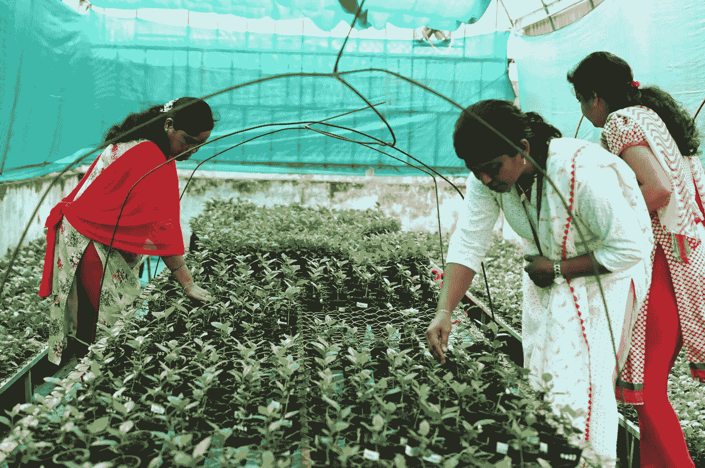

> The coffee varieties grown today were developed before climate change and diseases like leaf rust threat[ened crops. To ens](https://worldcoffeeresearch.org/programs/global-breeding-network)ure cups of joe for generations to come, the nonprofit World Coffee Research (WCR) in 2022 formed the Innovea Global Coffee Breeding Network, bringing together companies and government-affiliated research institutions to develop new varieties. This year, researchers in nine countries including Costa Rica and Rwanda have begun breeding trials. Farmers will likely have to wait until 2037 for the new, more resilient varieties, says Vern Long, CEO of WCR, but that’s still sooner than ever before. “We’re creating the best genetics by working together at scale,” Long says.

> 如今种植的咖啡品种是在气候变化和叶锈病等疾病威胁作物之前培育出来的。为了确保子孙后代都能享用咖啡，非营利组织世界咖啡研究组织 (WCR) 于 2022 年成立了 Innovea 全球咖啡育种网络 ，将企业和政府附属研究机构联合起来，共同开发新品种。今年，包括哥斯达黎加和卢旺达在内的九个国家的研究人员已经开始了育种试验。WCR 首席执行官 Vern Long 表示，农民可能要等到 2037 年才能获得新的、更具抗逆性的品种，但这仍然比以往任何时候都要早。“我们正在通过大规模合作创造最佳基因，”Long 说。

## RootWave eWeeder - 减少农用化学品

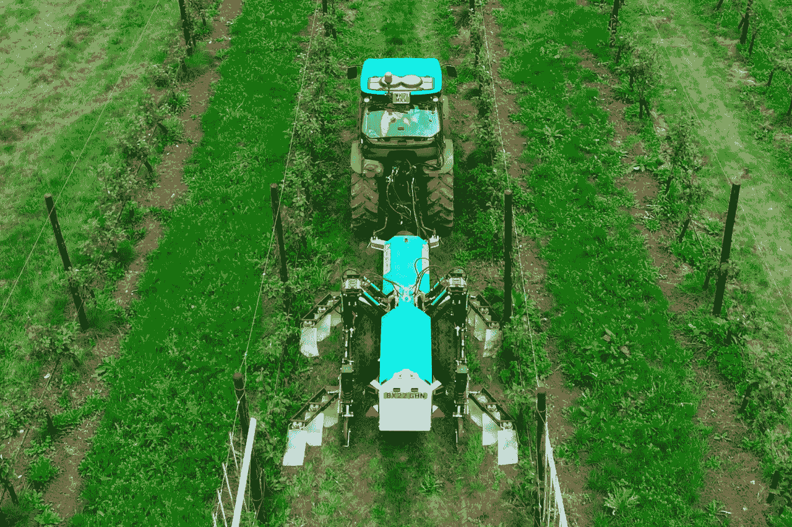

> Herbicides can have dangerous drawbacks, so U.K.-based RootWave developed a new nontoxic approach to weeds: The company’s tractor-mounted eWeeder zaps them with electricity. Designed for use in vineyards, orchards, and bush-fruit farms, the machine uses high-frequency, low-energy AC waveforms to fry weeds to their roots, killing up to 99% in row crops on a single pass, but leaving the soil and surrounding plants unharmed. The company says it’s cheaper on a per-hectare basis than herbicides, which are becoming less effective as plants adapt. And “there's no health or environmental consequences to it,” CEO Andrew Diprose says.

## **Scout Gen 5** - 葡萄园经理

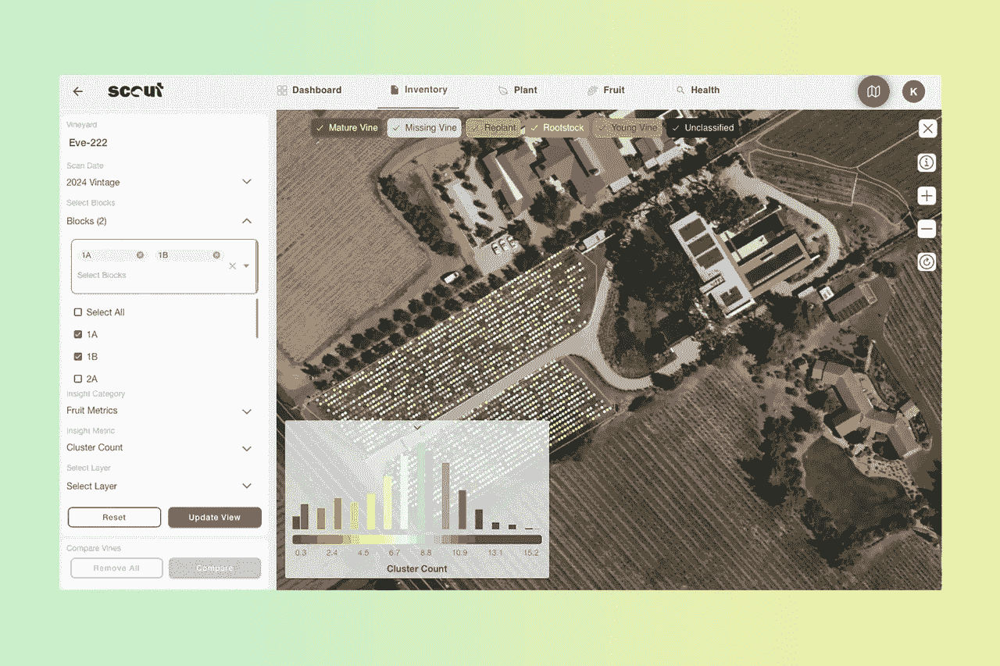

> In 2017, a wildfire nearly claimed the home of Scout CEO Kia Behnia. “Our vineyard saved our house,” he says, by acting as a natural firebreak. Now his company’s flagship platform, Scout Gen 5, returns the favor by helping farmers keep an eye on every vine. Launched in April, the software analyzes vintners’ photos and geolocations—from smartphones to those mounted on the back of ATVs—then uses AI to create an interactive vineyard map, plus a vine-level inventory with insights into each plant’s health, maturity, and productivity. “Farmers have this natural intuition,” Behnia says. “Scout doesn't take the artistry away—it scales it.”

> 2017 年，一场野火几乎烧毁了 Scout 首席执行官 Kia Behnia 的家。“我们的葡萄园拯救了我们的房子，”他说，因为它充当了天然的防火带。现在，他公司的旗舰平台 Scout Gen 5 回报了人们的帮助，帮助农民密切关注每一棵葡萄树。该软件于 4 月推出，可以分析酿酒师的照片和地理位置——从智能手机到安装在 ATV 后面的设备——然后使用人工智能创建交互式葡萄园地图，以及葡萄树级别的清单，深入了解每棵植物的健康状况、成熟度和产量。“农民有这种天生的直觉，”Behnia 说。“Scout 并没有夺走艺术性——而是将其规模化。”

## Thunderstruck Razors Edge Concaves - 更高效的收割

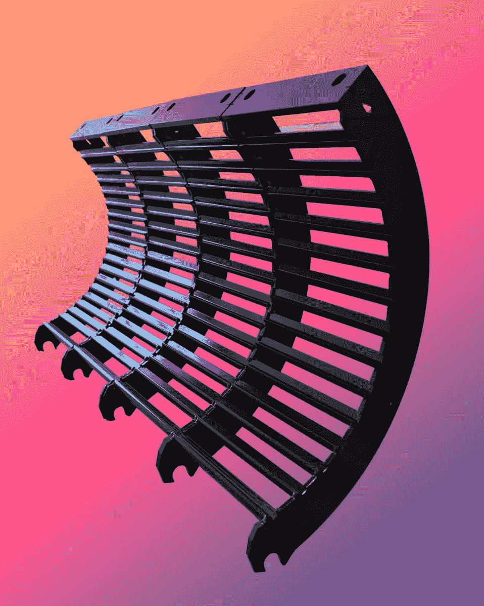

> Large-scale farmers might grow oats, barley, canola, sunflowers, soybeans, and corn. Accommodating this variability can mean expensive delays from changing concaves, the part on a combine that separates grain from chaff. Thunderstruck’s founder Jeremy Matuszewski debuted the Razors Edge Concaves last November to save that time. “The [concaves’] bar spacing…is variable based on crop flow, which balances the combine,” meaning farmers don’t have to change concaves between crops, Matuszewski says. Per field tests, the Razors Edge Concaves increased harvesting speed by 25%, reduced grain loss, and decreased fuel consumption by 40%.

> 大规模种植的农民可能会种植燕麦、大麦、油菜、向日葵、大豆和玉米。适应这种变化可能会因更换收割机上的凹板（联合收割机上用于分离谷物和谷壳的部件）而造成昂贵的延误。Thunderstruck 的创始人 Jeremy Matuszewski 于去年 11 月首次推出了 Razors Edge 凹板，以节省这部分时间。Matuszewski 说：“（凹板的）杆间距……可根据作物流量进行调整，从而平衡联合收割机。” 这意味着农民无需在不同作物之间更换凹板。田间测试显示，Razors Edge 凹板使收割速度提高了 25%，减少了谷物损失，并降低了 40% 的燃料消耗。

## Vanilla Vida 数据驱动的室内固化 - 适应气候的香草种植

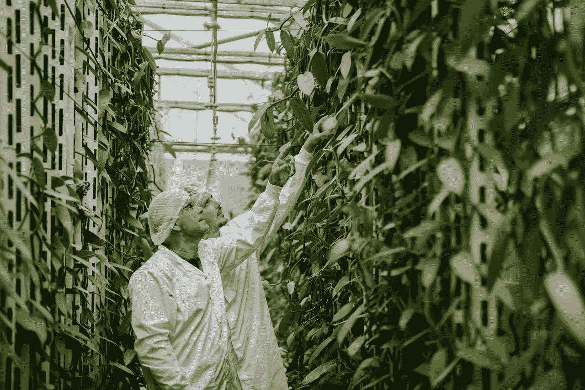

> Today, most of the vanilla we consume comes from synthetic sources, not the fruit of the orc[hids that t](https://phys.org/news/2025-03-heart-vanilla-country-farmers-front.html)hrive in the tropical climates [of ](https://phys.org/news/2025-03-heart-vanilla-country-farmers-front.html)a s[mall numbe](https://agfundernews.com/exclusive-vanilla-vida-celebrates-worlds-first-large-scale-indoor-vanilla-harvest)r of countries. As rainfall and droughts, intensified by climate change, imperil vanilla farms, Israel-based Vanilla Vida is seeking to bolster global supply of natural vanilla by growing it indoors, in climate-controlled facilities, using imaging and other precise farming technology to monitor the curing process, shorten growth time, and yield richer flavor. The company harvested its first beans in January, and next year will debut a new growing facility in Uganda.

> 如今，我们消费的大部分香草都来自人工合成，而非少数国家热带地区生长的兰花果实。气候变化加剧了降雨和干旱，香草农场因此面临危机。以色列香草维达公司 (Vanilla Vida) 正致力于提升全球天然香草的供应，其方式包括：在室内恒温恒湿的设施中种植香草，并利用成像和其他精准农业技术来监控香草的成熟过程，缩短生长时间，从而提升香草的风味。该公司于今年 1 月收获了第一批香草豆 ，并将于明年在乌干达启用新的种植设施。

# **Apps** & Software 应用软件

## Adobe Podcast Enhance Speech - 影响者音频工具

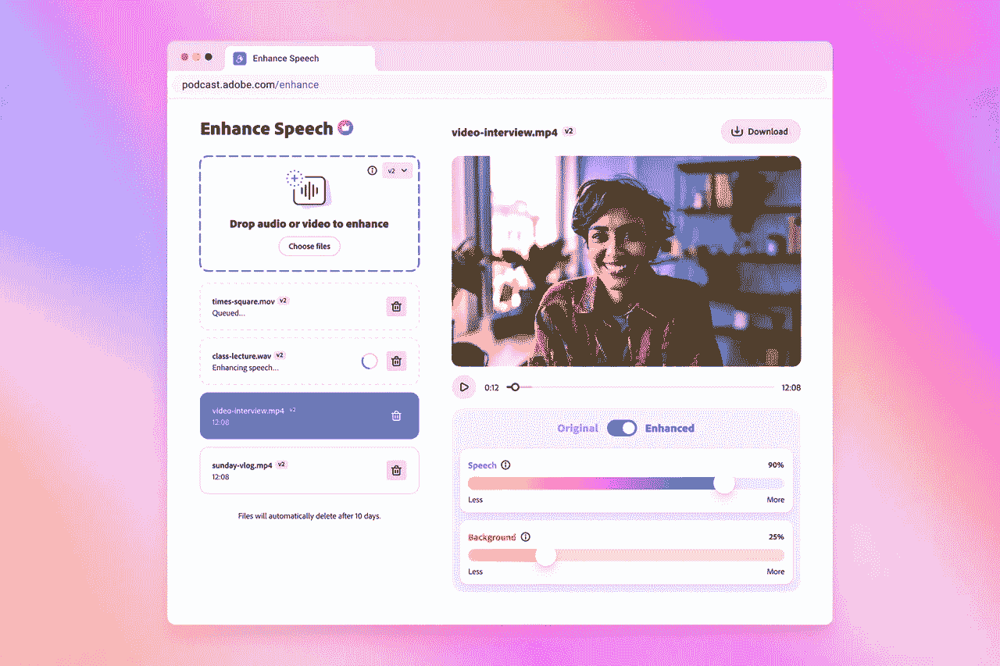

> Joe Rogan, Call Her Daddy, Huberman Lab. Podcasts are booming, and Adobe’s latest AI speech enhancement tool is giving them more polish. In November 2024, the company released version two of Enhance Speech within Adobe Podcast, its online suite of podcasting tools. Enhance Speech instantly removes noise, echo, and distortion from audio captured in busy public places or in rooms with poor acoustics. “You can have the most brilliant story to tell, but if it’s muffled by background noise or echo, people tune out,” Adobe Head of AI Audio Jay LeBoeuf says. Enhance Speech has already enhanced more than 100 million files.

> Joe Rogan，Call Her Daddy，Huberman Lab。播客正在蓬勃发展，Adobe 最新的 AI 语音增强工具使其更加完善。2024 年 11 月，该公司在其在线播客工具套件 Adobe Podcast 中发布了增强语音功能的第二版。增强语音功能可立即消除在人流密集的公共场所或音质较差的房间中录制的音频中的噪音、回声和失真。“即使你拥有最精彩的故事，但如果被背景噪音或回声掩盖，人们也会失去兴趣，”Adobe AI 音频主管 Jay LeBoeuf 说道。增强语音功能已增强了超过 1 亿个文件。

## Buzzkill Notification Manager - 安卓用户的专注工具

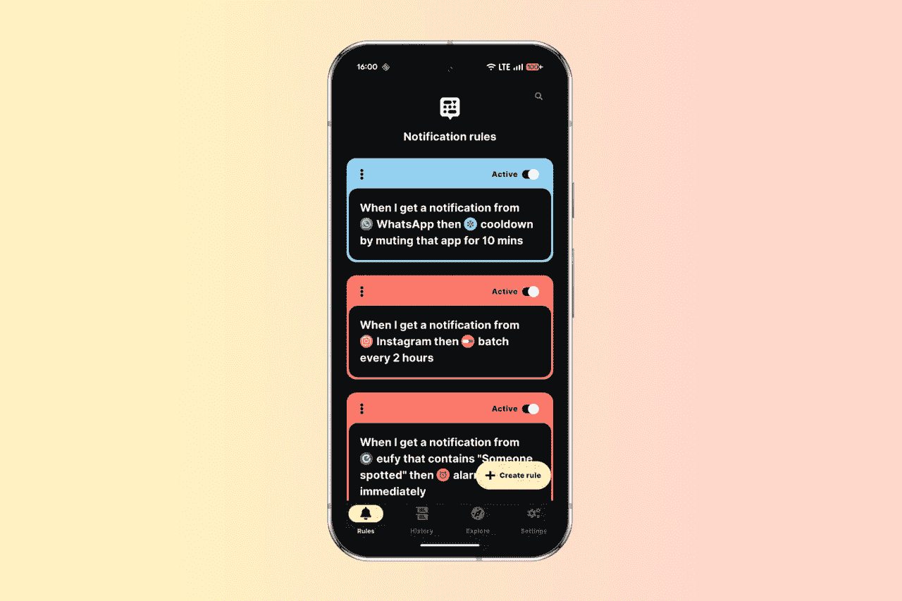

> News alerts, emails, text messages, updates—notifications can be a lot. BuzzKill is an app that lets Android users build plain-language rules to decide, with greater control, which notifications hit their home screens and when. For example, a user can decide to only receive notifications from a WhatsApp group when it mentions a specific person or term, or only buzz once if you get a bunch of alerts at the same time. The app has 25 plug-in-style actions, and more than 20,000 users. BuzzKill also sits locally and never sends data off-device. “I don’t want any of your data,” says Sam Ruston, the U.K.-based independent developer behind the app.

> 新闻提醒、电子邮件、短信、更新——通知种类繁多。BuzzKill 是一款应用，允许安卓用户构建简明易懂的规则，从而更好地控制哪些通知在何时出现在主屏幕上。例如，用户可以选择仅在 WhatsApp 群组提及特定人物或术语时接收通知，或者仅在同时收到多条通知时发出一次通知。该应用拥有 25 个插件式操作，用户超过 2 万。BuzzKill 也位于本地，绝不会将数据发送到设备外。“我不想要你的任何数据，”这款应用背后的英国独立开发者 Sam Ruston 说道。

## **Exygy CiviForm** - 简化公共服务的使用

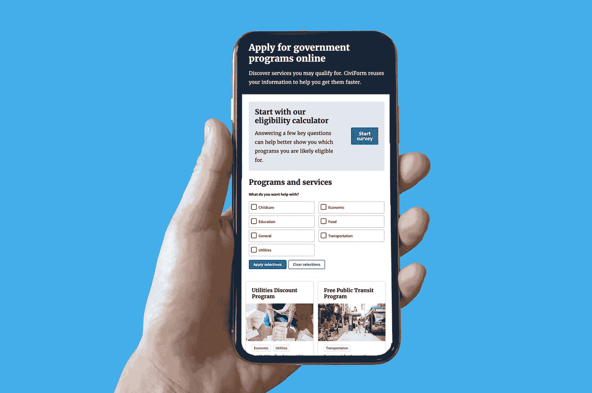

> Applying for public services often involves navigating byzantine websites and frustrating phone calls. CiviForm is an open-source software that consolidates public program applications into one streamlined, easy-to-use platform. While the project began during the pandemic as a joint effort between Seattle and Google.org, developers recognized its greater potential; the system moved to civic tech firm Exygy for broader deployment in 2023. “Other governments were all struggling with this exact same problem,” says Isabel Shaw, Exygy’s chief product officer. Now used in U.S. cities including Charlotte, N.C., and Bloomington, Ind., as well as the state of Arkansas, CiviForm serves more than 8 million people.

> 申请公共服务通常需要浏览错综复杂的网站和接听令人抓狂的电话。CiviForm 是一款开源软件，它将公共项目申请整合到一个精简易用的平台中。虽然该项目始于疫情期间，由西雅图和 Google.org 共同发起，但开发人员意识到了它的巨大潜力；该系统于 2023 年转移到市政科技公司 Exygy，以进行更广泛的部署。Exygy 首席产品官伊莎贝尔·肖表示：“其他政府也都在努力应对同样的问题。” CiviForm 目前已在美国北卡罗来纳州夏洛特、印第安纳州布卢明顿等城市以及阿肯色州投入使用，服务人口超过 800 万。

## Pindrop Pulse for Meetings - 企业级深度伪造检测

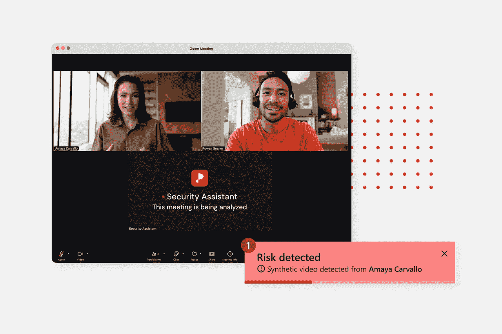

> Pindrop Pulse takes aim at the growing threat of real-time deepfake fraud. “Identity, consent, and accountability are society’s contracts. Deepfakes erode all three,” says CEO [and c](https://www.pindrop.com/article/why-your-hiring-process-now-cybersecurity-vulnerability/)o-foun[der](https://www.pindrop.com/article/why-your-hiring-process-now-cybersecurity-vulnerability/)[ Vijay Balasub](https://edition.cnn.com/2024/02/04/asia/deepfake-cfo-scam-hong-kong-intl-hnk)ramaniyan. Pulse for Meetings verifies that the right person is on the other end of a call—audio or video—stopping scams within as little as two seconds of speech. The need is urgent: Pindrop found deepfakes were becoming increasingly common in job interviews, and a single deepfake CFO triggered $25 million in scam transfers last year. Pindrop’s product is built on Georgia Tech research and battle-tested across major enterprise deployments.

> Pindrop Pulse 瞄准日益增长的实时深度伪造欺诈威胁。“身份、同意和责任是社会的契约。深度伪造会侵蚀这三者，”首席执行官兼联合创始人 Vijay Balasubramaniyan 表示。Pulse for Meetings 可在短短两秒内验证通话双方（音频或视频）是否为正确人员，从而阻止诈骗。这一需求迫在眉睫：Pindrop 发现深度伪造在求职面试中越来越常见，去年一位深度伪造的首席财务官就引发了 2500 万美元的诈骗转账 。Pindrop 的产品基于佐治亚理工学院的研究成果，并在主要企业部署中经过了实战检验。

## Zown Down Payment Boost Program - 更实惠的购房

> Saving for a down payment is no small feat. Zown, a digital real estate platform, aims to make home buying more affordable and efficient. Buyers are matched with licensed Zown agents, who are paid hourly based on performance, not commission; when buyers find a home, the company receives 2.5% commission from the seller but returns 1.5% to buyers to bolster their down payment. Except for home viewing, Zown handles deals entirely remotely. “Our secret sauce is building customer relationships digitally,” says CEO Rishard Rameez. The Canadian startup expanded to California in May and has completed over $300 million in transactions.

> 攒首付并非易事。数字房地产平台 Zown 旨在让购房更经济、更高效。买家会与 Zown 的持牌经纪人匹配，经纪人按小时支付绩效工资，而非佣金；买家找到合适的房源后，公司会从卖家那里收取 2.5% 的佣金，但会向买家返还 1.5% 以增加首付。除了看房之外，Zown 完全远程处理交易。“我们的秘诀是通过数字化方式建立客户关系，”首席执行官 Rishard Rameez 说道。这家加拿大初创公司于 5 月扩展到加州，目前已完成超过 3 亿美元的交易。

# Artificial Intelligence 人工智能

## **Ambiq SPOT** - 超高能效芯片

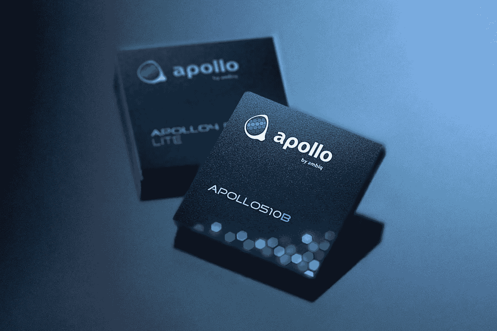

> Artificial intelligence is notoriously power-hungry, hoovering energy as it pumps out information. In battery-operated devices, that becomes restrictive: manufacturers must choose between energy-sucking AI features and limited power banks. Ambiq’s proprietary Sub-threshold Power Optimized Technology (SPOT) chip design lets AI inferencing run locally—without connecting to the cloud—reducing energy use while boosting speed and functionality. “We help [device manufacturers] do things they weren't able to do before,” says Charlene Wan, Ambiq’s VP of branding, marketing, and investor relations. Currently, Ambiq’s chips have been installed in 280 million commercial devices, including smart watches from Garmin and Xiaomi; in July 2025, the company went public.

> 众所周知，人工智能耗电严重，在输出信息时会消耗大量能量。对于电池供电的设备来说，这一点尤为重要：制造商必须在高能耗的 AI 功能和有限的移动电源之间做出选择。Ambiq 专有的亚阈值功耗优化技术（SPOT）芯片设计，让 AI 推理可以在本地运行，无需连接云端，从而降低能耗，同时提升速度和功能。“我们帮助[设备制造商]实现他们以前无法做到的事情，”Ambiq 品牌、市场营销和投资者关系副总裁 Charlene Wan 说道。目前，Ambiq 的芯片已安装在 2.8 亿台商用设备中，包括 Garmin 和小米的智能手表；该公司将于 2025 年 7 月上市。

## Anthropic Claude Sonnet 4 - 更快的大众人工智能模型

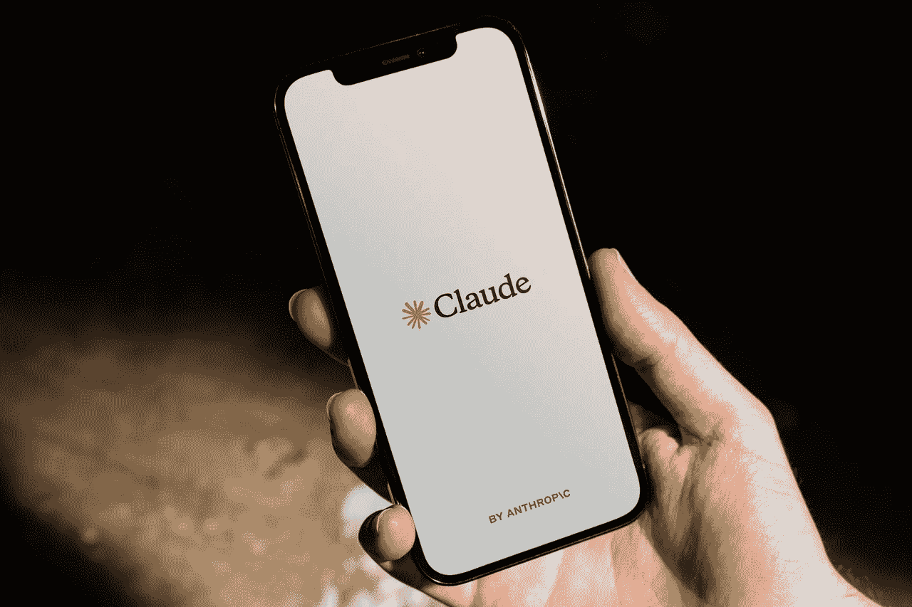

> When Anthropic launched its Claude Sonnet 4 model in May, users immediately took to the general-use large language model. “I was honestly surprised by the amount of adoption of Sonnet 4,” says Dianne Na Penn, Anthropic’s head of product management, research; she says 75% of [API users swit](https://menlovc.com/perspective/2025-mid-year-llm-market-update/)c[hed to ](https://www.anthropic.com/news/1m-context)Sonnet 4 within a week of its releas[e. The ](https://techcrunch.com/2025/08/12/anthropics-claude-ai-model-can-now-handle-longer-prompts/)model qui[ckly became a ](https://www.anthropic.com/news/claude-sonnet-4-5)favorite with coders, capturing more than double the market share of OpenAI among enterprise developers, according to a survey by Menlo Ventures. Post-release, Anthropic significantly expanded Sonnet’s context window, allowing it to handle much longer prompts—including up to 75,000 lines of code—and more than double the size of competitors' including OpenAI’s GPT-5. The company released Sonnet 4.5 in September, showing even quicker and more accurate calculations.

> 当 Anthropic 在 5 月份推出其 Claude Sonnet 4 模型时，用户立即喜欢上了这个通用的大型语言模型。“说实话，Sonnet 4 的采用率让我很惊讶，”Anthropic 的产品管理和研究主管 Dianne Na Penn 表示；她表示，75% 的 API 用户在 Sonnet 4 发布后一周内就转向了它。Menlo Ventures 的一项调查显示，该模型很快成为程序员的最爱，在企业开发者中占据了 OpenAI 两倍以上的市场份额。发布后，Anthropic 显著扩展了 Sonnet 的上下文窗口，使其能够处理更长的提示（包括多达 75,000 行代码），并且比包括 OpenAI 的 GPT-5 在内的竞争对手的提示大小增加了一倍多 。该公司于 9 月发布了 Sonnet 4.5 ，显示出更快、更准确的计算。

## DataSnipper DocuMine - 人工智能驱动的财务审计

> Auditors are the frontline workers of financial integrity, ensuring that businesses and governments comply with crucial, increasingly complex regulations. But much of their workday is spent reviewing documents manually. DocuMine, from the Dutch company DataSnipper, uses AI to automate this analysis, as well to verify data and link each insight back to its source. In April 2025, DocuMine launched within Microsoft Excel, which 1.3 million auditors and most finance professionals already use, offering them a smarter, scalable solution for a $217 billion industry that needs faster, more accurate audits—all with uncompromised transparency.

> 审计师是维护财务诚信的一线工作人员，确保企业和政府遵守至关重要且日益复杂的法规。但他们的大部分工作时间都花在手动审查文件上。荷兰公司 DataSnipper 的 DocuMine 使用人工智能自动执行此类分析，并验证数据并将每个洞察关联回其来源。2025 年 4 月，DocuMine 在 Microsoft Excel 中正式推出，目前已有 130 万审计师和大多数财务专业人士使用这款软件。DocuMine 为价值 2170 亿美元的行业提供了一个更智能、可扩展的解决方案，该行业需要更快、更准确的审计，并且所有这些都具有不折不扣的透明度。

## **DeepSeek R1** - 低成本的 LLM 挑战者

> The abrupt appearance of DeepSeek’s R1 advanced reasoning model at the start of the year was akin to the “shot heard ‘round the world” in AI circles. Major tech companies had spent recent years pouring billi[ons into](https://archive.is/e8VDc) gen[erative AI p](https://www.reuters.com/technology/chinas-deepseek-claims-theoretical-cost-profit-ratio-545-per-day-2025-03-01/)[roje](https://archive.is/e8VDc)cts, products, and infrastructure. Meanwhile, Chinese startup DeepSeek created in just months a model as good as OpenAI’s then-most advanced product on industry-standard benchmarks—and claimed to have spent just $6 million to train it. DeepSeek’s model also used a fraction of the compute as its U.S. competitors—and it’s still free to use.

> 今年年初，DeepSeek R1 高级推理模型的突然亮相，无异于人工智能圈“轰动全球”的一声枪响。近年来，各大科技公司已投入数十亿美元用于生成式人工智能项目、产品和基础设施建设。与此同时，中国初创公司 DeepSeek 仅用几个月时间就创建了一个在行业标准基准上与 OpenAI 当时最先进的产品不相上下的模型，并声称只花费了 600 万美元来训练它 。DeepSeek 的模型使用的计算量仅为其美国竞争对手的一小部分 ，而且仍然可以免费使用。

## Nvidia DGX Spark - 桌面级人工智能超级计算机

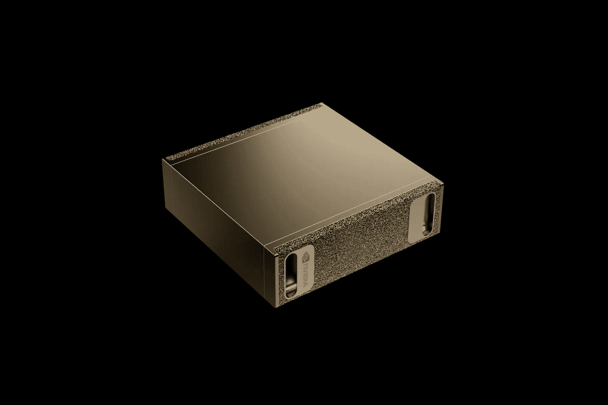

> AI compute power has so far been reserved for those with access to pricey cloud clusters. But Nvidia’s DGX Spark packs 1 petaflop of compute and 128GB of memory into a small-sized desktop, powered by the company’s Grace Blackwell GB10 Superchip. It can fine-tune AI models with up to 200 billion parameters. “Offering petaflops of AI performance on a desktop device is groundbreaking, because we really think it’ll unlock the democratization of AI,” says Dion Harris, senior director of high-performance computing and AI factory solutions at Nvidia. The computer can be linked to another DGX Spark to churn through bigger models and will cost $3,999, with reservations already open through select sellers.

> 迄今为止，AI 计算能力仅限于那些能够使用昂贵云集群的厂商。但英伟达的 DGX Spark 却将每秒 1 千万亿次浮点运算的计算能力和 128GB 内存集成到一台小型台式机中，并搭载该公司的 Grace Blackwell GB10 超级芯片。它可以对多达 2000 亿个参数的 AI 模型进行微调。“在桌面设备上提供每秒千万亿次浮点运算的 AI 性能具有开创性的意义，因为我们坚信这将开启 AI 的民主化进程，”英伟达高性能计算和 AI 工厂解决方案高级总监 Dion Harris 表示。这台计算机可以连接到另一台 DGX Spark，以处理更大规模的模型，售价 3999 美元，目前已通过指定经销商开放预订。

## UiPath Agentic Automation - 连接人工智能代理

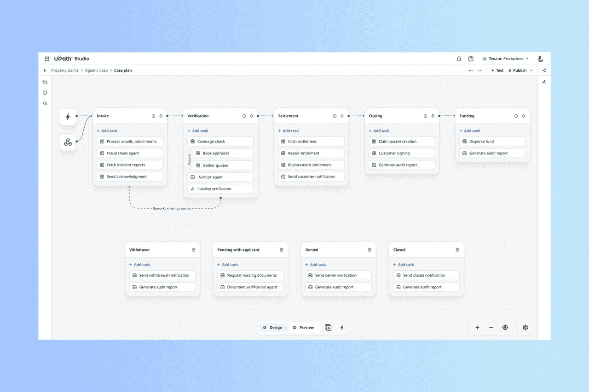

> Agen[tic AI ](https://www.uipath.com/platform/agentic-automation/agentic-orchestration)can simplify business, but managing[ dispar](https://www.uipath.com/platform/agentic-automation/agentic-orchestration)ate AI agents can also be a job in itself. UiPath’s platform helps businesses get their AI agents to work together. With the Maestro layer added to the platform this year, UiPath allows companies to “orchestrate” and manage a range of agents, including those built with third-parties, by ensuring access to the right data sets and enterprise systems, adherence to security guardrails, and adequate human oversight. “We put people in the conductor roles, and most of the operations work is done by agents and robots,” CEO Daniel Dines says. UiPath customers include banks, health insurers, and logistics providers.

> 智能代理 AI 可以简化业务，但管理分散的 AI 代理本身也是一项艰巨的任务。UiPath 平台帮助企业实现 AI 代理的协同工作。随着今年平台新增 Maestro 层，UiPath 允许企业“编排”和管理一系列代理，包括与第三方合作构建的代理，确保访问正确的数据集和企业系统、遵守安全防护措施以及充分的人工监督。“我们安排人员担任指挥，大部分运营工作由代理和机器人完成，”首席执行官 Daniel Dines 说道。UiPath 的客户包括银行、健康保险公司和物流供应商。

## **Warp Agentic Dev**elopment Environment - 专业人士的氛围编码

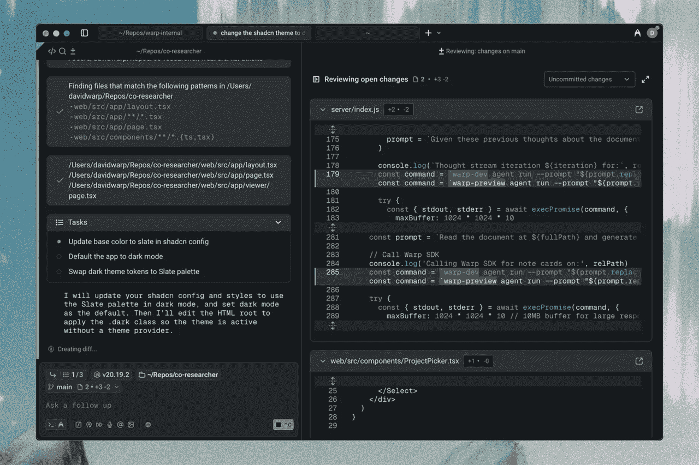

> The tr[end of vibe](https://time.com/7312641/agentic-ai-era-humans/) c[oding](https://time.com/7312641/agentic-ai-era-humans/)— tech novices using AI to write and refine code—hasn’t come without catches. For example: companies are now hiring engineers to fix errors in vibe-coded software. Warp has taken a different approach with an agent-based alternative to traditional coding interfaces. Launched in June, Warp’s agentic development environment (ADE) allows software engineers to task AI agents with developing their code, then intervene when they notice errors. “You get to see a really clear plan of what the agent is going to do, and you get to adjust that plan with the agent,” says Warp founder and CEO Zach Lloyd. “You're building stuff that's actually shippable.”

> 氛围编码（Vibe Code）的潮流——技术新手使用 AI 编写和优化代码——并非没有陷阱。例如：现在很多公司都在招聘工程师来修复氛围编码软件中的错误。Warp 另辟蹊径，推出了基于代理的传统编码界面替代方案。Warp 的代理开发环境（ADE）于今年 6 月上线，允许软件工程师委托 AI 代理开发代码，并在 AI 代理发现错误时进行干预。“你可以清晰地了解代理的执行计划，并根据计划进行调整，”Warp 创始人兼首席执行官扎克·劳埃德（Zach Lloyd）表示，“你构建的是真正可交付的产品。”

## WindBorne Systems Atlas - 填补天气预报的空白

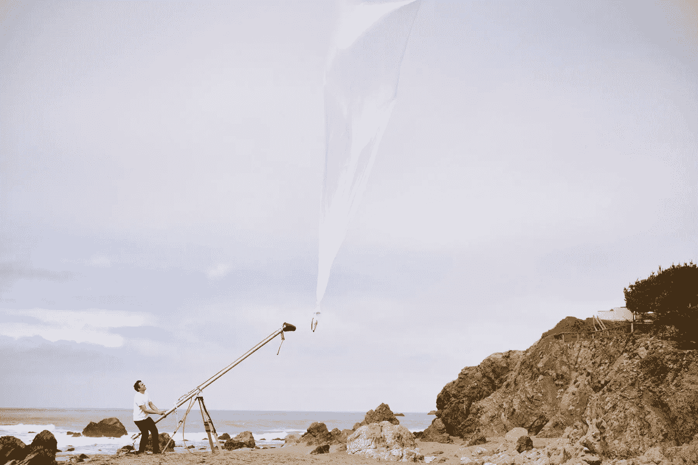

> The best weather forecasting systems still lack data from large swaths of the planet’s atmosphere, such as over oceans where major storms often develop. WindBorne is closing data gap[s with Atlas,](https://windbornesystems.com/blog/windborne-breaks-new-ai-forecasting-records-with-weathermesh-2-model-surpassing-ai-and-physics-gold-standards) its growing constellation of long-lasting weather balloons that m[easu](https://windbornesystems.com/blog/windborne-breaks-new-ai-forecasting-records-with-weathermesh-2-model-surpassing-ai-and-physics-gold-standards)re temperature, wind speed, pressure, humidity, and other factors. The company feeds the data into its own AI model to produce forecasts more accurate than those of government agencies. This year, the National Oceanic and Atmospheric Administration (NOAA) began buying Atlas sensor data to help fill gaps in the agency’s forecasting capabilities, following Trump Administration cuts. Windborne CEO John Dean says he wants to expand the NOAA partnership, but that weather forecasts should remain a public good.

> 即使是最好的天气预报系统仍然缺乏来自地球大气大片区域的数据，例如经常发生重大风暴的海洋上空的数据。WindBorne 正在利用 Atlas 填补数据缺口。Atlas 是其不断壮大的长寿命气象气球群，用于测量温度、风速、气压、湿度和其他因素。该公司将数据输入自己的人工智能模型，以生成比政府机构更准确的预报。今年，在特朗普政府削减开支后，美国国家海洋和大气管理局 (NOAA) 开始购买 Atlas 传感器数据，以帮助填补该机构预报能力的缺口。Windborne 首席执行官约翰·迪恩表示，他希望扩大与 NOAA 的合作伙伴关系，但天气预报仍应作为公共产品。

# **Beauty 美容**

## L'Oreal AirLight Pro - 出色的红外线吹风机

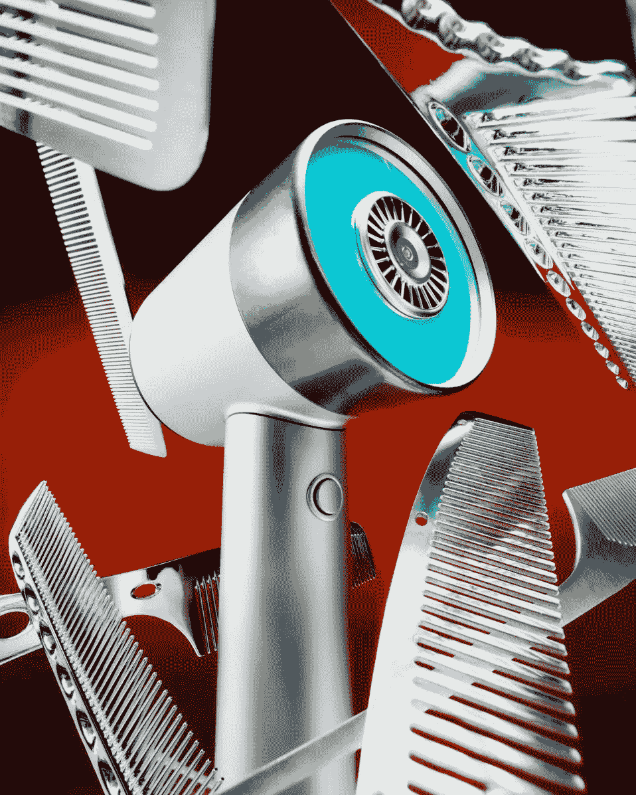

> L’Oréal’s first-ever [pr](https://time.com/collection/best-inventions-2022/6229945/zuvi-halo/)ofessional hair dryer was designed in partnership with the startup Zuvi, which released a first-of-its-kind infrared hair dryer a few years ago. This machine, which uses both infrared light and conventional convection, goes further. With more than 150 patents, it features a 17-blade motor surrounded by tungsten-halogen bulbs that produce infrared light to dry hair faster than standard hair dryers. But hair-drying is about more than speed, as anyone who walks out of a salon with dry, frizzy hair can attest. L’Oréal says the AirLight Pro results in smoother hair than convection-only dryers, because infrared light efficiently dries hair surfaces while leaving internal moisture intact.

> 欧莱雅首款专业吹风机是与初创公司 Zuvi 合作设计的，后者几年前推出了首款红外线吹风机。这款吹风机结合了红外线和传统对流技术，更进一步。它拥有 150 多项专利，配备 17 片叶片电机，周围环绕着卤钨灯泡，可产生红外线，比标准吹风机更快地吹干头发。但吹干头发不仅仅取决于速度，任何一个从沙龙出来头发干燥卷曲的人都可以证明这一点。欧莱雅表示，AirLight Pro 比仅使用对流技术的吹风机能使头发更顺滑，因为红外线能有效地干燥头发表面，同时保持内部水分的完整。

## **BoldHue 入门套件** - 适合所有肤色的粉底打印机

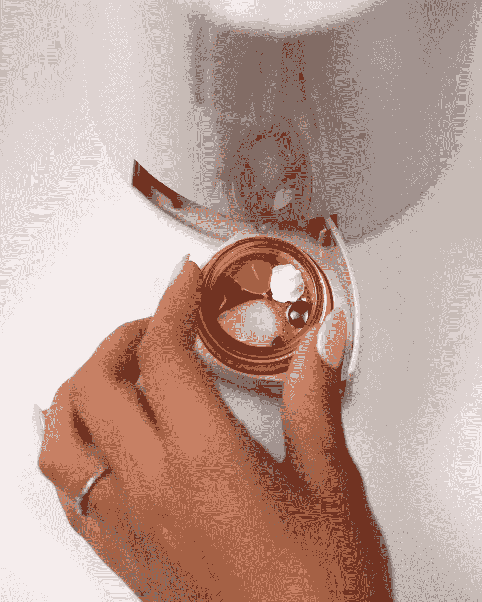

> “We wear makeup because we want to feel confident, comfortable in our own skin, and included,” says BoldHue CEO and co-founder Rachel Wilson. It was this desire for complete representation that inspired the company’s foundation printer. Launched this spring, the countertop device scans your skin to create a custom shade in under one minute, dispensing personalized blends of a skincare-enriched base and a combination of five color pigments to match all skin tones (and change daily if you get some sun). The lightweight, buildable foundation has a dewy finish and removes all the guesswork from shade-matching.

> “我们化妆是因为我们想要自信、舒适地展现自己的肤色，并且融入其中，”BoldHue 首席执行官兼联合创始人 Rachel Wilson 说道。正是这种对完美展现自我的渴望，启发了该公司研发粉底打印机。这款台面设备于今年春季推出，它可以扫描你的皮肤，在一分钟内打造专属色号，并根据你的肤色调配出个性化的粉底液，包括富含护肤成分的粉底和五种色彩颜料的组合（如果你晒太阳，粉底液会每天更换）。这款轻盈易涂的粉底液拥有水润的妆效，让你无需费心费力地寻找合适的色号。

## Epres ePhD 键合修复指甲护理 - 角蛋白焕活剂

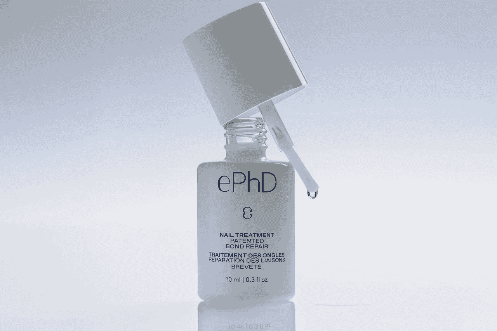

> Repeated polishing weakens fingernails by breaking down their keratin. But most nail-strengthening products on the market only work superficially, “like a landlord…painting over damage,” says Epres founder and doctor of materials science Eric Pressly. Pressly cofounded cult hair repair brand Olaplex a decade ago, and went on to launch Epres in 2022 based on his dozens of bond repair patents. The company’s new treatment uses just two ingredients—a synthetic form of ethyl acetate (found in fermenting fruits and vegetables) and the emollient diethylhexyl maleate—to repair the broken cross-linked bonds in nails, rebuilding them from within.

> 反复抛光会破坏指甲角蛋白，使其变得脆弱。但市面上大多数指甲强化产品的效果只是表面功夫，“就像房东……粉刷破损的墙面一样，”Epres 创始人兼材料科学博士埃里克·普雷斯利 (Eric Pressly) 说道。十年前，普雷斯利与他人共同创立了热门护发品牌 Olaplex，并于 2022 年凭借其数十项修复键专利创立了 Epres。该公司的新款护发产品仅使用两种成分——合成乙酸乙酯（存在于发酵水果和蔬菜中）和润肤剂马来酸二乙基己酯——来修复指甲中断裂的交联键，从内部重建它们。

## HigherDose 微电流身体塑形器 - 全身护肤设备

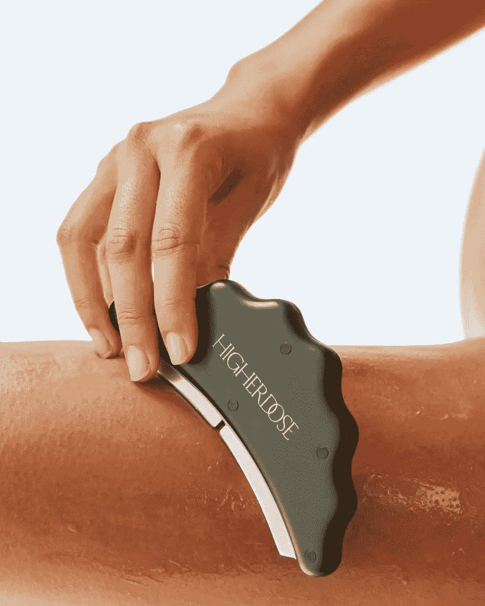

> Red light masks, gua sha, and microcurrent devices are popular home facial treatments, and now HigherDose has put them all together into one device for the body. Launched in June, the crescent-shaped handheld device—when rubbed over legs, abs, and more—supports lymphatic drainage, muscle recovery, and improved blood flow, with the goal of achieving a smoother, more toned appearance, according to the company. “We wanted to create something you’d actually reach for every day—a tool that feels spa-like but uses serious science to help people reconnect with their bodies,” says co-founder and co-CEO Lauren Berlingeri.

> 红光面膜、刮痧和微电流仪都是很受欢迎的家用面部护理产品，如今，HigherDose 将它们整合到一个身体护理设备中。这款新月形手持设备于今年六月上市，用于腿部、腹部等部位时，可以促进淋巴引流、肌肉恢复和改善血液循环，据该公司介绍，其目标是打造更光滑、更紧致的肌肤。“我们希望创造一款你每天都会用到的产品——一款感觉像水疗一样，但又运用严谨的科学原理，帮助人们重新与身体建立联系的工具，”联合创始人兼联合首席执行官劳伦·贝林杰里说道。

## L'Oréal Groupe Melasyl - 色素沉着过度的一大进步

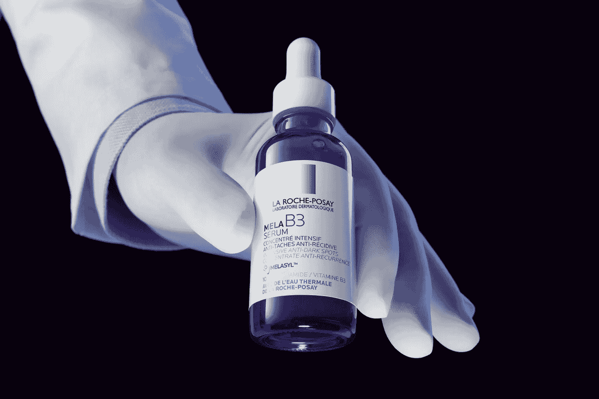

> L’Oréal Group’s scientists spent 18 years researching and testing a new skincare ingredient that could help the millions of people worldwide who experience skin pigmentation issues. The result, launched in 2024, is Melasyl, a patented cosmetic molecule formulated to reduce the appearance of hyperpigmentation, improve skin tone, and even out the complexion. Unlike many ingredients that block tyrosinase, the enzyme tied to melanin production, Melasyl helps intercept melanin precursors before they become pigments that collect in the skin, according to L’Oréal Groupe. Melasyl is now incorporated into formulas across L’Oréal Groupe brands including Kiehl’s, Vichy, and La Roche-Posay.

> 欧莱雅集团的科学家们耗时 18 年，研发并测试了一种全新的护肤成分，旨在帮助全球数百万受色素沉着问题困扰的人们。这项成果于 2024 年推出，名为 Melasyl，这是一种获得专利的化妆品分子，旨在减少色素沉着，改善肤色，均匀肤色。欧莱雅集团表示，与许多阻断酪氨酸酶（一种与黑色素生成相关的酶）的成分不同，Melasyl 有助于在黑色素前体转化为色素并积聚在皮肤中之前将其拦截。目前，Melasyl 已被欧莱雅集团旗下科颜氏、薇姿和理肤泉等品牌的配方所采用。

## Pelage Pharmaceuticals PP405 - 逆转秃顶的疗法

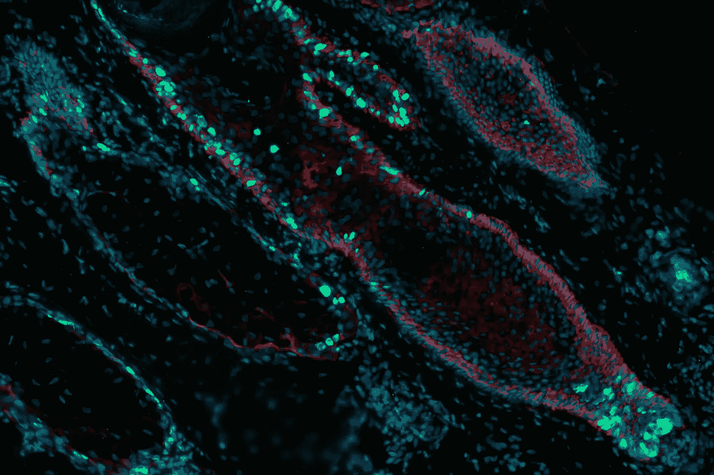

> PP405 is a topical, non-hormonal treatment that activates dormant stem cells in hair follicles to regrow hair back to fullness. Clinical trials have shown success, though the drug may not work in the end stages of balding if the follicle is scarred. Pelage Pharmaceuticals is still awaiting further trial results before it can receive FDA approval, but the drug’s success could open doors for future therapies. “It’s not covering up the symptoms, it’s targeting the underlying biology,” says Pelage Pharmaceuticals chief medical officer Christina Weng.

> PP405 是一种局部非激素疗法，可激活毛囊中休眠的干细胞，使头发重新长出。临床试验已证明该药物有效，但如果毛囊受损，该药物可能无法在秃顶的末期发挥作用。Pelage Pharmaceuticals 仍在等待进一步的试验结果，之后才能获得 FDA 的批准，但该药物的成功可能为未来的疗法打开大门。“它不是在掩盖症状，而是针对潜在的生物学机制，”Pelage Pharmaceuticals 首席医疗官 Christina Weng 说道。

## **Philips Norelco **i9000 Prestige Ultra - 更贴面的剃须

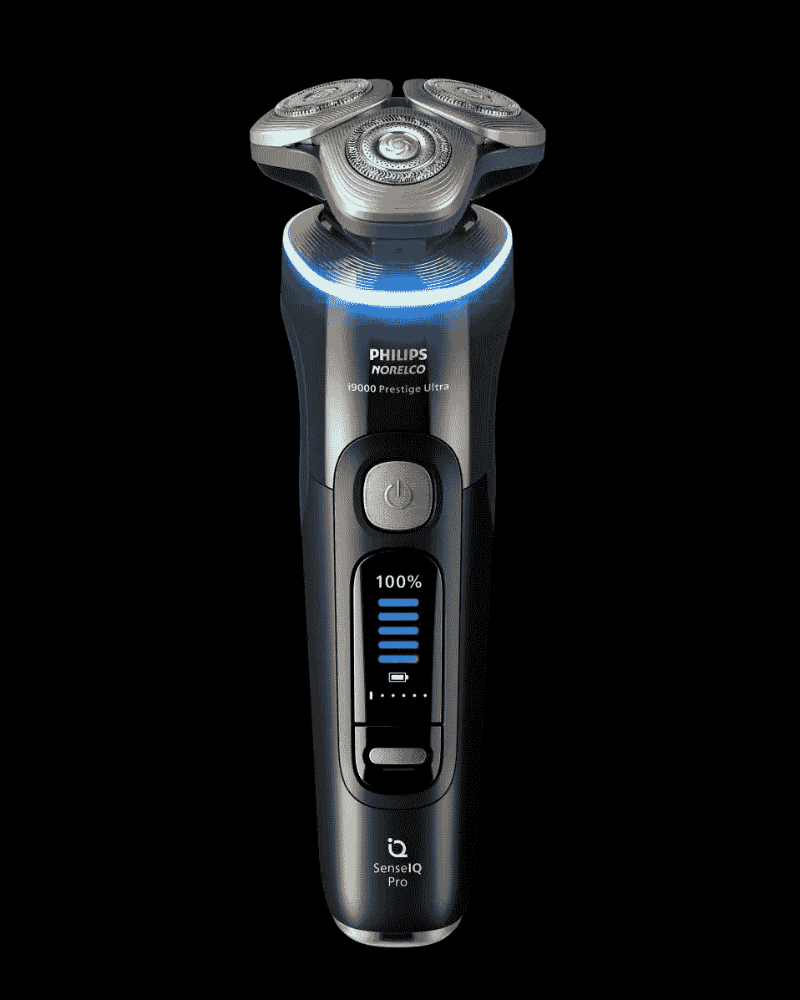

> This electric shaver introduces SenseIQ Pro, a new version of Philips Norelco’s AI-backed technology that helps users find the right shaving pressure via LED guidance lights (orange means too hard, green is just right). Also new is the i9000’s Triple Action Lift & Cut system, which lifts hair from its root to cut it just below the skin’s surface, up to -.08mm. Flexible heads adapt to facial curves to shave hard-to-reach areas, different modes handle everything from thick beards to foam, and, in another first, the charging station’s hood sanitizes the shaver with UV light while the battery refills.

> 这款电动剃须刀搭载了飞利浦 Norelco 人工智能技术的全新版本 SenseIQ Pro，可通过 LED 指示灯帮助用户找到合适的剃须压力（橙色表示用力过大，绿色表示力度适中）。i9000 还配备了三重提剪系统，可从根部提起毛发，将其剪至皮肤表层以下，深度可达 -0.08 毫米。灵活的刀头可贴合面部曲线，轻松剃除难以触及的区域；多种剃须模式，从浓密的胡须到泡沫，都能轻松应对；此外，充电座的遮光罩可在电池充电时使用紫外线对剃须刀进行消毒，这也是 i9000 的又一项创新。

## **Shark CryoGlow** - 冷却 LED 面膜

> To design its first skincare product, SharkNinja convened panels of dermatologists, aestheticians, behavior scientists, and “skinfluencers,” says Danielle Lessing, SVP of global product development. Hundreds of prototypes and multiple clinical studies resulted in the CryoGlow LED face mask. Like other LED masks, it uses three types of light to kill acne-causing bacteria and stimulate collagen production, which reduces fine lines; unlike other LED masks, it has cold metallic plates under the eyeholes to simultaneously reduce redness and puffiness. The team took design cues from ski goggles and VR headsets, Lessing says, to make sure the mask would fit snugly yet comfortably.

> SharkNinja 全球产品开发高级副总裁 Danielle Lessing 表示，为了设计其首款护肤产品，他们召集了皮肤科医生、美容师、行为科学家和“皮肤影响者”等专家组成的专家小组。数百个原型和多项临床研究最终催生了 CryoGlow LED 面膜。与其他 LED 面膜一样，它使用三种光线来杀死致痘细菌并刺激胶原蛋白生成，从而减少细纹；与其他 LED 面膜不同的是，它在眼窝下方设有冷金属板，可同时减少红肿。Lessing 表示，团队从滑雪镜和 VR 头戴设备中汲取了设计灵感，以确保面膜佩戴舒适贴合。

## Therabody TheraFace 去浮肿棒 - 用于放松

> After consume[rs started usi](https://www.therabody.com/blogs/news/theraface-depuffing-wand-clinically-proven-to-enhance-skin-health-according-to-new-study)ng the heavy-duty TheraGun on their face, the compan[y fi](https://www.therabody.com/blogs/news/theraface-depuffing-wand-clinically-proven-to-enhance-skin-health-according-to-new-study)gured it should make a face-focused product that massages and decreases swelling. The result is TheraFace Depuffing Wand, which features hot settings that increase blood flow and cold settings—no refrigeration required—that “seal in the benefits of that fluid movement” to soothe and firm faces, says Tim Roberts, TheraBody’s VP of science and innovation. The device, which is contoured to fit under-eye grooves, decreased under-eye puffiness in a company-sponsored clinical study. But it also just serves as an ultra-relaxing bit of self-care.

> 在消费者开始在脸上使用 TheraGun 高效面部按摩器后，该公司认为应该生产一款专注于面部的产品，用于按摩和消肿。于是， TheraFace 消肿棒应运而生。TheraFace 消肿棒具有热敷和冷敷两种功能，热敷可增加血液流动，冷敷无需冷藏，TheraBody 的科学与创新副总裁 Tim Roberts 表示，冷敷可“锁住液体流动的益处”，舒缓和紧致面部。这款设备的轮廓设计贴合眼底凹槽，在公司赞助的一项临床研究中，它确实减少了眼底浮肿。但它也是一种超级放松的自我护理产品。

## **Ulike Air 10** - 触感凉爽的激光脱毛

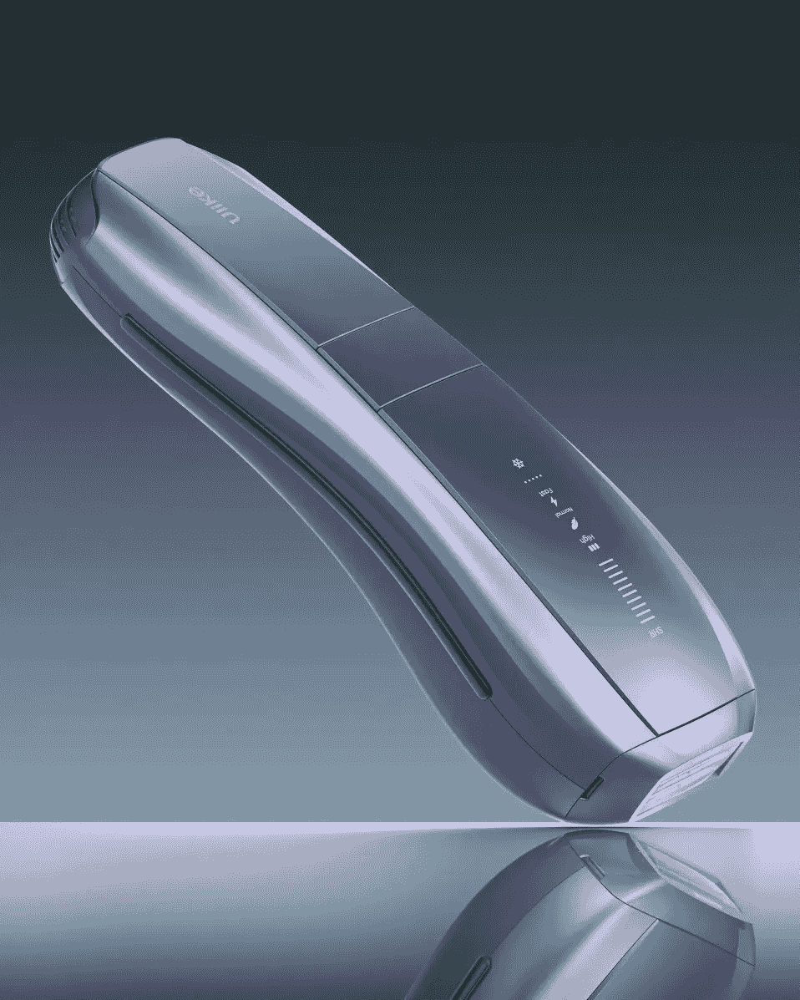

> Laser hair removal is one of the most popular cosmetic procedures in the U.S.—and while generally considered safe, both in-office and at-home treatments can cause irritation. Launched last year, Ulike’s Air 10 is the first at-home intense pulsed light (IPL) device to incorporate proprietary cooling technology that maintains a contact temperature of 65 degrees Fahrenheit, reducing painful side effects for even sensitive skin types. The device’s built-in SkinSensor also detects different skin tones and adjusts the intensity of each pulse accordingly. The Ulike Air 10 claims a 96% hair density reduction in just two weeks.

> 激光脱毛是美国最受欢迎的美容手术之一——虽然普遍认为安全，但无论是在诊所还是在家进行，都可能引起刺激。Ulike Air 10 于去年推出，是首款采用专有冷却技术的家用强脉冲光 (IPL) 设备，该技术可将接触温度保持在 65 华氏度（约 19 摄氏度），即使是敏感肌肤也能减少疼痛的副作用。该设备内置的 SkinSensor 传感器还能检测不同的肤色，并相应地调整每次脉冲的强度。Ulike Air 10 声称，仅用两周时间，毛发密度就能减少 96%。

# Connectivity & Communication 连接性

## Cailabs Tilba-L10 - 来自太空的激光通信

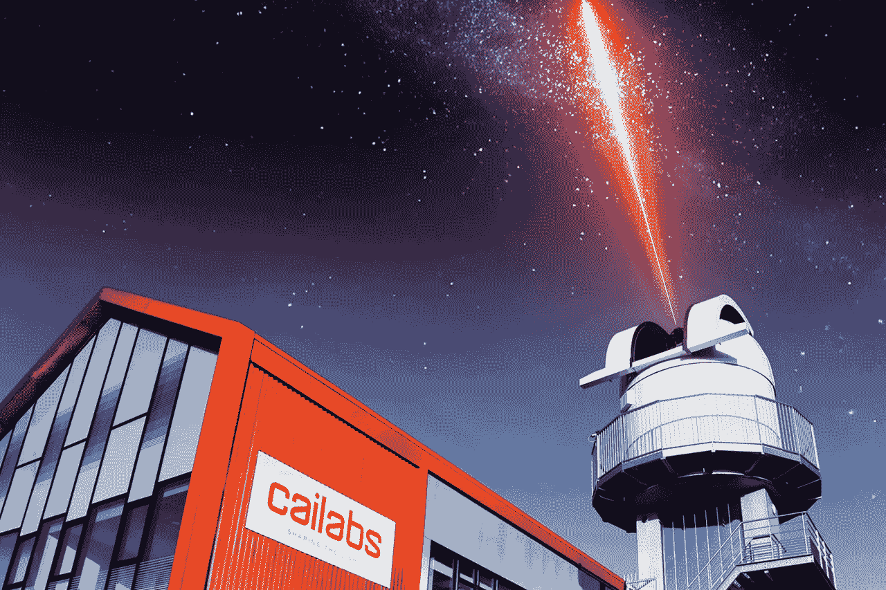

> Modern-day satellites communicate with the ground in a decidedly un-modern way—via radio. France-based Cailabs’ Tilba-L10 laser ground station avoids radio’s downsides. Its optical technology is not disrupted by foul weather, is harder for hostile actors to detect and jam, and has a massive carrying capacity. At the most commonly used frequency, radio waves can typically transmit 1 to 2 gigabits per second (gbps). Tilba-L10 can transmit up to 20 gbps in communication with laser-equipped satellites. “When you go optical, you get much more bandwidth that you can play with,” CEO Jean-Francois Morizur says. Launched in Nov. 2024, Cailabs now has buyers in countries including Australia, France, and the U.S.

> 现代卫星与地面的通信方式显然非现代方式——无线电。总部位于法国的 Cailabs 公司开发的 Tilba-L10 激光地面站则避免了无线电的缺点。其光学技术不受恶劣天气干扰，更难被敌方探测和干扰，并且拥有巨大的承载能力。在最常用的频率下，无线电波的传输速度通常为每秒 1 到 2 千兆比特 (gbps)。Tilba-L10 与配备激光的卫星通信时，传输速度高达 20 gbps。首席执行官 Jean-Francois Morizur 表示：“采用光学技术，可以获得更大的带宽。” Cailabs 于 2024 年 11 月正式投入运营，目前在澳大利亚、法国和美国等国家都有客户。

## **Crowd Compass** - 寻找朋友

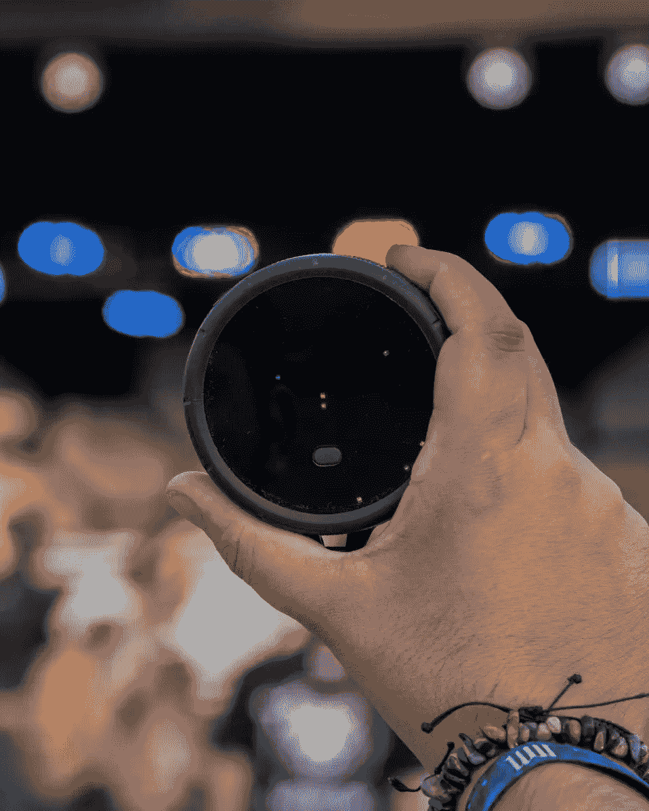

> Chris Dimoff was at a packed music festival when he thought of Crowd Compass, a friend-finding tool for events where cellphone networks are overwhelmed. “I lost my friends for half the night because my phone had no service,” says CEO Dimoff. His solution, launched in 2024, is a battery-powered, water-resistant device that uses GPS and long-range mesh radio technology to guide users to each other—no cell or Wi-Fi network required. Each LED on Crowd Compass represents another device in the paired group, adjusting in real-time as users move. The devices can also show nearby emergency services, and allow no-service messaging.

> 克里斯·迪莫夫（Chris Dimoff）在一场人头攒动的音乐节上，突然想到了 Crowd Compass，这是一款专为手机网络不堪重负的活动而设计的交友工具。“我因为手机没信号，半夜都找不到朋友了，”首席执行官迪莫夫说道。他的解决方案于 2024 年推出，是一款电池供电的防水设备，利用 GPS 和远程网状无线电技术引导用户找到彼此——无需手机或 Wi-Fi 网络。Crowd Compass 上的每个 LED 灯代表配对组中的另一个设备，并会随着用户的移动实时调整。这些设备还可以显示附近的紧急服务，并允许在无信号时发送消息。

## Microsoft Hollow Core Fiber - 微软空心纤维-更快的数据传输

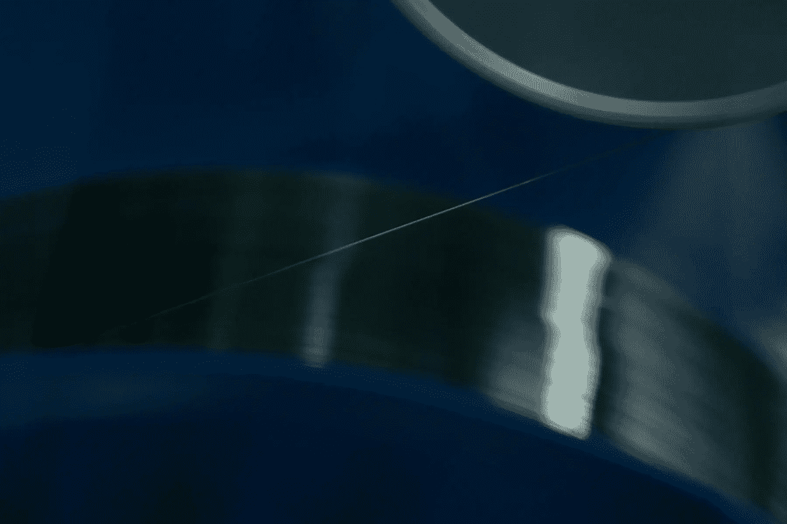

> Data tra[vels a](https://www.nature.com/articles/s41566-025-01747-5)cr[oss](https://www.nature.com/articles/s41566-025-01747-5) the cloud mainly as light via optical fibers made from solid glass. But that light—and thus that data—travels faster through air. “With hollow core fiber, the glass [has] an air core in the middle,” says Frank Rey, General Manager of Azure Hyperscale Networking at Microsoft, which this year showed that its hollow-core fiber achieved the lowest signal loss ever. “And because we can use more parts of the optical spectrum to send data, the transmission and overall total capacity is improved.” Current hollow-core fibers extend data transmission up to 1.5 times the distance of today's technology. Microsoft has more than 2,000 kilometers of fiber in production in Europe, mainly as interconnections between data centers, with over 12,000 kilometers planned for deployment in the next year.

> 数据主要以光的形式通过由实心玻璃制成的光纤在云端传输。但光（以及数据）在空气中传播速度更快。“空芯光纤的玻璃中间有一个空气芯，”微软 Azure 超大规模网络总经理 Frank Rey 说道。微软今年展示了其空芯光纤，实现了有史以来最低的信号损耗。“而且由于我们可以使用更多光谱部分来发送数据，传输量和总容量都得到了提升。”目前的空芯光纤可将数据传输距离延长至当今技术的 1.5 倍。微软在欧洲已生产超过 2,000 公里的光纤，主要用于数据中心之间的互连，并计划在明年部署超过 12,000 公里的光纤。

## Netgear Nighthawk M3 - 5G 旅行热点

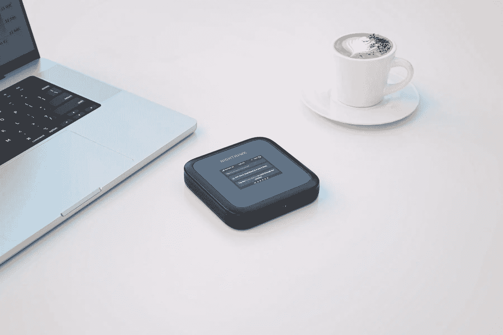

> Getting a good signal while traveling can be nearly impossible. Netgear’s Nighthawk M3 is a portable Wi-Fi router with immense power—providing 5G internet at up to 2.5 Gbps, to up to 32 devices, with a 13-hour battery. The device works with any mobile carrier across 140 countries, including the U.S., “so travellers don’t have to do anything,” says Netgear product line manager Arodi Dalpathadu. Ports support antennas to boost signal in rural spots, or add Ethernet if needed. It also moonlights as a power bank. The Nighthawk M3 is currently available in most of the world, with a similar U.S. release by early 2026.

> 旅行时想要获得良好的信号几乎是不可能的。Netgear 的 Nighthawk M3 是一款功能强大的便携式 Wi-Fi 路由器，可提供高达 2.5 Gbps 的 5G 网络，最多可连接 32 台设备，并配备 13 小时的电池续航时间。该设备兼容包括美国在内的 140 个国家/地区的任何移动运营商，“因此旅行者无需做任何事情，”Netgear 产品线经理 Arodi Dalpathadu 说道。端口支持天线，可在农村地区增强信号，或根据需要添加以太网。它还可以兼作移动电源。Nighthawk M3 目前已在全球大部分地区上市，类似型号将于 2026 年初在美国上市。

# Consumer Electronics 消费电子

## 70mai Dash Cam 4K Omni - 更智能的事故检测

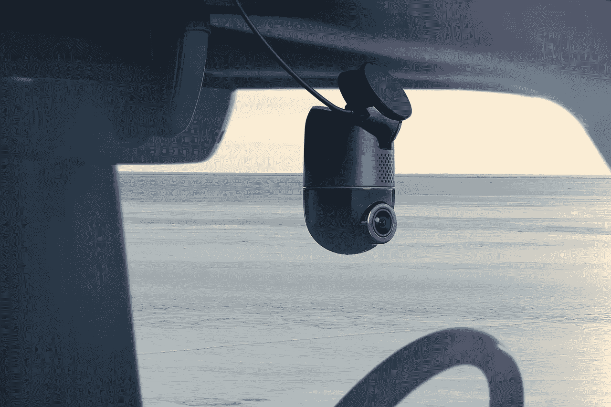

> In response to unpredictable urban traffic, several consumer dash cams promise video coverage by merging footage from two fixed cameras into a distorted fish-eye view that’s prone to split-second delays. Launched in May, 70mai’s Dash Cam 4K Omni offers a single intelligent eye. Rotating a full 360 degrees, the camera combines magnetic sensor-directed gimbals and AI-powered motion detection to spot trouble in real time and record with greater precision. (Recording can be turned off at any time.) “If you’re in a supermarket when someone hits your car, this device will notice, lock onto the other car, record high-definition evidence, and send an alert to your phone,” says product manager Zhiyi Liu.

> 为了应对变幻莫测的城市交通状况，一些消费级行车记录仪声称，它们会将两个固定摄像头的画面合并成一个扭曲的鱼眼视图，从而实现视频覆盖，但这种视图容易出现瞬间延迟。70 迈于今年 5 月推出的 4K 全向行车记录仪，配备了一颗智能摄像头。这款行车记录仪可 360 度旋转，结合了磁力传感器控制的万向节和人工智能驱动的运动检测功能，可以实时发现问题并更精确地录制。（录制功能可随时关闭。）“如果你在超市购物时，有人撞到了你的车，这款设备会注意到，锁定对方车辆，录制高清证据，并向你的手机发送警报，”产品经理刘志毅说道。

## **Antigravity A1** - 沉浸式 360 度无人机摄像头

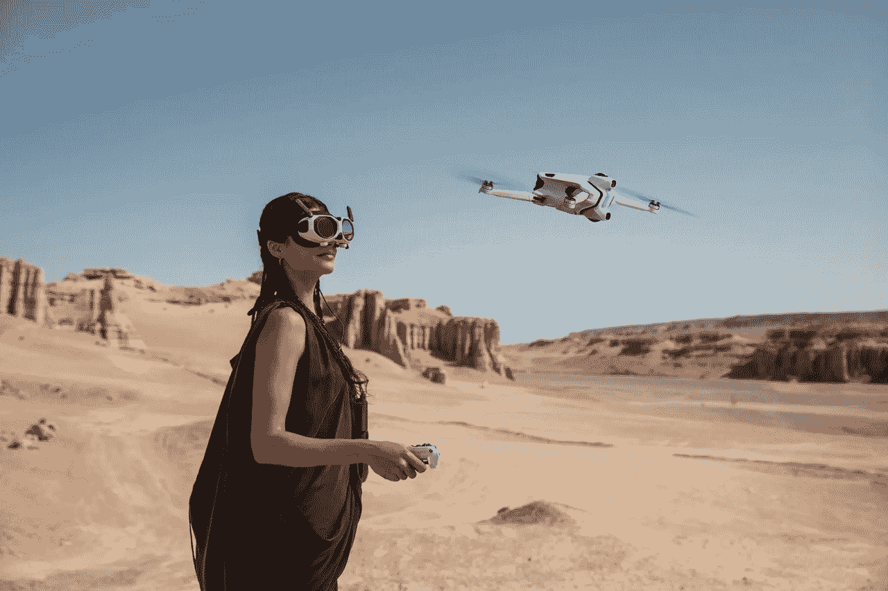

> Antigravity isn’t the first company to affix a 360-degree camera to a drone, but it calls itself the first to create a drone designed around one from the outset. The A1 ships with a pair of head-tracking goggles and a reimagined controller that can be used with one hand. That means pilots can get a drone’s eye view in any direction they like, creating a more immersive experience. And because the A1 weighs just 249 grams, U.S. buyers—and those in most other markets—won’t need to be licensed drone operators to fly one.

> Antigravity 并非第一家在无人机上安装 360 度摄像头的公司，但它自称是第一家从一开始就围绕 360 度摄像头打造无人机的公司。A1 配备一副头部追踪眼镜和一个重新设计的单手操控控制器。这意味着操控者可以从任何方向获取无人机的视角，从而打造更加沉浸式的体验。由于 A1 重量仅为 249 克，美国以及其他大多数市场的买家无需持有无人机操作执照即可驾驶。

## Apple AirPods Pro 3 - 耳中的实时翻译

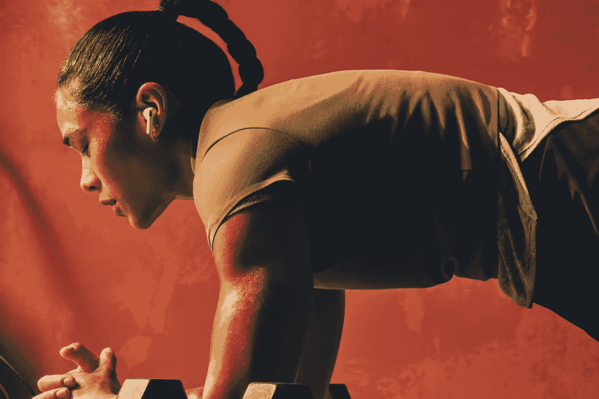

> At a certain price point, active noise cancellation earbuds perform pretty similarly. But Apple’s AirPods Pro 3, announced in September, are “a massive leap forward,” says John Ternus, Apple’s senior vice president of hardware engineering. Beyond removing twice as much background noise as the previous generation of AirPods Pro, tracking wearers’ heart rate using a photoplethysmography pulse sensor, and serving as a hearing aid if needed, the headphones’ new Live Translation feature can interpret a conversation between French, German, Portuguese, Spanish, or English-speaking friends instantly using Apple Intelligence. Italian, Japanese, Korean, and Chinese are coming by year’s end.

> 在特定价位上，主动降噪耳机的表现相当相似。但苹果硬件工程高级副总裁约翰·特纳斯 (John Ternus) 表示，苹果 9 月发布的 AirPods Pro 3 是“一次巨大的飞跃”。除了比上一代 AirPods Pro 消除两倍的背景噪音、使用光电容积脉搏传感器追踪佩戴者的心率，并在需要时充当助听器之外，这款耳机新增的实时翻译功能还可以利用 Apple Intelligence 即时翻译法语、德语、葡萄牙语、西班牙语或英语朋友之间的对话。意大利语、日语、韩语和中文版本将于年底推出。

## Belkin Stage PowerGrip - 指向充电

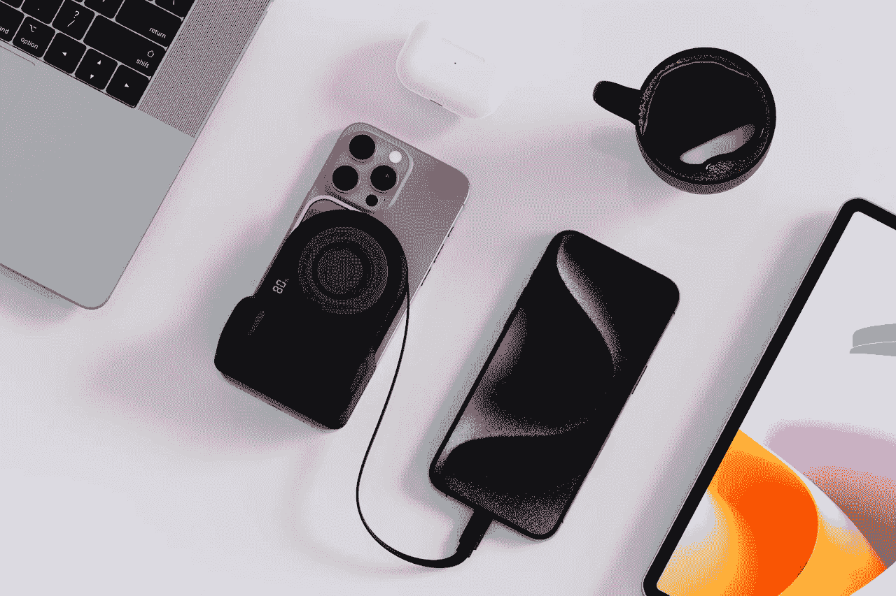

> This handy smartphone accessory does double duty while magnetically attached to a smartphone. It’s a backup battery that can wirelessly recharge phones (and other devices via a retractable cable and USB port). And it’s a content creation tool, mimicking the shape of an old-school camera to make it easier to point and shoot, and with a big Bluetooth-enabled shutter button. It’s made for content creators on the go, says Belkin’s Logan Olson, and it turns out that’s “a large segment of people.” The Powergrip can also function as a phone stand and is tripod-compatible.

> 这款便捷的智能手机配件磁吸式吸附在智能手机上，兼具双重功能。它既是备用电池，可以为手机无线充电（也可以通过伸缩线缆和 USB 接口为其他设备充电）。它同时也是一款内容创作工具，模仿老式相机的造型，方便对准和拍摄，并配有一个支持蓝牙的大型快门按钮。Belkin 的 Logan Olson 表示，这款产品专为忙碌的内容创作者打造，事实证明，这类人群“占了很大一部分”。Powergrip 还可以用作手机支架，并兼容三脚架。

## Belkin Switch 2 充电盒 - 延长游戏时间

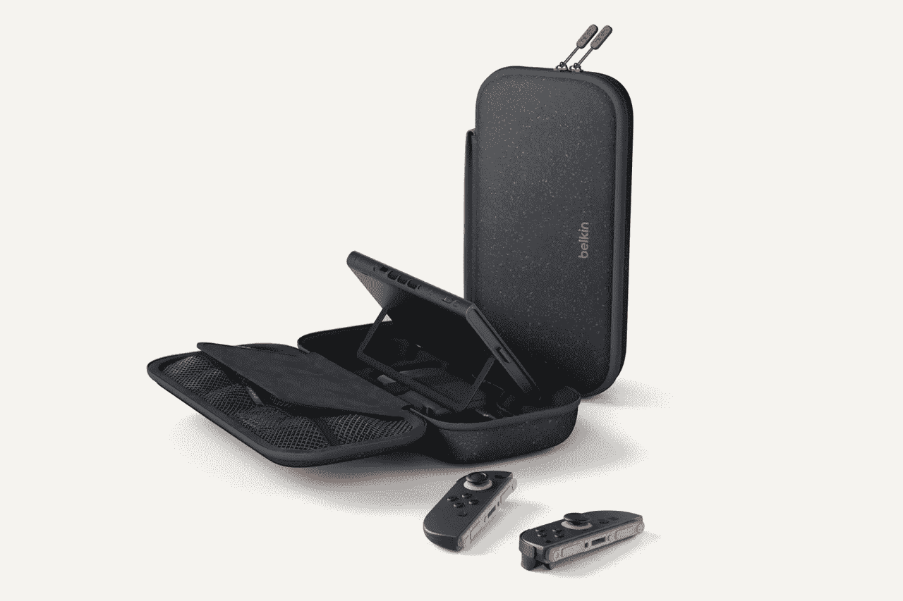

> [T](https://bsky.app/profile/matpiscatella.bsky.social/post/3lun37i6gok2k)he Nintendo Switch 2 is the fastest-selling video game hardware device in U.S. history. There’s just one problem: the on-the-go console runs out of juice often. “We knew battery, which was already an issue on the Switch 1, was going to be even more of an issue on the Switch 2,” says Logan Olson, Belkin’s director of product management for future ventures. Belkin, a third-party tech accessories firm, made a charging case for the console with a removable 10,000mAh power bank—enough to recharge the handheld 1.5 times. The case also has space for 12 game cards and an AirTag.

> 任天堂 Switch 2 是美国历史上销售最快的电子游戏硬件设备 。但它有一个问题：这款便携游戏机经常会没电。“我们知道电池问题在 Switch 1 上就已经是个问题，而 Switch 2 上的问题会更加严重，”贝尔金未来产品管理总监 Logan Olson 说道。第三方科技配件公司贝尔金为这款游戏机制作了一个充电盒，带有一个可拆卸的 10,000 毫安时移动电源，足以为这款掌上游戏机充电 1.5 次。充电盒还可以容纳 12 张游戏卡和一个 AirTag。

## **Biwin Mini SSD** - 小驱动器中的大存储

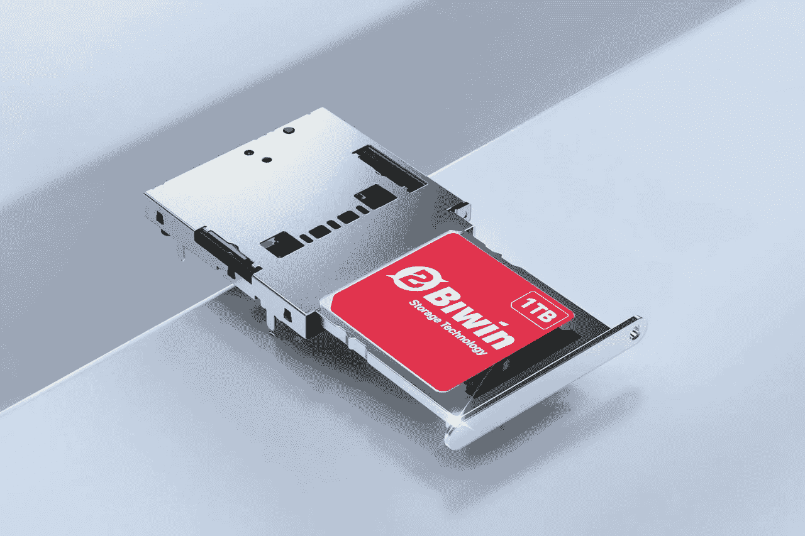

> Ti[ny gadge](https://www.biwintechnology.com/product/mini-ssd/)ts and handheld c[onsoles ](https://www.biwintechnology.com/product/mini-ssd/)need desktop-level storage, but a whole lot smaller. Biwin’s Mini SSD crams up to 2TB of storage into an NVMe drive the size of a micro-SIM card. “We brought this thing down to the size of a coin,” says Will Lin, director of Biwin Storage Technology USA. Its 15mm by 17mm by 1.4mm land-grid-array slab has 3,700 MB/s of read speed in a tiny footprint. The drive comes in three sizes: 512GB, 1TB, and 2TB. While Lin can’t disclose clients, major gaming handheld manufacturer GPD has said publicly that it’s already using the Biwin Mini SSD.

> 微型设备和手持游戏机需要桌面级的存储空间，但容量要小得多。Biwin 的 Mini SSD 可将高达 2TB 的存储空间塞进一个微型 SIM 卡大小的 NVMe 硬盘中。“我们把它缩小到了硬币大小，”Biwin Storage Technology USA 总监 Will Lin 说道。它采用 15 毫米 x 17 毫米 x 1.4 毫米的平面栅格阵列板，在极小的空间内实现了 3,700 MB/s 的读取速度。该硬盘有三种容量：512GB、1TB 和 2TB。虽然 Lin 无法透露客户，但大型游戏手持设备制造商 GPD 已公开表示，他们已经在使用 Biwin Mini SSD。

## **Camp Snap** - 无屏幕数码相机

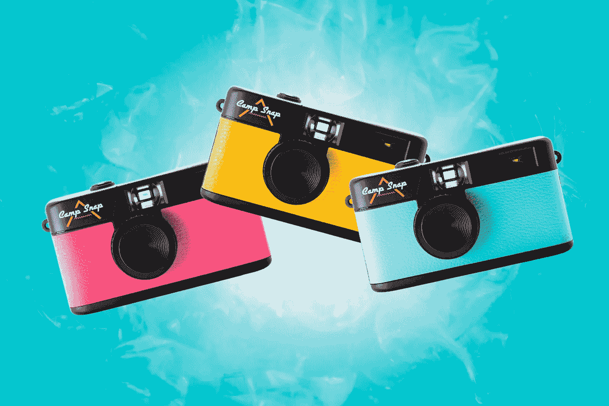

> Nostalgic for childhood summers taking photos without filters, parents Brian and Melanie Waldman created Camp Snap, a kid-friendly, screen-free digital camera. A modern take on film and disposable cameras, the Snap is a point and shoot that takes 500 shots per USB-C charge. With schools and summer camps increasingly adopting screen-free policies, the camera provides a valuable alternative. “We wanted our own kids to experience that freedom while still capturing memories,” says Brian, the company’s CEO. This year, the company added a Pro version and a screen-free digital video camera to its lineup.

> 怀念童年夏天无滤镜拍照的时光，父母布莱恩和梅兰妮·沃尔德曼发明了 Camp Snap，这是一款儿童友好型无屏幕数码相机。Snap 是对胶卷和一次性相机的现代诠释，是一款傻瓜相机，每次通过 USB-C 充电可拍摄 500 张照片。随着学校和夏令营越来越多地采用无屏幕政策，这款相机提供了一个宝贵的替代方案。“我们希望我们的孩子也能体验到这种自由，同时还能捕捉美好的回忆，”公司首席执行官布莱恩说道。今年，公司在其产品线中新增了 Pro 版本和无屏幕数码摄像机。

## Fujifilm Instax Wide Evo - 模拟与数字的结合

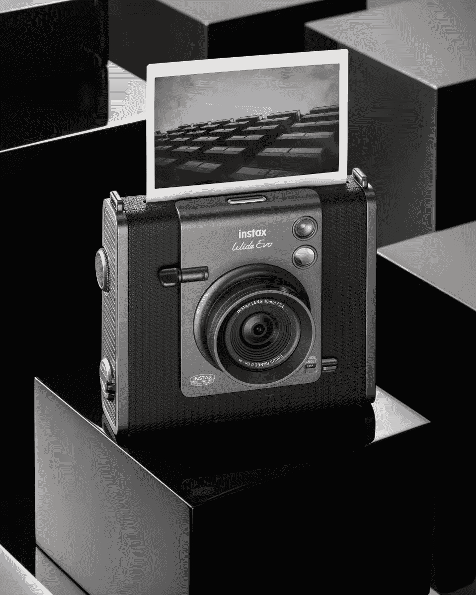

> This [camera combines](https://www.instaxus.com/cameras/instax-wide-evo/) [slick di](https://www.instaxus.com/cameras/instax-wide-evo/)gital features with instant photography nostalgia, letting you hold memories nearly as fast as you can capture (and filter) them. Building on its Mini Evo smartphone printer, the Instax Wide Evo features a 15.67 mm extra-wide lens, the ability to customize light and color gradient using “degree control,” and 10 additional lens effects. Users can snap their own pictures or upload them via Bluetooth, then make adjustments on the 3.5-inch LCD screen before using the “print crank” to physically begin the printing process.

> 这款相机将精巧的数码功能与即时摄影的怀旧感完美结合，让您几乎可以像捕捉（和过滤）回忆一样快速地留住它们。Instax Wide Evo 以 Mini Evo 智能手机打印机为基础，配备 15.67 毫米超广角镜头，能够通过“度数控制”自定义光线和色彩渐变，并新增 10 种镜头效果。用户可以自行拍摄照片或通过蓝牙上传，然后在 3.5 英寸 LCD 屏幕上进行调整，最后使用“打印曲柄”开始打印。

## Hisong AirStudio S1 - 无线音乐制作

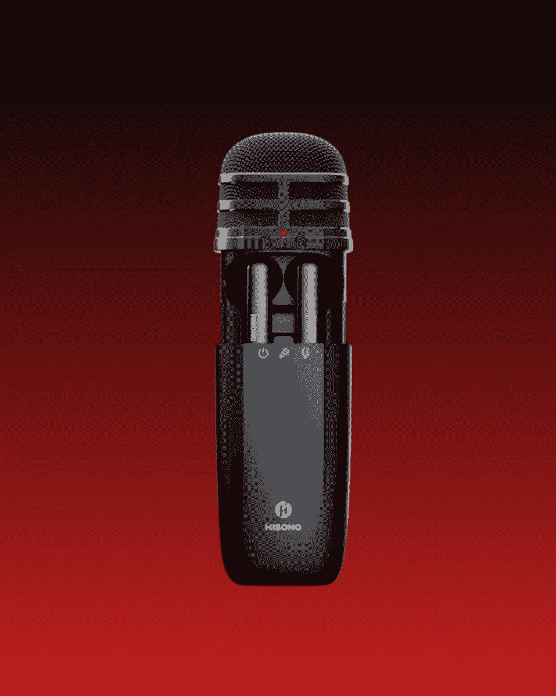

> Most studios are full of cables and cords connecting mics, mixers, and monitors. This “mobile recording capsule” reimagines recording for the wireless age, integrating condenser and enhanced dynamic microphones, wireless in-ear monitors, and an audio interface. The AirStudio S1’s low wireless latency makes it possible to create studio-grade recordings anywhere, Hisong claims. Every musician should “experience the joy of creating music without wires, complicated setups, or technical hurdles—just pure creativity,” founder Carlos Ye says. (A companion app supports advanced mixing functions; the product is compatible with audio mixing software like Pro Tools and Garage Band.)

> 大多数录音棚里都堆满了连接麦克风、调音台和监听音箱的线缆。这款“移动录音舱”重新定义了无线时代的录音方式，集成了电容式麦克风、增强型动圈麦克风、无线入耳式监听音箱以及音频接口。Hisong 声称，AirStudio S1 的低无线延迟使其能够在任何地方进行录音棚级录音。创始人 Carlos Ye 表示，每位音乐人都应该“体验无需线缆、复杂设置或技术障碍即可创作音乐的乐趣——纯粹的创造力”。（配套应用程序支持高级混音功能；该产品兼容 Pro Tools 和 Garage Band 等音频混音软件。）

## Huawei Pura 80 Ultra - 尖端的智能手机摄像头

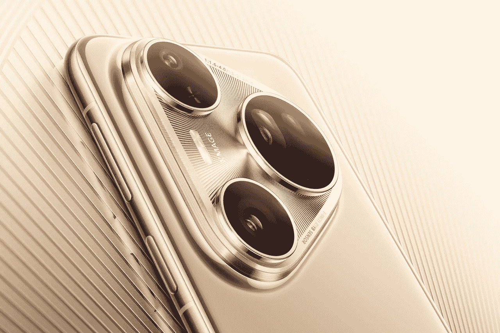

> Huawei’s Pura 80 Ultra is a smartphone for people who mostly use theirs for documenting the world around them. “We’ve developed an amazing camera that also happens to be a smartphone,” says Andreas Zimmer, Huawei’s head of product in Europe. Launched in July and featuring an industry-first switchable dual telephoto camera, the Pura 80 Ultra mimics the mechanics of a digital camera in miniature. Its two lenses offer 3.7x and 9.4x magnification for sharper shots, its one-inch sensor captures more light, and it can distinguish 1.5 million colors. The result? Richly detailed, vibrantly colored photos and videos in any lighting.

> 华为 Pura 80 Ultra 是一款专为那些主要用手机记录周围世界的人设计的智能手机。“我们开发了一款令人惊叹的相机，它恰好也是一款智能手机，”华为欧洲产品负责人 Andreas Zimmer 说道。Pura 80 Ultra 于今年 7 月上市，搭载业界首款可切换的双长焦摄像头，其结构模拟了微型数码相机的原理。它的两个镜头分别提供 3.7 倍和 9.4 倍的放大倍率，可拍摄出更清晰的照片；其 1 英寸传感器可捕捉更多光线，并能区分 150 万种颜色。效果如何？在任何光线下都能拍出细节丰富、色彩鲜艳的照片和视频。

## Littpopo MicroCam X1 - 袖珍显微镜摄像头

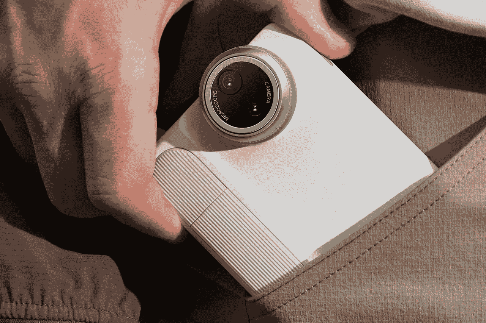

> Watchi[ng their yo](https://littpopo.com/products/digital-microscope-camera)un[g ](https://littpopo.com/products/digital-microscope-camera)daughter invent fairytale worlds around fallen leaves, parents-turned-founders Eva Hu and Sam Chan set out to lure kids off couches and into nature with a tool that rewards curiosity rather than screen time. The MicroCam X1 packs a 400x digital microscope, 3-centimeter macro lens, and 4K video camera into a 160 gram, drop-proof shell. “We wanted the device to be very tough for backyard or outdoor exploration,” Hu says. The intuitive design—you twist the camera barrel 180 degrees to swap modes—makes it easy to capture microscopic movies on a palm-sized display. Littpopo has already shipped about 2,000 units to families and classrooms.

> 看着年幼的女儿在落叶周围编织出一个个童话世界，由父母转型为创始人的 Eva Hu 和 Sam Chan 决定用一款激发好奇心而非沉迷于屏幕的工具，吸引孩子们离开沙发，走进大自然。MicroCam X1 将 400 倍数码显微镜、3 厘米微距镜头和 4K 摄像机集成在一个 160 克的防摔外壳中。“我们希望这款设备非常坚固耐用，适合在后院或户外探险，”Eva Hu 说道。这款设备设计直观——只需旋转 180 度即可切换模式——只需在掌上显示屏上轻松捕捉微观影像。Littpopo 已向家庭和课堂售出约 2,000 台。

## Nothing Headphone (1) - 声音和设计的清晰度

> Hig[h-end headpho](https://us.nothing.tech/products/headphone-1)[nes tend to b](https://us.nothing.tech/products/headphone-1)e made of lightweight plastics in neutral colors. British brand Nothing eschews this mass-market logic with its Headphone (1), over-ear headphones with rectangular, translucent earcups and metal components. Veteran audio firm KEF helped make the headphones sound superb, while Nothing’s industrial designers ensured every physical control is distinguishable by touch alone. Co-founder and CEO Carl Pei describes Nothing’s design aesthetic as “retrofuturistic engineering meets human warmth,” and says most of the company’s customers are young creatives. “We don't have to be liked by everybody,” Pei says, “But we have to have a group of people who really love us.”

> 高端耳机往往采用中性色的轻质塑料制成。英国品牌 Nothing 的 Headphone (1) 则打破了这种大众市场逻辑。这款头戴式耳机采用矩形半透明耳罩和金属部件。老牌音响公司 KEF 助力打造出这款音质卓越的耳机，而 Nothing 的工业设计师则确保每个物理控制按钮都可以通过触摸轻松区分。联合创始人兼首席执行官 Carl Pei 将 Nothing 的设计美学描述为“复古未来主义工程与人性化温暖的结合”，并表示公司的大部分客户都是年轻的创意人士。“我们不必让每个人都喜欢我们，”Pei 说，“但我们必须拥有一群真正爱我们的人。”

## **Pentax 17** - 适合智能手机一代的有趣胶片照片

> Pe[ntax is t](https://pentax.eu/products/pentax-17)[he fir](https://pentax.eu/products/pentax-17)st major camera maker to release a new 35mm film camera in almost two decades. The Pentax 17 is a half-frame camera, so users get 72 shots from a 36-exposure film, and its vertical orientation is ideally suited to a generation whose default camera is a smartphone. “This is a quality product designed to give you many years of pleasure,” says Ken Curry, president of Pentax owner Ricoh Imaging North America. Having to wait for your film to be developed is part of the appeal, Curry says. “Delayed gratification is a novelty these days.”

> 宾得是近二十年来首家推出全新 35 毫米胶片相机的大型相机制造商。 宾得 17 是一款半画幅相机，用户可以使用 36 张胶片拍摄 72 张照片，其竖屏模式非常适合以智能手机为默认相机的一代人。宾得母公司理光影像北美总裁肯·库里表示：“这是一款高品质产品，旨在为您带来多年的愉悦体验。”库里表示，等待胶片冲洗的过程也是其吸引力之一。“如今，延迟满足是一种新鲜事物。”

## Samsung Micro RGB - 超逼真的电视

> Most premium TVs still rely on a single, large white or blue backlight filtered through color layers, a setup that can mute vibrancy and waste energy. Samsung’s new Micro RGB TV instead uses individually controlled red, green, and blue LEDs tens of microns wide, giving richer, more lifelike colors and cutting power use by 20%. “Micro RGB is a breakthrough in premium TV technology,” says Taeyong Son, EVP of Samsung’s Visual Display Business. The first set of Micro RGB TVs ship this year for $29,999 and render images nearly indistinguishable from real life. Samsung’s glare-free glass and an on-board AI engine further refine each scene’s crispness and color.

> 大多数高端电视仍然依赖于单一、大的白色或蓝色背光，并通过色彩层进行过滤，这种设置会降低画面的活力并浪费能源。三星新款 Micro RGB 电视则采用了数十微米宽的红、绿、蓝三色 LED 灯珠，分别独立控制，呈现出更丰富、更逼真的色彩，并将功耗降低 20%。“Micro RGB 是高端电视技术的一次突破，”三星视觉显示业务执行副总裁孙泰勇表示。首批 Micro RGB 电视将于今年上市，售价 29,999 美元，其呈现的图像几乎与真实画面难以区分。三星的防眩光玻璃和内置 AI 引擎进一步优化了每个场景的清晰度和色彩。

## Shokz OpenRun Pro 2 - 更高水平的骨传导耳机

> Bone conduction headphones—which keep the ear canal open so listeners can enjoy music while staying aware of their surroundings—are having a moment. But the trade-off has historically been audio quality, especially bass. Shokz’s OpenRun Pro 2 “solves a long-standing problem of having to compromise either situational awareness or immersive audio,” says Shokz spokesperson Jayme Schwartz. The standout feature is the brand’s new DualPitch technology, which combines bone conduction for crisp mids and highs with air conduction for richer lows. Since launching in August 2024, Shokz has sold 630,000 units in North America and 1.8 million globally.

> 骨传导耳机——保持耳道畅通，让听众在欣赏音乐的同时还能感知周围环境——正风靡一时。但一直以来，这种耳机的音质，尤其是低音，一直是其痛点。Shokz 发言人 Jayme Schwartz 表示，Shokz 的 OpenRun Pro 2“解决了长期以来必须在情境感知和沉浸式音频之间做出妥协的问题”。该品牌的全新 DualPitch 技术尤为突出，它将骨传导技术（带来清脆的中音和高音）与气导技术（带来更浑厚的低音）相结合。自 2024 年 8 月上市以来，Shokz 在北美已售出 63 万台，全球销量达 180 万台。

## Tecno Megabook S14 - 羽量级笔记本电脑

> Weighing in at less than 2 lbs., this Chinese-made 14-inch OLED laptop stakes a claim as the lightest laptop on the market. (Apple’s 13-inch MacBook Air weighs 2.7 lbs.) But the device offers more than just that superlative. The S14 comes with Tecno’s proprietary AI model, which can perform AI-assisted tasks like meeting transcriptions, document analysis, and text- and voice-assisted photo search—all without an internet connection. “What sets this product apart is its ability to work intelligently even offline—whether you’re on a plane, in a remote village, or simply prioritizing privacy,” says Daniel Kang, Tecno’s PC product director.

> 这款中国制造的 14 英寸 OLED 笔记本电脑重量不到 2 磅，堪称市面上最轻的笔记本电脑。（苹果 13 英寸 MacBook Air 重 2.7 磅。）但这款设备的功能远不止如此。S14 搭载了 Tecno 专有的 AI 模型，可以执行 AI 辅助任务，例如会议记录、文档分析以及文本和语音辅助的照片搜索——所有这些都无需互联网连接。“这款产品的与众不同之处在于它即使在离线状态下也能智能工作——无论您是在飞机上、在偏远的村庄，还是仅仅在需要保护隐私的情况下，”Tecno 的 PC 产品总监 Daniel Kang 说道。

## The Light Phone III - 无干扰的 5G 手机

> Light co-founder Kaiwei Tang used to work for Nokia, but “I quit my job because I don’t see the point of making a new phone every six months,” he says. Light makes minimalist devices. Its previous phones could do little more than make calls or texts, with an e-ink display and multi-day battery life. Launched in April, the Light Phone III also pares back functionality to minimize distractions, but has more of the features customers expect from a modern-day phone, including a camera, basic GPS navigation, 5G hotspot capabilities, and a Yellow Pages-like directory—but no browser or social media apps.

> Light 联合创始人唐凯伟曾在诺基亚工作，但“我辞职了，因为我觉得每六个月就推出一款新手机毫无意义，”他说。Light 致力于打造极简主义的设备。其之前的手机除了打电话和发短信之外，几乎没有其他功能，配备电子墨水显示屏和长达数天的电池续航时间。今年 4 月推出的 Light Phone III 也削减了功能以最大程度地减少干扰，但拥有更多用户对现代手机的期望，包括摄像头、基本的 GPS 导航、5G 热点功能以及类似黄页的目录——但没有浏览器或社交媒体应用程序。

## Unihertz Jelly Star - 非常小的智能手机

> The Jelly Star is proof that smartphones don’t have to look the same. Chinese company UniHertz bills the device as the world’s smallest Android phone; with a three-inch display, it’s about the size of a credit card. The mobile market is “overwhelmed with large screens,” UniHertz CEO Stephen Xu says. But Jelly Star also stands out with a backside featuring a colorful translucent casing and LED light that pulses in sync with ringtones, notification sounds and music. Although it can operate the same apps as a full-sized smartphone, some users are embracing the tiny screen as a way to limit their scrolling.

> Jelly Star 证明了智能手机不必千篇一律。中国公司 UniHertz 称其为全球最小的安卓手机；它配备三英寸显示屏，大小与信用卡相当。UniHertz 首席执行官 Stephen Xu 表示，移动市场“充斥着大屏幕”。但 Jelly Star 的背面也同样引人注目，它采用彩色半透明外壳，并配有 LED 灯，可与铃声、通知音和音乐同步闪烁。虽然它可以运行与全尺寸智能手机相同的应用程序，但一些用户仍然喜欢小屏幕，因为它可以减少滚动屏幕的次数。

# Crypto & Blockchain 加密与区块链

## **Swear** - 防篡改视频认证

> Deepfake disinformation erodes public trust. Swear’s digital DNA fingerprints every pixel, audio sample, and metadata in real time when you take a video, and writes the hashes to the blockchain, so any later tweak—even one single bit—shows up instantly. The tech only adds a megabyte of data per hour of footage, so bodycams and CCTV can adopt it with no hardware changes. “If you’re going to become the internet’s notary, you have to put your stake on the strongest technologies,” says founder Jason Crawforth. Swear is piloting with U.S. security companies like Milestone, Axis, and ESI Convergent, and aims to bake its hashes into every smartphone camera next.

> Deepfake 虚假信息侵蚀公众信任。Swear 的数字 DNA 会在用户拍摄视频时实时记录每个像素、音频样本和元数据，并将哈希值写入区块链，因此任何后续调整——哪怕只有一比特——都会立即显示。该技术每小时拍摄的视频仅增加 1MB 的数据，因此执法记录仪和闭路电视监控系统无需任何硬件改动即可采用。“如果你想成为互联网的公证人，就必须押注于最强大的技术，”创始人 Jason Crawforth 说道。Swear 正在与 Milestone、Axis 和 ESI Convergent 等美国安全公司合作进行试点，并计划将其哈希值嵌入到每部智能手机摄像头中。

# **Design 设计**

## Aurzen Zip 三折便携式迷你投影仪 - 随时随地的娱乐

> From wallets to laptops, the key to portability is foldability. Entertainment is no exception, according to projection technology company Aurzen, whose new pocket-sized Aurzen Zip tri-fold projector puts projection in the palm of your hand. It features a patented Z-shaped design, Wi-Fi-free screen mirroring, zero-latency auto-focus, a full-screen vertical mode tailored to playing TikToks, and it unfolds into a built-in adjustable stand that makes tripods obsolete. “Whether I’m projecting a family slideshow or sharing a quick game session with friends on a road trip, Zip turns ordinary moments into shared adventures,” says Mike Zeng, Zip’s product director.

> 从钱包到笔记本电脑，便携性的关键在于可折叠性。投影技术公司 Aurzen 表示，娱乐领域也不例外。该公司全新推出的袖珍型 Aurzen Zip 三折投影仪，让投影体验尽在掌中。它采用获得专利的 Z 形设计，支持 Wi-Fi 无线屏幕镜像、零延迟自动对焦、专为播放抖音短视频定制的全屏竖屏模式，并可展开成内置可调节支架，让三脚架成为过去。Zip 产品总监 Mike Zeng 表示：“无论是投影家庭幻灯片，还是在旅途中与朋友快速分享游戏，Zip 都能将平凡的瞬间变成共同的冒险。”

## **Hedgehog Go** - 功能强大的旅行尺寸吹风机

> The[ discomfort](https://us.hedgehogdryer.com/products/hedgehog-go-new) of squelchy wet s[ocks or dam](https://us.hedgehogdryer.com/products/hedgehog-go-new)p gear can be an offputting problem during outdoor sports, but travel-sized dryer Hedgehog Go, which can be used on boots, gear, and hair, offers solace. The 12.3 oz. dryer with adjustable heat settings pushes out air at more than 60 m.p.h. through its 105,000 rpm fan, and comes with interchangeable nozzles. “We have 11 patents on the different systems we use,” says Hedgehog founder Bjorn Holte. The device was funded through Kickstarter and is now shipping to backers.

> 在户外运动中，湿漉漉的袜子或潮湿的装备带来的不适感可能令人不快，但旅行装的 Hedgehog Go 吹风机却能帮您解决这一难题。它可用于吹干靴子、装备和头发。这款 12.3 盎司（约 377 克）的吹风机配有可调节的热量设置，通过 105,000 转/分的风扇以超过 60 英里/小时（约 96 公里/小时）的速度吹出风力，并配有可更换的喷嘴。“我们使用的不同系统拥有 11 项专利，”Hedgehog 创始人 Bjorn Holte 说道。该设备由 Kickstarter 众筹，目前正在向支持者发货。

## Impact Acoustic Spark - 吸音灯

> Lighting impacts how rooms look and feel—and sound, if this pendant lamp is hanging around. Introduced this year by Swiss sound-management company Impact Acoustic, the Spark comes in five sizes and 36 colors, and delivers “exceptional sound absorption,” co-founder and CEO Sven Erni says. The lamp’s porous material absorbs ambient noise, reducing reverberations to create more acoustically-focused workspaces. What’s functional and chic is also sustainable: The Spark is made with felt the company crafts from up-cycled plastic bottles, and manufactured without adhesives for easy disassembly and full recyclability.

> 灯光会影响房间的外观和氛围，如果悬挂这款吊灯，声音效果也会受到影响。Spark 吊灯由瑞士音响管理公司 Impact Acoustic 于今年推出，共有五种尺寸和 36 种颜色，其联合创始人兼首席执行官 Sven Erni 表示，它拥有“卓越的吸音效果”。这款吊灯的多孔材质能够吸收环境噪音，减少混响，从而打造更注重声学效果的工作空间。它兼具实用性和时尚感，同时兼具可持续性：Spark 吊灯采用公司利用回收塑料瓶制作的毛毡制成，无需使用粘合剂，易于拆卸，可完全回收利用。

## Infinite Machine Olto - 一种在城镇中快速穿梭的方式

> In [the ](https://www.infinitemachine.com/olto?lp_location=wf)world of micro-mobility v[ehic](https://www.infinitemachine.com/olto?lp_location=wf)les, there’s now a dizzying array of mopeds, e-bikes, and scooters to choose from. The futuristic Olto combines features of all three in one slick design. Weighing 176 pounds (swappable battery included) and spacious enough for two passengers, it’s bike lane-legal and doesn’t require a license, registration, or insurance. Its 40-mile battery range can zip you to work as fast as 33 miles per hour. “To get people out of cars, you need alternatives,” says Infinite Machine co-founder Joseph Cohen. Olto aims to include several of the best.

> 在微型交通工具领域，如今有琳琅满目的轻便摩托车、电动自行车和踏板车可供选择。充满未来感的 Olto 将这三种车型的特点融入到一款时尚的设计中。它重 176 磅（含可更换电池），空间宽敞，可容纳两名乘客，可在自行车道上合法行驶，无需驾照、登记或保险。其 40 英里的电池续航里程可让您以每小时 33 英里的速度快速到达工作地点。“要让人们放弃汽车，你需要其他选择，”Infinite Machine 联合创始人 Joseph Cohen 说道。Olto 的目标是囊括其中的几款最佳车型。

## Moft Snap-on 手机支架和钱包 - 折纸 MagSafe 钱包

> Moft’s clever magsafe wallet has enough space for two credit cards—or a handful of bills—in the small vegan leather slab that attaches to the iPhone’s MagSafe connector, leaving your camera clear for quick snaps. The 6 mm thick origami-inspired design also unfolds into three separate angles to act as a stand for your phone on a flat surface. That’s ideal for taking selfies, watching YouTube, or scrolling through social media. It comes in 27 modern colors, including terracotta, lavender, and soft avocado. And at just over 2 oz., it’s a barely noticeable addition to your pocket.

> Moft 的这款 MagSafe 钱包设计精巧，小巧的人造皮革材质足以容纳两张信用卡或几张钞票，并可连接到 iPhone 的 MagSafe 接口，让你的相机保持清晰，方便快速拍照。这款 6 毫米厚的钱包采用折纸设计，可展开成三个不同的角度，可作为手机支架，放置在平面上。非常适合自拍、观看 YouTube 或浏览社交媒体。钱包提供 27 种时尚配色，包括赤土色、薰衣草色和软牛油果色。重量仅 2 盎司多一点，放在口袋里几乎不会显得突兀。

## NordicTrack Ultra 1 - 顶级跑步机

> The typical treadmill is all function and no form. The super-sleek NordicTrack Ultra 1 offers plenty of both. Released earlier this year for NordicTrack’s 50th anniversary, the machine features metal and hardwood uprights, brass control handles, dual vertical fans for full-body cooling, a control hub decoupled from the deck for vibration-free running, a 24-inch touchscreen that pivots to support non-treadmill workouts, and an eight-speaker surround sound system. Although the bestselling NordicTrack Commercial 1750 also has impressive features—and for a fraction of the price: $2,799 compared to $15,000—it can’t compete on style.

> 典型的跑步机只注重功能，不注重外形。超薄的 NordicTrack Ultra 1 兼具了两者。这款跑步机于今年早些时候为庆祝 NordicTrack 成立 50 周年而推出，采用金属和硬木立柱、黄铜控制手柄、用于全身冷却的双垂直风扇、与跑板分离的控制中心（可实现无振动跑步）、可旋转以支持非跑步机锻炼的 24 英寸触摸屏以及八扬声器环绕音响系统。虽然畅销的 NordicTrack Commercial 1750 也拥有令人印象深刻的功能（而且价格仅为其一小部分：2,799 美元，而 NordicTrack 1750 的价格为 15,000 美元），但它在外观设计上却无法与 NordicTrack 1750 相媲美。

## **Quip Ultra** - 智能电动牙刷

> Replacing electric toothbrush heads usually means substituting the neck up. That’s “like changing half your car when you need it serviced,” says Tom Johnstone, CMO at Quip. The Quip Ultra is a sonic electric toothbrush with replaceable brush “pods.” Not much bigger than the bristles, these heads reduce toothbrush waste by 70%, Quip says. A haptic strip on the handle lets users adjust power and set timers as easily as scrolling on a classic iPod, the wireless charging dock and magnetic mirror mount are elegant bathroom decor, and a connected app tracks your brushing habits with feedback for cleaner teeth.

> 更换电动牙刷刷头通常意味着更换刷颈。Quip 首席营销官汤姆·约翰斯通 (Tom Johnstone) 表示，这“就像在需要保养时更换半辆汽车一样”。Quip Ultra 是一款声波电动牙刷，配有可更换的刷头“胶囊”。Quip 表示，这些刷头比刷毛大不了多少，可以减少 70% 的牙刷浪费。手柄上的触觉条让用户可以像在经典 iPod 上滚动一样轻松地调节功率和设置定时器；无线充电底座和磁性镜架是浴室的优雅装饰；连接的应用程序可以跟踪您的刷牙习惯并提供反馈，帮助您清洁牙齿。

## Samsung The Frame Pro - 完美融合的无线电视

> Building on its predecessor’s success, Samsung’s The Frame Pro, released in April, tries to make technology less intrusive in your home. It mounts with a customizable fra[me to mi](https://www.samsung.com/us/lifestyle-tvs/the-frame/85-inch-class-the-frame-pro-neo-qled-4k-tv-ls03fw-sku-qn85ls03fwfxza/)mic a gallery wall, blending in with framed photographs and artwork, and can display art from museum collections when asleep. It also has 4K resolution, a speedy 120 Hz refresh rate, and a slew of other tools that make it competitive with other smart TVs. But a sleek-looking television is no good if unsightly cables trail from its frame. The Wireless One Connect Box can sit up to 30 feet away and beam signals to the TV, no strings attached—literally.

> 继上一代产品的成功之后，三星于今年四月发布的 The Frame Pro 电视，致力于降低科技产品对家居环境的干扰。它采用可定制的框架，模拟画廊墙面，与相框中的照片和艺术品完美融合，即使在睡眠状态下也能展示博物馆藏品。此外，它还拥有 4K 分辨率、120 Hz 的快速刷新率以及一系列其他功能 ，使其在与其他智能电视的竞争中脱颖而出。然而，如果电视机的框架上拖着难看的线缆，那么即使外观时尚，也无济于事。Wireless One Connect Box 可以放置在距离电视机 30 英尺（约 9 米）远的地方，并将信号传输到电视机，完全免费——真的。

## Speedo Sunny G Mariner Mirrored - 时尚的游泳镜

> Who said swim goggles have to look, and feel, like swim goggles? Eschewing utilitarian design, Speedo’s Sunny G Mariner Mirror Goggles both resemble and act like aviator sunglasses. Users say the UV protection encourages them to keep the goggles on their face even out of the water, but they suction well in the pool, landing closer to the cheekbones than eye sockets for increased comfort. Instead of the usual rubber strap that pulls on hair, the Sunny G uses a gentler, adjustable bungee cord. Based on the brand’s popular kids’ goggles, the often sold-out Sunny Gs offer anti-fog lenses in red, blue, and green.

> 谁说泳镜必须看起来、摸起来像泳镜？Speedo 的 Sunny G Mariner Mirror 泳镜摒弃了功利主义的设计，外观和使用体验都与飞行员太阳镜相似。用户表示，其防紫外线功能让他们即使出水也能将泳镜固定在脸上，而且在泳池中吸力出色，更贴近颧骨而非眼窝，从而提升佩戴舒适度。Sunny G 摒弃了常见的会拉扯头发的橡胶带，而是采用了更柔和、可调节的弹力绳。这款经常售罄的 Sunny G 系列泳镜以该品牌备受欢迎的儿童泳镜为基础，提供红、蓝、绿三色防雾镜片。

## Squarespace Blueprint AI - 人工智能引导的网站构建器

> Consumer-friendly web design relies on templates, making every website look the same. Blueprint AI, Squarespace’s AI-guided builder, asks a handful of questions and instantly spins up unique web designs, including imagery curated by the company’s own designers, so users can tweak pages rather than start from scratch. “Great design is inherently human,” says chief product officer Paul Gubbay. “We wanted to make sure the user felt AI was enhancing their story, but wasn’t taking over for them.” More than half of new customers now begin with Blueprint, while a late-September update added in a chat element to make sites even more personally tailored.

> 消费者友好的网页设计依赖于模板，这使得每个网站看起来都千篇一律。Squarespace 的人工智能引导式构建器 Blueprint AI 只需提出几个问题，即可立即生成独特的网页设计，包括由公司内部设计师精心挑选的图像，因此用户可以调整页面，而无需从头开始。首席产品官 Paul Gubbay 表示：“伟大的设计本质上是人性化的。我们希望确保用户感受到人工智能在增强他们的故事，而不是取代他们。”现在，超过一半的新客户都开始使用 Blueprint，而 9 月下旬的更新添加了聊天元素，使网站更加个性化。

## **Telepathic Instru**ments Orchid ORC-300 - 来自 Tame Impala 的紧凑型合成器

> Tame Impala’s Kevin Parker took making music one step [further and ma](https://us.telepathicinstruments.com/products/orchid-orc-1000)d[e a new instru](https://us.telepathicinstruments.com/products/orchid-orc-1000)ment. Parker’s brainchild, the Orchid ORC-300, is a compact synthesizer with a single octave of keys that can fit in a backpack and lets players create complex chords with minimal musical expertise or technical dexterity. Why chords specifically? “Every song’s got to have chords,” Parker says, “They're the part that slows me down when I'm writing.” Although there are plenty of tools to make songs sound polished, Parker says “there aren’t many things to help with the actual genesis of the song.” The first 4,000 Orchids—released in two drops—sold out in hours.

> Tame Impala 的 Kevin Parker 将音乐制作更进一步，制作了一种新乐器。Parker 的创意 Orchid ORC-300 是一款紧凑型合成器，只有一个八度的按键，可以放入背包，让玩家即使没有太多音乐专业知识或技术灵活性也能创作出复杂的和弦。为什么特别提到和弦？“每首歌都必须有和弦，”Parker 说，“它们是让我在创作时放慢速度的部分。”尽管有很多工具可以让歌曲听起来更精致，但 Parker 表示“没有多少东西可以帮助歌曲的实际创作。”首批 4,000 台 Orchid 分两次发售，几个小时内就销售一空。

## Waiting for Ideas PP-1 - 时尚的黑胶唱机

> Co[nven](https://www.waiting-for-ideas.com/projects/pp-1-by-waiting-for-ideas)[ti](https://www.waiting-for-ideas.com/projects/pp-1-by-waiting-for-ideas)onal record players still rely on delicate tonearms that intimidate casual listeners. PP-1, a sculptural aluminum deck from Paris creative studio Waiting For Ideas, flips things—literally. Place a record upside-down on the device, and a retractable needle extends itself, with internal sensors to set the tempo at 33 or 45 rpm. “I couldn’t find a turntable I liked,” designer Jean-Baptiste Anotin says, “so I built one that’s as simple as pressing play on Spotify.” The plug-and-play table weighs about 20 lbs. and began shipping in March. A sleeker PP-2 and matching passive speakers are already on the drawing board, Anotin says.

> 传统唱片机仍然依赖于精密的唱臂，这让普通听众望而却步。PP -1 是一款由巴黎创意工作室 Waiting For Ideas 打造的雕塑铝制唱机，它可谓是颠覆了传统。将唱片倒置放置在设备上，可伸缩唱针就会自动伸出，并配有内置传感器，可将速度设置为 33 或 45 rpm。“我找不到喜欢的唱机，”设计师 Jean-Baptiste Anotin 说，“所以我做了一个，操作起来很简单，只需在 Spotify 上按一下播放键即可。”这款即插即用的唱机重约 20 磅，已于三月份开始发货。Anotin 表示，更时尚的 PP-2 和配套的无源扬声器已经在设计中。

## Yukai Engineering Nekojita FuFu - 一只可爱的猫来冷却你的汤

> This rechargeable cat robot solves an occasiona[l inconvenien](https://globalstore.ux-xu.com/products/nekojita-fufu)ce in a very adorabl[e wa](https://globalstore.ux-xu.com/products/nekojita-fufu)y. Nékojita FuFu blows air to quickly cool off steaming bowls and mugs while perching on their rims. Nékojita—which is Japanese for “cat tongue” and a reference to temperature-sensitive palates—can be set to a constant blow or random intervals, bringing a steaming hot mug to a drinkable temperature in just three minutes. CEO Shunsuke Aoki says the device is designed for parents with young children to reduce “the burden of constantly blowing on food.” Nékojita FuFu has shipped to over 5,000 customers worldwide.

> 这款可充电猫咪机器人以一种非常可爱的方式解决了偶尔出现的不便。Nékojita FuFu 会停在碗和杯子的边缘，吹气快速冷却冒着热气的碗和杯子。Nékojita（日语中意为“猫舌头”，指对温度敏感的味蕾）可以设置为持续吹气或随机间隔，只需三分钟即可将热气腾腾的杯子加热到可饮用的温度。首席执行官 Shunsuke Aoki 表示，这款设备专为有幼儿的父母设计，旨在减轻“不断吹食物的负担”。Nékojita FuFu 已向全球超过 5,000 名客户发货。

# **Education 教育**

## Edthena AI Coach - 教师助手

> Classroom teachers need to learn, too, but often don’t get adeq[uate ins](https://www.edthena.com/ai-coach-for-teachers/)tructional coaching. Ed[tech com](https://www.edthena.com/ai-coach-for-teachers/)pany Edthena created AI Coach, the latest version of which debuted with elementary school math teachers in September. They can record and upload their lessons, and then the platform—validated by researchers at the University of Virginia—analyzes audio and video and offers time-stamped feedback detailing opportunities for improvement. The goal, says Edthena CEO Adam Geller, is to “give teachers clarity on how to grow, the confidence to try new strategies, and the support to keep improving.” The research that informed the program was backed by the Gates Foundation.

> 课堂教师也需要学习，但往往得不到足够的教学指导。教育科技公司 Edthena 创建了 AI Coach ，其最新版本于 9 月在小学数学教师中首次亮相。教师可以录制并上传课程，然后该平台（经弗吉尼亚大学研究人员验证）会分析音频和视频，并提供带有时间戳的反馈，详细说明改进机会。Edthena 首席执行官亚当·盖勒表示，其目标是“让教师明确如何成长，有信心尝试新策略，并获得持续改进的支持”。该项目的研究得到了盖茨基金会的支持。

## Roli Piano System - 学习弹奏

> A piano may seem out of reach for a lot of people. It’s huge, expensive, and the learning process requires years of investment. The Roli Piano system aims to make it more accessible. The colorful, light-up keyboard is educational and engaging; a stand-mounted camera watches learners’ fingers and gives personalized feedback like a live teacher would, and the accompanying app is full of popular music. “We asked: What if the piano itself could guide you, interact with you, and grow with you over time?” says Roli senior commercial director Luke Barton. “What if learning an instrument could feel more like play than practice?”

> 对很多人来说，钢琴似乎遥不可及。它体积庞大、价格昂贵，学习过程需要多年的投入。Roli 钢琴系统旨在让钢琴更容易普及。色彩鲜艳、会发光的键盘既有教育意义又引人入胜；支架式摄像头可以观察学习者的手指，并像现场老师一样提供个性化反馈；配套的应用程序则充满了流行音乐。“我们问自己：如果钢琴本身可以引导你、与你互动，并随着时间的推移与你一起成长，那会怎样？” Roli 高级商务总监 Luke Barton 说道。“如果学习乐器的感觉更像是演奏而不是练习，那会怎样？”

## Squirrel Ai 智能自适应学习系统 - 个性化人工智能课程计划

> Squirrel Ai’s platform is based on what it calls a “large adaptive model,” a combination of education-specific AI systems, trained and ev[aluat](https://www.technologyreview.com/2019/08/02/131198/china-squirrel-has-started-a-grand-experiment-in-ai-education-it-could-reshape-how-the/)ed by human [educat](https://www.bloomberg.com/news/features/2025-09-18/ai-in-schools-a-chinese-entrepreneur-is-betting-on-algorithms-as-teachers)or[s and stu](https://learningpolicyinstitute.org/blog/addressing-teacher-shortages-insights-four-states)dents in Pre-K through 12th grade. The company has been educating more than 24 million students in China with its AI tutoring—in some cases fully supplanting in-person lessons—and is now expanding into the U.S. Unlike other AI learning tools that partner with schools, Squirrel operates its own learning centers that use AI to personalize each student’s lesson plan and testing. The company’s expansion may be buoyed, in part, by a severe shortage of teachers: In the U.S.; an estimated 400,000 open teaching positions went unfilled last year. “Our LAM engine acts as a really good teacher, someone who’s been a teacher for 20 or 30 years,” claims Joleen Liang, president of Squirrel’s U.S. division.

> 松鼠 AI 的平台基于所谓的“大型自适应模型”，即由人类教育工作者和从幼儿园到 12 年级的学生训练和评估的教育专用人工智能系统的组合。该公司一直通过其人工智能辅导教育中国超过 2400 万名学生 - 在某些情况下完全取代了面对面授课 - 目前正在向美国扩张 。与其他与学校合作的人工智能学习工具不同，松鼠 AI 运营着自己的学习中心，使用人工智能为每个学生制定个性化的课程计划和测试。该公司的扩张可能部分受到教师严重短缺的推动：在美国，去年估计有 40 万个开放的教学职位空缺。松鼠 AI 美国分部总裁 Joleen Liang 声称：“我们的 LAM 引擎就像一位非常优秀的老师，一位已经当了 20 或 30 年老师的人。”

## **Superfluent** - 对话式语言学习应用

> When [Superfluent](https://www.superfluent.com/)[ founder Sa](https://www.superfluent.com/)m Nevada moved to Denmark, he found learning conversational Danish from apps—most of which are vocabulary-based—frustrating. “I could say, ‘The bear is having ice cream in a red car,’ but I couldn’t actually do much more than that,” he says. When large language models like ChatGPT arrived, Nevada saw an opportunity to create something more useful for daily life. Superfluent, built on a combination of OpenAI’s and Google’s models, uses conversational AI to assess users’ fluency and create appropriate dialogue scenarios, like ordering a coffee in a cafe, or inviting a friend to a party. Each lesson takes around five minutes.

> Superfluent 创始人 Sam Nevada 移居丹麦后，发现用大多数基于词汇的应用程序学习丹麦语会话令人沮丧。“我能说，‘熊在一辆红色汽车里吃冰淇淋’，但实际上我只能做到这些，”他说。当像 ChatGPT 这样的大型语言模型出现时，Nevada 看到了创造更贴近日常生活的语言的机会。Superfluent 结合了 OpenAI 和谷歌的模型，利用会话式人工智能评估用户的流利程度，并创建合适的对话场景，例如在咖啡馆点咖啡，或邀请朋友参加派对。每节课大约需要五分钟。

## Turnitin Clarity - 课堂人工智能护栏

> As [concern](https://www.turnitin.com/products/feedback-studio/clarity)s[ ab](https://www.turnitin.com/products/feedback-studio/clarity)out AI-fueled cheating mount, Turnitin is trying to use the technology to support writing students and educators. Clarity, software now being piloted by scores of high schools and universities, features a digital platform where students draft assignments, and—when teachers permit—access approved AI tools that provide feedback rather than answers. Educators can review version histories to see how submitted assignments were created, to detect AI use and whether anything was plagiarized. “The teacher has control over how much AI the student can use," says Chief Product Officer Annie Chechitelli.

> 随着人们对人工智能引发作弊行为的担忧日益加剧，Turnitin 正尝试利用这项技术为写作学生和教育工作者提供支持 。Clarity 软件目前正在数十所高中和大学试用，它提供了一个数字平台，学生可以在平台上起草作业，并在教师允许的情况下使用经批准的人工智能工具，这些工具提供反馈而非答案。教育工作者可以查看版本历史记录，了解已提交作业的创建过程，检测人工智能的使用情况以及是否存在抄袭行为。首席产品官 Annie Chechitelli 表示：“教师可以控制学生使用人工智能的程度。”

# Entertainment & Gaming 娱乐

## Epson Lifestudio Flex Plus - 随时随地享受强大的流媒体

> Epson’s Flex Plus isn’t your dad’s slide projector. Launched in September, the smart streaming projector—part of the company’s new Lifestudio range—sets up in seconds, can be easily moved from room to room, and pivots 90-degrees to project onto the ceiling, yet delivers “big, bright, and beautiful” 4K PRO-UHD picture quality to nearly any flat surface, says Epson product manager Kenny Tang. The line features a Bose audio system—the first time the company has integrated its audio into a smart streaming projector—while the Epson Projection Studio companion app lets multiple people project photos and videos in real time. And the option of a soft downward glow turns the projector into a sidetable lamp.

> 爱普生的 Flex Plus 可不是你老爸的幻灯机。这款智能流媒体投影仪于今年 9 月推出，是公司全新 Lifestudio 系列的一部分。爱普生产品经理 Kenny Tang 表示，它只需几秒钟即可安装完毕，可以轻松地在各个房间之间移动，并可旋转 90 度投射到天花板上，同时还能在几乎任何平面上呈现“大尺寸、明亮、精美”的 4K PRO-UHD 画质。该系列产品配备 Bose 音响系统——这是该公司首次将音频系统集成到智能流媒体投影仪中——而配套的 Epson Projection Studio 应用程序可让多人实时投影照片和视频。此外，柔和的向下发光选项可将投影仪变成一盏边台灯。

## **Falcon's Flight** - 世界上最大的过山车

> The world’s tallest, fastest, and longest roller coaster is almost ready for launch. Falcon’s Flight is two miles long, over 600 ft. tall, and—with a 519-ft[. drop—](https://qiddiya.com/qiddiya-city/sixflags/)hits a top speed of 155 mph. It’s just one of 28 rides coming to Six Flags Qiddiya City outside of Riyadh, Saudi Arabia. Falcon's Flight is so massive it can be seen from space and so fast that unique curved windshields were designed to protect riders from wind and desert sand. Six Flags Qiddiya City, the first Six Flags location outside North America, is expected to open by late 2025.

> 全球最高、最快、最长的过山车即将投入运营。“猎鹰飞行”长两英里，高超过 600 英尺（约 180 米），落差 519 英尺（约 156 米），最高时速可达 155 英里（约 249 公里）。它只是沙特阿拉伯利雅得郊外六旗奇迪亚城 28 座游乐设施之一。“猎鹰飞行”体型巨大，从太空都能看到；速度极快，其独特的弧形挡风玻璃设计能够有效保护乘客免受风沙侵袭。六旗奇迪亚城是六旗集团在北美以外的首家游乐设施，预计将于 2025 年底开业。

## Nintendo Switch 2 - 轰动一时的游戏机

> The original Nintendo Switch rewrote the rules for portable gaming. Its 2025 sequel increases the power without sacrificing portabi[lity. A sa](https://www.wsj.com/business/switch-2s-record-sales-make-it-nintendos-fastest-selling-console-b8d32b46)mpling of its impressive stats: An Nvidia Tegra T239 chip, alongside dedicated ray-tracing and Deep Learning Super-Sampling (DLSS) cores, lets the new model run at 4K on TVs, while the on-device 7.9-inch HDR display runs handheld titles at 1080p and 120Hz, meaning there’s no flicker during gameplay. Its 12 GB of LPDDR5X memory also helps keep sprawling open worlds stutter-free. Launched in June, the console sold 3.5 million units in its first week—making it Nintendo’s fastest-selling hardware ever.

> 初代任天堂 Switch 改写了掌上游戏的规则。其 2025 年的续作在提升性能的同时，依然保留了便携性。以下是一些令人印象深刻的数据：Nvidia Tegra T239 芯片，以及专用的光线追踪和深度学习超级采样 (DLSS) 核心，使新款 Switch 在电视上能够以 4K 分辨率运行；而设备内置的 7.9 英寸 HDR 显示屏则能够以 1080p 和 120Hz 的刷新率运行掌上游戏，这意味着游戏过程中不会出现闪烁。其 12 GB 的 LPDDR5X 内存也有助于在广阔的开放世界中保持流畅的画面。这款游戏机于今年 6 月上市，首周销量达 350 万台，成为任天堂有史以来销售最快的硬件产品 。

## Samsung Premiere 5 - 4K 触摸屏投影仪

> Samsung’s Premiere 5 can be used for much more than movie night. The short-throw projector beams a crisp, up-to-100-inch 4K image from as close as just 43cm away thanks to its triple laser tech, but it can also become a 40-inch interactive touchscreen—which its makers say could be handy for projecting recipes, homework, or yoga onto walls or floors. And its built-in 10W speakers are powerful enough for a cinema-like soundscape during multi-player gaming. “The Premiere 5 delivers an unprecedented, fully-featured entertainment experience,” says Kevin Lee, Samsung Electronics’ executive vice president of customer experience for visual displays.

> 三星 Premiere 5 的用途远不止电影之夜。这款短焦投影仪采用三重激光技术，可在近至 43 厘米的距离投射出高达 100 英寸的清晰 4K 图像，同时还能变身为 40 英寸的交互式触摸屏——其制造商表示，这可以方便地将食谱、家庭作业或瑜伽练习投影到墙壁或地板上。其内置的 10W 扬声器足以在多人游戏中营造出影院般的音效。“Premiere 5 带来了前所未有的、功能齐全的娱乐体验，”三星电子视觉显示客户体验执行副总裁 Kevin Lee 表示。

## Soundcore Rave 3S - 按需卡拉 OK

> Soundcore’s Rave 3S AI party speaker transforms any tune into a karaoke backing track. Launched in March, the Rave 3S distinguishes itself with its AI Vocal Removal technology, which allows for lowering or nixing vocals so partygoers can belt their song of choice—from Spotify, YouTube, TikTok, and more—on demand. It also includes two wireless mics, a guitar input, a 6.5-inch woofer, three 2.5-inch full-range speakers, and eight light effects that sync with the beat, while Soundcore’s app offers four vocal enhancements. And if you forget the lyrics, it brings the song’s vocals up to 50% until you’re back on track.

> Soundcore 的 Rave 3S AI 派对音箱可将任何曲调转换为卡拉 OK 伴奏。Rave 3S 于三月上市，其独特之处在于其 AI 人声消除技术，该技术可以降低或消除人声，让派对参与者可以根据需要高声演唱他们喜欢的歌曲——从 Spotify、YouTube、TikTok 等平台获取。它还配备两个无线麦克风、一个吉他输入接口、一个 6.5 英寸低音扬声器、三个 2.5 英寸全频扬声器以及八种与节拍同步的灯光效果，而 Soundcore 的应用程序则提供四种人声增强功能。如果您忘记了歌词，它会将歌曲的人声音量提升至 50%，直到您重新回到正轨。

## **ROG Xbox Ally X** - 便携式游戏 PC

> Gaming habits have become more portable, and the ROG Xbox Ally X is ASUS and Microsoft’s response to the trend. The two companies partnered to build a powerful handheld that’s designed to meet players across platforms. “It would have been easy mode for us to make another walled garden,” says Jason Beaumont, vice president of Xbox experiences at Microsoft. “But [players] wanted to be able to play their games regardless of where they came from.” Launching in October, the handheld can play compatible games from across a user’s PC or Xbox library. And because the device runs Windows 11, it can play PC games from third-party storefronts, too.

> 如今，游戏习惯变得更加便携，ROG Xbox Ally X 正是华硕和微软顺应这一趋势的成果。两家公司携手打造了一款功能强大的掌上游戏机，旨在满足跨平台玩家的需求。“对我们来说，再建一个‘围墙花园’很容易，”微软 Xbox 体验副总裁 Jason Beaumont 表示，“但玩家希望无论来自哪里都能畅玩游戏。”这款掌上游戏机将于 10 月上市，可以运行用户 PC 或 Xbox 游戏库中的兼容游戏。此外，由于该设备运行 Windows 11 系统，因此还可以运行来自第三方商店的 PC 游戏。

# Experimental 实验性

## AirCo AirMade SAF - 无化石燃料的航班

> The name says it all: AirCo pulls carbon di[oxide a](https://www.aircompany.com/sustainable-aviation-fuel/)[nd hydr](https://www.aircompany.com/sustainable-aviation-fuel/)ogen from the air to make AirMade fuel, turning atmospheric gasses into flight-ready energy. The jet fuel meets all existing aviation specifications without fossil fuels. In April, the U.S. Air Force successfully powered a flight using only the CO₂-derived jet fuel. The test “proved this isn’t just lab science,” says Gregory Constantine, AirCo co-founder and CEO. “It is real, mission-ready fuel.” The company now has over 1 billion gallons in commercial airline commitments and $69 million in fresh funding.

> 顾名思义：AirCo 从空气中提取二氧化碳和氢气，制造出 AirMade 燃料，将大气中的气体转化为飞行所需的能源。这种航空燃料符合所有现行航空规范，无需使用化石燃料。今年 4 月，美国空军成功完成了一次仅使用这种二氧化碳衍生航空燃料的飞行。AirCo 联合创始人兼首席执行官 Gregory Constantine 表示，这项测试“证明这不仅仅是实验室科学，而是真正的、随时可执行任务的燃料”。目前，该公司已获得超过 10 亿加仑的商业航空公司订单，并获得了 6900 万美元的新融资。

## Atropos Health ChatRWD - 随叫随到的临床查询

> While general artificial intelligence tools are dubious at dispensing medical advice, Atropos Health's ChatRWD offers clinicians AI that doesn’t encroach on their Hippocratic Oath. Drawing from a database of 300 million anonymized patient records, ChatRWD lets doctors simulate custom clinical trials in seconds, and claims reliable answers 94% of the time versus less than 10% for general AI models. Just one example of its real world impact: When anesthesiologists debated whether patients should stop diabetes medications before surgery, a Mills-Peninsula Medical Center study using ChatRWD analyzed 13,000 diabetes patients and found no increased surgical risk, helping avoid unnecessary medication interruptions and rescheduled procedures.

> 虽然一般的人工智能工具在提供医疗建议方面存在争议，但 Atropos Health 的 ChatRWD 为临床医生提供了不违背希波克拉底誓言的人工智能。ChatRWD 拥有 3 亿份匿名患者记录数据库，可让医生在几秒钟内模拟定制临床试验，并能提供 94% 的可靠答案，而一般人工智能模型的准确率不到 10%。以下是其现实世界影响的一个例子：当麻醉师争论患者是否应该在手术前停用糖尿病药物时，米尔斯半岛医疗中心的一项研究使用 ChatRWD 分析了 13,000 名糖尿病患者，发现手术风险并未增加，有助于避免不必要的药物中断和手术重新安排。

## **Northwestern University **Millimeter Pacemaker - 婴儿的微型心脏助手

> A wire[less, dis](https://news.northwestern.edu/stories/2025/03/worlds-smallest-pacemaker-is-activated-by-light)so[lvab](https://rogersgroup.northwestern.edu/)[le ](https://news.northwestern.edu/stories/2025/03/worlds-smallest-pacemaker-is-activated-by-light)pacemaker could revolutionize treatment for the more than one in 15,000 babies born with congenital heart defects each year. Existing, wired pacemakers risk tissue scarring and other dangers. Professor John Rogers and a team of researchers at Northwestern University developed a pacemaker smaller than a grain of rice that, when injected with a syringe, binds to the heart using absorbable polymers and regulates heartbeat by receiving light signals from a sensor on the skin’s surface. It can be built to dissolve after a certain number of days. “It’s blurring the distinction between a traditional implant and a pharmaceutical,” Rogers says.

> 一种无线可溶解起搏器可能会彻底改变每年每 15,000 名新生儿中就有一名患有先天性心脏缺陷的婴儿的治疗方式。现有的有线起搏器存在组织瘢痕形成和其他风险。西北大学的约翰·罗杰斯教授及其研究团队研发了一种比米粒还小的起搏器，用注射器注射后，它利用可吸收聚合物与心脏结合，并通过接收皮肤表面传感器的光信号来调节心跳。它可以在一定天数后溶解。“它模糊了传统植入物和药物之间的界限，”罗杰斯说。

## **Boston Universit**y Wireless MRI Coils - 可穿戴成像

> MRI scans may soon l[eave costly, b](http://bu.edu/articles/2024/making-mri-more-globally-accessible/)ulky hospital machines behind. Boston University researchers have built bendable wireless coil sensors that attach to the body, weigh less than an AA battery, and cost only $50. The eureka moment was the discovery that "a simple segment of coaxial cable—the same type that brings internet into your home—could deliver outstanding MRI performance," says Professor Xin Zhang, who leads the team developing the wireless technology. That insight could one day allow "first responders using portable MRI to assess injuries on the spot, a scenario unthinkable just a decade ago," she says.

> MRI 扫描可能很快就会取代昂贵笨重的医院机器。波士顿大学的研究人员研制出了一种可弯曲的无线线圈传感器 ，它可以贴在身上，重量比一节 AA 电池还轻，成本仅为 50 美元。这项无线技术研发团队负责人张欣教授表示，他们发现“一段简单的同轴电缆——与将互联网带入家庭的电缆相同——就能提供出色的 MRI 性能”。她表示，这一发现未来可能有一天能让“急救人员使用便携式 MRI 现场评估伤情，而这在十年前是不可想象的”。

## **Carbios Enzymes** - 回收纺织废料

> For Carbios, a French biotech firm, one man's trash is another man's classic white T-shirt. Working with cl[othing man](https://www.k-online.com/en/media_news/k-mag/sustainability/circular-economy/enzyme-recycling-textile-carbios)ufacturers like Patagonia, Puma, and Salomon, the company developed recycling technology that uses enzymes to break down polyester fibers in t[ex](https://www.k-online.com/en/media_news/k-mag/sustainability/circular-economy/enzyme-recycling-textile-carbios)t[ile wa](https://www.waste360.com/waste-recycling/carbios-figures-out-polyester-fiber-to-fiber-recycling)ste; the enzymes act like microscopic scissors on the polyester, leaving behind raw material that can be reconstituted, spun into yarn, and woven into fabric for new garments. The company’s first commercial plant, scheduled to open in France in 2026, will process tens of thousands of tons of waste per year to manufacture fresh plastic packaging and textiles—including about 400 million T-shirts.

> 对于法国生物科技公司 Carbios 来说，一个人眼中的垃圾，对另一个人来说却是经典的白色 T 恤。该公司与巴塔哥尼亚、彪马和萨洛蒙等服装制造商合作，开发了利用酶分解纺织废料中聚酯纤维的回收技术；酶就像微型剪刀一样作用于聚酯纤维，留下可重组、纺成纱线、织成新服装面料的原材料。该公司首家商业工厂计划于 2026 年在法国投产，每年将处理数万吨废料，用于生产新的塑料包装和纺织品——其中包括约 4 亿件 T 恤。

## Cognixion Axon-R - 为无声者发声

> This noninvas[ive headset gi](https://clinicaltrials.gov/study/NCT06810219)ves v[oice ](https://clinicaltrials.gov/study/NCT06810219)to people who have lost theirs to traumatic brain injury, stroke, ALS, or other neurological conditions. Axon-R measures eye, head, and brain activity to let individuals select letters, words, or commands, and also builds a personalized assistive AI model that suggests response words and phrases to users. The headset’s speaker generates speech in their voice. “It gives them their life back,” says founder and CEO Andreas Forsland. In March, Cognixion announced a clinical trial with late-stage ALS patients. Axon-R, which leading brain-computer interface company Blackrock Neurotech began distributing this year, is now being used by over a dozen major health systems.

> 这款非侵入式耳机让因创伤性脑损伤、中风、肌萎缩侧索硬化症 (ALS) 或其他神经系统疾病而失去声音的人们重获新生。Axon-R 可以测量眼部、头部和大脑活动，帮助用户选择字母、单词或命令，并构建个性化的辅助人工智能模型，为用户推荐相应的单词和短语。耳机的扬声器可以生成用户的声音。“它让他们重获新生，”创始人兼首席执行官 Andreas Forsland 说道。今年 3 月，Cognixion 宣布将对晚期 ALS 患者进行临床试验 。领先的脑机接口公司 Blackrock Neurotech 于今年开始分销 Axon-R，目前已有十多个大型医疗系统在使用。

## Flocean Subsea Desalination Plant - 高效制造淡水

> Norwegian startup Flocean is diving deeper for an energy efficient desalination solution: By operating 400-600 meters below the ocean surface (deeper than most skyscrapers are tall), its systems harness natural water pressure to nearly halve the power consumption of land plants. "Instead of noisy, energy-hungry, polluting coastal plants, desalination becomes quiet pods resting on the seabed," says CEO Alexander Fuglesang. Each pod produces fresh water for about 37,500 people daily. With the world's first commercial plant launching off Norway's coast in 2026, Fuglesang envisions a future "where water security is an engineering choice, not a diplomatic vulnerability."

> 挪威初创公司 Flocean 正在深入探索节能高效的海水淡化解决方案：通过在海平面以下 400 至 600 米（比大多数摩天大楼的高度还要深）的深度运行，其系统利用自然水压，将陆地工厂的耗电量几乎减半。“与嘈杂、耗能、污染严重的沿海工厂不同，海水淡化系统变成了静静地躺在海底的‘豆荚’，”首席执行官 Alexander Fuglesang 说道。每个‘豆荚’每天可为约 37,500 人提供淡水。随着全球首座商业化海水淡化工厂将于 2026 年在挪威海岸附近投入运营，Fuglesang 展望了未来“水安全将成为一项工程选择，而非外交漏洞”。

## **Industry-wide Quant**um Chip Advancements - 量子飞跃

> While the age of quantum computers—machines c[apable](https://time.com/collections/time100-ai-2025/7305880/hartmut-neven/) of solving problems better[ than even](https://www.technologyreview.com/2025/02/19/1112072/a-new-microsoft-chip-could-lead-to-more-stable-quantum-computers/) the best super[comput](https://www.bbc.com/news/articles/cly331r4p48o)ers—is not yet upon us, a flurry of breakthroug[hs in](https://time.com/7282334/the-quantum-era-has-begun/)[ the l](https://time.com/collections/time100-ai-2025/7305880/hartmut-neven/)ast year has br[ought the ](https://www.technologyreview.com/2025/02/19/1112072/a-new-microsoft-chip-could-lead-to-more-stable-quantum-computers/)future cl[oser. ](https://www.bbc.com/news/articles/cly331r4p48o)In Decemb[er, Goog](https://spectrum.ieee.org/ibm-quantum-computer-2668978269)le [unve](https://www.cnbc.com/2025/06/10/ibm-quantum-processor-starling-supercomputer.html)iled its Willow quantum chip, quickly followed by Microsoft's Majorana 1, and Amazon's Ocelot. IBM, already a leader in this space, is set to debut its new Nighthawk processor before the end of the year. Each has demonstrated the ability to make the experimental systems and their famously finicky, ultrasensitive quantum units more stable and reliable. The approaches vary, but the simultaneous breakthroughs mark a Cambrian-esque explosion in the field, says Marin Ivezic, founder of Applied Quantum, a consulting firm specializing in quantum computing. While many engineering challenges remain, "the race is now about who can scale it fastest," Ivezic says.

> 虽然量子计算机时代（能够比最好的超级计算机更好地解决问题的机器）尚未到来，但去年的一系列突破使未来更近了一步。去年 12 月，谷歌推出了 Willow 量子芯片，紧接着微软推出了 Majorana 1 ，亚马逊推出了 Ocelot 。IBM 已经是该领域的领导者 ，计划在年底前推出其新款 Nighthawk 处理器。每家公司都展示了使实验系统及其出了名的挑剔、超灵敏量子单元更加稳定和可靠的能力。专门从事量子计算的咨询公司 Applied Quantum 的创始人 Marin Ivezic 表示，方法各不相同，但同时取得的突破标志着该领域的寒武纪大爆发。虽然许多工程挑战依然存在，但“现在的竞赛是谁能最快地扩展它，”Ivezic 说。

## Lenovo Yoga Solar PC - 太阳能充电笔记本电脑

> Battery anxiety still chains laptop users to wall outlets. But for those who work away from a power bank, the Lenovo Yoga Solar PC can tap into a more plentiful source: the sun. The PC—still in concept phase—embeds back-contact photovoltaic cells across its lid, harvesting indoor or outdoor light to top up the battery. The 15mm-thin laptop couples 24% conversion efficiency with a “solar-first” algorithm that powers tasks in real time before storing surplus charge. Twenty minutes in direct sun can play an hour-long video on screen. The concept was shown at Mobile World Congress in March, but “we’re pursuing this quite aggressively,” says Wahid Razali, Lenovo’s director of consumer marketing.

> 电池焦虑依然让笔记本电脑用户离不开墙上插座。但对于那些没有充电宝的人来说，联想 Yoga 太阳能电脑可以利用更丰富的能源：太阳能。这款仍处于概念阶段的电脑在其顶盖上嵌入了背接触式光伏电池，可收集室内或室外的阳光为电池充电。这款厚度仅为 15 毫米的笔记本电脑拥有 24%的转换效率，并采用“太阳能优先”算法，可实时为任务供电，然后再储存多余的电量。在阳光直射下 20 分钟，屏幕上就能播放一小时的视频。联想消费者营销总监瓦希德·拉扎利(Wahid Razali)表示，这一概念电脑已于 3 月份在世界移动通信大会(MWC)上亮相，但“我们正在积极推进这一目标”。

## **University of Tok**yo lab-grown chicken - 创新的鸡块

> In the nascent lab-grown-meat space, the products come in tiny pieces—shredded, diced, or melded together. Larger pieces of [meat wou](https://www.nature.com/articles/d41586-025-01276-9)ld require a constant feed of nutrients and[ ox](https://www.nature.com/articles/d41586-025-01276-9)ygen to every cell in order to grow. In April, researchers at the University of Tokyo revealed they had done just that, creating what is likely the largest piece of lab-grown meat to date: a nugget-sized chunk of chicken. The scientists engineered a faux circulatory system out of tiny permeable (and inedible) tubes threaded through the meat. Still experimental, the nugget marks a major step toward real slabs sans animal.

> 在新兴的实验室人造肉领域，产品通常以小块的形式出现——切碎、切丁或混合在一起。大块的肉需要持续不断地向每个细胞输送营养和氧气才能生长。今年 4 月，东京大学的研究人员宣布 ，他们成功了，创造出了迄今为止可能是最大的实验室人造肉：一块鸡块大小的鸡肉。科学家们利用穿过鸡肉的微小可渗透（且不可食用）的管道，设计了一个模拟循环系统。这块鸡块目前仍处于实验阶段，标志着他们朝着真正的无动物成分人造肉迈出了重要一步。

## NTT Lightning Drone - 空中风暴保护

> Many people take cover when thunderclouds threaten. Experimental drones from Japanese tech giant NTT rush toward them to "tame the lightning," says Senior Research Engineer Atsushi Nagao. In a world-first last December, an NTT drone successfully manipulated the electric field to trigger a lightning strike on itself—and kept flying, thanks to a protective cage. The company aims to one day use these aerial lightning rods to protect cities and infrastructure from strikes. Beyond that, Nagao says the ultimate goal is to harvest renewable energy from "one of nature's most dangerous phenomena,” which can “reach temperatures hotter than the sun's surface."

> 雷雨交加时，许多人都会躲避雷雨。日本科技巨头 NTT 的高级研究工程师长尾厚史（Atsushi Nagao）表示，他们研发的实验性无人机会飞向雷电，以“驯服闪电”。去年 12 月，一架 NTT 无人机成功操控电场，在保护罩的帮助下，成功实现了世界首例，成功触发自身雷击，并持续飞行。该公司的目标是有朝一日利用这些空中避雷针保护城市和基础设施免受雷击。除此之外，长尾厚史表示，最终目标是从“自然界最危险的现象之一”中获取可再生能源，这种现象“温度可能高于太阳表面”。

## Quantum Brilliance Quoll - 钻石量子微处理器

> Most modern quantum computers need to be cooled and vacuum-sea[led t](https://www.ornl.gov/news/qa-inside-quantum-brilliances-quantum-computer-technology)[o protect ](https://static1.squarespace.com/static/5e54471da3971960f69d9535/t/6882bf557a4a8c3e4497020b/1753399147907/Oberg_2025_Mater._Quantum._Technol._5_033001.pdf)qubits with special properties. At Oak Ridge National Lab (ORNL) in Tennessee, Quantum Brilliance recently integrated the facility’s first onsite, commercial quantum-classical hybrid cluster that uses naturally occurring defects in diamonds as qubits, says CEO Marcus Doherty. The diamonds are hardier than traditional qubits, and can operate at room temperature, saving energy and space. The quantum microprocessor, which is about the size of a desktop computer and could help simulate chemistry between molecules, preserved quantum states for over a millisecond in tests.

> 大多数现代量子计算机需要冷却和真空密封，以保护具有特殊属性的量子比特。位于田纳西州橡树岭国家实验室 (ORNL) 的 Quantum Brilliance 公司首席执行官马库斯·多赫蒂 (Marcus Doherty) 表示，该公司最近集成了该设施首个现场商用量子-经典混合集群，该集群利用钻石中天然存在的缺陷作为量子比特。这些钻石比传统量子比特更坚硬，并且可以在室温下运行，从而节省能源和空间。该量子微处理器大小与台式计算机相当，可以帮助模拟分子间的化学反应，在测试中将量子态保持了超过一毫秒。

## **XRlabs SIM** - 练习手术

> When n[eurosurgeo](https://www.xrlabs.ai/xrlabs-sim)n [Ali Rezaei](https://www.xrlabs.ai/xrlabs-sim) Haddad learned in 2003 that Iranian conjoined twins had died during separation surgery, he vowed to build technology that could prevent such tragedies. Two decades later, his London-based company has developed XRlabs SIM, which uses AI to transform ordinary medical scans into immersive 3D environments where surgeons can rehearse life-or-death procedures. Last year the technology enabled the successful separation of conjoined Pakistani twins Minal and Mirha, allowing doctors to explore the 11-month-olds’ shared anatomy in advance and practice the 14-hour surgery. The mixed-reality platform has been used by doctors in the U.K., U.S. and Turkey.

> 2003 年，神经外科医生阿里·雷扎伊·哈达德（Ali Rezaei Haddad）得知伊朗一对连体双胞胎在分离手术中死亡后，立志要研发能够防止此类悲剧重演的技术。二十年后，他位于伦敦的公司开发了 XRlabs SIM ，利用人工智能将普通的医学扫描图像转换为沉浸式 3D 环境，外科医生可以在其中演练生死攸关的手术。去年，这项技术成功分离了巴基斯坦连体双胞胎米纳尔（Minal）和米尔哈（Mirha），医生们得以提前探索这对 11 个月大婴儿的共同解剖结构，并练习这场长达 14 小时的手术。该混合现实平台已被英国、美国和土耳其的医生使用。

## **PlusAI and Hyundai Xci**ent Autonomous Truck - 自动驾驶大型卡车

> Quiet, driverless, and powered by hydrogen, a new generation of trucks is about to hit U.S. highways. Hyundai's Xcient Fuel Cell trucks have already proven themselves across 9 million miles in real-world operations, while PlusAI's SuperDrive autonomous system has racked up more than 5 million miles. The companies are combining their technologies to tackle trucking's biggest challenges: cutting emissions, addressing driver shortages, and lowering costs. "This isn't a future technology. It's here, it's working," says David Liu, CEO of PlusAI. When it launches commercially, he envisions truck drivers will move from "grueling shifts to safer, elevated jobs."

> 新一代卡车安静、无人驾驶，并采用氢动力驱动，即将在美国高速公路上驰骋。现代的 Xcient 燃料电池卡车已在实际运营中行驶了 900 万英里，而智加科技的 SuperDrive 自动驾驶系统也已累计行驶超过 500 万英里。两家公司正在整合各自的技术，以应对卡车运输面临的最大挑战：减少排放、解决驾驶员短缺问题以及降低成本。“这不是一项未来的技术。它就在这里，而且正在发挥作用，”智加科技首席执行官刘大卫说道。他预计，当这项技术投入商业运营时，卡车司机将从“艰苦的轮班工作转向更安全、更高效的工作”。

# **Fashion 时尚**

## **Citizens of Humanity** and Pili Eco-Indigo - 环保牛仔布

> The world loves denim; each year, around 80,000 tons of indigo dyes are produced with the use of non-renewable petrochemicals and toxic compounds. Los Angeles-based apparel maker Citizens of Humanity and French biochemical company Pili have teamed up to change that with Eco-Indigo, a synthetic dye made by genetically engineering, fermenting, and filtering bacteria to produce indigo pigments. The use of fewer chemicals translates to safer conditions for workers, and will reduce CO₂ emissions by more than 50%, according to Pili founder Jeremie Blache. Citizens of Humanity launched the first Eco-Indigo denim garments in January.

> 牛仔布深受全球喜爱；每年，约有 8 万吨靛蓝染料的生产过程中使用了不可再生的石化产品和有毒化合物。总部位于洛杉矶的服装制造商 Citizens of Humanity 与法国生物化学公司 Pili 联手，共同研发出 Eco-Indigo，旨在改变这一现状。Eco-Indigo 是一种合成染料，通过基因工程、发酵和过滤细菌来生产靛蓝色素。Pili 创始人 Jeremie Blache 表示，减少化学品的使用意味着为工人提供更安全的生产条件，并将减少 50%以上的二氧化碳排放。Citizens of Humanity 于今年 1 月推出了首款 Eco-Indigo 牛仔服装。

## Lycra fiber made with Qira - 更可持续的氨纶

> In July, textile manufacturer Qore opened the doors to its $300 million facility in Eddyville, Iowa, to produce Qira: a bio-based, 1,4‑Butanediol (BDO) that replaces building block molecules historically produced using fossil fuels with those derived from U.S.-grown field corn. The Lycra Company is among Qore’s first collaborators, incorporating Qira into a renewable, bio-derived Lycra fiber for use in clothing and other textiles. Lycra’s use of Qira has the potential to reduce Lycra’s carbon footprint by up to 44%, according to a cradle-to-gate screening commissioned by the company, while delivering the same level of performance as Lycra’s original spandex fibers.

> 7 月，纺织品制造商 Qore 在爱荷华州埃迪维尔开设了其耗资 3 亿美元的工厂，用于生产 Qira：一种生物基 1,4 丁二醇(BDO)，其结构单元分子以源自美国种植玉米的分子为原料，取代了过去使用化石燃料生产的分子单元。莱卡公司是 Qore 的首批合作伙伴之一，将 Qira 融入可再生的生物基莱卡纤维中，用于服装和其他纺织品。根据莱卡公司委托进行的“从摇篮到大门”的筛选，使用 Qira 有望将莱卡的碳足迹减少高达 44%，同时保持与莱卡原有氨纶纤维相同的性能。

## **Phia** - 智能时尚朋友

> Online shopping is overwhelming, and it’s tricky to weigh the pros and cons of prices, quality, and environmental impact. Enter Phia: a free, AI-powered shopping assistant co-founded by former Stanford classmates Phoebe Gates (Bill and Melinda’s daughter) and Sophia Kianni. Phia’s user-friendly interface, available on iOS and as a Google Chrome browser extension, compares prices for new and used clothing, shoes, and accessories with one click. It also provides insight into how certain brands hold value in the resale market to help shoppers discern when to buy secondhand. Since the platform’s launch in April, Phia has garnered over 500,000 users and 5,000 direct brand partners.

> 网上购物令人眼花缭乱，很难权衡价格、质量和环境影响的利弊。Phia 应运而生：这是一款免费的人工智能购物助手，由斯坦福大学校友菲比·盖茨（比尔和梅琳达的女儿）和索菲亚·基安尼共同创立。Phia 的用户友好界面可在 iOS 和谷歌 Chrome 浏览器扩展程序上使用，只需点击一下即可比较新旧服装、鞋子和配饰的价格。它还能洞察某些品牌在二手市场的价值，帮助购物者判断何时购买二手商品。自 4 月平台上线以来，Phia 已拥有超过 50 万用户和 5,000 个直接品牌合作伙伴。

## Stella McCartney S-Wave - 带有可堆肥鞋底的植物基运动鞋

> An estimated 22 billion shoes are sent to landfill every year—but Stella McCartney’s new S-Wave Sport Sneaker is one step toward a more responsible future. “Every part of it incorporates conscious materials,” McCartney says. Each shoe is vegan and features a pineapple leaf yarn-knit upper, but its biggest breakthrough lies in its sole, which is crafted from BioCir Flex, a non-toxic material made by Balena. Engineered from biodegradable polymers and plant-based components, it’s as durable as polyurethane and as flexible as rubber, but “can be recycled or composted—leaving no waste or negative impact on Mother Earth,” McCartney says.

> 据估计，每年有 220 亿双鞋被送往垃圾填埋场，但 Stella McCartney 的新款 S-Wave 运动鞋却朝着更负责任的未来迈进了一步。“它的每个部分都采用了环保材料，”McCartney 说。每只鞋都是纯素的，鞋面采用菠萝叶纱线编织而成，但其最大的突破在于鞋底，它采用 Balena 生产的无毒材料 BioCir Flex 制成。它由可生物降解的聚合物和植物基成分制成，像聚氨酯一样耐用，像橡胶一样柔韧，但“可以回收或堆肥——不会留下任何浪费，也不会对地球母亲产生负面影响，”McCartney 说。

## Tagwalk Trends Dashboard - 时尚预测

> Nearly 9,000 looks debuted on the Spring/Summer 2025 runways in New York, London, and Milan—a staggering figure for industry insiders to analyze in search of emerging trends. Paris-based fashion search engine Tagwalk simplified the task with its AI-powered Trends Dashboard, described by CEO Alexandra Van Houtte as “an unbiased platform that delivers actionable data.” Launched in December 2024, the tool analyzes tags on more than 400,000 images across 1,000 brands, plus an archive of 100,000 industry searches, to forecast trending colors, materials, and themes up to a year in advance. The end result? Sharper predictions, and the potential to minimize overproduction.

> 近 9000 款时装亮相纽约、伦敦和米兰的 2025 春夏时装秀——对于业内人士来说，这是一个令人震惊的数字，需要分析这些时装来寻找新兴趋势。总部位于巴黎的时尚搜索引擎 Tagwalk 凭借其人工智能驱动的“趋势仪表盘”（Trends Dashboard）简化了这项任务。首席执行官 Alexandra Van Houtte 将其描述为“一个提供可操作数据的公正平台”。该工具于 2024 年 12 月上线，分析了 1000 个品牌超过 40 万张图片上的标签，以及 10 万条行业搜索的存档，从而提前一年预测流行色彩、材质和主题。最终结果如何？预测更精准，并有望最大限度地减少生产过剩。

## ThirdLove TempSync T-Shirt Bra - 温控文胸

> “Women’s [bodies go throu](https://www.thirtysevenfive.com/)gh many different changes—perimenopause, menopause, postpartum—and[ yet the](https://www.thirtysevenfive.com/) lingerie industry hasn’t kept up,” says Ra’el Cohen, co-founder and Chief Creative Officer of ThirdLove. Over 80% of women experience hot flashes during menopause. ThirdLove had this in mind when it became the first intimate apparel to incorporate 37.5 Technology—a cooling fabric used in performance gear—in its TempSync T-Shirt Bra. The textile uses embedded volcanic minerals and activated carbon particles to pull moisture vapor from the skin and speed its evaporation—all before you break a sweat.

> “女性的身体会经历许多不同的变化——围绝经期、绝经期、产后——然而内衣行业却未能跟上，”ThirdLove 联合创始人兼首席创意官 Ra'el Cohen 说道。超过 80% 的女性在更年期会经历潮热。ThirdLove 正是考虑到了这一点，才率先在其 TempSync T 恤文胸中融入了 37.5 技术 （一种用于运动装备的降温面料）。这种面料利用嵌入的火山矿物和活性炭颗粒吸收皮肤上的水蒸气并加速其蒸发——所有这些都在你出汗之前完成。

## Uncaged Innovations Elevate - 更逼真的皮革替代品

> Uncaged Innovations is reinventing plant-based leather alternatives by starting with the very foundation of animal leather: collagen. “We asked, ‘What makes leather leather?’” says co-founder Stephanie Downs. The result is Elevate, a material made with plant proteins from grains like wheat, soy, rice, and other agricultural byproducts that mimic collagen’s fibril structure; it looks, feels, and performs like traditional leather while “emitting 95% fewer greenhouse gases, using 89% less water, and 71% less energy” to make, according to the company. Car makers Jaguar Land Rover and Hyundai are exploring using Elevate in their interiors.

> Uncaged Innovations 正在从动物皮革的根本基础——胶原蛋白入手，重新发明植物基皮革替代品。“我们问，‘是什么让皮革成为皮革 ？’”联合创始人 Stephanie Downs 说道。最终成果是 Elevate，一种由小麦、大豆、大米等谷物和其他农业副产品中的植物蛋白制成的材料，模仿胶原蛋白的纤维结构；它的外观、触感和性能都与传统皮革相似，同时据该公司称，其制造过程“温室气体排放量减少 95%，用水量减少 89%，能耗减少 71%”。捷豹路虎和现代等汽车制造商正在探索在其内饰中使用 Elevate。

# Food & Drink 食品与饮料

## **Aerflo System** - 无浪费的苏打水

> "Aluminum cans are only around 50% recyclable in the United States," says Aerflo co-founder Buzz Wiggins. "The rest goes to waste." His company’s solution—a water bottle with a svelte carbonation unit built right into the lid—aims to reshape the $40 billion sparkling water industry. Leading up to its launch in 2024, the company miniaturized its design and worked with the U.S. Department of Transportation to become the first federally permitted business to ship CO₂ through the USPS. Aerflo’s mail-in refill program then cycles its carbon capsules back to its New Jersey facilities for reuse, eliminating more than a million single-use containers in a year.

> “在美国，铝罐的可回收率只有 50%左右，”Aerflo 联合创始人巴兹·威金斯(Buzz Wiggins)说道，“其余的都被浪费了。” 他公司的解决方案——一款瓶盖内置纤薄碳酸化装置的水瓶——旨在重塑价值 400 亿美元的气泡水行业。在 2024 年推出该款产品之前，该公司对其设计进行了小型化，并与美国交通部合作，成为首家获得联邦政府许可通过美国邮政服务(USPS)运送二氧化碳的企业。Aerflo 的邮寄补充计划随后将碳胶囊送回其位于新泽西州的工厂进行再利用，一年内可减少使用超过一百万个一次性容器。

## Aeropress Premium - 简单时尚的咖啡

> “The glass chamber was the number one feat,” Matt Brown, director of new products at AeroPress, says about designing the AeroPress Premium, a $200 metal-and-glass version of the company’s beloved namesake plastic coffee maker. Resembling an oversized syringe, the AeroPress consists of a chamber, filter cap, and plunger. For the Premium, Brown says it took over a year for the company to find a glass manufacturer to create “a double wall chamber that's actually sealed on two ends.” CEO Gerard Meyer says that also meant AeroPress had to “invent tests which didn’t even exist” to check if it could combine boiling water, ground coffee, glass, and metal in an end-product that was both comfortable and safe to use.

> “玻璃腔体是最重要的成就，”爱乐压 (AeroPress) 新产品总监马特·布朗 (Matt Brown) 在谈到爱乐压高级版 (AeroPress Premium) 的设计时说道。这款高级版咖啡壶是爱乐压备受喜爱的同名塑料咖啡壶的金属和玻璃版本，售价 200 美元。爱乐压外形类似一个加大号注射器，由一个腔体、滤盖和一个柱塞组成。布朗表示，为了打造高级版咖啡壶，公司花了一年多的时间才找到一家玻璃制造商，打造出“一个两端密封的双层腔体”。首席执行官杰拉德·迈耶 (Gerard Meyer) 表示，这也意味着爱乐压必须“发明一些根本不存在的测试”，以检验它能否将沸水、研磨咖啡、玻璃和金属完美结合，打造出一款既舒适又安全的最终产品。

## Better Meat Co. Rhiza - 创新的替代蛋白质

> "I wish people would be happy eating lentil soup and hummus wraps," says Better Meat Co. CEO Paul Shapiro. "But people want meat." His company makes Rhiza, a complete protein produced by feeding sorghum and potato sidestreams from French fry factories to Neurospora crassa microbes. It ferments in mere hours—less than 2.5% of the time it takes to produce chicken—and gains a meat-like texture. Brands like Hormel have blended Rhiza with animal meat to boost its low-fat protein content, and Better Meat Co. plans to sell Rhiza as a standalone alt-protein—priced lower than U.S. commodity ground beef—next year.

> “我希望人们能开心地吃扁豆汤和鹰嘴豆泥卷饼，”Better Meat Co. 首席执行官保罗·夏皮罗说道。“但人们想要肉。”他的公司生产 Rhiza，这是一种完全蛋白质，由炸薯条工厂生产的高粱和土豆副产品喂养粗糙脉孢菌 (Neurospora crassa) 微生物制成。它只需几个小时就能发酵——不到生产鸡肉所需时间的 2.5%——并获得类似肉类的口感。荷美尔 (Hormel) 等品牌已将 Rhiza 与动物肉混合，以提高其低脂蛋白质含量，Better Meat Co. 计划明年将 Rhiza 作为独立的替代蛋白质出售，价格低于美国商品碎牛肉。

## **Bubs** - 泡沫纯素软糖

> The disti[nctive Bubs ](https://time.com/collections/time100-companies-2025/7289588/orkla-snacks/)candies, which come in a variety of shapes and flavors, are a [1990s invent](https://time.com/collections/time100-companies-2025/7289588/orkla-snacks/)ion of [the Swedish](https://www.prnewswire.com/news-releases/bubs-viral-swedish-candy-brand-has-landed-stateside-302533685.html?tc=eml_cleartime) Lindström family. The vegan, gluten-free gummies have a unique foamy texture created with a proprietary recipe and manufacturing technique. After the candies went viral on social media in 2024, causing a surprise supply shortage, Bubs owner Orkla Snacks is launching four new bagged candies for the U.S. market: sour tutti frutti diamonds, sour lemon raspberry skulls, sour strawberry vanilla diamonds, sweet banana toffee ovals.

> 独特的 Bubs 糖果拥有多种形状和口味，是瑞典林斯特伦家族于 20 世纪 90 年代发明的。这款纯素无麸质软糖采用专有配方和生产工艺，拥有独特的泡沫质地。2024 年，这款糖果在社交媒体上爆红，导致意外的供应短缺。Bubs 的所有者 Orkla Snacks 将在美国市场推出四款新的袋装糖果 ：酸味什锦水果钻石糖、酸味柠檬覆盆子骷髅糖、酸味草莓香草钻石糖和甜味香蕉太妃糖椭圆糖。

## **Cann** - 无酒精的兴奋

> Only 54% of American[s repor](https://time.com/7309499/alcohol-americans-drinking-less/)[ted](https://time.com/7309499/alcohol-americans-drinking-less/) drinking alcohol in 2025—the smallest share in almost a century. Cann is capitalizing with an alternative social beverage. An 8 oz. serving of its microdose cannabis drinkable contains 2 mg of THC and 4 mg of CBD, capturing the “buzz people love with alcohol” without “the problematic stuff,” like high calories and hangovers, says CEO and co-founder Jake Bullock. With inventive flavors like grapefruit rosemary, it sold nearly 10 million cans in 2024. This year, the brand launched an Aperol Spritz-inspired bottle to share and a “naked roadie”—a flavorless liquid packet that can be mixed with other drinks.

> 2025 年，只有 54%的美国人表示饮酒 ，这是近一个世纪以来的最低比例。Cann 正在利用这种替代性的社交饮料来获利。该公司首席执行官兼联合创始人杰克·布洛克表示，其 8 盎司（约 227 毫升）的微剂量大麻饮料含有 2 毫克四氢大麻酚（THC）和 4 毫克大麻二酚（CBD），既能满足人们“饮酒后的兴奋感”，又不会带来高热量和宿醉等“有害物质”。凭借葡萄柚迷迭香等创新口味，Cann 在 2024 年售出了近 1000 万罐。今年，该品牌推出了一款受阿佩罗开胃酒（Aperol Spritz）启发的共享瓶装饮料，以及一款“naked roadie”（无味液体饮料），可以与其他饮料混合饮用。

## **Kara Pod** - 来自空气的咖啡

> No need to refill this coffeemaker’s water reservoir every day to support the daily habit: The machine can pull 1 gallon of water a day out of thin air. Kara Water spent two years miniaturizing its patented air-to-water technology to develop the countertop product, which dispenses mineralized water and can use either Kara’s own biodegradable coffee pods or Nespresso-compatible pods to make coffee. It’s not cheap, but even with operating costs factored in, CEO and founder Cody Soodeen says Kara Pod still offers savings to customers who normally buy bottled water or coffee from a shop.

> 无需每天给咖啡机的水箱加水即可满足日常习惯：这台机器每天只需从稀薄的空气中抽取 1 加仑的水。Kara Water 耗时两年，将其专利的空气转水技术小型化，开发出这款台面产品。它输出的是矿泉水，可以使用 Kara Water 自己的可生物降解咖啡包或 Nespresso 兼容咖啡包来冲泡咖啡。这款咖啡机价格不菲，但即使算上运营成本，首席执行官兼创始人 Cody Soodeen 表示，Kara Pod 仍然为那些通常在商店购买瓶装水或咖啡的顾客提供了优惠。

## Ninja Swirl by Creami - 软冰淇淋、硬冰淇淋，任何冰淇淋

> The Swirl adds a delicious twist to Ninja’s Creami range of at-home ice cream makers: It can whip up soft serve, along with the customizable hard ice cream that made the original a bona-fide viral hit back in 2021. “I think the way we create ice cream is truly unique,” says Kaitlyn Hebert, Ninja’s CMO of global marketing. “It took a lot of trial and error to get that beautiful swirl you imagine as a child.” With the Swirl’s 13 one-touch programs—including gelato, frozen custard, milkshake, fruit whip, and a new Creamifit option (designed for low-sugar, high-protein recipes)—the possibilities are endless.

> Swirl 为 Ninja 的 Creami 系列家用冰淇淋机增添了美味新意：它不仅可以制作软冰淇淋，还可以制作可定制的硬冰淇淋，正是这种硬冰淇淋让原版冰淇淋在 2021 年成为名副其实的热门产品。“我认为我们制作冰淇淋的方式真的很独特，”Ninja 全球营销首席营销官 Kaitlyn Hebert 说道。“我们经过反复试验才做出你小时候想象的那种美丽的漩涡。”Swirl 拥有 13 种一键式程序，包括意式冰淇淋、冻奶油冻、奶昔、水果奶油冻和全新的 Creamifit 选项（专为低糖、高蛋白食谱设计），可能性无穷无尽。

## **Posha** - 机器人家庭厨师

> AI is finally doing a job many people want it to take: cooking dinner. Posha is about the size of a microwave (and fits under standard kitchen cabinets), with a burner, stirring attachments, ingredient containers, and a touchscreen to control it all. Pick a recipe from the frequently updated digital library and follow Posha's ingredient prep instructions. Then walk away—Posha adds ingredients and cooks, using AI cameras to adjust (like adding water if too dry) just as a human would. It can only do one-pot dishes for now, but the recipe range is impressive. The tikka masala was delicious.

> 人工智能终于完成了许多人渴望它完成的工作：烹饪晚餐。Posha 的大小与微波炉相当（可放入标准厨柜），配备炉头、搅拌配件、配料容器以及一块触摸屏来控制一切。从频繁更新的数字库中选择一个食谱，并按照 Posha 的食材准备说明进行操作。之后，只需离开——Posha 会添加食材并烹饪，并使用人工智能摄像头进行调整（例如，如果太干可以加水），就像人类一样。目前它只能做一锅菜，但食谱种类令人印象深刻。咖喱鸡块非常美味。

## **Savor Butter** - 实验室培育的脂肪

> [Savor](https://www.savor.it/) is making anim[al-free fats ](https://time.com/5179798/dominique-crenn-firsts/)that chemically match the real [stuff](https://www.savor.it/), but have lower CO2 emissions, water use, and land use than their agriculture-based counte[rparts. Start](https://time.com/5179798/dominique-crenn-firsts/)[ing with wa](https://savor.it/redefining-indulgence?details=true)ter and either carbon dioxide or methane, the food-tech firm uses a thermal process to build fatty acid molecules, which can then form fats like milkfat and butter. In March it launched, adding a little rosemary and thyme extract for grassy undernotes. It behaves, and tastes, just like regular butter. Savor has been used in Michelin-starred restaurants like SingleThread and Atelier Crenn, and even made a collection of chocolate bonbons, on sale in December.

> Savor 正在生产化学成分与真黄油相当的无动物脂肪，但其二氧化碳排放量、用水量和土地使用量均低于农业脂肪。这家食品科技公司以水和二氧化碳或甲烷为原料，采用热处理工艺构建脂肪酸分子，进而生成乳脂和黄油等脂肪。今年 3 月，该公司推出了一款名为 Savor 的产品，添加了少许迷迭香和百里香提取物，增添了草本气息。其口感和口感与普通黄油完全一样。Savor 已被 SingleThread 和 Atelier Crenn 等米其林星级餐厅采用，甚至还推出了一系列巧克力夹心糖， 并于 12 月上市 。

## Shinkei Poseidon - 更人性化的商业捕鱼方法

> Most fish that [we eat d](https://www.seremoni.com/)ie slowly as they flop around on a boat deck, releasing stress hormones and lactic acid th[at can d](https://www.seremoni.com/)egrade quality and shelf life. Shinkei Systems invented Poseidon, an AI-powered robot that makes fish deaths more humane by automating a centuries-old Japanese slaughtering technique known as “ike-jime.” Poseidon scans fish using computer vision to determine their species, and then kills them instantly. Seven commercial fishing boats are now using the robot; Shinkei Systems then buys and sells the high-quality fish under its brand, Seremoni, to upscale restaurants and grocers including Daniel in New York and Benu in San Francisco.

> 我们食用的大多数鱼类都会在船甲板上翻滚嬉戏，慢慢死去。它们会释放应激激素和乳酸，从而降低鱼的品质并缩短保质期。新庆系统公司发明了人工智能机器人 Poseidon，它通过自动化一种名为“ike-jime”的日本百年历史的屠宰技术，使鱼类的宰杀更加人道。Poseidon 使用计算机视觉扫描鱼类以确定其种类，然后立即将其宰杀。目前，已有七艘商业渔船使用该机器人；新庆系统随后以其品牌 Seremoni 收购和销售这些优质鱼类，并将其出售给高档餐厅和杂货店，包括纽约的 Daniel 和旧金山的 Benu。

## Tropic Non-Browning Banana - 更持久的香蕉

> The world’s most popular fruit grows less so when it gets brown and mushy. To extend shelf life and reduce food waste, scientists at U.K.-based biotech company Tropic introduced the first non-browning banana this year. The banana, made using precision gene editing techniques, stays fresh at least 12 hours after peeling and doesn’t brown as easily. CEO Gilad Gershon says they’re also working on bananas that stay greener longer and are resistant to a fungal disease wreaking havoc across plantations from Asia to Latin America.

> 世界上最受欢迎的水果一旦变黄变软，生长就会受到影响。为了延长保质期并减少食物浪费，英国生物科技公司 Tropic 的科学家今年推出了首款不易褐变的香蕉。这种香蕉采用精准基因编辑技术制成，剥皮后至少可保鲜 12 小时，而且不易褐变。首席执行官吉拉德·格申表示，他们还在研发能够保持更长时间绿色的香蕉，并能抵抗一种在亚洲和拉丁美洲等地肆虐的真菌病害。

## Wildtype Salmon Saku - 第一种实验室培育的海鲜

> In May, Wildtype’s cultivated salmon became the first cell-grown seafood to receive approval from the U.S. Food and Drug Administration. (Lab-grown chicken was approved in 2023.) It was a long-awaited milestone for co-founders Justin Kolbeck and Aryé Elfenbein, who believe that cultivated proteins will help improve food security and lessen the environmental ramifications of commercial fishing. By year’s end, Wildtype’s sushi-grade salmon saku will be served in restaurants in San Francisco, Seattle, Aspen, and beyond. Meanwhile, the company in September joined cell-cultivated chicken maker Upside Foods in a lawsuit against Texas to fight a new law banning the sale of cultivated foods in the state.

> 今年五月，Wildtype 的人工培育三文鱼成为首个获得美国食品药品监督管理局 (FDA) 批准的细胞培养海鲜。（实验室培育鸡肉于 2023 年获得批准。）对于联合创始人 Justin Kolbeck 和 Aryé Elfenbein 来说，这是一个期待已久的里程碑，他们相信人工培育的蛋白质将有助于改善食品安全，并减少商业捕捞对环境的影响。到今年年底，Wildtype 的寿司级三文鱼佐料 (saku) 将在旧金山、西雅图、阿斯彭等地的餐厅供应。与此同时，该公司于 9 月与细胞培养鸡肉制造商 Upside Foods 联手起诉德克萨斯州，以对抗该州一项禁止销售人工培育食品的新法律。

# Green Energy 绿色能源

## Bloom Energy Server - 提供可靠的电力

> The growth of AI and data centers creates enormous loads on energy grids, sometimes causing unpredictable outages. Bloom Energy has developed onsite power systems to provide 24/7 reliability. Their fuel cells convert natural gas, bio-gas, or hydrogen into electricity, without combustion, resulting in no or limited CO2 emissions. Rather than precious metals often used in fuel cells, Bloom Energy Server uses ceramic material. It offers generators ranging from 200 kilowatts to 20 megawatts, and the systems can be grouped. Customers include Home Depot, Stop & Shop, Honda, and FedEx, and it announced a 1 gigawatt partnership with the utility provider American Electric Power in November 2024.

> 人工智能和数据中心的增长给电网带来了巨大的负荷，有时甚至会导致不可预测的停电。Bloom Energy 开发了现场电力系统，以提供全天候的可靠性。他们的燃料电池无需燃烧即可将天然气、生物气或氢气转化为电能，从而产生零二氧化碳排放或极少的二氧化碳排放。Bloom Energy Server 不使用燃料电池中常用的贵金属，而是使用陶瓷材料。该公司提供功率从 200 千瓦到 20 兆瓦不等的发电机，并且系统可以组合。其客户包括家得宝 (Home Depot)、Stop & Shop、本田和联邦快递 (FedEx)，并于 2024 年 11 月宣布与公用事业提供商美国电力公司 (American Electric Power) 建立 1 千兆瓦的合作伙伴关系。

## Bluetti Apex 300 - 充电

> This 80-pound portable power station is ready for campsites, RV and van-life nomads, and home blackouts. It’s the first to offer 12,000-watt bypass capability, enough to simultaneously run heavy appliances (like a dryer) and even charge an electric car. A voltage switch toggles between 120V and 240V, and ports allow direct hookup to RVs. As camping and RVs become more popular, and extreme weather more widespread, “people's need for energy is getting more and more complex," Bluetti’s Ellen Lee says. The Apex 300 can be recharged via gas generator or solar panels during extended outages.

> 这款重达 80 磅的便携式电站适用于露营地、房车和面包车旅行爱好者，以及家庭停电。它是首款提供 12,000 瓦旁路容量的电站，足以同时运行大型电器（例如烘干机），甚至可以为电动汽车充电。电压开关可在 120V 和 240V 之间切换，端口可直接连接到房车。随着露营和房车越来越受欢迎，极端天气也越来越普遍，“人们对能源的需求也越来越复杂，” Bluetti 的 Ellen Lee 说道。在长时间停电期间，Apex 300 可以通过燃气发电机或太阳能电池板充电。

## **Eco Wave Power Grid Co**nnected Energy Array - 利用海洋能

> [The en](https://www.ecowavepower.com/eco-wave-power-announces-award-of-land-use-tender-for-wave-energy-project-in-suao-port-taiwan/)ergy[ i](https://www.ecowavepower.com/eco-wave-power-announces-award-of-land-use-tender-for-wave-energy-project-in-suao-port-taiwan/)n breaking waves is being put to new use generating electric power. In September, Eco Wave Power launched the first U.S. wave energy project at the Port of Los Angeles. It attaches floaters to existing marine structures, such as buoys and docks. The up and down motion of the waves sends pressurized fluid to a conversion unit on land that generates electricity. The demonstration project can generate around 100 kilowatts of power (which could power a few dozen homes) and will run for two years to collect data. Eco Wave Power is already working on other projects in Portugal and Taiwan.

> 波浪能正被重新用于发电。今年 9 月，Eco Wave Power 公司在洛杉矶港启动了美国首个波浪能项目。该项目将浮标固定在现有的海洋结构物上，例如浮标和码头。波浪的上下运动将加压流体输送到陆地上的转换装置，从而产生电能。该示范项目可产生约 100 千瓦的电力（可为数十户家庭供电），并将运行两年以收集数据。Eco Wave Power 公司已在葡萄牙和台湾开展其他项目。

## **EcoFlow Ocean Pro **Home Battery Storage - 出色的家庭能源备份

> With storms and stress knocking out electrical grids, homeowners have turned to solar panels and whole house generators to ensure power. EcoFlow Ocean Pro’s home battery storage system, launched in the U.S. in July, goes further. Its AI-powered energy storage works with solar panels, the energy grid, and generators to provide seamless energy—up to 24 kilowatts of continuous power for the whole house. The system’s other specs beat competitors too: it touts 10 kilowatt hours of storage (which can be expanded to 80), it works in temperatures from -4°F to 140°F, each cell has an automatic extinguisher that activates in the event of fire, and it can withstand up to 3.3 ft. of water in a flood.

> 由于暴风雨和恶劣天气导致电网瘫痪，房主们纷纷转向使用太阳能电池板和全屋发电机来保障电力供应。EcoFlow Ocean Pro 的家用电池储能系统于 7 月在美国推出，它在这方面更进一步。其人工智能储能系统与太阳能电池板、电网和发电机协同工作，为整个房屋提供高达 24 千瓦的持续电力，无缝衔接。该系统的其他规格也胜过竞争对手：标称储能容量为 10 千瓦时（可扩展至 80 千瓦时），可在 -4°F 至 140°F 的温度下工作，每个电池单元都配备一个在发生火灾时启动的自动灭火器，并且在洪水中可承受高达 3.3 英尺（约 10 米）的水深。

## Fortescue Green Pioneer - 解决航运污染的海上解决方案

> The maritime shipping industry is facing a reckoning over polluting vessels, with international regulators requiring significant reductions in carbon emissions by 2050. Fortescue, an Australian mining company that transports iron ore, is tackling the problem with ammonia, a promising alternative to traditional marine fuels. “It doesn't produce carbon dioxide when you burn it," says Andrew Hoare, the company’s head of marine systems and green shipping. Fortescue's Green Pioneer, a first-of-its-kind vessel powered by ammonia and diesel, set sail on a global tour this year, demonstrating safe refueling with the corrosive chemical, which requires special handling. Fortescue plans to refurbish its fleet with ammonia-only engines by 2030.

> 海运业正面临船舶污染问题的清算，国际监管机构要求到 2050 年大幅减少碳排放。澳大利亚一家从事铁矿石运输的矿业公司 Fortescue 正在利用氨来解决这一问题。氨是一种很有前景的传统船用燃料替代品。“它燃烧时不会产生二氧化碳，”该公司船舶系统和绿色航运负责人安德鲁·霍尔说道。Fortescue 的“绿色先锋号”（Green Pioneer）是首艘以氨和柴油为动力的船舶，今年开始了全球巡游，展示了如何安全地为这种需要特殊处理的腐蚀性化学品加油。Fortescue 计划到 2030 年将其船队翻新为纯氨发动机。

## Heimdall Power Neuron - 电网效率

> [Virtually](https://greatriverenergy.com/transmission/neurons-boost-grid-capacity/) none[ of t](https://greatriverenergy.com/transmission/neurons-boost-grid-capacity/)he world’s high voltage powerlines have sensors—they operate based on conservative estimates about safe capacity and run below their true peak capability. So Heimdall Power developed the Neuron, its “magic ball.” The round device attaches to power lines to measure conditions affecting capacity (temperature is key) and calculate how much current the line can actually carry, making for more efficient use and improving the safety and reliability of power transmission. It’s already in use in Europe, and an August analysis of the first year of Heimdall’s first big U.S. project in Minnesota found Neurons increased transmission capacity 63% at peak demand and would save an estimated $3 million.

> 世界上几乎所有的高压输电线都配备传感器——它们基于对安全容量的保守估计运行，并且实际运行功率低于其真正的峰值容量。因此，Heimdall Power 开发了名为 Neuron 的“魔球”。这个圆形装置连接到输电线上，可以测量影响容量的条件（温度是关键），并计算出线路实际可承载的电流量，从而提高电力传输的效率和安全性及可靠性。该装置已在欧洲投入使用。今年 8 月，Heimdall Power 在明尼苏达州实施的第一个大型美国项目的第一年分析发现，Neurons 装置在高峰需求时将输电容量提高了 63%，预计可节省 300 万美元。

## **Jetson Air** - 成本更低的热泵

> Heat pumps are an efficient, electric alternative to conventional furnaces and air conditioning, 80% of which in the U.S. run on fossil fuels. But a major obstacle to wider adoption is their installation cost, which runs thousands of dollars more than traditional HVAC systems. To cut the upfront expense, heat pump startup Jetson uses tech to assess projects remotely so they’re only on-site for installation day. And it’s turning to vertical integration to cut costs further, launching its own device, Jetson Air, in September. A 24/7 monitoring system alerts technicians of any potential defects while sensors track air quality and remind owners to replace their filters.

> 热泵是一种高效的电力替代传统暖气炉和空调，在美国，80% 的暖气炉和空调都使用化石燃料。但其广泛应用的一个主要障碍是安装成本，比传统的暖通空调系统高出数千美元。为了降低前期成本，热泵初创公司 Jetson 使用技术远程评估项目，因此他们只在安装当天才到现场。为了进一步降低成本，该公司正在转向垂直整合，并于 9 月推出了自己的设备 Jetson Air。24/7 全天候监控系统会提醒技术人员任何潜在缺陷，同时传感器会跟踪空气质量并提醒业主更换过滤器。

## Polar Night Energy Sand Battery - 能量颗粒

> At Pol[ar Night En](https://polarnightenergy.com/news/worlds-largest-sand-battery-now-in-operation/)erg[y, c](https://polarnightenergy.com/news/worlds-largest-sand-battery-now-in-operation/)o-founders Tommi Eronen and Markku Ylönen use sand to store wind and solar energy as heat, providing a cleaner alternative for warming homes and businesses. The company's first industrial-scale sand battery went into operation this summer, contributing heating for the 5,000 residents of Pornainen, Finland, and using crushed soapstone left over from a fireplace manufacturer. Polar Night Energy has started testing samples shipped from interested customers around the world, analyzing grains for their heat-storing capacity. “We can use all kinds of different sand-like materials,” Eronen says.

> 在极夜能源公司 (Polar Night Energy)，联合创始人汤米·埃罗宁 (Tommi Eronen) 和马库·伊洛宁 (Markku Ylönen) 利用沙子将风能和太阳能储存为热能，为家庭和企业供暖提供了一种更清洁的替代方案。该公司首个工业规模的沙子电池已于今年夏天投入使用，为芬兰波尔奈宁的 5000 名居民供暖，并利用了壁炉制造商剩余的碎皂石。极夜能源公司已开始测试来自世界各地感兴趣的客户发来的样品，分析这些颗粒的储热能力。“我们可以使用各种不同的类似沙子的材料，”埃罗宁说。

## Wärtsilä Energy Storage System - 巨型电网规模电池

> In 2024, the U.K. phased out its last coal-fueled power pl[ant. Now, power](https://www.wartsila.com/media/news/03-03-2025-now-operational-wartsila-delivers-first-of-its-kind-energy-storage-system-for-zenob%C4%93-in-scotland-3558119) operators are looking for sustainable alternatives for storing power. In March, a 200-megawatt, 400-megawatt hour energy storage system built by Wärtsilä Energy Storage went live in Blackhillock, Scotland. The site, owned and operated by grid battery storage specialist Zenobe, is meant to balance power supply and demand, enhance the reliability of the U.K.’s renewable power system and save money. The location can integrate wind power from nearby offshore wind farms, letting it ease grid congestion. According to Zenobe, it should save users approximately $220 million over the next 15 years.

> 2024 年，英国逐步淘汰了最后一座燃煤发电厂。如今，电力运营商正在寻找可持续的电力储存替代方案。今年 3 月，由瓦锡兰储能公司（Wärtsilä Energy Storage）建造的 200 兆瓦、400 兆瓦时的储能系统在苏格兰布莱克希尔克投入使用 。该储能系统由电网电池储能专家 Zenobe 公司拥有和运营，旨在平衡电力供需，提高英国可再生能源系统的可靠性，并节省成本。该储能系统可以整合附近海上风电场的风电，从而缓解电网拥堵。Zenobe 公司表示，该系统未来 15 年将为用户节省约 2.2 亿美元。

# Green Tech **绿色科技**

## Coral Vita BrainCoral - 培育珊瑚礁

> Coral reefs exist in more than 100 countries, supporting 25% of marine life and benefitting an estimated 1 billion people. But half of the world’s coral reefs have died since 1950, and the rest could be gone by 2050. Coral Vita helps regenerate coral reefs on land, using technology that it says makes the process significantly faster traditional methods. The digital BrainCoral platform tracks everything about coral’s growth to ensure it has the best start, even identifying more heat-tolerant genetics. BrainCoral has helped produce more than 100,000 corals, and has been licensed to restoration projects around the world, including King Abdullah University of Science and Technology in Saudi Arabia, which aims to produce more than 400,000 corals per year by 2027.

> 珊瑚礁遍布全球 100 多个国家，养育着 25% 的海洋生物，惠及约 10 亿人。但自 1950 年以来，全球一半的珊瑚礁已经死亡，其余的珊瑚礁到 2050 年也可能消失。Coral Vita 帮助陆地上的珊瑚礁再生，其使用的技术据称比传统方法快得多。数字平台 BrainCoral 跟踪珊瑚生长的所有信息，以确保其拥有最佳开端，甚至识别出更耐热的基因。BrainCoral 已帮助培育了超过 10 万株珊瑚，并已获得世界各地修复项目的许可，包括沙特阿拉伯阿卜杜拉国王科技大学，该大学的目标是到 2027 年每年培育超过 40 万株珊瑚。

## Frontline Defense System 2 - 保护房屋免受野火侵害

> In early 2025, wildfires destroyed more than 12,000 properties in Los Angeles County—but only two of the 61 homes protected by Frontline Wildfire Defense’s fire safety system were lost. The system installs spray nozzles on roofs and other key areas around the property; when Frontline’s app detects a nearby fire, they release water for 20 minutes per hour that’s then supplemented with Class A firefighting foam, creating a perimeter of protection around the house. The service is now available in 12 Western U.S. states and has been installed on roughly 2,000 homes. “People are realizing they have to take matters into their own hands,” says CEO Harry Statter.

> 2025 年初，洛杉矶县的山火摧毁了超过 12,000 处房产，但在受“前线山火防御”消防安全系统保护的 61 栋房屋中，只有两栋房屋被毁。该系统在房屋的屋顶和其他关键区域安装喷嘴；当“前线”的应用程序检测到附近有火情时，系统会每小时喷洒 20 分钟的水，然后再喷洒 A 级消防泡沫，在房屋周围形成一道防护圈。该服务目前已在美国西部 12 个州推出，约 2,000 户家庭已安装。“人们意识到，他们必须自己动手解决问题，”首席执行官哈里·斯塔特说道。

## Genesis Systems WaterCube - 解渴

> When Hurricane Milton knocked out water service to [a childre](http://www.genesissystems.com/)n’s hos[pital in S](https://www.cbs42.com/business/press-releases/ein-presswire/791498455/water-anywhere-genesis-systems-debuts-wc-10-watercube-in-honolulu-showcasing-air-to-water-tech-for-clean-water-access/)[t. Petersbu](http://www.genesissystems.com/)rg,[ Fla](https://www.cbs42.com/business/press-releases/ein-presswire/791498455/water-anywhere-genesis-systems-debuts-wc-10-watercube-in-honolulu-showcasing-air-to-water-tech-for-clean-water-access/)., last year, a WaterCube stood ready with a backup supply, preventing the need to evacuate the NICU. The transportable WC-1000 machine, which can run on conventional or solar power, pulls moisture from the air to produce around 1,000 gallons of potable water per day. This year Genesis Systems introduced WC-10, a smaller WaterCube that can mount to a vehicle and run off its alternator. The U.S. military, a top backer of Florida-based Genesis Systems, is testing military-grade WaterCubes in the field.

> 去年，飓风米尔顿导致佛罗里达州圣彼得堡一家儿童医院供水中断，一台 WaterCube 水立方随时待命，提供备用水源，避免了医院新生儿重症监护室（NICU）的紧急疏散。这台便携式 WC-1000 机器可以使用传统能源或太阳能运行，它从空气中吸收水分，每天可生产约 1000 加仑（约 477 升）的饮用水。今年，Genesis Systems 公司推出了 WC-10，这是一款体积更小的水立方，可以安装在车辆上，并由车辆的交流发电机驱动。美国军方是佛罗里达州 Genesis Systems 公司的主要支持者，目前正在实地测试军用级 WaterCube 水立方。

## Kayrros Wildfire Risk Monitor - 用于野火预防的数据

> Traditional maps show where a wildfire has begun. Kayrros’ risk modeling tools predict fires even before they start, and monitor threatening situations multiple times a day. Its Wildfire Risk Monitor uses satellite technology, data fusion, machine learning, and AI along with ground-level data to assess risks, and allow users to take preventative actions such as clearing vegetation, monitor real-time conditions, and quantify post-fire destruction. It now works with insurers—including AXA, one of the world’s largest insurance companies—emergency services, governments, infrastructure operators, and more.

> 传统地图显示的是野火的起始位置。Kayrros 的风险建模工具甚至能够在火灾发生前就预测到火灾，并每天多次监测威胁情况。其野火风险监测系统利用卫星技术、数据融合、机器学习和人工智能以及地面数据来评估风险，并允许用户采取预防措施，例如清除植被、监测实时状况以及量化火灾后的破坏程度。目前，Kayrros 已与保险公司（包括全球最大的保险公司之一安盛保险）、紧急服务机构、政府、基础设施运营商等开展合作。

## Kraken Residential Flex - 降低电费

> The rise of consumer renewable energy and electric cars has put new strain on power grids. Kraken—which spun off from parent company Octopus Energy in September—partners with utilities to predict when customers will charge their electric devices and shifts demand to off-peak times when electricity is cheaper. The result: Lower bills for consumers and more grid flexibility for energy providers. “If you give people what they want,” says Devrim Celal, Kraken’s chief flexibility and marketing officer, “they're happy.” The platform is available in seven countries, including the U.S. and the U.K., with plans to launch in Japan and Australia.

> 消费级可再生能源和电动汽车的兴起给电网带来了新的压力。Kraken（于 9 月从母公司 Octopus Energy 分拆出来）与公用事业公司合作，预测消费者何时会为电子设备充电，并将需求转移到电价较低的非高峰时段。其结果是：消费者的账单更低，能源供应商的电网灵活性更高。“如果你能满足人们的需求，”Kraken 首席灵活性和营销官 Devrim Celal 说道，“他们就会很高兴。”该平台已在包括美国和英国在内的七个国家/地区推出，并计划在日本和澳大利亚推出。

## Nexalus Liquid Cooling - 将数据中心变成发电厂

> Da[ta center opera](https://time.com/6987773/ai-data-centers-energy-usage-climate-change/)[to](https://time.com/6987773/ai-data-centers-energy-usage-climate-change/)rs face a perennial problem of keeping cool, putting significant stress on the electrical grid. As demand for data centers skyrockets, Nexalus Liquid Cooling’s solution is to seal the servers off and create a closed-loop system, which co-founder Kenneth O’Mahony says can reduce energy use by 20%, and footprints by 33% (since servers can be more tightly packed). It then uses liquid to cool GPUs, captures the resulting thermal energy, and puts it to use powering surrounding communities. The system is being implemented by Dell, Hewlett Packard Enterprise, and even Formula One racing.

> 数据中心运营商长期面临冷却问题，这给电网带来了巨大压力。随着数据中心需求的飙升，Nexalus Liquid Cooling 的解决方案是将服务器隔离，并创建一个闭环系统。联合创始人 Kenneth O'Mahony 表示，该系统可以减少 20% 的能耗，并减少 33% 的占地面积（因为服务器可以更紧密地排列）。然后，该系统使用液体冷却 GPU，捕获产生的热能，并将其用于为周边社区供电。戴尔、惠普企业，甚至一级方程式赛车队都在采用该系统。

## **Voltpost** - 扩大电动汽车充电渠道

> EVs have grown to about 10% of the[ U.S. ](https://time.com/6513054/detroit-ev-charging-road-test-drive/)car market, but finding places to charge can still be a headache. Voltpost—available in six states, in partnership with utility companies and AT&T—is making it faster and cheaper to add new charging points by retrofitting e[xisting ](https://www.voltpost.com/voltpost-air)[in](https://time.com/6513054/detroit-ev-charging-road-test-drive/)fras[tru](https://www.voltpost.com/voltpost-air)cture: it encases conventional lampposts with EV charging equipment. “We realized we had this infrastructure right in front of us,” says founder and CEO Jeffrey Prosserman. Drivers use an app to unlock the cable and plug to charge their vehicle. A sleeker second generation version, launched in September, can attach to wooden utility poles and lamps in historic districts.

> 电动汽车已占美国汽车市场的约 10%，但寻找充电地点仍然是个难题。Voltpost 在六个州提供服务，并与公用事业公司和 AT&T 合作，通过改造现有基础设施，使新增充电点的速度更快、成本更低：它将电动汽车充电设备封装在传统路灯柱中。“我们意识到，这些基础设施就在我们眼前，”创始人兼首席执行官杰弗里·普罗瑟曼说道。司机可以使用应用程序解锁电缆和插头，为车辆充电。今年 9 月推出的第二代版本更加时尚，可以安装在历史街区的木质电线杆和路灯上。

# Health & Wellness 健康

## Egal Pads on a Roll - 超级方便的卫生巾

> Tom Devlin created Pads on a Roll after his wife,[ who reported on wom](https://www.bostonglobe.com/metro/2019/06/12/for-young-activists-new-cause-period-parity/qy52VKpWouqAgih3zT7YRL/story.html)en’s issues for the Boston Globe’s Spot[light tea](https://www.bostonglobe.com/metro/2019/06/12/for-young-activists-new-cause-period-parity/qy52VKpWouqAgih3zT7YRL/story.html)m, noticed a trend: girls were missing school because they lacked access to menstrual care products. By designing pads to resemble a toilet paper roll, Devlin aimed to normalize their presence for students and facilities managers while eliminating the expense of bathroom vending machines, since they fit into standard dispensers. Launched in late 2023, the company now supplies more than 1,700 schools, libraries, and healthcare facilities, plus airports like Denver International and stadiums like Allianz in Twickenham, England.

> 汤姆·德夫林 (Tom Devlin) 创立 Pads on a Roll 的原因在于，他的妻子曾为 《波士顿环球报 》聚焦团队报道女性问题，她注意到一个趋势：女孩们因为缺乏经期护理用品而缺课。德夫林将卫生巾设计成类似卫生纸卷的形状，旨在让学生和设施管理人员能够正常使用卫生巾，同时由于卫生巾可以放入标准分配器，因此无需购买卫生间自动售货机。该公司于 2023 年底成立，目前为 1700 多所学校、图书馆和医疗机构，以及丹佛国际机场等机场和英国特威克纳姆的安联体育场等提供卫生巾。

## Filterbaby Bath Filter - 减少浪费的过滤器

> Chlorination is highly effective at disinfecting water supplies, but common chlorine levels found in U.S. and European water systems have been tied to elevated cancer risks. Many people use shower and tap filters, but Filterbaby’s new bath faucet filter covers a relaxing soak as well, removing up to 99.5% of chlorine, as well as chloramine, heavy metals, and microplastics in tap water, according to the company. The product, which begins shipping in December, also aims to reduce waste: It uses one-fifth the amount of plastic found in competing products, the company says, in part through “ultra-thin” filter refill shells.

> 氯化消毒对水源消毒非常有效，但美国和欧洲供水系统中常见的氯含量与癌症风险升高有关。许多人使用淋浴和水龙头过滤器，但 Filterbaby 的新款浴缸水龙头过滤器也能带来轻松的泡澡体验，据该公司称，它可以去除自来水中高达 99.5%的氯以及氯胺、重金属和微塑料。该产品将于 12 月开始发货，同时也旨在减少浪费：该公司表示，它使用的塑料量仅为竞争产品的五分之一，部分原因是采用了“超薄”滤芯补充装。

## **Gob Earplugs** - 无塑料听力保护

> An estimated 40 billion plastic earplugs are produced every year, and many are thrown out after one use. GOB’s mission is to make “single use that doesn't suck” through sustainable and compostable materials, says CEO and co-founder Lauryn Menard. Their latest invention is a squishy cylindrical earplug made from lab-grown mycelium (mushroom root) that offers frequency protection from 12 to 25 dB and can be worn for sleep, air travel, or concerts. GOB’s current partners include Bowery Presents and AEG Live, and the earplugs are for sale at venues like Under the K Bridge and Forest Hills Stadium.

> 据估计，全球每年生产 400 亿个塑料耳塞，其中许多一次性使用后就被丢弃。GOB 的首席执行官兼联合创始人劳伦·梅纳德（Lauryn Menard）表示，GOB 的使命是通过可持续和可堆肥的材料制造“不吸水的一次性用品”。他们的最新发明是一款由实验室培育的菌丝体（蘑菇根）制成的柔软圆柱形耳塞，可提供 12 至 25 分贝的频率保护，可在睡眠、飞行或音乐会时佩戴。GOB 目前的合作伙伴包括 Bowery Presents 和 AEG Live，这些耳塞在 Under the K Bridge 和 Forest Hills Stadium 等场所有售。

## **Heat it** - 无化学物质的蚊虫叮咬治疗

> When engineeri[ng stud](https://medicaljournalssweden.se/actadv/article/view/11592/19095)ent and self-described “mosquito magnet” Lukas Liedtke learned that putting a hot teaspoon on a bug bite could stop the itch, he decided to harness “hyperthermic” treatment in a device. Heat It fits on a keychain, and plugs into a smartphone on one end. Users apply the other end to the bite, and can control treatment temperature and duration—with options based on a peer-reviewed study of more than 12,000 insect bites—through the app. Heat It recently launched at U.S. REI stores and, per Liedtke, has sold around 1.6 million devices.

> 自称“蚊子磁铁”的工程系学生卢卡斯·利特克（Lukas Liedtke）发现，用一把热茶匙敷在蚊虫叮咬处可以止痒，于是他决定将“高温”疗法融入到一款设备中。Heat It 可以挂在钥匙链上，一端连接智能手机。用户将另一端敷在叮咬处，并可以通过应用程序控制治疗温度和持续时间——这些选项基于一项针对超过 12,000 例蚊虫叮咬的同行评审研究 。Heat It 最近在美国 REI 商店上市，据利特克称，该设备已售出约 160 万台。

## **HerBrain** - 怀孕信息的突破

> Pregnancy contains a lot of unknowns, and research is notoriously difficult. At UC Santa Barbara, assistant professor Nina Miolane is working with REAL AI and the AI Core of the Bowers Women's Brain Health Initiative to develop a tool designed to offer insight to expectant mothers: HerBrain, the first digital twin of the maternal brain. Built with machine learning and training on brain imaging data from pregnant people (including Miolane, who had a son last year), the prototype illustrates how brain structures change across the pregnancy and postpartum periods, so a woman can predict her weekly shifts. “We want this to be an educational tool,” Miolane says. The HerBrain app is set to launch by 2027, with the goal of eventually integrating it into other pregnancy apps.

> 怀孕充满了未知数，研究起来也异常困难。加州大学圣巴巴拉分校的助理教授妮娜·米奥拉内 (Nina Miolane) 正与 REAL AI 和鲍尔斯女性大脑健康计划 (Bowers Women's Brain Health Initiative) 的人工智能核心团队合作，开发一款旨在为准妈妈提供洞见的工具：HerBrain，这是首个母亲大脑的数字孪生。该原型基于孕妇（包括去年生下儿子的米奥拉内）的脑部图像数据进行机器学习和训练，展示了大脑结构在孕期和产后期间的变化，从而帮助女性预测自己每周的大脑变化。米奥拉内说：“我们希望它成为一款教育工具。” HerBrain 应用程序预计将于 2027 年推出，目标是最终将其整合到其他怀孕应用程序中。

## **January AI** - 虚拟连续血糖监测仪

> Wh[en a user ](https://www.nature.com/articles/s41746-025-01430-7)[searches a ](https://www.nature.com/articles/s41746-023-00956-y)menu, scans a barcod[e,](https://www.nature.com/articles/s41746-025-01430-7)[ o](https://www.nature.com/articles/s41746-023-00956-y)r takes a photo of their meal, the January AI app uses an algorithm to predict how much the food will spike their blood sugar, and suggests timely behavior changes like exercise or increasing time between meals to control glucose levels without a continuous glucose monitor (CGM) or any needle pricks. The algorithm builds on clinical trial data from thousands of users’ fitness trackers, CGMs, and food logs. “We wanted to come up with an easy and affordable way for everyone to have access to their blood sugar,” says CEO Noosheen Hashemi.

> 当用户搜索菜单、扫描条形码或拍摄餐食照片时，January AI 应用程序会使用算法预测食物会使其血糖升高多少，并建议用户及时改变行为，例如运动或延长两餐之间的间隔，从而无需使用连续血糖监测仪 (CGM) 或针刺即可控制血糖水平。该算法基于数千名用户的健身追踪器、CGM 和饮食日志的临床试验数据。“我们希望找到一种简单且经济实惠的方法，让每个人都能获取自己的血糖数据，”首席执行官 Noosheen Hashemi 说道。

## **Keep Cold** - 时尚的药物管理器

> Many high-cost specialty medications are kept at precise temperatures from factory to pharmacy—and then they’re tossed into patients’ fridges, where temperature fluctuations can risk spoilage. Keep Labs’ Keep Cold aims to offer clinical-grade storage at home. Combining active temperature regulation, predictive alerts, and real-time mobile monitoring in a sleek whisper-quiet package, the alarm-clock sized device tracks schedules, displays reminders, and even measures changes in the weight—alerting users and caregivers if a dose is missed. “The thesis was that we had to make this so easy for patients,” Keep Labs CEO Jeff Wandzura says. “It has to be turnkey.”

> 许多高价特种药物从工厂到药房都需要保持精确的温度，然后才会被送进患者的冰箱，而温度波动可能会导致药物变质。Keep Labs 的 Keep Cold 旨在提供临床级的居家冷藏服务。这款闹钟大小的设备集主动温度调节、预测警报和实时移动监控于一体，外观时尚，静音无声，可以追踪日程安排、显示提醒，甚至测量体重变化——如果漏服，会向用户和护理人员发出警报。“我们的理念是，必须让患者能够轻松使用，”Keep Labs 首席执行官 Jeff Wandzura 说道，“它必须是交钥匙的。”

## Kohler and Remedy Place Ice Bath - 豪华冷水浴

> Ice bathin[g can im](https://www.kohler.com/remedy)pro[ve](https://www.kohler.com/remedy) circulation, decrease inflammation, and hasten muscle recovery. There are mental perks as well, says Huston Sprang, Kohler’s senior wellness product manager. “The mindset of pushing your body to extreme cold,” he says, facilitates “resiliency.” Steady breathing is part of the process. At a temperature as cold as 39 degrees Fahrenheit, Kohler’s $20,500 Ice Bath (a collaboration with “social wellness club” Remedy Place) offers timed lights to keep respiration on track as users bask in a sleek, minimalist design that Sprang says multiple builders are “already designing rooms around” before the product’s planned launch in November.

> 冰浴可以改善血液循环，减少炎症，加速肌肉恢复。科勒高级健康产品经理休斯顿·斯普朗（Huston Sprang）表示，冰浴还能带来精神上的益处。“将身体推向极寒的心态，”他说道，有助于增强“韧性”。平稳的呼吸是冰浴过程的一部分。科勒与“社交健康俱乐部”Remedy Place 合作推出的冰浴售价 20,500 美元，在低至 39 华氏度（约 1.9 摄氏度）的温度下，提供定时照明，让用户在享受时尚简约的设计时保持呼吸顺畅。斯普朗表示，在该产品计划于 11 月上市之前，多家建筑商“已围绕该产品设计房间”。

## Nuance Audio Glasses - 镜框内的助听器

> Hear[ing l](https://www.nuanceaudio.com/en-us)oss is common as people age, but a large majority of people who could benefit from hearing aids don’t wear them, often due to stigma. Nuance Audio Glasses offer a new way to hear better, with built-in speakers that amplify sound directionally while hiding discreetly in the stylish frames. Users can customize sound settings on a connected smartphone app and even use a tiny remote to control volume. In February, the $1,200 over-the-counter glasses were approved by the FDA as the first “software as medical device.” Nuance Audio Glasses can accommodate prescription or non-prescription lenses.

> 随着年龄增长，听力损失变得很常见，但大多数可以从助听器中受益的人却不佩戴，这往往是因为人们对助听器的偏见。Nuance 音频眼镜提供了一种改善听力的新方法，它内置扬声器，可定向放大声音，同时又巧妙地隐藏在时尚的镜框中。用户可以通过连接的智能手机应用程序自定义声音设置，甚至可以使用微型遥控器控制音量。今年 2 月，这款售价 1,200 美元的非处方眼镜获得美国食品药品监督管理局 (FDA) 批准，成为首个“软件即医疗设备”。Nuance 音频眼镜可兼容处方和非处方镜片。

## **Osteoboost** - 用腰带减少骨质流失

> Osteoporosis weakens bones a[s we age, ](https://my.clevelandclinic.org/health/diseases/4443-osteoporosis)affecting 50 million Americans, and women disproportionately. Half of all women will fracture a bone in their lifetime, according to Laura Yecies, CEO of Osteoboost, and hip fractures in old age often lead to complications or death. Mechanical loading associated with stepping and jumping maintains bone strength, but those actions decrease with age. Osteoboost was inspired by technology used to provide that mechanical loading for astronauts to stay healthy in space. The FDA-cleared vibrating belt worn around the hips consistently reduced spinal bone loss in study participants by 85%.

> 骨质疏松症会随着年龄增长而导致骨骼脆弱，影响着 5000 万美国人 ，其中女性的比例尤为高。Osteoboost 首席执行官 Laura Yecies 表示，一半的女性一生中会经历骨折，而老年时髋部骨折常常导致并发症甚至死亡。踏步和跳跃等运动带来的机械负荷可以维持骨骼强度，但这些运动会随着年龄的增长而下降。Osteoboost 的灵感源于一项技术，该技术为宇航员在太空中保持健康提供了机械负荷。经 FDA 批准的佩戴在臀部的振动带，在研究参与者中持续减少了 85%的脊柱骨质流失。

## **Outcomes4Me** - 揭开癌症护理的神秘面纱

> After experiencing a cancer scare, former Novartis executive Maya R. Said saw firsthand how nebulous the care-finding process can be—even for insiders. In 2017, she co-founded Outcomes4Me, a free, AI-based app that translates medical records and genomic data into plain-language care paths, clinical trial matches, and symptom tracking. It makes guidelines “accessible to any person that’s not a scientist,” says Said, so they “can really understand these treatments and advocate for themselves. “More than 400,000 patients now use the platform, which was ranked the highest-quality cancer app in the peer-reviewed journal Current Oncology. This year, the company acquired Germany's Mika Health app to expand into Europe.

> 经历了癌症恐慌后，诺华公司前高管玛雅·R·赛义德亲眼目睹了寻找治疗方案的过程有多么模糊——即使是内部人士也是如此。2017 年，她与他人共同创立了 Outcomes4Me，这是一款免费的人工智能应用程序，可以将医疗记录和基因组数据翻译成通俗易懂的护理路径、临床试验匹配和症状追踪。赛义德表示，它让“任何非科学家都能理解”指南，这样他们“就能真正理解这些治疗方法，并为自己争取权益”。目前，超过 40 万患者使用该平台，该平台在同行评审期刊 《当代肿瘤学》（Current Oncology） 中被评为质量最高的癌症应用程序。今年，该公司收购了德国的 Mika Health 应用程序，以进军欧洲市场。

## Science Lab 3 Memory Air - 增强认知的气味

> “If you took a deep breath now, you probably wouldn’t smell anythi[ng,” says](https://cnlm.uci.edu/leon/) [Micha](https://innovation.uci.edu/news/memoryair/)el Leon, a neurobiology professor and developer of Memory Air. Leon calls our current environment an “odor desert,” and claims it’s hurting our brains. Leon and colleagues have published studies showing older adults' brain activity and memory improved significantly when exposed to different odors at night—a result of the “direct superhighway” from our olfactory systems to our brains’ memory centers, he says. Memory Air, which cycles through 40 different scents nightly, like orange and eucalyptus, even showed improvements in dementia patients.

> “如果你现在深吸一口气，可能什么都闻不到，” 神经生物学教授 、“记忆空气”的开发者迈克尔·利昂说道。利昂将我们当前的环境称为“气味沙漠”，并声称它正在损害我们的大脑。利昂及其同事发表的研究表明，老年人在夜间接触不同气味时，大脑活动和记忆力会显著改善——他表示，这是嗅觉系统与大脑记忆中心之间“直达高速公路”的结果。“记忆空气”每晚循环播放 40 种不同的气味，例如橙子和桉树，甚至对痴呆症患者的疗效也有所改善。

## Sleep Number ClimateCool - 拯救热睡眠者

> When considering comfortable sleep temperatures, people are “always thinking of th[eir thermostat ](https://www.sleepnumber.com/products/climatecool)versus their bed,” says Rajasi Mills, head of health at Sleep Number. The company’s ClimateCool smart bed is premised on the idea that the bed’s temperature is most essential to getting a good night’s sleep. Rather than pushing cool air through the bed, its “dynamic airflow system” uses fans to draw heat away from the body through the mattress’ breathable cover and cooling ceramic gel layers. It can cool up to 15 degrees overnight, and couples can customize temperatures on each bed side, along with firmness.

> Sleep Number 的健康总监 Rajasi Mills 表示，当人们考虑舒适的睡眠温度时，“总是会想到恒温器而不是床”。该公司的 ClimateCool 智能床秉持着这样的理念：床温对于良好的睡眠至关重要。它的“动态气流系统”并非将冷空气吹过床面，而是利用风扇通过床垫的透气罩和冷却陶瓷凝胶层将热量从身体带走。它可在夜间将温度降至零下 15 度（约 13 摄氏度），夫妻双方还可以自定义床两侧的温度和软硬度。

## SoundHealth Sonu - 无药物鼻窦缓解

> Paramesh Go[pi expected s](https://soundhealth.life/products/sonu-band)urgical treatment when he approached Dr. Peter Hwang with a months-long sinus infecti[on. Inst](https://soundhealth.life/products/sonu-band)ead, the entrepreneur ended up discussing a new decongestion method that Hwang and a colleague were developing. It would use targeted vibrations to constrict inflamed sinus tissue and move mucus, clearing stuffed passages. The experience inspired Gopi, now SoundHealth's CEO, to join them in creating the Sonu headband, which emits sound waves after the companion smartphone app scans a user’s face to determine their sinuses’ resonant frequencies. In June, Sonu became the first FDA-approved device for treating nasal congestion and allergies without drugs.

> 帕拉梅什·戈皮（Paramesh Gopi）因鼻窦感染持续数月而寻求彼得·黄（Peter Hwang）医生的帮助，原本希望接受手术治疗。然而，这位企业家最终谈到了黄医生和一位同事正在研发的一种新的鼻塞缓解方法。这种方法利用定向振动收缩发炎的鼻窦组织，并移动黏液，疏通堵塞的鼻腔。这次经历启发了戈皮（现任 SoundHealth 首席执行官），他决定与他们合作，共同研发 Sonu 头带 。这款头带的配套智能手机应用程序会扫描用户的面部，以确定其鼻窦的共振频率，从而发出声波。今年 6 月，Sonu 成为首个获得 FDA 批准的非药物治疗鼻塞和过敏的设备。

## **Teal Wand** - 家用宫颈癌检测

> In May, the Teal Wand [became ](https://pubmed.ncbi.nlm.nih.gov/31500479/)the firs[t at-h](https://jamanetwork.com/journals/jamanetworkopen/fullarticle/2834245?widget=personalizedcontent&previousarticle=0)ome screening test for cervical cancer to be FDA-approved, and Teal Health began shipping kits across California in August. Users can place an order online, get a prescription from a telehealth clinician, and receive the wand—which looks and works like a tampon, with the cell-swabbing sponge inside—in the mail. They then submit the sample by mail for a Roche cobas test, which is FDA-approved to detect the HPV virus that causes cervical cancer. In a clinical trial, Teal found that the self collection method was as accurate as in-clinic collection.

> 今年 5 月，Teal Wand 成为首个获得 FDA 批准的家用宫颈癌筛查检测产品。8 月，Teal Health 开始在加州各地配送试剂盒。用户可以在线下单，从远程医疗医生处获得处方，并通过邮件收到 Teal Wand——它的外观和工作原理类似于卫生棉条，内含用于细胞擦拭的海绵。之后，用户可以将样本通过邮件提交给罗氏公司（Roche）的 Cobas 检测试剂盒进行检测，该试剂盒已获得 FDA 批准，可用于检测导致宫颈癌的 HPV 病毒。在一项临床试验中，Teal Health 发现，自行采集样本的方法与诊所采集的样本一样准确。

## **Whoop MG** - 专业级健康数据

> If you’ve ever wondered which fitness tracker your favorite athlete wears, the answer might be the Whoop MG, which stands for “medical grade.” Released in May, the wearable is unique in offering clinically-accurate ECG readings that detail cardiovascular health and “Daily Blood Pressure Insights” (in beta) that shed light on a user’s sleep quality and stress levels—all without a distracting screen on your wrist. Building on over 10 years of work with elite athletes—Cristiano Ronaldo, Patrick Mahomes, Rory McIlroy, and other pros are all investors—the device now offers a “pace of aging” score expressing how a user’s recent habits impact long-term health.

> 如果你想知道你最喜欢的运动员佩戴的是哪款健身追踪器，答案可能是 Whoop MG，它代表着“医疗级”。这款可穿戴设备于今年五月发布，其独特之处在于能够提供临床级精准的心电图读数，详细记录心血管健康状况，并提供“每日血压洞察”（测试版），揭示用户的睡眠质量和压力水平——而且无需佩戴手腕上的屏幕。基于与精英运动员十多年的合作——克里斯蒂亚诺·罗纳尔多、帕特里克·马霍姆斯、罗里·麦克罗伊等职业运动员都是其投资者——该设备现在提供“衰老速度”评分，以表达用户近期习惯对长期健康的影响。

## Wisp Male BV Partner Treatment - 更好的细菌性阴道病治疗方法

> In March, a landmark study in the New England Journal of Medicine demonstrated that, although bacterial vaginosis (BV) only a[f](https://www.businesswire.com/news/home/20250325624422/en/Wisp-Launches-Groundbreaking-Male-BV-Partner-Treatment)fects wo[men, sexua](https://www.nejm.org/doi/pdf/10.1056%2FNEJMoa2405404)l co[ntact plays ](https://time.com/collections/time100-health-2025/7279638/catriona-bradshaw/)a key role in transmission, so treating male partners prevents recurrence in women. Within a month, women’s telehealth company Wisp launched the first prescription antimicrobial treatment regimen for male partners. “It was really important for us to move on the news,” says Wisp CEO Monica Cepak. “We still need to invest in education and awareness on this new treatment category.”

> 今年 3 月， 《新英格兰医学杂志》 发表的一项具有里程碑意义的研究表明，尽管细菌性阴道病 (BV) 仅影响女性，但性接触在传播中起着关键作用，因此对男性伴侣进行治疗可以预防女性复发。不到一个月，女性远程医疗公司 Wisp 就推出了首个针对男性伴侣的处方抗菌治疗方案 。Wisp 首席执行官 Monica Cepak 表示：“对我们来说，及时了解这一消息非常重要。我们仍然需要对这一新型治疗类别的教育和宣传进行投入。”

# **Household 家居**

## **Aura Aspen** - 智能手机摄影师的数码相框

> As Twitter’s first chief scientist, Abdur Chowdhury observed technology’s ability to unite and fragment people at once. Hoping to snapshot the good, he co-founded Aura, known for its best-in-class digital picture frames, in 2012. This year, the company released its most versatile offering yet: Aspen’s 11.8-inch, anti-glare matte screen has a 4:3 aspect ratio—the same as smartphone cameras—and can display in portrait or landscape mode. It also boasts a remarkably slim, 1.1-inch profile. “Seeing photos of your life—and all the people in it—makes you feel good,” Chowdhury says. “If it isn’t to bring us closer together, why are we capturing those moments?”

> 作为 Twitter 的首任首席科学家，阿卜杜勒·乔杜里（Abdur Chowdhury）观察到科技能够同时将人们凝聚在一起，也同时将他们分裂开来。为了捕捉美好瞬间，他于 2012 年与他人共同创立了 Aura，该公司以其一流的数码相框而闻名。今年，该公司推出了迄今为止功能最丰富的产品：Aspen 的 11.8 英寸防眩光磨砂屏幕，其宽高比为 4:3——与智能手机摄像头相同——并且可以纵向或横向显示。它还拥有 1.1 英寸的超薄机身。“看到你生活中的照片——以及照片中所有人的照片——会让你感觉良好，”乔杜里说道。“如果不是为了拉近我们之间的距离，我们为什么要捕捉这些瞬间呢？”

## **Beko Solar Off-Grid Perf**ormance Refrigerator - 在停电期间保持食物新鲜

> Beko last year rolled out its first solar-powered refrigerator in South Africa, which has been beset by rolling blackouts for years due in part to an aging power grid. The country has both the pressing need and the sunshine for solar refrigeration, says Alper Göynüşen, technical leader of R&D for power electronics at Beko. The first refrigerators cost R10,000 (around $500) and were distributed in partnership with local governments and the United Nations, but Beko plans to sell a model directly to consumers next year. When the power goes out, Göynüşen says, “you postpone to wash your clothes…but you need to keep your food fresh.”

> 去年，倍科在南非推出了首款太阳能冰箱。由于电网老化等原因，南非多年来一直饱受轮流停电的困扰。倍科电力电子研发技术负责人 Alper Göynüşen 表示，南非对太阳能制冷的需求迫切，而且阳光充足。首批冰箱售价 1 万兰特（约合 500 美元），由倍科与当地政府和联合国合作销售，但倍科计划明年将其中一款直接面向消费者销售。Göynüşen 表示，停电时，“你可以推迟洗衣服的时间……但你需要保持食物新鲜。”

## Culligan ZeroWater - 可验证的水过滤

> Most water filters promise clean water but offer no proof they work. Culligan's ZeroWater filter pitcher features an integrated meter revealing contaminant levels in real time. The product removes 99.9% of total dissolved solids, 99.7% of lead and more than 99% of PFAS "forever chemicals"—significantly more contaminants overall than leading competitors, according to the company. "It's the same concept as sunscreen," says Kathy Chi Turber, president of Culligan's global products division: A barrier filters out what you don't want, while letting through what you need. And you’ll always know when it’s time to change the filter.

> 大多数净水器都声称能提供洁净的水，但却无法提供有效证据。Culligan 的 ZeroWater 滤水壶内置一个仪表，可实时显示污染物水平。该产品可去除 99.9% 的总溶解固体、99.7% 的铅以及超过 99% 的 PFAS“永久性化学物质”——据该公司称，其去除的污染物总量远超主要竞争对手。“这和防晒霜的原理是一样的，”Culligan 全球产品部门总裁 Kathy Chi Turber 说道：一道屏障可以过滤掉您不需要的物质，同时让您需要的物质通过。这样，您就能随时知道何时需要更换滤芯。

## Dreame X50 Ultra - 可爬台阶的扫地机器人

> Robot vacuums have not reached full sentience yet, but the Dreame X50 Ultra gets closer. No need to redirect a sad appliance that’s found itself stuck in a corner. This dirt-sucking device, released in February, uses smart navigation (it can recognize up to 200 objects) and responds to voice commands. It can also mop and clean steps and get over obstacles like cords, thanks to its new ProLeap system’s retractable legs that climb up to two-and-a-half inches. In other words, the X50 Ultra is made for actual homes, with room thresholds and clutter. Dreame says it's their best-selling robot vacuum to date.

> 机器人吸尘器尚未完全具备感知能力，但 Dreame X50 Ultra 在这方面更进一步。无需费力地将卡在角落里的扫地机器人移到别处。这款吸尘设备于二月发布，采用智能导航（可识别多达 200 个物体），并可响应语音指令。得益于全新 ProLeap 系统的伸缩支腿，它还能拖地、清洁台阶，并轻松越过电线等障碍物，这得益于其高达 2.5 英寸（约 6 厘米）的伸缩支腿。换句话说，X50 Ultra 专为实际居家环境而设计，能够轻松应对房间门槛和杂物。Dreame 表示，这是他们迄今为止最畅销的机器人吸尘器。

## Dreo TurboPoly Fan 707S - 跟随你的风扇

> Keeping cool is tricky. Fans are one weapon, but their dutiful oscillations don’t always hit the spot. Dreo’s TurboPoly Fan 707S, which can be adjusted to stand from 39 to 44 inches high, has a millimeter-wave radar sensor built in that tracks where people are in a room, and “adjusts its airflow towards the individual,” says Joshua Gunn, vice president of Dreo. “[It’s] our next evolution of what fans could be.” The standing fan can blow air 110 ft. and fill a standard room in less than a minute at a noise level below 25dB.

> 保持凉爽并非易事。风扇是其中一种武器，但它们精准的摆动并非总能达到最佳效果。Dreo 的 TurboPoly Fan 707S 立式风扇高度可调节，从 39 英寸到 44 英寸不等。它内置毫米波雷达传感器，可以追踪房间内人员的位置，并“根据个人情况调整气流”，Dreo 副总裁 Joshua Gunn 说道。“这是我们对风扇的全新演进。”这款立式风扇可将风吹到 110 英尺远的地方，并在不到一分钟的时间内充满一个标准房间，噪音水平低于 25 分贝。

## **Dyson PencilVac** - 清洁工的乐趣

> Dyson's slick PencilVac is the slimmest cordless vacuum on the market (in Europe and Asia for now, coming to the U.S. in 2026), housing its motor and canister inside its handle. To compress the layout, Dyson designed a version of the smaller, faster motor used in its popular hair tools. The PencilVac’s head pivots 360 degrees, contains four spinning "fluffy cones" that ball up hair and prevent tangles, and emits green LED light that highlights targeted dust specks. With lower suction than the brand's larger vacuums and weighing less than four pounds, the PencilVac is best for small spaces and touch-ups—and for that, it's a marvel of engineering.

> 戴森的 PencilVac 是市面上最纤薄的无线吸尘器（目前在欧洲和亚洲销售，2026 年将登陆美国），其电机和吸尘筒都内置在手柄内。为了精简布局，戴森设计了一款更小、更快的电机，该电机曾用于其广受欢迎的美发工具。PencilVac 的吸头可 360 度旋转，包含四个旋转的“蓬松锥”，可以卷起毛发并防止缠结，并发出绿色 LED 灯，突出显示目标灰尘颗粒。PencilVac 的吸力低于该品牌的大型吸尘器，重量不到四磅，最适合小空间和补妆——就这一点而言，它堪称工程奇迹。

## iGarden Swim Jet P Series - 家用游泳池的造流器

> While elite athletes have long favored in-pool water jets for resistance training, high costs have prohibited them from most swimmers. Now iGarden found a way to bring professional-grade resistance to the home pool with its new Swim Jet P Series. The stainless-steel system uses full-inverter technology for quiet, variable power and a patented flow-channel design that creates wide, consistent currents of up to 1,100 gallons per minute. “We focused on family fun, inviting kids and amateur and professional swimmers to try it as we gathered data,” says iGarden project manager Echo Ke. Ahead of its U.S. launch in October, iGarden inked a partnership with USA Artistic Swimming.

> 虽然精英运动员长期以来一直青睐于使用泳池喷水器进行阻力训练，但高昂的成本让大多数游泳者望而却步。如今，iGarden 凭借其全新 Swim Jet P 系列，找到了将专业级阻力带入家庭泳池的方法。这款不锈钢系统采用全变频技术，可实现安静、可变的功率，并采用获得专利的流道设计，可产生高达每分钟 1,100 加仑的宽阔、稳定的水流。iGarden 项目经理 Echo Ke 表示：“我们专注于家庭乐趣，邀请儿童、业余和专业游泳运动员尝试，同时收集数据。” 在 10 月份美国上市之前，iGarden 与美国花样游泳协会签署了合作协议。

## **LeafyPod** - 植物保姆

> With LeafyPod, the only green thumb you need is for tapping on your phone. The sleek smart planter has four AI sensors that monitor temperature, humidity, light levels, and soil moisture—all accessed via its companion app. But what truly sets it apart is its adaptive self-watering system: over time, a LeafyPod automatically adjusts how much water it dispenses based on a plant’s response to its environment. Humans have long talked to their plants; LeafyPod co-founder Cleo Song says now, plants can finally chat back. “We’re giving them a voice to say if they’re happy or not,” she says.

> 有了 LeafyPod，你只需要在手机上点几下就可以学会园艺了。这款造型时尚的智能花盆配备了四个人工智能传感器，可以监测温度、湿度、光照水平和土壤湿度——所有这些都可以通过配套的应用程序访问。但真正让它与众不同的是它的自适应浇水系统：随着时间的推移，LeafyPod 会根据植物对环境的反应自动调整浇水量。人类早已与植物对话；LeafyPod 联合创始人 Cleo Song 表示，现在，植物终于可以回应人类了。“我们赋予它们声音，让它们表达快乐与否，”她说。

## LG PuriCare AeroCat Tower - 减少过敏原的猫树

> LG’s PuriCare AeroCat Tower benefits cats and humans alike. The sleek, space-saving appliance, launched in 2025, functions as a cat tower, pet health monitor, and air purifier in one. While cats doze in the heated dome seat on top, the air purifier in the base reduces allergens, odors, and cat hair. The seat also has a built-in scale, enabling owners to track their feline's weight and rest habits via LG’s ThinQ app. Sojung Kim, an air solution product planner at LG, says the company aimed to design a structure that “allows cats to climb up and down safely and rest comfortably.”

> LG 的 PuriCare AeroCat Tower 让猫咪和人类都受益。这款时尚、节省空间的设备于 2025 年推出，集猫塔、宠物健康监测器和空气净化器于一体。当猫咪在顶部的加热圆顶座椅上打盹时，底座的空气净化器会减少过敏原、异味和猫毛。座椅还内置体重秤，方便主人通过 LG 的 ThinQ 应用程序追踪猫咪的体重和休息习惯。LG 空气解决方案产品规划师 Sojung Kim 表示，公司的目标是设计一种“让猫咪能够安全爬上爬下并舒适休息”的结构。

## Maytronics Dolphin Liberty 600 - 更智能的无线泳池清洁器

> “Some competing cordless robots sacrifice cleaning performance for extended run time,” says Franck Sogaard, president of Americas, EMEA, and APAC at Maytronics, whose Dolphin Liberty 600 runs cordlessly for 4.5 hours per session. One charge can keep a pool clean for up to two weeks, which the Liberty 600 does using two brushes, suction, and a jet system that blasts crevices in stairs. Its filtration system includes a debris basket for noticeable gunk, and a cartridge that grabs less visible particles. Recalling the robot is the fun part: Stick its Click-Up device into your pool and shake it, and the cleaner comes back to you, climbing up the pool’s walls.

> Maytronics 美洲、欧洲、中东和非洲地区及亚太区总裁 Franck Sogaard 表示：“一些竞争对手的无线机器人为了延长运行时间，牺牲了清洁性能。” 该公司旗下的 Dolphin Liberty 600 每次可无线运行 4.5 小时。一次充电即可保持泳池清洁长达两周，Liberty 600 使用两个刷子、吸力和一个喷射系统（可喷射楼梯缝隙）来实现这一目标。它的过滤系统包括一个用于清除明显污垢的杂物篮和一个用于吸附不太可见颗粒的滤芯。拿起机器人的过程非常有趣：将它的 Click-Up 装置放入泳池并摇晃，清洁器就会爬上泳池壁回到你身边。

## Midea PortaSplit - 适用于日益变暖的欧洲的便携式空调

> Notorious for eschewing air cond[itioners, Euro](https://www.eea.europa.eu/en/analysis/indicators/global-and-european-temperatures)pe is getting hotter at a rate faster than the global average. “People are really suffering,” says Manuel Seethaler, a public relations head at Midea, which debuted the portable air conditioner/heat pump PortaSplit last year in Germany. A cheap and quiet alternative to noisy ACs that typically cost thousands in the country to install, the PortaSplit offers tool-free self-installation and fits flexibly into historical windows. The PortaSplit began selling in France, Italy, Denmark, and the Netherlands this year—making ACs no longer a “crazy concept” across the Atlantic, Seethaler says.

> 欧洲以不爱用空调而臭名昭著，如今的气温上升速度甚至超过了全球平均水平 。“人们真的受不了，”美的公关主管曼努埃尔·西塔勒说道。美的去年在德国推出了便携式空调/热泵 PortaSplit。PortaSplit 是一款经济实惠、安静的替代产品，可以取代在德国安装通常需要数千美元的嘈杂空调。PortaSplit 无需工具即可自行安装，而且可以灵活地安装在老式窗户上。西塔勒表示，PortaSplit 今年开始在法国、意大利、丹麦和荷兰销售，这使得空调在大西洋彼岸不再是一个“疯狂的概念”。

## Thermasol Solaris - 离网桑拿

> Electric saunas work where power is available. Solaris works anywhere the sun shines. The stand-alone room, which Texas-based Thermasol says is the first off-grid solar-powered sauna available in the U.S., features a large solar-tinted window and a heater designed by Finnish parent company Harvia that can reach 170 degrees Fahrenheit within 40 minutes. It’s about “moving the industry forward,” says Nick Larrick, Harvia's North America region head. The sauna takes one day of sunshine to fully charge and offers two to three hours of use—up to five on sunny days. Users can monitor its battery life on a smartphone app.

> 电桑拿房在有电的地方就能用。Solaris 则在任何阳光充足的地方都能用。总部位于德克萨斯州的 Thermasol 公司称，这间独立桑拿房是美国首款离网太阳能桑拿房，配备了一扇巨大的太阳能彩色窗户和由其芬兰母公司 Harvia 设计的加热器，可在 40 分钟内达到 170 华氏度（约 74 摄氏度）。Harvia 北美区负责人 Nick Larrick 表示，这是为了“推动行业进步”。这间桑拿房需要一天的阳光照射才能充满电，可使用两到三个小时，晴天时最长可达五个小时。用户可以通过智能手机应用程序监控其电池续航时间。

## Tineco Carpet One Cruiser - 轻松实现深度清洁

> Most carpet cleaners are heavy and often involve lengthy drying times. Launched last fall, Tineco’s Carpet One Cruiser solves these pain points in a sleek, smart package. “It functions much like a standard vacuum in terms of convenience, while still delivering deep cleaning,” says Bill Song, the company’s international marketing and brand director. Built-in motion-detecting sensors ensure effortless handling, while the brand’s proprietary iLoop sensor analyzes dirt or dust levels and automatically adjusts suction power and water flow. Post-wash, a heating component quickly dries the fabric, reducing the risk of bacterial growth and letting users reclaim their space in just 30 minutes.

> 大多数地毯清洁器都很笨重，而且通常需要很长时间才能干燥。Tineco 去年秋季推出的 Carpet One Cruiser 地毯清洁器以其时尚、智能的外形解决了这些痛点。“就便捷性而言，它的使用方式与标准吸尘器非常相似，同时仍能提供深度清洁，”该公司国际营销和品牌总监 Bill Song 说道。内置运动检测传感器确保操作轻松便捷，而该品牌专有的 iLoop 传感器可分析污垢或灰尘水平，并自动调节吸力和水流。洗涤后，加热组件会快速干燥织物，降低细菌滋生的风险，让用户只需 30 分钟即可重获干净的空间。

## Vasa Waterwheel Pet Fountain - 为您的宠物提供更清洁的水

> There are oodles of pet fountains on the market. Vasa founder Darren Scott looked at what was wrong with them—scouring one-star Amazon reviews—to figure out how to make one that was actually good. Most importantly, he was aiming for cleanliness. “Just hearing the words of cat owners… gave me the realization that there was a problem,” Scott says. Drawing on his years of experience as a process engineer in pharmaceutical marketing, Scott developed a pet water fountain that uses a (dishwasher safe) wheel instead of a pump to keep fresh water circulating so it never gets stagnant.

> 市面上宠物饮水器琳琅满目。Vasa 创始人 Darren Scott 仔细研究了这些饮水器的问题所在——仔细查看了亚马逊上的一星评价——试图找到真正好用的饮水器。最重要的是，他追求的是清洁。“仅仅是听到猫主人的评价……就让我意识到问题所在，”Scott 说。凭借多年担任医药市场流程工程师的经验，Scott 开发了一款宠物饮水器，它使用（可用洗碗机清洗的）轮子代替水泵来保持淡水循环，从而防止水垢积聚。

# Immersive Technology 元宇宙与虚拟/增强现实

## Google DeepMind Genie 3 - 创建虚拟世界

> With most AI models, you enter a prompt and receive a static response. Genie 3, Google DeepMind’s world model launched in August, converts text prompts into interactive digital worl[ds. Te](https://deepmind.google/discover/blog/genie-3-a-new-frontier-for-world-models/)ll Genie 3 to create a river, then add a boat or a sea creature; the results are instant, striking, and navigable for several minutes at a time. Currently available to a limited group of academics and creators, according to Google, potential uses extend to education—a student could simulate exploring ancient Rome—or training AI agents in scenarios too risky to test in real life.

> 大多数人工智能模型都是输入提示并收到静态响应。谷歌 DeepMind 于 8 月推出的世界模型 Genie 3，可将文本提示转换为交互式数字世界。输入 Genie 3 创建一条河流，然后添加一艘船或一个海洋生物；结果即时呈现，效果惊人，并且每次可运行几分钟。 据谷歌称 ，目前该模型仅面向部分学者和创作者开放，其潜在用途可扩展到教育领域——学生可以模拟探索古罗马——或在现实生活中风险过高而无法测试的场景中训练人工智能代理。

## **XReal One** - 适合所有人的时尚 AR 眼镜

> Augmented reality promises wonder but can deliver frustration, often requiring a clunky, cumbersome virtual reality headset. XReal’s new One series of cinematic AR glasses are an elegant solution. They look like regular sunglasses, and connect via USB-C cable to phones, tablets, computers, or gaming consoles to create a floating virtual screen of up to 310 inches. The built-in spatial computing chip allows the screen to be anchored anywhere, for stable visuals that reduce motion sickness. The result is AR that’s “accessible to everyone, anywhere,” says co-founder and CEO Chi Xu. “For the first time, people can carry an immersive, cinematic experience in their pocket.”

> 增强现实 (AR) 承诺带来奇迹，但也会带来挫败感，通常需要笨重的虚拟现实头戴设备。XReal 全新推出的 One 系列影院级 AR 眼镜则提供了一个巧妙的解决方案。它们外观与普通太阳镜无异，可通过 USB-C 线缆连接到手机、平板电脑、电脑或游戏机，打造高达 310 英寸的悬浮虚拟屏幕。内置的空间计算芯片可将屏幕固定在任何位置，从而获得稳定的视觉效果，减少晕动症。XReal 联合创始人兼首席执行官徐驰表示，这意味着 AR“人人皆可随时随地使用”。“这是人们第一次可以将身临其境的影院级体验装进口袋。”

# **Logistics 物流**

## **AutoStore** - 更智能的仓库

> As demand for autonomous warehouses grows, AutoStore aims to lead fulfillment innovation. Its modular systems—more than 1,700 of which are in use across nearly 60 countries—combine product-fetching robots with compact, cube-based storage to increase warehouses’ capacity, speed, and accuracy. This spring, the Norwegian company introduced a new technology suite designed to make warehouses even more efficient. It includes CarouselAI, AutoStore’s first AI-powered robotic picker; VersaPort, a flexible warehouse workstation; and software that helps manage and optimize automated operations. “The future of fulfillment… is about adaptability and making warehouses smarter, not just bigger,” says chief product officer Parth Joshi.

> 随着对自动化仓库的需求不断增长，AutoStore 致力于引领订单履行创新。其模块化系统（超过 1700 个系统已在近 60 个国家/地区投入使用）将取货机器人与紧凑的立方体存储相结合，以提高仓库的容量、速度和准确性。今年春天，这家挪威公司推出了一套旨在提高仓库效率的新技术套件。它包括 AutoStore 首款人工智能机器人拾取器 CarouselAI、灵活的仓库工作站 VersaPort 以及帮助管理和优化自动化操作的软件。首席产品官 Parth Joshi 表示：“订单履行的未来……在于适应性，在于让仓库变得更智能，而不仅仅是更大。”

## **Gatik Driver** - 公路上的自动驾驶送货卡车

> Self-driving trucks are making daily deliveries across No[rth America, co](https://time.com/collection/best-inventions-2022/6229910/gatik-driverless-box-trucks/)urtesy of Gatik. Since its[ founding](https://time.com/collection/best-inventions-2022/6229910/gatik-driverless-box-trucks/) in 2017, Gatik’s success has come from owning one lane: short-haul, fixed-route autonomous deliveries between distribution centers and stores for clients like Walmart and Kroger. CEO Gautam Narang says Gatik is already “running the largest autonomous trucking fleet in North America,” but last year set its sights on more ambitious expansion. In 2024, the company partnered with Isuzu to mass-produce SAE Level 4 autonomous trucks (which can drive fully independently on certain routes); it is now operating daily driverless operations in Texas, Arkansas, California, and Ontario, Canada.

> 在 Gatik 的推动下，自动驾驶卡车正在北美各地进行日常配送。自 2017 年成立以来， Gatik 的成功源于其拥有一条路线：为沃尔玛和克罗格等客户在配送中心和门店之间提供短途、固定路线的自动驾驶配送服务。首席执行官 Gautam Narang 表示，Gatik 已经“运营着北美最大的自动驾驶卡车车队”，但去年，该公司将目光投向了更雄心勃勃的扩张计划。2024 年，该公司与五十铃合作，量产 SAE 4 级自动驾驶卡车（可在特定路线上完全独立行驶）；目前，该公司已在德克萨斯州、阿肯色州、加利福尼亚州和加拿大安大略省开展日常无人驾驶运营。

## **Pando AI Pi** - 自动化供应链运营

> Supply chains are complicated. Pi—a suite of AI agents from the U.S. startup Pando AI—manages them. Powered by 16 commercial LLMs, Pi plugs into ERP a[nd transport sy](https://pando.ai/company/press-release/pando-launches-pi-ai-teams-for-logistics-enabling-autonomous-freight-procurement-planning-and-payments-for-global-brands)ste[ms, reads con](https://pando.ai/company/press-release/pando-launches-pi-ai-teams-for-logistics-enabling-autonomous-freight-procurement-planning-and-payments-for-global-brands)tracts and invoices, and autonomously handles shipping. Founder Nitin Jayakrishnan, who once loaded trucks in his family’s printing factory, launched Pi in February. Early deployments in 20 large companies including Apple, Meta, and Procter & Gamble report 90% productivity gains and 10% to 14% cuts in logistics costs. “These are not trials, these are not proofs of concept,” Jayakrishnan says. “These are full-scale global rollouts of AI technology.”

> 供应链错综复杂。Pi——美国初创公司 Pando AI 开发的一套人工智能代理——负责管理这些供应链。Pi 由 16 个商业 LLM 提供支持，可以接入 ERP 和运输系统，读取合同和发票，并自主处理运输。创始人 Nitin Jayakrishnan 曾在自家的印刷厂装车，他于今年 2 月创立了 Pi 。包括苹果、Meta 和宝洁在内的 20 家大公司的早期部署报告显示，生产率提高了 90%，物流成本降低了 10% 至 14%。Jayakrishnan 说：“这不是试验，也不是概念验证，而是人工智能技术的全面全球推广。”

# **Manuf**acturing & Materials 制造与材料

## **Bambu Lab H2D** - 桌面制造工厂

> B[ambu Lab is](https://bambulab.com/en-us/h2d)[ one of](https://bambulab.com/en-us/h2d) the best known names in 3D printing, and its new H2D printer is its best equipped yet. The device’s dual nozzle setup can print as thin as 0.2 millimeters. Materials extruded through it—which pass by 15 strategic sensors before extrusion—can be heated to 350° Celsius, and can lay out 600 mm of materials a second on its plate. It also tracks its work with an AI-supported camera to avoid mishaps. Add in an optional laser engraver and pen and the H2D becomes a complete fabrication machine.

> Bambu Lab 是 3D 打印领域最知名的品牌之一，其新款 H2D 打印机更是其迄今为止最强大的配置。该设备的双喷嘴设计可打印薄至 0.2 毫米的材料。挤出的材料在挤出前会经过 15 个战略传感器，可加热至 350°C，并可在打印板上每秒打印 600 毫米的材料。此外，它还配备 AI 摄像头，可追踪打印过程，避免意外发生。如果选配激光雕刻机和激光笔，H2D 将成为一台功能齐全的制造机器。

## **Boston Metal Molten Oxid**e Electrolysis (MOE) - 气候友好型钢铁

> Zero-carbon steel is a step closer to reality. In March 2025, Boston Metal completed an industrial test of its Molten Oxide Electrolysis (MOE) technique, which uses renewable electricity to convert iron ore directly into pure liquid metal, without any CO₂ byproduct. Decarbonizing steel, says CEO Tadeu Carneiro, “is one of the most powerful levers for climate progress.” The test used a school-bus-sized reactor built to withstand corrosive, lava-hot conditions, and produced more than one ton of metal. Carneiro says the company is “on track” to deliver cost-competitive green steel technology by 2028.

> 零碳钢距离现实更近了一步。2025 年 3 月，波士顿金属公司完成了其熔融氧化物电解（MOE）技术的工业测试，该技术利用可再生电力将铁矿石直接转化为纯液态金属，不产生任何二氧化碳副产品。首席执行官塔德乌·卡内罗表示，脱碳钢“是推动气候进步的最有力杠杆之一”。该测试使用了一个校车大小的反应堆，该反应堆能够承受腐蚀性和熔岩般的高温条件，并生产了超过一吨的金属。卡内罗表示，公司正“按计划”在 2028 年前推出具有成本竞争力的绿色钢铁技术。

## FibreCoat Radar-Absorbing Material - 使飞机无法被探测

> [An invisibil](https://fibrecoat.de/fibrecoat-and-saint-gobain-a-partnership-forged-in-innovation/)ity cloak is still the holy grail of stealth, but FibreCoat’s radar-absorbing material is close: the light[wei](https://fibrecoat.de/fibrecoat-and-saint-gobain-a-partnership-forged-in-innovation/)ght plates shield fighter jets, drones, and satellites from being seen by radar. Most stealth engineering uses angular design to deflect radar waves or special paints that have to be regularly reapplied. FibreCoat’s malleable plates are made from proprietary metal-coated glass and basalt fibers mixed with layers of polymer plastic to dissipate a broad range of radar waves, says CEO Robert Brüll. Launched this year, FibreCoat already supplies governments and commercial companies like French materials giant Saint-Gobain. The technology could also protect EVs and buildings from electromagnetic interference, Brüll says.

> 隐形斗篷仍然是隐形领域的终极目标，但 FibreCoat 的雷达吸波材料已接近这一目标：这种轻质板材可以保护战斗机、无人机和卫星不被雷达发现。大多数隐形工程都采用角度设计来偏转雷达波，或者使用必须定期重新涂抹的特殊涂料。FibreCoat 首席执行官罗伯特·布鲁尔 (Robert Brüll) 表示，公司的可锻铸板由专有的金属镀膜玻璃和玄武岩纤维与多层聚合物塑料混合而成，可以消散多种雷达波。FibreCoat 于今年推出，目前已向政府和法国材料巨头圣戈班等商业公司供货。布鲁尔表示，该技术还可以保护电动汽车和建筑物免受电磁干扰。

## Honor Silicon-Carbon Battery - 更薄、更持久的电源

> Lithium-ion batteries—which most devices currently use—are hitting their density limits, capping how slim foldable devices can be. Honor’s new battery design allows them to compact materials while extending battery life. After launching a silicon-carbon battery with 10% silicon in 2024, the company this year announced a similar battery with 25% silicon at just 2.3 mm thick and boasting 6,100mAh of power. The new battery debuted in the Honor Magic V5 phone released in July (with a usage time of 35+ hours), and will soon be integrated into Honor’s watches and PCs.

> 目前大多数设备使用的锂离子电池正达到其密度极限，限制了可折叠设备的纤薄程度。荣耀的全新电池设计使其能够压缩材料，同时延长电池寿命。继 2024 年推出硅含量为 10%的硅碳电池后，该公司今年宣布推出一款类似的电池，硅含量为 25%，厚度仅为 2.3 毫米，容量高达 6100 毫安时。这款新电池已于 7 月发布的荣耀 Magic V5 手机上首次亮相（续航时间超过 35 小时），并将很快集成到荣耀的手表和 PC 中。

## **Sway TPSea Flex** - 可堆肥零售袋

> Plastic bags are one of retail’s biggest eco-bugbears. But Julia Marsh, C[EO and co-](https://swaythefuture.com/tpsea-flex)f[ounder of ](https://swaythefuture.com/tpsea-flex)Sway, created an environmentally-friendly alternative with TPSea Flex: a glossy, translucent film spun from farmed seaweed that can be fed through legacy plastic-bag lines and matches polyethylene’s toughness, but is fully compostable. Marsh launched TPSea Flex in 2024 after testing 400 different formulations, and has attained $8.5 million in funding to date—plus a client list including J.Crew and Prana. “We will be tripling volumes every year, and we have functionally no limit on capacity,” Marsh says. About 100,000 pounds of TPSea Flex will end up in millions of shopping bags this year.

> 塑料袋是零售业最大的环保隐患之一。但 Sway 首席执行官兼联合创始人 Julia Marsh 发明了一种环保替代品 TPSea Flex ：一种由养殖海藻纺成的光滑半透明薄膜，可直接用于传统塑料袋生产线，其韧性与聚乙烯相当，但完全可堆肥。Marsh 在测试了 400 种不同配方后，于 2024 年推出了 TPSea Flex，迄今已获得 850 万美元融资，客户包括 J.Crew 和 Prana。Marsh 表示：“我们每年的产量将增加两倍，实际上我们的产能没有上限。”今年，约有 10 万磅 TPSea Flex 将用于数百万个购物袋。

## Xerion DirectPlate - 钴的突破

> For decades, the U.S. has relied entirely on foreign refineries—mainly in China—for cobalt, an essential element in EV batteries, fighter jet engines, and other critical technology. That began to change in April, when Xerion Advanced Battery Corp opened a pilot plant using a new refining approach in Dayton, Ohio. Xerion's DirectPlate technology uses electricity and molten salt to extract pure cobalt directly from raw materials in a single step, simplifying the complex—and far more expensive—process employed overseas. CEO John Busbee says DirectPlate puts the U.S. on the path to rebuild “mineral independence.” Xerion plans to scale production up to 2,000 tons of cobalt annually by early 2027, about 25% of current U.S. demand for the lustrous blue element.

> 几十年来，美国一直完全依赖外国炼油厂（主要是中国）来获取钴。钴是电动汽车电池、战斗机发动机和其他关键技术的关键元素。今年 4 月，Xerion Advanced Battery Corp 在俄亥俄州代顿市开设了一家采用新精炼方法的试验工厂，情况开始发生变化。Xerion 的 DirectPlate 技术利用电力和熔盐，一步即可从原材料中提取纯钴，简化了海外采用的复杂且成本高得多的工艺。首席执行官约翰·巴斯比表示，DirectPlate 技术将使美国走上重建“矿产独立”的道路。Xerion 计划到 2027 年初将钴的年产量扩大到 2000 吨，约占美国目前对这种光泽蓝色元素需求的 25%。

# Medical & Healthcare 医疗保健

## Abbott i-STAT TBI - 脑损伤的血液测试

> Du[ring head traumas li](https://abbott.mediaroom.com/2024-04-01-Abbott-Receives-FDA-Clearance-for-Whole-Blood-Rapid-Test-to-Help-with-Assessment-of-Concussion-at-the-Patients-Bedside)ke concussi[ons, the br](https://www.neurologylive.com/view/fda-clears-abbott-i-stat-traumatic-brain-injury-whole-blood-test-bedside-assessment)ain’s cells releas[e two pr](https://www.fiercebiotech.com/medtech/abbotts-rapid-blood-based-concussion-test-races)oteins, GFAP and UCH-L1. Abbott’s i-STAT Traumatic Brain Injury (TBI) test only takes about 15 minutes [to look fo](https://www.neurologylive.com/view/fda-clears-abbott-i-stat-traumatic-brain-injury-whole-blood-test-bedside-assessment)[r s](https://www.fiercebiotech.com/medtech/abbotts-rapid-blood-based-concussion-test-races)igns of brain injury by checking for these biomarkers, offering a much quicker alternative to CT scans—the go-to diagnostic since the 1970s. The medical community long thought a TBI blood test was impossible, largely because of the blood-brain barrier. “It was a tall order, and there was no road map,” Dr. Beth McQuiston, Abbott’s medical director of diagnostics, says. The test was FDA cleared in 2024, and MotoAmerica has already deployed Abbott’s test during motorcycle races.

> 在脑震荡等头部创伤期间，脑细胞会释放两种蛋白质：GFAP 和 UCH-L1。雅培的 i-STAT 创伤性脑损伤 (TBI) 检测只需约 15 分钟即可通过检测这些生物标志物来寻找脑损伤迹象，这比 CT 扫描（自 20 世纪 70 年代以来的首选诊断方法）提供了一种更快捷的替代方法。长期以来，医学界一直认为 TBI 血液检测是不可能的，主要是因为血脑屏障的存在。雅培诊断医学总监 Beth McQuiston 博士表示：“这是一个艰巨的任务，而且没有明确的路线图。” 该检测于 2024 年获得 FDA 批准 ，MotoAmerica 已在摩托车比赛中部署了雅培的检测。

## Abridge for Nurses - 减少文书工作

> Nurses supply most of our healthcare, but many technological advancements are geared toward doctors. Now Abridge, an AI-powered medical transcription platform that previously turned doctors’ conversations with patients into useful, billable notes, is lightening the load on nurses. “Administrative burden is really driving nurses away from the profession,” says Julia Chou, chief operating officer of Abridge. The new platform was designed to capture the nuances of nursing documentation, which involves entering structured data like a patient's vital signs, including their blood pressure, heart rate, and temperature, and was deployed at Mayo Clinic Arizona in early 2025.

> 护士提供了我们大部分的医疗保健服务，但许多技术进步是面向医生的。如今，人工智能医疗转录平台 Abridge 正在减轻护士的负担，该平台此前曾将医生与患者的对话转化为实用且可计费的记录。Abridge 首席运营官 Julia Chou 表示：“行政负担正在迫使护士放弃这个职业。” 这个新平台旨在捕捉护理文档的细微差别，包括输入患者生命体征（包括血压、心率和体温）等结构化数据。该平台已于 2025 年初在亚利桑那州梅奥诊所部署。

## **Akara AI Sensor** - 更高效的手术室

> Operating rooms waste more than two hours a day on inefficiencies. Irish healthcare tech company Akara is tackling this with its Al Sensor. “We think of it as being akin to an air traffic controller for the operating room,” says CEO Conor McGinn. The system installs directly in ORs, using AI-powered thermal sensing to track surgeries, send real-time alerts to staff, and generate precise scheduling data to reclaim lost time. Hospitals including the ambulatory surgery division of Cedars-Sinai in Los Angeles have started using the system since its launch last year, with five more planned across the U.S. and Europe.

> 手术室每天因效率低下而浪费超过两个小时。爱尔兰医疗科技公司 Akara 正在利用其人工智能传感器 (AI Sensor) 解决这一问题。“我们认为它就像手术室里的空中交通管制员，”首席执行官康纳·麦金 (Conor McGinn) 说道。该系统直接安装在手术室中，利用人工智能热感应技术跟踪手术，向工作人员发送实时警报，并生成精准的排程数据，从而挽回损失的时间。自去年推出以来，包括洛杉矶雪松西奈医院 (Cedars-Sinai) 门诊手术部在内的多家医院已开始使用该系统，并计划在美国和欧洲再增加五家医院。

## AngioDynamics NanoKnife - 微创前列腺癌治疗

> NanoKnife delivers a localized electrical pulse that can treat prostate cancer. Developed by medical device firm AngioDynamics and cleared by the Food and Drug Administration in December 2024, it offers men with intermediate-risk cases of prostate cancer a minimally invasive option before doctors turn to radiation or other traditional cancer treatments that can damage nearby nerves. “It's not therapy that is appropriate for all men,” says David Golombos, a urologic oncologist at Robert Wood Johnson University Hospital in N.J., “but this serves as a great option to treat localized prostate cancer, minimizing quality of life side effects” like erectile dysfunction.

> 纳米刀可发射局部电脉冲，用于治疗前列腺癌。该技术由医疗器械公司 AngioDynamics 开发，并于 2024 年 12 月获得美国食品药品监督管理局（FDA）批准。它为中危前列腺癌男性提供了一种微创治疗方案，以便在医生转向放射治疗或其他可能损害附近神经的传统癌症治疗方法之前进行治疗。新泽西州罗伯特·伍德·约翰逊大学医院的泌尿肿瘤学家 David Golombos 表示：“这种疗法并非适合所有男性，但它是治疗局部前列腺癌的绝佳选择，可以最大限度地减少勃起功能障碍等生活质量方面的副作用。”

## Ars Pharma Neffy - 无针肾上腺素

> For decades, people with severe food allergies had one emergency option: epinephrine injections, which many fear and delay—research shows just 10 to 15% of people administer them promptly during anaphylaxis. Neffy, an epinephrine nasal spray from Ars Pharma, makes it less scary. “Too many people hesitate in a crisis because they’re afraid of the needle,” says Richard Lowenthal, CEO of Ars Pharma. Using the novel absorption enhancer dodecyl maltoside, Neffy delivers injection-like effectiveness through the nasal mucosa. In March, the FDA approved Neffy’s use for children 33 lbs. (approx. 4 years) and up—an expansion of its initial approval for anyone over 66 lbs. in August 2024.

> 几十年来，严重食物过敏患者只有一种紧急选择：注射肾上腺素。但许多人对此感到恐惧并拖延——研究表明，只有 10% 到 15% 的人在过敏反应期间会及时注射。Ars Pharma 的肾上腺素鼻喷雾剂 Neffy 让这种选择不再那么可怕。“太多人在危机时刻犹豫不决，因为他们害怕针头，”Ars Pharma 首席执行官理查德·洛文塔尔 (Richard Lowenthal) 说道。Neffy 使用新型吸收促进剂十二烷基麦芽糖苷，可通过鼻粘膜发挥类似注射的功效。今年 3 月，FDA 批准 Neffy 用于体重 33 磅（约 4 岁）及以上的儿童——这比最初批准的 2024 年 8 月将 Neffy 的适用范围扩大了。

## Brinter 3D BioPrinted Tissue - 打印新的肩袖和前交叉韧带

> Rup[tured r](https://brinter.com/)o[tat](https://brinter.com/)or cuffs and torn ACLs heal slowly after conventional suturing—then often fail when the joint gets back to work. Brinter 3D-prints three-layer implants using bioinks made from living cells and biomaterials, whose polymer core provides strength while the printed collagen covers guide new cells to rebuild the tendon. The company, headquartered in Wake Forest’s regenerative-medicine hub, is currently testing its printed outputs in animal trials, and in the National Laboratory aboard the International Space Station. “We could literally have one of our implants in a human by the end of next year,” co-founder Tom Alapaattikoski says. Next up: cartilage—and eventually, whole organs.

> 肩袖撕裂和前交叉韧带撕裂在传统缝合后愈合缓慢，关节恢复功能后往往会失效。Brinter 使用由活细胞和生物材料制成的生物墨水，通过 3D 打印技术打印三层植入物。生物墨水的聚合物核心提供强度，而打印的胶原蛋白覆盖层则引导新细胞重建肌腱。该公司总部位于维克森林大学的再生医学中心，目前正在动物试验和国际空间站上的国家实验室测试其打印成果。“到明年年底，我们的植入物就有可能真正进入人体，”联合创始人 Tom Alapaattikoski 说道。接下来是软骨——最终是整个器官。

## Cellares Cell Shuttle - 加快细胞疗法

> Cell-based treatments, such as CAR T-cell therapies that help the immune system fight cancer and autoimmune diseases, are some of the most exciting new innovations in medicine. But they are often customized to each patient, making manufacturing arduous. Cellares’s Cell Shuttle is a novel system that leverages robotics to streamline production. It can make 16 different cell therapies at a time—enough to treat as many patients in one year as have received cell therapies in the U.S. so far. This year, it earned the FDA’s Advanced Manufacturing Technology designation, and the first factory is set to become operational in 2026 in New Jersey, with others planned for Europe and Japan.

> 基于细胞的疗法，例如帮助免疫系统对抗癌症和自身免疫性疾病的嵌合抗原受体 T 细胞疗法，是医学领域最激动人心的创新之一。但它们通常是根据每位患者量身定制的，这使得生产过程非常艰巨。Cellares 的 Cell Shuttle 是一种利用机器人技术简化生产的新型系统。它可以同时生产 16 种不同的细胞疗法，足以在一年内治疗相当于迄今为止美国接受细胞疗法治疗的患者人数。今年，该系统获得了 FDA 的先进制造技术认证，首家工厂预计将于 2026 年在新泽西州投入运营，其他工厂也计划在欧洲和日本设立。

## Ceribell Point-of-Care EEG - 快速脑部测试

> Speedy treatment of potentially deadly seizures is vital, yet ho[spital](https://ceribell.com/product/point-of-care-eeg/)s often need h[ou](https://ceribell.com/product/point-of-care-eeg/)rs [to se](https://ceribell.com/evidence/clinical-studies/)t up EEG tests to measure brain waves. Ceribell’s system, which includes a data-collecting headband, a pocket-sized recorder, and cloud-based software, allows hospitals to begin patient monitoring within minutes. “Everybody in the hospital has a heart monitor, but we don’t monitor our other most important organ,” CEO Jane Chao says. Now at more than 500 hospitals, thousands of ER doctors are using EEGs regularly for the first time. By expediting diagnoses, Ceribell’s system leads to a 20% reduction in severe disabilities and cuts ICU stays in half, clinical studies show.

> 快速治疗可能致命的癫痫发作至关重要，但医院通常需要数小时来设置脑电图（EEG）测试以测量脑电波。Ceribell 的系统包含一个数据收集头带、一个袖珍录音机和基于云的软件，使医院能够在几分钟内开始对患者进行监护。首席执行官 Jane Chao 表示：“医院里每个人都配备了心脏监护仪，但我们却没有监测我们另一个最重要的器官。”目前，在 500 多家医院，数千名急诊室医生首次定期使用脑电图。 临床研究表明，通过加快诊断速度，Ceribell 的系统可将严重残疾的发生率降低 20%，并将重症监护室的住院时间缩短一半。

## **Colossal Biosciences Non-In**vasive Blood Cloning - 简化克隆

> Cloning can be a vital tool for saving [some of the 47,](https://www.iucnredlist.org/about/background-history)000 species th[reatened with](https://colossal.com/) ext[inction.](https://time.com/7274542/colossal-dire-wolf/) Colossal Biosciences—the company that famously de-extincted the dire wolf—has found a way to make it easier. Cloning previously involved surgically harvesting skin or tissue cells from the donor animal, but Colossal has successfully cloned animals using endothelial progenitor cells (EPCs), which line blood vessels and can be harvested with a simple blood draw. EPCs are also heartier than skin cells, and divide faster. “As biodiversity loss accelerates worldwide,” says CEO and co-founder Ben Lamm, “EPCs offer a more humane, efficient pathway to safeguarding genetic heritage for future generations.”

> 克隆技术是拯救 47,000 个濒临灭绝物种的重要工具。Colossal Biosciences—— 这家因成功复活冰原狼而闻名的公司——已经找到了一种更简便的方法。之前的克隆技术需要通过手术从供体动物身上获取皮肤或组织细胞，但 Colossal Biosciences 已成功利用内皮祖细胞（EPC）克隆动物。EPC 位于血管内壁，只需抽血即可获取。EPC 比皮肤细胞更强壮，分裂速度更快。“随着全球生物多样性的丧失加速，”首席执行官兼联合创始人 Ben Lamm 说道，“EPC 提供了一种更人道、更高效的途径，可以为子孙后代保护遗传遗产。”

## Columbia University STAR method - 人工智能生育辅助

> [AI is gener](https://time.com/7005892/ivf-under-attack-fetal-personhood/)ating new hope for infertility. About 10% of men with infertility have azoospermia, a low [amount of sp](https://time.com/6211312/ivf-more-effective/)erm in semen.[ It’](https://time.com/7005892/ivf-under-attack-fetal-personhood/)s a challenge f[or h](https://time.com/5492615/male-infertility-taboo-society-shame/)uman technicians to det[ect those ra](https://time.com/6211312/ivf-more-effective/)re [sperm, but Colu](https://time.com/7291154/doctors-report-first-pregnancy-new-ai-procedure/)mbia researchers, led by Dr. Zev Williams, developed the STAR (Sperm Tracking and Recovery) method to scan millions of semen images to detect dozens, and isolate the viable sperm for use in IVF. “It can do that in a couple of hours—and so gently that the sperm we recover can be used to fertilize an egg,” Williams says. After 20 years of trying, the first couple to use STAR is expecting their first child this year.

> 人工智能为不孕不育带来了新希望。大约 10% 的不育男性患有无精子症，即精液中精子数量低。检测这些稀有精子对人类技术人员来说是一项挑战，但由 Zev Williams 博士领导的哥伦比亚研究人员开发了 STAR（精子追踪和恢复）方法，通过扫描数百万张精液图像来检测数十个精子，并分离出可用于 IVF 的可行精子。“它可以在几个小时内完成这项工作——而且操作非常温和，我们回收的精子可以用来使卵子受精，”Williams 说。经过 20 年的努力， 第一对使用 STAR 的夫妇将于今年迎来他们的第一个孩子。

## Cresilon Traumagel - 几秒钟内止血的简单解决方案

> Seconds matter when controlling blood loss after[ a trauma](https://cresilon.com/traumagel/)tic inju[ry. Every year](https://cresilon.com/our-story/)[, about ](https://pmc.ncbi.nlm.nih.gov/articles/PMC10207757/#:~:text=Hemorrhage%20is%20estimated%20to%20account,of%20life%20lost%20%5B2%5D.)[60,000 Am](https://cresilon.com/traumagel/)ericans die from hemorrhage. Brooklyn, [New Yo](https://cresilon.com/our-story/)rk-based Cresilon created Traumagel, a plant-based gel physicians and first responders can apply to wounds through a prefilled syringe that forms a mechanical barrier to quickly stop even severe bleeding and enable clotting. Compared to “old-fashioned” methods like stuffing gauze into a wound, applying pressure, or using tourniquets, CEO and co-founder Joe Landolina says the gel “simplifies the process drastically.” The product received FDA clearance in 2024 and is now used in ambulances and hospitals nationwide.

> 在控制创伤性损伤后的失血时，分秒必争。每年约有 6 万美国人死于出血。总部位于纽约布鲁克林的 Cresilon 公司研发了 Traumagel ，这是一种植物基凝胶。医生和急救人员可以通过预充式注射器将凝胶涂抹在伤口上，形成一道机械屏障，即使是严重的出血也能快速止血并促进凝血。首席执行官兼联合创始人乔·兰多利纳表示，与将纱布塞入伤口、施加压力或使用止血带等“老式”方法相比，这种凝胶“大大简化了流程”。该产品于 2024 年获得 FDA 批准，目前已在全国各地的救护车和医院使用。

## **Earflo** - 帮助孩子清理耳朵

> [Chronic ear in](https://www.choa.org/parent-resources/surgery/ear-tubes-in-kids)fections are a leading reason kids undergo surgery requiring anesthesia—some 700,000 in the U.S. have ear tube surgery each year. Earflo offers a simp[ler alternative. A](https://pubmed.ncbi.nlm.nih.gov/40370996/)s k[ids swallow](https://eyeandear.org/2024/10/earflo-wins-wca-innovation-prize/)[ wate](https://www.choa.org/parent-resources/surgery/ear-tubes-in-kids)r—which naturally opens the[ ear ](https://eyeandear.org/2024/10/earflo-wins-wca-innovation-prize/)tube leading to where fluid is trapped—Earflo gently puffs air to help release the fluid. In a clinical trial, 86% of children using Earflo showed significant hearing improvement after four weeks. Nearly 90% avoided surgery altogether. Earflo is seeking FDA clearance and looking to debut commercially this year. It’s already won the World Congress of Audiology Innovation Prize.

> 慢性耳部感染是儿童接受需要麻醉手术的主要原因 ——美国每年约有 70 万人接受耳管手术。Earflo 提供了一种更简单的替代方案。当孩子吞咽水时，耳管会自然打开，通向积液的通道——Earflo 会轻轻地吹气，帮助排出积液。一项临床试验显示，86%使用 Earflo 的儿童在四周后听力显著改善 。近 90%的儿童完全避免了手术。Earflo 正在申请 FDA 批准，并计划今年上市。它已经获得了世界听力学大会创新奖。

## Eisai and Biogen Leqembi Iqlik - 家用阿尔茨海默病治疗

> Patients with mild to moderate Alzheimer’s disease can now treat themselves at home with the latest drug for the neurodegenerative disease. In August, the FDA approved the first self-injectable form of lecanemab, which was originally approved in 2023 as an IV infusion that people had to receive at a clinic or hospital. The drug slows progression of the disease by reducing the build up of different forms of the protein amyloid in the brain. Patients give themselves the injections of the at-home version, called Leqembi Iqlik, using an auto-injector. Iqlik is approved as a maintenance treatment for Alzheimer’s, so once patients complete a round of treatment with the IV infusions over 1.5 years, they can then transition to Iqlik to maintain the benefits of the drug.

> 患有轻度至中度阿尔茨海默病的患者现在可以使用最新的神经退行性疾病药物在家中进行治疗。今年 8 月，FDA 批准了首个可自行注射的 Lecanemab 药物，该药物最初于 2023 年获批为静脉输液剂型，患者必须在诊所或医院接受治疗。该药物通过减少脑内不同形式淀粉样蛋白的积聚来减缓疾病进展。患者使用自动注射器自行注射名为 Leqembi Iqlik 的家用版本。Iqlik 被批准用于阿尔茨海默病的维持治疗，因此，一旦患者在 1.5 年内完成一轮静脉输液治疗，他们就可以过渡到 Iqlik 以维持药物的益处。

## Every Cure MATRIX - 治疗不治之症

> [Less than 25%](https://everycure.org/the-problem/)[ of re](https://everycure.org/the-problem/)cognized diseases have treatments that are approved by the U.S. Food and Drug Administration. The nonprofit Every Cure’s MATRIX platform uses AI to figure out which already-approved drugs could help patients with completely different conditions—a process called drug repurposing. So far, the Every Cure team has identified or advanced 14 repurposed drugs that have become effective treatments for five rare diseases. “It’s so gratifying and rewarding when you see someone improve on a drug that the system wasn't advancing for them,” says co-founder and president Dr. David Fajgenbaum.

> 不到 25% 的已知疾病拥有经美国食品药品监督管理局（FDA）批准的治疗方法。非营利组织 Every Cure 的 MATRIX 平台利用人工智能（AI）来识别哪些已获批准的药物可以帮助患有完全不同疾病的患者——这一过程被称为药物再利用。到目前为止，Every Cure 团队已经识别或改进了 14 种药物，这些药物已成为五种罕见疾病的有效治疗方法。“当你看到有人改进了系统未曾改进的药物时，你会感到非常欣慰和有成就感，”联合创始人兼总裁 David Fajgenbaum 博士说道。

## **Gilead Yeztugo** - 预防艾滋病毒

> Treating HIV has changed dramatically since the first antivirals in the 1980s, but this year preventing the disease took a major leap forward. People at high risk of HIV infection could previously get a drug injected once every two months to protect them from getting HIV, but a new drug, Gilead’s Yeztugo, was FDA approved in June to do the same with only two shots a year. (Gilead is already testing an annual shot.) CEO Dan O’Day says he is committed to ensuring it is widely available. “All of us are extraordinarily excited about the opportunity this brings to bend the arc of the epidemic,” he says.

> 自 20 世纪 80 年代首批抗病毒药物问世以来，艾滋病毒的治疗方式发生了巨大变化，但今年，艾滋病毒的预防取得了重大进展。此前，艾滋病毒高危人群每两个月注射一次药物即可预防感染艾滋病毒，但吉利德公司的一种新药 Yeztugo 已于今年 6 月获得 FDA 批准，只需每年注射两次即可达到同样的效果。（吉利德公司已在测试一年一次的注射剂型。）首席执行官丹·奥戴表示，他致力于确保该药物的广泛普及。“我们所有人都对这一药物带来的扭转疫情趋势的机会感到无比兴奋，”他说道。

## Mbiota Elemental Diet - 更美味的医用食品

> Elemental d[iets and med](https://www.cedars-sinai.org/newsroom/new-cedars-sinai-study-shows-how-specialized-diet-can-improve-gut-disorders/)ical meal replacements have[ been](https://journals.lww.com/ajg/fulltext/2022/06000/evidence_based_and_emerging_diet_recommendations.28.aspx) shown to be effective in reducing gut inflammation and bacteria overgro[wth, b](https://www.cedars-sinai.org/newsroom/new-cedars-sinai-study-shows-how-specialized-diet-can-improve-gut-disorders/)ut palatability[ is often a](https://www.cghjournal.org/article/S1542-3565(25)00241-1/fulltext) [barri](https://mbiota.com/pages/published-research)er for patients who need them. Traditionally, “it tastes like hot garbage, and the amino acids stick to your tongue so you have this horrific taste in your mouth all day,” says Nicola Wodlinger, CEO of Mbiota Labs, which created an elemental diet intended to be tastier for patients. Researchers with Cedars-Sinai and Mbiota found this year in clinical trials that its formula led to higher compliance among patients treating small intestinal bacterial overgrowth (SIBO) and intestinal methanogen overgrowth (IMO), alongside positive results for improving gut biome.

> 元素饮食和医疗代餐已被证明可有效减少肠道炎症和细菌过度生长，但适口性往往是需要它们的患者的一个障碍。Mbiota Labs 首席执行官 Nicola Wodlinger 表示：“传统饮食尝起来像热垃圾，氨基酸会粘在舌头上，让你一整天都感觉嘴里有股难闻的味道。”Mbiota Labs 研发了一种旨在让患者更美味的元素饮食。Cedars -Sinai 和 Mbiota 的研究人员今年在临床试验中发现 ，其配方提高了治疗小肠细菌过度生长 (SIBO) 和肠道产甲烷菌过度生长 (IMO) 患者的依从性，同时在改善肠道菌群方面也取得了积极成果 。

## Medtronic BrainSense aDBS - 控制帕金森病的震颤

> While there is no cure for Parkinson’s disease, there’s now a better way to control its involuntary muscle movements. In February, the FDA approved Medtronic’s BrainSense adaptive deep brain stimulation, which regulates the triggering brain signals with more real-time adjustments than previous methods. Surgeons implant a stimulator in the patient’s chest, which is connected with electrodes to the brain. The device continuously analyzes neural activity for brainwaves typical of tremors, and steps in to modify those signals when they are detected. The dynamic, real-time adaptability makes it more accurate, providing just the right stimulation to reduce tremors.

> 虽然帕金森病目前无法治愈，但现在有一种更好的方法来控制其不自主的肌肉运动。今年 2 月，美国食品药品监督管理局（FDA）批准了美敦力公司的 BrainSense 自适应深部脑刺激系统，该系统比以往的方法能够更实时地调节触发的脑信号。外科医生将一个刺激器植入患者胸部，并通过电极连接到大脑。该设备持续分析神经活动，寻找震颤的典型脑电波，并在检测到这些信号时介入并进行调整。这种动态的实时自适应性使其更加精准，能够提供恰到好处的刺激来减少震颤。

## Mirvie Encompass - 预测先兆子痫

> Each year around the world, 500,000 fetal deaths occur du[e to ](https://www.nature.com/articles/s41467-025-58157-y)preeclampsia, a condition that causes high blood pressure, endangering the mother as [well. Previousl](https://www.mirvie.com/mirvie-media-releases/advantia-health-partners-with-mirvie-to-bring-predictive-and-preventive-care-to-maternal-health)[y, ](https://www.prnewswire.com/news-releases/win-expands-maternal-health-program-and-introduces-early-preeclampsia-prediction-and-prevention-program-powered-by-mirvies-encompass-302518028.html)doct[ors had no ](https://www.ahajournals.org/doi/10.1161/CIRCRESAHA.118.313276)way of id[entifyi](https://pmc.ncbi.nlm.nih.gov/articles/PMC7311709/)ng high-risk moms before they [showed sym](https://www.nature.com/articles/s41586-021-04249-w)ptoms, but a new [te](https://www.nature.com/articles/s41467-025-58157-y)s[t called Encomp](https://www.mirvie.com/mirvie-media-releases/advantia-health-partners-with-mirvie-to-bring-predictive-and-preventive-care-to-maternal-health)ass chang[es ](https://www.prnewswire.com/news-releases/win-expands-maternal-health-program-and-introduces-early-preeclampsia-prediction-and-prevention-program-powered-by-mirvies-encompass-302518028.html)that. It’s the first diagnostic to use cell-free RNA in blood to predict complications four months in advance. In a 10,000-patient study published this spring, Encompass correctly identified 91% of women who would develop preterm preeclampsia. Launched in May, Encompass is now available through physician practices like Advantia Health and partnerships like WIN.

> 全球每年有 50 万例胎儿死于先兆子痫。先兆子痫会导致高血压 ，并危及孕妇的生命。此前，医生无法在高危孕妇出现症状之前识别她们，但一项名为 Encompass 的新检测改变了这一现状。它是首个利用血液中的游离 RNA 提前四个月预测并发症的诊断方法。在今年春季发表的一项涉及 1 万名患者的研究中，Encompass 正确识别了 91%可能患上早产先兆子痫的女性。Encompass 于今年 5 月推出，目前可通过 Advantia Health 等医疗机构以及 WIN 等合作伙伴获得。

## Njembuma Company OBM-Drape - 挽救分娩生命

> Severe blee[ding ](https://www.nejm.org/doi/full/10.1056/NEJMoa2303966)afte[r ](https://www.nejm.org/doi/full/10.1056/NEJMoa2303966)childbirth can be life-threatening. Nairobi-based Njembuma Company developed the Objective Blood Measurement (OBM)-Drape to detect heavy bleeding early. The biodegradable device is placed on the delivery bed to collect and measure the amount of blood loss during births, so healthcare workers can intervene if blood loss reaches certain levels, says operations director Simon Maina. A 2023 study found that blood-collection drapes led to a lower risk of complications and death during childbirth. This year, the company plans to increase production from 300,000 to 2 million drapes, and they’re now available across Africa and Asia.

> 产后严重出血可能危及生命。总部位于内罗毕的恩杰布马公司（Njembuma Company）开发了客观血量测量（OBM）巾，用于及早发现大量出血。运营总监西蒙·马伊纳（Simon Maina）表示，这种可生物降解的装置放置在产床上，用于收集和测量分娩过程中的失血量，以便医护人员在失血量达到一定水平时进行干预。2023 年的一项研究发现，采血巾可降低分娩并发症和死亡的风险。今年，该公司计划将采血巾的产量从 30 万片增至 200 万片，目前已在非洲和亚洲各地销售。

## OnMed CareStation  OnMed - 盒子里的医生

> As hospitals and doctor’s offices close across rural America, a start-up has come up with a potential solution: the OnMed CareStation, a futuristic doctor’s office in a box. Anyone can walk into a CareStation pod—the size of a small exam room—without an appointment, press a “start” button, and be connected over video chat with a licensed clinician who walks them through taking their own measurements with a scale, blood pressure machine, infrared thermometer, and other diagnostic tools. In many states, OnMed’s clinicians can even prescribe medicine. OnMed already has 26 care stations operational in seven states, and expects to have 40 more open by the end of 2025.

> 随着美国农村地区医院和诊所纷纷关闭，一家初创公司提出了一个潜在的解决方案：OnMed CareStation，一个未来主义风格的“盒子医生办公室”。任何人都可以无需预约，走进一个与小型诊室大小相当的 CareStation 舱，按下“开始”按钮，即可通过视频聊天与持证临床医生联系，医生会指导患者使用体重秤、血压计、红外体温计和其他诊断工具进行测量。在许多州，OnMed 的临床医生甚至可以开药。OnMed 已在七个州运营了 26 个护理站，预计到 2025 年底将新增 40 个。

## OpenEvidence - 传播医学研究

> For physicians—particularly those in rural areas—OpenEvidence is a lifeline to high-quality, peer-reviewed medical knowledge. “It does what technology promises but so rarely delivers: real, democratic access to the best information and reliable answers,” says founder Daniel Nadler. The AI-powered search engine aggregates up-to-date guidance and clinical resources typically reserved for the nation’s largest institutions; since launching in 2023, it has signed content agreements with JAMA and The New England Journal of Medicine. By giving all verified U.S. healthcare professionals free access to the tool—the company says nearly 40% of U.S. doctors are now using it—OpenEvidence is making advanced knowledge truly accessible for all.

> 对于医生（尤其是农村地区的医生）来说，OpenEvidence 是获取高质量、同行评审医学知识的生命线。“它实现了技术承诺但很少实现的目标：真正、民主地获取最佳信息和可靠答案，”创始人丹尼尔·纳德勒 (Daniel Nadler) 表示。这个由人工智能驱动的搜索引擎汇总了通常为美国最大机构保留的最新指南和临床资源；自 2023 年推出以来，它已与 JAMA 和新英格兰医学杂志签署了内容协议。通过向所有经过验证的美国医疗保健专业人员免费提供该工具（该公司表示，目前近 40% 的美国医生正在使用它），OpenEvidence 正在让所有人都能真正获得先进的知识。

## Proprio Paradigm - 为外科医生制作实时地图

> Over [1 million](https://www.jointcommission.org/en-us/certification/orthopedic) s[pine surger](https://www.americanhhm.com/technotrends/fda-approved-proprios-first-of-its-kind-ai-surgical-guidance-technology)ies are performed annually in the U.S., but success rates are low, leading to repeat operations. Proprio’s Paradigm is an FDA-cleared, real-time 3D surgical guidance system to impro[ve outcomes. It](https://www.propriovision.com/news/first-light-field-enabled-spine-surgery-navigation-platform-proprio-paradigm-tm-receives-fda-clearance) uses arrays of sensors an[d came](https://www.jointcommission.org/en-us/certification/orthopedic)ras to[ buil](https://pmc.ncbi.nlm.nih.gov/articles/PMC5913031/)[d a live ](https://www.americanhhm.com/technotrends/fda-approved-proprios-first-of-its-kind-ai-surgical-guidance-technology)dig[ital t](https://www.propriovision.com/news/first-light-field-enabled-spine-surgery-navigation-platform-proprio-paradigm-tm-receives-fda-clearance)[win of ](https://www.propriovision.com/news/proprio-receives-fda-clearance-for-the-worlds-first-ai-surgical-guidance-platform)the patient’s body that acts as a map—and also requires fewer traditional scans, thus reducing radiation exposure. The platform has already been used in over 100 procedures with revision-surgery risk dropping from about 50% to less than 10%, the company says. After its first clearance in 2023, Paradigm has rolled out to top medical centers such as Duke Health.

> 美国每年进行超过 100 万例脊柱手术，但成功率低 ，导致重复手术。Proprio 的 Paradigm 是经 FDA 批准的实时 3D 手术引导系统，可改善手术效果。它使用传感器和摄像头阵列来构建患者身体的实时数字孪生，充当地图 - 并且还需要更少的传统扫描，从而减少辐射暴露。该公司表示，该平台已在 100 多例手术中使用，修复手术风险从约 50% 降至 10% 以下。在 2023 年首次获得批准后，Paradigm 已推广到杜克健康等顶级医疗中心 。

## RapidAI Lumina 3D - 尽早发现中风

> [There is](https://www.aha.org/aha-center-health-innovation-market-scan/2024-09-10-5-health-care-workforce-shortage-takeaways-2028) a[ severe shor](https://www.rsna.org/news/2024/october/radiologic-technologist-shortage)tage[ o](https://www.aha.org/aha-center-health-innovation-market-scan/2024-09-10-5-health-care-workforce-shortage-takeaways-2028)[f hea](https://www.rsna.org/news/2024/october/radiologic-technologist-shortage)lthcare workers in the U.S., and neuroradiologists and qualified technicians for CT scans are no exception. RapidAI aims to fill some of those gaps by speeding up diagnostics. This year, the company received FDA clearance for Lumina 3D, which creates near-immediate 3D imaging from a CTA scan (commonly used to catch clots and aneurysms). David Stoffel, a doctor and the chief business officer of RapidAI, says hospitals using Lumina are able to read scans faster and more quickly catch strokes. “Time is the difference between a person being wheeled out or walking out,” Stoffel says. RapidAI’s technology is in use in hospitals in over 100 countries worldwide.

> 美国严重缺乏医护人员，神经放射科医生和合格的 CT 扫描技师也不例外 。RapidAI 旨在通过加快诊断速度来填补其中的一些空白。今年，该公司的 Lumina 3D 获得了 FDA 批准，该产品可以通过 CTA 扫描（通常用于发现血栓和动脉瘤）创建近乎即时的 3D 成像。RapidAI 首席商务官兼医生 David Stoffel 表示，使用 Lumina 的医院能够更快地读取扫描结果并更快地发现中风。Stoffel 说：“时间就是一个人被推出去和走出去之间的区别。”RapidAI 的技术已在全球 100 多个国家的医院中使用。

## Sanofi Modulus  - 一种更快生产疫苗的新方法

> The world’s largest producer of flu vaccines is changing the way those shots, and potentially other medical products, are made. Companies traditionally dedicate an entire facility to one biologic product, but Sanofi is pioneering a modular system—called Modulus—that allows it to manufacture up to four different products at a time in a process inspired by the auto industry’s compartmentalized production. Patrick Pommares, head of evolutive vaccine facility manufacturing operations, says different “panels” perform specific steps in the process, and can be interchanged to streamline production. “We can plug and produce,” he says. Sanofi’s first two Modulus systems, in France and Singapore, will begin production by the end of 2025 and in 2026, respectively.

> 全球最大的流感疫苗生产商正在改变疫苗的生产方式，甚至可能改变其他医疗产品的生产方式。传统上，企业会将整套设施专门用于生产一种生物制品，但赛诺菲正在率先推出一种名为 Modulus 的模块化系统，该系统能够同时生产多达四种不同的产品，其流程灵感源自汽车行业的分区生产模式。赛诺菲疫苗生产运营负责人帕特里克·庞马雷斯表示，不同的“面板”在生产过程中执行特定的步骤，并且可以互换以简化生产流程。“我们可以即插即用，”他说道。赛诺菲位于法国和新加坡的首批两套 Modulus 系统将分别于 2025 年底和 2026 年开始生产。

## Sebela Miudella - 突破性的无激素宫内节育器

> Approved by the FDA in February, Miudella is the first hormone-free copper IUD in the U.S. to achieve this designation in 40 years—and the smallest available. Its flexible nitinol frame compresses into a smaller insertion tube, conforms to different uterine shapes, and allows for strategic placement with less material, reducing heavy bleeding and cramping. “You shouldn’t have to trade off… for a highly effective contraceptive,” says Kelly Culwell, an OB-GYN and head of research and development at Sebela Women's Health. Miudella comes in a tapered inserter—making insertion easier—and prevents pregnancies for up to three years.

> Miudella 于今年二月获得美国食品药品监督管理局 (FDA) 批准，是美国 40 年来首个获此认证的无激素铜宫内节育器，也是目前市面上最小的节育器。其灵活的镍钛合金框架可压缩成更小的插入管，适应不同的子宫形状，并允许以更少的材料进行精准放置，从而减少大量出血和痉挛。“您不应该为了一款高效的避孕产品而做出妥协，”Sebela Women's Health 的妇产科医生兼研发主管 Kelly Culwell 说道。Miudella 采用锥形插入器，更易于插入，并可避孕长达三年。

## SetPoint System - 用于治疗自身免疫性疾病的植入物

> SetPoint Medical is offering patients with the autoimmune disorder rheumatoid arthritis something close to a cure. The company’s SetPoint System—which was FDA approved in July—is a small neck implant that gives an electrical jolt for one minute a day to the vagus nerve, and has been shown to help regulate the body’s immune response. “This is just the beginning” of neuromodulation devices to treat chronic inflammatory illnesses, says Murthy Simhambhatla, SetPoint’s CEO. Already the company is seeing positive results in studies for applications for Crohn's disease and multiple sclerosis, and has partnered with Northwell Health to deliver the SetPoint System to treat rheumatoid arthritis.

> SetPoint Medical 正在为自身免疫性疾病类风湿性关节炎患者提供接近治愈的疗法。该公司的 SetPoint 系统（已于今年 7 月获得 FDA 批准）是一种小型颈部植入物，每天向迷走神经施加一分钟的电流，并已被证明有助于调节人体的免疫反应。SetPoint 首席执行官 Murthy Simhambhatla 表示：“这仅仅是神经调节设备治疗慢性炎症疾病的开端”。该公司已在克罗恩病和多发性硬化症的研究中取得了积极成果，并已与 Northwell Health 合作，推出 SetPoint 系统用于治疗类风湿性关节炎。

## Synchron Stentrode - 同步电极 - 开发突破性的神经技术

> Synchron’s brai[n-comput](http://youtube.com/watch?v=YK8r5vdpozA)er interface, or BCI, aims to enable people who are paralyzed or have severe moto[r im](http://youtube.com/watch?v=YK8r5vdpozA)pairment to control smartphones or other digital devices using only their thoughts. The investigational device, a tiny array of electrodes, is implanted into a blood vessel in the brain without requiring surgery, similar to how stents are placed. “It’s transformative that there’s now a potential therapy to overcome a broken nervous system,” says CEO and founder Tom Oxley. The Brooklyn, N.Y.-based company has conducted two clinical trials—one patient was recently shown controlling an iPad, making it the first BCI to do so—and is preparing for a larger-scale study in the coming months.

> Synchron 的脑机接口 (BCI) 旨在帮助瘫痪或严重运动障碍人士仅凭意念控制智能手机或其他数码设备。这款研究设备由一排微型电极组成，无需手术即可植入脑血管，类似于植入支架。“现在有一种潜在的疗法可以克服神经系统损伤，这具有变革意义，”首席执行官兼创始人汤姆·奥克斯利 (Tom Oxley) 说道。这家总部位于纽约布鲁克林的公司已经进行了两项临床试验—— 最近有一名患者展示了如何控制 iPad，这是首个实现这一目标的 BCI——并且正在为未来几个月的更大规模研究做准备。

## Vertex Journavx  Vertex - 止痛药的突破

> Treating pain has long been a challenge. Over-the-counter treatments often don’t do enough, while opioids block pain signals but can be extremely addictive. Vertex broke those barriers with Journavx, the first non-opioid prescription pain killer in more than two decades, earning FDA approval in January. The drug targets one of multiple sodium channels that is involved in regulating pain neurons in tissues throughout the body, but not in the brain, which allows it to avoid the habit-forming risk of opioids. “Pain affects everyone. [It’s] an incredibly important disease area where we thought we could make a big difference,” says CEO Reshma Kewalramani.

> 疼痛治疗长期以来一直是一个难题。非处方药通常疗效不佳，而阿片类药物虽然可以阻断疼痛信号，但却极易成瘾。Vertex 凭借 Journavx 打破了这些障碍，这是二十多年来首款非阿片类处方止痛药，并于今年 1 月获得 FDA 批准。该药物靶向的是多种钠通道中的一种，该通道参与调节全身组织中的疼痛神经元，但不作用于大脑，这使得它避免了阿片类药物的成瘾风险。“疼痛影响着每个人。[这]是一个极其重要的疾病领域，我们认为我们可以在其中发挥巨大作用，”首席执行官 Reshma Kewalramani 说道。

## Yseop Copilot - 科学作家的人工智能助手

> Generative AI firm Yseop is transforming regulatory writing in pharma, turning what was once a lengthy process into a one-click task. Its Copilot AI assistant streamlines the drafting, editing, and finalization of documents, from clinical study reports to patient narratives and regulatory paperwork like CMC submissions. “We are building the world’s first automated content factory for pharma,” says CEO Emmanuel Walckenaer. Directly within Microsoft Word and Veeva Vault, the platform uses pre-trained LLMs to generate content that meets standards for accuracy and compliance. Since its launch in 2023, Yseop Copilot has been incorporated by Eli Lilly, Novartis, GSK, and AstraZeneca.

> 生成式人工智能公司 Yseop 正在改变制药行业的监管文件撰写，将原本冗长的流程简化为一键式任务。其 Copilot 人工智能助手简化了文件的起草、编辑和定稿流程，涵盖从临床研究报告到患者叙述，再到 CMC 提交等监管文件。首席执行官 Emmanuel Walckenaer 表示：“我们正在打造全球首个面向制药行业的自动化内容工厂。” 该平台直接在 Microsoft Word 和 Veeva Vault 中使用预先训练好的 LLM 生成符合准确性和合规性标准的内容。自 2023 年推出以来，Yseop Copilot 已被礼来、诺华、葛兰素史克和阿斯利康等公司采用。

# Outdoors 户外

## Anker Solix EverFrost 2 - 无冰太阳能冷却器

> Anker Solix’s EverFrost 2 Electric Cooler doesn’t require ice, can stay cold for days, and is quick to charge ahead of a camping trip or another off-grid adventure. The Chinese company invented a battery-powered, air-cooling technology for the cooler, which comes in three sizes. The 40-liter version is easily powered up by a wall outlet, and cools to a set temperature within minutes. (Other charging options are a car socket, USB-C cord, or portable 100W solar panels—which Anker Solix also sells.) A mixture of beer, produce, meats, and snacks fit inside. Two caveats: It’s very heavy, and costs between $600 and $760.

> Anker Solix 的 EverFrost 2 电动冷藏箱无需冰块，即可保持数天低温，而且在露营或其他离网探险活动前充电快捷。这家中国公司发明了一种电池供电的风冷技术，为这款冷藏箱提供三种尺寸。40 升版本可通过壁式插座轻松充电，并在几分钟内冷却至设定温度。（其他充电方式包括车载插座、USB-C 线缆或便携式 100W 太阳能电池板——Anker Solix 也销售此类产品。）里面可以装下各种啤酒、农产品、肉类和零食。但有两个缺点：它很重，售价在 600 至 760 美元之间。

## Arc Sport  弧光运动 -适合尾流运动的时尚电动船

> Gas boats can be loud, expensive, and polluting. Electric boats solve all those problems, says Arc Boats CEO Mitch Lee. The company’s attractive 23-ft. electric Arc Sport is designed for four to six hours[ of wake ](https://arcboats.com/blog/curtin-maritime-electric-tugboats-partnership)surf[in](https://arcboats.com/blog/curtin-maritime-electric-tugboats-partnership)g, water skiing, inner tubing, or just a day out on a lake. It also has a suite of high-tech features including full joystick control that allows lateral movement and wake setting. Arc Boats is applying the same powertrain to tugboats slated to operate in the port of Los Angeles by 2027. “We are focused on building better boats. Electric power trains are fundamentally better for the marine environment,” Lee says.

> 燃气船噪音大、价格昂贵、污染严重。Arc Boats 首席执行官 Mitch Lee 表示，电动船解决了所有这些问题。该公司 23 英尺长的电动 Arc Sport 专为四到六小时的尾流冲浪、滑水、内胎漂流或一日游湖而设计。它还配备了一系列高科技功能，包括可进行横向移动和尾流设置的全操纵杆控制。Arc Boats 计划于 2027 年在洛杉矶港投入运营的拖船上采用同样的动力系统。Lee 表示：“我们专注于打造更好的船舶。电力驱动系统从根本上更有利于海洋环境。”

## BenjiLock Fingerprint Padlock - 防风雨生物识别挂锁

> Lost key? Never again. Underneath its royal blue protective flap, BenjiLock’s patented Outdoor Fingerprint Padlock simply uses a biometric sensor from the Swedish company Fingerprints to unlock. This year, the company introduced a hardy stainless steel, IP68 waterproof version. "There's no app, no Bluetooth, and no Wi-Fi," says CEO and founder Robbie Cabral. "You're not able to try to hack it." Each USB-rechargeable device (the battery lasts up to a year on a single charge) can recognize 10 pre-programmed fingerprints and features built-in LEDs and audio indicators, making it accessible for many of those with disabilities.

> 钥匙丢了？再也不用了。BenjiLock 的专利户外指纹挂锁，在其宝蓝色的保护盖下，只需使用瑞典公司 Fingerprints 的生物识别传感器即可解锁。今年，该公司推出了一款坚固耐用的不锈钢材质、IP68 防水版本。“它无需应用程序、蓝牙和 Wi-Fi，”首席执行官兼创始人 Robbie Cabral 说道。“你根本无法破解它。” 每个 USB 充电设备（一次充电可使用长达一年）可识别 10 个预编程指纹，并配有内置 LED 和音频指示灯，方便许多残障人士使用。

## Kizik Juno - 免提雪地靴

> Lacing and unlacing boots all winter is tiresome at best, impossible for those with motor challenges. “Winter boots are notoriously clumsy to get on and off,” says Andreas Harlow, Kizik’s senior vice president of product design. The company’s hands-free Juno snow boot offers a solution: a patented cage technology at the back of the boot’s heel, which guides a foot forward and then snaps to lock it in place—no bending down necessary. In October, Kizik launched the Juno 2 boot, offering the similar hands-free functionality in both “high” and “low” boot options.

> 整个冬天穿靴子，系带解带简直是件累人的事，对于那些行动不便的人来说更是不可能。“众所周知，冬靴穿脱起来笨手笨脚，”Kizik 产品设计高级副总裁 Andreas Harlow 说道。该公司推出的 Juno 免提雪地靴提供了一个解决方案：靴子后跟后部采用专利的笼式技术，引导脚向前移动，然后弹起锁定，无需弯腰。10 月，Kizik 推出了 Juno 2 雪地靴，在“高筒”和“低筒”两种款式中都提供类似的免提功能。

## Royal Robbins Mosquito Protection Technology - 防蚊布

> Mos[quitos are](https://www.cdc.gov/global-health/impact/fighting-the-worlds-deadliest-animal.html) the world’s deadliest animal—and their threat is likely increasing. Traditional defenses such as spray-on clothing insecticides like permethrin or skin-applied repellents like Deet not only demand frequent reapplication but have also faced scrutiny as potential health hazards. As an alternative, outdoor apparel maker Royal Robbins launched its proprietary Mosquito Protection Technology this spring: a tight-weave fabric with an imperceptibly contoured structure that's 92% effective at preventing mosquitos' proboscises from penetrating it, according to the company—all while retaining breathability. It's a chemical-free solution that lasts as long as the garment does, with zero reapplication required.

> 蚊子是世界上最致命的动物 ，而且它们的威胁可能还在加剧。传统的防护措施，例如喷洒在衣物上的氯菊酯等杀虫剂，或涂抹在皮肤上的避蚊胺等驱蚊剂，不仅需要频繁重复使用，而且还因潜在的健康危害而受到严格审查。作为替代方案，户外服装制造商 Royal Robbins 今年春天推出了其专有的防蚊技术：一种紧密编织的面料，具有不易察觉的轮廓结构，据该公司称，该技术可有效防止蚊子喙穿透，有效率为 92%，同时保持透气性。这是一种不含化学物质的解决方案，其使用寿命与服装一样长，无需重复使用。

## Snow Secure Insulation Mat - 滑雪季省钱妙招

> "People think it's easy to store snow in Finland," says Antti Lauslahti, CEO of Snow Secure. In fact, 24-hour sunshine necessitates snow farming, the practice of preserving snow berms between ski seasons. The Finnish company's white extruded polystyrene mats, laid on top of natural or manufactured snow drifts at the end of ski season, both insulate and shield from sun and rain to retain the snow when it gets warmer. The European stalwart's claim that it has the best snow-retaining ratio on the market is proving alluring in the climate change era. It was recently adopted in North America, including at resorts in Idaho and New Mexico.

> “人们以为在芬兰储雪很容易，”Snow Secure 首席执行官安蒂·劳斯拉蒂 (Antti Lauslahti) 说道。事实上，24 小时的日照需要人工造雪，即在滑雪季之间保存雪堤。这家芬兰公司生产的白色挤塑聚苯乙烯垫，在滑雪季结束时铺设在天然或人造雪堆上，既能隔热，又能遮风挡雨，以便在天气变暖时将雪保留下来。这家欧洲巨头声称其雪保留率是市场上最高的，这在气候变化时代极具吸引力。最近，这种产品在北美地区已被采用，包括爱达荷州和新墨西哥州的度假村。

## The North Face DotKnit - 更好的针织，保持干燥和温暖

> Originally designed to outfit some of the world's elite alpine athletes, The North Face's newest Advanced Mountain Kit features a collection of layers and technologies for those looking to stay dry on sweaty cold-weather adventures. The updated DotKnit fabric incorporates both wool and synthetic material into a stippled textile, which pairs hydrophobic inner yarns with hydrophilic outer ones. "Those little dots are windows that allow the moisture to come through," says Cory Olson, global head of innovation at The North Face. "It's taking any sweat that's generated on the body and immediately expelling it away from you." The North Face sells a variety of garments made from DotKnit.

> The North Face 最新推出的 Advanced Mountain Kit 最初是为一些世界顶尖高山滑雪运动员设计的，它融合了多种层次和科技，旨在帮助那些希望在寒冷天气中保持干爽的人们。升级版 DotKnit 面料将羊毛和合成材料融合成一种点状织物，将疏水性内层纱线与亲水性外层纱线完美搭配。“这些小点就像窗户，让水分得以渗透，”The North Face 全球创新总监 Cory Olson 说道。“它能吸收身体产生的汗水，并立即将其排出体外。”The North Face 销售各种采用 DotKnit 面料制成的服装。

## Tick Mitt  滴答手套 - 轻松去除宠物和衣服上的蜱虫

> Among the 475,000 CDC-recorded yearly cases of Lyme disease in the U.S. are several of Olivia Abrams’ family members—including Abrams. “Ticks are becoming…an invasive species,” she says, spreading to new parts of the country but remaining tough to spot. Abrams found that car shammies, used to wipe drool off her family’s mastiffs, picked them up easily, so she developed a microfiber mitt that customers can rub over dogs, skin, or clothes after outdoor activities. The loops in the microfiber snag ticks’ hook-shaped legs and pull them off, helping to prevent bites.

> 美国疾病控制与预防中心记录的每年 47.5 万例莱姆病病例中，有几例是奥利维亚·艾布拉姆斯的家人——包括艾布拉姆斯本人。“蜱虫正在成为……一种入侵物种，”她说，它们正在蔓延到美国的新地区，但仍然很难被发现。艾布拉姆斯发现，用来擦拭自家獒犬口水的汽车绒布很容易沾染蜱虫，于是她发明了一种超细纤维手套，顾客可以在户外活动后涂抹在狗狗、皮肤或衣服上。超细纤维上的毛圈可以钩住蜱虫的钩状足并将其拉断，有助于防止叮咬。

# Parenting 育儿

## Baby Gear Group Libraries 婴儿用品集团图书馆 - 婴儿用品租赁

> Baby Gear Group’s national network of rental libraries for baby stuff aims to render registries for expecting parents obsolete. Founded by mom Bo Zhao, Baby Gear Group uses a subscription-based rental model to create circularity throughout communities for baby gear that is quickly outgrown—including strollers, bassinets, highchairs, and more. “We have collectively kept 12 metric tons of gear and packaging out of landfills,” says Zhao, “and saved families over $760,000.” Baby Gear Group has locations in six cities throughout Pennsylvania and the Midwest, and in July launched a broader national expansion, targeting 1,000 branches across the U.S.

> Baby Gear Group 的全国婴儿用品租赁图书馆网络旨在让准父母们不再需要登记。Baby Gear Group 由妈妈赵波创立，采用订阅式租赁模式，在社区内循环利用那些很快就会用不完的婴儿用品——包括婴儿车、摇篮、高脚椅等等。“我们总共避免了 12 吨的婴儿用品和包装被填埋，”赵波说道，“并为家庭节省了超过 76 万美元。” Baby Gear Group 在宾夕法尼亚州和中西部的六个城市设有分店，并于 7 月启动了更广泛的全国扩张计划，目标是在全美开设 1000 家分店。

## Canopy Baby Bath Tub Filter 婴儿浴盆过滤器 - 三合一沐浴清洁剂

> This filter reduces chlorine, heavy metals, and skin-irritating contaminants, but it also handles two other jobs for parents concerned about their bathing baby’s health and safety. The BPA-free silicone attachment acts as a bump-proof spout cover to protect sensitive noggins while offering a color-changing battery-free temperature indicator that parents have no doubt that, to paraphrase Goldilocks, the water will be just right. Canopy provides that assurance in more ways than one.

> 这款过滤器不仅能减少氯、重金属和刺激皮肤的污染物，还能帮助父母更好地保障宝宝的健康和安全。不含双酚 A 的硅胶配件可作为防撞喷嘴盖，保护宝宝敏感的头部，同时提供变色且无需电池的温度指示器，让父母确信水温恰到好处。Canopy 以多种方式提供这种保障。

## Cozyla Calendar+ 2  日历+ 2 - 家庭计划员

> Mom’s next girls’ night, what’s for dinner Tuesday, basketball practices, parent-teacher conferences, chores, and so much mo[re: Keep](https://www.cozyla.com/products/calendar-plus-2-digital-calendar)ing track of schedules in one family acr[oss ](https://www.cozyla.com/products/calendar-plus-2-digital-calendar)different email clients and school communication platforms is a lot to juggle. Cozyla’s solution for preventing dropped balls and mental overload is a wall-mountable touchscreen hub displaying all the details day by day, color-coded by household member. The second version of the device, which launched this year, includes an AI assistant enabling voice commands. The device can sync up to eight calendars on iOS, Android and Windows devices via Cozyla’s own mobile-friendly app, and includes meal planning tools.

> 妈妈的下一个女生之夜、周二晚餐吃什么、篮球训练、家长会、家务等等：要同时管理一个家庭在不同邮件客户端和学校沟通平台上的日程安排，实在是太麻烦了。Cozyla 的解决方案是一个壁挂式触摸屏中心，可以显示所有每日详细信息，并按家庭成员颜色进行编码，从而避免信息丢失和精神负担过重。该设备的第二版于今年推出，包含一个支持语音指令的人工智能助手。该设备可以通过 Cozyla 的移动友好型应用程序在 iOS、Android 和 Windows 设备上同步多达八个日历，并包含膳食计划工具。

## Elvie Rise  艾尔维·赖斯 - 摇篮和弹跳椅二合一

> Unsafe sleep environments are the leading modifiable risk factor for sudden unexpected infant death (SUID), and Elvie’s Rise Smart Bouncer and Bassinet helps parents address it with ease. The first 2-in-1 soothing bouncer that transitions into a bassinet without moving the baby, it meets ASTM safety requirements in both modes. It also features patented SootheLoop technology, which records and repeats preferred bounce cadences, putting parents in “complete control of how to soothe and calm their babies,” says CEO Sarah O’Leary. Parents can also pair it with the Elvie Soothe & Sleep app for insight into their baby’s sleep habits.

> 不安全的睡眠环境是导致婴儿猝死（SUID）的主要可控风险因素，而 Elvie 的 Rise 智能摇椅和婴儿摇篮可以帮助父母轻松应对这一问题。这是首款无需移动婴儿即可转换为摇篮的二合一安抚摇椅，两种模式下均符合 ASTM 安全要求。它还采用了获得专利的 SootheLoop 技术，可以记录并重复宝宝喜欢的摇篮节奏，让父母“完全掌控如何安抚和安抚宝宝”，首席执行官 Sarah O'Leary 说道。父母还可以将其与 Elvie Soothe & Sleep 应用程序配对，以深入了解宝宝的睡眠习惯。

## Evenflo Revolve180 LiteMax NXT - 安全且能让人平静的汽车座椅

> Parents stuck in traffic with a crying infant know the helplessness of being unable to soothe them, yet not every distracting toy is safe for use in the car. Launched in January, Evenflo’s Revolve180 LiteMax NXT Rotational Infant Car Seat is the first and only infant car seat with integrated lights and sounds designed to soothe babies. The 180-degree rotating seat meets or exceeds all applicable Federal Safety Standards and features low-stimulation light sequences, songs, and sounds—all customizable with the Evenflo app so parents can tailor “sensory experiences based on what’s most beneficial for their child,” says Sharon Ruggieri, Evenflo’s senior director of product management.

> 困在路上，婴儿啼哭不止的父母深知无法安抚他们的无助，然而并非所有分散注意力的玩具都适合在车内安全使用。Evenflo 于今年一月推出的 Revolve180 LiteMax NXT 旋转式婴儿汽车安全座椅，是首款也是唯一一款集成灯光和声音的婴儿汽车安全座椅，旨在安抚婴儿。这款 180 度旋转座椅符合或超越了所有适用的联邦安全标准，并具有低刺激的灯光序列、歌曲和声音——所有这些都可以通过 Evenflo 应用程序进行定制，因此父母可以根据“对孩子最有益的感官体验”来定制，Evenflo 产品管理高级总监 Sharon Ruggieri 说道。

## Frida 2-in-1 Manual Breast Pump 二合一手动吸奶器 - 流线型便携泵

> Frida entered the breast pump category this spring with an innovative dual-function device that is both manual pump and passive-suction milk collector. CEO Chelsea Hirschhorn says the idea was born of wanting to streamline the “abundance of stuff” that accompanies babies; Frida’s thoughtful design may cut back on the number of parts to clean each day. In tests, it matched an electric pump in output—albeit with more elbow grease required—and the passive collector stayed on firmly. More than two-thirds of Frida’s 250+ employees have kids under 5, Hirschhorn says, so “the focus groups are within the walls of Frida HQ.”

> 今年春天，Frida 进军吸奶器领域，推出了一款创新的双功能吸奶器，既能手动吸奶，又能被动吸奶收集。首席执行官切尔西·赫希霍恩 (Chelsea Hirschhorn) 表示，这一创意源于希望简化陪伴宝宝的“繁琐物品”；Frida 的贴心设计或许可以减少每天需要清洁的部件数量。测试中，它的吸奶量堪比电动吸奶器——尽管需要更多体力劳动——而且被动收集器依然稳固地固定在吸奶器上。赫希霍恩表示，Frida 拥有 250 多名员工，其中超过三分之二的员工都有 5 岁以下的孩子，因此“焦点小组的会议都在 Frida 总部进行。”

## Future Family IVF Insurance 未来家庭试管婴儿保险 - 安心怀孕

> One in six couples globally experience infertility. IVF is increasingly common, but it’s also expensive, with rounds costing upwards of $20,000 per cycle, driving many families into debt. Future Family CEO Claire Tomkins, who went through six rounds of IVF to have her three children, knew something had to change. “Our goal is that every family feels financially secure to take a chance on IVF,” Tomkins says. Her company’s new “Baby or Your Money Back” IVF insurance offering is that simple: pay a premium, and if you’re not taking a baby home after two rounds, you get reimbursed. The result? More peace of mind and less financial risk.

> 全球六分之一的夫妇患有不孕不育症。试管婴儿（IVF）越来越普遍，但价格昂贵，每轮费用高达 2 万美元，让许多家庭负债累累。未来家庭（Future Family）首席执行官克莱尔·汤姆金斯（Claire Tomkins）经历了六轮试管婴儿才有了三个孩子，她知道必须做出改变。“我们的目标是让每个家庭都感到经济安全，敢于尝试试管婴儿，”汤姆金斯说道。她公司新推出的“生孩子或退款”试管婴儿保险服务就是这么简单：支付保费，如果两轮治疗后您没有带孩子回家，就可以获得补偿。结果如何？更安心，财务风险更低。

## Moonbird Moonbuddy - 儿童呼吸教练

> [After launching Moonbird’s f](https://time.com/7094690/moonbird/)irst breath-coaching relaxation tool, co-founders Stefanie and Michael Broes received surprising feedback: though designed for adults, it often ended up in the hands of customers’ children. The Broes siblings made a few kid-friendly adjustments, and Moonbuddy was born. Shaped like a variety of cute animals, the screen-free device simply expands and contracts in-hand, allowing children to sync their breath—an intuitive, tactile process that helps them relax, focus, and fall asleep. “Children really resonated with the idea that when a small animal breathes and its belly expands, their bellies expand as well,” says Stefanie Broes.

> Moonbird 推出首款呼吸训练放松工具后，联合创始人 Stefanie 和 Michael Broes 收到了意想不到的反馈：虽然这款产品是为成年人设计的，但最终却经常落入顾客孩子的手中。Broes 兄妹对其进行了一些儿童友好型调整，Moonbuddy 由此诞生。这款无屏幕设备造型类似各种可爱的动物，只需握在手中即可伸缩，让孩子们同步呼吸——这是一种直观的触觉过程，有助于他们放松、集中注意力并入睡。Stefanie Broes 说：“孩子们非常喜欢这个想法：当小动物呼吸时，腹部会扩张，他们的腹部也会随之扩张。”

## Nara Organics Whole Milk Infant Formula 全脂婴儿配方奶粉 - 独一无二的配方

> Over two thirds of babies born in the U.S. rely on formula for nutrition, yet when Nara Organics founder Esther Hallam gave birth in New York state, she couldn’t find a single whole milk option (full fat is recommended for brain development)—let alone one without skim milk, sugar, palm oil, or corn syrup (many of which are banned from European formulas). This July, Nara Organics Whole Milk Organic Infant Formula became the first and only FDA-registered organic whole milk infant formula that meets both U.S. and E.U. standards. Hallam hopes her high quality formula will help break the stigma around formula feeding.

> 在美国，超过三分之二的婴儿依靠配方奶粉获取营养，然而，当 Nara Organics 创始人 Esther Hallam 在纽约州生孩子时，她却找不到任何一款全脂奶粉（全脂奶粉有利于大脑发育），更不用说不含脱脂牛奶、糖、棕榈油或玉米糖浆（其中许多成分在欧洲配方奶粉中被禁用）的配方奶粉了。今年 7 月，Nara Organics 全脂有机婴儿配方奶粉成为首款也是唯一一款获得 FDA 注册、同时符合美国和欧盟标准的有机全脂婴儿配方奶粉。Hallam 希望她的高品质配方能够打破人们对配方奶粉喂养的偏见。

## Prevelo Bikes Zulu One and Zulu Two - 创新型儿童山地自行车

> Gone are the clunky kids bikes of yore. In 2018, Prevelo’s Zulu One and Zulu Two lightweight trail bikes—engineered for kids ages 3 to 6—gained popularity among parents teaching their tykes to ride. This year, the Zulu series got a major upgrade with the patent-pending Balance-Tec system, which allows for switching between a balance bike and pedal bike in minutes—all without additional tools or removing parts of the frame. “It's the only system on the market where, when it's in pedal-bike configuration, there's no compromise to performance,” says Prevelo co-founder Jacob Rheuban. The new models are also 15% lighter so beginners will feel comfortable tackling any trail.

> 笨重的儿童自行车时代已经一去不复返了。2018 年，Prevelo 推出了专为 3 至 6 岁儿童设计的轻量级山道自行车 Zulu One 和 Zulu Two，深受家长们的喜爱。今年，Zulu 系列进行了重大升级，配备了正在申请专利的 Balance-Tec 系统，该系统允许在几分钟内从平衡车切换到踏板车，无需额外工具或拆卸车架部件。Prevelo 联合创始人 Jacob Rheuban 表示：“这是市面上唯一一款在踏板车模式下性能丝毫不受影响的系统。” 新款车型的重量也减轻了 15%，因此初学者可以轻松应对任何山道。

# Privacy & Security  隐私和安全

## Cape Obscura  暗角 - 注重隐私的手机

> Launched in late 2024, Cape Obscura is the first phone with a cellular service that changes your phone’s network identity every day, making privacy the default while keeping you connected. It pairs a secure SIM with a hardened Android device profile that rotates identifiers like your IMSI and IMEI daily, adds SIM-swap protection, encrypted voicemail, and signaling defenses against SS7 tracking attacks. This setup scrambles the breadcrumbs that carriers and data brokers use to follow you. “Your IMSI is the license plate of your digital life,” says Cape CEO John Doyle. Obscura does not make you invisible to lawful interception, but it offers one of the strongest consumer options yet for vanishing from the cellular network.

> Cape Obscura 于 2024 年底推出，是首款配备蜂窝服务的手机，它会每天更新手机的网络身份，在保持连接的同时，将隐私保护设为默认设置。它将一张安全的 SIM 卡与一个强化的 Android 设备配置文件配对，该配置文件会每天轮换您的 IMSI 和 IMEI 等标识符，并添加了 SIM 卡交换保护、加密语音邮件以及针对 SS7 跟踪攻击的信令防御功能。这种设置会扰乱运营商和数据经纪人用来追踪您的信息。“您的 IMSI 是您数字生活的牌照，”Cape 首席执行官 John Doyle 说道。Obscura 并不能让您在合法拦截下隐形，但它提供了迄今为止最强大的消费者从蜂窝网络中消失的选项之一。

## Honor On-Device AI Deepfake Detection 荣耀设备上的 AI Deepfake 检测 - 建立更好的信任

> Shenzhen-based Honor’s newest flagship phones (like the Magic 7 Pro) ship with a built-in deepfake detector. The tool scans video for the telltale signs, like broken frames or unnatural facial movements, on the device itself, which cuts lag and avoids sending data elsewhere. The result is a first-of-its-kind safeguard that “shifts the burden of detection from the user to the device, empowering everyone to navigate the complex AI era with confidence and security,” says Honor vice president Jianfa Sun. The feature works within Honor’s own calling apps and WeChat, WhatsApp, Messenger, and Botim, as well as in short-form video apps like Douyin (China’s version of TikTok) and the streaming network Bilibili, according to the company.

> 总部位于深圳的荣耀最新旗舰手机（例如 Magic 7 Pro）内置了深度伪造检测器。该工具会在设备端扫描视频，查找诸如断帧或不自然的面部动作等可疑迹象，从而减少延迟并避免将数据传输到其他地方。荣耀副总裁孙建发表示，这开创了一项“将检测负担从用户转移到设备，让每个人都能自信安全地应对复杂的人工智能时代”的先河。据荣耀公司称，该功能适用于荣耀自有的通话应用、微信、WhatsApp、Messenger 和哔哩哔哩等短视频应用，以及抖音（中国版 TikTok）和流媒体网络哔哩哔哩等短视频应用。

## k-ID  孩子 - 在线年龄确认

> In preparation for its ban of under-16s from soci[al media](https://www.businesswire.com/news/home/20250831456307/en/k-ID-Welcomes-Australian-Governments-Rigorous-Trial-of-the-Latest-Online-Child-Safety-Solutions-and-Agrees-the-Technological-Infrastructure-Now-Exists-for-Immediate-Action)[ goi](https://www.businesswire.com/news/home/20250831456307/en/k-ID-Welcomes-Australian-Governments-Rigorous-Trial-of-the-Latest-Online-Child-Safety-Solutions-and-Agrees-the-Technological-Infrastructure-Now-Exists-for-Immediate-Action)ng into effect in December, Australia in August approved k-ID as a vetted way for platforms to comply. Discord, Twitch, Hasbro, and others have already begun using k-ID for advanced user age verification, and it also helps companies understand which product features, in-app advertisements, and data practices are allowed in over 200 jurisdictions so they can customize user experiences accordingly. With countries like the U.K. and Australia now holding platforms more responsible for protecting children online, clarity is vital for compliance.

> 为了应对 12 月生效的 16 岁以下社交媒体禁令，澳大利亚于 8 月批准了 k-ID，将其作为平台合规的审核方式。Discord、Twitch、孩之宝等公司已经开始使用 k-ID 进行高级用户年龄验证，它还能帮助公司了解在 200 多个司法管辖区内哪些产品功能、应用内广告和数据处理方式是允许的，以便他们能够相应地定制用户体验。随着英国和澳大利亚等国家要求平台承担更多保护儿童上网的责任，清晰的合规性至关重要。

## Q-Ctrl Ironstone Opal  Q-Ctrl 铁石蛋白石 - 量子导航

> Every day, over 1,000 commercial flights are disrupted when military forces or bad actors block the satellite-based GPS signals pilots need to navigate. Australian s[tartup Q-Ctrl ](https://q-ctrl.com/ironstone-opal)cre[ated a highly ](https://q-ctrl.com/ironstone-opal)accurate backup solution: a quantum navigation system that uses ultra-precise atomic sensors to deliver GPS-like accuracy without satellites. In flight tests this year, Ironstone Opal proved itself 50 times more accurate than conventional GPS backups, such as inertial navigation systems, with positioning accuracy down to four meters. In June, the company was awarded a joint DARPA contract with Lockheed Martin to develop its navigation tech.

> 每天，超过 1000 个商业航班因军事力量或不良行为者阻断飞行员导航所需的卫星 GPS 信号而中断。澳大利亚初创公司 Q-Ctrl 创造了一种高精度备用解决方案：一种量子导航系统，它使用超精密原子传感器，无需卫星即可提供与 GPS 相当的精度。在今年的飞行测试中， Ironstone Opal 证明了其精度比惯性导航系统等传统 GPS 备用系统高出 50 倍，定位精度可低至 4 米。今年 6 月，该公司与洛克希德·马丁公司签订了一份联合 DARPA 合同，用于开发其导航技术。

## U.S. Cyber Trust Mark  美国网络信任标志 - 互联网连接设备的营养标签

> The U.S. Cyber Trust Mark is the government’s bid to bring nutrition-label clarity to connected devices. Unveil[ed la](https://www.cybersecuritydive.com/news/fcc-cyber-trust-mark-ul-investigation-delay/758507/)st year, devices like smart doorbells, routers, and baby monitors can carry a QR-coded shield logo certifying they meet baseline cybersecurity standards set by the FCC and NIST, including consumer-friendly security controls and automatic updates. The label, when scanned, will tell customers security-related information about that specific product including a configuration manual. As of September, the project appeared to be on hold as the FCC had launched an investigation into the private company that vets the project, though experts say delays in implementing the cybersecurity solution puts Americans at risk. The FCC did not respond to requests for comment about the status of the program.

> 美国网络信任标志是美国政府为提高联网设备营养标签清晰度而推出的举措。该标志于去年推出，智能门铃、路由器和婴儿监视器等设备可以带有二维码盾牌标识，证明其符合美国联邦通信委员会 (FCC) 和美国国家标准与技术研究院 (NIST) 制定的网络安全基准标准，包括用户友好的安全控制和自动更新功能。扫描该标签后，消费者将获得该产品的安全相关信息，包括配置手册。截至 9 月，该项目似乎处于搁置状态，因为 FCC 已对负责审查该项目的私营公司展开调查 ，但专家表示，网络安全解决方案实施的拖延将美国人置于风险之中。FCC 尚未回应关于该项目进展的置评请求。

# Productivity  生产率

## Anysphere Cursor  任意球形光标 - 氛围编码工具

> Cursor sits at t[he forefron](https://time.com/collections/time100-ai-2025/7305819/rick-rubin/)t[ of the v](https://time.com/collections/time100-companies-2025/7289581/anysphere/)ibe-coding revolution. Built atop open-source Microsoft code, Anysphere’s AI-first coding platform allows users to write and edit code with conversational prompts. Using a mix of in-house AI mo[dels a](https://cursor.com/en/blog/series-c)nd ones f[rom ](https://time.com/collections/time100-ai-2025/7305819/rick-rubin/)OpenAI, Anthrop[ic,](https://time.com/collections/time100-companies-2025/7289581/anysphere/) and more, Cursor can automate swathes of software development work. Developers have rapidl[y ado](https://cursor.com/en/blog/series-c)pted the tool: according to Anysphere, over 50,000 enterprises—including over half of the Fortune 500—use it, generating over 100 million lines of code a day. In June, Anysphere raised $900 million in funding to “push the frontier of AI coding research.”

> Cursor 处于氛围编码革命的前沿。Anysphere 的 AI 优先编码平台基于微软的开源代码构建，允许用户使用对话提示编写和编辑代码。Cursor 结合使用内部 AI 模型以及来自 OpenAI、Anthropic 等公司的模型，可以自动化大量软件开发工作。开发人员迅速采用了该工具：据 Anysphere 称，超过 5 万家企业（包括超过一半的《财富》500 强企业）使用它，每天生成超过 1 亿行代码。今年 6 月，Anysphere 筹集了 9 亿美元资金，用于“推动 AI 编码研究的前沿”。

## Greenhouse Dream Job  温室梦想工作 - 磨练求职技巧

> The traditional job search can swamp recruiters and applicants alike. A new feature from hiring platform Greenhouse, called Dream Job, lets candidates select one role per month to tag with something akin to a Tinder super like, signaling high interest. “For job seekers, it means more control over their search,” says CEO and co-founder Daniel Chait. “For recruiters, it’s a clear way to see…candidates who genuinely want the role” as opposed to the influx of bots that now swarm job applications. Applicants who use it move through the job search process four times more successfully than those who don’t, the company says. More than 6,500 companies already use the tool to filter applicants.

> 传统的求职搜索方式会让招聘人员和求职者都感到不知所措。招聘平台 Greenhouse 推出了一项名为“梦想工作”（Dream Job）的新功能，让求职者每月选择一个职位，并添加类似 Tinder 超级点赞的标签，以表明自己对职位高度感兴趣。“对于求职者来说，这意味着他们可以更好地掌控自己的搜索过程，”首席执行官兼联合创始人 Daniel Chait 说道。“对于招聘人员来说，这是一种清晰的方式，可以让他们看到……真正想要这个职位的候选人”，而不是像现在那样被大量的机器人淹没在求职申请中。该公司表示，使用该功能的求职者比不使用此功能的求职者成功率高出四倍。超过 6,500 家公司已经使用该工具来筛选求职者。

## Logitech Spot  罗技 Spot - 一个简单的会议室监视器

> Hybrid offices waste space and energy because managers lack data on how rooms are really used. Logitech’s Spot is a palm-sized puck that can stick to walls and sense when employees are in meeting rooms, by using millimetre-wave radar, temperature, CO₂, and particulate sensors. Spot runs for up to four years on a replaceable D-cell and its data stream feeds into Zoom, Microsoft, and other platforms, helping companies manage meetings and guiding real estate and HVAC decisions that could cut corporate carbon footprints. The company is rolling out the tech globally in the fourth quarter after beta tests.

> 混合办公室浪费空间和能源，因为管理人员缺乏关于房间实际使用情况的数据。罗技的 Spot 是一款手掌大小的智能球，可以贴在墙上，通过毫米波雷达、温度、二氧化碳和颗粒物传感器感知员工何时进入会议室。Spot 使用可更换的 D 型电池，可运行长达四年，其数据流可传输至 Zoom、微软和其他平台，帮助企业管理会议，并指导房地产和暖通空调 (HVAC) 决策，从而减少企业的碳足迹。在完成 Beta 测试后，罗技将于第四季度在全球推广这项技术。

## ReMarkable Paper Pro - 无干扰的平板电脑

> Modern notetakers have to dodge distractin[g apps an](https://remarkable.com/products/remarkable-paper/pro)d alerts on their tablets. [The Paper](https://remarkable.com/products/remarkable-paper/pro) [Pro from reM](https://remarkable.com/products/remarkable-paper/pro/details/compare)arkable introduces a focus-first canvas: an 11.8-inch e-ink screen that’s capable of displaying 20,000 colors. The tablet is also just 5.1 millimeters thin. “It does make the engineering exceptionally difficult,” says CEO Phil Hess. “Every tenth of a millimeter counts.” The 1.16-lb device boasts a two-week battery life. Hess hints that off-device AI integration is coming shortly: “If we’re a thinking surface, then the level of integration we have with these thinking-assisted tools like AI… you can expect much more out of that,” he says.

> 现代的笔记工作者必须避开平板电脑上分散注意力的应用程序和提醒。reMarkable 的 Paper Pro 引入了焦点优先的画布：一块 11.8 英寸的电子墨水屏幕，能够显示 20,000 种颜色。这款平板电脑的厚度仅为 5.1 毫米 。“这确实使工程设计变得异常困难，”首席执行官 Phil Hess 表示。“十分之一毫米都至关重要。”这款重量为 1.16 磅的设备拥有两周的电池续航时间。Hess 暗示，设备外的 AI 集成即将推出：“如果我们是一个思考表面，那么我们与 AI 等思考辅助工具的集成程度……你可以期待更多，”他说。

## Square Handheld  方形手持设备 - 超便携式销售点

> As businesses become increasingly mobile, vendors want the flexibility to meet customers where they are—whether at the table, on the floor, or next to the fitting room. “The countertop is starting to move around,” says Thomas Templeton, head of hardware at Block, the financial tech company that owns Square. This year, his team released Square Handheld, a portable point-of-sale device nearly as small as a smartphone—and at just .7 lbs, slimmer and smaller than others on the market—that allows businesses to take orders, process merchandise, and run payments from one sleek hub.

> 随着企业移动化程度日益提高，商家希望能够灵活地随时随地与顾客见面——无论是在餐桌上、地板上，还是在试衣间旁。“柜台开始移动了，”Square 母公司 Block 的硬件主管托马斯·坦普尔顿 (Thomas Templeton) 说道。今年，他的团队推出了 Square Handheld，这是一款便携式销售点设备，体积几乎与智能手机一样小巧——重量仅为 0.7 磅，比市面上的其他产品更轻薄更小巧——商家可以通过一个时尚的枢纽接收订单、处理商品和进行支付。

## You.com ARI - 按需白皮书

> [You.com](http://you.com/)[’s ARI,](http://you.com/) which stands for “advanced research & insights,” may be the high-powered research consultant many companies have been waiting for. It generates spiffy reports in less than five minutes, on subjects ranging from how wildfire risks impact home insurance prices to quantum computing. Anyone can conduct market research “at a level that would have required a team of MBAs and consultants just a few years ago," CEO Richard Socher says. Under the hood is a large language model that analyzes over 400 sources, before spinning out prose with citations. ARI can also integrate internal data streams to support enterprise-specific insights. NIH and APCO are customers.

> You.com 的 ARI（代表“高级研究与洞察”）或许正是许多公司梦寐以求的高性能研究顾问。它能在不到五分钟的时间内生成精美的报告，涵盖从野火风险如何影响房屋保险价格到量子计算等各种主题。首席执行官理查德·索彻 (Richard Socher) 表示，任何人都可以进行市场调研，“其水平在几年前甚至需要一个由 MBA 和顾问组成的团队才能做到”。其底层是一个大型语言模型，可以分析 400 多个来源，然后生成带有引文的文本。ARI 还可以集成内部数据流，以支持企业特定的洞察。美国国立卫生研究院 (NIH) 和安可公司 (APCO) 都是其客户。

# Reuse & Recycle  重复使用和回收

## AMP One  AMP 一号 - 让人工智能对回收物进行分类

> Even though 43% of Americans participate in recycling programs, more than three-quarters of their refuse ends up in the trash. “People are lazy—the recycling bin gets full and they put it in their garbage can,” says Tim Stuart, CEO of AMP. “Our technology can extract that.” In Portsmouth, Va., AMP is using AI-powered scanners to make sure the least amount of waste ends up in landfills. After garbage collection, organic material is sorted and sent for composting, while plastics and aluminum are sold to recyclers. This year, AMP is negotiating a 20-year partnership with Portsmouth’s Southeastern Public Service Authority to process 500,000 tons of garbage a year. “It’s a blueprint for lots of municipalities,” says Stuart.

> 尽管 43% 的美国人参与了回收计划，但超过四分之三的垃圾最终还是被扔进了垃圾桶。AMP 首席执行官蒂姆·斯图尔特 (Tim Stuart) 表示：“人们很懒——回收箱满了，他们就把垃圾扔进垃圾桶。我们的技术可以减少这种浪费。”在弗吉尼亚州朴茨茅斯，AMP 正在使用人工智能扫描仪，确保将最终进入垃圾填埋场的垃圾量降至最低。垃圾收集后，有机物会被分类并送去堆肥，而塑料和铝则会出售给回收商。今年，AMP 正在与朴茨茅斯东南公共服务管理局洽谈一项为期 20 年的合作协议，每年处理 50 万吨垃圾。斯图尔特说：“这是许多城市效仿的蓝图。”

## Greyparrot Analyzer  Greyparrot 分析仪 - 认可回收领域的品牌

> O[nly 9% o](https://wedocs.unep.org/xmlui/bitstream/handle/20.500.11822/36964/VITGRAPH.pdf)f the more tha[n 400 mi](https://www.nature.com/articles/s43247-025-02169-5#:~:text=Despite%20these%20developments%2C%20the%20global,for%20current%20and%20future%20generations.)ll[ion](https://wedocs.unep.org/xmlui/bitstream/handle/20.500.11822/36964/VITGRAPH.pdf)[ metr](https://www.nature.com/articles/s43247-025-02169-5#:~:text=Despite%20these%20developments%2C%20the%20global,for%20current%20and%20future%20generations.)ic tons of plastic produced each year is recycled. U.K.-based Greyparrot is looking to make recycling work better. The company’s Analyzer product uses machine learning to help waste-management and recycling facilities better identify individual pieces of waste being processed so they can be sorted and recycled more effectively. Its DeepNest platform also uses AI to identify brands so manufacturers can track the recyclability and waste cycle of their products. The company recently partnered with Bollegraaf, one of the largest builders of recycling plants, to integrate its Analyzer AI systems to help automate recycling management.

> 每年生产的超过 4 亿吨塑料中，只有 9%被回收利用 。总部位于英国的 Greyparrot 公司致力于改善回收利用。该公司的 Analyzer 产品利用机器学习技术，帮助废物管理和回收机构更好地识别正在处理的单个废物，从而更有效地进行分类和回收。其 DeepNest 平台还利用人工智能识别品牌，以便制造商追踪其产品的可回收性和废物周期。该公司最近与最大的回收工厂建设商之一 Bollegraaf 合作，整合其 Analyzer 人工智能系统，助力实现回收管理的自动化。

## VVater Farady Reactor  法拉第反应堆 - 消除水污染

> Water treatment has long relied on four methods: filters, membranes, chemicals, and biological processes. VVater's Farady Reactor offers a new approach for removing contaminants including PFAS (“forever chemicals”), microplastics, and pharmaceutical residues: precise electrical pulses that destroy cells at the molecular level. The breakthrough came after years searching for the right combination of voltage, frequency, and harmonics, says co-founder and CEO Kevin Gast. VVater’s low-energy electroporation system can be used anywhere from municipal facilities to disaster zones to residences (when whole-home units launch next year).

> 长期以来，水处理主要依赖于四种方法：过滤器、膜、化学品和生物过程。VVater 的法拉第反应器提供了一种去除污染物（包括 PFAS（“永久化学物质”）、微塑料和药物残留物）的新方法：精确的电脉冲可在分子水平上破坏细胞。联合创始人兼首席执行官 Kevin Gast 表示，这项突破是经过多年探索电压、频率和谐波的正确组合后取得的。VVater 的低能耗电穿孔系统可用于从市政设施到灾区再到住宅（全屋单元将于明年推出）的任何地方。

# Social Impact  社会影响

## MDCF-2 - 重要的营养不良补充剂

> Severe childhood malnutrition causes long[-term c](https://time.com/7306325/medical-consequences-starvation-gaza/)hronic health conditions, partly because of maldevelopment of the gut microbiome. So Tahmeed Ahmed from Bangladesh’s ICDDR and Jeffrey Gordon of Washington University in St. Louis formulated a therapeutic food—microbiota-directed complementary food No. 2 (MDCF-2)—to encourage production of specific intestinal bacteria that break down food into molecules linked to bone growth and brain development. Clinical trials have shown that malnourished children eating MDCF-2 see bigger weight and height improvements, and an October 2024 study identified a key growth-inducing enzyme the therapy appears to stimulate. The next step, says Gordon, is to get the treatment to “larger populations of children…where acute malnutrition is rampant.”

> 严重的儿童营养不良会导致长期慢性健康问题 ，部分原因是肠道微生物群发育不良。因此，孟加拉国国际营养不良研究中心的 Tahmeed Ahmed 和圣路易斯华盛顿大学的 Jeffrey Gordon 研制出了一种治疗性食品——微生物导向补充食品 2 号 (MDCF-2)——以促进特定肠道细菌的产生，这些细菌将食物分解成与骨骼生长和大脑发育相关的分子。临床试验表明，食用 MDCF-2 的营养不良儿童体重和身高改善更为显著，而 2024 年 10 月的一项研究发现了一种该疗法似乎可以刺激的关键生长诱导酶。Gordon 表示，下一步是将这种治疗方法推广到“更多严重营养不良的儿童群体”。

## Chariot DAFpay - 更便捷的捐赠

> DAFpay makes it easier to donate to a good cause from a donor-advised fund (DAF), a tax-advantaged charitable investment account that has been growing in popularity for years. By integrating DAFpay into their donation forms (next to Venmo, Apple Pay, and other options), nonprofits turn what had been an onerous online experience with multiple redirects into a three-click process. The friction-free option has proved “transformative” for many charities, says Mitch Stein, Chariot’s head of strategy. Blood Cancer United raised $3 million through DAFpay, a big uptick in DAF donations, since installing it in January. More than 100,000 nonprofits now use the service.

> DAFpay 让通过捐赠者建议基金 (DAF) 向公益事业捐款变得更加便捷。DAF 是一种享有税收优惠的慈善投资账户，多年来一直广受欢迎。通过将 DAFpay 集成到其捐款表单中（与 Venmo、Apple Pay 和其他选项并列），非营利组织将原本繁琐的在线流程（包括多次重定向）简化为三次点击即可完成。Chariot 战略主管 Mitch Stein 表示，这种无摩擦的选项已被证明对许多慈善机构具有“变革性”的意义。自今年 1 月安装 DAFpay 以来，血癌联盟 (Blood Cancer United) 已通过 DAFpay 筹集了 300 万美元，DAF 捐款额大幅增长。目前，已有超过 10 万家非营利组织使用这项服务。

## Flashfood 3.0  闪食 3.0 - 削减食品杂货成本

> Up to 40% of the U.S. food supply goes to waste while approximately 18 million American families can’t afford or access groceries. Flashfood aims to tackle both problems at once. With version 3.0 of its mobile app, launched in late 2024, shoppers can find flash deals on fresh meat, dairy, bakery items, and produce—often discounted up to 50%—that might otherwise be discarded by nearby supermarkets due to aesthetic flaws or looming expiration dates. Flashfood, which estimates it has saved shoppers more than $355 million on food to date, launched a pilot partnership in July with Kroger, one of the largest grocery chains in the U.S.

> 美国高达 40%的食品供应被浪费，而约 1800 万美国家庭买不起或买不到食品杂货。Flashfood 旨在同时解决这两个问题。其 3.0 版移动应用程序将于 2024 年底推出，购物者可以找到新鲜肉类、乳制品、烘焙食品和农产品的限时抢购活动——通常折扣高达 50%——否则这些商品可能会因为外观缺陷或即将过期而被附近的超市丢弃。Flashfood 估计，迄今为止已为购物者节省了超过 3.55 亿美元的食品费用，并于 7 月与美国最大的连锁超市之一克罗格启动了试点合作。

## JustiGuide Relo  JustiGuide 时钟 - 人工智能移民援助

> More than 51 million immigrants live in the United States, including 2.1 million temporary residents who are lawfully in the country for work or education. Securing visas, work permits, or asylum status, however, can be daunting. JustiGuide’s ReLo platform helps immigrants navigate that process. Founded by Nigerian immigrant Bisi Obateru, its AI-powered multilingual dashboard helps users find and complete critical forms, connect with immigration consultants in real time, and access qualified immigration lawyers. “Immigration delays cost the U.S. economy $34 billion annually,” says Obateru. “We’re not just building software; we’re creating pathways for global talent to contribute to American innovation.”

> 美国有超过 5100 万移民，其中包括 210 万合法居留美国工作或求学的临时居民。然而，获得签证、工作许可或庇护身份却并非易事。JustiGuide 的 ReLo 平台可以帮助移民顺利完成申请流程。该平台由尼日利亚移民 Bisi Obateru 创立，其人工智能驱动的多语言控制面板可帮助用户查找并填写关键表格，实时联系移民顾问，并联系合格的移民律师。Obateru 表示：“移民审批延误每年给美国经济造成 340 亿美元的损失。我们不仅仅是在开发软件，我们还在为全球人才开辟道路，为美国创新做出贡献。”

## Hexavalent vaccines  六价疫苗 - 一次接种预防六种疾病

> E[arlie](https://www.gavi.org/vaccineswork/lifesaving-six-one-vaccine-has-started-roll-out-low-income-countries-heres-why-its)[r ](https://www.gavi.org/vaccineswork/lifesaving-six-one-vaccine-has-started-roll-out-low-income-countries-heres-why-its)this year, Senegal and Mauritania became the first two low-income countries to distribute lifesaving hexavalent vaccines. The six-in-one vaccine combines two vaccines currently supplied to low-income countries: a pentavalent vaccine that targets diphtheria, pertussis, tetanus, hepatitis B, and meningitis, as well as a separate polio vaccine. Because the hexavalent vaccine simplifies dosing schedules—it involves three injections rather than five spread across two vaccines—more young children will gain protection against polio in particular, according to Gavi, the global health organization that covered the majority of the vaccine’s costs in the two countries. Hexavalent vaccines have been in use in Europe and the U.S. for 25 and 13 years, respectively. It wasn’t fair that “lower-income countries have had to wait,” says Katy Clark, Gavi senior programme manager.

> 今年早些时候，塞内加尔和毛里塔尼亚成为首批分发救命六价疫苗的两个低收入国家。这种六合一疫苗结合了目前供应给低收入国家的两种疫苗：一种是针对白喉、百日咳、破伤风、乙肝和脑膜炎的五价疫苗，以及一种单独的脊髓灰质炎疫苗。据全球疫苗免疫联盟（Gavi）称，由于六价疫苗简化了接种程序——只需注射三次，而不是两种疫苗各注射五次——更多的幼儿将获得免疫力，尤其是预防脊髓灰质炎。Gavi 是一家全球卫生组织，承担了这两个国家大部分疫苗的费用。六价疫苗在欧洲和美国分别使用了 25 年和 13 年。Gavi 高级项目经理凯蒂·克拉克表示，“低收入国家不得不等待”，这很不公平。

## SolarSPELL - 为半个世界打造的数字图书馆

> Ro[ughly hal](https://solarspell.org/our-digital-libraries)f the world isn’t online. [The](https://solarspell.org/our-digital-libraries) offline digital library SolarSPELL has more than 45,000 resources in its collection spanning education, agriculture, and health to bring what co-founder Laura Hosman, an associate professor at Arizona State University (ASU), calls “the best of the internet” to students, teachers, farmers, and healthcare workers in low-access areas like Micronesia, Rwanda, and Northeast Syria. The solar-powered device, created by a team at ASU, is made from recycled plastic with a computer board that generates its own offline WiFi hotspot so nearby devices can tap into the stored data. The initiative, which introduced an improved design in 2024, now reaches 420,000 learners across 15 countries, 92% of whom report feeling better prepared to do their jobs, Hosman says.

> 大约一半的世界人口没有上网。离线数字图书馆 SolarSPELL 拥有超过 45,000 种资源， 涵盖教育、农业和健康领域，旨在为密克罗尼西亚、卢旺达和叙利亚东北部等网络覆盖不足地区的学生、教师、农民和医护人员提供“互联网的精华”。联合创始人、亚利桑那州立大学 (ASU) 副教授 Laura Hosman 称之为“互联网的精华”。这款太阳能设备由 ASU 的一个团队发明，由再生塑料制成，配有一块电脑板，可以生成自己的离线 WiFi 热点，以便附近的设备可以利用存储的数据。Hosman 表示，该计划于 2024 年引入了改进的设计，目前已覆盖 15 个国家的 420,000 名学习者，其中 92% 的人表示感觉自己做好了更充分的准备去完成工作。

## The Divya Washing Machine Divya 洗衣机 - 减轻全球洗衣负担

> In 2018, Navjot Sawhney was volunteering in South India with Engineers Without Borders UK when he discovered that his neighbor, Divya, spent up to 20 hours per week hand-washing clothes. Sawhney founded The Washing Machine Project to serve the 5 billion people worldwide who wash their families’ clothes by hand. “This burden falls disproportionately on women and girls, denying them opportunities to work, study, and rest,” Sawhney says. His team developed the first flat-packable manual washing machine that’s 75% faster and uses 50% less water than hand-washing, no electricity required. A 2024 partnership with the Whirlpool Foundation helped the company expand to 15 countries and send machines to refugee camps and hospitals in Gaza.

> 2018 年，纳夫乔特·萨尼（Navjot Sawhney）在英国无国界工程师组织（Engineers Without Borders UK）的协助下在南印度做志愿者时，发现邻居迪维亚（Divya）每周要花长达 20 个小时手洗衣服。萨尼创立了洗衣机项目，旨在服务全球 50 亿手洗家人衣物的人们。“这种负担主要落在妇女和女孩身上，剥夺了她们工作、学习和休息的机会，”萨尼说道。他的团队研发了首款平板式手动洗衣机，比手洗速度快 75%，节水 50%，而且无需用电。2024 年，与惠而浦基金会的合作帮助该公司将业务拓展到 15 个国家，并向加沙的难民营和医院捐赠了洗衣机。

## The Garbage Cafe  垃圾咖啡馆 - 社区鼓励回收利用

> To address pollution and food insecurity, the Indian city of Ambikapur created a cleverly named solution: the garbage cafe. Customers drop off discarded plastic at a city sorting center, in exchange for free food vouchers they can redeem at an eatery run by local government staff, receiving a full meal for one kilogram of trash and breakfast items for half a kilogram. The city then sells the recycled material to private companies. The cafe is “a step towards a cleaner, sustainable future,” says Ritu Sain, an administrative official who helped lead waste-reduction efforts. Since the cafe opened in 2019, several other cities in India have adopted the model.

> 为了解决污染和粮食短缺问题，印度城市安比卡普尔（Ambikapur）创造了一个巧妙的解决方案：垃圾咖啡馆。顾客将废弃塑料送到城市分类中心，换取免费餐券，并在当地政府工作人员经营的餐馆兑换。一公斤垃圾换一顿正餐，半公斤换一顿早餐。之后，市政府将回收的垃圾卖给私营企业。参与领导垃圾减量工作的行政官员里图·塞恩（Ritu Sain）表示，这家咖啡馆“迈向更清洁、可持续的未来”。自 2019 年这家咖啡馆开业以来，印度其他几个城市也纷纷效仿。

## Throne  王座 - 浴室即服务

> The U.S. has a public bathroom problem: The[re aren’t n](https://thronelabs.co/)[earl](https://thronelabs.co/)y enough to meet demand. Throne Labs set out to “rethink restrooms” and reduce costs, and came up with Throne, a pop-up smart bathroom. To access the ADA-compliant pods for free, a user must have a unique ID connected to a mobile device or access card; make a mess too many times and you could lose Throne privileges permanently. (Built-in sensors and other users can flag problems.) The approach is winning over a growing number of city governments. Nearly 100 Thrones will be installed by the end of 2025, including in Los Angeles, Detroit, and Washington D.C.

> 美国公共卫生间存在一个问题：数量远远无法满足需求。Throne Labs 致力于“重新思考卫生间”并降低成本，并推出了一款名为“Throne”的弹出式智能卫生间。要免费使用符合《美国残疾人法案》(ADA) 标准的智能卫生间，用户必须拥有连接到移动设备或门禁卡的唯一 ID；如果弄脏次数过多，可能会永久失去“Throne”的使用权限。（内置传感器和其他用户可以举报问题。）这种方法正在赢得越来越多市政府的青睐。到 2025 年底，将安装近 100 个“Throne”，包括洛杉矶、底特律和华盛顿特区。

## UNIMMAP Multiple Micronutrient Supplements 多种微量营养素补充剂 - 人人享有产前保健

> [Wome](https://time.com/4402863/prenatal-vitamins-pregnancy-multivitamin/)n in t[he ](https://time.com/7021633/gates-foundation-report-2024-childhood-malnutrition/)West have access to a slew of premium prenatal supplements, while pregnant women in poorer countrie[s typically re](https://www.thelancet.com/journals/langlo/article/PIIS2214-109X%2824%2900503-5/fulltext)[ce](https://time.com/4402863/prenatal-vitamins-pregnancy-multivitamin/)i[ve ](https://time.com/7021633/gates-foundation-report-2024-childhood-malnutrition/)two-nutrient tablets, if any, says Spe[ncer Ki](https://www.thelancet.com/journals/langlo/article/PIIS2214-109X%2824%2900503-5/fulltext)rk of Kirk Humanitarian. The nonprofit has worked closely with manufacturers to bring the price of MMS—which was originally developed by the WHO, UNICEF, the UN University, and others, and contains 15 essential nutrients—in line with the iron-and-folic-acid-only tablets currently provided to humanitarian agencies. With evidence clear that MMS helps prevent births of small newborns at highest risk for infant mortality, more than 30 countries are now introducing or scaling up the use of MMS in their healthcare systems.

> 柯克人道主义组织的斯宾塞·柯克表示，西方国家的女性可以获得大量优质的产前补充剂，而较贫穷国家的孕妇通常只能获得两种营养素的片剂（如果有的话）。该非营利组织与制造商密切合作，使 MMS （最初由世界卫生组织、联合国儿童基金会、联合国大学等机构开发，含有 15 种必需营养素）的价格与目前提供给人道主义机构的仅含铁和叶酸的片剂价格保持一致。有明确证据表明 ，MMS 有助于预防新生儿过小（婴儿死亡率最高）的出生，目前已有 30 多个国家在其医疗保健系统中引入或扩大 MMS 的使用。

## Wonderful Copenhagen CopenPay 美妙的哥本哈根 CopenPay - 奖励善行

> Copenhagen is turning tourists into a force for good. Its tourism org[anizatio](https://www.visitcopenhagen.com/copenpay)n, Wonderful Copenhagen, rewards visitors for good behavior through its CopenPay program. Pick up trash, your boat rental is free; take public transit, get a free museum admission. This year, 100 local organizations offered rewards. “The goal is to make it easy and fun for tourists to…give something back,” says marketing director Rikke Holm Petersen. The program had 5,000 participants during a four-week run in 2024; this past summer, it had 25,000 over nine. Since then, Berlin and Helsinki have started similar programs, and Petersen says more than 100 other cities have inquired about replicating the approach.

> 哥本哈根正在将游客转化为一股向善的力量。当地旅游组织“奇妙哥本哈根”（Wonderful Copenhagen）通过其 “哥本哈根支付”（CopenPay） 计划奖励行为良好的游客。捡垃圾，租船免费；乘坐公共交通，博物馆门票免费。今年，100 个当地组织提供了奖励。“我们的目标是让游客轻松有趣地……回馈社会，”市场总监里克·霍尔姆·彼得森（Rikke Holm Petersen）说道。该计划将于 2024 年运行四周，期间共有 5000 人参与；今年夏天，九周内参与人数已达 25000 人。此后，柏林和赫尔辛基也启动了类似的计划，彼得森表示，已有 100 多个其他城市咨询复制这一做法。

# Sports & Fitness  运动与健身

## Acemate Tennis Robot  Acemate 网球机器人 - 比赛准备就绪

> Tennis is a sport that can’t be played alone, unless you roll this robot onto the court with you. Acemate’s rechargeable machine catches balls in its net and shoots one back, with full-court coverage up to about 16 feet per second on all surface types. Users can set the robot’s returning speed and height via a companion phone app, which also offers post-play feedback detailing a player’s shot placements, average speeds, and other data points. Acemate says the robot can serve balls up to 80 mph. Just like humans, it can’t return every shot; but 90% is pretty good.

> 网球是一项无法独自进行的运动，除非你带着这个机器人一起上场。Acemate 的这款可充电机器人可以用网接球，然后将其击回，覆盖全场，速度高达每秒约 16 英尺（约 4.9 米），适用于所有场地类型。用户可以通过配套的手机应用程序设置机器人的回球速度和高度，该应用程序还会提供赛后反馈，详细记录球员的击球位置、平均速度和其他数据点。Acemate 表示，这款机器人的发球速度最高可达 80 英里/小时（约 128 公里/小时）。和人类一样，它无法每次都能回球，但 90% 的回球率已经相当不错了。

## Apex Cool Labs Narwhals  Apex Cool Labs 独角鲸 - 真正的冷却

> [Stanfo](https://news.stanford.edu/stories/2012/08/cooling-glove-research-082912)rd biologi[s](https://news.stanford.edu/stories/2012/08/cooling-glove-research-082912)ts have called palm cooling “better than steroids” for its ability to lower core temperature and ease muscle fatigue among athletes. In 2024, Apex Cool Labs packaged that science into The Narwhals. The handheld devices use copper tubes to draw heat from your palms, one of the few areas where blood vessels connect directly between arteries and veins. The instant chill lets users do more sets in the weight room or push harder in the final reps of a cardio workout, says co-founder Ariel Paul. NBA and NHL teams are already using them to stay cool on the sidelines.

> 斯坦福大学的生物学家称掌心降温“比类固醇更好”，因为它能够降低运动员的核心温度，缓解肌肉疲劳。2024 年，Apex Cool Labs 将这项科技成果融入到“独角鲸”（The Narwhals）产品中。这款手持设备利用铜管吸收手掌热量，而手掌是动脉和静脉血管直接连接的少数几个部位之一。联合创始人艾丽尔·保罗表示，这种即时降温功能可以让用户在举重室进行更多组训练，或者在有氧运动的最后阶段更加卖力。NBA 和 NHL 球队已经在使用它们来保持场边凉爽。

## Beyond Power Voltra 1  超越力量 Voltra 1 - 便携式重量训练

> The Voltra I shrinks a weight room into a portable shoebox-sized device, making strength training accessible without a gym. Once mounted to a squat rack, wall, or other sturdy anchor point, an internal motor can generate up to 200 lbs. of resistance through an 8.5-ft. cable (accessories including handles, bars, and harnesses are available). An LCD touchscreen lets users toggle between different strength-training modes, to imitate using resistance bands or traditional weights. The battery-powered smart device can adjust in real-time to make each rep harder or easier based on how much force you use.

> Voltra I 将健身房缩小成鞋盒大小的便携式设备，让您无需健身房即可进行力量训练。一旦将其安装在深蹲架、墙壁或其他坚固的固定点上，内置电机即可通过 8.5 英尺长的线缆产生高达 200 磅的阻力（提供手柄、杠铃和安全带等配件）。LCD 触摸屏可让用户在不同的力量训练模式之间切换，模拟使用阻力带或传统哑铃的训练效果。这款由电池供电的智能设备可以根据您的用力程度实时调整每次训练的难度或轻松程度。

## Cannondale Synapse Carbon 2 SmartSense - 车架内自行车创新

> Battery-powered tech and bicycles have been converging for years. This sixth-generation of Cannondale’s Synapse, designed for long-distance riding, is a big step forward. Outfitted with the company’s SmartSense system, it’s the first road bike that powers an integrated system of lights, radar, and wireless electronic shifting with a single battery “hidden in the downtube,” says Chief Marketing Officer Will Ockelton. That battery can also charge a phone, while the bike’s “StashPort” downtube storage compartment can hold a spare tube and tools. It’s “like a glove box for your bike,” Ockelton says. With everything tucked out of sight, the Synapse is even more aerodynamic than its predecessors.

> 多年来，电池供电技术与自行车一直在不断融合。这款专为长途骑行设计的第六代 Cannondale Synapse 自行车是向前迈出的一大步。它配备了公司的 SmartSense 系统，是第一款通过“隐藏在下管中”的一块电池为集成了灯光、雷达和无线电子变速系统的公路自行车，首席营销官 Will Ockelton 说道。这块电池还可以为手机充电，而自行车的“StashPort”下管储物箱可以容纳备用内胎和工具。Ockelton 说，它“就像自行车的手套箱”。由于所有部件都隐藏在视线之外，Synapse 比其前代产品更符合空气动力学。

## Flitedeck 弗利特甲板 - 骑行者的智能驾驶舱

> Serious cyclists shell out serious money for aerodynamic bikes—and t[hen often](https://flite.bike/) [end up cl](https://flite.bike/)uttering the handlebars with bike computers and accessories. Flitedeck, which Germany-based Flite describes as a “smart cockpit,” is a first-of-its-kind handlebar that integrates a slew of functions in one slick package. A waterproof touchscreen offers navigation, ride, and performance info, along with safety system features including a built-in front light and bell. The carbon-fiber product, which Flite says is compatible with 99% of bike stems, connects via Wi-Fi, Bluetooth, and 5G eSIM to various apps and sensors, such as power meters.

> 专业的骑行者会不惜重金购买空气动力学自行车，结果却常常在车把上堆满码表和配件。德国 Flite 公司将 Flitedeck 描述为“智能座舱”，它是一款首创的车把，将一系列功能集成在一个精致的包装中。防水触摸屏提供导航、骑行和性能信息，以及内置前灯和车铃等安全系统功能。Flite 表示，这款碳纤维产品与 99% 的自行车把立兼容，可通过 Wi-Fi、蓝牙和 5G eSIM 连接到各种应用程序和传感器，例如功率计。

## Hyperice and Nike Hyperboot - 随时随地恢复

> Your feet and ankles act as your body’s suspension system—the foundation of every step, stride, or jump. Hyperice’s Normatec leg sleeves, which provide compression to increase blood flow, have gained popularity as a muscle recovery tool, but are bulky when worn, immobilizing the wearer. Founder Anthony Katz set about redesigning all the components of the leg sleeves into what’s essentially a puffy high-top sneaker. The new Hyperboot from Hyperice x Nike fuses compression and heat to loosen the fluid lining ankle and foot tissues so you can move more easily and reduce the risk of injury.

> 你的脚和脚踝就像身体的悬挂系统，是每一步、每跨步或每跳跃的基础。Hyperice 的 Normatec 腿套能够提供压力以促进血液流动，作为肌肉恢复工具而广受欢迎，但穿戴时体积庞大，难以活动。创始人 Anthony Katz 着手将腿套的所有组件重新设计成一款本质上像蓬松高帮运动鞋的产品。Hyperice x Nike 全新 Hyperboot 融合了压力和热量，能够放松脚踝和足部组织的液体内衬，让你活动自如，降低受伤风险。

## Louisville Slugger Pro Prime TPD1 - 重新设计本垒打

> A long-ball barrage has sparked [a craze. The N](https://www.mlb.com/news/yankees-discuss-new-torpedo-bats)ew York Yankees hit a record-tying 15 home runs in their three first games of the 2025 season, with some players using [Louisvill](https://www.mlb.com/news/aaron-leanhardt-discusses-invention-of-torpedo-bats)e Sluggers’ odd-looking Torpedo Prime bats, which move the fat sweet spot closer to the handle, where data shows players are more likely to strike the ball. Now wood bat sales at Hillerich & Bradbury, maker of Louisville Sluggers, are up some 20% year-over-year. “Really good players have had fantastic success with it,” says Bobby Hillerich, the company’s VP of manufacturing. “It's proof in performance.” Former Yankees analyst Aaron Leanhardt, an MIT-trained physicist, is credited with inventing the torpedo.

> 长打风暴引发了一股热潮。纽约洋基队在 2025 赛季的前三场比赛中击出了追平纪录的 15 个本垒打 ，部分球员使用了 Louisville Sluggers 奇形怪状的 Torpedo Prime 球棒，这种球棒将甜蜜点移到了更靠近球棒手柄的位置，数据显示，球员在那里更容易击中球。现在，Louisville Sluggers 制造商 Hillerich & Bradbury 的木棒销量同比增长了约 20%。该公司生产副总裁 Bobby Hillerich 表示：“真正优秀的球员用它取得了惊人的成功。它的性能就是最好的证明。”前洋基队分析师 Aaron Leanhardt 是麻省理工学院培养的物理学家，他被认为是鱼雷球棒的发明者 。

## Puma Fast-R Nitro Elite 3 - 更快的赛车鞋

> After sen[ding two ](https://www.biorxiv.org/content/10.1101/2025.04.13.648601v1)ma[ratho](https://www.biorxiv.org/content/10.1101/2025.04.13.648601v1)ners to the 2024 Olympics, Puma dropped the Fast-R 3 in April to show just how serious the brand is about speed. The race day shoe uses a new foam compound, restructured carbon plate, and its lightest build yet to boost running economy (how efficiently the body uses energy to maintain a given pace) by an average of 3% in lab tests—the most of any in the “super shoe” genre. “In major marathons, over a third of runners wearing Fast‑R 3 smashed their personal records by over three minutes,” says Romain Girard, PUMA VP Innovation.

> 在派出两位马拉松选手参加 2024 年奥运会后，彪马于今年 4 月推出了 Fast-R 3，以彰显其对速度的重视。这款比赛鞋采用新型泡沫复合材料、重组碳板，并拥有迄今为止最轻的构造，在实验室测试中，跑步经济性（身体利用能量维持特定配速的效率）平均提升了 3%，在“超级跑鞋”类别中堪称佼佼者。彪马创新副总裁罗曼·吉拉德表示：“在大型马拉松赛事中，超过三分之一穿着 Fast-R 3 的跑者将个人纪录提升了超过三分钟。”

## Rally Orbital Massager  Rally 轨道按摩器 - 振动按摩枪

> Wh[en a ](https://getrally.co/)bizarre DIY wellness ha[ck—us](https://getrally.co/)ing car buffers to treat muscle pain—eased his dad’s myalgia, Rally co-founder John Benjamin envisioned a new recovery tool. “The best game in town was a percussive therapy gun,” he says. “But Olympic athletes were lugging car buffers into training rooms.” Partnering with sports doctors, pro trainers, and the engineering firm Doris Dev, Benjamin secured nine patents to refine the idea. The result: a sleek device combining circular oscillation with deep percussion for a gently powerful—and shockingly quiet—massage.

> 当一个奇特的 DIY 健康妙招——用汽车缓冲器缓解肌肉疼痛——缓解了他父亲的肌痛时， Rally 联合创始人约翰·本杰明（John Benjamin）便萌生了一种新的康复工具。“当时最棒的游戏是冲击疗法枪，”他说，“但奥运会运动员却把汽车缓冲器拖进训练室。” 本杰明与运动医生、专业教练以及工程公司 Doris Dev 合作，获得了九项专利来完善这个想法。最终，一款造型流畅的设备诞生了，它将圆形振动与深度冲击相结合，带来轻柔有力且极其安静的按摩体验。

## Sequel Spiral Tampon  续集螺旋卫生棉条 - 重新设计月经护理

> Tampons haven’t evolved much in nearly a century. San Francisco-based startup Sequel set out to change that. Founded in 2019 by Stanford graduates and high-level athletes Amanda Calabrese and Greta Meyer, Sequel has secured 31 patents for its FDA-cleared spiral tampon, which replaces straight grooves with a helical design that absorbs liquid more evenly and reduces leaks—a common problem, especially during high activity. It’s also made with plant-based viscose fibers and a BPA-free applicator. The company has inked women’s sports partnerships, including with the WNBA’s Indiana Fever, since the Spiral hit the market last year.

> 近一个世纪以来，卫生棉条几乎没有什么革新。总部位于旧金山的初创公司 Sequel 致力于改变这一现状。Sequel 由斯坦福大学毕业生、高水平运动员 Amanda Calabrese 和 Greta Meyer 于 2019 年创立，其已获得 FDA 批准的螺旋形卫生棉条已获得 31 项专利。该卫生棉条采用螺旋设计取代了直槽，能够更均匀地吸收液体，并减少渗漏——渗漏是常见的问题，尤其是在高强度活动期间。此外，它还采用植物粘胶纤维和不含 BPA 的涂抹器制成。自去年螺旋形卫生棉条上市以来，该公司已与包括 WNBA 印第安纳狂热队在内的多家女子体育机构签署了合作协议。

## Spalding TF DNA  斯伯丁 TF DNA - 数据驱动的运球

> To analyze players’ performance at a granu[lar ](https://www.noahbasketball.com/)[leve](https://www.noahbasketball.com/)l, the NBA uses a system called Noah that outfits courts with cameras and sensors. The creators of the Spalding TF DNA harnessed this ability inside a basketball. Extremely lightweight gyroscopes and accelerometers in the balls’ bladders tell users their shooting release angles, speeds, spin rates, and other pro-level metrics through a smartphone app and subscription that also features NBA players’ drills. “We’re seeing players improve 25% across all metrics on their shots…within 12 weeks of using the ball,” says Erik Anderson, CEO of SIQ, which partnered with Spalding on the TF DNA.

> 为了更细致地分析球员的表现，NBA 使用了一个名为 Noah 的系统，该系统在球场上配备了摄像头和传感器。斯伯丁 TF DNA 的研发团队将这种能力融入篮球之中。球胆中装有超轻陀螺仪和加速度计，可以通过智能手机应用程序和订阅服务，告知用户他们的投篮出手角度、速度、旋转速度以及其他职业水平的指标，该应用程序和订阅服务还包含 NBA 球员的训练数据。“我们发现球员在使用篮球 12 周内，各项投篮指标都提高了 25%……”与斯伯丁合作研发 TF DNA 的 SIQ 首席执行官埃里克·安德森说道。

## Wahoo Kickr Run  Wahoo Kickr 跑

A better treadmill  更好的跑步机

> What if your treadmill let you set the pace—not with buttons, but with your body? “We had some folks tell us this wasn’t possible, and that was all the challenge we needed,” says Wahoo product manager Joe Justice. The KICKR RUN’s RunFree mode uses sensor technology to speed up or slow down based on your position, and the hoodless deck ensures you’ll never clip your feet. With the ability to tilt forward and backward side to side to simulate real terrain, it’s the kind of innovation that could finally wipe the term “dreadmill” from runners’ vocabulary.

> 如果你的跑步机能让你设定速度——不是用按钮，而是用你的身体——那会怎样？“有些人告诉我们这不可能，而这正是我们需要的挑战，”Wahoo 产品经理 Joe Justice 说道。KICKR RUN 的 RunFree 模式利用传感器技术，根据你的位置加速或减速，而无罩式跑板则确保你永远不会夹脚。它能够前后左右倾斜，模拟真实地形，这项创新最终可能会让“跑步机”一词从跑步者的词汇中消失。

# Sustainability  可持续性

## Azure Printed Homes  Azure 印刷房屋

Housing from recycled plastic

采用再生塑料制成的外壳

> From natural disasters to homelessness, there are myriad reasons a person or family might need a new home, fast. “We shouldn’t give up on the American dream,” says property developer Gene Eidelman, an immigrant from Ukraine, “and part of it is home ownership.” Eidelman launched Azure Printed Homes in 2022, 3-D printing entire structures from recycled plastic material in just a few weeks. From studio-sized huts and homes on wheels to stand-alone houses, prices start at $19,900. Azure has constructed about 100 homes so far and will open a second factory in Denver to reach 200 by next year.

> 从自然灾害到无家可归，个人或家庭急需新家的原因多种多样。“我们不应该放弃美国梦，”来自乌克兰的移民房地产开发商吉恩·艾德尔曼（Gene Eidelman）说道，“而拥有住房是其中的一部分。”艾德尔曼于 2022 年推出了 Azure Printed Homes，只需几周时间就能用回收塑料 3D 打印出完整的房屋结构。从工作室大小的小屋、房车到独立式住宅，价格从 19,900 美元起。Azure 迄今已建造了约 100 栋房屋，并将在丹佛开设第二家工厂，到明年将建造 200 栋。

## Budderfly Virtual Power Plant 虚拟发电厂 - 让小企业影响电网

> It’s easy to think of an electric grid—in a town, county, or entire state—as a monolith. The reality is, a grid represents a dense system of individual users and businesses, each of which has their own energy needs. A typical restaurant uses more energy than an office building. A grocery store uses more energy than a restaurant. But small, local businesses previously lacked a resource to participate in large-scale energy programs. Budderfly’s virtual power plants, piloted in 2024 and launched officially in 2025, let small-to-midsize businesses install the company’s distributed energy resources—like solar panels or electric car chargers—which Budderfly then manages remotely. The grid gains flexibility between different businesses' peak use times, and energy costs go down.

> 人们很容易将城镇、县城或整个州的电网想象成一个庞然大物。但事实上，电网代表着一个由个人用户和企业组成的密集系统，每个用户和企业都有各自的能源需求。一家典型的餐厅比一栋办公楼消耗的能源更多。一家杂货店比一家餐厅消耗的能源更多。但此前，小型本地企业缺乏参与大规模能源项目的资源。Budderfly 的虚拟发电厂于 2024 年试运行，并于 2025 年正式投入使用，让中小型企业能够安装该公司的分布式能源资源，例如太阳能电池板或电动汽车充电器，然后由 Budderfly 进行远程管理。电网能够灵活地适应不同企业的高峰用电时段，从而降低能源成本。

## Candela P-12 Shuttle  坎德拉 P-12 航天飞机 - 电动通勤渡轮

> Most ferries still run on diesel or gasoline engines. Last November, Swedish boat maker Candela launched the P-12, an electric hydrofoil vessel, and began a pilot commuter ferry service in Stockholm. The 30-passenger boat uses computer-controlled wings to lift it above the water, reducing drag and allowing for speeds of up to 25 knots—twice as fast as Stockholm’s diesel-powered ferries—and its electric motors have a range of 40 nautical miles on one charge. With the pilot run completed in August, Candela plans to deploy the P-12 in the U.S. on Lake Tahoe next year, and says it has received orders from Saudi Arabia, New Zealand, and Berlin.

> 大多数渡轮仍使用柴油或汽油发动机。去年 11 月，瑞典船舶制造商坎德拉（Candela）推出了电动水翼船 P-12，并在斯德哥尔摩开始提供试点通勤渡轮服务。这艘可载 30 名乘客的船使用计算机控制的机翼将其升至水面之上，从而减少阻力，航速可达 25 节（约 25 海里），是斯德哥尔摩柴油动力渡轮的两倍。其电动机一次充电可行驶 40 海里（约 64 公里）。随着 8 月份试运行的完成，坎德拉计划明年在美国太浩湖部署 P-12，并表示已收到来自沙特阿拉伯、新西兰和柏林的订单。

## Glacier Recycling Robots  冰川回收机器人 - 人工智能分拣机

> T[he U.S. re](https://www.epa.gov/facts-and-figures-about-materials-waste-and-recycling/national-overview-facts-and-figures-materials)cycles just 32% of its waste, while the rest is mainly landfilled. Part of the problem is that workers and outdated machinery that sort bottles, cans, paper, and plastic at recycling facilities miss a lot of recyclables, leading[ to wa](https://www.amazon.science/blog/the-path-to-better-plastics-our-progress-and-partnerships)[ste](https://www.epa.gov/facts-and-figures-about-materials-waste-and-recycling/national-overview-facts-and-figures-materials). Gla[cie](https://www.amazon.science/blog/the-path-to-better-plastics-our-progress-and-partnerships)r’s AI-powered robot can identify more than 70 recyclable materials, and is being tested on bio-plastics. One robot can prevent some 10 million items from going to a landfill each year, says Rebecca Hu-Thrams, who co-founded Glacier with Areeb Malik. The company is partnering with recycling companies, and consumer brands like Amazon to develop more recyclable packaging designs.

> 美国仅回收了 32%的垃圾，其余主要被填埋 。部分问题在于，回收设施中负责对瓶子、罐子、纸张和塑料进行分类的工人和过时的机器漏掉了许多可回收物品，从而造成了浪费。Glacier 的人工智能机器人可以识别 70 多种可回收材料，目前正在进行生物塑料测试。与 Areeb Malik 共同创立 Glacier 的 Rebecca Hu-Thrams 表示，一个机器人每年可以防止约 1000 万件物品进入垃圾填埋场。该公司正在与回收公司以及亚马逊等消费品牌合作，开发更多可回收包装设计。

## Jackery Solar Roof  Jackery 太阳能屋顶 - 赋予设计思维力量

> Big[ black sla](https://www.jackery.com/pages/jackery-solar-roof)bs on your roof—sol[ar pa](https://www.jackery.com/pages/jackery-solar-roof)nels—typically don’t match your home’s aesthetic. The curved solar tiles of Jackery’s new Solar Roof are the first on the market designed to blend into a neighborhood dotted with Mediterranean-style terracotta roofs. Homeowners can choose from terracotta color or obsidian, and the curved tiles mean that for some homeowners, “solar no longer clashes with design codes or HOA restrictions,” says CEO Jack Sun. Each 10-pound panel is built to withstand high winds, hail, and extreme temperatures, while boasting an industry-leading solar cell conversion rate (how much sunlight is turned into energy) of over 25%.

> 屋顶上巨大的黑色板状太阳能板通常与房屋的整体美感格格不入。Jackery 新款太阳能屋顶采用弧形太阳能瓦片，是市面上首款旨在与遍布地中海风格陶土屋顶的社区环境相融合的太阳能瓦片。房主可以选择陶土色或黑曜石色，弧形瓦片意味着，对于一些房主来说，“太阳能不再与设计规范或业主协会 (HOA) 的限制相冲突”，首席执行官 Jack Sun 说道。每块 10 磅重的太阳能板都能抵御强风、冰雹和极端温度，同时拥有业界领先的太阳能电池转换率（即阳光转化为电能的量），超过 25%。

## Kind Designs Living Seawalls 生活海堤 - 用可持续栖息地抗击洪水

> Anya Freeman loved living in Miami Beach—except for the frequent flooding. So she founded Kind Designs, which puts a thoughtful spin on seawalls, structures that have protected vulnerable shorelines f[or decades. The](https://www.miamiherald.com/news/local/environment/climate-change/article298269808.html) company’s Living Seawalls are 3D-printed from a non-toxic concrete mixt[ure, an](https://www.miamiherald.com/news/local/environment/climate-change/article298269808.html)d can be custom shaped to suit local flora and fauna: mangrove roots in Miami, barnacles and seagrass in New York. Their richly textured surfaces dissipate waves while providing habitats for sea life. Since October 2024, Kind Designs has installed nine Living Seawalls across the Miami/Fort Lauderdale area, and won grants from the U.S. Navy and Air Force to fortify their coastal bases.

> 安雅·弗里曼热爱迈阿密海滩的生活——除了频繁的洪水。因此，她创立了 Kind Designs 公司，致力于为海堤——数十年来保护脆弱海岸线的建筑——注入新的活力。该公司的“活海堤”采用无毒混凝土混合物 3D 打印而成，可根据当地动植物进行定制造型：迈阿密的红树林根系、纽约的藤壶和海草。它们纹理丰富的表面可以消散波浪， 同时为海洋生物提供栖息地。自 2024 年 10 月以来，Kind Designs 已在迈阿密/劳德代尔堡地区安装了九座“活海堤”，并获得了美国海军和空军的拨款，用于加固其沿海基地。

## LiquiDonate  液体捐赠 - 将品牌废弃物转化为慈善事业

> Consumer returns often create waste, but not when they’re redirected to those who[ need them.](https://www.liquidonate.com/) “[Returns are](https://www.liquidonate.com/) the best kept secret in retail,” says Disney Petit, the founder and CEO of LiquiDonate, which helps 150 brands send their excess inventory—returns and overstocked items—to more than 4,000 charities and nonprofits that need it. The idea came during the pandemic, when Petit began photographing personal items to give away; by 2023, she’d launched LiquiDonate, with Restoration Hardware as its first retail partner. Now she estimates the company has kept over 12.3 million pounds of goods—from clothing to furniture to nonperishable food—from landfills.

> 消费者退货往往会造成浪费，但如果能将其转交给需要的人，就不会造成浪费。LiquiDonate 创始人兼首席执行官迪斯尼·佩蒂特 (Disney Petit) 表示：“退货是零售业中保守得最好的秘密。” LiquiDonate 帮助 150 个品牌将其多余的库存（退货和积压商品）发送给 4,000 多个需要的慈善机构和非营利组织。这个想法是在疫情期间产生的，当时佩蒂特开始拍摄个人物品进行捐赠；到 2023 年，她创立了 LiquiDonate，Restoration Hardware 成为其首个零售合作伙伴。现在，她估计该公司已经避免了超过 1230 万磅的商品（从服装到家具再到不易腐烂的食品）被送入垃圾填埋场。

## Loop Living Cocoon  循环生活茧 - 纯天然棺材

> The Loop[ Living Coco](https://loop-biotech.com/about-us/?srsltid=AfmBOopx-7hkhsc5aSgjxgVuR4ZNy5Gw-Lt9dQJ47vycqSWi1mqjgfxE)o[n, a biodegradable moss-line](https://pubmed.ncbi.nlm.nih.gov/35985390/)d coffin made from mus[hrooms and hem](https://nfda.org/news/statistics#:~:text=Cost%20of%20a%20Funeral:%20The,Economic%20Impact)p fibers, is designed [to “actively](https://loop-biotech.com/about-us/?srsltid=AfmBOopx-7hkhsc5aSgjxgVuR4ZNy5Gw-Lt9dQJ47vycqSWi1mqjgfxE) enrich nature, ev[en a](https://nfda.org/news/statistics#:~:text=Cost%20of%20a%20Funeral:%20The,Economic%20Impact)[fter we’re g](https://pubmed.ncbi.nlm.nih.gov/35985390/)o[ne,” says CE](https://www.pressherald.com/2025/06/04/the-countrys-first-mushroom-casket-was-buried-last-week-in-rural-maine/)O and co-founder Bob Hendrikx. It’s a sustainable approach to traditional burials—which can leach pollutants into soil and groundwater—for the 68% of Americans interested in having green funerals. Since the Netherlands-based company launched in 2020, there have been about 2,500 burials using its caskets, including the first in the U.S. this summer, in Maine. “It’s not just about minimizing harm, it’s about turning your last act into a gift to the earth,” Hendrikx says.

> Loop Living Cocoon 是一种由蘑菇和大麻纤维制成的可生物降解的苔藓棺材，其首席执行官兼联合创始人 Bob Hendrikx 表示，其设计目的是“即使在我们去世后也能积极地丰富自然”。对于 68% 对绿色葬礼感兴趣的美国人来说，这是一种可持续的传统丧葬方式——传统丧葬方式会将污染物渗入土壤和地下水 。自这家总部位于荷兰的公司于 2020 年成立以来，已有大约 2,500 例葬礼使用其棺材进行，包括今年夏天在美国缅因州的首例葬礼 。“这不仅是为了最大限度地减少伤害，还为了将你最后的行为变成对地球的礼物，”Hendrikx 说。

## Moen Handheld That Saves Hot Water 摩恩手持式热水器，节省热水 - 更可持续的淋浴

> Research suggests that up to 30% of shower water is wasted while it's warming up. “We’ve all had mornings where we turned on the cold shower and lost track of time waiting for the water to turn hot,” says Caroline Silva, Moen’s senior category manager of custom showering. “This is an unnecessary depletion of precious resources.” The company’s aptly named Handheld That Saves Hot Water, launched in March, reduces water to a trickle while it’s heating, then restores full flow once the temperature reaches 95 degrees Fahrenheit. It also meets the EPA’s WaterSense criteria, meaning it uses at least 20% less water than standard models.

> 研究表明，高达 30%的淋浴用水在加热过程中被浪费。“我们都有过这样的经历：早上打开冷水淋浴，然后忘了时间等待水变热，”摩恩定制淋浴高级品类经理卡罗琳·席尔瓦说道。“这是对宝贵资源的不必要消耗。”该公司今年 3 月推出了一款名为“手持省热水器”的产品，它的名字恰如其分，在加热过程中将水流减少到涓涓细流，当温度达到 95 华氏度（约 35 摄氏度）时再恢复满水流量。这款产品还符合美国环保署（EPA）的 WaterSense 标准，这意味着它的用水量比标准型号至少减少 20%。

## Samsara Eco EosEco  轮回生态 EosEco - 再生运动休闲

> A[s much as](https://www.unep.org/plastic-pollution) 23 million metric tons of plastic waste is generated each year, polluting water systems and harming wildlife. Only 10% is recycled. Samsara Eco uses AI-designed enzymes to break down plastic fibers—even those mixed with other materials—returning them [to the](https://www.samsaraeco.com/press-release-jerrabomberraopening/)ir[ o](https://www.unep.org/plastic-pollution)riginal form, so they can be reused. In December, the company announced it had created the first en[zym](https://www.samsaraeco.com/press-release-jerrabomberraopening/)e that can recycle a type of nylon frequently used in fashion and cars. It’s partnered with Lululemon to create new garments from recycled polyester and nylon fibers, including a prototype shirt in 2024 from the reclaimed nylon. The company opened a main facility outside Canberra in September, and plans a second in Asia.

> 每年产生多达 2300 万吨的塑料垃圾，污染水源，危害野生动物。其中只有 10%被回收利用。Samsara Eco 使用人工智能设计的酶来分解塑料纤维——即使是与其他材料混合的纤维——使其恢复原状，以便重复使用。去年 12 月，该公司宣布已研制出第一种能够回收一种常用于时装和汽车的尼龙的酶。该公司正与 Lululemon 合作，利用回收的聚酯纤维和尼龙纤维打造新服装，包括将于 2024 年用回收尼龙制成的原型衬衫。该公司于 9 月在堪培拉郊外开设了一家主要工厂，并计划在亚洲开设第二家工厂。

## WattTime Automated Emissions Reduction (AER) 自动减排 (AER) - 自动化清洁能源使用

> As solar and wind power has become common worldwide, many assume their energy flows directly to the electric power grid. In reality, utilities often bypass renewable energy to maximize the use of their power plants. WattTime’s Automated Emissions Reduction system tracks real-time marginal emissions data to identify when the grid’s electricity is cleanest so connected devices, like EVs or smart thermostats, can automatically prioritize running during low-emission periods. WattTime now monitors power use in 210 countries. “You can change what time you use energy, and you can change where,” says CEO Gavin McCormick. In September 2024, the system surpassed 1 billion free users.

> 随着太阳能和风能在全球范围内普及，许多人认为它们的能源会直接流入电网。但实际上，公用事业公司往往会绕过可再生能源，以最大限度地利用其发电厂。WattTime 的自动减排系统会跟踪实时边际排放数据，以确定电网电力何时最清洁，以便电动汽车或智能恒温器等联网设备能够在低排放时段自动优先运行。WattTime 目前监测着 210 个国家的电力使用情况。“你可以改变使用能源的时间和地点，”首席执行官 Gavin McCormick 表示。到 2024 年 9 月，该系统的免费用户将超过 10 亿。

# Toys & Play  玩具和玩乐

## Bambu Lab CyberBrick  Bambu Lab CyberBrick - 3D 打印玩具

> CyberBrick, from 3D printing company Bambu Lab’s MakerWorld ecosystem, has released kits that include modular and 3D-printable parts to build miniature, remote-controlled toys [(prin](https://makerworld.com/en/models/1549117-build-a-droid-cyberbrick-based-robot-kit#profileId-1689536)ters not incl[uded). Encoura](https://makerworld.com/en/models/1415281-rene-the-rubber-duck-boat#profileId-1469711)gin[g STEM learni](https://blog.bambulab.com/cyberbrick-announces-its-pre-launch-on-kickstarter-to-unlock-the-full-potential-of-3d-printing/)ng for beginners, CyberBrick parts require no soldering, wiring, or coding know[-how ](https://makerworld.com/en/models/1549117-build-a-droid-cyberbrick-based-robot-kit#profileId-1689536)to a[ssem](https://makerworld.com/en/models/1415281-rene-the-rubber-duck-boat#profileId-1469711)[ble](https://blog.bambulab.com/cyberbrick-announces-its-pre-launch-on-kickstarter-to-unlock-the-full-potential-of-3d-printing/). Advanced users can code to customize templates or create new designs, from R2-D2 to swimming rubber duckies, to share with the enthusiastic community. CyberBrick “revolution[izes] the entire supply chain,” Bambu Lab founder and CEO Ye Tao said in a press release, adding that customers can turn their 3D printers into personal toy factories.

> CyberBrick 是 3D 打印公司 Bambu Lab 旗下 MakerWorld 生态系统的子公司，现已推出包含模块化和 3D 打印部件的套件，用于构建微型遥控玩具（不含打印机）。CyberBrick 鼓励初学者学习 STEM，无需焊接、接线或编程知识即可组装。高级用户可以编写代码来定制模板或创建新设计，从 R2-D2 到游泳小黄鸭 ，并与热情的社区分享。Bambu Lab 创始人兼首席执行官叶涛在新闻稿中表示，CyberBrick“彻底改变了整个供应链”，并补充说，客户可以将他们的 3D 打印机变成个人玩具工厂。

## Biggest Little B is for Ball - 最大的小 B 代表球

> B is for Ball is the toy for every parent who swore up and down they wouldn’t let baby gear take over their home. The colorful, two-piece silicone ball starts as a teether for babies, and as they grow, it becomes a bath toy, a stacking toy, and a toy for open-ended active and imaginative play for older kids. The sky is the limit, and that’s exactly the point. “I wanted to create a universal and timeless tool for discovery and learning—and do it in a way that solves parents’ frustrations and respects our environment,” says founder Stephanie Fu. Bonus: it can go in the dishwasher.

> B is for Ball 是所有誓言不让婴儿用品占据家门的父母的玩具。这款色彩缤纷的两片式硅胶球最初是婴儿的牙胶，随着婴儿的成长，它变成了洗澡玩具、堆叠玩具，以及供大孩子进行开放式、主动和富有想象力的玩耍的玩具。天空才是极限，这正是它的精髓所在。“我希望创造一种通用且永恒的探索和学习工具——并且以一种既能解决父母的烦恼又能尊重环境的方式来实现它，”创始人 Stephanie Fu 说道。额外惊喜：它可以放入洗碗机清洗。

## Chompshop ChompSaw - 儿童安全电动工具

> It’s a tale as old as time: A kid gets a shiny, expensive new toy and then wants to play with the cardboard it came in. But while accessible, cardboard has one drawback, says Chompshop co-founder and CEO Kausi Raman. It is “really hard for kids to cut. Most of the time they need an adult’s help,” she says. Her solution: ChompSaw, which looks like a mini tablesaw, but with no blade or spinning parts that could snag hair. Instead, it works like a rapid-fire hole puncher; little fingers can’t fit in the cutting area’s opening. The plug-in device also cuts paper, fabric, and craft foam.

> 这是一个流传已久的故事：一个孩子得到了一个闪亮昂贵的新玩具，然后想玩弄包装盒里的纸板。Chompshop 联合创始人兼首席执行官 Kausi Raman 表示，纸板虽然容易获得，但有一个缺点。“孩子们很难切割。大多数时候，他们需要大人的帮助，”她说。她的解决方案是：ChompSaw，它看起来像一把迷你台锯，但没有刀片或可能钩住头发的旋转部件。相反，它的工作原理就像一个快速打孔器；小手指无法伸进切割区域的开口。这款插入式设备还可以切割纸张、织物和工艺泡沫。

## Clixo  克利克索 - 开放式游戏

> Toymaker Assaf Eshet wanted to create an open-ended, expressive building system that is “truly reflective of how kids think.” The result is Clixo, which Eshet says is inspired by the intricacy of origami, while being as accessible as a set of building blocks. Children can turn the light, flexible magnetic pieces into animals, jewelry, cars—whatever their imaginations desire. “Parents often tell us that while their kids are busy creating wild creatures or inventive gadgets,” Eshet says, “they’re also quietly practicing problem-solving, spatial reasoning, and building creative confidence.” He hopes parents join the fun.

> 玩具制造商 Assaf Eshet 想要创造一个开放式、富有表现力的拼搭系统，能够“真实地反映孩子们的思维方式”。最终，Clixo 应运而生。Eshet 表示，它的灵感源自折纸的精妙之处，同时又像积木一样易于上手。孩子们可以将这些轻巧灵活的磁性积木变成动物、珠宝、汽车——任何他们想象中想要的东西。“家长们经常告诉我们，孩子们在忙着创造各种野生动物或创意小玩意儿的同时，”Eshet 说，“也在默默地练习解决问题、空间推理，并建立创造力。”他希望家长们也能加入到这个充满乐趣的活动中。

## LiberLive C1 - 无弦智能吉他

> So many looking to sing and play guitar hit roadblocks when calloused fingers and complex chords get in the way. The C1 makes it easier to play a song by swapping steel strings for two paddles and a pressure-sensitive neck pad. You touch for a chord and flick to strum. A companion app shows chord prompts, while the hinged body folds down small enough to tuck into a backpack. The C1 has six hours of battery life and a headphone jack for silent practice. Tang’s team is already prototyping sister instruments to make music “casual and playful.”

> 许多想唱歌弹吉他的人，因为长满老茧的手指和复杂的和弦而遇到障碍。C1 用两个拨片和一个压感颈垫取代了传统的钢丝弦，让弹奏变得更容易。只需触摸和弦，轻弹即可扫弦。配套应用程序会显示和弦提示，铰链式琴身可以折叠起来，小到可以放进背包。C1 拥有六小时的电池续航时间，并配有耳机插孔，方便静音练习。唐的团队已经在制作 C1 的原型，让音乐变得“轻松随意、妙趣横生”。

## Mattel Barbie You Create  您创造的美泰芭比娃娃 - 定制一个标志性的娃娃

> A[dults ](https://www.circana.com/post/toy-industry-us-sales-grow-in-early-2025)are actually fueling growth in the toy market by buying for themselves, and Mattel says a third of grown-ups who buy Barbies aren’t just collecting: they’re c[usto](https://creations.mattel.com/pages/you-create-barbie-basics-doll-kits?srsltid=AfmBOoob5d9mh59yDsxSC6QX7IbQTt-TDrioQVfzljGHRDemPtnrfkhU)mizing. “Over[ t](https://www.circana.com/post/toy-industry-us-sales-grow-in-early-2025)he years we’ve seen an active community of fans and collectors bring their own creativ[ity](https://creations.mattel.com/pages/you-create-barbie-basics-doll-kits?srsltid=AfmBOoob5d9mh59yDsxSC6QX7IbQTt-TDrioQVfzljGHRDemPtnrfkhU) to Barbie,” says Kim Culmone, SVP and global head of doll design. So in March the toymaker launched You Create Barbie, a $100 kit that comes with three interchangeable heads and three articulated bodies, plus wigs, clothing, and accessories to let enthusiasts get creative. And although marketed to adults, the dolls are just as hardy and ready for kid play as ever.

> 成年人实际上正在通过为自己购买玩具来推动玩具市场的增长。美泰公司表示，购买芭比娃娃的成年人中，有三分之一不仅仅是为了收藏，他们还在进行个性化定制。“多年来，我们看到一个活跃的粉丝和收藏家群体，他们为芭比娃娃注入了自己的创造力，”美泰公司高级副总裁兼全球娃娃设计主管金·卡蒙(Kim Culmone)说道。因此，这家玩具制造商在今年 3 月推出了名为“你创造芭比”(You Create Barbie)的套装 ，售价 100 美元，包含三个可互换的头部和三个可铰接的身体，以及假发、服装和配饰，让爱好者们尽情发挥创意。虽然这些娃娃面向成人销售，但它们同样耐用，适合孩子们玩耍。

## Pixicade - 让绘画栩栩如生

> This toy turns drawings into video games, sparking creativity while bridging the analog and digital worlds. Kids draw their video game vision with markers, take and upload photos, and the Pixicade app creates the playable game (no coding necessary). The goal was to help reverse the decline in creative thinking that co-creator Alysha Hortsman, a high-school teacher and illustrator, has seen among students in recent years. Originally intended for classroom use, Pixicade sold out soon after debuting in October 2024. “The excitement, confidence and sense of pride kids feel...is real,” says her husband and co-creator Martin Hortsman.

> 这款玩具将绘画变成电子游戏，激发创造力，同时连接模拟世界和数字世界。孩子们用马克笔画出他们对电子游戏的想象，拍照上传，Pixicade 应用程序会创建可玩的游戏（无需编程）。其目标是帮助扭转近年来学生创造性思维衰退的现象，这一现象是由联合创始人、高中教师兼插画家 Alysha Hortsman 发现的。Pixicade 最初计划用于课堂教学，但在 2024 年 10 月推出后不久就销售一空。“孩子们感受到的兴奋、自信和自豪感……是真实的，”她的丈夫兼联合创始人 Martin Hortsman 说道。

# Transportation  运输

## BMW iX3  宝马 iX3 - 下一代电动 SUV

> The German luxury automaker spent years and more than $11 billion—its largest single investment ever—to develop “Neue Klasse,” its next-generation vehicle architecture. [Unveiled in Se](https://www.bmwblog.com/2025/02/20/bmw-gen6-battery-neue-klasse-ev-tech/)ptember as the first new class member, the electric iX3 SUV has a 400-mile range and charging speeds that deliver 17[5 mil](https://www.bmwblog.com/2025/02/20/bmw-gen6-battery-neue-klasse-ev-tech/)e[s of ran](https://www.bmwgroup.com/en/news/general/2025/superbrains.html)ge in just 10 minutes, thanks to BMW’s newly redesigned battery system. With 40 models planned for launch by 2027 on the Neue Klasse platform, which features what BMW calls a new “digital nervous system” involving four computers that can receive over-the-air updates, the iX3 kicks off a new chapter for the 109-year-old company.

> 这家德国豪华汽车制造商耗时数年，斥资逾 110 亿美元（这是其有史以来最大的单笔投资）开发其下一代汽车架构“Neue Klasse”。电动 iX3 SUV 作为该级别车型的首款新成员于 9 月亮相，续航里程为 400 英里，充电速度可达 10 分钟内行驶 175 英里，这得益于宝马全新设计的电池系统 。宝马计划到 2027 年推出 40 款基于 Neue Klasse 平台的车型，该平台采用宝马所谓的新型“ 数字神经系统 ”，包含四台可以接收无线更新的计算机。iX3 将为这家拥有 109 年历史的公司揭开新篇章。

## BYD Seagull  比亚迪海鸥 - 价格实惠的电动汽车

> If you’re American, you’d be forgiven if you’ve never heard of Chinese automaker BYD. But in much of the world, the electric vehicle company is a household name. The BYD Seagull (branded as the Dolphin Surf in some markets) is the company’s star and cheapest offering, at RMB 73,800 (about $10,300) at launch. It’s a compact hatchback, the simplest version of which has a 30kWh battery, 55kW motor, a range of 190 miles, and a top speed of 81 mph. Does the world want a tiny electric car? It seems so. In June, the one millionth Seagull rolled off the production line. It launched in 15 European markets earlier this year.

> 如果你是美国人，没听说过中国汽车制造商比亚迪也情有可原。但在世界大部分地区，这家电动汽车公司已是家喻户晓。比亚迪海鸥（部分市场品牌为海豚冲浪）是该公司的明星车型，也是最便宜的产品，上市价格为7.38万元人民币（约合1.03万美元）。这是一款紧凑型掀背车，最简配版本配备30千瓦时电池和55千瓦电机，续航里程为190英里（约合300公里），最高时速为81英里（约合130公里）。世界需要一辆小型电动汽车吗？看来是的。今年6月，第100万辆海鸥下线。今年早些时候，它已在欧洲15个市场上市。

## First Student Halo  第一学生光环 - 更智能的校车

> School buses shuttle more than 26 million American kids annually. Aiming to increase their reliability and safety, school transportation giant First Student launched Halo, a technology platform designed for school buses, in February. With hardware upgrades—including tablets, cameras, sensors, and Wi-Fi—Halo enables adaptive routing, GPS tracking and real-time updates for parents and staff, AI-powered telematics for avoiding hazards, and predictive analytics for anticipating maintenance needs. First Student President and CEO John Kenning says with Halo-equipped buses, “drivers are better supported, parents have greater peace of mind, and districts are more efficient.” This fall, the platform rolled out in 46,000 vehicles.

> 每年，校车接送超过 2600 万美国儿童。为了提高校车的可靠性和安全性，学校交通巨头 First Student 于今年 2 月推出了专为校车设计的技术平台 Halo。通过平板电脑、摄像头、传感器和 Wi-Fi 等硬件升级，Halo 能够为家长和教职员工提供自适应路线规划、GPS 追踪和实时更新，以及用于规避危险的人工智能远程信息处理，以及用于预测维护需求的预测分析。First Student 总裁兼首席执行官 John Kenning 表示，配备 Halo 的校车“将为驾驶员提供更好的支持，让家长更加安心，也让学区更加高效。”今年秋季，该平台已在 4.6 万辆校车上正式推出。

## LimeGlider - 舒适地游览城镇

> When Lime set out to make a new product to add to its fleets of e-bikes and scooters, it turned to customers for ideas. Feedback pointed to something “bike-like with a big, cushy, motorcycle-style seat,” and a throttle, rather than pedals, according to Lime’s president, Joe Kraus. The result, the LimeGlider, is a micromobility device that looks “like an e-bike and a moped had a baby.” The Glider has 20-inch wheels and a low step-through height, so customers in skirts can ride comfortably. The gliders rolled out in cities around the world this summer.

> 当 Lime 着手打造一款新产品来扩充其电动自行车和滑板车阵容时，它向客户征求意见。Lime 总裁乔·克劳斯(Joe Kraus)表示，反馈意见指出，这款产品应该“像自行车一样，但座椅要宽大舒适，像摩托车一样”，并且采用油门而不是踏板。最终，LimeGlider 诞生了，这是一款微型代步工具，看起来“就像电动自行车和轻便摩托车的结合体”。Glider 配备 20 英寸的车轮和较低的跨高，即使穿着裙子的顾客也能舒适地骑行。今年夏天，这款 Glider 已在全球多个城市上市。

## Mubea U-Mobility eCargobike 电动货运自行车 - 最后一英里的主力

> The future of last-mile delivery in cities may run on pedal power. This year Amazon rolled out a fleet of Mubea e-cargobikes—which look like tiny trucks and travel on bike paths—in New York City to support expedited deliveries; last year the e-commerce giant opened a “micromobility hub” in Berlin to deliver more than 1.5 million packages a year with the four-wheeled utility bikes. The latest U-mobility version features an uphill booster and electronic parking brake, and can carry loads up to about 550 pounds while rolling quietly through congested streets. E-cargo bikes, says Konrad Schlösser, managing director of micromobility, are about “investing in the attractiveness and long-term vitality of a city."

> 未来城市最后一英里的配送或将依赖脚踏动力。今年，亚马逊在纽约市推出了一批 Mubea 电动货运自行车（外形类似小型卡车，可在自行车道上行驶），以支持快速配送；去年，这家电商巨头在柏林开设了一个“微出行中心”，每年使用这种四轮多功能自行车配送超过 150 万个包裹。最新的 U-mobility 版本配备了上坡助力器和电子驻车制动器，可承载约 550 磅（约 250 公斤）的负载，并在拥堵的街道上安静行驶。微出行总经理康拉德·施洛瑟（Konrad Schlösser）表示，电动货运自行车旨在“投资城市的吸引力和长期活力”。

## QTPIE Automated Road Test System (ARTS) 自动道路测试系统 (ARTS) - 机器人驾驶考试监考员

> [QTPIE](https://qtpie.eu/arts)[ turn](https://qtpie.eu/arts)s the driving exam into a phone on the dashboard: its dual cameras and sensors watch road and driver, scoring speed, head-turns, and lane discipline while an AI voice guides each maneuver and issues a final evaluation. After 300 pilot runs with Virginia’s Department of Motor Vehicles, the Automated Road Test System will launch in 10 of the busiest DMV centers, expand to 30 more by mid-2026, and go statewide in 2027. Next up could be using the same system for insurance companies. “We want to be the ubiquitous driving evaluation standard,” says CEO and founder Ravi Teja Chadalavada.

> QTPIE 将驾驶考试变成了仪表盘上的一部手机：其双摄像头和传感器监控道路和驾驶员，记录车速、转向和车道规则，同时 AI 语音引导每次操作并给出最终评估。在与弗吉尼亚州机动车辆管理局 (DMV) 合作进行了 300 次试点后，自动路考系统将在弗吉尼亚州最繁忙的 10 个 DMV 中心推出，到 2026 年中期扩展到另外 30 个，并于 2027 年在全州范围内推广。下一步，该系统可能会被保险公司采用。“我们希望成为无处不在的驾驶评估标准，”首席执行官兼创始人 Ravi Teja Chadalavada 表示。

## SaverOne - 防止驾驶员分心

> Distracted driving kills over 3,200 Americans annually, but Israeli startup SaverOne has a way to stop drivers from reaching for their phones. The company's sensor-equipped system installed in a car or truck automatically detects the driver's device and blocks access to distracting apps when the car is moving, while preserving GPS. And the system can’t be overridden. "Distracted driving isn't about bad drivers; it's about human nature colliding with technology designed to steal our focus," says SaverOne CEO Ori Gilboa. The technology has been deployed by commercial fleets including for European construction company CEMEX and MDM Express, a U.S. FedEx contractor.

> 分心驾驶每年导致超过 3200 名美国人死亡，但以色列初创公司 SaverOne 找到了一种方法来阻止驾驶员拿起手机。该公司安装在汽车或卡车上的传感器系统会自动检测驾驶员的设备，并在车辆行驶时阻止访问分散注意力的应用程序，同时保留 GPS 定位。而且该系统无法被覆盖。“分心驾驶并非指糟糕的驾驶员；而是人性与旨在分散我们注意力的技术之间的冲突，”SaverOne 首席执行官 Ori Gilboa 说道。该技术已被商业车队采用，包括欧洲建筑公司 CEMEX 和美国联邦快递承包商 MDM Express。

## Verge TS Pro - 长续航电动摩托车

> A hubless rear wheel defines Verge’s TS Pro electric motorcycle. Its rim-integrated motor eliminates chains, gears, and oils, freeing space for a powerful battery; since its launch last year, the TS Pro set a Guinness World Record, completing a 193-mile ride on a single charge. When the motor is in the rim, there’s no “delay or latency when controlling the traction,” says CEO Tuomo Lehtimäki, whose experience in China’s spare-parts trade inspired him to build something cleaner. With over-the-air updates and Tesla-style remote diagnostics, the bike continues to improve itself long after it leaves the factory.

> Verge 的 TS Pro 电动摩托车采用无轮毂后轮设计。其轮辋集成式电机省去了链条、齿轮和润滑油，为强大的电池腾出了空间；自去年上市以来，TS Pro 创造了一项吉尼斯世界纪录，单次充电即可行驶 193 英里。首席执行官 Tuomo Lehtimäki 表示，当电机安装在轮辋上时，“牵引力控制不会有任何延迟或等待时间”。他在中国零配件贸易方面的经验激励他打造更清洁的产品。凭借无线更新和类似特斯拉的远程诊断功能，这款摩托车即使在出厂后也能持续改进。

## Volvo Multi-Adaptive Safety Belt 沃尔沃多功能自适应安全带 - 智能安全带

> In 1959, Volvo engineer Nils Bohlin patented the now-ubiquitous three-point safety belt. This year his company built on that legacy. Its new adaptive restraint system customizes protection (e.g. by adjusting the amount of give in the belt) using data from interior and exterior sensors that monitor the wearer’s height, weight, and sitting position, as well as the speed and direction of any crash. The safety belt will debut in the electric 2026 Volvo EX60, and will get more protective as the company collects real-world driving data. “We can update its performance through over-the-air updates,” Volvo’s Thomas McIntyer Schultz says.

> 1959 年，沃尔沃工程师尼尔斯·博林（Nils Bohlin）为如今随处可见的三点式安全带申请了专利。今年，他的公司在此基础上进行了创新。其新型自适应约束系统利用来自车内和车外传感器的数据，定制保护措施（例如，通过调整安全带的弹性程度），这些传感器监测佩戴者的身高、体重、坐姿以及碰撞的速度和方向。这款安全带将于 2026 年沃尔沃 EX60 电动汽车上首次亮相，随着公司收集真实驾驶数据，其保护性能将进一步提升。“我们可以通过无线更新来提升其性能，”沃尔沃的托马斯·麦金泰尔·舒尔茨（Thomas McIntyer Schultz）说道。

## Waymo Driver  Waymo 司机 - 更安全的自动驾驶汽车

> More than 40,000 Americans die in traffic accidents every year, with most caused by human error. Waymo, the autonomous ride-hailing service that launched in 2009, says its AI-powered Waymo Driver could be the solution. Waymo’s more than 2,000 cars have completed more than 10 million trips in San Francisco, Phoenix, Los Angeles, Austin, and Atlanta, with five times fewer injury-causing crashes than human drivers and zero human fatalities caused by its vehicles, according to the company. Waymo plans to expand to Miami, Dallas, Nashville, and Washington, D.C. in 2026, as Chinese competitor Baidu Apollo Go races into Europe. “Autonomous driving is one of the most complex technological challenges of our generation,” says Waymo co-CEO Dmitri Dolgov. “We’ve built the safest, most advanced AI system operating in the physical world at scale.”

> 每年有超过 40,000 名美国人死于交通事故，其中大多数是人为失误造成的。2009 年推出的自动驾驶叫车服务 Waymo 表示，其人工智能驱动的 Waymo Driver 可以解决这个问题。据 Waymo 称，其 2,000 多辆汽车已在旧金山、菲尼克斯、洛杉矶、奥斯汀和亚特兰大完成了 1000 多万次行程，其致伤事故比人类驾驶员少五倍，且零死亡。随着中国竞争对手百度 Apollo Go 进军欧洲，Waymo 计划在 2026 年将业务扩展到迈阿密、达拉斯、纳什维尔和华盛顿特区。Waymo 联席首席执行官 Dmitri Dolgov 表示：“自动驾驶是我们这一代人面临的最复杂的技术挑战之一。我们已经构建了最安全、最先进的人工智能系统，可以在现实世界中大规模运行。”

# Travel  旅行

## ESR CryoBoost Foldable 3-in-1 Magnetic Charging Station 可折叠三合一磁性充电站 - 更酷（更快）的无线充电

> This charging stand for iPhone, Apple Watch, and AirPods doesn't just support cutting-edge induction charging standard Qi2.2. "This design solves one of the biggest consumer frustrations when using wireless," says ESR senior director of product marketing Elsie Chu: charging time. The company’s CryoBoost cooling technology uses open-duct airflow and a quiet, ultra-thin fan made of aerospace-grade aluminum to cool devices (instead of blowing on the charger itself, as most competitors do); it keeps things 4 degrees Celsius cooler than non-CryoBoost Qi2.2 products and therefore boosts your battery more quickly. It can juice an iPhone 16 Pro half an hour faster than rivals.

> 这款适用于 iPhone、Apple Watch 和 AirPods 的充电支架不仅支持先进的 Qi2.2 感应充电标准，还解决了消费者在使用无线充电时最大的痛点之一：充电时间。ESR 产品营销高级总监 Elsie Chu 表示：“这项设计解决了消费者在使用无线充电时最大的痛点之一：充电时间。” 该公司的 CryoBoost 冷却技术采用开放式风道气流和由航空级铝材制成的静音超薄风扇来冷却设备（而不是像大多数竞争对手那样直接对着充电器吹风）；与非 CryoBoost Qi2.2 产品相比，它能使设备温度降低 4 摄氏度，从而更快地为电池充电。它能够比竞争对手快半小时为 iPhone 16 Pro 充满电。

## Faye  费伊 - 超便捷的旅行保险

> It’s 2 a.m. in Tokyo, and your luggage is MIA. Many travel insurance companies will make you wait weeks for reimbursement, if you can figure out how to file a claim. Faye, which only offers single-trip travel policies, will put money in your digital wallet instantly to buy replacement clothes or a new toothbrush. Beyond speedy payouts, Faye’s app offers 24/7 concierge help and telemedicine access, and a new eSIM feature, added in January, provides cell service when traveling abroad. The company crossed $100 million in revenue this year, less than three years after launching in the U.S.

> 现在是东京凌晨两点，你的行李不见了。很多旅行保险公司会要求你等上几周才能拿到赔付，前提是你得想办法申请理赔。Faye 只提供单次旅行保险，它会立即把钱存入你的数字钱包，让你可以买替换的衣服或新牙刷。除了快速赔付外，Faye 的应用程序还提供全天候礼宾服务和远程医疗服务，今年一月新增的 eSIM 功能还能让你在出国旅行时使用手机。该公司今年的收入突破了 1 亿美元，这距离它在美国成立还不到三年。

## Entegra Embark Extended Electric Class A Motorhome 加长型电动 A 级房车 - RV 范式转变

> This full-size RV from industry powerhouse Thor Industries (under its Entegra brand) aims to shed RVs’ gas-guzzling reputation. An all-new all-electric powertrain designed in collaboration with EV-maker Harbinger sets the vehicle apart. The Embark has an electric-only range of 105 miles; an integrated gas generator that recharges the battery extends its range to 450 miles. That’s far higher than existing EV RVs, which have an average range of 125 miles; that “simply doesn’t cut it for road warriors,” says Todd Woelfer, Thor’s senior vice president and COO. Entegra Embark will retail for over $300,000 when it goes on sale in 2026.

> 这款全尺寸房车由行业巨头 Thor Industries（旗下 Entegra 品牌）打造，旨在摆脱房车耗油的恶名。与电动汽车制造商 Harbinger 合作设计的全新纯电动动力系统使这款车脱颖而出。Embark 纯电动续航里程为 105 英里（约 169 公里）；集成的燃气发电机可为电池充电，续航里程可延长至 450 英里（约 720 公里）。这远高于现有的电动房车，后者的平均续航里程为 125 英里（约 200 公里）。Thor 的高级副总裁兼首席运营官 Todd Woelfer 表示，“对于经常出差的人来说，这根本不够用”。Entegra Embark 将于 2026 年上市，零售价将超过 30 万美元。

## Manta Sound Sleep Mask 睡眠面罩 - 休息一下

> The new [version](https://mantasleep.com/products/manta-sleep-mask-sound-new-gen)[ o](https://mantasleep.com/products/manta-sleep-mask-sound-new-gen)f Manta’s Sound Sleep Mask is lighter, thinner, and more comfortable than its predecessor. Combining the company’s proprietary full blackout, side-sleeper-friendly C-shaped eye cup design with built-in Bluetooth speakers over the ears, the mask lets users doze off to music, white noise, meditation apps, or a podcast. Co-founder and head of design Ben Schwarz says side sleepers won’t feel anything pushing into their ear: “It's a very thin speaker component embedded in a foam sandwich.” With 24 hours of playtime battery life, it’s Manta’s most advanced sleep mask to date.

> Manta Sound Sleep Mask 的新款产品比上一代更轻、更薄、更舒适。这款面罩融合了公司专有的全遮光、侧卧舒适型 C 形眼罩设计，并内置蓝牙扬声器，让用户在音乐、白噪音、冥想应用或播客的陪伴下安然入睡。联合创始人兼设计总监 Ben Schwarz 表示，侧卧者不会感到任何压迫感：“它就像一个嵌入泡沫夹层中的超薄扬声器组件。” 这款面罩拥有 24 小时的续航时间，是 Manta 迄今为止最先进的睡眠面罩。

# Wearable Technology  可穿戴技术

## Garmin Index Sleep Monitor 睡眠监测器 - 智能臂带

> Wrist-worn sleep-tracking devices can be uncomfortable to wear overnight. Fitness-focused brand Garmin’s Index Sleep Monitor, released in June, takes a different tack. The machine-washable fabric band is worn on the upper arm, where it tracks sleep stages, heart rate variability, breathing variations, and skin temperature. Its “smart wake alarm” gently wakes users with a vibration during a lighter sleep stage within their preferred wakeup window. Then the device sends the night’s data and a personalized sleep score to the companion smartphone app, where users can learn “how prepared they are to take on the day," says Garmin’s Susan Lyman.

> 腕戴式睡眠追踪设备整夜佩戴可能会不舒服。专注于健身的品牌佳明（Garmin）于今年 6 月推出了一款名为 Index 的睡眠监测器，它另辟蹊径。这款可机洗的织物腕带佩戴在上臂，可以追踪睡眠阶段、心率变异性、呼吸变化和体表温度。它的“智能唤醒闹钟”会在用户偏好的睡眠时间段内，通过振动在较浅的睡眠阶段轻轻唤醒用户。然后，该设备会将当晚的数据和个性化睡眠评分发送到配套的智能手机应用程序，佳明的苏珊·莱曼（Susan Lyman）表示，用户可以从中了解自己“为迎接新的一天做好了多少准备”。

## Meta Ray-Ban Display  Meta Ray-Ban 显示屏 - 智能眼镜的飞跃

> Mark Zuckerberg’s September demonstration of Meta’s Ray-Ban Display and its accompanying Neural Band didn’t go off without some hitches—the tech glitched a few times on stage—but the wearables are impressive. A 600-by-600 pixel display on the right lens can field texts and calls without pulling out your phone. The unique electromyography (EMG) wristband receives electrical signals from the twitches in forearm muscles, letting users pinch and pull windows and tap out messages innocuously. The Neural Band lasts 18 hours between charges; the glasses—prescription or non—last six. It feels a world away from where the technology was just a few years ago.

> 马克·扎克伯格在 9 月份演示了 Meta 的雷朋显示器（Ray-Ban Display） 及其配套的神经腕带（Neural Band），虽然演示过程中出现了一些小问题——技术在台上出现了几次故障——但这些可穿戴设备仍然令人印象深刻。右侧镜片上 600 x 600 像素的显示屏可以接收短信和电话，而无需掏出手机。独特的肌电图（EMG）腕带可以接收前臂肌肉抽搐的电信号，让用户可以轻松地捏拉窗口并输入信息。神经腕带每次充电可使用 18 小时；眼镜（无论是否带度数）每次充电可使用 6 小时。感觉与几年前的技术相比，简直是天壤之别。

## NeuroVigil iBrain - 便携式人工智能大脑监测器

> Once a research prototype used by Stephen Hawking, NeuroVigil’s iBrain formally launched in 2024 as an investigational device in four U.S. states. The wireless EEG device that can be worn at home captures brain activity, using AI to map biomarkers that may signal conditions like apnea, Parkinson’s, brain cancer, or drug side effects long before symptoms appear. Backed by an $85 million Series B that valued the company at $6 billion, the rollout builds on earlier work with Roche and Novartis. “The idea is if we do the AI right, you actually don't have to be in the brain” to diagnose problems with it, says founder Dr. Philip Low, whose father’s health struggles inspired his pursuit of preventive neuroscience.

> NeuroVigil 的 iBrain 曾是史蒂芬·霍金使用的研究原型，并于 2024 年在美国四个州正式推出，作为一项研究设备。这款可在家中佩戴的无线脑电图设备可以捕捉大脑活动，利用人工智能绘制生物标记，这些生物标记可能在症状出现之前就预示着呼吸暂停、帕金森症、脑癌或药物副作用等疾病。该公司获得了 8500 万美元的 B 轮融资，估值达到 60 亿美元，此次推出是基于之前与罗氏和诺华的合作。“我们的想法是，如果我们正确地利用人工智能，你实际上不必进入大脑”就可以用它来诊断问题，创始人菲利普·洛博士说道，他父亲的健康问题激发了他从事预防性神经科学的追求。

## Oura Ring 4  大浦环 4 - 始终开启

> The latest smart ring from the Finnish company that pioneered the category has more than twice a[s many sig](https://time.com/collections/time100-companies-2025/7289650/oura/)nal pathways as its predecessor, enabling more complete and accurate readings of physi[olog](http://ouraring.com/)i[cal ](https://time.com/collections/time100-companies-2025/7289650/oura/)d[ata.](http://ouraring.com/) The ring introduces Oura’s “smart sensing” technology, which captures blood oxygen levels, heart and respiratory rates, skin temperature changes, and movement. In December 2024, two months after launching Oura 4, the company introduced its subscription-based Symptom Radar, which identifies early signs in a user’s biometric data of common respiratory infections like the flu or a cold.

> 这家芬兰公司是智能戒指领域的先驱，其最新产品的信号通路数量是上一代产品的两倍多，能够更全面、更准确地读取生理数据。这款戒指采用了 Oura 的“智能传感”技术，可以捕捉血氧水平、心率和呼吸频率、皮肤温度变化以及运动情况。2024 年 12 月，即 Oura 4 推出两个月后，该公司推出了基于订阅的“症状雷达”，该功能可以根据用户的生物特征数据识别流感或感冒等常见呼吸道感染的早期迹象。

## Ozlo Sleepbuds  Ozlo 睡眠耳塞 - 自我调节睡眠系统

> M[ost ](https://ozlosleep.com/products/sleepbuds)sleep gadgets just track slumber. Ozlo’s tiny, squishy bluetooth earbuds are smarter, adjusting to your sleep. You can listen to audiobooks or playlists until accelerometers in the buds detect you’ve dozed off. Then they pivot to noise-cancellation, and the charging case—filled with noise, temperature, and light sensors—logs how you sleep, offering recommendations for change. “We maximized the charging case to do more than just charge,” says co-founder N.B. Patil, who previously worked for Bose. Next up, Patil wants the case to talk to smart thermostats, auto-tweaking bedroom temperatures when its sensors flag restless sleep. The SleepBuds qualify for HSA/FSA reimbursement.

> 大多数睡眠设备只能追踪睡眠。Ozlo 这款小巧柔软的蓝牙耳机更加智能，能够根据你的睡眠情况进行调整。你可以一直听有声读物或播放列表，直到耳机里的加速度计检测到你打瞌睡。之后，耳机会切换到降噪模式，而充电盒——里面装满了噪音、温度和光线传感器——会记录你的睡眠情况，并提供调整建议。“我们最大限度地利用了充电盒的功能，而不仅仅是充电，”曾在 Bose 工作的联合创始人 NB Patil 说道。接下来，Patil 希望充电盒能够与智能恒温器对话，当传感器检测到睡眠不安时，会自动调节卧室温度。SleepBuds 符合 HSA/FSA 报销条件。

<https://aigcreative.feishu.cn/sync/K4Gvd9vUQsy9Oubwqaeclu0Fnbg>

# 知识库动态