# 2024年《财富》世界500强排行榜揭晓

> 来源：[https://aigcreative.feishu.cn/docx/OTg7dxxXgo6sQAx5KDocD5xBn7e](https://aigcreative.feishu.cn/docx/OTg7dxxXgo6sQAx5KDocD5xBn7e)

> 原文链接：[https://mp.weixin.qq.com/s/In9a1lFYQkXAeGTMbkBY8Q](https://mp.weixin.qq.com/s/In9a1lFYQkXAeGTMbkBY8Q)

> 👸号：财富FORTUNE

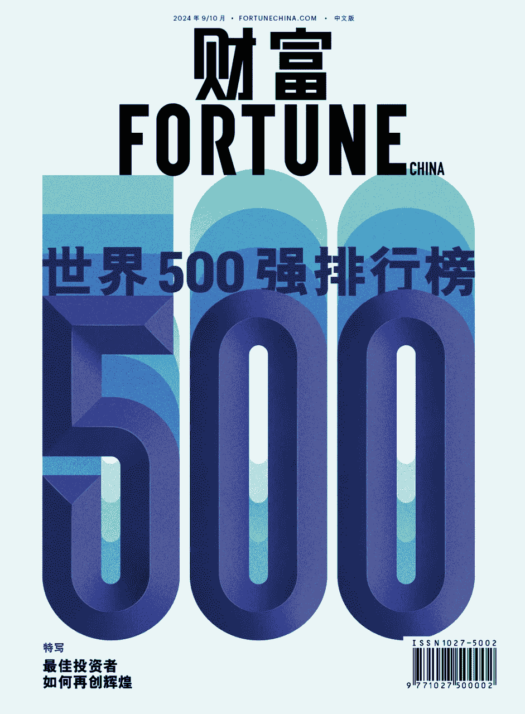

财富中文网于北京时间2024年8月5日与全球同步发布了最新的《财富》世界500强排行榜。依据这个榜单的数据，人们可以了解全球大型企业的最新发展趋势，深入到国家或地区的研究可以揭示大企业群体分布的变化。对中国读者来说，尤其是可以借此深入了解中国和世界大公司的竞争趋势、优劣势和潜在差距。（未来更多榜单和深度商业报道请关注“财富中文网”官方网站和🛰️。应用商店搜索“财富Plus”安装官方APP，第一时间获得通知，同时可以免费查询和分析所有历史数据。）

今年《财富》世界500强排行榜企业的营业收入总和约为41万亿美元，相当于全球GDP的三分之一，比去年略微增长了约0.1%。此次上榜门槛（最低销售收入）从309亿美元增长至321亿美元。所有上榜公司的净利润总和同比增长2.3%，约为2.97万亿美元。500家公司除了盈利总额略低于前年（2022年）上榜企业，其他指标，包括资产总额、净资产总额以及雇佣员工总数均达到自《财富》世界500强排行榜创立以来的最高峰。

沃尔玛连续第十一年成为全球最大公司。亚马逊重回第二。中国的国家电网公司继续位列第三。排在第四和第五位的分别是沙特阿美和中国石化。

500家公司的整体利润重回增长轨道。2023年，世界500强企业利润总额接近3万亿美元，相较上一年增长2.3%。沙特阿美利润虽然同比下降约24%，却仍然以约1,207亿美元的利润蝉联利润榜榜首；三家美国科技企业——苹果公司、谷歌母公司Alphabet和微软分别位居最赚钱公司（利润榜）的第二、第四和第五位。

伯克希尔－哈撒韦公司作为去年世界500强榜单上亏损最多的企业，以超过962亿美元的利润，位居今年利润榜第三位。三家中国公司进入利润榜前十，均为商业银行，分别是：中国工商银行、中国建设银行和中国农业银行，其中工商银行的利润超过514亿美元。

## 中国、美国和日本

今年，加上台湾地区企业，中国共有133家公司上榜，比去年减少9家。作为对比，美国今年共计139家公司上榜，比上一年增加3家，大公司数量位居各国之首。这是自2018年以后，中国上榜的公司数量首次少于美国。（关注“财富中文网”官方网站和🛰️，应用商店搜索“财富Plus”安装官方APP，免费获得“世界500强上的中国公司”、“最赚钱公司”、“亏损公司”、“行业”、“ROE”、“利润率”等相应子榜单。）

进入榜单的中国大陆（包括香港）公司数量为128家，比去年减少7家。日本上榜公司数量排第三。这个国家一共有40家上榜公司，减少一家，延续了其下降的趋势。当《财富》世界500强1990年首次亮相时，日本有多达149家公司上榜。时至今日，美国、中国和日本三个国家，合在一起为榜单贡献了大约三分之二的公司、营收和利润。

今年，中国133家上榜公司2023年营收总额约为11万亿美元，相比去年142家上榜公司，营收总额下降约6%；平均销售收入约为830亿美元，低于上榜美国企业的平均收入990亿美元，略高于全榜500家企业的平均数；然而，营业利润比美国企业的平均数低得多。美国企业平均利润是88亿美元，上榜中国大陆（包括香港）企业平均数为39亿美元，不到上榜美国企业的一半，也未达到全榜单500家企业的平均利润——59亿美元。而139家美国公司盈利总额高达12,236亿美元，占据《财富》世界500强全部盈利的41%。

特约作者王志乐指出：2024年《财富》世界500强反映了上榜中国企业数量型增长陷入停滞甚至下滑，经营质量不及全球平均水平。目前，中国企业自身经营管理问题与国内营商环境存在的问题（比如对民营企业的支持和对外资企业的促进不足）和国际产业链重构等问题叠加，使得中国企业的发展面临的挑战空前严峻。详细分析请见明日发布的王志乐文章《寻找高水平开放中的世界一流企业》。（应用商店搜索“财富Plus”，安装官方APP，第一时间获得通知）

## 汽车行业崛起，互联网回暖

在看到中国企业发展过程中存在问题的同时，也能发现中国企业实现新跨越的群体。在上榜中国企业所在的15个领域中，“汽车和零部件”的发展较为突出：

一共有10家中国汽车及汽车部件企业进入2024年《财富》世界500强。在这10家企业中，奇瑞第一次上榜，以391亿美元营收位列385位。其他九家的排位同比多数都有上升。去年，比亚迪是排名提升最多的中国公司。今年，这家公司的营收从上年630亿美元又增加到851亿美元，比上年排位提升69位。同时，宁德时代继去年首次上榜后，今年营收从488亿美元又增加到566亿美元。吉利公司的营收也提升40位，从604亿美元增加到704亿美元。这几家企业带动中国汽车，尤其是电动汽车走向世界市场。王志乐认为，华为、比亚迪和宁德时代等中国公司已经是颇具竞争力的世界一流企业。

此次，128家中国大陆（包括香港）的企业中，除去5家新上榜和重新上榜企业，以及6家位次不变的公司，有46家企业位次上升，但是71家位次下降。其中，互联网领域大公司整体上升。五家互联网巨头中，除了阿里巴巴下滑2位之外，京东、腾讯和美团的排位均有提升，同时拼多多首次上榜。受益于中国互联网行业的回暖，美团成为榜单中排名提升最多的中国公司，排名跃升83名，位居第384位。排在第47位的京东集团更是首次进入前50名，取代中国平安成为中国大陆最大民营公司。

## 经营领域中的发现

《财富》世界500强排行榜将所有企业按照其经营领域进行分类。所谓经营领域（sector）包括了若干细分产业。上榜128家中国大陆（包括香港）企业分属15个经营领域。在这15个经营领域中，仅有4个领域企业整体销售收益率超过5%，即金融、零售、电信和高技术领域。

而高技术领域是全球技术发展的前沿，也是全球竞争的焦点。按照《财富》的分类，这个经营领域包括网络、通讯设备、互联网服务、计算机、电子电气设备、半导体元器件、计算机软件、人工智能等分类下的企业。

进入2024年《财富》世界500强排行榜的高技术企业共33家，它们的平均营业收入为882亿美元，平均盈利达146亿美元。高技术企业的营业收益率居于最好的行业之列。华为依然是这个领域中国公司的龙头，这家走出困难时刻的公司今年销售额接近1,000亿美元，盈利约为123亿美元。

在这33家高技术企业中，美国高技术企业有16家，平均营业收入1,026亿美元，盈利236亿美元。进入2024年排行榜的非美国高技术企业共17家（包括中国大陆企业6家），平均营业收入746亿美元，平均盈利则只有63亿美元。显然，美国高技术大企业在该高度竞争的领域中占据了优势。它们的盈利能力相当可观：仅苹果、Alphabet、微软和Meta Platforms就创造了2,822亿美元的净利润。

此次《财富》世界500强排行榜一共有43家“新上榜和重新上榜”公司，其中有5家中国公司，它们是：奇瑞控股集团有限公司、杭州市实业投资集团有限公司、海亮集团有限公司、拼多多控股公司、友邦保险控股有限公司。奇瑞、杭实集团和拼多多均为首次上榜。43家公司中有15家来自银行业。凭借人工智能热潮带来的强劲需求，英伟达首次上榜，位居第222位，在今年首次上榜公司中排位最高。（应用商店搜索“财富Plus”安装官方APP，免费获得往年历史数据。）

在净资产收益率（ROE）榜上，家得宝公司以超过1,450%的净资产收益率蝉联榜首，甲骨文公司跃升至第二位，净资产收益率超过792%。Cencora公司和苹果公司分别位列第三、四位。净资产收益率最高的50家公司中，只有两家中国公司——奇瑞控股集团以35%的净资产收益率位列第40位，拼多多则位列第47位。在ROE方面，中国公司中排位前10的是：奇瑞控股集团有限公司、拼多多控股公司、台积公司、宁德时代新能源科技股份有限公司、比亚迪股份有限公司、广达电脑公司、美的集团股份有限公司、紫金矿业集团股份有限公司、立讯精密工业股份有限公司、联想集团有限公司。

在利润率榜上，Visa公司以超52%的净利润率位居榜首。利润率最高的前五家公司中，有三家来自半导体、电子元件行业，分别是英伟达、台积公司和博通公司，位居第二至四位。

在排名位次的变化上，今年上升幅度最大的是瑞银集团，跃升165位，位列第182位。德意志银行上升149名，位列第205位，是排名上升幅度第二大的公司。排名上升幅度最大的10家公司中，除一家保险公司外，其余9家均为银行。今年有四家中国公司上升至少50位：美团、比亚迪股份有限公司、盛虹控股集团有限公司、泰康保险集团股份有限公司。

今年共有33家公司未能实现盈利，其中有六家中国大陆公司。亏损榜中排名第一的是英美烟草集团，亏损额超过178亿美元。受俄乌冲突及欧盟制裁影响，俄罗斯天然气工业股份公司排名第二，亏损额超过73亿美元。相比去年，今年榜单中亏损公司的亏损总额大幅下降。

——本刊编辑部

## 榜单看点

· 沃尔玛连续11年蝉联《财富》世界500强榜首，自1995年以来已经19次位居榜首。

· 共计133家中国公司登上榜单。其中，中国大陆（含香港）128家企业上榜，台湾地区5家企业上榜。

· 今年中国公司的上榜企业数量自2018年以后首次少于美国。在本次榜单中，美国企业增加3家，达到139家。

· 2023年上榜的中国公司营收总额约为11万亿美元，相比去年142家公司，营收总额下降约6%。

· 美国企业平均利润达88亿美元，上榜中国大陆（包括香港）企业平均利润为39亿美元。

· 榜上共有112家国有企业，其中超过三分之二公司的总部位于中国。

· 此次《财富》世界500强排行榜一共有43家新上榜和重新上榜公司，其中，13家为新上榜公司，30家为重返榜单的公司。英伟达首次上榜，位列第222位。

· 在今年的上榜企业中，有15家公司的排名与上年相比至少跃升了100位，其中瑞银集团的排名上升了165位，是本次榜单中排名上升幅度最大的企业。

· 中国（含台湾地区）的133家上榜公司、美国的139家上榜公司，以及日本的40家上榜公司，占据上榜企业总数的62%、收入总额的67%，以及利润总额的65%。

· 四分之一的《财富》世界500强公司将总部设在了北京、东京、纽约、上海和首尔。

· 金融、能源、车辆与零部件、高技术和医疗保健这五大行业，占上榜公司总数的60%、总收入的65%。其中，金融行业在所有行业中居首，创造了8.6万亿美元的收入。

· 8家上榜公司的利润较上年至少增长了1,000%，其中通用电气的利润增长了4,114%。

· 在今年的上榜企业中，大型科技公司的盈利能力相当可观：苹果、Alphabet、微软和Meta Platforms共创造了2,822亿美元的净收入。

· 27家上榜公司的首席执行官是女性，比上年减少2家。

· 自1995年起，140家企业从未落榜。

### 1. 沃尔玛

营收（百万美元）：648,125.0

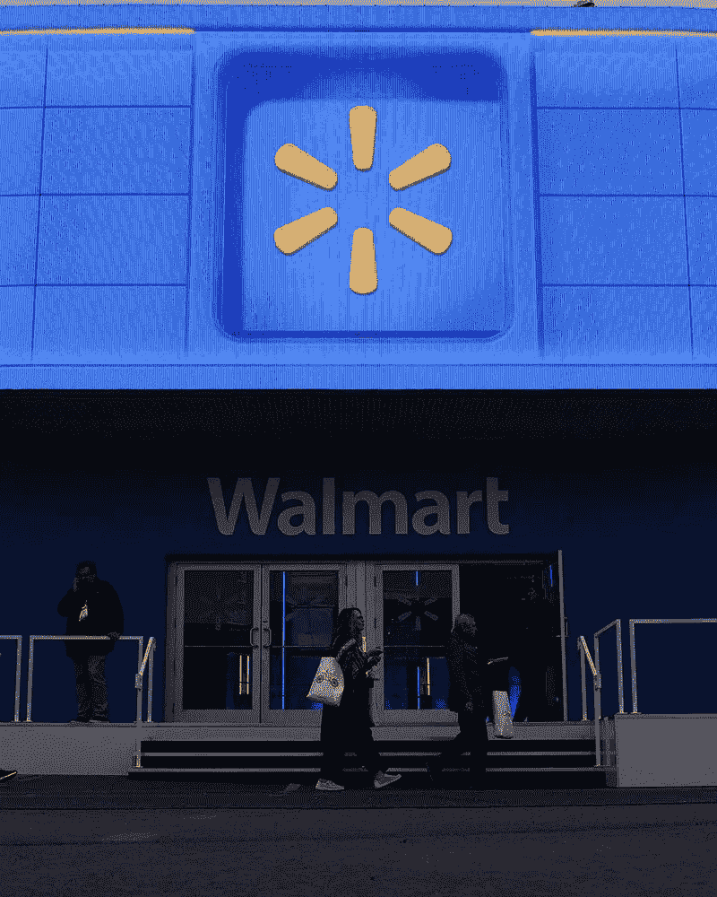

今年，沃尔玛第19次登上榜首，也是连续第11年成为全球最大的公司。过去一年中，沃尔玛电子商务取得了显著增长，广告等新业务推动了利润增长，并由于通货膨胀推高物价，吸引了更多高收入消费者。在中国市场，山姆会员店是其重要增长引擎。

### 3. 国家电网有限公司

营收（百万美元）：545,947.5

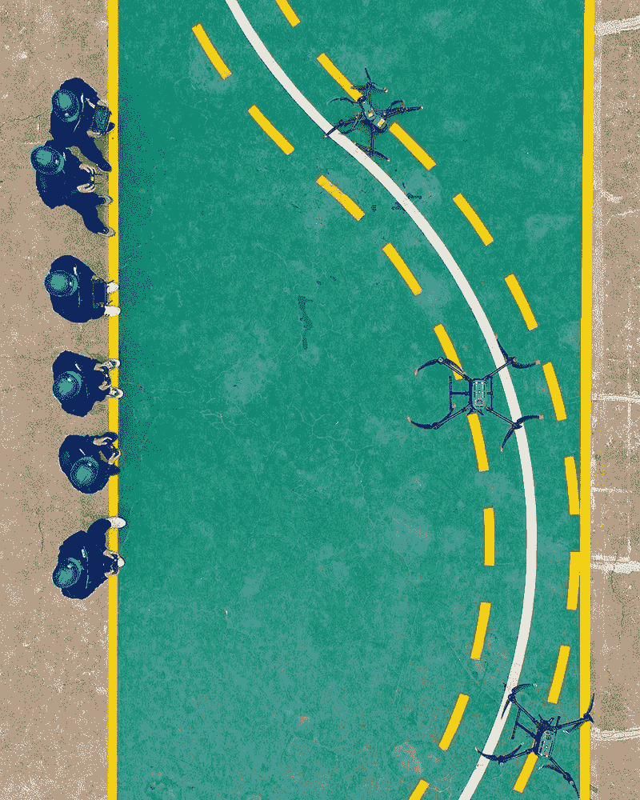

这是国家电网连续第三年位居榜单第三位以及上榜的中国企业首位。按照国家规划，到2025年、2030年，中国非化石能源消费占比将分别达到20%、25%左右，国家电网无疑将在实现这一目标的过程中发挥关键作用。

### 4. 沙特阿美公司

营收（百万美元）：494,890.1

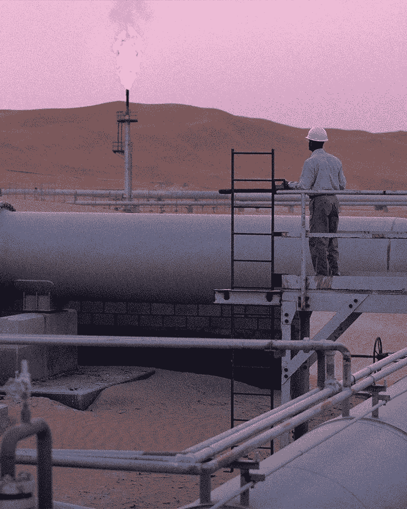

尽管沙特阿美的排名较上一年下降两位，但仍然是连续三年最赚钱的企业。作为中东地区的标志性企业，近年来其不仅在全球能源领域频频落子，而且不断增加在中国市场的存在感，持续推进中阿合作的深化。

### 5. 中国石油化工集团有限公司

营收（百万美元）：429,699.7

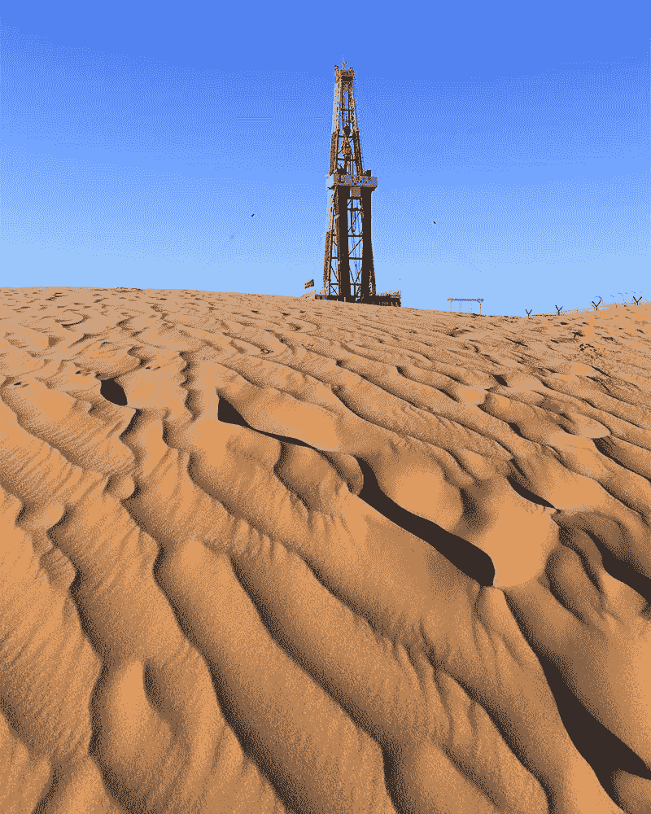

中国石化的排名较去年上升一名，在上榜的中国企业中位列第二。2023年，受原油、成品油及化工品等产品价格下降影响，中国石化营收下滑，但同期油气当量产量、原油加工量和境内成品油总经销量均创历史新高，同时加速低碳转型步伐。

### 6. 中国石油天然气集团有限公司

营收（百万美元）：421,713.6

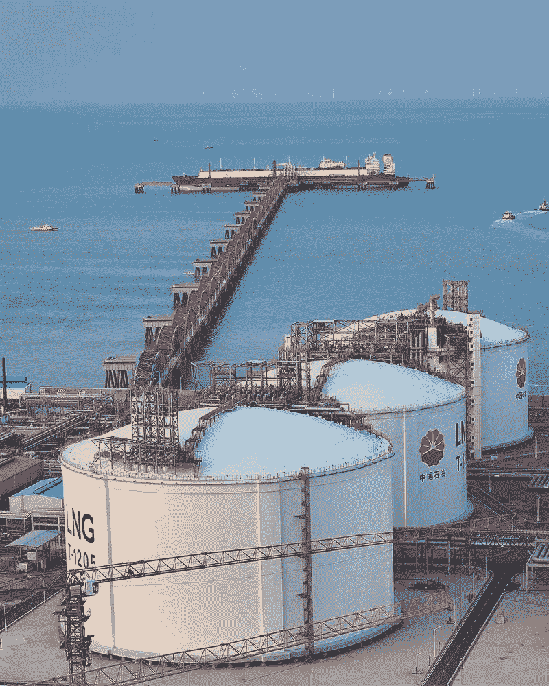

2023年，中国石油原油实现稳步增产，天然气产量继续较快增长。近日中国石油上线碳资产集中管控平台，集成碳排放分析、碳成本核算等功能，助力该集团实现碳达峰目标。

### 7. 苹果公司

营收（百万美元）：383,285.0

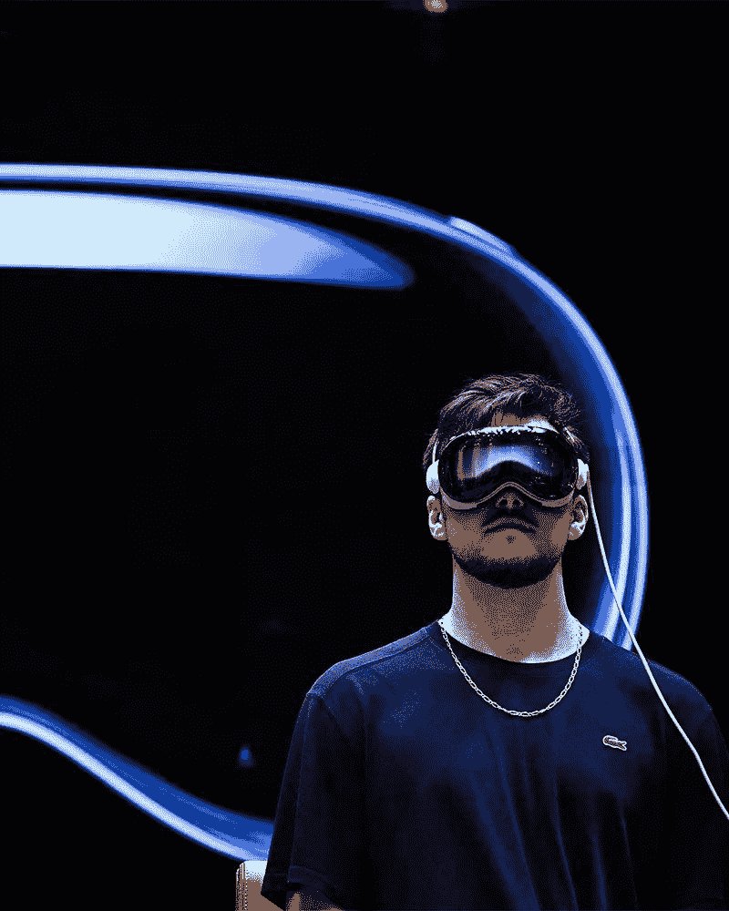

苹果发布的Apple Intelligence，是在人工智能应用方面追赶竞争者的最新表现。Apple Intelligence定位为适用于iPhone、iPad和Mac的个人智能系统，它为消费者提供的是别样的人工智能体验，为苹果提供的则是未来的新增营收来源。

### 9. 伯克希尔－哈撒韦公司

营收（百万美元）：364,482.0

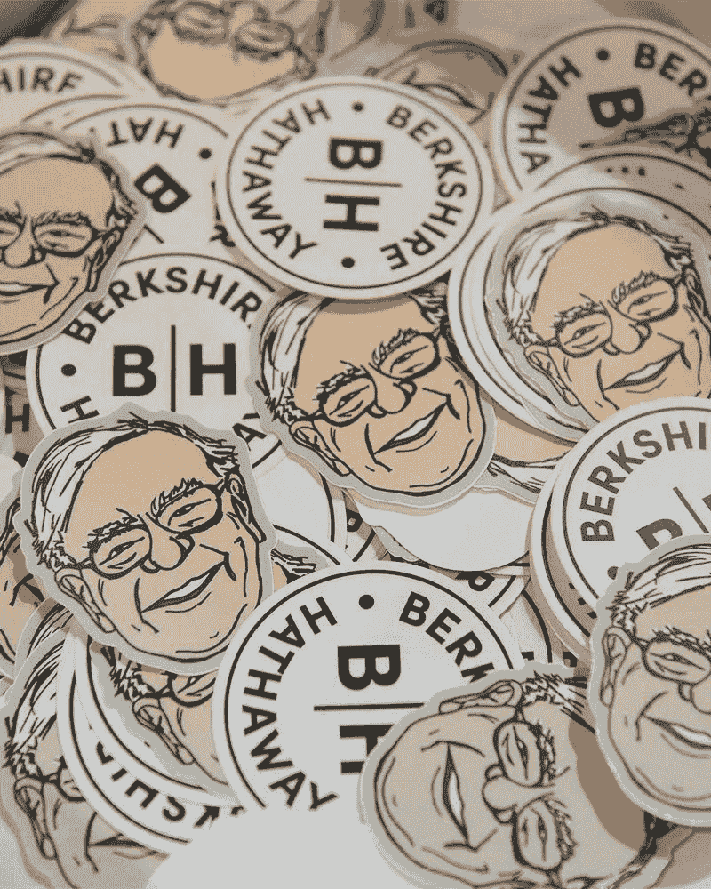

时隔六年，伯克希尔－哈撒韦再次回到榜单前十位。作为副董事长及沃伦·巴菲特60多年的商业伙伴，查理·芒格于2023年底去世。2024年6月底，巴菲特在媒体采访中罕见透露了最新的遗产安排。

### 11. 大众公司

营收（百万美元）：348,408.1

2023年全球经济回暖且供应链问题缓解，汽车销售复苏，大众的销量明显增长，令其在榜单的排名较上一年上升四位。作为全球最大车企，大众在华销量也是长期位居首位，但当前也在应对空前激烈的价格战。

### 26. 微软

营收（百万美元）：211,915.0

微软已经成为人工智能市场的领导者之一。除了不断为其软件产品加载人工智能功能，还投资人工智能领域领军企业OpenAI。微软在人工智能领域的积极布局和Azure云计算业务的强劲表现，让其在营收方面能够始终具有竞争力。

### 32. 鸿海精密工业股份有限公司

营收（百万美元）：197,876.0

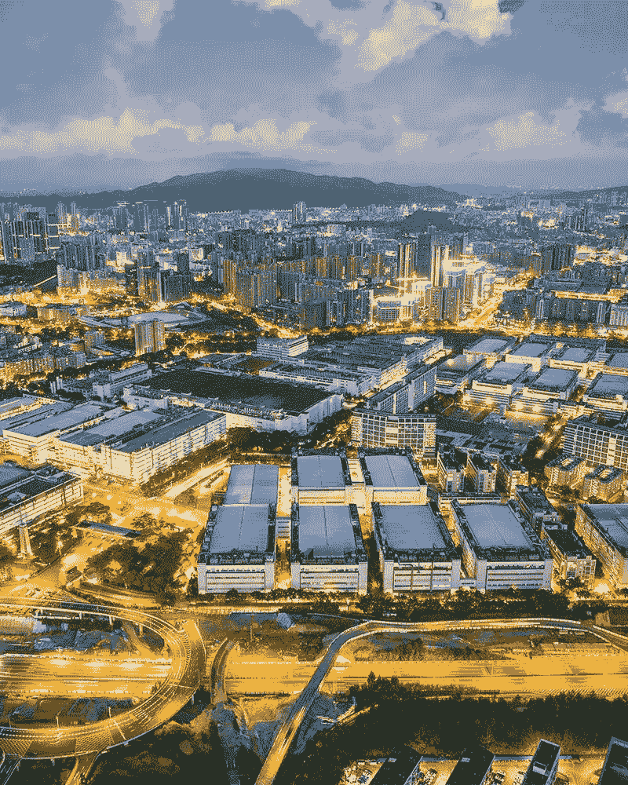

作为全球最大的苹果手机生产商，鸿海精密去年一度因为苹果等消费电子产品的销售疲软而业绩承压，但全球人工智能服务器需求的爆炸性增长令其第四季度业绩大幅反弹。预计2024年，人工智能服务器在其整体服务器营收占比将达到四成以上。

### 47. 京东集团股份有限公司

营收（百万美元）：153,217.4

京东集团今年取代平安集团成为中国最大的民营公司，并且排名首次进入前50位。创始人刘强东在今年提出，京东需要拼搏精神，他强调“业绩不好，又不拼搏的人，这家公司都不能容忍，都会逐步通过各种手段，全部淘汰出局。”

### 70. 阿里巴巴集团控股有限公司

营收（百万美元）：131,337.9

2023年，阿里巴巴集团重整组织架构的同时，开启深度重组变革，蔡崇信出任集团董事会主席。他指出，当下阿里巴巴出现了一些“大公司病”的症状，将积极对“大公司病”开刀、保持创业精神。

### 86. 信实工业公司

营收（百万美元）：108,877.9

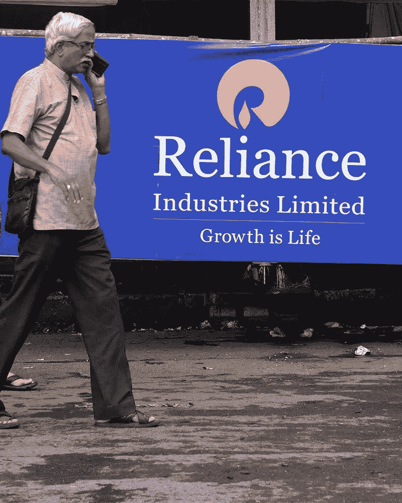

信实工业是榜单上最大的印度公司，业务遍及石油化工、零售、数字服务和纺织品等领域。2023年，该公司实现创纪录的营收，并成为印度首家税前利润超过1万亿卢比的公司。董事长穆克什·安巴尼在该年公布了接班计划：他的三个孩子都被任命为董事会非执行董事，将领导公司在未来五年向数字、消费和绿色能源等领域实现多元化发展。

### 87. 高盛集团

营收（百万美元）：108,418.0

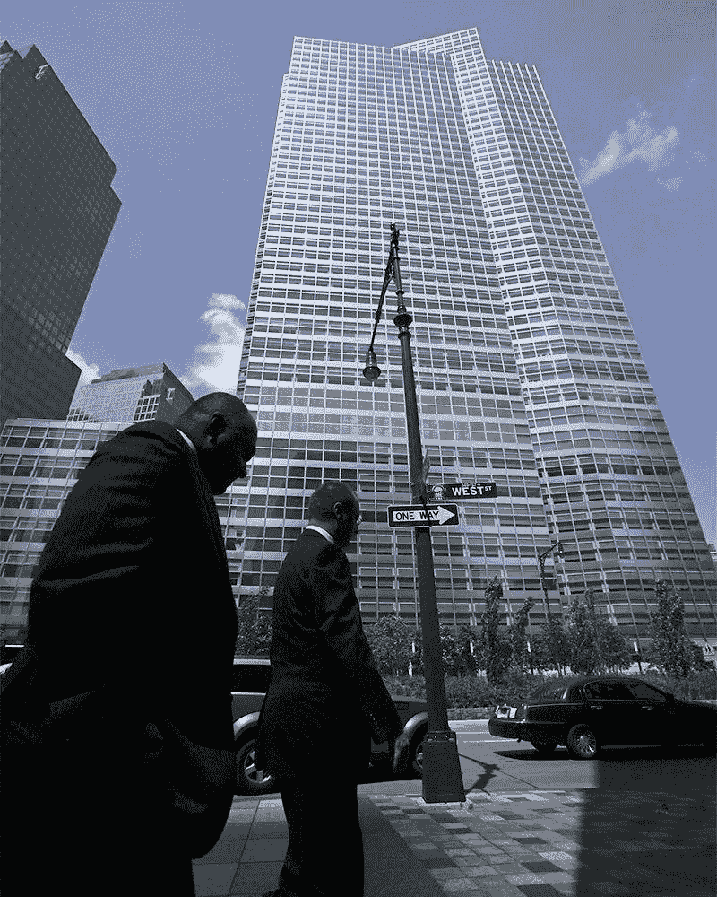

高盛集团在榜单上的排名较去年上升98位，首次进入前100位。虽然其2023年营收增长显著，但净利润同比下降24.4%，是2019年以来的最低水平。高盛还解雇了超过3,000名员工，创下这家投资银行自2008年全球金融危机以来最大规模裁员，并出售了个人财富管理业务。

### 103. 华为投资控股有限公司

营收（百万美元）：99,470.3

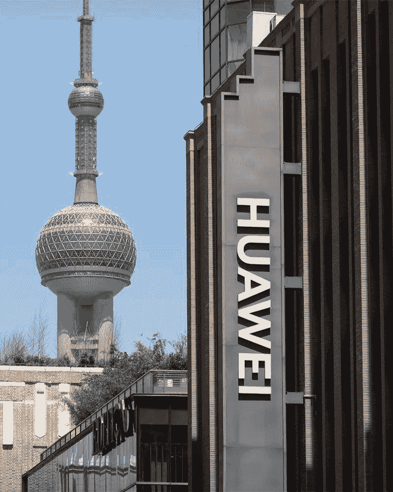

2023年是华为手机业务全面回归的一年，Mate60系列在没有任何预告的情况下发售，旋即售罄并长期缺货。多次重申“不造车，帮助车企造好车”的华为智能汽车解决方案BU也逐步成熟，截至2024年7月初，华为车BU收入达100亿元。

### 110. 特斯拉

营收（百万美元）：96,773.0

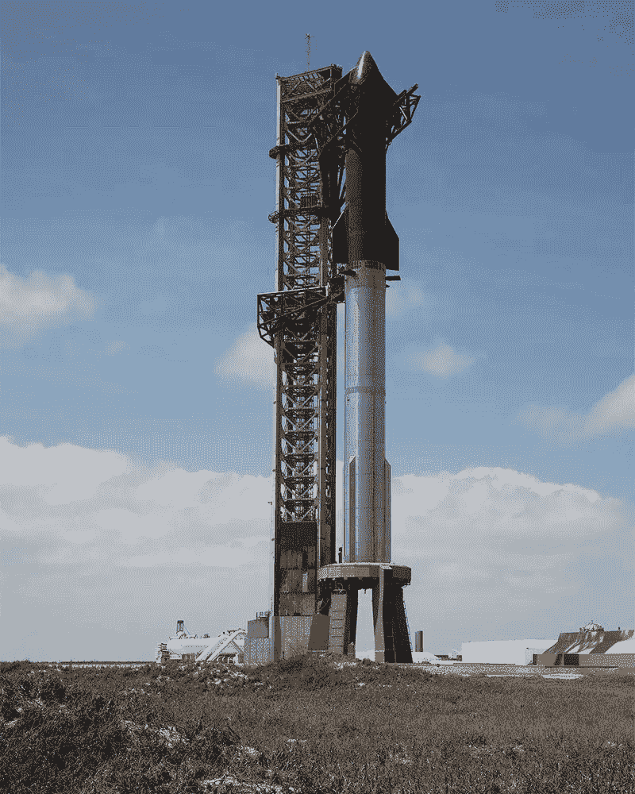

特斯拉排名较去年跃升42名。在创始人埃隆·马斯克的愿景中，特斯拉是一家人工智能公司、机器人公司以及可持续能源公司，而不仅仅是电动汽车公司。这一愿景也体现在数轮大规模人员优化中，该公司的许多职位空缺均集中在人工智能和机器人技术方面。

### 115. 强生

营收（百万美元）：95,195.0

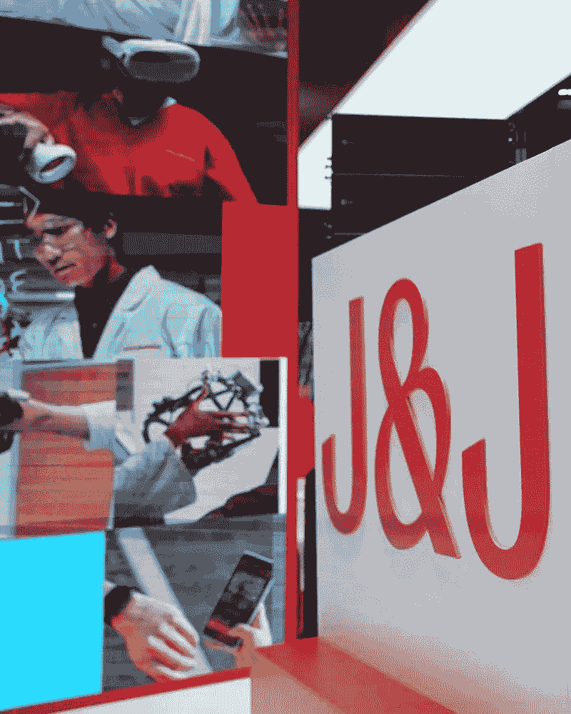

2023年8月，强生公司宣布完成分拆，专注于消费者健康业务的Kenvue完全独立运营，分拆后的强生公司继续专注医药和医疗器械。在今年的榜单上，强生取代辉瑞，成为全球最大的制药企业。

# 119

迪奥公司

营收（百万美元）：93,136.5

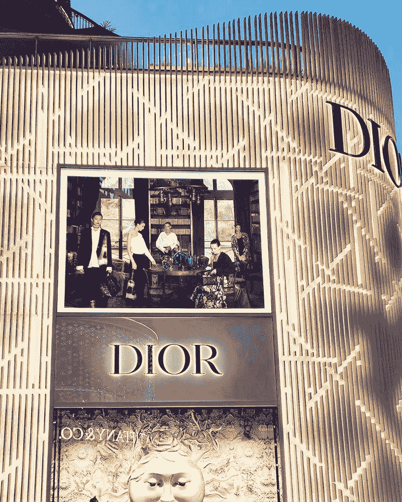

得益于旗下时装、香水、彩妆和钟表品牌的强劲表现，迪奥公司在2023年录得创纪录的营收，再度成为榜单上排名最高的奢侈品公司。不过，自下半年起，中国等关键市场的奢侈品销售开始出现下滑，令奢侈品巨头们业绩承压。

# 123

百事公司

营收（百万美元）：91,471.0

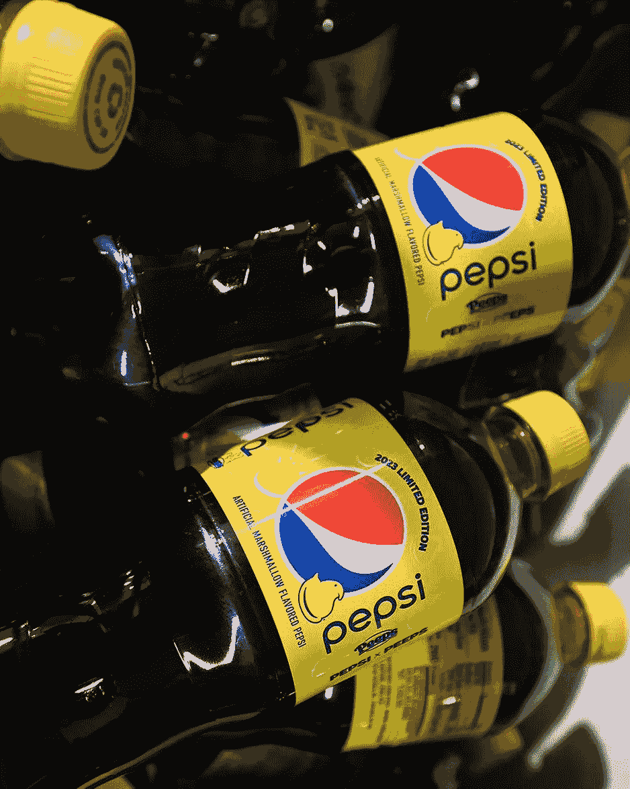

尽管持续的通货膨胀导致北美市场饮料和零食需求下降，但百事公司的净营收仍然在逐年上升，这得益于国际市场对碳酸饮料和零食的强劲需求。百事公司近年来一直在扩大其在发达市场和新兴市场的产品组合，通过推出口味多样的产品来推动消费。

# 131

华特迪士尼公司

营收（百万美元）：88,898.0

尽管2023年出品的电影产品未能如预期地收获好评和优秀票房表现，但并未影响华特迪士尼公司继续跻身《财富》世界500强榜单，并拥有显眼的位置。全球各地的迪士尼游乐场排队的游客组成了保卫这家娱乐业巨头公司江湖地位的铜墙铁壁。

# 141

腾讯控股有限公司

营收（百万美元）：86,028.3

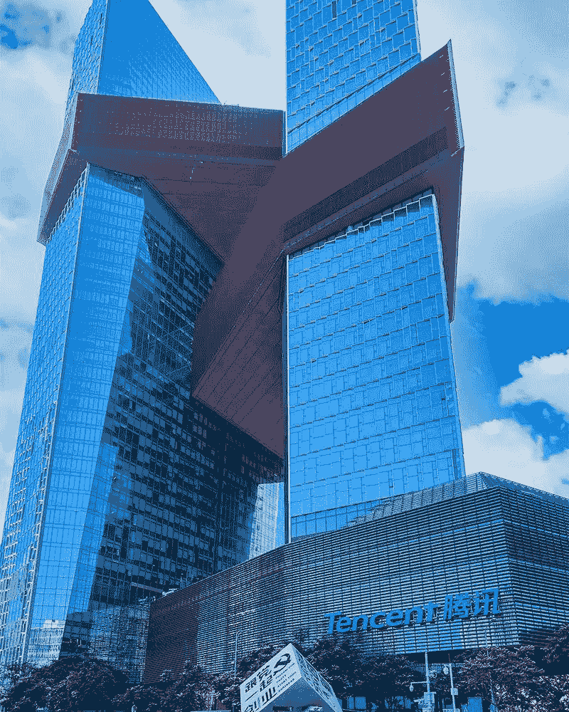

2023年，腾讯在视频号、广告人工智能模型、游戏等多个产品和服务上取得了突破。腾讯董事会主席马化腾表示，包括🛰️视频号及搜一搜广告、小游戏平台服务费及视频号商家技术服务费，推动了毛利和经营盈利增幅超过收入增幅，成为腾讯高质量的收入来源。

# 143

比亚迪股份有限公司

营收（百万美元）：85,082.0

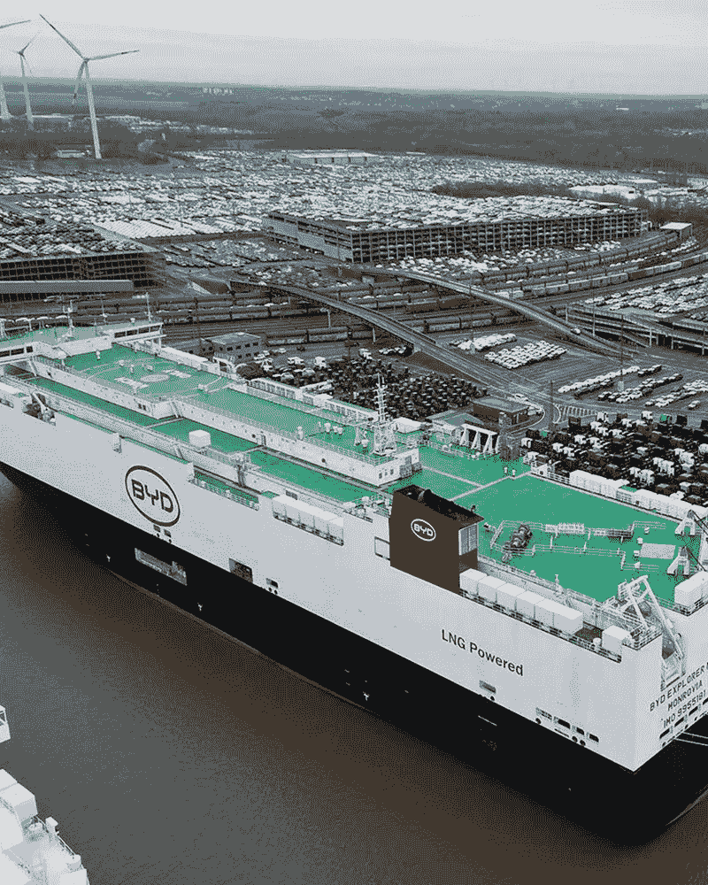

今年7月，比亚迪第800万辆新能源汽车下线。比亚迪在新能源汽车行业的成就，也标志着中国汽车工业在新能源领域的重大突破。2024年1月至6月，比亚迪海外销量超20.3万辆，同比增长173.8%。

# 182

瑞银集团

营收（百万美元）：71,245.0

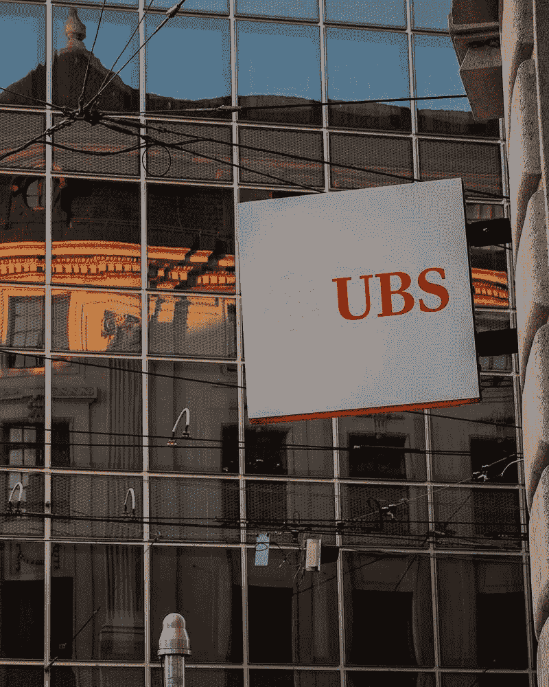

瑞银集团2023年展开对瑞士信贷的并购。虽然这笔交易花费了大额成本，拖累了瑞银的利润表现，但瑞银通过优化日常运营效率节省开支，在营收上超越了市场预期，成为今年在榜单上跃升幅度最大的企业，排名上升165位。

# 206

万科企业股份有限公司

营收（百万美元）：65,789.5

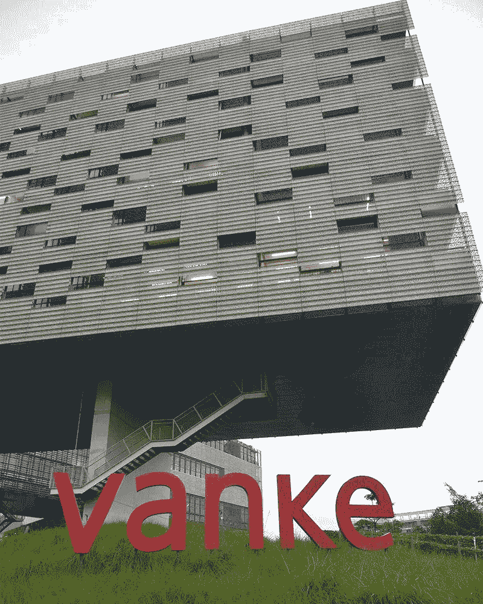

万科在中国上榜民营房企中排名最高。近日，刚渡过债务危机的万科披露了投资者关系活动记录表，称相对于潜在总需求，目前房地产市场供给水平无论从总量还是结构方面都不充分，活下去并且能够提供优质住宅的企业才有机会。

# 222

英伟达公司

营收（百万美元）：60,922.0

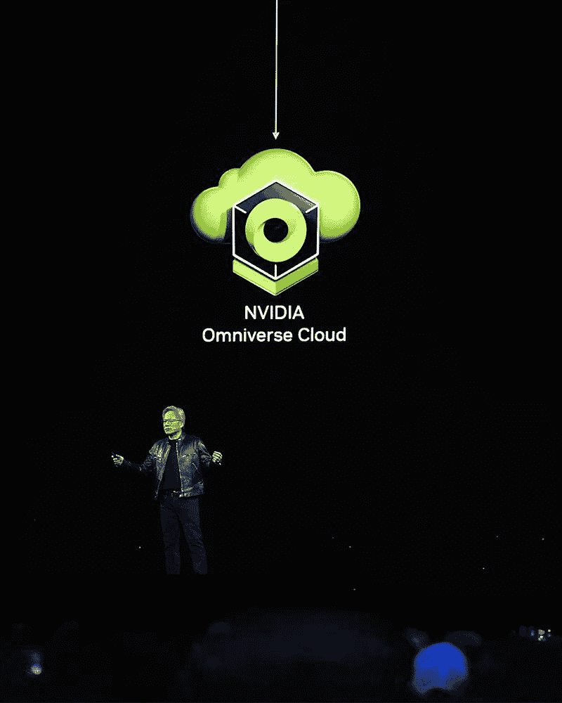

生成式人工智能模型的惊人表现，让许多公司实现了历史性飞跃。全球对训练和运行强大的生成式人工智能模型的先进制程芯片需求激增，英伟达则是这些芯片的主要提供者，这让黄仁勋有底气宣布英伟达处于一场新“工业革命”的核心，也将这家企业首次推上《财富》世界500强榜单。

# 381

泰康保险集团股份有限公司

营收（百万美元）：39,411.6

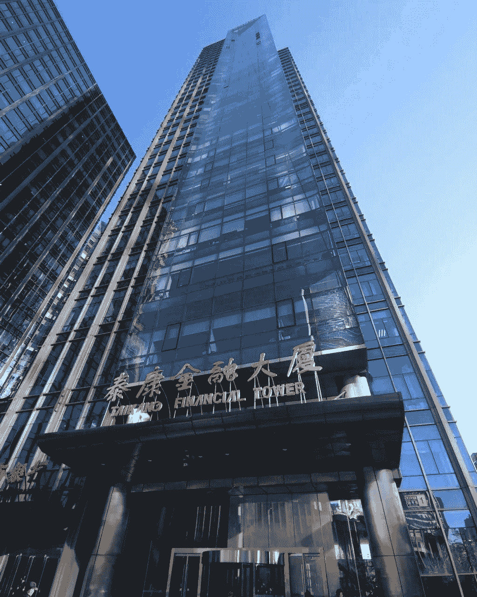

人口结构的变化对中国社会和经济带来了深刻影响。在老龄化加速到来的背景下，中国寿险业遭遇困境。将养老服务引入传统寿险的泰康连续第七年上榜，是寿险公司超越同质化竞争的一个独特案例。

# 384

美团

营收（百万美元）：39,092.5

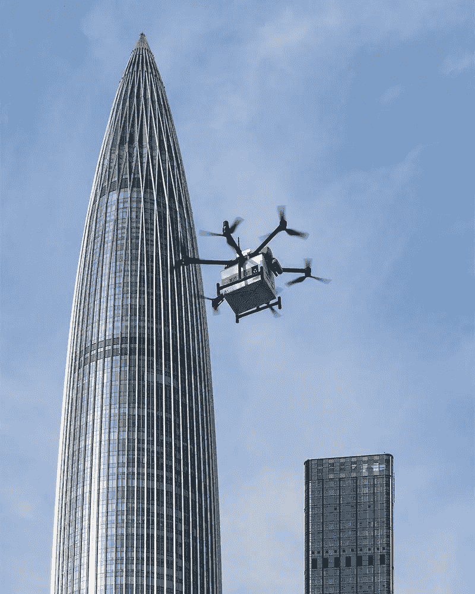

美团排名跃升83位，是本次榜单排名上升幅度最大的中国企业。这家本地生活服务龙头企业一直在开拓边界以寻求增量，包括开启直播、拓展品类、升级和快手的合作、入局梯媒广告市场等。此外，美团还在探索无人机、境外业务等新增长点。

# 385

奇瑞控股集团有限公司

营收（百万美元）：39,091.7

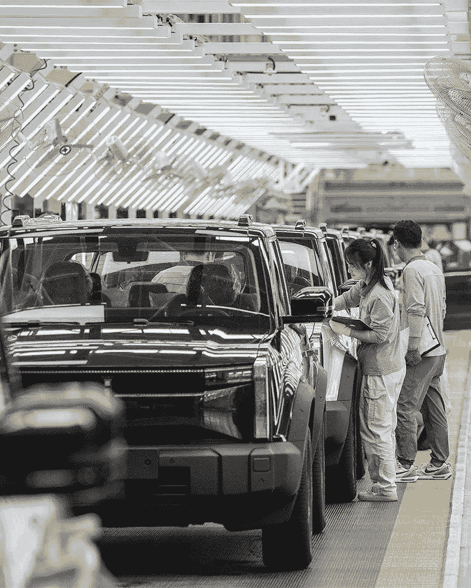

从“造中国人能买得起的汽车”到“造中国人买得起的好车”，再到“要造全球用户喜爱的品牌，特别是豪华品牌”，奇瑞的发展历程也是中国乘用车行业发展的缩影。2024年，奇瑞首次上榜《财富》世界500强。

# 397

小米集团

营收（百万美元）：38,276.8

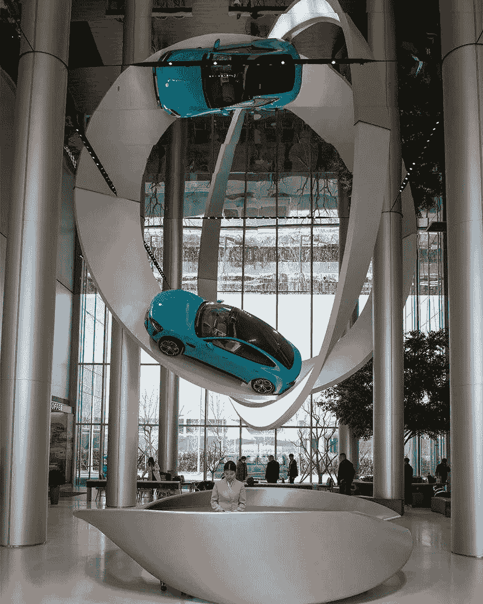

小米汽车是中国新能源智能汽车的一匹黑马。汽车业务收入也将对该公司未来在该榜单上的排位产生影响。创始人雷军曾经表示要在15年至20年的时间内，成为全球前五的汽车厂商。

# 442

拼多多控股公司

营收（百万美元）：34,981.1

拼多多今年第一次登上《财富》世界500强榜单，它的成功故事反映了一个新兴电商平台如何通过深入理解下沉市场用户的需求，迅速在市场中取得一席之地。但目前，下沉市场也给拼多多带来诸多“反噬效应”，如何长期让消费者在低价中获益成为该公司面临的挑战。

# 469

诺和诺德公司

营收（百万美元）：33,703.8

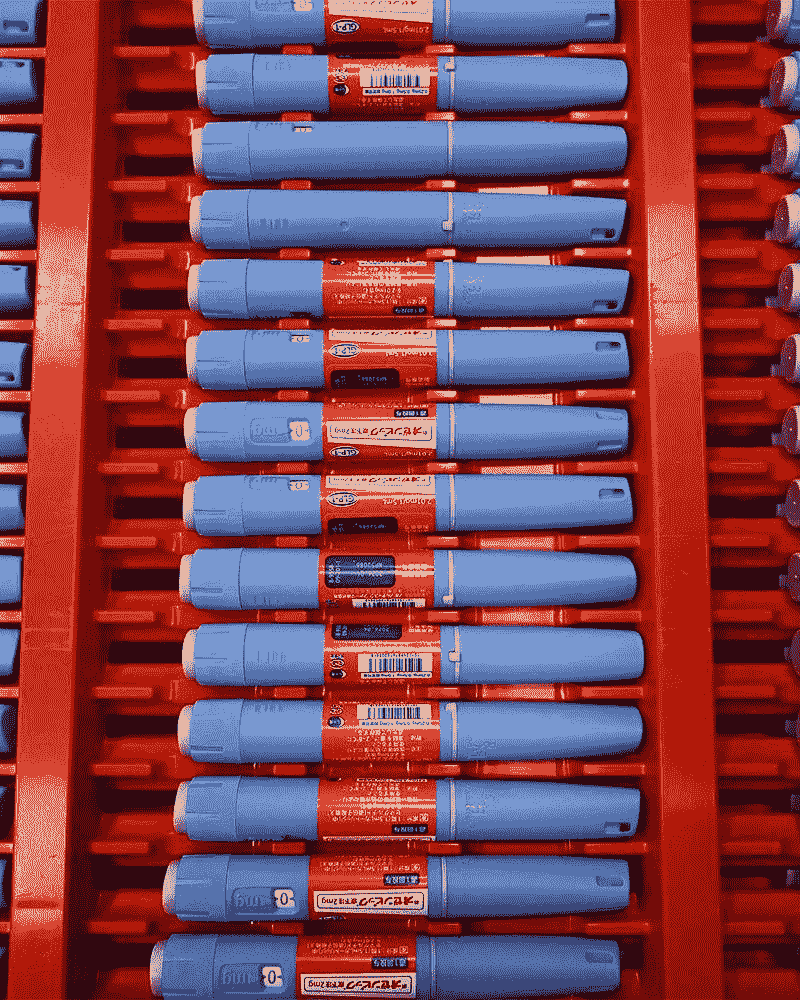

诺和诺德现在必须开始面对自己从“小而美”变身为“大而强”的现实。尽管司美格鲁肽不仅为诺和诺德贡献了巨额营收，也为人类许多特定疾病的治疗开启了新纪元，但这一明星药物对诺和诺德来说，只是其发展历程中的闪光点之一，而非全部。

# 完整榜单

| 排名 | 公司名称 | 国家 |
| --- | --- | --- |
| 1 | 沃尔玛 | 美国 |
| 2 | 亚马逊 | 美国 |
| 3 | 国家电网有限公司 | 中国 |
| 4 | 沙特阿美公司 | 沙特阿拉伯 |
| 5 | 中国石油化工集团有限公司 | 中国 |
| 6 | 中国石油天然气集团有限公司 | 中国 |
| 7 | 苹果公司 | 美国 |
| 8 | 联合健康集团 | 美国 |
| 9 | 伯克希尔－哈撒韦公司 | 美国 |
| 10 | CVS Health公司 | 美国 |
| 11 | 大众公司 | 德国 |
| 12 | 埃克森美孚 | 美国 |
| 13 | 壳牌公司 | 英国 |
| 14 | 中国建筑集团有限公司 | 中国 |
| 15 | 丰田汽车公司 | 日本 |
| 16 | 麦克森公司 | 美国 |
| 17 | Alphabet公司 | 美国 |
| 18 | Cencora公司 | 美国 |
| 19 | 托克集团 | 新加坡 |
| 20 | 开市客 | 美国 |
| 21 | 摩根大通公司 | 美国 |
| 22 | 中国工商银行股份有限公司 | 中国 |
| 23 | 道达尔能源公司 | 法国 |
| 24 | 嘉能可 | 瑞士 |
| 25 | 英国石油公司 | 英国 |
| 26 | 微软 | 美国 |
| 27 | 嘉德诺健康集团 | 美国 |
| 28 | Stellantis集团 | 荷兰 |
| 29 | 雪佛龙 | 美国 |
| 30 | 中国建设银行股份有限公司 | 中国 |
| 31 | 三星电子 | 韩国 |
| 32 | 鸿海精密工业股份有限公司 | 中国 |
| 33 | 信诺集团 | 美国 |
| 34 | 中国农业银行股份有限公司 | 中国 |
| 35 | 中国铁路工程集团有限公司 | 中国 |
| 36 | 福特汽车公司 | 美国 |
| 37 | 中国银行股份有限公司 | 中国 |
| 38 | 美国银行 | 美国 |
| 39 | 通用汽车公司 | 美国 |
| 40 | Elevance Health公司 | 美国 |
| 41 | 宝马集团 | 德国 |
| 42 | 梅赛德斯-奔驰集团 | 德国 |
| 43 | 中国铁道建筑集团有限公司 | 中国 |
| 44 | 中国宝武钢铁集团有限公司 | 中国 |
| 45 | 花旗集团 | 美国 |
| 46 | Centene公司 | 美国 |
| 47 | 京东集团股份有限公司 | 中国 |
| 48 | 家得宝 | 美国 |
| 49 | 法国电力公司 | 法国 |
| 50 | 马拉松原油公司 | 美国 |
| 51 | 克罗格 | 美国 |
| 52 | Phillips 66公司 | 美国 |
| 53 | 中国平安保险（集团）股份有限公司 | 中国 |
| 54 | 中国中化控股有限责任公司 | 中国 |
| 55 | 中国移动通信集团有限公司 | 中国 |
| 56 | 中国海洋石油集团有限公司 | 中国 |
| 57 | 本田汽车 | 日本 |
| 58 | 房利美 | 美国 |
| 59 | 中国人寿保险（集团）公司 | 中国 |
| 60 | 沃博联 | 美国 |
| 61 | 瓦莱罗能源公司 | 美国 |
| 62 | 西班牙国家银行 | 西班牙 |
| 63 | 中国交通建设集团有限公司 | 中国 |
| 64 | 法国巴黎银行 | 法国 |
| 65 | 三菱商事株式会社 | 日本 |
| 66 | Meta Platforms公司 | 美国 |
| 67 | 汇丰银行控股公司 | 英国 |
| 68 | 威瑞森电信 | 美国 |
| 69 | 中国五矿集团有限公司 | 中国 |
| 70 | 阿里巴巴集团控股有限公司 | 中国 |
| 71 | 中国中信集团有限公司 | 中国 |
| 72 | 中国华润有限公司 | 中国 |
| 73 | 现代汽车 | 韩国 |
| 74 | 美国电话电报公司 | 美国 |
| 75 | 山东能源集团有限公司 | 中国 |
| 76 | 美国康卡斯特电信公司 | 美国 |
| 77 | 德国电信 | 德国 |
| 78 | 中国南方电网有限责任公司 | 中国 |
| 79 | Uniper公司 | 德国 |
| 80 | 美国富国银行 | 美国 |
| 81 | 恒力集团有限公司 | 中国 |
| 82 | 安联保险集团 | 德国 |
| 83 | 中国邮政集团有限公司 | 中国 |
| 84 | 国家能源投资集团有限责任公司 | 中国 |
| 85 | 厦门建发集团有限公司 | 中国 |
| 86 | 信实工业公司 | 印度 |
| 87 | 高盛集团 | 美国 |
| 88 | 房地美 | 美国 |
| 89 | 俄罗斯石油公司 | 俄罗斯 |
| 90 | 塔吉特公司 | 美国 |
| 91 | Equinor公司 | 挪威 |
| 92 | 哈门那公司 | 美国 |
| 93 | 上海汽车集团股份有限公司 | 中国 |
| 94 | 州立农业保险公司 | 美国 |
| 95 | 印度人寿保险公司 | 印度 |
| 96 | 雀巢公司 | 瑞士 |
| 97 | 意大利国家电力公司 | 意大利 |
| 98 | 埃尼石油公司 | 意大利 |
| 99 | 巴西国家石油公司 | 巴西 |
| 100 | SK集团 | 韩国 |
| 101 | 意昂集团 | 德国 |
| 102 | 俄罗斯天然气工业股份公司 | 俄罗斯 |
| 103 | 华为投资控股有限公司 | 中国 |
| 104 | 法国兴业银行 | 法国 |
| 105 | 博世集团 | 德国 |
| 106 | 中粮集团有限公司 | 中国 |
| 107 | 日本伊藤忠商事株式会社 | 日本 |
| 108 | 中国电力建设集团有限公司 | 中国 |
| 109 | 墨西哥石油公司 | 墨西哥 |
| 110 | 特斯拉 | 美国 |
| 111 | 摩根士丹利 | 美国 |
| 112 | 中国医药集团有限公司 | 中国 |
| 113 | 博枫公司 | 加拿大 |
| 114 | 皇家阿霍德德尔海兹集团 | 荷兰 |
| 115 | 强生 | 美国 |
| 116 | 印度石油公司 | 印度 |
| 117 | ADM公司 | 美国 |
| 118 | 法国农业信贷银行 | 法国 |
| 119 | 迪奥公司 | 法国 |
| 120 | 日本电报电话公司 | 日本 |
| 121 | 三井物产株式会社 | 日本 |
| 122 | 家乐福 | 法国 |
| 123 | 百事公司 | 美国 |
| 124 | 联合包裹速递服务公司 | 美国 |
| 125 | 泰国国家石油有限公司 | 泰国 |
| 126 | 安盛 | 法国 |
| 127 | 联邦快递 | 美国 |
| 128 | 索尼 | 日本 |
| 129 | 中国第一汽车集团有限公司 | 中国 |
| 130 | Engie集团 | 法国 |
| 131 | 华特迪士尼公司 | 美国 |
| 132 | 波兰国营石油公司 | 波兰 |
| 133 | 戴尔科技公司 | 美国 |
| 134 | 敦豪集团 | 德国 |
| 135 | 中国电信集团有限公司 | 中国 |
| 136 | 日产汽车 | 日本 |
| 137 | 加拿大皇家银行 | 加拿大 |
| 138 | 浙江荣盛控股集团有限公司 | 中国 |
| 139 | 美国劳氏公司 | 美国 |
| 140 | 乐购 | 英国 |
| 141 | 腾讯控股有限公司 | 中国 |
| 142 | 厦门国贸控股集团有限公司 | 中国 |
| 143 | 比亚迪股份有限公司 | 中国 |
| 144 | 日本生命保险公司 | 日本 |
| 145 | 西门子 | 德国 |
| 146 | 日本邮政控股公司 | 日本 |
| 147 | 中国航空工业集团有限公司 | 中国 |
| 148 | 三菱日联金融集团 | 日本 |
| 149 | 宝洁公司 | 美国 |
| 150 | 物产中大集团股份有限公司 | 中国 |
| 151 | Seven &amp; I 控股公司 | 日本 |
| 152 | 艾伯森公司 | 美国 |
| 153 | 引能仕控股株式会社 | 日本 |
| 154 | 交通银行股份有限公司 | 中国 |
| 155 | Energy Transfer公司 | 美国 |
| 156 | 美国邮政 | 美国 |
| 157 | 江西铜业集团有限公司 | 中国 |
| 158 | 中国人民保险集团股份有限公司 | 中国 |
| 159 | 波音 | 美国 |
| 160 | 中国兵器工业集团有限公司 | 中国 |
| 161 | 太平洋建设集团有限公司 | 中国 |
| 162 | 起亚公司 | 韩国 |
| 163 | 西斯科公司 | 美国 |
| 164 | 第一生命控股有限公司 | 日本 |
| 165 | 印尼国家石油公司 | 印度尼西亚 |
| 166 | 万喜集团 | 法国 |
| 167 | 马来西亚国家石油公司 | 马来西亚 |
| 168 | 多伦多道明银行 | 加拿大 |
| 169 | 卢克石油公司 | 俄罗斯 |
| 170 | 陕西煤业化工集团有限责任公司 | 中国 |
| 171 | 盛虹控股集团有限公司 | 中国 |
| 172 | 巴斯夫公司 | 德国 |
| 173 | 中国保利集团有限公司 | 中国 |
| 174 | 法国BPCE银行集团 | 法国 |
| 175 | 山东魏桥创业集团有限公司 | 中国 |
| 176 | 巴西JBS公司 | 巴西 |
| 177 | Alimentation Couche-Tard公司 | 加拿大 |
| 178 | 印度国家银行 | 印度 |
| 179 | 招商银行股份有限公司 | 中国 |
| 180 | 印度石油天然气公司 | 印度 |
| 181 | 广州汽车工业集团有限公司 | 中国 |
| 182 | 瑞银集团 | 瑞士 |
| 183 | 空中客车公司 | 荷兰 |
| 184 | 丰田通商公司 | 日本 |
| 185 | 浙江吉利控股集团有限公司 | 中国 |
| 186 | 台积公司 | 中国 |
| 187 | 厦门象屿集团有限公司 | 中国 |
| 188 | 雷神技术公司 | 美国 |
| 189 | 伊塔乌联合银行控股公司 | 巴西 |
| 190 | 安赛乐米塔尔 | 卢森堡 |
| 191 | 通用电气公司 | 美国 |
| 192 | 北京汽车集团有限公司 | 中国 |
| 193 | 洛克希德－马丁 | 美国 |
| 194 | KOC集团 | 土耳其 |
| 195 | 美国运通公司 | 美国 |
| 196 | 日立 | 日本 |
| 197 | 瑞士罗氏公司 | 瑞士 |
| 198 | 丰益国际 | 新加坡 |
| 199 | 卡特彼勒 | 美国 |
| 200 | 西班牙对外银行 | 西班牙 |
| 201 | 韩国电力公司 | 韩国 |
| 202 | 美国大都会集团 | 美国 |
| 203 | 日本永旺集团 | 日本 |
| 204 | 英国劳埃德银行集团 | 英国 |
| 205 | 德意志银行 | 德国 |
| 206 | 万科企业股份有限公司 | 中国 |
| 207 | HCA 医疗保健公司 | 美国 |
| 208 | 日本三井住友金融集团 | 日本 |
| 209 | LG电子 | 韩国 |
| 210 | 联合利华 | 英国 |
| 211 | 埃森哲 | 爱尔兰 |
| 212 | 巴克莱 | 英国 |
| 213 | 晋能控股集团有限公司 | 中国 |
| 214 | 中国铝业集团有限公司 | 中国 |

| 排名 | 公司 | 国家 |
| --- | --- | --- |
| 215 | 慕尼黑再保险集团 | 德国 |
| 216 | 俄罗斯联邦储蓄银行 | 俄罗斯 |
| 217 | 巴西银行 | 巴西 |
| 218 | 前进保险公司 | 美国 |
| 219 | 国际商业机器公司 | 美国 |
| 220 | 日本制铁集团公司 | 日本 |
| 221 | 迪尔公司 | 美国 |
| 222 | 英伟达公司 | 美国 |
| 223 | StoneX集团 | 美国 |
| 224 | 苏黎世保险集团 | 瑞士 |
| 225 | 法国布伊格集团 | 法国 |
| 226 | 日本瑞穗金融集团 | 日本 |
| 227 | 戴姆勒卡车控股股份公司 | 德国 |
| 228 | 荷兰国际集团 | 荷兰 |
| 229 | 默沙东 | 美国 |
| 230 | 邦吉公司 | 美国 |
| 231 | 百威英博 | 比利时 |
| 232 | 兴业银行股份有限公司 | 中国 |
| 233 | 浦项制铁控股公司 | 韩国 |
| 234 | 松下控股公司 | 日本 |
| 235 | 康菲石油公司 | 美国 |
| 236 | 辉瑞制药有限公司 | 美国 |
| 237 | 达美航空 | 美国 |
| 238 | 中国华能集团有限公司 | 中国 |
| 239 | 中国能源建设集团有限公司 | 中国 |
| 240 | 东风汽车集团有限公司 | 中国 |
| 241 | TD Synnex公司 | 美国 |
| 242 | 大众超级市场公司 | 美国 |
| 243 | 浙江恒逸集团有限公司 | 中国 |
| 244 | 好事达 | 美国 |
| 245 | 意大利忠利保险公司 | 意大利 |
| 246 | 思科公司 | 美国 |
| 247 | 雷普索尔公司 | 西班牙 |
| 248 | 联想集团有限公司 | 中国 |
| 249 | 河钢集团有限公司 | 中国 |
| 250 | 宁德时代新能源科技股份有限公司 | 中国 |
| 251 | 雷诺 | 法国 |
| 252 | 巴西布拉德斯科银行 | 巴西 |
| 253 | 中国电子科技集团有限公司 | 中国 |
| 254 | 美国全国保险公司 | 美国 |
| 255 | 特许通讯公司 | 美国 |
| 256 | 国家电力投资集团有限公司 | 中国 |
| 257 | 德国艾德卡公司 | 德国 |
| 258 | 巴拉特石油公司 | 印度 |
| 259 | 艾伯维 | 美国 |
| 260 | 美国纽约人寿保险公司 | 美国 |
| 261 | 英特尔公司 | 美国 |
| 262 | TJX公司 | 美国 |
| 263 | 诺华公司 | 瑞士 |
| 264 | 力拓集团 | 英国 |
| 265 | 青山控股集团有限公司 | 中国 |
| 266 | 保德信金融集团 | 美国 |
| 267 | 中国远洋海运集团有限公司 | 中国 |
| 268 | 必和必拓集团 | 澳大利亚 |
| 269 | 惠普公司 | 美国 |
| 270 | 联合航空控股公司 | 美国 |
| 271 | 印度塔塔汽车公司 | 印度 |
| 272 | Performance Food Group公司 | 美国 |
| 273 | Iberdrola公司 | 西班牙 |
| 274 | 德国联邦铁路公司 | 德国 |
| 275 | 日本出光兴产株式会社 | 日本 |
| 276 | 泰森食品 | 美国 |
| 277 | 美的集团股份有限公司 | 中国 |
| 278 | 美国航空集团 | 美国 |
| 279 | 中国联合网络通信股份有限公司 | 中国 |
| 280 | 美国利宝互助保险集团 | 美国 |
| 281 | 加拿大丰业银行 | 加拿大 |
| 282 | 沃尔沃集团 | 瑞典 |
| 283 | 意大利联合圣保罗银行 | 意大利 |
| 284 | 圣戈班集团 | 法国 |
| 285 | 陕西延长石油（集团）有限责任公司 | 中国 |
| 286 | 拜耳集团 | 德国 |
| 287 | 东京海上日动火灾保险公司 | 日本 |
| 288 | 耐克公司 | 美国 |
| 289 | 马士基集团 | 丹麦 |
| 290 | 菲尼克斯医药公司 | 德国 |
| 291 | 绿地控股集团股份有限公司 | 中国 |
| 292 | 上海浦东发展银行股份有限公司 | 中国 |
| 293 | 路易达孚集团 | 荷兰 |
| 294 | 蒙特利尔银行 | 加拿大 |
| 295 | 采埃孚 | 德国 |
| 296 | KB金融集团 | 韩国 |
| 297 | 赛诺菲 | 法国 |
| 298 | 丸红株式会社 | 日本 |
| 299 | 甲骨文公司 | 美国 |
| 300 | 金川集团股份有限公司 | 中国 |
| 301 | 瑞士再保险股份有限公司 | 瑞士 |
| 302 | 安达保险公司 | 瑞士 |
| 303 | Enterprise Products Partners公司 | 美国 |
| 304 | 第一资本金融公司 | 美国 |
| 305 | 电装公司 | 日本 |
| 306 | HDFC银行 | 印度 |
| 307 | 中国建材集团有限公司 | 中国 |
| 308 | 法国威立雅环境集团 | 法国 |
| 309 | 中国船舶集团有限公司 | 中国 |
| 310 | 沃达丰集团 | 英国 |
| 311 | Plains GP Holdings公司 | 美国 |
| 312 | 德国巴登-符腾堡州银行 | 德国 |
| 313 | EXOR集团 | 荷兰 |
| 314 | 敬业集团有限公司 | 中国 |
| 315 | 联合信贷集团 | 意大利 |
| 316 | 巴登-符滕堡州能源公司 | 德国 |
| 317 | 东京电力公司 | 日本 |
| 318 | 住友商事 | 日本 |
| 319 | World Kinect公司 | 美国 |
| 320 | Orange公司 | 法国 |
| 321 | HD现代公司 | 韩国 |
| 322 | 英格卡集团 | 荷兰 |
| 323 | 澳新银行集团 | 澳大利亚 |
| 324 | 美国国际集团 | 美国 |
| 325 | 软银集团 | 日本 |
| 326 | 中国机械工业集团有限公司 | 中国 |
| 327 | Talanx公司 | 德国 |
| 328 | 美洲电信 | 墨西哥 |
| 329 | 阿斯利康 | 英国 |
| 330 | 浙江省交通投资集团有限公司 | 中国 |
| 331 | 中国太平洋保险（集团）股份有限公司 | 中国 |
| 332 | 可口可乐公司 | 美国 |
| 333 | 美国教师退休基金会 | 美国 |
| 334 | 巴西联邦储蓄银行 | 巴西 |
| 335 | CHS公司 | 美国 |
| 336 | 中国华电集团有限公司 | 中国 |
| 337 | 法国国民互助信贷银行集团 | 法国 |
| 338 | MS&amp;AD保险集团控股有限公司 | 日本 |
| 339 | 现代摩比斯公司 | 韩国 |
| 340 | 苏商建设集团有限公司 | 中国 |
| 341 | 法国国营铁路集团 | 法国 |
| 342 | 百时美施贵宝公司 | 美国 |
| 343 | 中国兵器装备集团公司 | 中国 |
| 344 | 德国大陆集团 | 德国 |
| 345 | Raízen公司 | 巴西 |
| 346 | 陶氏公司 | 美国 |
| 347 | 乔治威斯顿公司 | 加拿大 |
| 348 | 欧莱雅 | 法国 |
| 349 | Fomento Económico Mexicano公司 | 墨西哥 |
| 350 | 西班牙电话公司 | 西班牙 |
| 351 | 中国民生银行股份有限公司 | 中国 |
| 352 | 百思买 | 美国 |
| 353 | 伍尔沃斯集团 | 澳大利亚 |
| 354 | 上海建工集团股份有限公司 | 中国 |
| 355 | LG化学公司 | 韩国 |
| 356 | 赛默飞世尔科技公司 | 美国 |
| 357 | 麦格纳国际 | 加拿大 |
| 358 | 奥地利石油天然气集团 | 奥地利 |
| 359 | 万通互惠理财公司 | 美国 |
| 360 | 联合服务汽车协会 | 美国 |
| 361 | 广州市建筑集团有限公司 | 中国 |
| 362 | 通用动力 | 美国 |
| 363 | 巴西淡水河谷公司 | 巴西 |
| 364 | 紫金矿业集团股份有限公司 | 中国 |
| 365 | Travelers公司 | 美国 |
| 366 | 华纳兄弟探索公司 | 美国 |
| 367 | 加拿大帝国商业银行 | 加拿大 |
| 368 | 利安德巴塞尔工业公司 | 荷兰 |
| 369 | 森宝利公司 | 英国 |
| 370 | 深圳市投资控股有限公司 | 中国 |
| 371 | 鞍钢集团有限公司 | 中国 |
| 372 | 韩华集团 | 韩国 |
| 373 | 美国合众银行 | 美国 |
| 374 | 汉莎集团 | 德国 |
| 375 | 和硕 | 中国 |
| 376 | 雅培公司 | 美国 |
| 377 | 蒂森克虏伯 | 德国 |
| 378 | 新希望控股集团有限公司 | 中国 |
| 379 | 日本KDDI电信公司 | 日本 |
| 380 | 中国核工业集团有限公司 | 中国 |
| 381 | 泰康保险集团股份有限公司 | 中国 |
| 382 | 美国诺斯洛普格拉曼公司 | 美国 |
| 383 | 江苏沙钢集团有限公司 | 中国 |
| 384 | 美团 | 中国 |
| 385 | 奇瑞控股集团有限公司 | 中国 |
| 386 | Inditex公司 | 西班牙 |
| 387 | 施耐德电气 | 法国 |
| 388 | 西北互助人寿保险公司 | 美国 |
| 389 | Dollar General公司 | 美国 |
| 390 | Cenovus Energy公司 | 加拿大 |
| 391 | 西班牙ACS集团 | 西班牙 |
| 392 | Coop集团 | 瑞士 |
| 393 | 加拿大枫信金融控股公司 | 加拿大 |
| 394 | 广州工业投资控股集团有限公司 | 中国 |
| 395 | PBF Energy公司 | 美国 |
| 396 | 渣打银行 | 英国 |
| 397 | 小米集团 | 中国 |
| 398 | 康帕斯集团 | 英国 |
| 399 | 日本明治安田生命保险公司 | 日本 |
| 400 | 葛兰素史克集团 | 英国 |
| 401 | 森科能源公司 | 加拿大 |
| 402 | 杭州市实业投资集团有限公司 | 中国 |
| 403 | Uber Technologies公司 | 美国 |
| 404 | 德国中央合作银行 | 德国 |
| 405 | GS加德士 | 韩国 |
| 406 | 铃木汽车 | 日本 |
| 407 | 海尔智家股份有限公司 | 中国 |
| 408 | X5零售集团 | 荷兰 |
| 409 | 法国邮政 | 法国 |
| 410 | 杭州钢铁集团有限公司 | 中国 |
| 411 | 上海医药集团股份有限公司 | 中国 |
| 412 | 山东高速集团有限公司 | 中国 |
| 413 | 霍尼韦尔国际公司 | 美国 |
| 414 | 广东省广新控股集团有限公司 | 中国 |
| 415 | 顺丰控股股份有限公司 | 中国 |
| 416 | 三菱电机股份有限公司 | 日本 |
| 417 | 广州医药集团有限公司 | 中国 |
| 418 | 中国大唐集团有限公司 | 中国 |
| 419 | 曼福集团 | 西班牙 |
| 420 | CFE公司 | 墨西哥 |
| 421 | 怡和集团 | 中国 |
| 422 | 亿滋国际 | 美国 |
| 423 | 大和房建 | 日本 |
| 424 | 星巴克公司 | 美国 |
| 425 | 新加坡奥兰集团 | 新加坡 |
| 426 | 高通 | 美国 |
| 427 | 博通公司 | 美国 |
| 428 | 日本钢铁工程控股公司 | 日本 |
| 429 | 海亮集团有限公司 | 中国 |
| 430 | US Foods Holding公司 | 美国 |
| 431 | ELO集团 | 法国 |
| 432 | Migros集团 | 瑞士 |
| 433 | Mercadona公司 | 西班牙 |
| 434 | D.R. Horton公司 | 美国 |
| 435 | 中国电子信息产业集团有限公司 | 中国 |
| 436 | 蜀道投资集团有限责任公司 | 中国 |
| 437 | 中国中煤能源集团有限公司 | 中国 |
| 438 | 铜陵有色金属集团控股有限公司 | 中国 |
| 439 | 长江和记实业有限公司 | 中国 |
| 440 | 菲利普－莫里斯国际公司 | 美国 |
| 441 | 帕卡公司 | 美国 |
| 442 | 拼多多控股公司 | 中国 |
| 443 | CRH公司 | 爱尔兰 |
| 444 | 广达电脑公司 | 中国 |
| 445 | 赛富时 | 美国 |
| 446 | 友邦保险控股有限公司 | 中国 |
| 447 | 纽柯 | 美国 |
| 448 | 捷普公司 | 美国 |
| 449 | 澳大利亚国民银行 | 澳大利亚 |
| 450 | SAP公司 | 德国 |
| 451 | 中国中车集团有限公司 | 中国 |
| 452 | 上海德龙钢铁集团有限公司 | 中国 |
| 453 | 莱纳公司 | 美国 |
| 454 | 损保控股有限公司 | 日本 |
| 455 | 美国礼来公司 | 美国 |
| 456 | 韩国天然气公司 | 韩国 |
| 457 | Molina Healthcare公司 | 美国 |
| 458 | 北京建龙重工集团有限公司 | 中国 |
| 459 | 康明斯公司 | 美国 |
| 460 | 陕西建工控股集团有限公司 | 中国 |
| 461 | 荷兰合作银行集团 | 荷兰 |
| 462 | 爱信 | 日本 |
| 463 | Rajesh Exports公司 | 印度 |
| 464 | 英美烟草集团 | 英国 |
| 465 | 台湾中油股份有限公司 | 中国 |
| 466 | 纽约梅隆银行 | 美国 |
| 467 | 通威集团有限公司 | 中国 |
| 468 | Netflix公司 | 美国 |
| 469 | 诺和诺德公司 | 丹麦 |
| 470 | 首钢集团有限公司 | 中国 |
| 471 | 山西焦煤集团有限责任公司 | 中国 |
| 472 | 广西投资集团有限公司 | 中国 |
| 473 | 俄罗斯外贸银行 | 俄罗斯 |
| 474 | 马自达汽车株式会社 | 日本 |
| 475 | 湖南钢铁集团有限公司 | 中国 |
| 476 | 加拿大鲍尔集团 | 加拿大 |
| 477 | Truist Financial公司 | 美国 |
| 478 | 西门子能源 | 德国 |
| 479 | 斯伦贝谢公司 | 美国 |
| 480 | 哥伦比亚国家石油公司 | 哥伦比亚 |
| 481 | 艾睿电子 | 美国 |
| 482 | Jerónimo Martins公司 | 葡萄牙 |
| 483 | 中国航空油料集团有限公司 | 中国 |
| 484 | 澳洲联邦银行 | 澳大利亚 |
| 485 | 英国森特理克集团 | 英国 |
| 486 | 林德集团 | 英国 |
| 487 | 喜力公司 | 荷兰 |
| 488 | 立讯精密工业股份有限公司 | 中国 |
| 489 | 3M公司 | 美国 |
| 490 | Visa公司 | 美国 |
| 491 | 阿波罗全球管理公司 | 美国 |
| 492 | 阿联酋航空集团 | 阿拉伯联合酋长国 |
| 493 | Vibra Energia公司 | 巴西 |
| 494 | 麦德龙 | 德国 |
| 495 | 斯巴鲁公司 | 日本 |
| 496 | 法国航空－荷兰皇家航空集团 | 法国 |
| 497 | Enbridge公司 | 加拿大 |
| 498 | 瑞士ABB集团 | 瑞士 |
| 499 | 日本三菱重工业股份有限公司 | 日本 |
| 500 | 三星C&amp;T公司 | 韩国 |

<https://aigcreative.feishu.cn/sync/K4Gvd9vUQsy9Oubwqaeclu0Fnbg>
