# 2024，“大模型六小虎”逐梦AI圈｜甲子光年

> 来源：[https://aigcreative.feishu.cn/docx/Bx4Qd3lmnoYESOxxI7dcNwKJn6f](https://aigcreative.feishu.cn/docx/Bx4Qd3lmnoYESOxxI7dcNwKJn6f)
>
> 原文链接：[https://mp.weixin.qq.com/s/zLTWt_f3oil50ymk2W7bAQ](https://mp.weixin.qq.com/s/zLTWt_f3oil50ymk2W7bAQ)
>
> 👸号：甲子光年

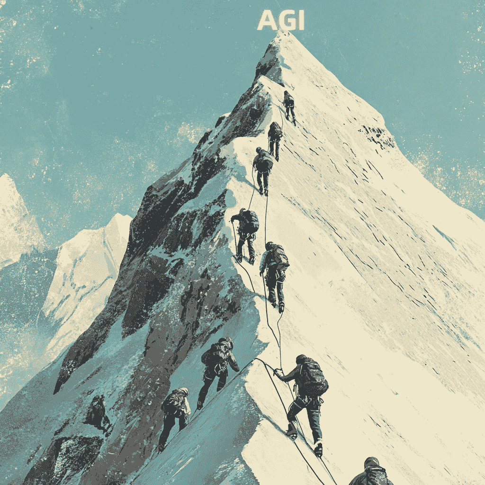

作者｜赵健

2024年，从“百模大战”的喧闹中所沉淀下来的创业公司第一梯队，大概是一个“6+2”的格局。

“6”为智谱、MiniMax、百川智能、月之暗面、阶跃星辰与零一万物，业内也常称为“大模型六小虎”；“2”即两家规模稍小但各具特色的公司：深度求索（DeepSeek）与面壁智能。

在ChatGPT刚发布不久，大模型六小虎是创业赛道最闪耀的明星。但到了今年下半年，形势正在悄然生变。

近期几位投资人都对「甲子光年」表示，有两家小虎已经隐隐有掉队的势头，而且每个投资人给出的刚好是两个相同的名字。“但是也没有说哪家活得特别好的，明年再跑跑看吧。按现在的估值来算，不管哪家都是低于预期的。”其中一位投资人补充道。

另一位投资人表示，六家的综合能力大致在同一纬度，但融资规模已有差异。

此外，幻方量化旗下的深度求索在今年一鸣惊人，近期发布的DeepSeek V3在多项评测成绩上一举超越阿里Qwen-2.5与Meta Llama 3.1，成为开源模型的新王。有人认为，DeepSeek事实上已经跻身“六小虎”之列。

六小虎的竞争也在无限扩大，在2023年后知后觉的科技巨头在2024年后来居上。在海外，谷歌刚刚立下军令状，要在关键的2025年吹响反击的号角。在国内，字节跳动也在AI战略上全面出击。

2025年，大模型创业公司将会如何应对？

## 1.AGI梦开始的地方

把时间尺度稍微拉长，才能更直观地感受暗流涌动。不妨先回顾一下大模型六小虎的起点。

智谱与MiniMax是唯二两家成立时间早于ChatGPT发布的公司，他们比大多数人更早看到了技术的拐点。

智谱成立于2019年6月，是国内第一批，也可能是第一个探索大模型的公司。成立的第一天，智谱写下了“让机器像人一样思考”的愿景。

智谱一周年的司庆日正好撞上了OpenAI发布GPT-3。当天张鹏与受邀而来的张钹院士深入讨论了GPT-3的技术前景。张鹏隐隐意识到，这个被称为“大模型”的技术，将是未来的技术方向。张鹏说：“OpenAI做的这个事情，也是我们一直期待去做的，一定追寻去做的，更是一定要去做的。”

智谱成立两年后，MiniMax成立。2021年，闫俊杰在一个不到100平米的房间里写下了MiniMax的初心和路径，要实现“Intelligence with Everyone”。闫俊杰当时写下的三个判断至今依然未变：做下一代AI；做接近图灵测试的智能体；智能创造极致体验。

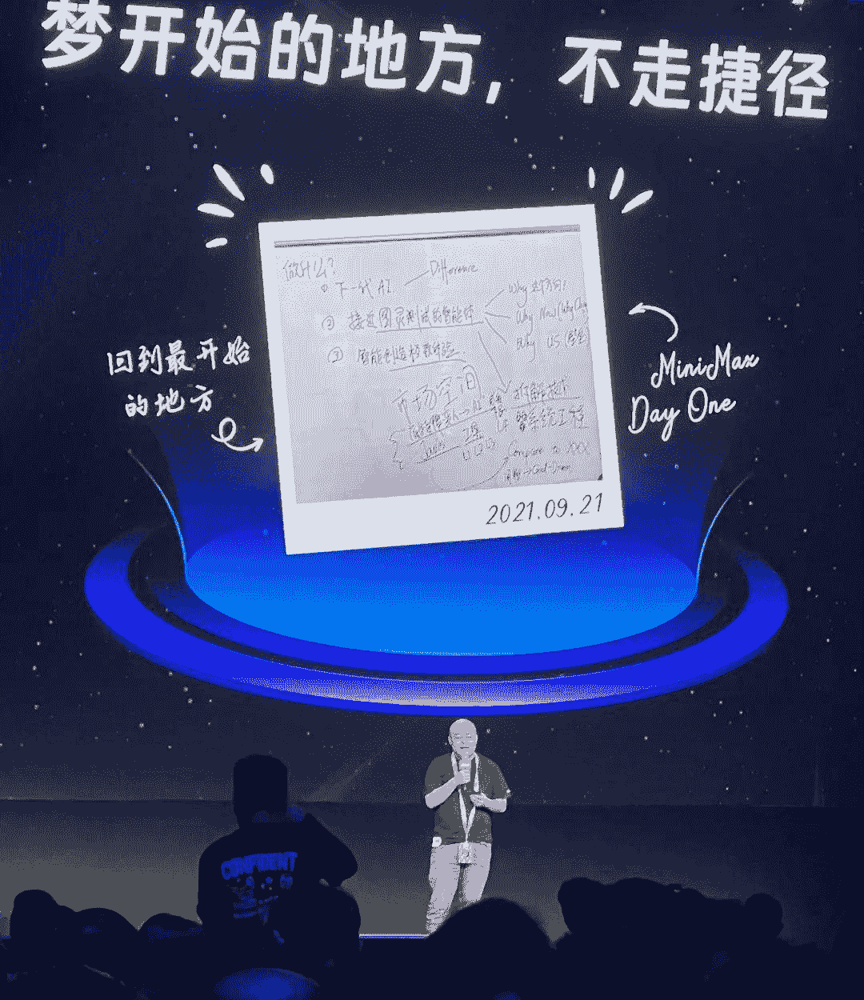

闫俊杰在钉钉生态大会上分享MiniMax的Day1，图片来自「甲子光年」拍摄

在ChatGPT发布之后，大模型迅速从一个冷门晦涩的技术词汇摇身一变成为投融资市场最热门的话题。很多人讲不清楚大模型的概念，但不妨碍它是技术发展的共识。背负着成为“中国的OpenAI”的期待，大模型六小虎应运而生。

在百川智能成立的公开信上，王小川激动地表示：“生活在二十一世纪初是如此幸运，波澜壮阔的互联网革命还没有谢幕，通用人工智能时代又呼啸而来。多年前我曾断言，机器掌握语言，通用人工智能时代就来了；我也有畅想，搜索的未来是问答。ChatGPT的腾空出世，地动山摇，这一切都开始成为现实。ChatGPT发布到今天，仅仅131天，每天都有扑面而来的新进展、新突破。131天恍如隔世！”

同样感到激动的还有杨植麟。在他看来，ChatGPT所展现出的高级推理能力放在三五年前是不可思议的，它会催生资本与人才的变量，这是做AI的核心生产要素，并带来一个可能性：从0到1搭建构建AGI（通用人工智能）的组织。杨植麟把公司名字命名为自己最喜欢的摇滚乐队Pink Floyd的专辑《月之暗面》，同时也代表了公司对于神秘与未知的探索精神。

2022年12月，姜大昕问ChatGPT的第一个问题是：“你多大了？”在过去，这个对于人类再简单不过的问题会难倒所有的机器，但ChatGPT的回答是，它在2019年被训练完成，今年是2022年，所以是3岁。姜大昕又问：“你明年多大？”这个问题的难点在于让机器理解明年是“今年+1”，涉及到数字的推理，ChatGPT又答对了。ChatGPT的回答让这位资深的技术专家出了一身鸡皮疙瘩，姜大昕意识到划时代的技术变革到来了。

李开复是这一批AGI创业者中年龄最大的一位，他在40年前提交的CMU（卡内基梅隆大学）的博士申请信就是探索AI。李开复本可以以投资人的身份站在幕后，但在40年后终于看到通过AGI的梦想有机会实现之时，李开复终究还是按捺不住心中的热情而躬身入局。他在2023年3月20日发出英雄帖，筹备零一万物。

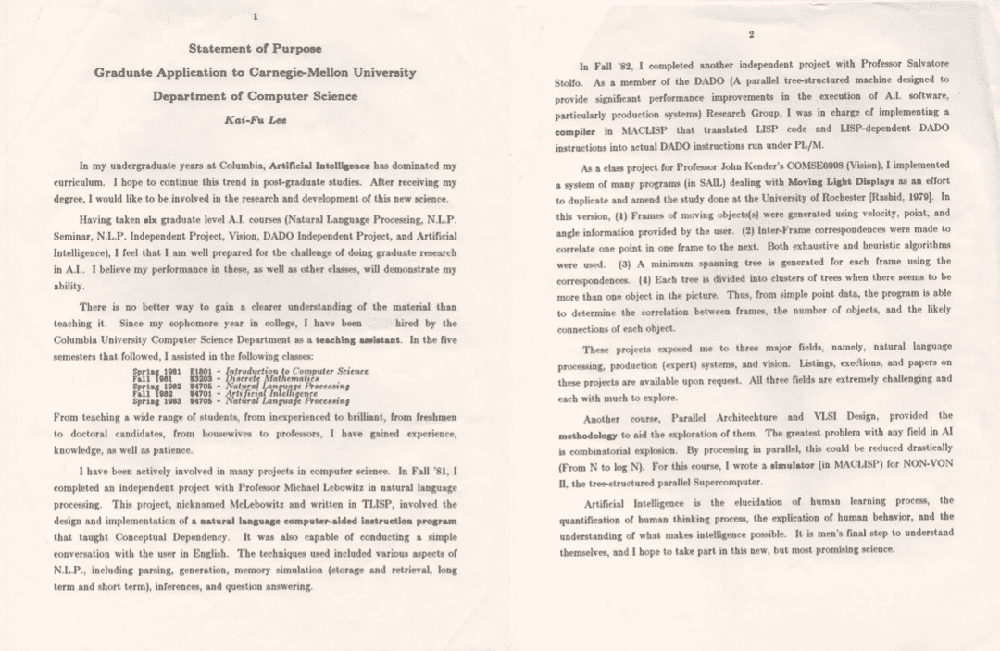

1983年李开复的CMU博士申请信

在短短3个月时间内，大模型六小虎陆续就位：百川智能成立于2023年3月，月之暗面、阶跃星辰成立于2023年4月，零一万物成立于2023年5月。

杨植麟曾解释过公司成立时间以及融资窗口的紧迫性：“ChatGPT扩散需要时间。有的人知道得早，有的人知道得晚，有的人一开始怀疑、后面变成震惊、再变成相信。找人找钱，跟timing结合得很紧。我们2023年2月开始集中做第一轮融资。如果delay（延迟）到4月，基本没机会了。但如果2022年12月或2023年1月做也没机会，当时有疫情，大家没反应过来——所以，真正窗口就是一个月。”

回过头来看，杨植麟的判断基本上是完全正确的。2023年下半年之后成立的AI公司，要么很难再拿到大额融资，也就很难再跻身第一梯队；要么就是像面壁智能（面壁的成立时间也较早，2022年8月）一样，深耕端侧大模型的垂直细分领域，或者像DeepSeek一样，依附于“不差钱”的母公司幻方量化，可以相对理想主义地对AGI展开“深度求索”。

大模型六小虎都带有同一个理想——AGI。但是如何实现AGI，不同的公司逐渐形成战略分化，这在2024年逐渐变得明显。

## 2.“六小虎”战略分化

2024年6月14日的智源大会上，杨植麟、王小川、张鹏、李大海四位“清华系”大模型独角兽的创始人罕见同台，分享了各自对于“通往AGI之路”的观点。在智源研究院院长王仲远的主持下，几位创始人几乎没有直接的交锋，但这仍然是一次难得的同台。

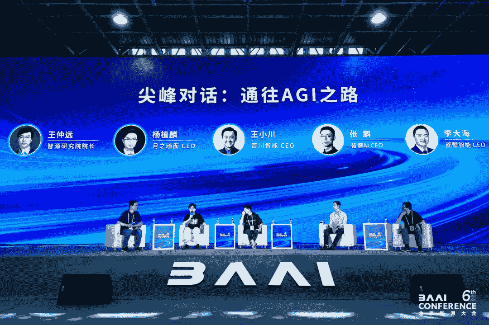

图片来自智源大会

AGI是大家共同的目标，但一千个从业者有一千个AGI，如何实现AGI也分化出了不同的路线。

为了将AGI从定性的描述变成定量的描述，DeepMind、OpenAI以及智谱都先后定义了AGI的等级。

在智谱的定义中，L1代表AI学会使用语言，L2代表AI具备逻辑思维能力与多模态理解能力，L3代表AI学会使用工具（Agent）的能力，L4代表自我学习的能力——也就是国际上非常热的“超级对齐”，L5代表全面超越人类、探究科学规律的能力，已经趋近AGI。

同时，智谱也定义了当前AGI的进度条。他们认为，L1的进度已经达到80%，L2的进度为60%，o1是推理模型的新范式；L3的进度只有40%，Agent的能力还处在非常早期的阶段；L4、L5才刚刚起步。

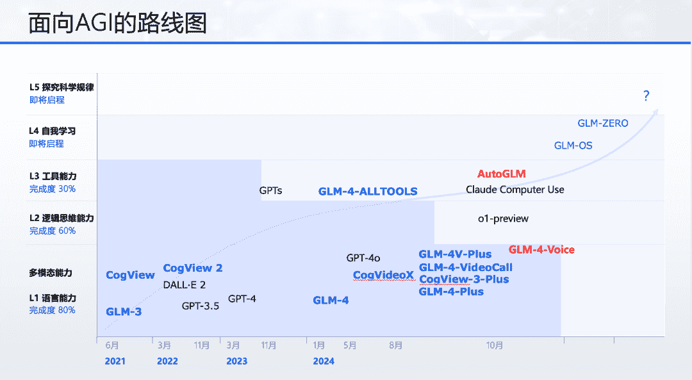

智谱公布的面向AGI的路线图

如果用一个词来评价智谱的战略，或许是“稳重求胜”。

过去两年，智谱采取了最稳妥、确定性最高的路线，那就是紧盯行业内最好的公司OpenAI，从底层的预训练框架，到模型，到最上层的应用，做全方位的对标。但永远当追随者最好的结果也只能是老二。从2023年下半年开始，智谱就在很多场合强调，做中国的ChatGPT远非公司的目标。

今年OpenAI的脚步有所放缓，智谱在对标OpenAI之外，加大了对L3——Agent的投入。在2023年11月的发布会上，张鹏在现场演示了用AutoGLM在🛰️里建群并在群里发出了100个、总价值2万元的红包。张鹏认为，Agent像是在用户和应用之间增加一个智能的调度层，链接所有应用甚至是所有设备，这可以看做是大模型通用操作系统（LM-OS）的一种雏形。

另一家明确对标OpenAI的大模型公司是阶跃星辰。阶跃星辰是六小虎中公开露面最晚的公司。从公司成立的第一天，阶跃星辰就在公司展厅的展板上画出了一条与OpenAI相似的业务主线——从单模态模型到世界模型。

姜大昕曾对「甲子光年」表示，OpenAI的模型矩阵看似复杂，但背后的逻辑其实非常简单。OpenAI发布过的主流模型包括语言生成模型GPT-4系列、多模态生成模型DALL-E与Sora、多模态理解模型GPT-4v、端到端到端语音模型GPT-4o，以及最新发布的推理模型o系列。此外，OpenAI还在积极布局具身智能，这是世界模型的核心载体之一。

姜大昕认为，大模型的演进将会经历从早期语言、视频、语音等各个模态独立发展，然后逐步融合，到彻底融合的过程。姜大昕认为：“Scaling Law、多模态理解与生成的统一，是实现AGI的核心认知。”

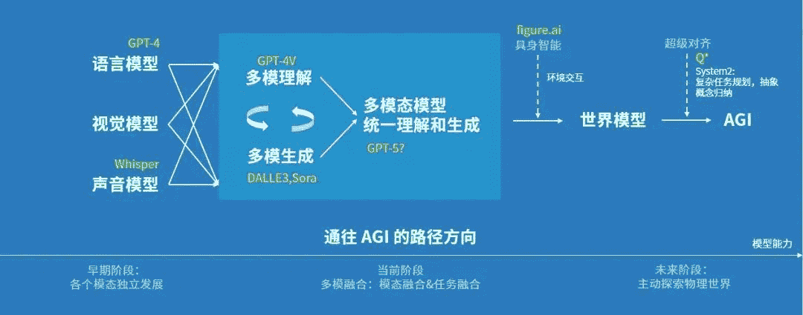

这张技术路线图由阶跃星辰发布于2024年3月，“超级对齐”部分的Q*、System2后来被证实为OpenAI发布的o系列推理模型

MiniMax虽然成立较早，但一直对外保持低调的姿态。在2023年2月，MiniMax曾举办过一次小规模沟通会，核心创始人之一杨斌向「甲子光年」等介绍了MiniMax自研的三个基础模型：文本到视觉，文本到语音、文本到文本，MiniMax也是国内首家多模态大模型创业公司。当时，MiniMax的首款应用Glow已经获得近500万用户，后来该产品更名为星野，海外版为Talkie。

MiniMax在2023年夏天开始研发MoE混合专家架构，投入了80%的算力与研发资源。在经历了两次失败后，MiniMax在2024年1月正式推出国内第一个MoE大模型。2024年4月，MiniMax开始钻研Linear Attention（线性注意力），成功研发出了新一代的基于MoE+Linear Attention的模型，达到了可以比肩GPT-4o的水平。

在2024年8月31日的“MiniMax Link伙伴日”上，闫俊杰表示“快”是MiniMax底层大模型的核心技术研发目标。闫俊杰还分享了他对于AI应用要提高渗透率和使用深度的三个关键因素：让模型的错误率持续降低、无限长的输入和输出，以及多模态。

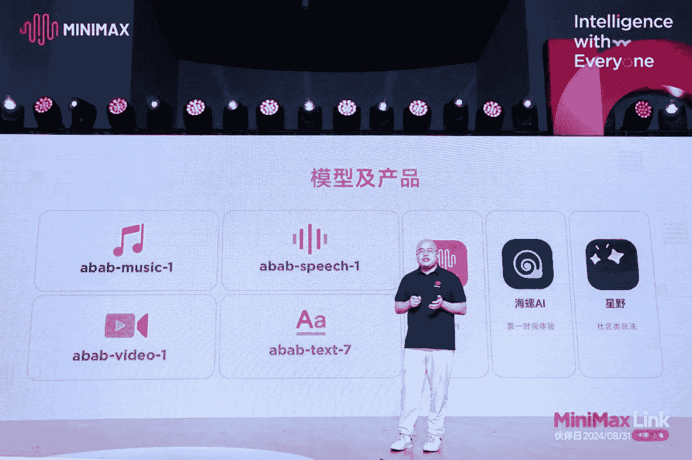

闫俊杰分享Minimax的模型及产品，图片来自MiniMax

月之暗面并没有公开过其技术路线图，甚至没有公布过其底层大模型的任何基础信息。

在2023年10月，月之暗面发布其首款AI智能助手Kimi，凭借20万字长上下文输入一鸣惊人。当时，Anthropic的Claude-100k模型只支持约八万字，OpenAI的GPT-4-32k只支持约2.5万字。独特的长上下文功能让Kimi在短期内获得了大量的用户，成为国内最受关注的AI智能助手。

用户量越大，推理成本越高，Kimi如何接住这“泼天的流量”？2024年7月，月之暗面联合清华大学团队发布了以KVCache为中心的分离式推理架构Mooncake。月之暗面工程副总裁、AI Infra负责人许欣然透露，这套系统承载了Kimi线上80%的流量。

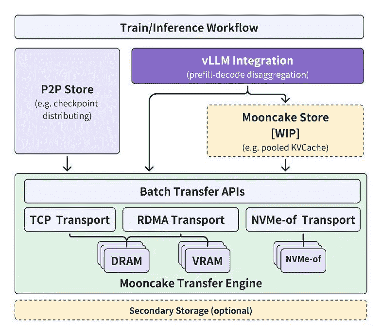

Mooncake推理系统架构图，图片来自月之暗面

许欣然还发布了一些“暴论”，第一条就是关于节省成本：“现在、立刻、马上真能省很多钱（毕竟不能公开规模和每日请求的pattern，如果你说省不了那你都对）。”

在Kimi之后，月之暗面也在探索更多技术路线，包括正在内测的视频生成模型以及已经发布的数学模型k0-math、视觉思考模型K1。

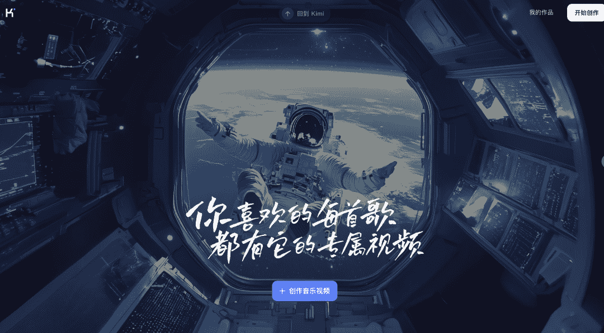

月之暗面正在内测的视频生成模型的界面

王小川对于AGI的愿景最出人意料，但也在情理之中。去年百川智能完成了通用人工智能团队的组建，今年吸纳了大量的医疗领域的专业人士，开始从通用人工智能战略聚焦医疗领域。

聚焦医疗似乎把路走窄了，但王小川并不这么认为。王小川将能否人工制造医生，作为判断AGI的重要标志。王小川认为，AGI的首要变化是它开始具备思考、学习、沟通和共情能力，以及多模态图像处理能力。从学习范式的能力要求来看，我们实际上是在像评价人一样评价它。因此，我们的评价指标或学习范式是向人类学习，数据来源于人类社会产生的数据，而医生是所有职业中智力密度最高的职业之一。

“如果连医生都制造不了，那就别谈AGI了。”王小川斩钉截铁。

中国科学院院士、清华大学计算机系教授张钹近期和「甲子光年」分享他看好的大模型企业时就提到了百川智能，他说：“从企业的角度来看，它（百川智能）有可能活下来，它在努力解决中国的医疗问题。现在国内大模型，你只能从应用角度去看。”

王小川也没有像其他六小虎一样跟进Sora，是唯一一位明确表态不做视频模型的创始人。2024年初Sora震撼世界时，也震撼了百川智能的工程师，但跟进Sora的想法很快就被王小川摁下了。在王小川心中，语言才是智能的“圣经”，Sora既不代表AGI，也不代表场景，而是阶段性产物。

在不做视频生成模型这一点上，王小川与跟他总是观点相左的李彦宏罕见地达成了共识。在今年百度世界大会期间，李彦宏就对「甲子光年」表达了“不做Sora，但非常看好多模态”的观点。

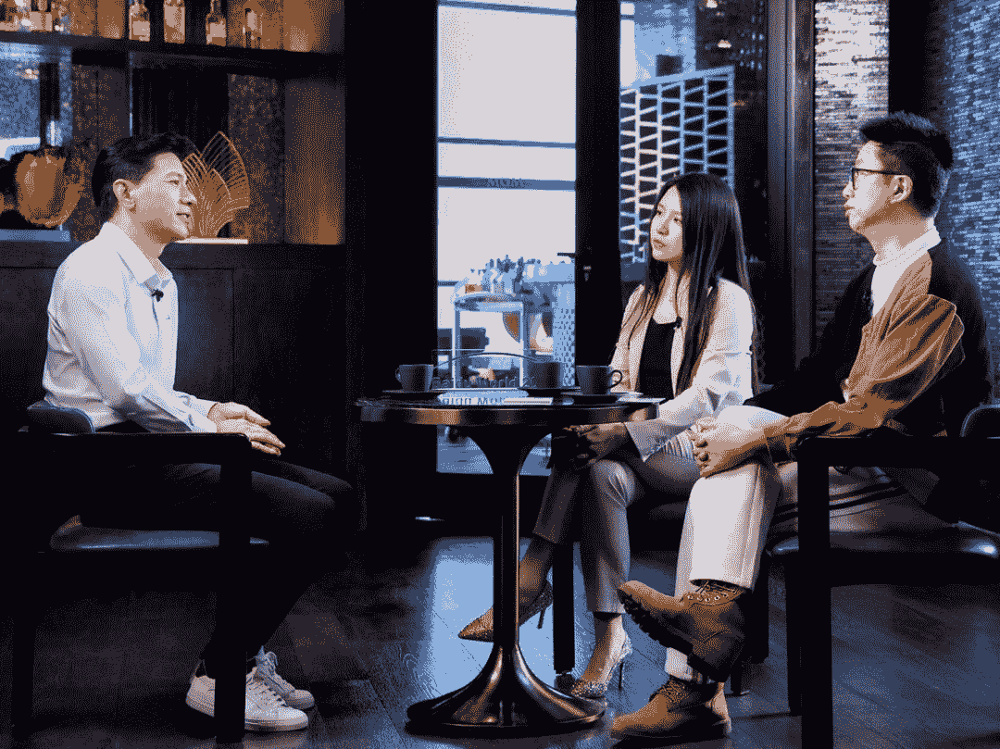

甲子光年创始人&CEO张一甲、硅星人创始人骆轶航对话李彦宏，图片来自百度

## 3.预训练的进与退

今年，海外的科技大厂在玩一种很新的收购——不直接收购公司，而是收购公司的CEO，包括一小部分团队。比较知名的有三起：亚马逊收购Adept，微软收购Inflection.ai、谷歌收购Character.ai。这被看作是硅谷大模型创业格局洗牌的一种信号。

8月3日，在谷歌收购Character预训练团队的消息发布之后，硅基流动创始人&CEO袁进辉如此评价：“产模一体，略受打击。”

产即产品，模即模型。其实，OpenAI、Anthropic以及后来异军崛起的xAI，都是产模一体的路线。所以说，不是产模一体的路线有问题，而是非头部的创业公司是否有足够的资金来支持产模一体的问题。

做模型的预训练需要承担高昂的成本。Meta训练Llama 3.1用到了1.6万张H100，马斯克今年用122天搭建的目前世界上最大的AI训练集群Colossus包含了10万张H100。如果仅仅计算GPU购买成本，按一张H100为3万美元估算，Llama 3.1的训练成本高达4.8亿美元，xAI的训练成本高达30亿美元。这是国内的创业公司不可承受的。

根据公开信息，大模型六小虎的估值在200亿元左右，融资额在百亿人民币左右。这些钱是否足够支撑继续做预训练？

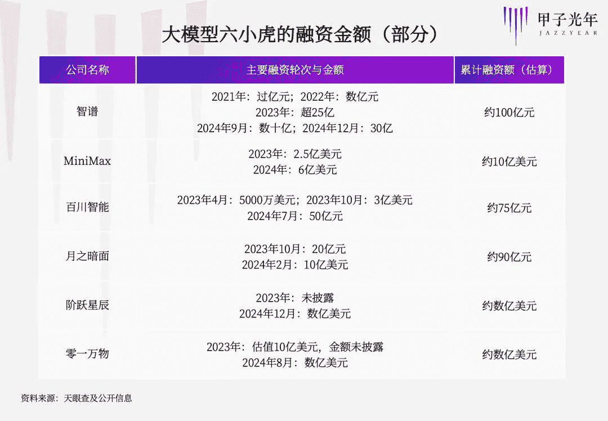

今年10月，36kr的一篇报道称，国内至少有两家小虎要放弃预训练了。不过，目前还没有公司承认这一点。

李开复专门为此发文辟谣，零一万物也在10月16日发布了新模型Yi-Lightning，该模型在公认比较权威的排行榜LLM Arena上一度排名全球第六，仅次于OpenAI与谷歌，追平xAI。

张鹏在12月10日的2024甲子引力年终盛典上表示，智谱一直在做预训练，今年8月刚刚发布最新迭代的模型GLM-4-Plus。智谱大约4～6个月就会迭代一版新模型。

王小川在12月14日的极客公园IF2025创新大会上也谈到了此事。他先是肯定了中国一定要自己掌握预训练。但同时也表示，受限于卡与算力，在中国做超级平台的预训练是不现实的，百川选择“由场景带动预训练”，在做超级应用时一定得要引领模型的进展。

阶跃星辰在12月23日完成数亿美元B轮融资后表示，这笔融资将用于继续投入基础模型研发，强化多模态和复杂推理能力，并通过产品和生态加大覆盖C端应用场景。

六小虎不放弃预训练，或许还跟预训练的Scaling Law放缓有关系。OpenAI迟迟不发下一代预训练模型，而是把重心转移到了推理模型上，这让人们怀疑预训练的Scaling Law是否撞墙了。OpenAI前首席科学家Ilya在今年的NeurIPS 2024大会上更是直接发表“暴论”：“我们所了解的预训练将要结束了（Pre-training as we know it will end）。”

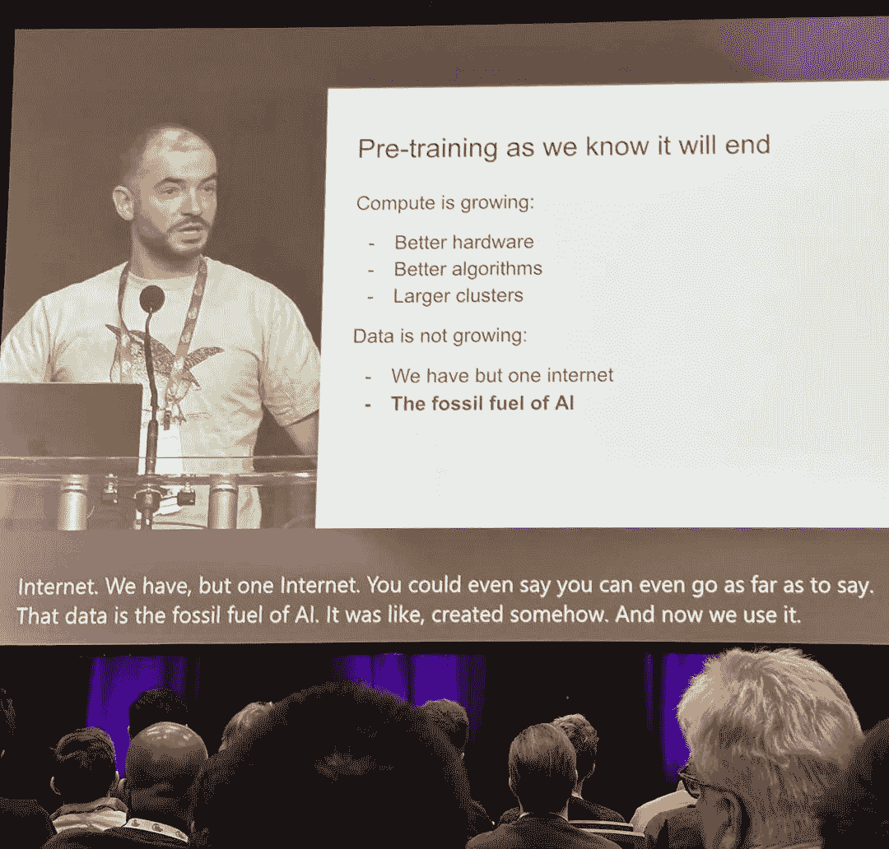

在NeurIPS 2024大会上演讲的Ilya，图片来自X

从另一个角度来看，如果预训练的Scaling Law真的在放缓，对于AGI的实现或许不是好事，但对于缺芯少卡的国内大模型公司来说不见得是坏事。当堆卡带来的规模效应递减，那么工程化的价值就会被放大。

零一万物的Yi-Lightning就是一个参考案例。据李开复介绍，Yi-Lightning的训练过程仅用了2000张GPU、耗费300万美元，训练成本大概只有OpenAI的3%。李开复认为，中国大模型公司只要有足够好的人才、想做好预训练的决心，融资额跟芯片都不会是问题。

近期，DeepSeek V3的发布也侧面印证了李开复的观点。这一在多项评测成绩上超越Qwen-2.5-72B与Llama-3.1-405B的开源新王，和世界顶尖的闭源模型GPT-4o以及Claude-3.5-Sonnet不分伯仲。DeepSeek V3仅仅使用了2048张H800做训练，总训练成本不到600万美元，其GPU使用小时只有Meta的十分之一。

除了预训练之外，大模型的范式也在转移。在OpenAI发布o1推理模型后，OpenAI研究科学家Noam Brown表示，o1模型代表一种新的推理的扩展范式，我们不再受预训练的瓶颈限制。

当推理也有Scaling Law，大模型六小虎的战线又被拉长了。一个最直接的问题是，预训练与推理的算力如何分配？

张鹏在2024甲子引力年终盛典上透露，智谱对于预训练与推理的算力投入大约是一半一半。

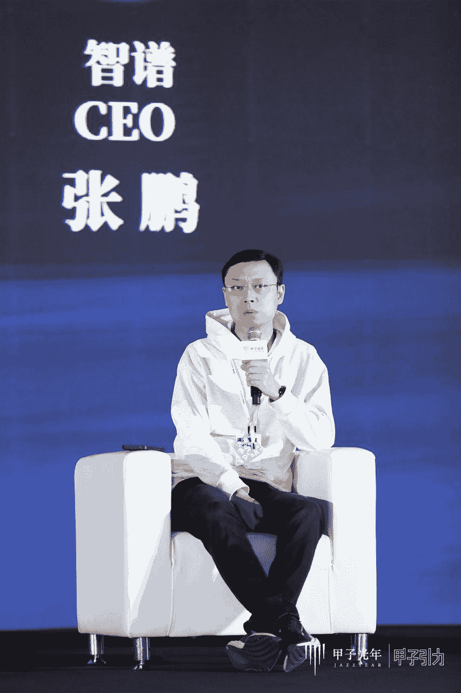

智谱CEO张鹏，图片来自2024甲子引力年终盛典

在2024年的云栖大会上，姜大昕与杨植麟关于o1模型进行了一次对谈。杨植麟认为，训练与推理的算力占比会发生变化，预训练不一定会降低，但推理一定会升高。之前只有达到一定算力门槛的公司可以做预训练的算法创新，而现在算力相对较少的公司也可以通过后训练的方式探索更多的机会。

姜大昕认为，推理侧对于强化学习的训练，算力需求不一定比预训练要小，因为Self Play（自强化）理论上是没有上限的。只是不太确定的是，Self Play的主模型要不要继续Scale，ROI是否是正向的。如果是的话，算力的需求是平方级的增长。

目前，月之暗面已经率先发布推理模型，先后上线了数学模型k0-math、视觉思考模型K1，是跟进推理模型动作最快的创业公司。此外，阿里的QwQ、DeepSeek的R1、昆仑天工的Skywork o1也快速跟进。而在今天——2024年的最后一天，智谱也发布其首个基于扩展强化学习技术训练的推理模型GLM-Zero-Preview。

预训练胜负未分，推理模型又激战正酣。大模型的下半场已经悄然拉开大幕，考验每一家公司的战略执行力。

## 4.艰难的商业化

与技术路线的分歧相比，商业化更是迫在眉睫、生死存亡。红杉资本曾提出著名的“AI的6000亿美元问题”，直指AI商业化收入与巨大的投资严重不匹配的问题。

李开复曾如此定义中国大模型的市场机会：“如果把开源、闭源分成两种，国内、国外分成两种，to B、to C分成两种，那么就至少有2x2x2=8个机会，而胜出者数量可能会进一步收窄。”

开源与闭源既是技术选择，更是商业选择。今年李彦宏一句“开源都是智商税”，让这个话题备受争议。海外的大模型创业公司比如OpenAI、Anthropic都采用了闭源战略，而Meta坚定采用开源战略，谷歌则是两者兼有，但以闭源为主。

国内只有阿里Qwen、DeepSeek完全采用了类似Meta的开源路线，而其他开源公司主要采用了谷歌路线，即把较小参数的或者非最新版本的模型开源，而更大参数、更强的模型采用闭源，包括智谱、百川智能与零一万物皆是如此。

张鹏曾解释过开源模型的意义：第一，开源能让大家知道智谱在做什么；第二，开源以后可以让更多的人参与大模型，用社区的方式汇集大家的热情一起来推动大模型发展，这是开源最重要的一件事。开源并非为了赢得市场或者追求商业上的利益，要不然就不会选择开源了，这是智谱一直以来对开源的定位。

最早开源的智谱吃到了先发优势的红利，是开源战略最成功的创业公司。根据智谱公布数据，其开源模型系列全球累计下载量超过3000万，并入选Hugging Face平台最受欢迎的人工智能机构。

百川智能在2023年9月公布过其开源模型在开源社区的总下载量接近500万次。零一万物并未公布过开源模型下载量的数据。在Hugging Face上，零一万物开源模型的累计下载次数在20万左右。

在商业化策略上，to B还是to C并不完全是一道单选题，六小虎基本都是全面布局。在大多数投资人心中，to B想象空间相对更低，但商业化路径更加明确；to C的想象空间巨大，是继移动互联网时代之后最大的机遇，但怎么做，是否是创业公司的机会，尚无定论。

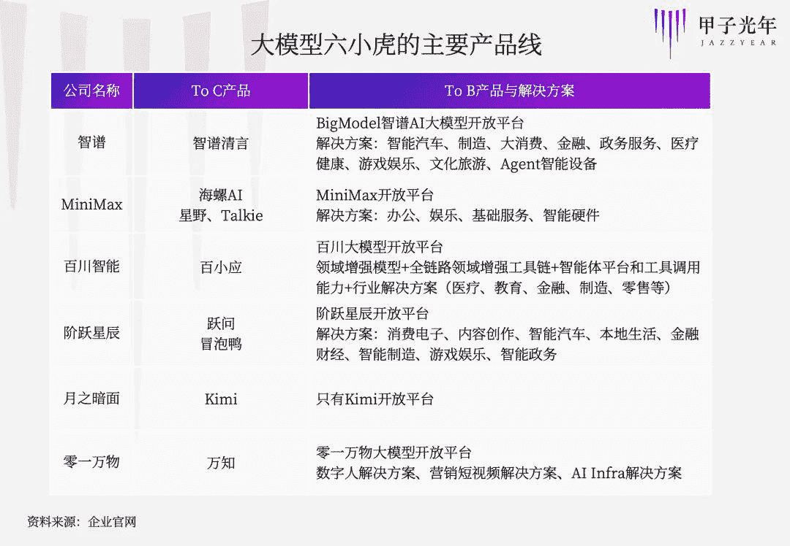

在C端领域，月之暗面与MiniMax目前是两家最强的产品公司。有数据可以佐证：根据Sensor Tower的数据，截至2024年6月，Talkie的全球月活跃用户数已达到1100万，超过一半用户来自美国，与Character.ai硬碰硬；2024年11月，杨植麟公布Kimi在10月份的全平台月活超过3600万，在国内与字节跳动的豆包直接交锋。

阶跃星辰、智谱也在C端跃跃欲试、各有千秋。跃问的多模态智能视觉搜索功能「拍照问」，是国内首个集成到iPhone 16相机控制键中的大模型应用产品能力；而智谱则引入前阿里达摩院资深技术专家、支付宝中国首席数据官胡云华担任智谱清言负责人。据智谱透露，智谱清言2024年已有2500万用户，年化收入（ARR）超千万元人民币。

零一万物将C端产品的重心放在了海外。此前据李开复透露，其海外的生产力工具应用总用户接近千万，今年的营收预期过亿人民币。

在B端领域，大模型绕不开定制化的难题。定制化模型之所以不容易赚钱，是因为当产品与服务不够标准化的时候，就会变成按照人/天计算的商业模式。

现在，六小虎普遍在用“MaaS（Model as a Service）开放平台”来寻找解法。每一家六小虎都有自己的MaaS开放平台，对外提供API接口来调用模型的能力。目前，除了Kimi仅提供标准化的API之外，另外几家大模型公司或多或少都会在行业深耕，提供更加个性化的行业解决方案。

智谱曾分享过其三种to B的商业化模式：第一，标准化的API；第二，云端私有化解决方案；第三，完全私有化解决方案，也是最具中国特色的方案。

智谱定位基座大模型，而不做针对特定行业的垂直模型。张鹏曾告诉「甲子光年」：“我们不会直接扎到具体场景里做应用开发，很多行业存在技术、数据的壁垒，不是创业公司的体量能够搞定的，更多希望是合作伙伴在垂直行业深耕。”

但也有小虎选择继续深入，做行业模型、垂直模型。2024年上半年表示“坚决做to C，不做不赚钱的to B”的零一万物，在下半年发布了面向电商直播的数字人解决方案，以及面向智算中心的AI Infra解决方案。百川智能则在核心医疗领域之外，发布了“全链路领域增强金融大模型Baichuan4-Finance”。

零一万物联合创始人祁瑞峰曾对「甲子光年」等表示，解决to B赚钱问题的关键是回到业务本身，真正让大模型进入客户核心业务场景，形成一个标准化、可规模复制的应用产品。

人们常把今天的“大模型六小虎”与此前的“AI四小龙”做对比，后者并没有解决好to B定制化的问题。如果商业化难题能够解决，四小龙就是六小虎的下限；如果商业化难题解决不了，四小龙或许就是六小虎的上限了。

## 5.更多的不确定性

在技术路线选择与商业化进展之外，还有很多的因素影响着大模型公司的进展。

2024年，最八卦、争议最大、最受关注的大模型公司，可能非月之暗面莫属了。

2024年2月，月之暗面完成由阿里领投的10亿美元融资，创下国内大模型领域的单笔最大融资额纪录。

2024年3月，在发布200万字长文本功能后，月之暗面被二级市场炒作，“Kimi概念股”由此诞生，为Kimi智能助手以及月之暗面公司带来巨大的曝光。

在这两则好消息之后不久，月之暗面就被卷入了巨大的舆论漩涡中。

先有媒体报道“杨植麟套现数千万美金”，后有朱啸虎诉讼发难，月之暗面均委托律师来处理。这支年轻的创业明星团队在技术上站上了世界前沿的舞台，却在公司的管理与运营上暴露出了稚嫩与不足。

在这场风暴中，月之暗面的核心团队非常稳定。而其他小虎则或多或少遭遇了核心人员的流失，从核心业务的负责人到联合创始人级别均有波及。他们有的另起炉灶去创业，有的加入了更强大的大厂。

人才的流动本身是很正常的现象，但人才的去向却反映了市场资源的流动趋势。在2024年，有钱、有卡的大厂对人才的虹吸效应愈加明显。

大厂的虹吸效应不仅是人才，还包括直接的业务竞争。最具代表性的是字节跳动，在短短一年内发生了180度的转变。昆仑万维创始人周亚辉今年11月28日在朋友圈点评道：“年初说字节23年的AI战略不及格，但这完全不影响字节24年AI战略的满分表现。”

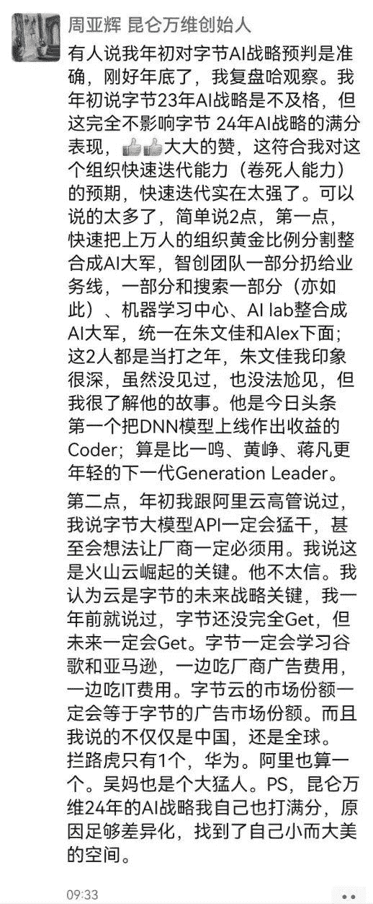

图片来自周亚辉的朋友圈

在基础大模型的技术侧，字节跳动已经点满了大模型的科技树。豆包大模型昨日宣称，距5月15日首次亮相仅7个月，其在通用语言、视频生成、语音对话、视觉理解等方面模型能力均已跨入国际第一梯队，综合能力对标GPT-4o。在上下文这样的功能点上，豆包大模型已经做到300万字窗口的长文本能力，每百万tokens处理延迟仅需15秒。这一上下文窗口长度和时延水平达到目前业界极限。

在AI产品端，字节跳动过去一年不仅一口气推出了十几款AI应用，而且在投流竞争上具备天然优势。字节跳动掌握了中国最大的聚合广告投放平台“穿山甲”，同时有抖音等流量巨大的超级App。从今年4月起，抖音就不再接受其它AI产品的投放。

在B端，大模型也渐渐被大厂主导。2024年5月，火山引擎掀起价格战，整个行业快速跟进，大模型API的价格一降再降。

今年大模型招投标也出现越来越多大厂的身影。在今年上半年的一次统计中，中国电信、科大讯飞、智谱、百度云、中国移动分别拿下大模型项目的前五位。在这些大模型落地的隐秘角落，大厂正取代大模型创业公司而占据主导地位。

2024年，“AI一天、人间一年”的狂飙突进在慢慢消退，备受期待的大模型公司也逐渐把节奏放缓了下来。

技术的发展总有一个规律，那就是人们往往高估技术的短期效应，而低估技术的长期影响力。如果我们仍旧以AGI为目标，目前它仍旧处在初级阶段。

2025年，大模型还会有更多的故事与更多的变化。那时候，我们也将更能看清楚AGI的模样。

<https://aigcreative.feishu.cn/sync/K4Gvd9vUQsy9Oubwqaeclu0Fnbg>

END.
