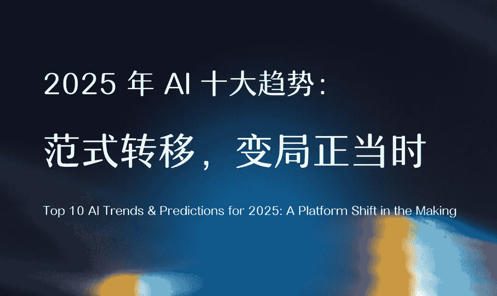
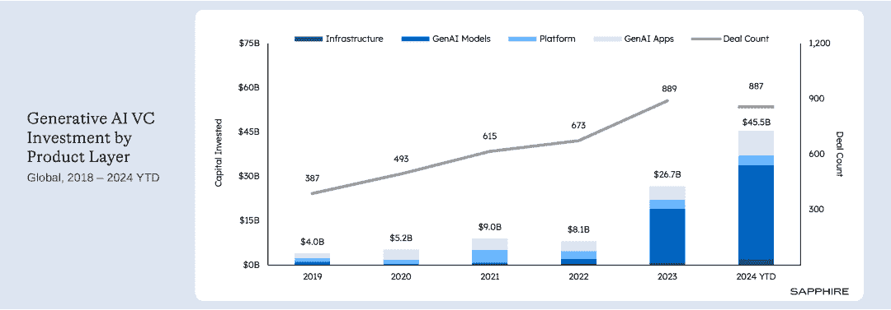
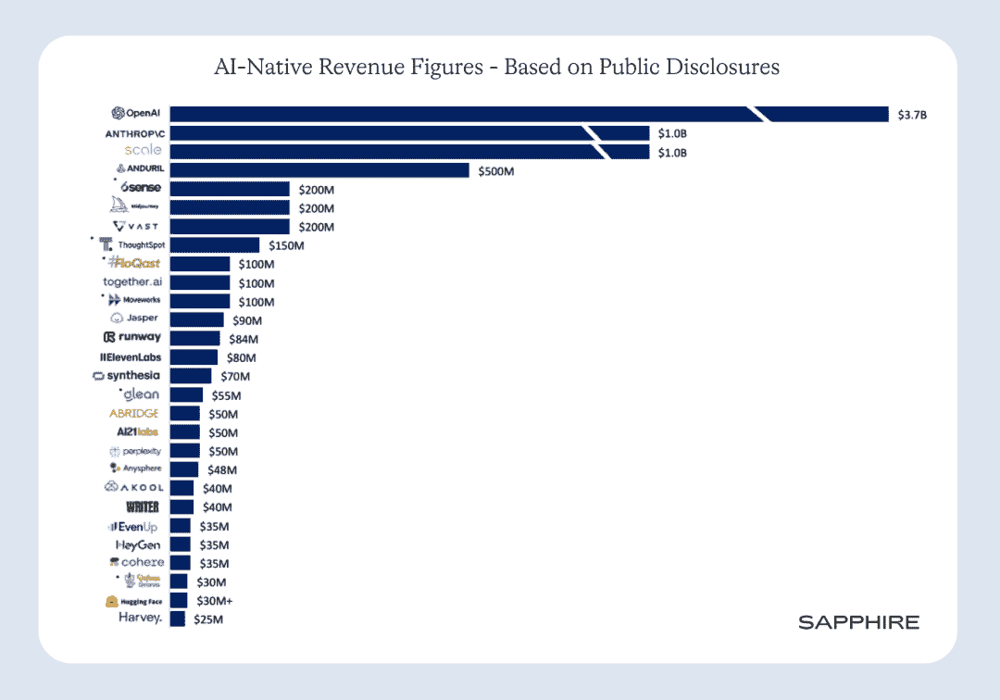
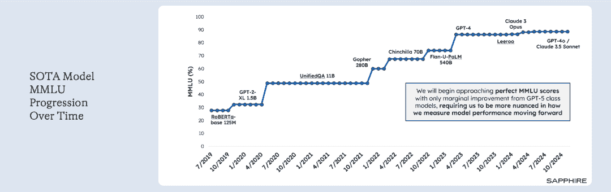
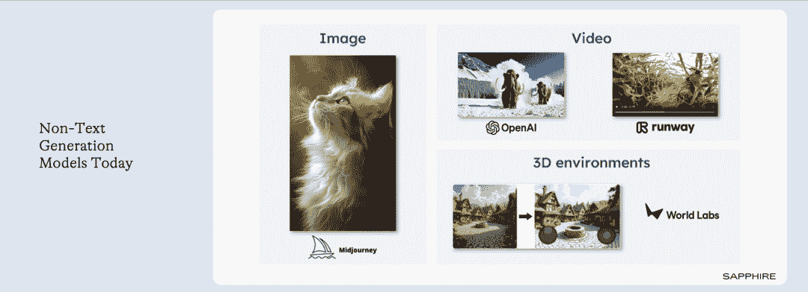
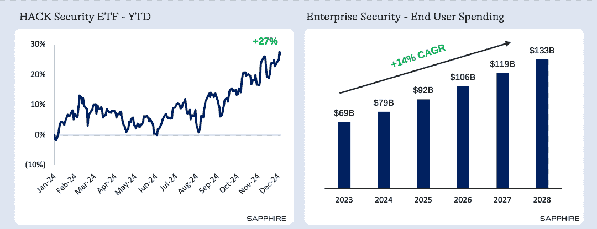

# 2025 年 AI 十大趋势：范式转移，变局正当时

> 来源：[https://aigcreative.feishu.cn/docx/BQH3duNNvolMUFx5xU7cHX0Xn8c](https://aigcreative.feishu.cn/docx/BQH3duNNvolMUFx5xU7cHX0Xn8c)

> 原文链接： [https://mp.weixin.](https://mp.weixin.qq.com/s/O10dC5W0wnPrpUfcpdqgOQ)qq.com/s/O10dC5W0...

> 公众号：宇宙编辑部 特工宇宙

特别感谢特工宇宙战略顾问  @庄明浩  老师的推荐。该篇文章由 Apphire Ventures 发布于其官方博客，经宇宙编辑部翻译如下。

2024 年初，我们明显感受到 GenAI （生成式人工智能） 仍将是技术发展和风险投资的重点方向。在顶尖的 AI 实验室算力需求的推动下，模型层继续吸引了最多的资本投入。代码辅助、营销和客户支持等场景的落地正在加速，同时随着巨头们加入这场军备竞赛，全球资本支出也在增加。

AI 领域的许多发展与我们的预期相符，但也出现了不少意外。很少有人预料到现在还没有看到 GPT-5 级别的模型，或者一些曾经炙手可热、融资数亿美元的初创公司，其创始团队离职跳槽去了其他大厂。我们也没有看到个人 AI 助手的兴起、新型 AI 形态对手机作为用户日常核心备地位的威胁、Deepfake （深伪技术） 出来的丑闻在选举中造成混乱、全球搜索市场份额的重新洗牌，或者任何接近 AGI （通用人工智能） 的东西——尽管在年初时很多人都做出了这样的预测。同样，很少有人预见到推理模型会引发巨大轰动并揭示出新的 Scaling Law （规模法则） 。

虽然判断 AI 发展的方向并不困难，但预测具体路径和潜在风险要困难得多。在Sapphire Ventures，我们的使命是深入研究技术趋势，形成对市场判断的精准观点，并支持那些朝这一愿景努力的企业家们。在新年伊始之际，我们分享一些关于生成式 AI 的最新观点。

✨ 以下是我们对 2025 年的十大 AI 预测：

1. AI 原生应用将获得最牛逼的融资势头

2. 更多 AI 原生公司将达到 5000 万美元的 ARR （年度经常性收入）

3. AI 融资退出活动将增加，但并购将多于 IPO

4. 模型将在多个维度得到改进

5. AI Agents 将持续火热，但效果可能参差不齐

6. 另一场 AI 军备竞赛：国防部将加大对 AI 的投入

7. AI 生成内容将激增，视频将成为新焦点

8. 随着使用量增长，基于“最终结果”的 AI 定价模式将放缓

9. AI：重大安全威胁与对抗

10. 如无重大灾难，AI 监管进展将缓慢进行

让我们深入探讨每一项预测。

# 1. AI 原生应用将获得最牛逼的融资势头

2024 年 AI 原生创业公司的融资再创纪录，截至 12 月初超过 450 亿美元投资，相比 2023 年增长超过 70%。

数据来源：截至 2024.12.4 的 Pitchbook 数据；Sapphire 内部分析（2024.12）

注：Pitchbook 数据持续更新，因此可能会有变化；包括所有披露交易规模的企业软件风险投资活动；生成式 AI 分类和子类别由 Sapphire 定义，其他人可能会对相关公司有不同分类。

这些数字令人感到震惊，特别是考虑到今年整体风险投资趋于平稳甚至略有下降。不过，这还低估了 AI 投资的势头，如果采用更广泛的定义——“以某种方式使用 AI 的公司”，总额会更高。

我们相信 AI 原生公司的融资将在 2025 年继续增长。原因如下：

1. 投资者对 AI 公司保持强烈兴趣

2. 战略投资人和政府持续参与投资

3. 创最高纪录的基金备用金 （Dry Power，基金储备的现金流）

4. 巨大的资金需求

5. 激烈的人才竞争

6. 各赛道中不断涌现的成功案例

总的来说，要超越今年的投资水平，一方面需要投资范围向 AI 各个层次延伸，另一方面基础模型的头部玩家也要保持大额融资的势头。从整体走势看，我们预计明年市场仍将保持增长，但增速将有所收窄。从增速来看，应用层有望领跑，但从投资总额来看，模型层依然是当之无愧的资本热宠。

# 2. 更多 AI 原生公司将达到 5000 万美元的 ARR

据统计，超过 30 家创业公司达到了 2500 万美元 ARR，相比 24 年年初的 19 家有明显增长。从下面的图表，我们可以看到生成式 AI 的广泛影响，包括构建基础模型、代码辅助、数据管理、营销、销售、法律、知识管理、搜索和客户支持的公司。

数据来源：OpenAI、Anthropic、Scale、Anduril、6Sense、Midjourney、Vast、ThoughtSpot、FloQast、Together、Moveworks、Jasper、Runway、ElevenLabs、Synthesia、Glean、Abridge、AI21 Labs、Perplexity、Anysphere、Akool、Writer、EvenUp、HeyGen、Cohere、Defense Unicorns、Hugging Face、Harvey

注：*代表Sapphire Ventures 投资的公司

虽然上述列表令人印象深刻，但值得注意的是，它仅包括已报道或公开披露数据的公司。我们知道还有更多公司已经达到这个标准或即将达到。

我们认为一年后，现在的这份清单将显得有些单薄。具体来说，我们相信将有至少 50 家 AI 原生创业公司产生 5000 万美元 ARR，同时仍保持 50% 以上的增长率，其中几家将突破一亿美元门槛。

# 3. AI 融资退出活动将增加，但并购将多于 IPO

2024 年 IPO 市场仍然低迷，仅有包括 ServiceTitan、OneStream、Waystar 和 Rubrik 在内的少数软件公司上市。并购环境虽然没有那么差，但相比往年仍然低迷，我们没有看到太多的重大交易。虽然买家大多放弃了大型交易，但我们看到了很多特定于 AI 的收购活动，比如 Run.ai、OctoAI、Datavolo、Tenyx、Leonardo.ai 等公司陆续被收购。谈到 AI 并购，2024 年最有趣的趋势之一是微软与 Inflection、亚马逊与 Adept 以及谷歌与 Character.AI 之间的 “Extracti-hire” （人才收购式） 交易。

在 2025 年，我们预计会看到更活跃的退出环境，我们将看到首批 AI IPO。就这一点而言，CoreWeave 有望在上半年上市，Scale AI 紧随其后。也许 Databricks 会决定上市。但只会有少数几家，大部分可能会在 2026 年和 2027 年上市。

我们的观点基于四个关键洞察：

1. 美国大选这个不确定因素已经消除，预计监管环境将至少逐步转向更有利于交易的方向。

2. 科技巨头和私募基金持有大量现金，一直在耐心等待时机，同时也在不断完善各自的“并购清单”。

3. 最近许多企业软件股价的上涨也增强了他们的竞价地位。

4. 尽管行业仍处于早期发展阶段，但部分细分赛道已经到了整合的窗口期。我们预计在代码辅助、销售营销以及数据管理等领域将率先出现整合动作。

考虑到这一切，我们相信我们将会看到更多的“Extracti-hire” 交易，以及首个价值 50 亿美元以上的对 AI 原生公司的收购。

# **4. 模型将在多个维度得到改进**

关于 Scaling Law 是否正在失效的争论在 11 月初成为主要讨论点，因为多家媒体发布报告称 OpenAI、谷歌和 Anthropic 在他们仍在开发的下一代基础模型上，都看到了收益递减。任何发展速度的放缓都令人担忧，因为这会产生连锁反应，并带来财务上的影响。但在反应中，模型仍在改进的事实被忽视了。

数据来源：Papers With Code

虽然这是一个更明显的预测，但我们认为有必要重申一下，基础模型的功能将在多个方面变得更好。最值得关注的是，我们可能会看到多模态模型性能的提升和推理模型的快速进步，这将使 GPT-5 级别模型发布时，在核心 LLM 能力方面获益。这些进步，加上不断的 AI 工程化工作、新颖的训练技术、新架构 （如 Mamba） 、更好的模型编排能力、结合生成式 AI 和预测式 AI 的创新方式，以及仍在快速下降的推理成本，将使 AI 的进展保持稳定速度。例如，GPT-4 的价格自 2023 年 3 月首次发布以来已下降约 90%，使前沿智能变得更加容易获取。我们喜欢把即将到来的时期称为“Mixture-of-Everything”时代。

数据来源：Midjourney、OpenAI Sora发布会、World Labs、TechCrunch报道

虽然可能会遇到瓶颈，但我们认为明年还不会碰到。在 2025 年，我们预计 GPT-5 的模型将上市，并预计一些头部实验室和大型云服务提供商将发布多个推理模型。我们还认为，在 Llama 及其衍生产品的引领下，SLM 和开源模型将从当今领先的 LLM 中夺取几个百分点的市场份额。

# 5. AI Agents 将持续火热，但效果可能参差不齐

2024 年下半年，Agents 发布的资讯比比皆是。企业们围绕它们不停地开会，创业公司争相演示它们，风投公司不停谈论它们将如何颠覆经济。虽然 Agents 的叙事声势浩大，但迄今为止产生的影响可以忽略不计。我们相信这种情况将在 2025 年开始改变。

我们距离真正的 Agentic Workflows（智能工作流程）可能还有几年时间，但认为 25 年 Agents 将在客户支持、IT、销售、安全和几个垂直场景中产生实质性影响。在这些领域成功摆脱无聊、重复的任务，将增强组织和个人员工对 Agents 的信心，促使他们进一步投资 Agents。围绕生产力的提升定义成功指标，并密切跟踪成本节省，将对构建更广泛采用的商业案例至关重要。

虽然初期的采用将激增，但我们也将看到更多的“Agent-Washing”，即现有能力会被营销得比实际更先进。这将让期望在自动化、助手和 Agents 能力之间弄明白的买家感到困惑，因为他们希望将 AI 的支出从实验性的预算，转向真正有效果的固定成本。在消费者（如最近有报道称 Perplexity 购物 Agents 难以满足基本请求）和企业领域都将出现高调的 Agents 失败案例，这可能会限制 Agents 时代发展的速度。

尽管 2025 年可能会有一些波折，但我们从长期来看十分看好 Agents，认为在未来一年，对于展示早期的 PMF 方面将至关重要。在短期内追踪 Agents 的采用和真正影响可能很困难，但我们预测至少有一家超大市值的科技公司，将在年内宣称通过 Agents 部署节省了 10 亿美元成本。

# 6. 另一场 AI 军备竞赛：国防部将加大对 AI 的投入

自从 ChatGPT 让生成式 AI 名声大噪以来，数据中心就一直在进行着 AI 军备竞赛。与此同时，另一场 AI 军备竞赛也在政府内部，特别是在国防部悄然升温。

虽然国防科技的发展势头才刚刚开始，但未来十年有望成为该领域投资的黄金时代——特别是在 AI 国防科技方面。正如我们在今年早些时候，关于这个话题的文章中指出的，持续的全球冲突推动了对现代技术的需求，国防部自己也承认了其技术短板，并增加预算以努力采用最新技术。这些趋势，加上顶尖的国防人才涌向私营部门，创造了一个适合国防科技蓬勃发展的环境。

不仅是我们单方面这么说，过去一年国防科技公司成功的证据，正在以不容忽视的方式堆积。在公开市场上，Palantir 的股票在 2024 年上涨了 320% 以上，市值攀升至约 1600 亿美元；在私募市场，Anduril 以 1480 亿美元的估值融资 15 亿美元 F 轮，较 2022 年的估值上涨约 70%；Starlink （星链） 在乌克兰战场的应用；SpaceX 在太空防御项目中的关键作用；无人机技术的持续进步。这些例子不胜枚举。

我们相信，截至 11 月底已获得超过 30 亿美元风险投资的国防科技，将在 2025 年翻一番以上，很有可能成为年度增长最快的垂直技术类别。此外，我们相信 AI 项目的报告上的预算和非机密项目数量，将从目前的 18 亿美元和 685 个显著增加。

# 7. AI 生成内容将激增，视频将成为新焦点

现在几乎不可能读文章、听播客或看视频而不遇到 AI 生成的内容。一项研究表明，从 ChatGPT 发布到 2024 年 3 月的 16 个月期间，AI 生成内容增长了 8000%。在许多情况下，AI 生成的内容很容易被发现，但我们预计这种情况在 2025 年将发生改变。

AI 生成的内容正在各种形式中以惊人的速度增长，改变着我们生产和消费内容的方式——这是有充分理由的。生成式 AI 已经证明了它的快速、成本效益和可扩展性。生成式 AI 工具在头脑风暴、编辑、配音、翻译和设计场景中提供了巨大的好处，推动了营销人员、销售、媒体公司和 KOL 的采用。

随着多模态模型的进步和生成式 AI 应用变得更加强大，内容创作者的生产力将空前提升。然而，在未来几年 AI 生成内容份额增加的过程中，我们需要应对几个棘手的问题，包括：建立更清晰的版权和艺术家报酬规则、构建内容认证机制以对抗 Deepfake 和错误信息、防止 AI 生成内容被重复用于训练导致的模型崩溃，以及从更哲学的角度来说，要防止我们消费的知识质量普遍下降。

我们认为 AI 生成内容的利大于弊。展望未来，我们将看到一个突破性的消费级和企业级视频产品，其规模将类似于 NotebookLM。我们还认为 2025 年将会看到完全由 AI 生成的媒体内容登上音乐、短视频和日常播客的前 20 排行榜。

# 8. 随着使用量增长，基于“最终结果”的 AI 定价模式将放缓

目前我们投资的公司的高管最常问的问题之一是如何为新的 AI 功能定价。显然，我们正处于实验阶段，没有明确的答案。多种定价模式将共存，各个类别都在摸索寻找新的平衡点 （即基于席位个数、基于消费和基于最终效果的模式） 。

在如此多的实验进行时，现在判断哪种模式会占主导地位还为时过早，不过我们相信基于席位的模式将增长放缓，特别是随着 Agent 能力的成熟。25 年将为哪些方法可行、哪些不可行提供有价值的数据。我们特别关注高单价席位制 SKU 的客户流失率，以此作为客户价值和功能竞争壁垒的信号。

我们的感觉是，许多类别将演变为包含基础的平台承诺（可能与用户席位挂钩）以及将高级 AI 的使用量计入该价格中。超出此阈值的使用将按计量收费。但现在下定论还为时过早。我们更有把握的是，**基于结果的定价，增长会比许多人预期的更**慢，范围也更有限。我们认为这种模式只适用于输入输出明确可测量、且客户与供应商之间达成一致的特定场景。然而，这并不适用于大多数企业任务和工作流程。考虑到这些因素， 我们预测 2025 年基于最终结果的模式在企业软件总收入中的占比将不到 1%。

# **9. AI：重大安全威胁与对抗**

考虑到大公司因安全失误的代价越来越高，安全是 2024 年唯一能在 CIO 优先级和公开市场表现中与 AI 并驾齐驱的另一个领域，这并不令人意外。在各大投行最近发布的 CIO 季度报告中，全被列为第一或第二优先级。安全是白帽黑帽之间的持续斗争，这使得该领域始终具有投资价值，且企业在这方面的支出难以被削减。

AI 已迅速成为安全领域的主要攻击手段和第一道防线。对于不法分子而言，AI 提高了攻击的质量和数量 （如利用伪造的音视频的高级钓鱼和社交舆论攻击） ，扩大了威胁面，并引入了新的漏洞，如提示注入攻击、模型和数据投毒以及数据泄露。为说明这些挑战，HiddenLayer 发现 77% 的受访公司经历过 AI 工具的漏洞，Hugging Face 不久前也公开披露了其 Space 平台遭到入侵。

数据来源：(1) CapIQ，截至2024.12.5；(2) TD Cowen《网络安全入门》(2024.11)

反过来，AI 可以帮助公司保护数据、改善可观察性、识别和缓解威胁、简化安全流程并加强预测分析。该领域的供应商已迅速对这一机会做出反应。当我们面对参议院情报委员会主席 Mark Warne**r 最近所称的“迄今为止我国最严重的电信黑客攻击”的后果，以**及外国对手持续针对美国关键基础设施的攻击时，形势比以往任何时候都更加严峻。预测安全支出和网络攻击会增加是显而易见的，但如果我们进一步预测， 我们认为 2025 年将会看到一次 AI 驱动的网络攻击，给特定公司或政府造成数十亿美元的经济损失。

# 10. 如无重大灾难，AI 监管进展将缓慢进行

关于如何监管 AI 的问题由来已久，但随着当前这一代基础模型的发布而成为主流。它们快速变革性的能力引起企业高管、研究人员、立法者和公民对从数据隐私到就业损失，再到更具幻想色彩的 AI 失控场景的种种担忧。

迄今为止，虽然关于监管的讨论很多，包括走过场式的听证会，和继续研究某问题的呼声，但在如何推进方面几乎没有达成共识。欧盟是个例外，它在 3 月通过了《欧盟 AI 法案》，并于 24 年 8 月将其正式立法。该法案本意是将欧洲置于安全可信的 AI 发展前沿，但很快就被贴上了又一个限制创新的官僚主义产物的标签。

在美国，最全面的一项拟议法案——加州的《前沿人工智能模型安全创新法案》被纽森州长否决。他的这一决定获得了业界的广泛支持，理由是这些措施过于严格，且没有充分考虑 AI 应用的具体场景。

我们认为，除非发生重大灾难。否则 2025 年 AI 监管将缓慢推进。即便如此，这也可能具有挑战性。我们认为联邦层面不会很快出台任何重要的 AI 立法，不过会更多地使用关税和贸易限制来控制 AI 关键资源的获取。预计将会看到更多理论框架的提出、政府高层的表态，以及研究课题的立项，但不会有实质性限制 AI 发展步伐的措施。

# **一切才刚刚开始**

毫无疑问，未来一年有很多令人兴奋的事情。这些选题中的许多都值得单独写成文章，比如市场上 AI 的赢家和输家、AI 对能源行业的影响、新的 AI 硬件设备,以及下一代个人 AI 助手等。2025 全年我们将继续讨论所有这些话题！

<https://aigcreative.feishu.cn/sync/K4Gvd9vUQsy9Oubwqaeclu0Fnbg>