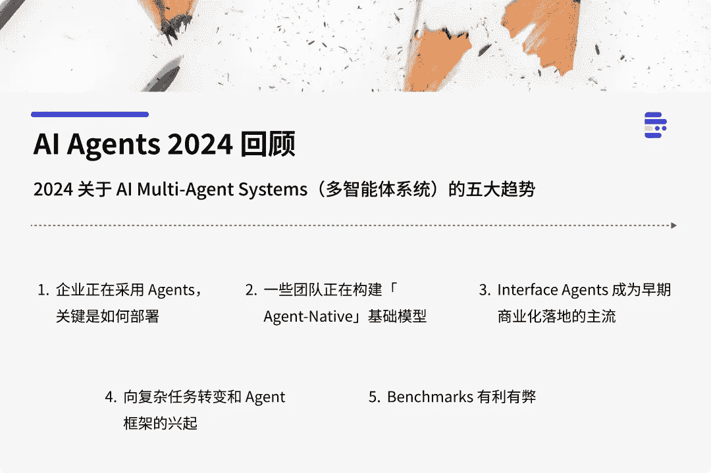
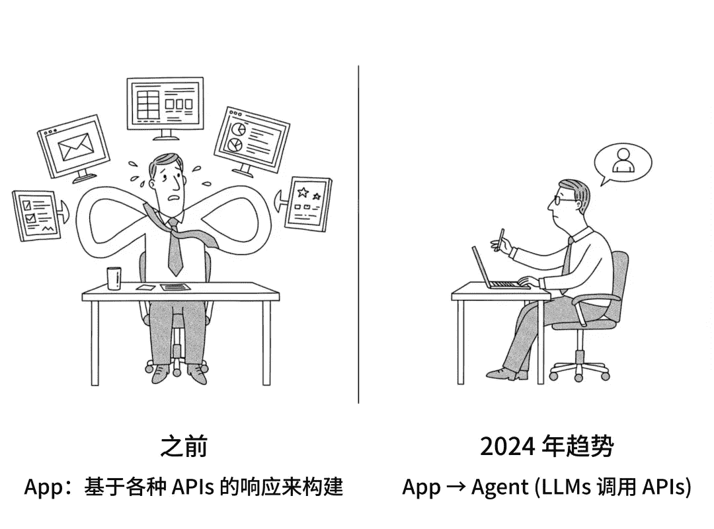
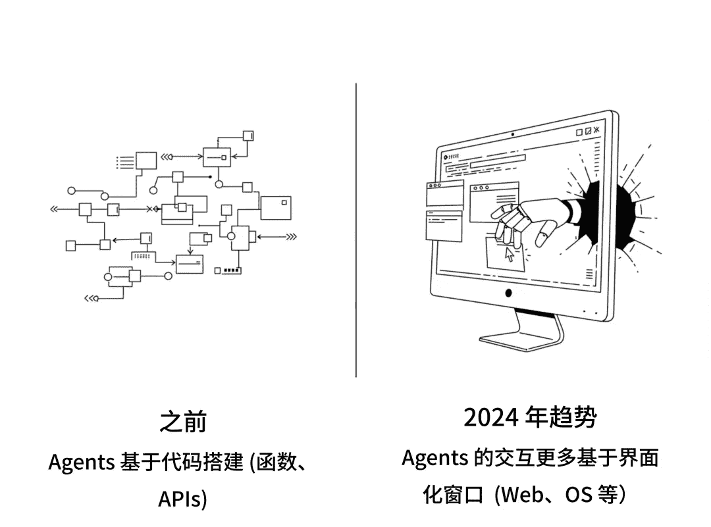
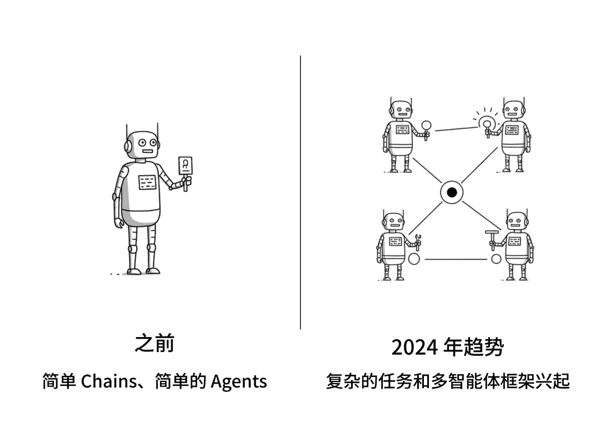
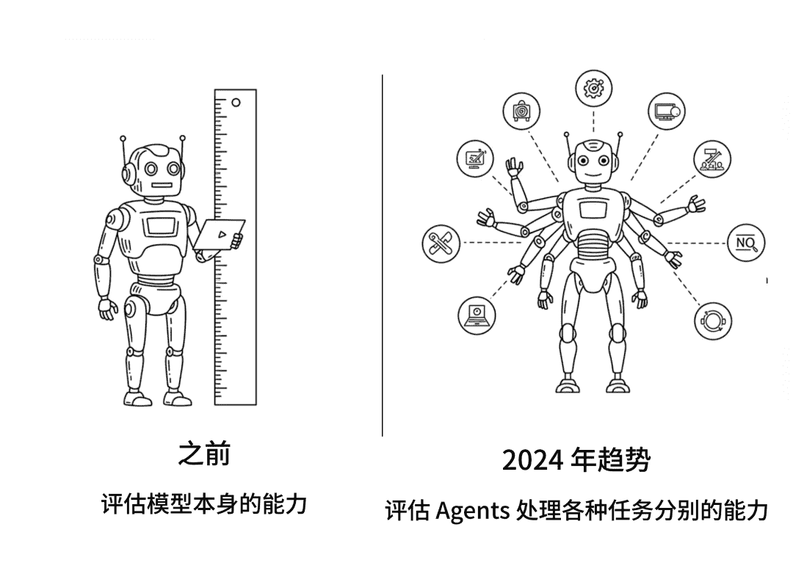
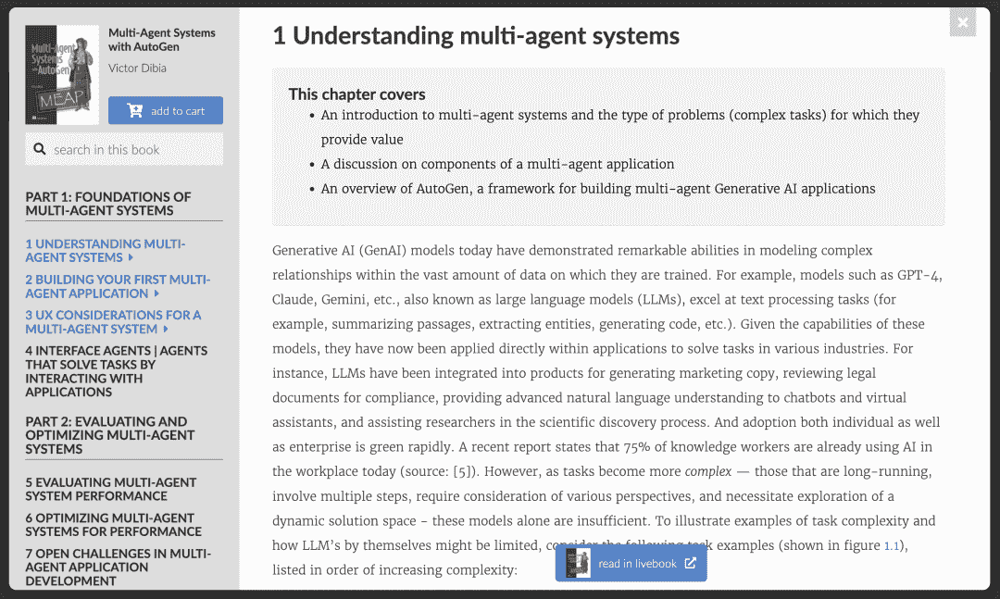
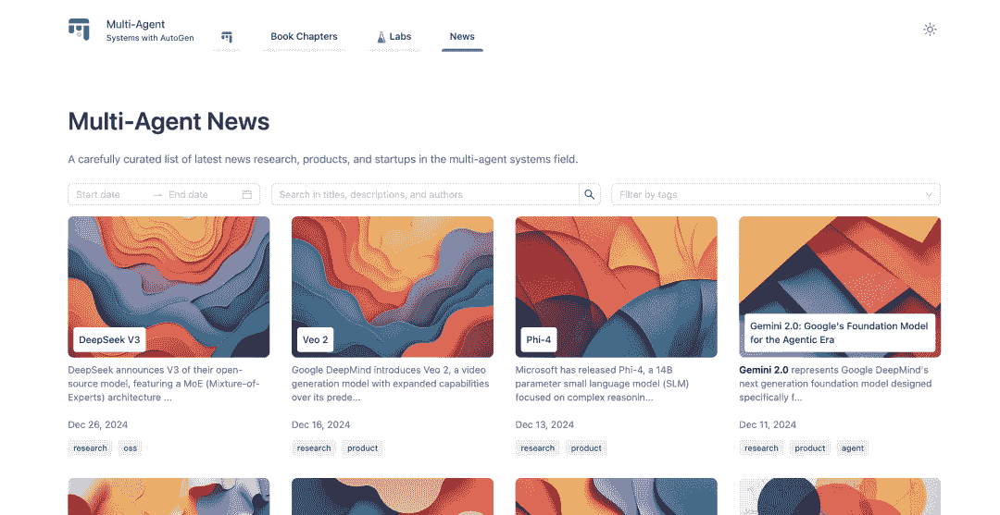
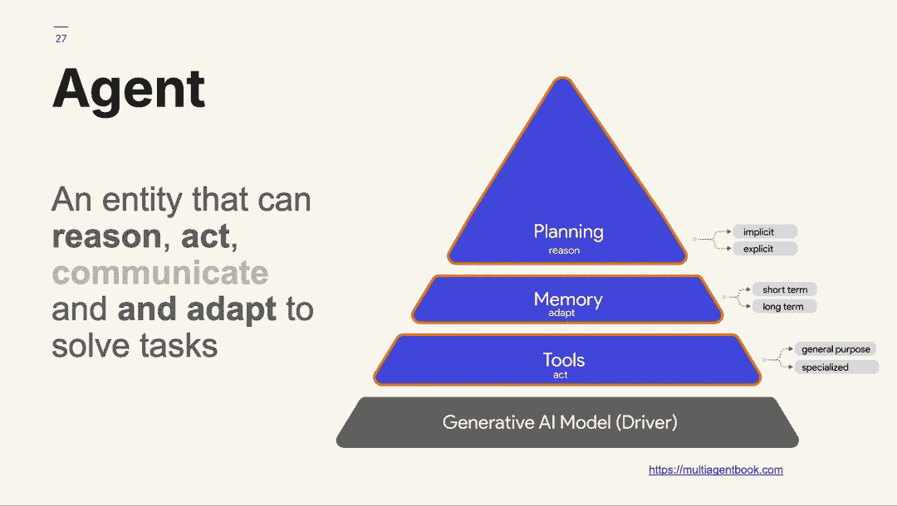
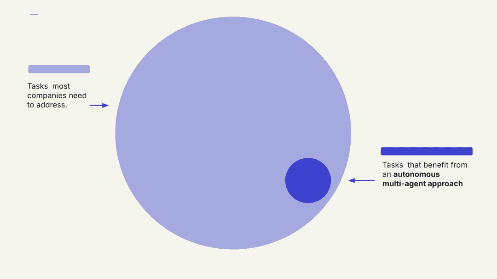

# AI Agents 24 年回顾 - 五大发展趋势

> 来源：[https://aigcreative.feishu.cn/docx/KXcLdxdRVo37jjxZOSXcDT8FnZg](https://aigcreative.feishu.cn/docx/KXcLdxdRVo37jjxZOSXcDT8FnZg)

> 原文链接： [https://mp.weixin.](https://mp.weixin.qq.com/s/xofn2zwgZ5XvGOdgpkLe4Q)qq.com/s/xofn2zwg...

> 👸号： 特工宇宙

特别感谢特工宇宙战略顾问  @庄明浩  老师的推荐。本文二创自 Victor Dibia 博士的一期播客，其是微软 GenAI/HCI 相关研究员，知名多智能体框架 AutoGen 贡献者。

2024 年，我花了相当一部分时间在研究多智能体系统，主要是 AutoGen，一个用于构建 AI 应用的 OSS 框架，并为此写了一本书《Multi-Agent Systems with AutoGen》。

书籍一览

我还运营了一个多智能体栏目，并将我这一年的总结与反思，融汇成了这一篇文章。

https://multiagentbook.com/news/

企业正在采用 AI Agents，关键是如何部署

**许多企业和初创公司都在产品中使用了 Agent。 **AI Agent 广义上是指代表用户执行的系统，目的是节省用户的时间，避免繁琐忙碌的工作。

下面是一些企业中应用 Agent 的例子：

1. 微软 Copilot Agent ：AI Agent 可协助用户执行各种任务，与用户并肩工作，为用户提供建议，自动执行重复性任务，并提供见解，帮助用户做出明智决策。

2. Salesforce Agentforce ：Agentforce 是一款主动、自主的 AI 应用程序，可为员工或客户提供专业化、始终在线的能力支持。用户可以为 Agentforce 配备任何必要的业务知识，以便根据其特定角色执行任务。

3. **Sema4.ai **：当涉及到复杂的、以知识为基础的工作时，RPA 就显得有一些捉襟见肘，RPA 缺乏推理、判断和适应现实世界变化的能力。

4. LinkedIn HR Assistant ：招聘人员可以选择将耗时的任务委托给 Hiring Assistant，包括寻找候选人和协助申请人审核，这样他们就可以专注于更具战略性、以人为本的工作。

这里最关键的是 Agent 的部署方式。

大多数部署都将 LLM 当作 Wrapper/Orchestrator，即「调用」现有 API 作为工具。

从本质上讲，这种趋势代表了一种转变，即从「点击获取数据、上传到 Salesforce 和生成报告按钮」这种手动操作偏少的方法，转变为「对话即可生成报告」这种更简单的方法，同时由支持 LLM 的管道来处理点击操作。

这显然是一种有效的方法。 既保留了现有 AI 接口的可靠性，又尽量减少了重复步骤改善用户体验。 但这也并非易事，因为要确保在大规模生产中选择可靠的工具仍然具有挑战性。虽然这离真正的自主助手 （可以理解为 Agent 的顶级最终态） 还有几步之遥，但这代表了向这一征程迈出的第一步。

😶以前：用户在产品中完成任务时需要与不同的 API 和应用交互；

🤗趋势：LLM 充当协调层，将自然语言请求转化为多个 API 调用，最大限度地减少点击和中间任务。

Agent-Native 基础模型

今年一个有趣的发现是，有许多团队建立了专为 Agent 设计的基础模型。

一个好的 Agent 必须做好几件事：

1. Planning：通过多步骤任务规划进行推理

2. Tools：使用工具行动

3. Memory：适当利用记忆

4. 以及与其他 Agent 通信交互

这里的重要趋势是，上述 Agent 能力现在正被提升融入到生成模型本身。

1. **OpenAI **：o1 模型强调推理、规划、任务拆解等，而这些能力以前是分散在多个 Agent 行动中的。就在今年年底 （12 月 20 日） ，OpenAI 宣布 （但尚未发布） 了 o3 系列模型，o3 是具有更强大的推理计算能力 （test-time compute） 。

2. **Gemini **：Gemini 2.0 Flash 的原生用户界面操作能力以及其他改进，如多模态推理、长上下文理解、复杂指令跟踪和规划、组合函数调用、原生工具使用和延迟改进等。

此外，模型也在不断进步，可以做更多的事情。

1. 多模态输出：谷歌的 Gemini 2.0 Flash 是一个原生的多模态输入（文本、图像）和输出（文本、图像和音频）模型。

2. ChatGPT 高级语音模式。

3. 电影生成：来自 Meta 的 Movie Gen 是一个专门的电影生成模型。

4. Lynn Cherny 中介绍了来自 Google 的 Veo 2 视频生成模型和许多其他创意工具 （传送门：https://arnicas.substack.com/p/titaa-62-december-ai-madness/comments） 。

**向「Agent-Native」架构的转变反映出，人们越来**越认识到， 有效的 Agent 需要的不仅仅是一般的语言对话能力，它们还需要内置的规划、工具使用和协调能力。

😶 以前：LLM 只关注语言模型本身。规划、工具使用和任务分解/推理等功能都是在模型外部实现的。

🤗 趋势：模型从设计之初就内置了多步骤任务分解、规划、工具使用和多模式交互功能。

Interface Agents 成为主流

Interface Agents 详细介绍：https://newsletter.victordibia.com/p/interface-agents

如**果说 2024 年有哪个应用领域主**导着商业 Agent 的部署，那就是 Interface Agents， 通过驱动界面和接口（网络浏览器、桌面操作系统等）来完成任务的 Agent。

1. Kura AI 和 Runner H 等初创公司 ：发布了通过驱动网页浏览器来解决任务的 Agent 产品。

2. **微软的 OmniParser **：改进了 Agent 与图形用户界面元素的交互方式。

3. 新版 AutoGen 和 AutoGen Studio ：提供了一个 WebSurferAgent 预设，可以通过驱动网页浏览器来解决任务。

4. **ChatGPT 屏幕共享模式 **：具有视觉功能的 ChatGPT 高级语音模式也可以通过屏幕共享了解屏幕上的内容。

5. Anthropic Claude Computer Use ：开发者可以指导 Claude 像人一样使用计算机看屏幕、移动光标、点击按钮和输入文本。

6. 谷歌的 Project Mariner ：结合了强大的多模态理解和推理能力，可以使用浏览器自动执行任务。

7. Browser Use extension ：让 AI Agent 可以访问网站 （传送门：https://github.com/browser-use/browser-use） 。

Agent 可以通过自动执行现有不同应用程序中的重复性任务，带来直接的价值。

😶 以前：Agent 的行动空间通常来自编程工具和代码执行。

🤗 趋势：直接操作用户界面（Web、桌面）成为 Agent 行动的主要方法。

向复杂任务的转变与 Agent 框架的兴起

2024 年人们普遍对 Agent 系统的性能感到焦虑，担心它们是否炒作大于实质。在 LangChain 的一项调查中，41% 的受访者提到性能是使用 Agent 的主要瓶颈。

**这**种担心的根源是不知道什么时候该使用什么样的 Agent 架构。在许多情况下，可能甚至不需要建立一个 Agent。

2024 年还标志着从简单的 Agent 应用（如使用 LangChain 等工具进行自然语言天气查询）向更复杂、更自主的场景过渡，如 App 开发（Devin、Co），甚至是通用助理。

一个关键的挑战依然存在：为这些复杂的任务选择合适的模式。具体来说，就是如何有效地实现包括分支逻辑、反思、元认知等在内的行为。这些模式的重要性值得我们在之后深入探讨。

为了应对这些挑战，一年内出现了一些人工智能框架、指南和研究论文，其中包括：

1. **AutoGen **：用于构建 AI Agent 系统的开源框架。

2. **Magentic One **：使用 AutoGen 构建的高性能通用 Agent 系统，旨在解决复杂任务。系统采用多 Agent 架构，由一个领导 Agent（即 "协调者"）指挥其他四个 Agent 完成任务。协调者制定计划、跟踪进度并重新制定计划以从错误中纠正，同时指导专门的 Agent 执行任务，如操作网络浏览器、浏览本地文件或编写和执行 Python 代码。

3. **AutoGen Studio **：一款用于原型设计、测试和调试多 Agent 应用程序的无代码工具。

4. **LangGraph **：利用 LangGraph 获得控制，设计能够可靠处理复杂任务的Agent。

5. **OpenAI Swarm **：轻量级多 Agent 协作框架。

6. **CrewAI **。

7. **Pydantic AI **：Python Agent 框架，旨在减少使用生成式人工智能构建生产级应用的痛点。

2024 年，AutoGen 的核心重点将是使各种 Multi-Agent 模式的表达更容易，并为此提供构建模块。

😶 以前：适用于简单任务的简单链和工具调用的序列模式。

🤗 趋势：用于处理复杂、多步骤任务的复杂模式，需要规划、思考和协调。

端到端的 Agents Benchmarks

2024 年推出的 benchmarks（基准测试）让我们了解了自主多 Agent 系统可以处理的任务类型以及它们的性能如何。用于计算可重复性的 CORE-Bench 框架、专注于基于 Web 任务的 WebArena ，以及微软的 Windows Agent Arena，都促使该领域更加严格地评估任务中的 Agent 行为。

这些基准测试有利有弊。虽然专用 Agent 在垂直领域中表现出了令人印象深刻的能力，但通用 Agent 仍然难以应对复杂的、开发的任务。

在 WebArena 中，端到端任务的成功率仅为 14.41%，而人类的成功率为 78.24%。

但值得注意的是，在接近年底时， 我们在一些 benchmarks 中看到了性能的阶跃式增长，例如，OpenAI 最新宣布（但尚未发布）的 o3 模型在 ARC-AGI 基准测试中获得了 87.5 分，而人类的基准分是 85 分。

尽管 benchmark 有很多缺陷（往往不能反映业务问题的实际表现），但我认为 benchmark 仍然是真正的 AGI/ASI 出现之前的金科玉律。

😶 以前：侧重于单个模块能力（语言、推理、工具使用）的临时评估。

🤗 趋势：衡量端到端 Agent 性能的综合任务完成的 Benchmarks。

# **展望 2025 会发生什么？ **

**1. 模型能力层面提升**

将更多功能提升融入到模型中的趋势将继续下去。

例如，我们很可能会看到擅长适应性/个性化的模型，能够明智地决定存储哪些信息、何时存储、如何以及何时有效地检索信息，从而高效地使用记忆。

2. Agent 架构更加可靠性

如果说 2024 年是 Agent 成为能解决问题的可行方法的一年，那么 2025 年将是 Agent 成为特定问题领域上性能最佳的解决方案的一年。汇聚在一套 Multi-Agent 系统开发模式上将会让我们实现这一目标。

在不同复杂度水平上模式的演进可能会分阶段展开：

1. 阶段一：将重点关注基础能力，简单、重点明确的任务，如可视化生成和文件转换，作为更复杂应用的基石；

2. 阶段二：解决更复杂的问题，实现综合数据分析和公司研究等高级应用，以及自动订餐和航班预订等复杂任务；

3. 阶段三：重点是整合，引入能够可靠处理之前所有任务的通用助手。

这些系统就像 Sam Altman 提到的那样，也是 Magentic One 等早期系统的前身，融合了从早期阶段吸取的经验教训。随着我们对整个技术栈的优化，成功的模式将会出现。这些模式将被标准化，并纳入库和框架之中，为何时使用特定方法提供明确指导。

**3. Agent 市场兴起**

将看到可复用的 Agent 和 Agent 市场的兴起，特别是针对常见问题，如研究任务、内容生成、应用开发等。这个生态 可能既包括初创公司的商业产品，也包括一些开源实践。虽然这可能会为初创公司创造一个具有挑战性的环境，但同时也会促进良性竞争和创新。

<https://aigcreative.feishu.cn/sync/K4Gvd9vUQsy9Oubwqaeclu0Fnbg>