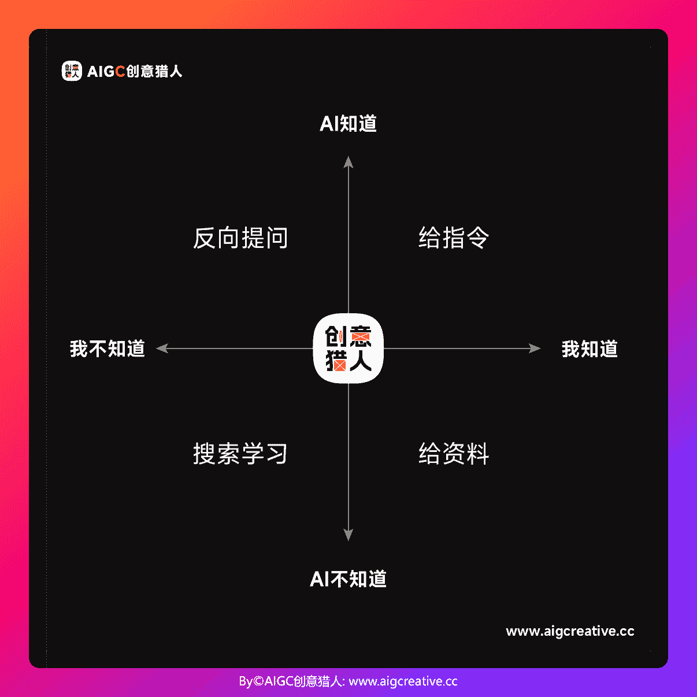
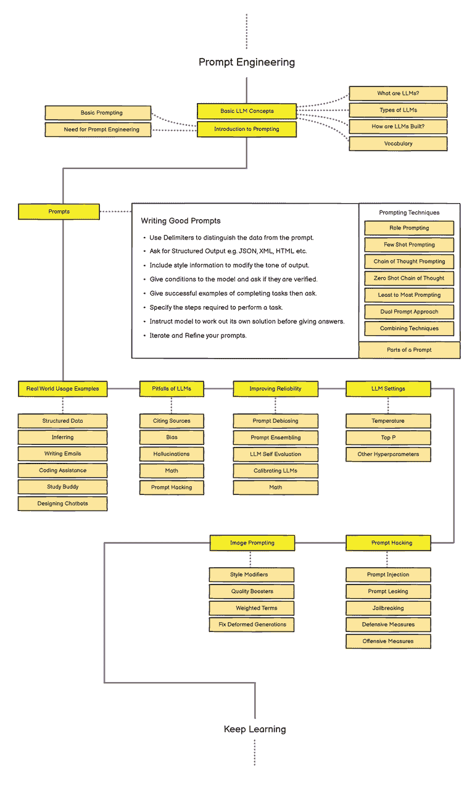
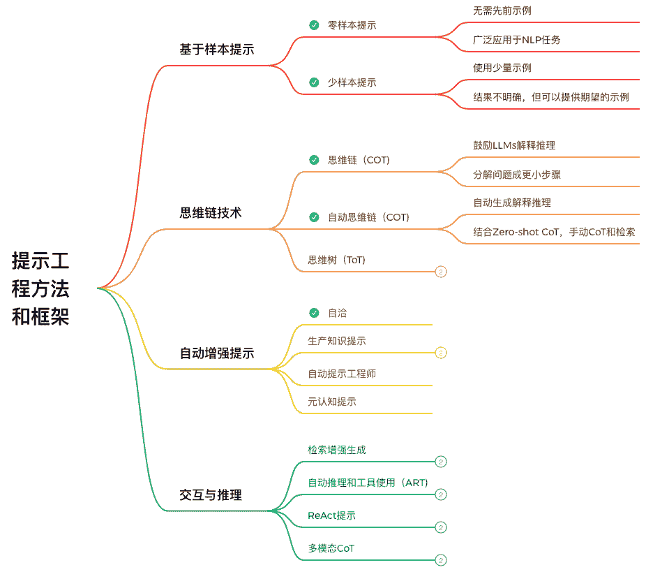
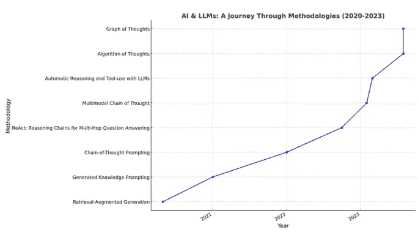
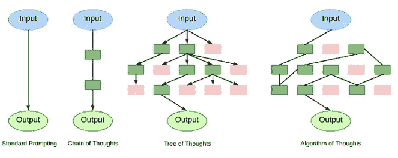
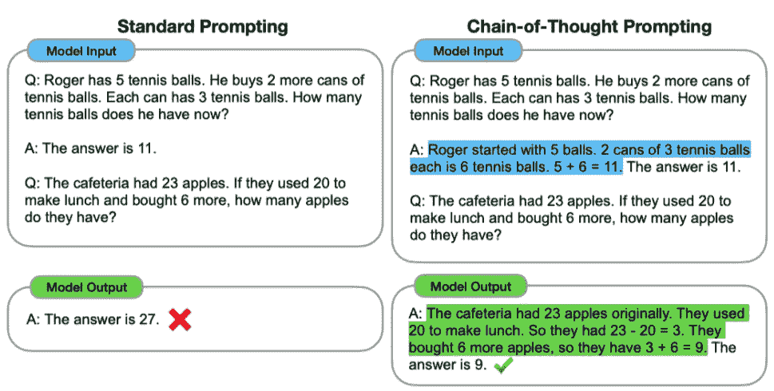
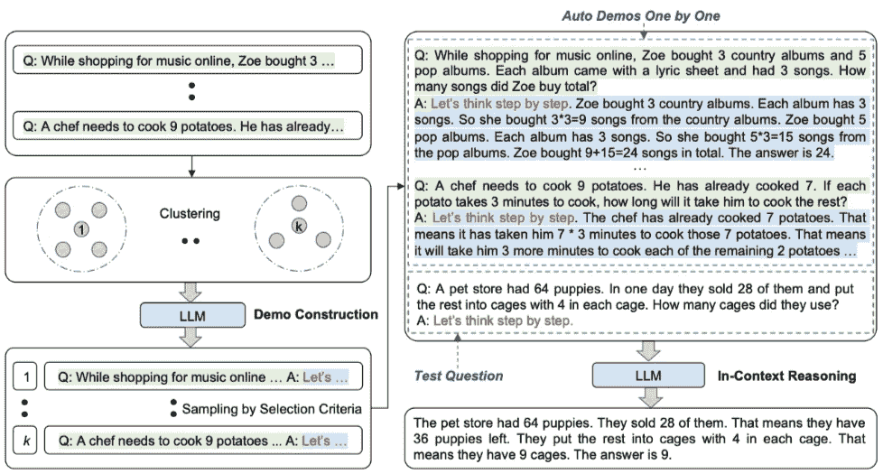
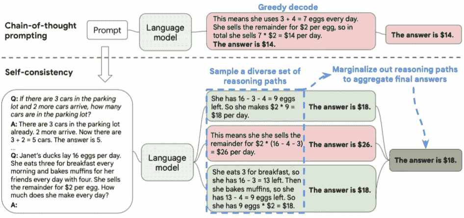

# AI提示工程

> 来源：[https://aigcreative.feishu.cn/docx/ZB8tdXeYgoNUAAxrYyQcbNwtnmd](https://aigcreative.feishu.cn/docx/ZB8tdXeYgoNUAAxrYyQcbNwtnmd)

> 要真正入门AI，OpenAI的官方Prompt工程指南肯定还不够，您必须了解的强大方法论和框架

# **AI与人类智能的四象限交互模型**

自从ChatGPT（全名：Chat Generative Pre-trained Transformer）于2022年11月30日发布以来，一个新兴的行业突然兴起，那就是Prompt engineering（提示工程），可谓如日冲天。从简单的文章扩写，到RAG，ChatGPT展现了前所未有的惊人能力。

今天，我们将向大家介绍与提示工程相关的方法论和框架。

# **提示工程总览**

提示工程技术大概可以分成四类：

+   基于样本提示技术

+   思维链技术

+   自动增强技术

+   交互与推理技术

由于篇幅有限，这篇文章将首先从一些相对简单易懂的方法论和框架开始。包括：

+   零样本提示（Zero-shot）

+   少样本提示（Few-shot）

+   思维链（Chain-of-Thought / CoT）

+   自动思维链（Automatic CoT）

+   自洽（Self-consistency）

请看下方标有✅的部分。

以下是它们各自的发布时间线：

# **基于样本提示**

## Zero-shot

Zero-shot提示是自然语言处理（NLP）中的一项强大技术，广泛应用于情感分析和文本分类等任务。它使得模型能够准确分类提示，即使没有先前的接触也能达到预期效果。比如这样的提示：“那个镜头选择很棒。”即使模型之前没有接触过类似的提示，它也应该能够准确地将情感分类为“正面”。它是我们最经常用到的提示词。

在自然语言生成（NLG）中，Zero-shot提示将数据转化为连贯的叙述，适用于各种应用。在AI重写工具中，如Jasper，Zero-shot提示通过生成类似人类的文章提高内容质量，而无需复杂的提示。

另外，Zero-shot ReAct和 Zero-shot CoT等变体使其在各种场景中得到了广泛应用。

总的来说，Zero-shot提示是 NLP 领域中一项强大的技术，能够处理各种提示并生成相关的回应。

## Few-shot

Few-shot提示是一种在语言模型中使用的技术，特别是在像LangChain这样的AI应用中。这种方法涉及向模型提供少量示例或“快照”，以引导其生成响应。这些示例相当于模型的迷你训练，帮助模型理解所期望的响应类型。

类似于教孩子根据颜色对物体进行分类的情景，你可以给他们展示一些示例，例如一个红苹果、一个蓝色球和一个黄香蕉。然后，你给他们展示一片绿叶，并让他们对其进行分类。即使之前没有展示过绿色的物体，他们可以运用从示例中学到的逻辑正确地对叶子进行分类。

在Few-shot提示中也是如此，你给语言模型提供一些示例，然后要求它对一个新的提示进行响应。

例如，你可以向模型提供以下示例：

+   今天天气非常好（正面Pos）

+   家具很小（中性Neu）

+   我不喜欢你的态度（负面Neg）

+   那个投篮太糟糕了（负面Neg）

+

看到这些示例后，即使模型之前没有见过这个确切的句子，模型应该能够将类似“这个蛋糕很美味”的新句子分类为正面（Pos）。

**当你不能明确告诉模型你需要什么，但可以提供期望输出**的例子时，Few-shot提示特别有用。

通过少样本提示，模型可以利用学习到的逻辑从有限的示例中推广到新的情景，这在提高模型的泛化能力和灵活性方面非常有效。

# **思维链技术**

## Chain-of-Thought(CoT)

CoT鼓励大型语言模型（LLMs）解释他们的推理过程。在Zero-shot情景下，只需在原始提示中加入类似"让我们一起逐步思考"的短语，即可实现。虽然没有明确指出这是在LangChain还是BabyAGI中使用的，但这在LLMs中是常见的技术。

LangChain和BabyAGI都是AGI的实现和框架

比如，你正在尝试解决一个数学问题。你可能不会直接得出答案，而是会将问题分解为更小的步骤，对吧？这就是CoT提示对LLMs的作用，它会逐步引导模型进行逻辑思考。

CoT有两个重要步骤：

+   选择并解释具有相同结构的问题。

+   细分问题结构，并在示例答案部分展示答案。

另外，Zero-shot-CoT方法曾经很流行，通过添加“逐步和逻辑思考”，就可以提高性能。

## Automatic CoT

**Au**tomatic CoT旨在通过自动生成推理步骤来增强LLMs的问题解决能力。它结合了Zero-shot CoT，Manual CoT和检索（Retriever）的概念，通过优化问题回答（QA）过程来提高性能。

以下是步骤：

在准备阶段，对“让我们一步一步地思考”后的问答集进行聚类，并随时准备好。在接收到用户输入后，从聚类中检索问题和答案，并将其作为CoT合并到输入中。

# **自动增强提示**

## 自洽

自洽（Self-consistency）通过汇总多个CoT的结果（比如取占多数的结果）来提高响应准确性。

步骤如下：

+   从CoT响应中提取多个与输入（提示）相符的片段。

+   融合这些多个答案，形成最终的综合回答。

# **总结**

这些提示工程技术各有自身的优势，在不同场景下可以灵活运用，具体取决于任务的要求和可用资源。

<https://aigcreative.feishu.cn/sync/K4Gvd9vUQsy9Oubwqaeclu0Fnbg>

# 知识库动态