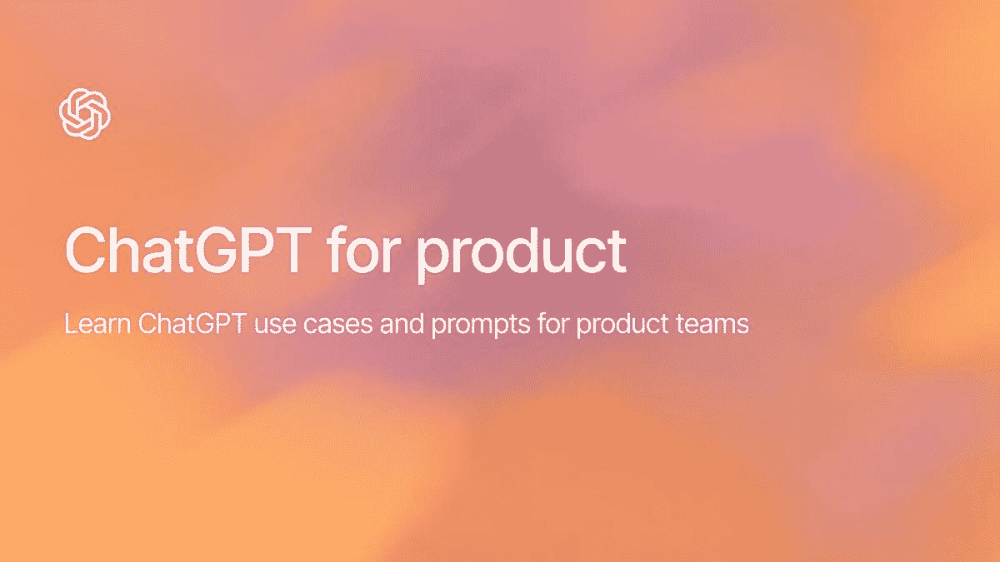
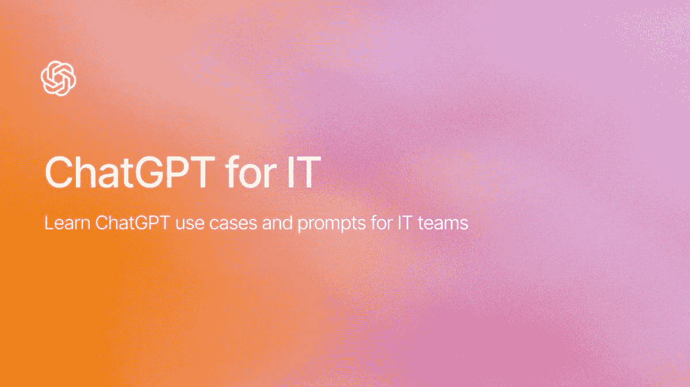
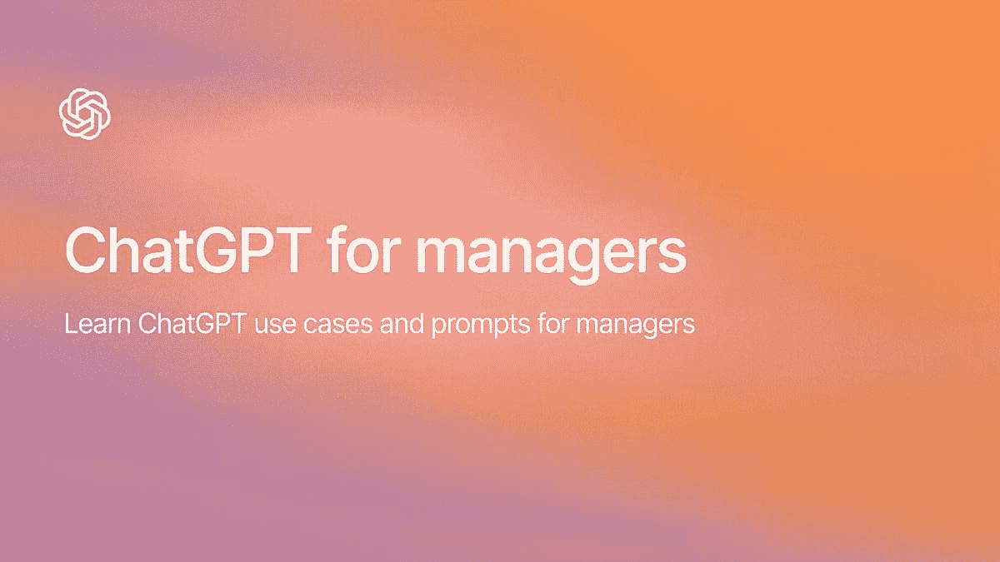
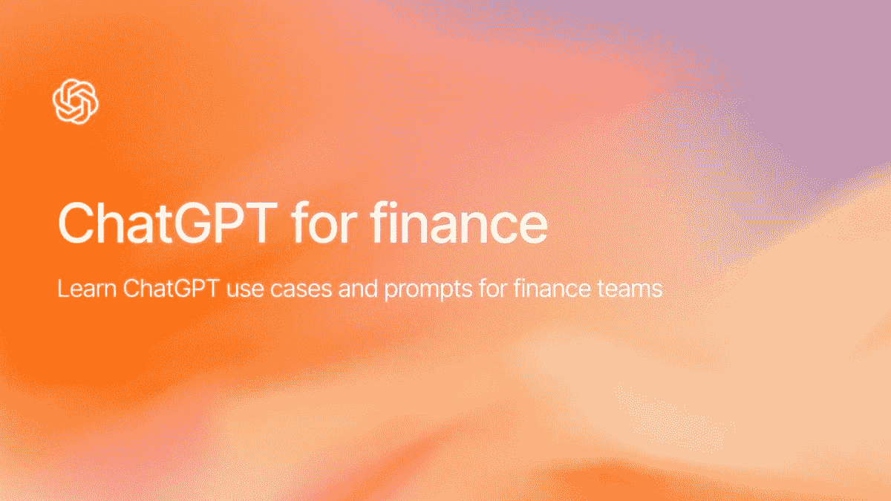
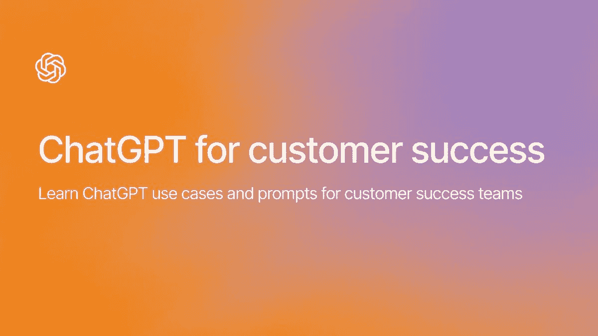
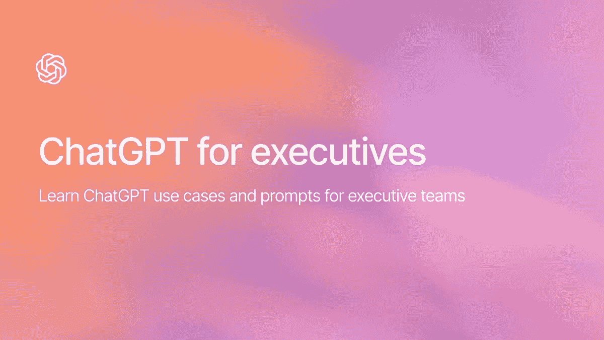

#  ChatGPT官方提示词：OpenAI为各行各业发布的提示词包！

> 来源：[https://aigcreative.feishu.cn/docx/OgbvdzIMioKzwaxwGcscrDdLnLg](https://aigcreative.feishu.cn/docx/OgbvdzIMioKzwaxwGcscrDdLnLg)

> 来源：OpenAI Academy

> 整理：公众号-AIGC创意猎人，何先森Kevin

#  ChatGPT 通用篇

> https://academy.openai.com/public/clubs/work-users-ynjqu/resources/chatgpt-for-any-role

> Check out examples below of ChatGPT use cases and prompts for any work role. Use the Use Cases for Work GPT built by OpenAI to get more ideas for your role, and the other function-specific role guidance in the OpenAI Academy for Work.

> 请查看下方 ChatGPT 的使用案例和提示，这些案例和提示适用于任何工作角色。您还可以使用 OpenAI 构建的“工作 GPT 用例”来获取更多适合您角色的灵感，以及 OpenAI Academy for Work 中其他特定职能的角色指导。

## Communication & writing 沟通与写作

> Write a professional email：

> Write a professional email to [recipient]. The email is about [topic] and should be polite, clear, and concise. Provide a subject line and a short closing.

> 撰写一封专业的电子邮件：

> 请给[收件人]撰写一封专业的电子邮件。邮件内容关于[主题]，行文需礼貌、清晰、简洁。请拟定邮件主题和简短的结尾。

> Rewrite for clarity：

> Rewrite the following text so it is easier to understand. The text will be used in a professional setting. Ensure the tone is clear, respectful, and concise. Text: [paste text].

> 优化表述：

> 请重写以下文本，使其更易于理解。该文本将用于专业场合。请确保语气清晰、尊重且简洁。文本：[粘贴文本]。

> Adapt message for audience：

> Reframe this message for [audience type: executives, peers, or customers]. The message was originally written for [context]. Adjust tone, word choice, and style to fit the intended audience. Text: [paste text].

> 根据受众调整信息：

> 请将此信息重新表述为[受众类型：高管、同事或客户]。此信息最初是为[上下文]撰写的。请调整语气、用词和风格，以适应目标受众。文本：[粘贴文本]。

> Draft meeting invite：

> Draft a meeting invitation for a session about [topic]. The meeting will include [attendees/roles] and should outline agenda items, goals, and preparation required. Provide the text in calendar-invite format.

> 会议邀请草稿：

> 请为一场关于[主题]的会议草拟一份会议邀请。会议将包括[参会人员/角色]，并应概述议程项目、目标和所需准备工作。请以日历邀请格式提供文本。

> Summarize long email：

> Summarize this email thread into a short recap. The thread includes several back-and-forth messages. Highlight key decisions, action items, and open questions. Email: [paste text].

> 长邮件摘要：

> 请将此邮件串摘要成一份简短的概要。该邮件串包含多条往来信息。请突出显示关键决策、行动事项和未决问题。电子邮件：[粘贴文本]。

## Meetings & collaboration 会议与协作

> Create a meeting agenda：

> Create a structured agenda for a meeting about [topic]. The meeting will last [time] and include [attendees]. Break the agenda into sections with time estimates and goals for each section.

> 创建会议议程：

> 为一场关于[主题]的会议创建一份结构化的议程。会议时长为[时间]，参会人员为[参会人员]。将议程分成若干部分，并为每个部分设定时间预估和目标。

> Summarize meeting notes：

> Summarize these meeting notes into a structured recap. The notes are rough and informal. Organize them into categories: key decisions, next steps, and responsibilities. Notes: [paste text].

> 总结会议记录：

>

> 将这些会议记录总结成一份结构化的概要。目前的记录较为粗略和非正式。请将记录整理成以下类别：关键决策、后续步骤和责任人。备注：[粘贴文本]。

> Create an action items list：

> Turn the following meeting notes into a clean task list. The tasks should be grouped by owner and include deadlines if mentioned. Notes: [paste text].

> 创建行动事项清单：

>

> 将以下会议记录整理成一份清晰的任务清单。任务应按负责人分组，并包含截止日期（如有提及）。备注：[粘贴文本]。

> Prep questions for a meeting：

> Suggest thoughtful questions to ask in a meeting about [topic]. The purpose of the meeting is [purpose]. Provide a list of at least 5 questions that show preparation and insight.

> 准备会议问题：

>

> 就[主题]提出一些值得思考的问题，以便在会议中提出。会议的目的是[目的]。请提供至少5个问题，以展现您的准备和洞察力。

> Draft follow-up email：

> Write a professional follow-up email after a meeting about [topic]. Include a recap of key points, assigned responsibilities, and next steps with deadlines. Use a clear and polite tone.

> 撰写后续邮件：

>

> 在关于[主题]的会议结束后，撰写一封专业的后续邮件。邮件内容应包含要点回顾、责任人分配以及后续步骤和截止日期。请使用清晰礼貌的语气。

> Identify root cause：

> Analyze the following workplace issue: [describe issue]. The context is that the problem has occurred multiple times. Identify possible root causes and suggest questions to confirm them.

> 找出根本原因：

>

> 分析以下工作场所问题：[描述问题]。背景是该问题已多次发生。找出可能的根本原因，并提出问题以确认这些原因。

> Compare options：

> Compare the following two or more possible solutions: [list options]. The decision needs to be made in [timeframe]. Evaluate pros, cons, and potential risks for each option.

> 比较方案：

>

> 比较以下两个或多个可能的解决方案：[列出方案]。需要在[时间范围]内做出决策。评估每个方案的优缺点和潜在风险。

> Decision criteria：

> Help define clear decision-making criteria for [describe decision]. The context is that multiple stakeholders are involved. Provide a short list of weighted criteria to guide the choice.

> 决策标准：

> 帮助[描述决策]制定清晰的决策标准。背景是涉及多个利益相关者。提供一份简短的加权标准清单以指导选择。

> Risk assessment：

> Assess the potential risks of the following plan: [describe plan]. The plan is set to start on [date]. List risks by likelihood and impact, and suggest mitigation strategies.

> 风险评估：

> 评估以下计划的潜在风险：[描述计划]。该计划计划于[日期]开始实施。按可能性和影响列出风险，并提出缓解策略。

> Recommend best option：

> Based on the following background: [describe situation and options], recommend the most suitable option. Explain your reasoning clearly and suggest first steps for implementation.

> 推荐最佳方案：

> 基于以下背景：[描述情况和方案]，推荐最合适的方案。清晰地解释您的理由，并提出实施的初步步骤。

## Organization & productivity 组织与生产力

> Document daily priorities：

> Create a prioritized to-do list from the following tasks: [paste tasks]. The context is a typical workday with limited time. Suggest which tasks should be done first and why.

> 记录每日优先事项：

> 根据以下任务创建优先级待办事项清单：[粘贴任务]。场景设定为时间有限的典型工作日。请建议哪些任务应该优先完成，并说明原因。

> Create a weekly plan：

> Build a weekly work plan for [describe role or situation]. The week includes deadlines, meetings, and individual focus time. Provide a balanced schedule with recommended priorities.

> 制定每周计划：

> 为[描述角色或情况]制定每周工作计划。计划内容包括截止日期、会议和个人专注时间。提供一份平衡的日程安排，并推荐优先事项。

> Summarize a long document：

> Summarize the following document into 5 key points and 3 recommended actions. The document is [type: report, plan, or notes]. Keep the summary concise and professional. Text: [paste document].

> 总结长篇文档：

> 将以下文档总结为 5 个要点和 3 项建议行动。文档类型为[报告、计划或笔记]。请保持总结简洁专业。文本：[粘贴文档]。

> Brainstorm solutions：

> Brainstorm potential solutions to the following workplace challenge: [describe challenge]. Provide at least 5 varied ideas, noting pros and cons for each.

> 集思广益：

> 针对以下工作挑战集思广益，提出潜在解决方案：[描述挑战]。至少提供 5 个不同的想法，并分别说明每个想法的优缺点。

> Write a project update：

> Draft a short project update for stakeholders. The project is [describe project]. Include progress made, current blockers, and next steps. Write in a professional, concise style.

> 撰写项目进展报告：

> 为利益相关者撰写一份简短的项目进展报告。项目类型为[描述项目]。报告内容包括已取得的进展、当前遇到的障碍以及后续步骤。请以专业、简洁的风格撰写。

# ChatGPT for product 产品篇

> https://academy.openai.com/public/clubs/work-users-ynjqu/resources/use-cases-product

> The product team is the bridge between customer needs, business goals, and technical execution. They thrive on uncovering insights, validating ideas, and shaping roadmaps that balance user value with strategic impact. ChatGPT can accelerate their workflow by generating PRDs, summarizing customer feedback, exploring competitor products, and brainstorming features—freeing them to spend more time on decision-making and strategy.

> 产品团队是连接客户需求、业务目标和技术执行的桥梁。他们擅长挖掘洞察、验证想法并制定兼顾用户价值和战略影响的产品路线图。ChatGPT 可以通过生成产品需求文档 (PRD)、汇总客户反馈、探索竞品以及集思广益地提出功能，来加速他们的工作流程，从而使他们能够腾出更多时间专注于决策和战略制定。

## Competitive & market research 竞争与市场调研

> Compare competitors’ onboarding UX：

> Research how 3 key competitors structure their onboarding flow for new users. Include screenshots, key steps, and points of friction or delight. Synthesize a comparison table and recommendations for improvement. Target product: [Insert product]

> 比较竞争对手的新用户引导体验：

> 研究 3 个主要竞争对手如何构建新用户引导流程。包括屏幕截图、关键步骤以及痛点或亮点。汇总对比表格并提出改进建议。目标产品：[插入产品名称]

> Benchmark competitor pricing strategies：

> I’m a product manager launching a new SaaS product. Research how top 5 competitors in this space structure their pricing tiers, freemium vs. paid, feature gating, and upsell triggers. Use public sources and include URLs. Output: A comparison table with insights and risks.

> 对标竞争对手的定价策略：

> 我是一名产品经理，正在推出一款新的 SaaS 产品。研究该领域排名前 5 的竞争对手如何构建其定价层级、免费增值模式与付费模式、功能限制以及追加销售触发机制。使用公开资源并包含 URL。输出：包含洞察和风险的对比表格。

> Compare tech stack options：

> Compare the pros and cons of integrating [technology/tool A] vs. [technology/tool B] into our product. Focus on scalability, cost, support, and developer experience. Include citations.

> 比较技术栈选项：

> 比较将 [技术/工具 A] 与 [技术/工具 B] 集成到我们产品中的优缺点。重点关注可扩展性、成本、支持和开发者体验。包含引用。

> Identify regulatory risks for new features：

> I’m a PM scoping a [feature] for financial services. Research recent regulatory guidance in the US, UK, and EU around the use of [feature] in customer-facing products. Summarize by region with citations. Output: A table of legal considerations to flag for our legal team and product design implications.

> 识别新功能的监管风险：

> 我是一名产品经理，正在为金融服务领域规划 [功能]。研究美国、英国和欧盟近期关于在面向客户的产品中使用 [功能] 的监管指南。按地区总结并附上参考文献。输出：一份法律注意事项表格，需提交给法务团队并考虑其对产品设计的影响。

> Research top product-led growth tactics：

> Research the top 7 product-led growth strategies used by fast-scaling SaaS companies in the last 2 years. Prioritize those with measurable impact. Include 1–2 examples per tactic and source links. Output: Ranked list with strategy, example, and success metric.

> 研究领先的产品驱动型增长策略：

> 研究过去两年中快速扩张的 SaaS 公司使用的 7 种领先的产品驱动型增长策略。优先考虑那些具有可衡量影响的策略。每种策略提供 1-2 个示例和来源链接。输出：包含策略、示例和成功指标的排名列表。

## Product strategy & roadmapping 产品战略与路线图规划

> Prioritize product roadmap items based on impact：

> Review this list of upcoming product initiatives. Use the data provided (impact scores, effort estimates, and strategic alignment notes) to suggest priority order. Present the reordered list with justification for each recommendation. [Insert initiative list]

> 根据影响程度确定产品路线图项目的优先级：

> 查看即将推出的产品计划列表。利用提供的数据（影响评分、工作量估算和战略一致性说明）提出优先级排序建议。提交重新排序后的列表，并为每项建议提供理由。[插入计划列表]

> Explore monetization models：

> We’re considering pricing changes. Based on this product value and audience, suggest 3 monetization strategies. Include pros, cons, and examples of companies using each. [Insert product and audience details]

> 探索盈利模式：

> 我们正在考虑调整定价。基于产品价值和目标受众，提出 3 种盈利策略。列出每种策略的优缺点以及使用案例。[插入产品和目标受众详情]

> Draft a vision statement for the product：

> Based on this long-term goal and user need, write a concise product vision statement. Keep it inspiring and grounded in real outcomes. [Insert product goal]

> 撰写产品愿景声明：

> 基于长期目标和用户需求，撰写一份简洁的产品愿景声明。保持鼓舞人心，并立足于实际成果。[插入产品目标]

> Brainstorms feature ideas from customer feedback：

> Review this batch of customer feedback from the past quarter. Identify pain points and generate a list of 5 feature ideas to address recurring themes. [Insert feedback or summary]

> 根据客户反馈集思广益，提出功能创意：

> 查看上个季度收到的客户反馈。找出痛点，并针对反复出现的主题，提出 5 个功能创意。[插入反馈或总结]

> Plan A/B testing experiments：

> Review this list of product UI changes and propose 2 A/B test setups. Include hypothesis, success metrics, and potential outcomes. [Insert UI changes or user goals]

> 规划 A/B 测试实验：

> 查看产品 UI 变更列表，并提出 2 个 A/B 测试方案。包含假设、成功指标和潜在结果。[插入用户界面变更或用户目标]

## Product content & communication 产品内容与沟通

> Draft PRD for a new feature：

> Based on this feature idea and customer need, write a first-draft PRD. Include user story, problem statement, solution overview, acceptance criteria, and success metrics. [Insert context or problem]

> 撰写新功能产品需求文档 (PRD)：

> 基于此功能构想和客户需求，撰写 PRD 初稿。内容应包括用户故事、问题陈述、解决方案概述、验收标准和成功指标。[插入背景或问题]

> Draft changelog and release notes：

> Using this release summary, draft user-facing changelog notes for our next version release. Use a friendly, clear tone and group by category (e.g., new, improved, fixed). [Insert release notes or ticket list]

> 撰写变更日志和发布说明：

> 利用此版本概要，为我们的下一个版本发布撰写面向用户的变更日志。使用友好清晰的语气，并按类别分组（例如，新增、改进、修复）。[插入发布说明或问题列表]

> Create a go-to-market FAQ：

> Draft an internal FAQ for our sales and support teams about our upcoming feature launch. Use this background and anticipated questions. Write in a confident, informative tone. [Insert feature and launch details]

> 创建上市常见问题解答 (FAQ)：

> 为我们的销售和支持团队撰写关于即将推出的功能的内部常见问题解答。使用此背景信息和预期问题。以自信且信息丰富的语气撰写。[插入功能和发布详情]

> Generate a one-sentence value proposition：

> Based on this feature description, write 3 versions of a clear, compelling one-sentence value proposition. Tailor each one to a different target audience. [Insert feature description]

> 撰写一句话价值主张：

> 基于此功能描述，撰写三个清晰且引人注目的一句话价值主张版本。每个版本都针对不同的目标受众进行定制。 [插入功能描述]

> Draft pitch deck for new product：

> Create a 5-slide outline for a pitch deck introducing our new product to internal stakeholders. Include problem, solution, market, product overview, and timeline. [Insert product idea]

> 新产品推介演示文稿草稿：

> 创建一个包含 5 张幻灯片的演示文稿大纲，向内部利益相关者介绍我们的新产品。内容包括问题、解决方案、市场、产品概述和时间表。[插入产品创意]

## UX & visual design 用户体验与视觉设计

> Visualize a user journey map：

> Create a user journey map for our [insert user persona] going through [insert experience]. Include emotional highs/lows, touchpoints, and moments of friction. Output as a visual flow.

> 可视化用户旅程图：

> 为我们的[插入用户画像]创建用户旅程图，展示其[插入体验]过程。包含情绪高潮/低谷、关键触点和摩擦点。以可视化流程图的形式输出。

> Design onboarding flow wireframe：

> Generate a wireframe-style image of a 3-step onboarding flow for a finance app. Steps include: linking an account, setting financial goals, and reviewing suggestions. Style: greyscale wireframe with labels.

> 设计引导流程线框图：

> 为一款金融应用生成一个三步引导流程的线框图。步骤包括：关联账户、设置财务目标和查看建议。样式：带标签的灰度线框图。

> Illustrate product comparison visuals：

> Create a side-by-side visual comparison of two app dashboards: one cluttered with too many metrics, and one simplified with actionable insights. Style: dashboard UI, minimalistic, neutral branding.

> 绘制产品对比图：

> 创建两个应用仪表盘的并排对比图：一个仪表盘包含过多指标，另一个仪表盘则简洁明了，提供可操作的洞察。样式：仪表盘用户界面，极简主义，中性品牌风格。

> Design user journey infographics：

> Generate a user journey infographic showing the onboarding experience for a mobile health-tracking app. Include key milestones, emotions, and friction points. Style: infographic, vertical layout, soft colors.

> 设计用户旅程信息图：

> 生成一个用户旅程信息图，展示一款移动健康追踪应用的引导体验。包含关键里程碑、情绪和摩擦点。样式：信息图，竖版布局，柔和色彩。

## Data analysis & insights 数据分析与洞察

> Analyze product feedback themes：

> Analyze this set of user feedback and identify the 4 most frequent themes. Summarize each with example quotes and suggested product implications. [Insert feedback or data dump]

> 分析产品反馈主题：

> 分析这组用户反馈，找出 4 个最常见的主题。用示例引语和建议的产品改进方案来总结每个主题。[插入反馈或数据]

> Synthesize insights from usage data：

> Based on the following product usage data, summarize 3 key behavioral trends and what they suggest about user needs. Recommend 2 follow-up investigations. [Insert data or summary]

> 综合使用数据洞察：

> 基于以下产品使用数据，总结 3 个关键行为趋势及其对用户需求的启示。建议 2 项后续调查。[插入数据或摘要]

> Identify product adoption risks：

> Review our product rollout plan and highlight 5 risks to successful adoption. Include likelihood, impact, and mitigation recommendations. [Insert rollout plan or summary]

> 识别产品推广风险：

> 审查我们的产品推广计划，并重点指出 5 个可能影响产品成功推广的风险。包括风险发生的可能性、影响以及缓解措施建议。[插入推广计划或摘要]

> Analyze A/B test results：

> Review the results of our recent A/B test (test vs. control). Identify statistical significance, key metrics that changed, and recommend next steps. Present insights clearly with graphs if needed. [Upload test data]

> 分析 A/B 测试结果：

> 审查我们最近的 A/B 测试（测试组 vs. 对照组）结果。确定统计显著性、关键指标的变化，并提出后续步骤建议。如有需要，请使用图表清晰地呈现分析结果。[上传测试数据]

> Compare feature adoption across customer segments：

> Use this data to compare how small business vs. enterprise customers adopt our key features. Highlight major differences, usage frequencies, and retention impact. Format output as a table with insights. [Upload CSV or describe dataset]

> 比较不同客户群体的功能采用情况：

> 使用此数据比较小型企业客户和大型企业客户如何采用我们的关键功能。重点指出主要差异、使用频率和留存率影响。将输出格式化为包含分析结果的表格。 [上传 CSV 文件或描述数据集]

# ChatGPT for engineers 工程师篇

> https://academy.openai.com/public/clubs/work-users-ynjqu/resources/use-cases-engineers

> Engineers focus on building, fixing, and optimizing systems. They care about writing clean code, solving technical problems efficiently, and reducing bugs or downtime. ChatGPT can help by generating code snippets, explaining complex concepts, reviewing logic, writing documentation, and speeding up repetitive tasks so engineers can focus on shipping quality work faster.

> 工程师专注于构建、修复和优化系统。他们注重编写简洁的代码、高效地解决技术难题，并减少错误和停机时间。ChatGPT 可以通过生成代码片段、解释复杂概念、审查逻辑、编写文档以及加速重复性任务来提供帮助，从而使工程师能够专注于更快地交付高质量的工作成果。

## Research & benchmarking 研究与基准测试

> Evaluate cloud providers for migration：

> I’m an infrastructure engineer evaluating cloud migration options. Context: We’re moving from on-prem to the cloud for a fintech backend. Output: Compare AWS, GCP, and Azure for scalability, pricing, compliance, and developer tooling. Include citations.

> 评估云服务提供商以进行迁移：

> 我是一名基础设施工程师，正在评估云迁移方案。背景：我们正在将金融科技后端从本地部署迁移到云端。输出：比较 AWS、GCP 和 Azure 的可扩展性、定价、合规性和开发者工具。请提供参考文献。

> Research frameworks for real-time apps：

> I’m building a real-time collaboration tool. Context: We need low-latency and scalability. Output: Compare top frameworks (e.g., SignalR, Socket.io, WebRTC) with use cases, pros/cons, and current usage by other SaaS companies. Include sources.

> 研究实时应用框架：

> 我正在构建一个实时协作工具。背景：我们需要低延迟和可扩展性。输出：比较主流框架（例如 SignalR、Socket.io、WebRTC）的用例、优缺点以及其他 SaaS 公司目前的使用情况。请提供参考文献。

> Benchmark observability tools：

> Benchmark the top observability tools. Context: We want to move from basic logging to full-stack monitoring. Output: Create a comparison table of features, pricing, integrations for Datadog, New Relic, Prometheus, and OpenTelemetry. Include sources.

> 基准测试可观测性工具：

> 对主流可观测性工具进行基准测试。背景：我们希望从基础日志记录升级到全栈监控。输出：创建 Datadog、New Relic、Prometheus 和 OpenTelemetry 的功能、定价和集成方面的比较表。请提供参考文献。

> Analyze AI/ML trends in logistics：

> I’m researching AI/ML adoption in logistics systems. Context: Our company is considering integrating predictive routing. Output: A 5-paragraph summary on current trends, vendors, and implementation patterns. Include citations and links.

> 分析物流领域的 AI/ML 趋势：

> 我正在研究 AI/ML 在物流系统中的应用。背景：我们公司正在考虑集成预测路径规划功能。输出：一份包含 5 段的摘要，内容涵盖当前趋势、供应商和实施模式。请包含引用和链接。

> Investigate compliance best practices：

> Research best practices for GDPR/CCPA compliance so we can help kick off discussions with our legal team. Context: Our app stores sensitive user data in the EU and US. Output: A compliance checklist with citations, sorted by regulation. Include links to documentation and regulations.

> 调查合规最佳实践：

> 研究 GDPR/CCPA 合规的最佳实践，以便我们能够与法务团队展开讨论。背景：我们的应用程序在欧盟和美国存储敏感用户数据。输出：一份包含引用的合规清单，并按法规排序。请包含指向相关文档和法规的链接。

## Technical reviews & documentation 技术评审与文档

> Review system design doc：

> I’ve drafted a technical design document for [insert project or feature]. Review it for clarity, architectural soundness, and completeness. Highlight any missing considerations or questions reviewers may raise.

> 系统设计文档审核：

> 我已为[插入项目或功能]起草了一份技术设计文档。请审核其清晰度、架构合理性和完整性。指出任何遗漏的考虑因素或审核人员可能提出的问题。

> Document internal API behavior：

> I need to document how this internal API works for other developers. Here’s the relevant code, schema, and usage examples: [insert materials]. Create clear documentation including endpoints, input/output formats, and expected behavior.

> 内部 API 行为文档：

> 我需要为其他开发人员记录此内部 API 的工作原理。以下是相关的代码、架构和使用示例：[插入材料]。请创建清晰的文档，包括端点、输入/输出格式和预期行为。

> Draft runbook for on-call engineers：

> I need to create a runbook for on-call engineers supporting [insert system]. Draft one that includes sections for system overview, common alerts, diagnostic steps, and escalation procedures.

> 为值班工程师编写操作手册：

> 我需要为支持[插入系统]的值班工程师编写一份操作手册。请编写包含系统概述、常见警报、诊断步骤和升级流程等章节的操作手册。

> Draft onboarding guide for new hires：

> I need to write an onboarding guide for new engineers joining [insert team]. Create a draft with sections for required tools, access setup, codebase overview, and first tasks. Make it suitable for self-service onboarding.

> 为新员工编写入职指南：

> 我需要为加入[插入团队]的新工程师编写一份入职指南。请编写包含所需工具、访问权限设置、代码库概述和初始任务等章节的操作手册。使其适合自助式入职。

> Write JIRA ticket from spec：

> Based on this engineering spec for [insert task or feature], write a JIRA ticket that includes the problem statement, context, goals, acceptance criteria, and technical notes for implementation.

> 根据规范编写 JIRA 工单：

> 根据 [插入任务或功能] 的工程规范，编写一个 JIRA 工单，其中包含问题陈述、背景、目标、验收标准和实现的技术说明。

## Debugging & optimization 调试与优化

> Debug failing system in production：

> A system in production is intermittently failing, and we’re struggling to isolate the root cause. Based on the following logs, metrics, and recent changes: [insert context], help identify the most likely causes and suggest next steps for mitigation.

> 调试生产环境中的故障系统：

> 生产环境中的系统间歇性出现故障，我们难以找到根本原因。请根据以下日志、指标和近期变更：[插入上下文]，帮助识别最可能的原因并提出后续的缓解措施。

> Analyze performance bottlenecks：

> Our service is experiencing latency and degraded performance during peak usage. Here are metrics, logs, and relevant traces: [insert context]. Help identify the bottlenecks and recommend specific optimizations.

> 分析性能瓶颈：

> 我们的服务在高峰使用期间出现延迟和性能下降。以下是指标、日志和相关跟踪信息：[插入上下文]。请帮助识别瓶颈并推荐具体的优化方案。

> Analyze a data pipeline failure：

> A critical data pipeline failed in yesterday’s run. Here are the logs, data volume trends, and error outputs: [insert context]. Analyze what likely went wrong and provide recommendations to prevent recurrence.

> 分析数据管道故障：

> 昨天运行中，一条关键数据管道发生故障。以下是日志、数据量趋势和错误输出：[插入上下文]。分析可能出错的原因并提供防止再次发生的建议。

> Suggest observability improvements：

> We currently use [insert tools] for monitoring [insert service]. Review our observability setup and suggest improvements across metrics, logging, alerting, and dashboards to improve issue detection and debugging.

> 提出可观测性改进建议：

> 我们目前使用[插入工具]来监控[插入服务]。请审查我们的可观测性设置，并就指标、日志记录、告警和仪表板等方面提出改进建议，以增强问题检测和调试能力。

> Brainstorm edge cases for testing：

> We’re preparing test cases for [insert feature/system]. Brainstorm potential edge cases and failure scenarios that may not be covered by standard testing, including unusual user inputs, system state changes, and concurrency issues.

> 集思广益，制定测试用例：

> 我们正在为[插入功能/系统]准备测试用例。集思广益，找出标准测试可能无法涵盖的潜在极端情况和故障场景，包括不寻常的用户输入、系统状态变化和并发问题。

## Data analysis & reporting 数据分析与报告

> Identify trends in product usage logs：

> Analyze this CSV of product usage logs. Context: We want to identify usage trends over time and across user segments. Output: Summary stats + line or bar charts highlighting key trends.

> 识别产品使用日志中的趋势：

> 分析此产品使用日志 CSV 文件。背景：我们希望识别产品使用日志随时间和用户群体的变化趋势。输出：汇总统计数据 + 突出显示关键趋势的折线图或柱状图。

> Visualize system error rates over time：

> Plot error rates over time from this dataset. Context: It contains application logs from the last month. Output: A time-series chart with callouts for error spikes and a short interpretation.

> 可视化系统错误率随时间的变化：

> 根据此数据集绘制错误率随时间的变化曲线。背景：它包含上个月的应用程序日志。输出：带有错误峰值标注和简要说明的时间序列图。

> Analyze performance test results：

> Analyze this set of performance test results. Context: It compares two versions of our backend service. Output: Side-by-side comparison charts + text summary of improvements or regressions.

> 分析性能测试结果：

> 分析此性能测试结果集。背景：它比较了我们后端服务的两个版本。输出：并排比较图表 + 改进或退步的文本摘要。

> Prioritize bugs based on impact：

> Analyze this bug report dataset. Context: Each row includes severity, frequency, and affected users. Output: A prioritized list of top bugs with charts showing frequency vs. severity.

> 根据影响程度确定错误优先级：

> 分析此错误报告数据集。背景：每一行都包含严重性、频率和受影响用户。输出：按优先级排序的顶级错误列表，以及显示频率与严重性对比的图表。

> Summarize feedback from user surveys：

> Summarize this user feedback CSV. Context: It includes ratings and open text responses from a recent survey. Output: Key themes, sentiment scores, and charts showing distribution of ratings.

> 汇总用户调查反馈：

> 汇总此用户反馈 CSV 文件。背景：包含近期调查中的评分和开放式文本回复。输出：关键主题、情感得分以及显示评分分布的图表。

## System architecture & visualization 系统架构与可视化

> Create a component diagram：

> I need to visualize the architecture of [insert system or service]. Generate a component diagram showing key services, data flows, and third-party integrations. Use clear labels and group components logically.

> 创建组件图：

> 我需要可视化[插入系统或服务名称]的架构。生成一个组件图，展示关键服务、数据流和第三方集成。使用清晰的标签，并按逻辑对组件进行分组。

> Visualize system architecture：

> Create an image of the system architecture. Context: It’s a microservices-based e-commerce platform with services for payments, catalog, and user profiles. Output: Diagram with labeled services and data flow arrows.

> 可视化系统架构：

> 创建系统架构图。背景：这是一个基于微服务的电子商务平台，包含支付、目录和用户资料等服务。输出：带有标签的服务和数据流箭头的图表。

> Explain CI/CD pipeline to stakeholders：

> Create an image that explains our CI/CD process. Context: This is for a presentation to business stakeholders. Output: Diagram showing dev → build → test → deploy steps with basic icons and short descriptions.

> 向利益相关者解释 CI/CD 流水线：

> 创建一张解释我们 CI/CD 流程的图片。背景：用于向业务利益相关者进行演示。输出：展示开发 → 构建 → 测试 → 部署步骤的图表，包含基本图标和简短描述。

> Model data flow in ML pipeline：

> Create an image showing data flow in a machine learning pipeline. Context: We collect raw user data, clean it, train models, and serve predictions. Output: A labeled flowchart from raw data to inference.

> 在机器学习流水线中建模数据流：

> 创建一张展示机器学习流水线中数据流的图片。背景：我们收集原始用户数据，进行数据清洗，训练模型，并提供预测结果。输出：从原始数据到推理的带标签的流程图。

> Diagram customer journey through app：

> Create a customer journey map through our mobile banking app. Context: Steps include onboarding, account linking, transactions, and support. Output: A visual flowchart with steps, screens, and decision points.

> 绘制用户在应用程序中的旅程图：

> 创建用户在我们手机银行应用程序中的旅程图。背景：步骤包括注册、账户关联、交易和支持。输出：包含步骤、屏幕和决策点的流程图。

# ChatGPT for sales 销售篇

> https://academy.openai.com/public/clubs/work-users-ynjqu/resources/use-cases-sales

> Sales teams focus on understanding what customers need and finding the right way to show how their product or service can help. They spend a lot of time writing emails, preparing for meetings, handling objections, and updating CRM notes. ChatGPT can speed up repetitive tasks—like drafting outreach messages, summarizing calls, or customizing follow-ups—so they can stay organized, respond faster, and focus on building relationships.

> 销售团队专注于了解客户需求，并找到合适的方式展示他们的产品或服务如何提供帮助。他们花费大量时间撰写电子邮件、准备会议、处理异议以及更新客户关系管理系统 (CRM) 记录。ChatGPT 可以加速重复性任务，例如撰写推广信息、总结通话内容或定制后续跟进，从而帮助他们保持高效有序、快速响应客户需求，并专注于建立客户关系。

## Outreach & communication 对外联络与沟通

> Draft a personalized cold outreach email：

> Write a short, compelling cold email to a [job title] at [company name] introducing our product. Use the background below to customize it. Background: [insert value props or ICP info]. Format it in email-ready text.

> 撰写个性化陌生拜访邮件：

> 撰写一封简短而引人入胜的陌生拜访邮件，发送给[公司名称]的[职位名称]，介绍我们的产品。使用以下背景信息进行个性化定制。背景信息：[插入价值主张或理想客户画像信息]。请将其格式化为电子邮件文本。

> Rework demo follow-up email：

> Rewrite this follow-up email after a demo to sound more consultative. Original email: [paste here]. Include recap, next steps, and call scheduling CTA. Output as email text.

> 修改演示后续邮件：

> 修改演示后的后续邮件，使其更具咨询性。原始邮件：[粘贴到此处]。包含演示总结、后续步骤和通话安排行动号召。以电子邮件文本格式输出。

> Draft renewal pitch for key customer：

> Draft a renewal pitch for [customer name] based on this renewal history and value data: [paste data]. Include key ROI proof points and renewal recommendation. Output as a short pitch and optional follow-up email.

> 为重要客户撰写续约提案：

>

> 根据[客户名称]的续约历史和价值数据，撰写续约提案：[粘贴数据]。包含关键的投资回报率证明和续约建议。以简短的提案和可选的后续邮件格式输出。

> Create summary of rep activity：

> Write a daily update summarizing key rep activities. Inputs: [paste call summaries or CRM exports]. Make it upbeat and concise. Output as 3–5 bullet message.

> 创建销售代表活动摘要：

> 撰写每日更新，总结销售代表的关键活动。输入：[粘贴通话记录或CRM导出数据]。保持积极向上且简洁明了。以3-5条要点的形式输出。

> Draft exec update on pipeline status：

> Summarize our pipeline health this month for execs. Inputs: [paste data]. Include total pipeline, top risks, biggest wins, and forecast confidence. Write it like a short exec update.

> 高管进度报告草稿：

> 向高管总结本月项目进展情况。输入内容：[粘贴数据]。包括项目总数、主要风险、最大成果和预测信心。请以简短的高管进度报告形式撰写。

## Sales strategy & planning 销售策略与规划

> Generate strategic account plan：

> Create an account plan for [customer name]. Use these inputs: company profile, known priorities, current product usage, stakeholders, and renewal date. Output a structured plan with goals, risks, opportunities, and next steps.

> 制定战略客户计划：

> 为[客户名称]创建客户计划。输入以下信息：公司简介、已知优先级、当前产品使用情况、利益相关者和续约日期。输出包含目标、风险、机遇和后续步骤的结构化计划。

> Design territory planning framework：

> Create a territory planning guide for our next fiscal year. Inputs: team headcount, target industries, regions, and historical revenue. Recommend allocation method and sample coverage plan.

> 设计区域规划框架：

> 为下一财年创建区域规划指南。输入信息：团队人数、目标行业、地区和历史收入。推荐分配方法和示例覆盖计划。

> Prioritize accounts using firmographic data：

> I have this list of accounts: [paste sample]. Prioritize them based on [criteria: industry, size, funding, tech stack]. Output a ranked list with reasons why.

> 使用公司概况数据确定客户优先级：

> 我有以下客户列表：[粘贴示例]。根据[标准：行业、规模、融资、技术栈]确定优先级。输出排名列表并说明原因。

> Spot high-potential accounts using weighted scoring：

> Score accounts based on [insert rules—e.g., company size, engagement score, intent signals]. Data: [Upload account list]. Output top 10 ranked accounts with their score and a note explaining why.

> 使用加权评分识别高潜力客户：

> 根据[插入规则——例如，公司规模、参与度评分、意向信号]对客户进行评分。数据：[上传客户列表]。输出排名前 10 的客户及其评分，并说明原因。

> Regional market entry planning：

> I’m evaluating market entry into [region/country] for our [SaaS solution]. Research local buying behaviors, competitive landscape, economic conditions, and regulatory concerns. Format as a go/no-go market readiness summary with citations and action steps.

> 区域市场进入规划：

> 我正在评估我们的[SaaS 解决方案]进入[地区/国家]市场的可行性。研究当地的购买行为、竞争格局、经济状况和监管问题。以市场准备情况评估报告的形式，总结市场是否适宜进入市场，并附上参考文献和行动步骤。

## Competitive intelligence & enablement 竞争情报与赋能

> Create battlecard for competitor：

> Create a battlecard for [competitor name]. Use these notes: [insert positioning data]. Include strengths, weaknesses, how we win, and quick talk track. Output as table format.

> 创建竞争对手对比卡：

> 为[竞争对手名称]创建一份竞争对手对比卡。使用以下信息：[插入定位数据]。包含优势、劣势、我们的制胜之道以及简短的沟通要点。以表格形式输出。

> Competitive positioning analysis：

> I’m preparing a competitive battlecard for [competitor name]. Research their pricing model, product positioning, recent customer wins/losses, and sales motion. Compare it to ours based on these strengths: [insert]. Output a 1-page summary with citations.

> 竞争定位分析：

> 我正在准备一份针对[竞争对手名称]的竞争对比卡。研究他们的定价模式、产品定位、近期客户转化/流失情况以及销售策略。基于以下优势将其与我们的优势进行比较：[插入]。输出一份包含引用的单页摘要。

> Create a sales enablement one-pager：

> Create a one-pager to help reps pitch [product name] to [persona]. Include key benefits, features, common use cases, and competitor differentiators. Format as copy-ready enablement doc.

> 创建销售赋能单页资料：

> 创建一份单页资料，帮助销售代表向[目标客户画像]推销[产品名称]。包含关键优势、功能、常见用例以及竞争对手的差异化优势。格式化为可直接使用的赋能文档。

> Prepare sales objection rebuttals：

> Create rebuttals to these common objections: [insert 2–3 objections]. Make them sound natural and confident, and include a backup stat or story where useful. Output as list.

> 准备销售异议反驳：

> 针对以下常见异议创建反驳：[插入2-3个异议]。使其听起来自然自信，并在适当情况下提供佐证数据或案例。以列表形式输出。

> Find customer proof points in the public domain：

> Research recent online reviews, social mentions, and testimonials about [our product OR competitor product]. Focus on what customers are praising or criticizing. Summarize the top 5 quotes, what persona each came from, and where it was posted. Include links.

> 在公共领域寻找客户评价：

> 研究近期关于[我们的产品或竞品]的在线评论、社交媒体提及和用户评价。重点关注客户的赞扬和批评。总结出前5条评价，并注明每条评价的来源用户画像和发布位置。附上链接。

## Data analysis & performance insights 数据分析与绩效洞察

> Analyze pipeline conversion rates by stage：

> Analyze this sales pipeline export. Calculate conversion rates between each stage and identify the biggest drop-off point. Data: [Upload pipeline CSV]. Output a short summary and a table of conversion % by stage.

> 按阶段分析销售渠道转化率：

> 分析此销售渠道导出数据。计算各阶段之间的转化率，并找出转化率最低的阶段。数据：[上传销售渠道 CSV 文件]。输出简要摘要和按阶段划分的转化率百分比表格。

> Identify top-performing reps by close rate：

> From this dataset of rep activities and closed deals, calculate the close rate for each rep and rank them. Data: [Upload rep performance CSV]. Output a ranked list and a sentence for each rep’s strength.

> 按成交率识别业绩最佳的销售代表：

> 根据此销售代表活动和已成交交易数据集，计算每位销售代表的成交率并进行排名。数据：[上传销售代表绩效 CSV 文件]。输出排名列表和每位销售代表优势的简要说明。

> Visualize deal velocity across quarters：

> Use this CRM export to calculate average deal velocity per quarter (days from lead to close). Data: [Upload with open/close dates]. Show velocity trend in a simple chart and summarize the trendline.

> 可视化各季度交易速度：

> 使用此 CRM 导出数据计算每个季度的平均交易速度（从线索到成交的天数）。数据：[上传包含开户/成交日期的数据]。以简图形式展示速度趋势并总结趋势线。

> Summarize campaign attribution to closed deals：

> Match campaign sources to closed-won deals from this data. Identify which campaign drove the most closed revenue. Data: [Upload campaign + deal export]. Output a ranked list and a short campaign summary.

> 总结已成交交易的营销活动归因：

> 根据此数据，将营销活动来源与已成交交易进行匹配。找出哪个营销活动带来的成交收入最多。数据：[上传营销活动 + 交易导出数据]。输出排名列表和简短的营销活动摘要。

> Generate performance comparison chart：

> Here’s a table of rep performance by quarter: [paste data]. Compare top vs bottom performers. Show chart with trends and call out key differences. Output as table + insights.

> 生成业绩对比图表：

> 以下是按季度划分的销售代表业绩表：[粘贴数据]。对比业绩最佳和最差的销售代表。显示趋势图表并突出显示关键差异。以表格和分析结果的形式输出。

## Visuals & Sales Collateral 视觉素材和销售材料

> Visualize sales process in funnel view：

> Create a funnel graphic showing our sales stages: [insert stages]. Make it clean and easy to read for onboarding docs. Output as a simple image.

> 以漏斗图形式可视化销售流程：

> 创建一个漏斗图，展示我们的销售阶段：[插入阶段名称]。使其简洁易读，适用于入职文档。输出为简单的图像。

> Visualize the B2B sales funnel：

> Create an image of a standard B2B SaaS sales funnel with these stages: Prospecting, Discovery, Demo, Proposal, Closed Won/Lost. Use clean, modern icons and text labels. Output should be clear enough for use in a slide or enablement doc.

> 可视化 B2B 销售漏斗：

> 创建一个标准的 B2B SaaS 销售漏斗图像，包含以下阶段：寻找潜在客户、探索、演示、提案、成交（已赢单/已输单）。使用简洁现代的图标和文本标签。输出应清晰明了，适用于幻灯片或培训文档。

> Illustrate key sales personas：

> Create professional illustrations for 3 personas: (1) CFO of a mid-market company, (2) VP of IT at a global enterprise, and (3) Operations Manager at a logistics firm. Style should be flat and modern, ideal for use in a one-pager or training slide.

> 绘制关键销售角色：

> 为 3 个角色创建专业的插图：（1）中型企业的首席财务官 (CFO)，（2）全球企业的 IT 副总裁，以及（3）物流公司的运营经理。风格应扁平化且现代，非常适合用于单页文档或培训幻灯片。

> Create a territory coverage map：

> Create a simplified U.S. map showing sales territories split by region: West, Central, East. Use distinctive color zones and label key states. Output should look clean and suitable for a sales kickoff deck.

> 创建区域覆盖图：

> 创建一张简化的美国地图，显示按地区划分的销售区域：西部、中部、东部。使用不同的颜色区域并标注关键州。输出应简洁明了，适用于销售启动演示文稿。设计团队庆祝图片：

> Draft a team celebration graphic：

> Design a fun, modern graphic to celebrate “Top Rep of the Month.” Include a placeholder for name/photo and stylized trophy or badge. Style should match internal brand or newsletter vibe.

> 设计一张趣味十足、现代感强的图片，庆祝“月度最佳员工”。图片中需包含姓名/照片的占位符以及风格化的奖杯或徽章。风格应与内部品牌或简报风格保持一致。

# ChatGPT for marketing 营销篇

> https://academy.openai.com/public/clubs/work-users-ynjqu/resources/use-cases-marketing

> Today’s marketer is equal parts strategist, storyteller, and analyst. They care about resonant brand narratives, measurable pipeline impact, and staying ahead of ever-evolving channels—without sacrificing authenticity or inclusivity. ChatGPT helps them brainstorm campaign angles, iterate copy faster, surface audience insights, and pressure-test messaging so they can ship high-quality assets at the speed of the market.

> 如今的营销人员集战略家、故事讲述者和分析师于一身。他们关注能够引起共鸣的品牌故事、可衡量的销售渠道影响，以及在不断变化的渠道中保持领先地位——同时又不牺牲真实性和包容性。ChatGPT 帮助他们集思广益，构思营销角度，更快地迭代文案，挖掘受众洞察，并对信息进行压力测试，从而以市场所需的速度交付高质量的素材。

## Campaign planning & strategy 活动策划与策略

> Visualize campaign timeline：

> Build a timeline for our upcoming multi-channel campaign. Key dates and milestones are: [insert info]. Output as a horizontal timeline with phases, owners, and deadlines.

> 可视化营销活动时间线：

> 为我们即将开展的多渠道营销活动构建时间线。关键日期和里程碑如下：[插入信息]。以横向时间线的形式输出，包含阶段、负责人和截止日期。

> Brainstorm campaign ideas：

> Brainstorm 5 creative campaign ideas for our upcoming [event/launch]. The audience is [insert target], and our goal is [insert goal]. Include a theme, tagline, and 1-2 core tactics per idea.

> 集思广益，提出营销活动创意：

> 为我们即将开展的[活动/发布]集思广益，提出 5 个创意营销活动创意。目标受众为[插入目标群体]，我们的目标是[插入目标]。每个创意需包含主题、标语和 1-2 个核心策略。

> Draft a creative brief：

> Create a creative brief for our next paid media campaign. Here's the goal, audience, and offer: [insert info]. Include sections for objective, audience insights, tone, assets needed, and KPIs.

> 撰写创意简报：

> 为我们即将开展的付费媒体营销活动撰写创意简报。目标、受众和优惠如下：[插入信息]。包含目标、受众洞察、语气、所需素材和关键绩效指标 (KPI) 等部分。

> Build a messaging framework：

> Build a messaging framework for a new product. The product details are: [insert info]. Output a table with 3 pillars: key benefits, proof points, and emotional triggers.

> 构建信息框架：

> 为新产品构建信息框架。产品详情如下：[插入信息]。输出包含三大支柱的表格：关键优势、论证要点和情感触发点。

> Build a customer journey map：

> Create a customer journey map for our [product/service]. Our typical customer is [insert profile]. Break it into stages, goals, touchpoints, and potential pain points per stage. Output as a table.

> 构建客户旅程图：

> 为我们的[产品/服务]创建客户旅程图。我们的典型客户是[插入客户画像]。将项目分解为多个阶段，每个阶段列出目标、接触点和潜在痛点，并以表格形式输出。

## Competitive and market research 竞争与市场调研

> Competitive content analysis：

> Research how top 5 competitors structure their blog content strategy. Include tone, topics, frequency, SEO focus, and CTAs. Provide URLs, takeaways, and a table summarizing common and standout tactics.

> 竞品内容分析：

> 研究排名前五的竞争对手如何构建其博客内容策略。内容包括语气、主题、发布频率、SEO重点和行动号召（CTA）。提供URL链接、要点总结以及汇总常见和突出策略的表格。

> Research emerging trends in buyer behavior：

> Research 2024 trends in how [type] buyers research and evaluate [industry] products. Include behavior shifts, content preferences, and channel usage. Cite sources and format as a short briefing with bullet-point insights.

> 研究新兴买家行为趋势：

> 研究2024年[类型]买家如何研究和评估[行业]产品的趋势。内容包括行为转变、内容偏好和渠道使用情况。引用来源并以要点式简报的形式呈现。

> Research regional campaign benchmarks：

> Research typical CTRs, CPCs, and conversion rates for digital campaigns targeting [location] in 2024. Focus on [ad channels]. Include source links and a table comparing each metric by country.

> 研究区域营销活动基准：

> 研究2024年针对[地点]的数字营销活动的典型点击率（CTR）、每次点击费用（CPC）和转化率。重点关注[广告渠道]。提供来源链接以及按国家/地区比较各项指标的表格。

> Research industry event competitor presence：

> Compile a summary of how our competitors are participating in [insert upcoming event]. Include booth activations, speaking sessions, sponsorships, and media coverage. Output as a table with links and analysis.

> 研究竞争对手在行业活动中的表现：

> 汇总竞争对手参与[即将举行的活动名称]的情况。内容包括展位活动、演讲环节、赞助和媒体报道。以包含链接和分析的表格形式呈现。

> Research AI tools for marketers：

> Research the most recommended [tools] for marketers by function (e.g. copywriting, planning, analytics, design). Create a table with features, pricing, pros/cons, and primary use case. Include sources.

> 研究面向营销人员的AI工具：

> 按功能（例如文案撰写、策划、分析、设计）研究最受推荐的营销人员[工具]。创建一个表格，列出功能、定价、优缺点和主要用例。注明参考文献。

## Content & creative development 内容与创意开发

> Draft a product launch email：

> Write a launch email for our new product. Use the following info about the product and target audience: [insert details]. Make it engaging and persuasive, formatted as a marketing email ready for review.

> 撰写产品发布邮件：

> 为我们的新产品撰写一封发布邮件。请使用以下产品和目标受众信息：[插入详细信息]。邮件内容应引人入胜、具有说服力，并按照营销邮件的格式准备，以便审核。

> Generate ad copy variations：

> Create 5 ad copy variations for a [channel] campaign. Here’s the campaign theme and audience info: [insert context]. Each version should test a different hook or tone.

> 生成广告文案变体：

> 为[渠道]营销活动创建5个广告文案变体。以下是营销活动主题和受众信息：[插入背景信息]。每个版本都应测试不同的切入点或语气。

> Create a social post series：

> Draft a 3-post social media series promoting [event, product, or milestone]. Use this background for context: [paste details]. Each post should include a copy and a suggested visual description.

> 创建社交媒体系列帖子：

> 撰写一个包含3篇帖子的社交媒体系列，推广[活动、产品或里程碑]。请使用以下背景信息：[粘贴详细信息]。每篇帖子都应包含文案和建议的视觉描述。

> Create a customer spotlight post：

> Write a customer spotlight post based on this success story: [paste key details]. Make it conversational, authentic, and aligned to our brand voice. Output as a LinkedIn post draft.

> 创建客户案例：

> 根据以下成功案例撰写客户案例：[粘贴关键信息]。内容应自然流畅、真实可信，并与我们的品牌调性保持一致。以LinkedIn帖子草稿的形式发布。

> Create an explainer video script：

> Draft a script for a 60-second explainer video about [product/topic]. Here’s what it should cover: [insert info]. Make it punchy and clear, with suggested visuals or animations.

> 创建介绍视频脚本：

> 撰写一个关于[产品/主题]的60秒解释视频脚本。脚本内容应包含以下信息：[插入信息]。力求简洁明了，并可辅以视觉效果或动画。

## Data analysis & optimization 数据分析与优化

> Identify top-performing marketing channels：

> Analyze this marketing performance spreadsheet and identify which channels had the highest ROI. The file includes data from Q1–Q2 campaigns across email, social, paid search, and events. Summarize the top 3 channels and create a chart showing ROI by channel.

> 识别表现最佳的营销渠道：

> 分析此营销绩效电子表格，并确定哪些渠道的投资回报率 (ROI) 最高。该文件包含第一季度至第二季度电子邮件、社交媒体、付费搜索和活动等方面的营销活动数据。总结排名前三的渠道，并创建图表显示各渠道的投资回报率。

> Uncover customer churn patterns：

> Review this customer churn dataset and identify common characteristics of churned customers. Use columns like tenure, product usage, and support tickets to group insights. Output a short summary with a chart or table showing top risk factors.

> 揭示客户流失模式：

> 查看此客户流失数据集，并识别流失客户的共同特征。使用诸如客户时长、产品使用情况和支持工单等列对分析结果进行分组。输出一份简短的摘要，并附上显示主要风险因素的图表。

> Summarize survey results：

> Summarize insights from this post-campaign customer feedback survey. The file includes satisfaction ratings and open-ended responses. Provide a 3-bullet executive summary and a chart of top satisfaction drivers.

> 总结调查结果：

> 总结此活动后客户反馈调查的分析结果。该文件包含满意度评分和开放式回答。提供一份包含三点的执行摘要，并生成一张显示主要满意度驱动因素的图表。

> Forecast next quarter’s lead volume：

> Use this historical lead volume data from the past 6 quarters to project expected lead volume for the next quarter. Highlight any trends, seasonal patterns, and output a simple forecast chart.

> 预测下一季度的潜在客户数量：

> 使用过去六个季度的历史潜在客户数量数据来预测下一季度的预期潜在客户数量。突出显示任何趋势和季节性模式，并输出一个简单的预测图表。

> Optimize campaign budget allocation：

> Based on this spreadsheet of previous campaign spend and returns, recommend a revised budget allocation for next quarter. Focus on maximizing ROI while reducing spend on underperforming channels. Output as a table with new % allocations.

> 优化营销活动预算分配：

> 根据上一季度的营销活动支出和收益情况，建议调整下一季度的预算分配方案。重点在于最大化投资回报率，同时减少在表现不佳渠道上的支出。最终以表格形式输出新的预算分配百分比。

## Visual & brand communication 视觉与品牌传播

> Develop a brand style guide outline：

> Create an outline for a brand style guide for [company/product]. Include sections for typography, color palette, logo usage, tone of voice, imagery style, and do’s/don’ts.

> 制定品牌风格指南大纲：

> 为[公司/产品]创建品牌风格指南大纲。大纲应包含字体、配色方案、标志使用、语气、图像风格以及使用规范/禁忌等部分。

> Conceptualize visual storytelling：

> Brainstorm 3 visual storytelling concepts for a brand campaign on [theme]. Include a concept name, visual style, and key narrative elements (e.g., story arc, mood, colors).

> 构思视觉叙事：

> 围绕[主题]为品牌推广活动构思3个视觉叙事概念。概念名称、视觉风格和关键叙事元素（例如，故事弧线、氛围、色彩）。

> Create a visual campaign moodboard：

> Create a moodboard with 4 visuals for our [campaign or brand update]. Theme is [describe theme], and the tone should be [describe tone]. Use photoreal or illustrated style.

> 创建视觉推广活动情绪板：

> 为我们的[推广活动或品牌更新]创建一个包含4个视觉元素的情绪板。主题为[描述主题]，语气为[描述语气]。使用照片写实或插画风格。

> Evaluate brand consistency：

> Review the following marketing assets [insert links/files] and evaluate brand consistency in terms of tone, visuals, and messaging. Provide 3 strengths and 3 gaps with recommendations.

> 评估品牌一致性：

> 查看以下营销素材[插入链接/文件]，并从语气、视觉效果和信息传递方面评估品牌一致性。提出3个优势和3个不足之处，并提出改进建议。

> Refresh brand identity concepts：

> Suggest 3 creative directions to refresh our brand identity. Include possible color palettes, typography styles, visual motifs, and tone updates that align with [audience/market shift].

> 更新品牌识别概念：

> 提出3个创意方向，以更新我们的品牌识别。包含与[受众/市场变化]相一致的可能的颜色调色板、字体样式、视觉主题和语调更新。

# ChatGPT for IT IT篇

> https://academy.openai.com/public/clubs/work-users-ynjqu/resources/use-cases-it

> IT teams are responsible for keeping systems secure, efficient, and accessible—and ChatGPT can help them move faster and reduce manual work. It can summarize logs, write automation steps, explain complex configurations, and help communicate technical changes to non-technical teams.

> IT 团队负责确保系统的安全、高效和易用性，而 ChatGPT 可以帮助他们更快地完成工作并减少人工操作。它可以汇总日志、编写自动化步骤、解释复杂的配置，并帮助向非技术团队传达技术变更信息。

## Cloud & vendor evaluations 云服务和供应商评估

> Compare cloud providers：

> Compare AWS, Azure, and GCP for our use case: [insert workload or environment]. Consider cost, uptime, global availability, and ease of integration. Research using 2025 data, and present a table comparing each provider with a recommendation at the end.

> 比较云服务提供商：

> 针对我们的用例[插入工作负载或环境]，比较 AWS、Azure 和 GCP。考虑成本、正常运行时间、全球可用性和集成便捷性。使用 2025 年的数据进行研究，并制作一个表格，比较每个提供商，最后提出建议。

> Generate vendor comparison chart：

> Research and compare remote access vendors for enterprise use. Focus on features, pricing, integrations, and support quality. Use 2025 data, and summarize the findings in a comparison table with notes.

> 生成供应商比较表：

> 研究并比较适用于企业用途的远程访问供应商。重点关注功能、定价、集成和支持质量。使用 2025 年的数据，并将研究结果总结在一个带有注释的比较表格中。

> Compare AI observability tools：

> I'm an IT Manager at [insert company]. I’m evaluating observability platforms. Research current offerings, pricing, supported environments, and key differentiators in 2025. Include citations and summarize insights in a comparison table with a recommendation for a mid-size engineering org.

> 比较 AI 可观测性工具：

> 我是 [插入公司名称] 的 IT 经理。我正在评估可观测性平台。研究当前产品、定价、支持的环境以及 2025 年的关键差异化因素。在比较表格中包含引用并总结见解，并为中型工程组织提出建议。

> Investigate zero trust frameworks：

> I'm a Security Architect working on adopting a zero trust model. Research leading frameworks (e.g., NIST 800-207) and recent updates to best practices in 2024–2025. Include real-world implementation case studies where possible. Provide a summarized comparison and an executive-ready briefing.

> 研究零信任框架：

> 我是一名安全架构师，致力于采用零信任模型。研究领先框架（例如 NIST 800-207）以及 2024-2025 年最佳实践的最新更新。尽可能包含实际应用案例研究。提供简要对比和面向高管的简报。

## IT compliance & security IT 合规与安全

> Assess global data residency laws：

> I’m an IT Compliance Lead planning a global data storage architecture. Research 2025 data residency requirements across the EU, US, APAC, and LATAM. Include regulatory restrictions and preferred cloud regions. Cite official documentation and summarize findings in a table grouped by region.

> 评估全球数据驻留法规：

> 我是一名 IT 合规主管，负责规划全球数据存储架构。请研究欧盟、美国、亚太和拉丁美洲地区 2025 年的数据驻留要求，包括监管限制和首选云区域。请引用官方文档，并将研究结果汇总成表格，按地区分组。

> Analyze remote access tools：

> As an IT Service Delivery Lead, I need a secure, scalable remote access tool for our hybrid team. Compare current vendors (e.g., BeyondTrust, TeamViewer Tensor, Chrome Remote Desktop) for enterprise use in 2025. Focus on SSO support, encryption, session logging, and pricing. Provide a security-focused executive summary with links to primary sources.

> 分析远程访问工具：

> 作为一名 IT 服务交付主管，我需要一款安全、可扩展的远程访问工具，供我们的混合团队使用。请比较现有供应商（例如 BeyondTrust、TeamViewer Tensor、Chrome Remote Desktop）在 2025 年企业级应用方面的性能。重点关注单点登录 (SSO) 支持、加密、会话日志记录和定价。请提供一份以安全为重点的执行摘要，并附上主要参考资料的链接。

> Generate compliance checklist：

> Based on SOC 2 guidelines, create a checklist of IT-specific controls to review for an upcoming internal audit. Use this existing audit prep document as background. Organize the checklist by domain (e.g., access, change management, incident response).

> 生成合规性检查清单：

> 根据 SOC 2 指南，创建一份 IT 特定控制措施的检查清单，用于即将到来的内部审计。请参考现有的审计准备文档。请按领域（例如访问控制、变更管理、事件响应）组织检查清单。

> Validate access controls：

> Review this access matrix of users, roles, and systems. Check whether each user’s access level follows our least-privilege policy. Identify any potential overprovisioning, and provide a table listing users with permissions that may need to be scaled back.

> 验证访问控制：

> 审查此用户、角色和系统访问矩阵。检查每个用户的访问级别是否符合我们的最小权限原则。识别任何潜在的过度配置，并提供一个表格，列出可能需要缩减权限的用户。

> Review API security posture：

> Review this API schema and a sample set of traffic logs. Identify common API security issues such as poor input validation or lack of authentication. Provide a bullet-point list of findings with suggested fixes.

> 审查 API 安全性：

> 审查此 API 架构和一组示例流量日志。识别常见的 API 安全问题，例如输入验证不完善或缺少身份验证。提供一份包含建议修复方案的要点列表。

## IT operations & asset management IT 运营与资产管理

> Draft IT onboarding checklist：

> Create a checklist for onboarding new hires from an IT perspective. Include key steps for account provisioning, security training, and hardware setup. Use this outline of our current process, and present the checklist organized by day or week.

> IT入职流程清单草案：

> 从IT角度创建一份新员工入职流程清单。清单应包含账户配置、安全培训和硬件设置等关键步骤。参考我们当前的流程大纲，并按日或周整理清单。

> Generate hardware lifecycle policy：

> Create a draft policy for managing the lifecycle of company laptops and desktops. Reference this spreadsheet of device ages and current replacement costs. Write a formal document with guidance on replacement timelines, support windows, and environmental considerations.

> 硬件生命周期管理策略草案：

> 创建一份公司笔记本电脑和台式机生命周期管理策略草案。参考这份包含设备使用年限和当前更换成本的电子表格。撰写一份正式文档，提供更换时间表、支持窗口和环境因素方面的指导。

> Draft asset inventory policy：

> Write a formal policy for maintaining and auditing IT asset inventory. Use this list of tools, departments, and stakeholders as a starting point. Include purpose, responsibilities, and process for inventory reconciliation.

> 资产清单管理策略草案：

> 撰写一份维护和审核IT资产清单的正式策略。参考这份工具、部门和利益相关者列表作为起点。清单应包含资产清点的目的、职责和流程。

> Help prioritize IT tickets：

> Review this queue of open IT support tickets. Use this prioritization rubric based on impact, urgency, and SLA. Reorder the tickets accordingly and present the list as a prioritized backlog with a short reason for each ranking.

> 协助IT工单优先级排序：

> 审核这份待处理的IT支持工单队列。根据影响程度、紧急程度和服务级别协议（SLA）使用这份优先级排序标准。根据优先级重新排序工单，并将列表整理成优先级待办事项清单，并简要说明每个优先级的原因。

> Track hardware lifecycle risk：

> Use this device inventory file containing purchase dates, models, and OS versions. Highlight which assets are past end-of-life or nearing refresh thresholds. Create a table of at-risk devices and include a narrative summary for IT leadership.

> 跟踪硬件生命周期风险：

>

> 使用包含购买日期、型号和操作系统版本的设备清单文件。突出显示哪些资产已过使用寿命或即将更新换代。创建一份存在风险的设备表格，并附上一份面向 IT 管理层的说明性摘要。

## IT communication & incident management IT通信与事件管理

> Draft an incident postmortem：

> Summarize the recent [insert system or service] outage. Include the root cause, timeline of events, user impact, and actions taken. Use information from the incident ticket or war room notes, and format the summary as a shareable internal postmortem report.

> 撰写事件分析报告：

> 总结近期[插入系统或服务名称]的故障。包括根本原因、事件时间线、用户影响以及已采取的措施。使用事件工单或作战室记录中的信息，并将摘要格式化为可共享的内部分析报告。

> Create a DR playbook draft：

> Create a draft disaster recovery playbook for a critical production service. Use this system diagram and our recovery objectives (RTO, RPO). Organize the playbook into steps to take before, during, and after a service outage.

> 创建灾难恢复操作手册草稿：

> 为关键生产服务创建灾难恢复操作手册草稿。使用此系统图和我们的恢复目标（RTO、RPO）。将操作手册组织成服务中断前、中断期间和中断后需要采取的步骤。

> Write internal comms for downtime：

> Write a professional internal communication announcing planned downtime for [insert system or tool]. Include timing, affected users, impact on work, and who to contact for questions. Write the message in the tone of an IT team update.

> 撰写停机内部通知：

> 撰写一份专业的内部通知，宣布[插入系统或工具名称]的计划停机。包括停机时间、受影响用户、对工作的影响以及联系人。以IT团队更新的语气撰写通知。

> Translate error logs to plain language：

> Help translate these system error logs into language that can be understood by a non-technical executive. Use definitions where needed, and summarize what each log entry means in a few clear sentences. Present the explanation as an email draft.

> 将错误日志翻译成通俗易懂的语言：

> 帮助将这些系统错误日志翻译成非技术管理人员也能理解的语言。在需要的地方使用定义，并用几句话概括每个日志条目的含义。将解释以电子邮件草稿的形式提交。评估 SaaS 工具冗余：

> Evaluate SaaS tool redundancy：

> Review our current list of SaaS tools used by IT, engineering, and ops. Use the attached spreadsheet with cost, team usage, and tool functions. Identify overlapping tools and recommend 3–5 candidates for consolidation, explaining why each was chosen in a short summary report.

> 请查看我们当前 IT、工程和运维部门使用的 SaaS 工具列表。使用附件中的电子表格，其中包含成本、团队使用情况和工具功能信息。找出功能重叠的工具，并推荐 3-5 个可整合的工具，并在简短的总结报告中解释选择每个工具的原因。

## IT monitoring & optimization IT 监控与优化

> Summarize system health trends：

> Analyze the system health logs from the last 30 days. Focus on spikes in CPU/memory, service outages, and recurring error codes. Provide a concise summary of the key issues and add brief commentary on possible causes or needed follow-ups.

> 系统健康趋势总结：

> 分析过去 30 天的系统健康日志。重点关注 CPU/内存峰值、服务中断和重复出现的错误代码。提供关键问题的简要总结，并对可能的原因或需要采取的后续措施进行简要说明。

> Suggest system monitoring improvements：

> Review our monitoring setup for [insert system] based on the current configuration and recent alert history. Identify 2–3 areas for improvement, such as gaps in alert coverage, noise reduction, or metrics tuning. Present the suggestions in a short internal memo.

> 提出系统监控改进建议：

> 根据当前配置和最近的告警历史记录，审查 [插入系统名称] 的监控设置。确定 2-3 个需要改进的方面，例如告警覆盖范围的不足、降低噪音或调整指标。以简短的内部备忘录形式提出这些建议。

> Analyze service uptime and incident frequency：

> Review this CSV with daily uptime % and incident logs for [insert service] over the past quarter. Identify patterns in outages, frequency of issues by severity, and calculate overall uptime. Summarize findings and suggest actions for improvement in a brief report.

> 分析服务正常运行时间和事件频率：

> 审查过去一个季度 [插入服务名称] 的每日正常运行时间百分比和事件日志的 CSV 文件。识别中断模式、按严重程度划分的问题频率，并计算总体正常运行时间。在简短的报告中总结发现并提出改进建议。

> Audit user access logs for anomalies：

> Analyze this user access log export. Identify users or IP addresses with unusual access frequency, after-hours logins, or failed attempts. Flag suspicious patterns and summarize results in a security review format.

> 审核用户访问日志是否存在异常：

> 分析此用户访问日志导出文件。识别访问频率异常、非工作时间登录或登录失败的用户或 IP 地址。标记可疑模式，并以安全审查格式汇总结果。

> Forecast IT support ticket volume：

> Analyze this export of support ticket volume by week for the past 12 months. Identify seasonality trends and forecast volume for the next quarter. Visualize the trend and provide commentary for capacity planning.

> 预测 IT 支持工单量：

> 分析过去 12 个月每周的支持工单量导出数据。识别季节性趋势并预测下一季度的工单量。将趋势可视化，并为容量规划提供说明。

# ChatGPT for HR 人力资源篇

> https://academy.openai.com/public/clubs/work-users-ynjqu/resources/use-cases-hr

> HR teams are the backbone of employee experience and operational alignment. ChatGPT can help HR teams save time by creating first drafts of policies, answering employee questions, summarizing survey feedback, and generating content for internal comms.

> 人力资源团队是员工体验和运营协调的基石。ChatGPT 可以帮助人力资源团队节省时间，例如创建政策初稿、解答员工疑问、总结调查反馈以及生成内部沟通内容。

## Workspace experience and feedback 工作区体验和反馈

> Draft employee survey questions：

> Write 6–8 employee survey questions designed to measure [e.g. belonging, manager trust, workload balance]. Ensure the questions are neutral and easy to understand. Format them as one question per line with rating scale suggestions.

> 员工调查问卷草拟：

> 撰写 6-8 个员工调查问卷，旨在衡量员工的归属感、对经理的信任度以及工作量平衡等。确保问题客观中立且易于理解。每行一个问题，并附上评分等级建议。

> Generate performance review prompts：

> Develop a set of five questions for performance reviews that encourage reflection, future goal setting, and actionable feedback. Tailor to [function/team], and keep the tone constructive and growth-oriented. Present the questions as a list for a review form.

> 绩效考核提示：

> 设计一套包含五个问题的绩效考核提示，鼓励员工反思、设定未来目标并提供可操作的反馈。根据[职能/团队]进行调整，并保持建设性和成长导向的语气。将问题以列表形式呈现在考核表中。

> Analyze exit survey themes：

> Review the following employee exit survey responses and identify the top recurring themes, concerns, and sentiment trends. These responses are from [department/timeframe]. Provide a thematic summary with bullet points and representative quotes. [Insert responses here]

> 分析离职调查主题：

> 回顾以下员工离职调查问卷的回复，并找出主要反复出现的主题、担忧和情绪趋势。这些回复来自[部门/时间段]。提供包含要点和代表性引语的主题总结。[在此处插入回复]

> Analyze trends in employee attrition：

> Analyze this employee attrition dataset from the last 12 months. Focus on patterns by department, tenure, and exit reasons. Summarize key insights and suggest 2–3 actions HR should consider. Present findings as bullet points followed by a short paragraph. [Upload your CSV or paste table here]

> 分析员工流失趋势：

> 分析过去 12 个月的员工流失数据集。重点关注部门、任期和离职原因的模式。总结关键见解，并提出 2-3 项人力资源部门应考虑的措施。请以要点形式列出调查结果，并附上一段简短的文字说明。[在此处上传您的 CSV 文件或粘贴表格]

> Generate a compensation benchmarking report：

> Based on this internal salary data and industry benchmarks, highlight pay discrepancies by role, gender, and level. Include averages, standard deviation, and a visual if possible. Provide a short summary for leadership review. [Upload benchmark and internal files]

> 生成一份薪酬基准报告：

> 基于内部薪酬数据和行业基准，按职位、性别和级别突出显示薪酬差异。请尽可能包含平均值、标准差和图表。提供一份简短的总结供领导层审核。[上传基准数据和内部文件]

## HR research & compliance 人力资源研究与合规

> Research global HRcompliance updates：

> Research the latest 2024-2025 HR compliarEU, US, and APAC (focus on remote work laclassification, and data privacy). Provide linlsources and summarize in plain language.Pa 3-region comparison table with a 1-paragrregion.

> 研究全球人力资源合规性更新：

> 研究欧盟、美国和亚太地区最新的 2024-2025 年人力资源合规性（重点关注远程办公分类和数据隐私）。提供可靠的参考资料，并用通俗易懂的语言进行总结。制作一个包含三个区域的对比表格，每个区域用一段文字进行描述。

> Benchmark average DEI budgets：

> Research typical DEI program budgets and team sizes for companies with 500–5,000 employees in the US. Include industry benchmarks if available. Present key insights with 3 cited data points and include a simple bullet summary for leadership.

> 基准分析平均多元化、公平和包容 (DEI) 预算：

> 研究美国拥有 500 至 5,000 名员工的公司的典型 DEI 项目预算和团队规模。如有行业基准，请一并列出。提出关键见解，并引用三个数据点，同时为领导层提供简洁的要点总结。

> Explore top HR tech trends for 2025：

> [You’re briefing HR leadership on tech trends.] Research and summarize the top 5 HR technology trends expected to shape 2025. Include use cases, vendor examples, and implications for mid-sized companies. Synthesize insights into a short executive briefing with citations and actionable recommendations.

> 探索 2025 年人力资源技术发展趋势：

> [您正在向人力资源领导层汇报技术趋势。] 研究并总结预计将影响 2025 年的五大人力资源技术趋势。包括用例、供应商示例以及对中型企业的影响。将见解综合成一份简短的高管简报，并附上引用和可操作的建议。

> Compare employee retention strategies across industries：

> [You are building a retention initiative for a mid-sized tech firm.] Research 3 innovative, high-impact employee retention strategies used in tech, healthcare, and financial services. Focus on post-pandemic engagement challenges. Include cited examples and summarize key elements in a side-by-side comparison chart.

> 比较不同行业的员工留任策略：

> [您正在为一家中型科技公司制定员工留任计划。] 研究科技、医疗保健和金融服务行业中使用的 3 种创新且高效的员工留任策略。重点关注疫情后员工敬业度面临的挑战。列出相关案例，并在并排比较图表中总结关键要素。

> Research tools for recruiting：

> Research 4 top-rated candidate screening or sourcing tools used by mid-market companies. Summarize features, pricing, compliance status (EEOC), and known limitations. Provide links to primary sources and present findings in a comparison table.

> 研究招聘工具：

> 研究中型企业使用的 4 种顶级候选人筛选或招聘工具。总结其功能、定价、合规状态（EEOC）和已知局限性。提供原始资料链接，并在比较表格中呈现研究结果。

## Talent acquisition & employee engagement 人才招聘与员工敬业度

> Create interview questions：

> Develop behavioral interview questions aligned to our company values for a [role title] opening in [team/department]. We want to assess both technical skills and culture fit. Provide 6–8 questions grouped by competency.

> 创建面试题：

> 根据公司价值观，为[团队/部门]的[职位名称]职位空缺设计行为面试题。我们希望评估应聘者的技术技能和文化契合度。请提供6-8个按能力分组的问题。

> Write a job description draft：

> Based on this information [insert job responsibilities, skills, team context], write a professional job description for a [job title]. Include a short intro, responsibilities, required qualifications, and what makes the role appealing.

> 撰写职位描述草稿：

> 基于以下信息[填写职位职责、技能要求、团队背景]，为[职位名称]撰写一份专业的职位描述。包括简短的介绍、职责、所需资格以及该职位的吸引力所在。

> Brainstorm engagement initiatives：

> Generate five practical ideas for improving employee engagement across [company/team/region]. Consider our hybrid work model, current engagement scores, and time/resource constraints. Present each idea with a short description, expected impact, and implementation effort level.

> 集思广益，提出提升员工敬业度的方案：

> 针对[公司/团队/地区]的员工敬业度，提出五个切实可行的方案。请考虑我们的混合办公模式、当前的敬业度评分以及时间/资源限制。请简要描述每个方案，并说明预期影响和实施难度。

> Write internal recognition blurb：

> Draft a short recognition message to celebrate [employee/team] for their recent accomplishment: [describe what they did]. Write it in a warm, appreciative tone suitable for Slack or email. Keep it under 100 words.

> 撰写内部表彰信：

> 撰写一条简短的表彰信息，以庆祝[员工/团队]最近取得的成就：[描述他们的工作内容]。请使用热情、赞赏的语气，适合在Slack或电子邮件中使用。字数控制在100字以内。

> Create a DEI workshop outline：

> Design a one-hour DEI workshop for employees at [company/team]. The goal is to foster inclusive communication and awareness. Include an agenda, key learning objectives, interactive activities, and 2–3 discussion questions.

> 创建 DEI（多元化、公平和包容）工作坊大纲：

> 为[公司/团队]的员工设计一个时长一小时的 DEI 工作坊。目标是促进包容性沟通和意识提升。工作坊内容包括议程、关键学习目标、互动活动以及 2-3 个讨论问题。

## Policy & program development 政策与项目制定

> Draft an internal policy summary：

> Summarize the key points of this [internal policy or handbook section] so HR business partners can understand and communicate it effectively. This policy relates to [brief description or context]. Present the summary in clear, professional language under 200 words.

> 撰写内部政策摘要：

> 总结此[内部政策或手册章节]的关键要点，以便人力资源业务伙伴能够理解并有效传达。此政策与[简要描述或背景]相关。请使用清晰专业的语言撰写摘要，字数不超过200字。

> Draft a return-to-office FAQ：

> Write an employee-facing FAQ to support our return-to-office transition. Use this background information [insert key RTO plan details]. Cover top employee concerns (e.g. hybrid schedules, health protocols, expectations) in a warm and clear tone. Include 5–7 questions with answers.

> 撰写返岗常见问题解答：

> 撰写面向员工的常见问题解答，以支持我们的返岗过渡。请使用以下背景信息[插入返岗计划的关键细节]。以热情清晰的语气涵盖员工最关心的问题（例如混合办公模式、健康协议、预期）。包含5-7个问题及答案。

> Plan onboarding week：

> Build a 5-day onboarding schedule for new hires in [department or region]. Include orientation goals, topics to cover, people to meet, and relevant tools or resources. Present it in a simple day-by-day table with time blocks if helpful.

> 制定入职周计划：

> 为[部门或地区]的新员工制定为期5天的入职计划。包括入职目标、要涵盖的主题、要接触的人员以及相关的工具或资源。如有需要，可以使用简单的每日表格并标注时间段。

> Brainstorm wellbeing initiatives：

> Suggest three tailored wellbeing programs for employees at [company/team], considering recent feedback and budget constraints. Include rationale, estimated costs, and potential success metrics. Present ideas as a short proposal summary.

> 集思广益，提出员工福利计划：

> 根据近期反馈和预算限制，为[公司/团队]的员工提出三个量身定制的员工福利计划。包含理由、预估成本和潜在成功指标。以简短的提案摘要形式呈现想法。

> Plan compliance training rollout：

> Create a phased plan to roll out a new compliance training across [team/region]. Include timing, communications strategy, target audiences, and support materials. Present the plan in bullet points or as a 4-week calendar.

> 制定合规培训推广计划：

> 制定分阶段计划，在[团队/区域]推广新的合规培训。包括时间安排、沟通策略、目标受众和支持材料。以要点形式或四周日历形式呈现计划。

## Internal brand visuals & communication 内部品牌视觉与沟通

> Create a welcome banner for onboarding：

> Create an image for a new employee onboarding welcome banner. Style: clean and modern. Mood: warm and inclusive. Format: horizontal banner with space for overlay text. Include visual cues like a diverse team, coffee cups, or digital collaboration tools.

> 为新员工入职创建欢迎横幅：

> 为新员工入职创建欢迎横幅图片。风格：简洁现代。氛围：热情包容。格式：横幅，留有文字叠加空间。包含视觉元素，例如多元化的团队、咖啡杯或数字化协作工具。

> Design an internal DEI poster：

> Create a poster-style image for an internal DEI campaign. Style: bold, minimal. Include abstract representations of diversity (hands, overlapping shapes, color blocks). Mood: optimistic and forward-looking. Include placeholder space for a slogan or quote.

> 设计内部多元化、公平和包容 (DEI) 海报：

> 为内部 DEI 活动创建海报风格的图片。风格：醒目简约。包含多元化的抽象表现形式（例如手、重叠的形状、色块）。氛围：乐观积极。留有标语或引言的占位符。

> Illustrate a hybrid work policy：

> Generate an illustration showing a hybrid work scenario: a person working from home, a coworking space, and a modern office. Style: flat illustration or soft 3D. Intended for use in HR documentation.

> 绘制混合办公政策插图：

> 绘制混合办公场景的插图：员工在家办公、在联合办公空间办公以及在现代办公室办公。风格：扁平化插图或柔和的 3D 效果。用于人力资源文档。

> Visualize the employee lifecycle：

> Create a simple visual diagram of the employee lifecycle: attract, onboard, develop, retain, offboard. Use icons or abstract figures to represent each phase. Style: corporate presentation-ready.

> 可视化员工生命周期：

> 创建一个简单的员工生命周期可视化图表：吸引、入职、发展、留任、离职。使用图标或抽象图形来表示每个阶段。风格：适用于企业演示文稿。

# ChatGPT for managers 经理人篇

> https://academy.openai.com/public/clubs/work-users-ynjqu/resources/use-cases-for-managers

> Team managers are responsible for keeping projects on track, coaching direct reports, and aligning team output to business goals. They juggle daily check-ins, status updates, performance reviews, and cross-functional coordination—often with limited time for deep work. ChatGPT helps managers streamline repetitive tasks like drafting feedback, summarizing meetings, and preparing updates.

> 团队经理负责确保项目按计划进行，指导下属，并使团队产出与业务目标保持一致。他们需要兼顾日常沟通、进度汇报、绩效评估和跨部门协调，往往缺乏深入工作的时间。ChatGPT 可以帮助经理简化重复性任务，例如撰写反馈、会议总结和准备进度更新。

## Strategic planning & alignment 战略规划与协调

> Draft quarterly goals：

> Draft clear and measurable quarterly goals for my team. Here is the business context, company objectives, and recent performance: [insert context]. Return 3 Objectives with 3-4 Key Results each, in a simple bullet format.

> 制定季度目标：

> 为我的团队制定清晰且可衡量的季度目标。以下是业务背景、公司目标和近期业绩：[插入背景信息]。请以简洁的要点形式列出 3 个目标，每个目标包含 3-4 个关键成果。

> Exec update talking points：

> I need to brief my VP on team progress. Based on this weekly summary: [insert notes], generate concise talking points grouped into achievements, blockers, and asks.

> 高管汇报要点：

> 我需要向副总裁汇报团队进展。基于这份每周总结：[插入备注]，请生成简洁的汇报要点，并将其分为成就、障碍和需求三类。

> Run a skills gap analysis：

> I’m trying to assess skill gaps on my team. Here’s our current skill matrix and desired future state: [insert info]. Identify key gaps and suggest training or hiring solutions. Return findings in a short table.

> 进行技能差距分析：

> 我正在评估团队的技能差距。以下是我们当前的技能矩阵和期望的未来状态：[插入信息]。请找出关键差距，并提出培训或招聘解决方案。请以简表形式提交分析结果。

> Plan a hiring roadmap：

> I need to plan hiring needs for the next two quarters. Here’s our current team structure and projected growth: [insert info]. Suggest a phased hiring plan with rationale for each role and proposed timing.

> 制定招聘路线图：

> 我需要规划未来两个季度的招聘需求。以下是我们当前的团队结构和预计增长：[插入信息]。请提出分阶段的招聘计划，并说明每个职位的理由和建议的时间安排。

> Plan a hiring roadmap：

> We just experienced a strategic pivot. Here’s what changed: [insert details]. Help me reframe our team’s goals and narrative to align with the new direction. Provide 2-3 talking points and a revised team goal statement.

> 制定招聘路线图：

> 我们刚刚经历了一次战略转型。以下是具体变化：[插入详情]。请帮我重新构建团队目标和愿景，使其与新的方向保持一致。请提供 2-3 个要点以及一份修订后的团队目标声明。

## Managerial coaching & performance enablement 管理辅导与绩效提升

> Create a 1:1 template：

> Draft a 1:1 meeting template for my direct reports. I want it to include check-ins on progress, roadblocks, career growth, and feedback. Format it as a bulleted agenda with guiding questions.

> 创建一对一会议模板：

> 为我的直接下属起草一份一对一会议模板。我希望它包含进度检查、遇到的障碍、职业发展和反馈等内容。请将其格式化为带有引导性问题的要点式议程。

> Improve feedback delivery：

> I want to give constructive feedback to a report who is underperforming. The issue is [insert behavior]. Suggest 2-3 ways to phrase it constructively, with pros and cons of each approach.

> 改进反馈方式：

> 我想给一位表现不佳的下属提供建设性反馈。问题是[插入行为]。请提供2-3种建设性表达方式，并说明每种方式的优缺点。

> Prepare for a difficult conversation：

> I have a difficult conversation coming up with a team member about [insert issue]. Help me think through what to say, how to open, and what questions to ask. Return a 3-part conversation guide.

> 准备应对棘手的谈话：

> 我即将与一位团队成员就[插入问题]进行一次棘手的谈话。请帮助我思考该说什么、如何开场以及该问什么问题。请提供一份包含三个步骤的谈话指南。

> Prepare for a difficult conversation：

> I’m dealing with a conflict between my team and another function. Here’s a summary of the tension and recent incidents: [insert info]. Suggest root causes and a 3-step mediation approach I can try.

> 准备应对棘手的谈话：

> 我的团队与其他部门之间存在冲突。以下是紧张局势和近期事件的概述：[插入信息]。请提出根本原因以及我可以尝试的三步调解方法。

## Team analytics & health diagnostics 团队分析与健康诊断

> Identify burnout risk from hours：

> Based on this timesheet data (weekly hours logged per person), flag any early signs of burnout risk. Use a threshold of >45 hours for 2+ weeks. Return a summary of flagged employees and trends in average hours.

> 根据工时识别倦怠风险：

> 基于这份工时表数据（每人每周记录的工时），标记任何倦怠风险的早期迹象。阈值设定为连续两周以上工时超过 45 小时。返回一份已标记员工的汇总报告以及平均工时趋势。

> Analyze workload distribution：

> I have a CSV that shows task assignments and completion times per team member for the last 4 weeks. Analyze workload distribution across the team—identify who may be overburdened or underutilized, and summarize in a short paragraph with a chart.

> 分析工作量分配：

> 我有一个 CSV 文件，其中显示了过去 4 周每位团队成员的任务分配和完成时间。分析团队的工作量分配情况——识别哪些成员可能工作量过大或未充分利用，并用简短的段落和图表进行总结。

> Diagnose team health issues：

> I’m noticing signs of disengagement or dysfunction on my team. Based on this description of recent behavior and team dynamics: [insert description], what are the likely causes and what should I do next? Provide a 3-part action plan.

> 诊断团队健康问题：

> 我注意到我的团队出现了一些消极怠工或功能失调的迹象。根据以下对近期行为和团队动态的描述：[插入描述]，可能的原因是什么？我下一步应该怎么做？提供一个包含三个部分的行动计划。

## People & talent research & benchmarking 人才研究与标杆分析

> Hybrid engagement best practices：

> I lead a hybrid team in [insert industry]. Research effective engagement and collaboration practices from the last 2 years. Focus on techniques proven to improve team trust, reduce burnout, and sustain productivity. Provide a top 5 list with supporting evidence and links.

> 混合型团队协作最佳实践：

> 我领导着一支[插入行业名称]的混合型团队。请研究过去两年中有效的团队协作实践。重点关注已被证明能够提升团队信任度、减少员工倦怠并维持生产力的技巧。提供一份包含证据和链接的五大最佳实践清单。

> Benchmark manager-to-IC ratios：

> I’m a [insert role, e.g. Senior Engineering Manager] at a [insert company type, e.g., 500-person SaaS company]. I want to benchmark manager-to-IC ratios across similar tech firms. Focus on industry norms, variations by team type (engineering, product, etc.), and recommendations for scaling. Provide citations and a comparison table.

> 经理与个人贡献者比例基准分析：

> 我是一家[插入公司类型，例如拥有500名员工的SaaS公司]的[插入职位，例如高级工程经理]。我想对类似科技公司的经理与个人贡献者比例进行基准分析。重点关注行业标准、不同团队类型（工程、产品等）的差异以及规模化建议。请提供参考文献和对比表格。

> Research effective upskilling programs：

> I’m designing an upskilling program for a [insert team type, e.g., customer support team]. Find case studies or frameworks from companies that have implemented successful internal training programs. Include how they measured success, duration, and tools used. Summarize in 3–4 paragraphs with links.

> 研究有效的技能提升项目：

> 我正在为[插入团队类型，例如客户支持团队]设计一个技能提升项目。请寻找已成功实施内部培训项目的公司的案例研究或框架。包括他们如何衡量成功、培训持续时间以及使用的工具。用3-4段文字进行总结，并附上链接。

> Compare DEI strategy examples：

> I’m helping shape our team’s DEI goals. Research how leading companies in [insert industry] structure their DEI initiatives at the team level. Include examples of KPIs, training, and rituals. Return a comparison table with links.

> 比较 DEI 策略示例：

> 我正在协助制定团队的 DEI 目标。请研究[插入行业名称]的领先公司如何在团队层面构建 DEI 举措。请提供关键绩效指标 (KPI)、培训和流程示例。提交一份包含链接的比较表格。

> Understand burnout risks and mitigation：

> I’m seeing signs of burnout on my team. Research recent studies or expert guidance on recognizing burnout in knowledge workers and preventing escalation. Summarize key risk factors and recommend a 3-part action plan with citations..

> 了解职业倦怠风险及应对措施：

> 我发现我的团队出现了职业倦怠的迹象。请研究近期关于识别知识型员工职业倦怠并防止其恶化的研究或专家指导。总结关键风险因素，并推荐一个包含参考文献的三部分行动计划。

## Team culture & visual communication 团队文化与视觉沟通

> Depict a team growth journey：

> Design a visual metaphor for a team’s growth journey over a year. Include representations of challenges, milestones, and collaboration. Style should be inspiring, like a timeline or path through a landscape.

> 描绘团队成长历程：

> 设计一个视觉隐喻，展现团队一年的成长历程。包含挑战、里程碑和协作的呈现方式。风格应鼓舞人心，例如时间轴或风景路线图。

> Summarize team culture visually：

> Design an image that represents our team culture. Our values are [insert 3–5 values, e.g. curiosity, impact, accountability]. Use icons or illustrations to match each value, and organize in a clean layout suitable for a wiki or mural board.

> 以视觉方式概括团队文化：

> 设计一幅代表我们团队文化的图片。我们的价值观是[插入3-5个价值观，例如：好奇心、影响力、责任感]。使用图标或插图来对应每个价值观，并以简洁的布局进行组织，使其适合维基或墙板展示。

> Show quarterly focus areas：

> Create a visual dashboard or poster that shows our team’s three strategic priorities this quarter: [insert priorities]. Make it visually engaging and easy to present in an all-hands slide.

> 展示季度重点领域：

> 创建一个可视化仪表盘或海报，展示我们团队本季度的三个战略重点：[插入重点领域]。使其具有视觉吸引力，并易于在全体员工大会幻灯片中展示。

# ChatGPT for finance 财经篇

> https://academy.openai.com/public/clubs/work-users-ynjqu/resources/use-cases-finance

> Finance teams are focused on driving fiscal clarity, managing risk, and ensuring their organization makes informed, strategic decisions backed by data. ChatGPT can support them by accelerating financial analysis, generating executive-ready summaries, automating routine documentation, and brainstorming strategic financial plans—all while considering compliance and accuracy standards.

> 财务团队致力于提升财务透明度、管理风险，并确保组织能够基于数据做出明智的战略决策。ChatGPT 可以通过加速财务分析、生成可供高管阅读的摘要、自动化日常文档处理以及集思广益地制定战略财务计划来为他们提供支持——所有这些都将同时兼顾合规性和准确性标准。

## Financial benchmarking & market analysis 金融基准及市场分析

> Benchmark financial performance：

> Benchmark our financial performance against companies in the [insert industry] sector. Use public data to compare gross margin, net profit, and CAC. Present results in a table with source links.

> 财务业绩基准分析：

> 将我们的财务业绩与[插入行业名称]领域的公司进行基准比较。使用公开数据比较毛利率、净利润和客户获取成本 (CAC)。以表格形式呈现结果，并附上数据来源链接。

> Benchmark expense ratios vs. peers：

> I'm a finance lead at [insert company or industry]. Research current SG&A and R&D expense ratios for 5 comparable companies in the [insert sector, e.g., SaaS, manufacturing, healthcare]. Provide a table with metrics, source links, and a short analysis of how we compare.

> 费用比率与同行进行基准比较：

> 我是[插入公司名称或行业名称]的财务主管。请研究[插入行业名称，例如：SaaS、制造业、医疗保健]领域内5家可比公司的当前销售、管理及行政 (SG&A) 和研发 (R&D) 费用比率。提供包含指标、数据来源链接以及我们公司对比情况的简要分析的表格。

> Competitive fundraising analysis：

> I'm a CFO preparing for our next fundraising round. Research recent funding rounds (past 12 months) in [insert industry]. Summarize deal sizes, valuations, lead investors, and positioning. Format as a briefing memo with source citations and clear bullet-point insights.

> 竞争性融资分析：

> 我是一名首席财务官，正在为下一轮融资做准备。请研究[插入行业名称]领域最近12个月的融资轮次。总结交易规模、估值、领投方和市场定位。以简报备忘录的形式呈现，并附上数据来源和清晰的要点总结。

> Compare global tax regulations：

> I manage global finance compliance. Research and compare corporate tax rates and reporting requirements in [insert countries]. Focus on tax incentives, reporting thresholds, and penalties. Deliver a comparison chart with links to official sources.

> 比较全球税务法规：

> 我负责全球财务合规工作。请研究并比较[插入国家/地区名称]的企业税率和申报要求。重点关注税收优惠、报告门槛和处罚措施。提供一份对比图表，并附上官方来源链接。

> ESG finance strategy benchmark：

> I'm updating our ESG financial strategy. Research how leading companies in [insert industry] integrate ESG into financial planning and disclosures. Summarize 3–5 examples with their KPIs, reporting cadence, and financial impact. Include references.

> ESG财务战略基准：

> 我正在更新我们的ESG财务战略。请研究[插入行业名称]的领先企业如何将ESG融入财务规划和信息披露。总结3-5个案例，并说明其关键绩效指标（KPI）、报告频率和财务影响。请提供参考文献。

## Financial planning & forecasting 财务规划与预测

> Forecast revenue trends：

> Forecast next quarter’s revenue based on the past 6 quarters of data. Use the trends from our [insert dataset or industry] to explain your reasoning. Present the forecast in a table and write a short executive summary.

> 预测收入趋势：

> 根据过去六个季度的数据预测下一季度的收入。使用我们[插入数据集或行业]中的趋势来解释您的理由。以表格形式呈现预测结果，并撰写一份简短的执行摘要。

> Draft budget assumptions for planning：

> Help me draft budget assumptions for our next annual plan. Context: [insert department/region/product info]. Output should include key assumptions, rationale, and any dependencies.

> 制定预算假设：

> 请帮我制定下一年度计划的预算假设。背景：[插入部门/地区/产品信息]。输出结果应包括关键假设、理由和任何依赖关系。

> Model cash flow scenarios：

> Model 3 cash flow scenarios based on these variables: [insert inputs such as revenue range, delays, or costs]. Output as a table with assumptions, key drivers, and estimated cash impact.

> 构建现金流情景模型：

> 基于以下变量构建三个现金流情景模型：[插入收入范围、延迟或成本等输入数据]。以表格形式输出，包含假设、关键驱动因素和预计现金影响。

> Conduct ROI analysis for tooling：

> Conduct an ROI analysis for a new [insert software or tool] we’re considering. Context: [insert usage or pricing data]. Output should include payback periods, assumptions, and a short risk assessment.

> 进行工具投资回报率分析：

> 对我们正在考虑的新[插入软件或工具]进行投资回报率分析。背景：[插入使用情况或定价数据]。输出结果应包括投资回收期、假设和简要的风险评估。

> Compare pricing strategies：

> Compare 3 potential pricing strategies for our [insert product or service]. Use prior pricing data from [insert past year] for context. Output should be a side-by-side comparison table with pros, cons, and estimated impact.

> 比较定价策略：

> 比较我们[插入产品或服务]的三种潜在定价策略。请使用[插入上一年年份]的先前定价数据作为参考。输出结果应为并排比较表，列出优点、缺点和预计影响。

## Financial communication & reporting 财务沟通与报告

> Prepare board meeting talking points：

> Draft financial talking points for an upcoming board meeting. Use our [insert Q2 results or P&L summary] as input. Write the talking points in bullet format, focusing on topline metrics and risk/upsides.

> 准备董事会会议要点：

> 为即将召开的董事会会议起草财务要点。请使用我们的[插入第二季度业绩或损益表摘要]作为参考。以要点形式撰写要点，重点关注关键指标和风险/收益前景。

> Write investor update summary：

> Write a summary for our next investor update. Use highlights from [insert performance report or fundraising update]. Format the output as a concise executive email suitable for external stakeholders.

> 撰写投资者更新摘要：

> 为我们下一次的投资者更新撰写摘要。请使用[插入业绩报告或融资更新]中的亮点。将输出格式设置为简洁的高管电子邮件，适合外部利益相关者阅读。

> Draft QBR financial slide content：

> Draft the financial performance section for our next QBR deck. Use these inputs: [insert Q2 revenue, margin trends, notable cost changes]. Output as slide bullets with 1–2 takeaway lines.

> 起草季度业务回顾 (QBR) 财务幻灯片内容：

> 为我们下一次的季度业务回顾 (QBR) 演示文稿起草财务业绩部分。请使用以下参考：[插入第二季度收入、利润率趋势、显著成本变化]。以幻灯片要点形式输出，并包含 1-2 条要点总结。

> Translate variance analysis：

> Translate this variance analysis into a manager-friendly summary. Source: [insert analysis]. Write in plain language with a brief explanation of why each variance occurred.

> 翻译差异分析：

> 将此差异分析翻译成易于管理者理解的摘要。来源：[插入分析]。使用通俗易懂的语言撰写，并简要解释每个差异出现的原因。

> Summarize audit findings：

> Summarize key findings from our internal audit. Use this document: [insert findings]. Output should be a summary for executives, with 3 themes and recommended next steps.

> 总结审计结果：

> 总结我们内部审计的主要发现。请使用此文档：[插入发现]。输出结果应为高管摘要，包含 3 个主题和建议的后续步骤。

## Operational finance & process improvement 运营财务与流程改进

> Analyze cost reduction opportunities：

> Identify cost reduction opportunities from our recent budget report. Use the breakdown from [insert cost center or department] to evaluate. Provide a table with opportunities, projected savings, and any potential risks.

> 分析成本削减机会：

> 从我们最近的预算报告中识别成本削减机会。使用[插入成本中心或部门]的细分数据进行评估。提供一个表格，列出机会、预计节省金额以及任何潜在风险。

> Evaluate M&A target fit：

> Evaluate the financial and strategic fit of an M&A target. Use this context: [insert company profile or key metrics]. Output should be a table of pros/cons and a 3-paragraph summary of risk/reward.

> 评估并购目标的契合度：

> 评估并购目标的财务和战略契合度。使用以下背景信息：[插入公司简介或关键指标]。输出结果应为优缺点表格和一份三段式的风险/回报总结。

> Identify accounting process gaps：

> Review our current accounting close checklist and suggest improvements. Use this documentation: [insert SOP or task list]. Output should highlight bottlenecks and recommend process updates.

> 识别会计流程缺陷：

> 审查我们当前的会计结算清单并提出改进建议。使用以下文档：[插入标准操作程序或任务清单]。输出结果应突出显示瓶颈并建议流程更新。

> Review vendor payments for consolidation：

> Analyze vendor payments in this data [upload file]. Identify top 10 vendors by spend, spot any duplication (e.g., similar vendor names), and recommend vendors to consolidate. Output a table and short cost-reduction summary.

> 审查供应商付款以进行合并：

> 分析此数据中的供应商付款[上传文件]。按支出确定前 10 名供应商，找出任何重复项（例如，相似的供应商名称），并建议合并供应商。输出一个表格和一份简短的成本削减总结。

> Procurement strategy cost levers：

> I'm leading a finance initiative to cut procurement costs. Research strategies used by Fortune 500 companies to reduce procurement spend without harming supplier relationships. Present 3–5 tactics with cost impact examples and cited sources.

> 采购策略成本杠杆：

> 我正在领导一项旨在削减采购成本的财务计划。研究财富 500 强企业在不损害供应商关系的前提下降低采购成本的策略。列举 3-5 种策略，并举例说明其对成本的影响，同时引用相关资料。

## Financial dashboards & visual storytelling 财务仪表盘与可视化叙事

> Visualize revenue growth funnel：

> Create an image of a revenue growth funnel with labeled stages: Acquisition → Activation → Revenue → Retention → Expansion. Use a clean, modern style suitable for an executive finance presentation. Include icons for each stage.

> 可视化收入增长漏斗：

> 创建一个收入增长漏斗图，并标注以下阶段：获客 → 激活 → 收入 → 留存 → 拓展。采用简洁现代的风格，适合高管财务演示。每个阶段都应包含图标。

> Illustrate budget planning workflow：

> Create a horizontal process flow diagram showing a budget planning cycle: Forecasting → Review → Stakeholder Input → Approval → Tracking → Adjustment. Use corporate-style visuals with subtle color and labels.

> 展示预算规划工作流程：

> 创建一个横向流程图，展示预算规划周期：预测 → 审核 → 利益相关者意见 → 批准 → 跟踪 → 调整。使用企业风格的视觉效果，并采用柔和的色彩和标签。

> ESG finance impact visual：

> Create a visual showing how ESG initiatives can impact finance metrics. Show links between sustainability investments and cost savings, risk mitigation, and investor interest. Use a modern, green-themed design with arrows.

> ESG 财务影响可视化：

> 创建一个可视化图表，展示 ESG 举措如何影响财务指标。展示可持续发展投资与成本节约、风险缓解和投资者兴趣之间的联系。采用现代绿色主题设计，并使用箭头。

> Executive dashboard concept：

> Generate a conceptual image of a finance executive dashboard showing high-level KPIs: Revenue, Gross Margin, Burn Rate, Runway, and Budget vs. Actual. Use a clean layout with panels and placeholder numbers.

> 高管仪表盘概念图：

> 生成一个财务高管仪表盘的概念图，展示关键绩效指标 (KPI)：收入、毛利率、资金消耗率、资金储备以及预算与实际对比。使用简洁的布局，包含面板和占位符数字。

# ChatGPT for customer success 客户成功篇

> https://academy.openai.com/public/clubs/work-users-ynjqu/resources/use-cases-customer-success

> Customer success teams care deeply about adoption, retention, and long-term value, often bridging the gap between product capabilities and real-world outcomes. ChatGPT can help by accelerating research, drafting communications, organizing QBRs, and even surfacing product insights—so they can spend more time driving meaningful results.

> 客户成功团队非常重视用户采纳、留存和长期价值，他们常常需要弥合产品功能与实际应用效果之间的差距。ChatGPT 可以通过加速研究、撰写沟通文案、组织季度业务回顾 (QBR) 甚至挖掘产品洞察来提供帮助，从而使他们能够将更多时间用于推动真正有意义的成果。

## Onboarding & lifecycle strategy 入职及生命周期策略

> Create onboarding plan template：

> Create a reusable onboarding plan template for [type of customer]. Reference typical timelines, milestones, and stakeholder alignment needs. Format as a week-by-week table with task owners and goals.

> 创建客户引导计划模板：

> 为[客户类型]创建一个可重复使用的客户引导计划模板。参考典型的流程时间表、里程碑和利益相关者协调需求。以每周表格的形式呈现，包含任务负责人和目标。

> Summarize onboarding feedback：

> Summarize onboarding feedback from our last 10 customers in [segment]. Use these shared notes and survey answers. Output a short paragraph per theme: wins, blockers, suggestions.

> 总结客户引导反馈：

> 总结我们最近10位[细分市场]客户的客户引导反馈。使用共享笔记和调查问卷答案。针对每个主题输出一段简短的文字：成功之处、遇到的障碍、建议。

> Identify best practices for high-touch onboarding：

> Research how leading B2B companies structure high-touch onboarding journeys. Focus on companies with $1M+ ACV and hybrid onboarding models. Include sources and structure the output as a bulleted summary of key tactics with references.

> 确定高触达客户引导的最佳实践：

> 研究领先的B2B公司如何构建高触达客户引导流程。重点关注年合同价值超过100万美元且采用混合客户引导模式的公司。包含参考资料，并将输出内容组织成关键策略的要点总结，并附上参考文献。

> Suggest proactive playbooks：

> Recommend 3 proactive outreach playbooks for at-risk customers in [industry/segment]. Use trends from recent churn, feature inactivity, and low engagement. Output should include: goal, trigger, CTA, and timing.

> 推荐主动式客户拓展方案：

> 为[行业/细分市场]中存在流失风险的客户推荐3个主动式客户拓展方案。参考近期客户流失、功能不活跃和低参与度等趋势。输出内容应包括：目标、触发因素、行动号召和时间安排。

> Brainstorm retention incentives：

> Suggest creative retention strategies for accounts likely to downgrade in [industry]. Use trends in usage and renewal hesitations we’ve seen. Output 5 tested and 5 novel ideas with pros/cons.

> 集思广益，探讨客户留存激励措施：

> 针对[行业]中可能降级的客户，提出创新的客户留存策略。参考我们观察到的使用趋势和续订犹豫情况。提出 5 个已验证的方案和 5 个全新的方案，并分析其优缺点。

## Competitive & benchmark research 竞争与基准研究

> Benchmark CS org structure：

> Benchmark the CS org structure for companies like ours in [industry, size]. Focus on roles per customer segment and ratio to revenue. Output as a comparison table with notes on headcount ratios.

> 基准客户成功组织架构：

> 对标与我们公司规模相当的[行业，规模]公司的客户成功组织架构。重点关注每个客户细分市场的角色以及角色与收入的比例。以对比表格的形式输出，并附上人员比例的说明。

> Benchmark success metrics by industry：

> Research top 3 success metrics used for customer health scoring in the [industry] sector. Include CSAT, NRR, usage frequency, or other emerging benchmarks. Output as a table comparing metric, source, and benchmark value with citations.

> 按行业对标成功指标：

> 研究[行业]领域中用于客户健康评分的前3个成功指标。包括客户满意度 (CSAT)、净推荐值 (NRR)、使用频率或其他新兴基准。以表格的形式输出，比较指标、来源和基准值，并附上引用。

> Evaluate CS tooling stacks ：

> Research typical Customer Success tech stacks for companies in early-stage, growth-stage, and enterprise. Include categories (e.g., CRM, Success Platform, Analytics). Output a comparison chart with examples and usage notes.

> 评估客户成功工具栈：

> 研究处于早期、成长和大型阶段的公司中典型的客户成功技术栈。包括类别（例如，CRM、成功平台、分析）。以对比图表的形式输出，并附上示例和使用说明。

> Competitive enablement summary：

> Research how competitors are supporting enterprise customers post-sale in [industry]. Include examples of success resources, team structure, and onboarding formats. Output as a table comparing 3 competitors with pros/cons per tactic.

> 竞争对手赋能策略概述：

> 研究竞争对手在[行业]领域如何为企业客户提供售后支持。包括成功资源、团队结构和入职流程的示例。以表格的形式输出，比较3家竞争对手，并列出每项策略的优缺点。

> Create competitive comparison of CS programs：

> Research what customer success programs look like at our top 3 competitors. Focus on onboarding, health tracking, and expansion strategies. Output a comparison matrix.

> 创建客户成功计划的竞争对比：

> 研究我们前三大竞争对手的客户成功计划。重点关注客户导入、健康状况跟踪和拓展策略。生成对比矩阵。

## Account planning & renewal prep 账户规划与续约准备

> Draft executive email update：

> Write a weekly update email for [executive stakeholder at customer]. Use these internal notes from this week’s call and usage metrics: [paste here]. Output should be a short, polished email with 3 bullets.

> 撰写高管邮件更新：

> 为[客户方高管利益相关者]撰写每周更新邮件。使用本周电话会议的内部记录和使用指标：[粘贴到此处]。输出应为简短精炼的邮件，包含3个要点。

> Draft QBR talking points：

> Summarize the top wins, risks, and product usage highlights for [Customer Name] ahead of our QBR. Use their latest health score, usage trends, and support ticket history. Format as a bulleted prep doc for internal review.

> 撰写季度业务回顾 (QBR) 要点：

> 在季度业务回顾 (QBR) 之前，总结[客户名称]的主要成果、风险和产品使用亮点。使用他们最新的健康评分、使用趋势和支持工单历史记录。以要点形式整理成准备文档，供内部审核。

> Prep for renewal call：

> Create a renewal call prep checklist for [Customer Name]. Include contract terms, current usage, known risks, and upsell potential. Output as a bulleted checklist.

> 续约电话会议准备：

> 为[客户名称]创建续约电话会议准备清单。包括合同条款、当前使用情况、已知风险和追加销售潜力。以要点形式整理成清单。

> Create account plan summary：

> Draft a 1-pager account plan for [Customer Name]. Use notes from our last 2 calls + contract info + goals: [paste here]. Output should be formatted as goals, blockers, actions, and renewals.

> 创建账户计划摘要：

> 为[客户名称]撰写一份单页账户计划。使用我们最近两次电话会议的记录、合同信息和目标：[粘贴到此处]。输出应按目标、障碍、行动和续约进行格式化。

> Outline renewal risk summary：

> Draft a renewal risk summary for [Customer Name] ahead of our internal forecast call. Include their renewal date, usage trend, sentiment, and contract notes. Output should be a paragraph summary + 1-line recommendation.

> 续约风险概要：

> 请在内部预测会议前，为[客户名称]撰写一份续约风险概要。概要内容应包括续约日期、使用趋势、客户情绪以及合同备注。最终成果应为一段概要加上一句建议。

## Data & health analysis 数据与健康分析

> Outline success metrics by segment：

> Outline a draft list of success metrics for [segment] customers. Include adoption goals, engagement targets, and renewal benchmarks. Format as a 2-column table: Metric | Definition.

> 按客户细分概述成功指标：

> 为 [细分] 客户制定一份成功指标草案。包括采用目标、参与度目标和续约基准。格式为两列表格：指标 | 定义。

> Evaluate CSAT score distribution：

> Review this CSAT survey data from Q2. Calculate the overall average, identify outlier scores, and summarize feedback themes if available. Output as a short summary with key stats and top positive/negative feedback examples.

> 评估客户满意度 (CSAT) 分数分布：

> 查看第二季度的 CSAT 调查数据。计算总体平均值，识别异常值，并总结反馈主题（如有）。输出包含关键统计数据和主要正面/负面反馈示例的简短摘要。

> Analyze support ticket trends：

> Examine this export of support tickets from the last quarter. Identify the top 5 recurring issues and provide a short summary of root causes. Output should include a ranked list with issue, frequency, and potential CS actions.

> 分析支持工单趋势：

> 查看上季度导出的支持工单数据。识别前 5 个反复出现的问题，并提供根本原因的简要总结。输出应包含按问题、频率和潜在客户支持措施排序的列表。

> Spot early signs of churn：

> Review this customer usage data from the past 90 days. Identify any customers who may be at risk of churning based on usage drop, login frequency, or support interactions. Summarize the findings in a table with columns: Customer Name | Risk Factor | Notes.

> 发现客户流失的早期迹象：

> 查看过去 90 天的客户使用数据。根据使用量下降、登录频率或支持互动情况，识别任何可能存在流失风险的客户。将调查结果汇总到一个表格中，列为：客户名称 | 风险因素 | 备注。

> Standardize customer health scoring：

> Build a draft health scoring rubric for [segment or region]. Use inputs like usage %, NPS, renewal status, and ticket volume. Output as a table with scoring ranges, weights, and color indicators.

> 标准化客户健康评分：

> 为[细分市场或地区]构建一份客户健康评分标准草案。使用诸如使用率、净推荐值 (NPS)、续订状态和工单量等输入数据。以表格形式输出，包含评分范围、权重和颜色标识。

## Visual & diagram design 视觉与图表设计

> Design customer health score mock-up：

> Design a visual mock-up of a color-coded health score gauge for customers. Include Low, Medium, High ranges with suggested numerical ranges and icons. Style: dashboard-style, clean lines, professional.

> 设计客户健康评分模型：

> 设计一个客户健康评分表的可视化模型，采用颜色编码。包含低、中、高三个等级，并附上建议的数值范围和图标。风格：仪表盘风格，线条简洁，专业。

> Visualize customer journey map：

> Turn this outline of customer lifecycle stages into a visual journey map. Use the stages and pain points listed here: [paste text]. Output as a labeled diagram with 5 lifecycle stages.

> 可视化客户旅程图：

> 将客户生命周期阶段概述转化为可视化旅程图。使用此处列出的阶段和痛点：[粘贴文本]。输出为包含 5 个生命周期阶段的带标签图表。

> Illustrate escalation process flow：

> Create a diagram that illustrates the internal escalation process from CSM to Support to Engineering. Include 3 levels of severity and labeled handoff points. Style: flowchart format, minimal colors, ready for internal wiki.

> 绘制升级流程图：

> 创建一个图表，展示从客户成功经理 (CSM) 到支持团队再到工程团队的内部升级流程。包含 3 个严重级别和带标签的交接点。风格：流程图格式，颜色简洁，适用于内部 Wiki。

> Build a visual customer maturity model：

> Create an image that visualizes a 4-stage customer maturity model for a SaaS platform. Each stage should have a title, key behavior pattern, and suggested CS touchpoint. Style: professional, clean, slide-ready.

> 构建可视化客户成熟度模型：

> 创建一个图像，可视化 SaaS 平台的 4 阶段客户成熟度模型。每个阶段应包含标题、关键行为模式和建议的客户成功接触点。风格：专业、简洁，适用于幻灯片。

# ChatGPT for executives 高管篇

> https://academy.openai.com/public/clubs/work-users-ynjqu/resources/use-cases-executives

> Executives are focused on setting strategic direction, making high-stakes decisions, and ensuring alignment across teams. Their time is limited and attention is pulled in many directions, making speed, clarity, and leverage critical. ChatGPT helps executives cut through noise, allowing leaders to move faster, stay more informed, and make sharper decisions.

> 高管们专注于制定战略方向、做出高风险决策以及确保团队协同一致。他们的时间有限，注意力分散在各个方面，因此速度、清晰度和效率至关重要。ChatGPT 帮助高管们过滤掉干扰信息，使领导者能够更快地行动、掌握更多信息并做出更明智的决策。

## Investor & market intelligence 投资者与市场情报

> Summarize investor trends：

> I’m preparing for our investor update. Research the latest funding and market trends in [industry]. Focus on valuation benchmarks, risk sentiment, and notable exits. Present in a concise brief with sources.

> 总结投资者趋势：

> 我正在准备投资者更新报告。请研究[行业]的最新融资和市场趋势。重点关注估值基准、风险情绪和值得关注的退出案例。请以简明扼要的简报形式呈现，并附上参考文献。

> Survey investor sentiment：

> Research current investor sentiment for companies in the [industry] space. Pull insights from earnings calls, investor letters, and analyst notes. Focus on risk appetite, funding trends, and growth expectations. Provide a 1-page briefing with source links.

> 调查投资者情绪：

> 请研究[行业]领域内各公司当前的投资者情绪。从财报电话会议、投资者信函和分析师报告中获取信息。重点关注风险偏好、融资趋势和增长预期。请提供一份包含参考文献链接的单页简报。

> Benchmark executive compensation：

> Conduct research on executive compensation benchmarks for [title, e.g. CFO] at [company size and industry]. Include total compensation breakdowns, geographic variations, and trends across public/private companies. Summarize in a 1-page brief with data tables and citations.

> 高管薪酬基准分析：

> 请研究[公司规模和行业]中[职位，例如首席财务官]的高管薪酬基准。包括总薪酬构成、地域差异以及上市公司/非上市公司的薪酬趋势。请以单页简报形式总结，并附上数据表格和参考文献。

> Evaluate M&A opportunities in a sector：

> I’m evaluating M&A options in the [sector/vertical]. Research recent acquisitions (past 24 months), typical deal sizes, common targets, and integration outcomes. Provide company examples, risks, and strategic rationale. Format as an investor-style briefing.

> 评估行业并购机会：

> 我正在评估[行业/垂直领域]的并购选择。请研究近期（过去24个月）的收购案例、典型交易规模、常见目标公司以及整合结果。提供公司案例、风险和战略依据。以投资者简报的形式呈现。

> Assess future trends in [your industry]：

> I’m an executive at [company/industry]. Conduct deep research on 3–5 emerging trends in [industry/topic] over the next 3 years. Include industry-specific examples, expert citations, and potential implications for strategy and talent planning. Present as an executive summary with bullet points and links to sources.

> 评估[您所在行业]的未来趋势：

> 我是[公司/行业]的一位高管。请对未来三年[行业/主题]的3-5个新兴趋势进行深入研究。研究内容包括行业案例、专家引述以及对战略和人才规划的潜在影响。以包含要点和参考文献链接的执行摘要形式呈现。

## Executive & organizational communications 高管及组织沟通

> Draft a vision statement：

> Help me draft a compelling vision statement for our [company/team/initiative]. Our focus areas are: [insert key goals, values, or direction]. Make it inspiring, concise, and easy to communicate across departments.

> 撰写愿景声明：

> 请帮我为我们的[公司/团队/项目]撰写一份引人入胜的愿景声明。我们的重点领域是：[插入关键目标、价值观或方向]。请确保其鼓舞人心、简洁明了，并且易于跨部门沟通。

> Generate town hall talking points：

> I need talking points for an upcoming company-wide town hall. The theme is [insert theme or announcement]. Make it engaging, clear, and forward-looking. Limit to 5 minutes of content.

> 撰写全员大会发言要点：

> 我需要为即将举行的全员大会准备发言要点。主题是[插入主题或公告]。请确保其引人入胜、清晰明了且具有前瞻性。发言时间限制在5分钟以内。

> Refresh internal comms strategy：

> Help me design a new internal communications plan for [company or team]. We’re trying to improve alignment, morale, and transparency. Suggest 3 guiding principles and a simple comms calendar.

> 更新内部沟通策略：

> 请帮我为[公司或团队]设计一份新的内部沟通计划。我们希望提高团队的协作性、士气和透明度。请提出3项指导原则和一个简单的沟通日历。

> Plan a reorg comms sequence：

> I’m planning communications for a reorg. Provide a step-by-step message plan by audience type (execs, managers, all staff). Include tone guidelines and delivery format per message.

> 规划重组沟通流程：

> 我正在规划重组的沟通工作。请按受众类型（高管、经理、全体员工）提供一份分步骤的信息传递计划。请包含每条信息的语气指南和传递格式。

> Draft a succession planning memo：

> Help me draft a succession planning memo for our [leadership team/board]. Include reasoning, timing, and a transparent outline of next steps for internal comms.

> 起草继任计划备忘录：

> 请帮我为我们的[领导团队/董事会]起草一份继任计划备忘录。内容包括理由、时间安排以及清晰明了的内部沟通后续步骤概述。

## Strategic planning & decision support 战略规划与决策支持

> Create a pricing strategy brief：

> We’re revisiting our pricing strategy for [product/service]. Based on [insert context: goals, customer segments, competitive positioning], suggest 2–3 pricing models and pros/cons of each.

> 制定定价策略简报：

> 我们正在重新审视[产品/服务]的定价策略。基于[插入背景信息：目标、客户群体、竞争定位]，提出2-3种定价模型，并分别列出它们的优缺点。

> Prioritize growth levers：

> Given our goals [insert business goals], identify 3 high-potential growth levers and estimate effort vs. impact. Include a table with short descriptions and trade-offs.

> 确定增长杠杆的优先级：

> 鉴于我们的目标[插入业务目标]，确定3个高潜力增长杠杆，并评估投入与回报。请提供包含简要描述和权衡取舍的表格。

> Analyze market entry risks：

> We are considering entering [new market/region]. Based on current economic, legal, and competitive factors, summarize key risks and mitigation strategies in bullet format.

> 分析市场进入风险：

> 我们正在考虑进入[新市场/地区]。基于当前的经济、法律和竞争因素，以要点形式总结关键风险和应对策略。

> Reframe strategic trade-offs：

> We’re choosing between [Option A] and [Option B] for our next big investment. Compare trade-offs across cost, time, team capacity, and customer impact. Recommend based on goal fit.

> 重新构建战略权衡：

> 我们正在为下一笔重大投资选择[方案A]或[方案B]。比较成本、时间、团队能力和客户影响方面的权衡取舍。根据目标契合度提出建议。

> Design a 3-year strategy outline：

> Based on these business priorities [insert high-level goals], help me develop a high-level 3-year strategy. Include major focus areas, risks, and milestones per year.

> 制定三年战略纲要：

> 基于这些业务优先级[插入高层目标]，请协助我制定一份三年战略纲要。列出每年的主要关注领域、风险和里程碑。

## Analytical performance & data insights 分析性能与数据洞察

> Identify top and bottom performing segments：

> This is a dataset of performance across [regions/products/customers]. Identify which segments are over- and under-performing relative to the average. Show the metrics driving this and recommend 2 actions based on the findings.

> 识别表现最佳和最差的细分市场：

> 这是一个涵盖[地区/产品/客户]的绩效数据集。请识别哪些细分市场相对于平均水平表现优异或落后。展示驱动这些表现的指标，并根据分析结果提出两项建议。

> Analyze quarterly business metrics：

> I’m reviewing performance data for Q[insert quarter]. Analyze this dataset [upload CSV] for key trends in revenue, churn, and customer acquisition. Highlight 3 insights I should share with the board and suggest follow-up questions I should ask.

> 分析季度业务指标：

> 我正在审核[季度名称]季度的绩效数据。请分析此数据集[上传CSV文件]，找出收入、客户流失率和客户获取方面的关键趋势。重点阐述我应该与董事会分享的三项洞察，并提出我应该提出的后续问题。

> Analyze customer journey drop-off：

> I uploaded a funnel dataset showing customer journey stages. Analyze conversion rates between each stage and identify the largest drop-offs. Suggest 2–3 hypotheses and next steps to test or investigate.

> 分析客户旅程流失：

> 我上传了一个漏斗数据集，展示了客户旅程的各个阶段。请分析每个阶段之间的转化率，并找出流失最严重的阶段。提出2-3个假设以及需要测试或调查的后续步骤。

> Forecast next quarter based on historical trends：

> Based on this historical data [upload], build a simple forecast for [KPI, e.g. revenue] over the next quarter. Use a basic time-series model and explain any assumptions made. Present as a short briefing I can share with my leadership team.

> 基于历史趋势预测下一季度：

> 基于此历史数据[上传]，对下一季度的[KPI，例如收入]进行简单的预测。使用基本的时序模型，并解释所做的任何假设。以简短的汇报形式呈现，以便与我的领导团队分享。确定战略投资的优先顺序：

> Prioritize strategic investments：

> I uploaded a dataset of ongoing or proposed initiatives with cost, impact score, and estimated time to ROI. Help me prioritize these initiatives by building a simple scoring model and plotting effort vs. impact. Summarize the top 3 recommendations.

> 我上传了一个数据集，其中包含正在进行或拟议的项目，以及成本、影响评分和预计投资回报时间。请帮我构建一个简单的评分模型，并绘制投入与影响的图表，从而确定这些项目的优先顺序。最后，总结出最重要的三项建议。

## Executive visualization & framework design 执行可视化和框架设计

> Build a competitive landscape grid：

> Based on the following list of competitors and their differentiators [paste], create a 2x2 matrix plotting them by [x axis] and [y axis]. Label each quadrant and include our position.

> 构建竞争格局矩阵：

> 根据以下竞争对手及其差异化优势列表[粘贴]，创建一个 2x2 矩阵，分别以 [x 轴] 和 [y 轴] 为横坐标绘制。标注每个象限，并标明我们的市场定位。

> Design a 2x2 market positioning matrix：

> Create a 2x2 matrix plotting companies in [industry] by [X-axis: e.g. pricing] and [Y-axis: e.g. innovation]. Label each quadrant, add 6–8 companies, and highlight where we fit. Keep it suitable for a board presentation.

> 设计 2x2 市场定位矩阵：

> 创建一个 2x2 矩阵，以 [x 轴：例如，价格] 和 [y 轴：例如，创新] 为横坐标绘制 [行业] 中的公司。标注每个象限，添加 6-8 家公司，并突出显示我们的市场定位。确保矩阵适合董事会演示。

> Show transformation timeline：

> Create a visual timeline showing a company transformation journey from [year 1] to [year 3]. Include key milestones: strategy shifts, team growth, market expansion. Style: simple, bold, professional.

> 展示转型时间线：

> 创建一个可视化时间线，展示公司从 [第 1 年] 到 [第 3 年] 的转型历程。包含关键里程碑：战略转变、团队发展、市场扩张。风格：简洁、醒目、专业。

> Visualize strategic vision or flywheel：

> Create a high-level strategic flywheel or vision diagram for a company focused on [industry or goal]. Show how inputs (e.g. customers, data, feedback) loop into outputs (e.g. growth, innovation). Keep it clean, modern, and executive-ready.

> 可视化战略愿景或飞轮图：

> 为专注于 [行业或目标] 的公司创建一个高层次的战略飞轮图或愿景图。展示输入（例如，客户、数据、反馈）如何循环转化为输出（例如，增长、创新）。保持简洁、现代且符合高管形象。

> Illustrate a future product Vision：

> Create a conceptual image of a future product vision for [industry/product]. Highlight features that reflect innovation and customer benefit. Style should be forward-looking, abstract but clear.

> 描绘未来产品愿景：

> 为[行业/产品]创作未来产品愿景的概念图。突出体现创新性和客户利益的功能特性。风格应具有前瞻性，抽象但清晰。

<https://aigcreative.feishu.cn/sync/K4Gvd9vUQsy9Oubwqaeclu0Fnbg>

# 知识库动态