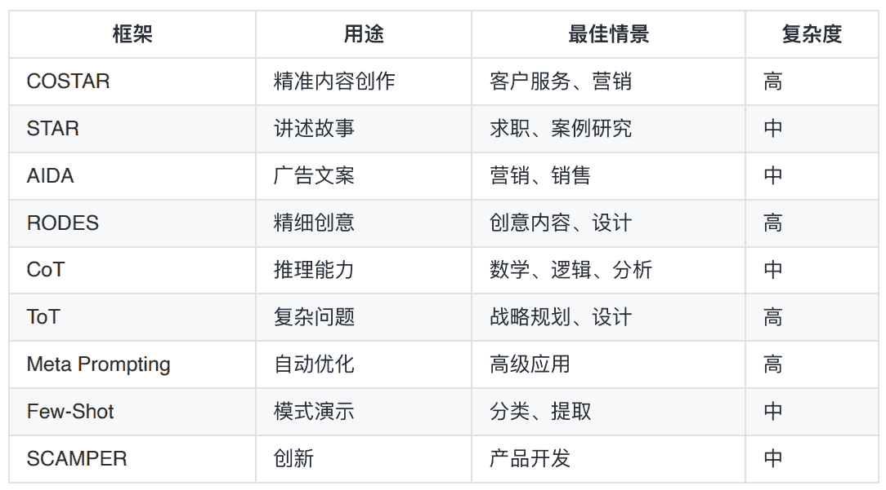

# 完整提示词工程指南：框架、技术与模板手册

> 来源：[https://aigcreative.feishu.cn/docx/VwvzdkJlEoxI2KxbxHMcLRBHndc](https://aigcreative.feishu.cn/docx/VwvzdkJlEoxI2KxbxHMcLRBHndc)

> 制作时间: 2025年10月

> 版本: 1.0 完整版

> 制作人: X@Berryxia_ai

# 序言

提示词工程是与大型语言模型（LLM）有效沟通的关键。本指南汇总了除GROK框架（R-T-F、TA-G、B-A-B、C-A-R-E、R-I-S-E）外的所有主要框架、技术和最佳实践。

# 第一部分：核心提示词框架（57+种）

## 一、基础框架类

### 1. COSTAR框架

Context → Objective → Style → Tone → Audience → Response

用途：客户服务、内容创作、营销文案

> 【上下文】客户上次订单延迟5天，这是3个月内的第二次投诉，提到可能转向竞争对手。

> 【目标】写一封100字的道歉邮件，承认延迟并提供补偿。

> 【风格】正式且专业

> 【语气】歉意、同情、权威

> 【受众】VIP客户

> 【响应格式】邮件形式

### 2. STAR框架

Situation → Task → Action → Result

用途：讲述故事、展示成就、解决方案展示

> 【情景】销售管道中的低质量线索导致demo预约率低。

> 【任务】改进lead qualification策略。

> 【行动】审计广告文案，调整landing pages，增加qualifying questions。

> 【结果】将低质量demo预约降低30%。

### 3. AIDA框架（营销经典）

Attention → Interest → Desire → Action

用途：广告文案、销售信息、营销活动

> 【吸引力】"管理佣金再也不用手工计算"

> 【利益】展示60%公司仍用Excel的风险

> 【欲望】强调节省时间、避免错误、提高透明度

> 【行动】"预约15分钟演示" 或 "下载审计清单"

### 4. SPAR框架

Situation → Purpose → Action → Result

用途：简化的问题解决、快速指导

> 【情景】客服响应时间超长

> 【目的】改进客户体验并减少等待时间

> 【行动】实施AI客服、改进工单系统

> 【结果】平均响应时间降低60%，满意度提升

### 5. PAR框架

Problem → Action → Result

用途：故障排除、简单问题解决

> 【问题】网站加载速度慢

> 【行动】优化图片、启用缓存、CDN部署

> 【结果】加载时间从5秒降至1.2秒

### 6. CARE框架

Context → Action → Result → Example

用途：案例研究、项目展示、成功故事

【背景】远程团队协作效率低

【行动】推出虚拟mentoring和月度town halls

【结果】员工敬业度指数提升20%

【示例】某团队参与后敬业度提升30%的案例 ⭐

### 7. RODES框架 ⭐

> Role → Objective → Details → Examples → Sense Check

> 用途：创意内容、精准指导、高质量输出

> 角色：季节性推文文案高手

> 目标：为行业内容创作能吸引用户互动的推文

> 细节：280字以内，避免hashtag和emoji

> 示例：展示高性能推文的风格

> 理解确认：你理解任务和指导了吗？

### 8. RASCEF框架

Role → Action → Steps → Context → Examples → Format

用途：技术文档、复杂指导、深度分析报告

用于精确指导和详细输出的完整框架。

### 9. CRISPE框架

Clarity → Relevance → Iteration → Specificity → Parameters → Examples

用途：策略规划、内容创建、技术问题解决

注重精确和创意的平衡。

### 10. RTF框架

✅ [如图所示 - 这是已有框架]

## 二、分析和研究框架

### 11. RACE框架

Research → Analyze → Create → Evaluate

用途：深度分析、学术研究、数据分析

### 12. TRACE框架

Topic → Reason → Audience → Counterargument → Evidence

用途：说服性写作、辩论准备、论文撰写

### 13. PEE框架

Point → Evidence → Explanation

用途：学术论文、论证、分析文章

> 【论点】远程工作提高生产力

> 【证据】统计数据：远程工作者完成任务速度快17%

> 【解释】减少办公室干扰、更自由的时间管理

### 14. SMART框架

Specific → Measurable → Achievable → Relevant → Time-bound

用途：目标设定、项目规划、OKR制定

> 目标：在6个月内通过优化销售流程，将销售额提升30% 而不是"提高销售"

### 15. COAST框架

Challenge → Objective → Strategy → Tactics → Success

用途：项目管理、战略规划、复杂问题解决

## 三、创意和设计框架

### 16. SPARK框架

Situation → Problem → Aspiration → Result → Kismet

用途：创新产品开发、营销策略、创意写作 注重动态创新方法。

### 17. SCAMPER框架

Substitute → Combine → Adapt → Modify → Put to Another Use → Eliminate → Reverse

用途：创新思维、产品改进、解决方案设计

> 产品：智能手表

> 【替代】用AI替代简单的计时功能

> 【合并】结合健康追踪和工作日程

> 【调整】改为模块化可互换表带

> 【修改】增加手势控制功能

> 【另作他用】可用作家居控制中心

> 【消除】移除复杂菜单系统

> 【反转】从通知驱动改为用户驱动

### 18. Six Thinking Hats框架（6顶思考帽）

White (Facts) → Red (Emotion) → Black (Risk) → Yellow (Benefits) → Green (Creativity) → Blue (Process) 用途：全面决策、团队会议、问题解决

> 【白】事实：该产品市场规模$10B

> 【红】感受：这个机会让人兴奋但也有风险感

> 【黑】风险：竞争对手已占60%市场

> 【黄】收益：进入后可快速获得$50M收入

> 【绿】创意：采用订阅模式而非一次性销售

> 【蓝】过程：决定下周内制定详细计划

### 19. BLOG框架

Background → Logic → Outline → Goal

用途：博客写作、长篇文章、营销内容

### 20. Hamburger Model框架

Introduction (Top) → Body/Substance (Meat) → Conclusion (Bottom)

用途：简化内容结构、清晰组织

## 四、问题解决和决策框架

### 21. How Might We (HMW) 框架

Challenge framed as opportunity

> 用途：设计思维、头脑风暴、创新工作坊 "我们如何让远程团队建立更强的信任关系？"

> 而不是"远程团队缺乏信任"

### 22. PAUSE框架 Prepare → Assess → Uncover → Synthesize → Execute

用途：反思性思维、决策制定、冲突解决

### 23. GOPA框架

Goals → Obstacles → Plans → Actions

用途：目标设定、问题解决、项目规划

### 24. RICE框架

Reach → Impact → Confidence → Effort

用途：项目优先级排序、资源分配、创意评估

> 功能A：Reach(1M用户) × Impact(高) ÷ Effort(3月)

> 功能B：Reach(500K用户) × Impact(中) ÷ Effort(1月)

### 25. ROSES框架

Recognize → Observe → Strategize → Execute → Study

用途：复杂问题解决、持续改进、学习循环

### 26. ORID框架（聚焦对话法）

Objective → Reflective → Interpretive → Decisional

用途：团队讨论、教练辅导、反思性写作

## 五、内容和通信框架

### 27. 3Cs框架

Company → Customer → Competitor

用途：市场分析、商业战略、竞争分析

### 28. APE框架

Audience → Purpose → Execution

用途：目标受众定位、内容定制、营销活动

### 29. TAG框架

Topic → Audience → Goal

用途：内容规划、消息定制、通信策略

### 30. ERA框架

Engage → React → Act

用途：营销互动、用户参与、行为改变

### 31. Challenge-Solution-Benefit框架

Challenge (Problem) → Solution → Benefit

用途：产品文案、销售信息、营销内容

### 32. The Five Ws and One H

Who → What → When → Where → Why → How

用途：新闻写作、完整信息收集、深度报道

> 谁：目标受众是谁？

> 什么：产品/服务是什么？

> 何时：推出/发生的时间？

> 何地：地理位置或背景？

> 为什么：原因和动机？

> 怎样：具体方式和过程？

### 33. CAR-PAR-STAR框架

CAR: Context, Action, Result PAR: Problem, Action, Result STAR: Situation, Task, Action, Result

用途：行为面试、绩效评估、个人品牌塑造

## 六、高级推理框架

### 34. Chain of Thought (CoT)

Step-by-step reasoning

用途：复杂分析、数学问题、逻辑推理

> 问题：15、32、5、13、82、7、1中的奇数相加等于偶数吗？

> CoT提示：

> 第一步：找出所有奇数：15, 5, 13, 7, 1

> 第二步：相加：15 + 5 + 13 + 7 + 1 = 41

> 第三步：判断41是奇数还是偶数？41是奇数

### 35. Tree of Thoughts (ToT)

Multiple reasoning paths with backtracking

用途：复杂问题解决、创意写作、策略规划

> 问题求解：使用4, 9, 10, 13和四种基本运算得到24

> 第一步：生成3个可能解

> 第二步：评估每个解的可行性

> 第三步：基于最有前景的进行扩展

> 第四步：用BFS或DFS遍历整个树

### 36. Meta Prompting ⭐

### Let LLM generate and refine prompts

用途：自动化提示词优化、复杂任务处理

> 初始提示：生成一个详细的提示词来帮助LLM写说服力论文

> 元提示输出示例： "写一篇说服力论文，论证可再生能源应取代化石燃料

> 结构：

> - 引言：引人入胜的开场+清晰论点

> - 正文段落1：环保效益（证据+例子）

> - 正文段落2：经济优势（就业+成本节省）

> - 正文段落3：反驳反对意见

> - 结论：总结+行动号召 语气：自信且有说服力"

### 37. Program-Aided Language Models (PAL)

### Integrating external programming environment

用途：需要编程的问题解决、数据分析、算法实现

> 而不是：数据分析问题

> 改为：生成Python代码，使用外部解释器执行

### 38. Socratic Method 📚

### iterative questioning for critical thinking

用途：教育、辅导、深度理解

> 第一步：提出基本问题让学生给出假设

> 第二步：审视假设，要求学生解释推理

> 第三步：提出反例或不同观点

> 第四步：引导学生修正理解

## 39. Instruction Following Prompt

## Explicit, detailed directives

用途：应用程序、自动化流程、可靠输出

> 【动作动词】提取

> 【输入规范】以下邮件中

> 【约束条件】格式为JSON，最多100字

> 【输出格式】{sender_name, meeting_date, meeting_time}

### 40. Few-Shot Prompting

### Provide examples to guide behavior

用途：复杂任务、特定格式输出、模式演示

> 情感分类示例：

> 输入1：我很高兴 → 输出1：正面

> 输入2：这太糟糕了 → 输出2：负面

> 输入3：我要参加考试 → 输出3：中立

> 现在分类：我觉得这个产品不错

### 41. Zero-Shot Prompting

### Task description without examples

用途：简单任务、基础测试、多功能提示

> 直接提示：翻译以下文本为西班牙语："Hello, how are you?"

### 42. In-Context Learning

### Learning from examples provided in prompt

用途：知识转移、模式识别、快速适应

# 第二部分：提示词核心要素

## 提示词的5个关键成分

### 1. 角色/人设 (Role/Persona)

定义AI应该扮演什么身份

> 示例1："你是一位有20年经验的生活教练"

> 示例2："你是一位初级医学生"

> 示例3："你是营销分析师"

### 2. 上下文 (Context)

提供必要的背景信息

> 示例："在美国科技行业背景下，员工流失率为15%"

> 关键信息：行业、地理位置、当前情况、历史数据

### 3. 指令 (Directive/Task)

明确的任务说明

> ✅ 好："生成5条针对科技初创公司的LinkedIn广告，每条少于280字"

> ❌ 差："写关于科技的东西"

### 4. 输出格式 (Output Format)

指定响应的结构

> - JSON格式

> - 表格

> - Markdown

> - 项目符号列表

> - 分步骤说明

> - 单句摘要

### 5. 约束和限制 (Constraints)

定义边界和规则

> 限制：

> - 最多200字

> - 不包含政治内容

> - 必须包含至少2个行业数据

> - 不使用jargon

> - 保持专业语气

### 推荐的提示词组织顺序

> 1. 示例 (Examples) - 如果需要

> 2. 上下文/背景 (Context)

> 3. 角色 (Role)

> 4. 指令 (Directive) ← 放在最后

> 5. 输出格式 (Output Formatting)

为什么？ 将指令放在最后可防止LLM继续上下文而不执行任务

# 第三部分：提示词优化技巧

## 通用原则

### 1. 清晰性 (Clarity)

> ❌ "写点关于环保的内容"

> ✅ "写一篇800字的科普文章解释海洋塑料污染对海洋生物的影响，目标受众是初中学生，包含：现状、危 害、解决方案三个部分"

### 2. 具体性 (Specificity)

> ❌ "提高销售"

> ✅ "在3个月内通过优化销售流程将B2B销售额提升25%"

### 3. 避免歧义 (Avoid Ambiguity)

> ❌ "有点创意的标题"

> ✅ "生成5个标题选项，每个少于10个字，用简单易懂的语言，避免行业术语"

### 4. 提供上下文 (Context)

> 完整示例： "你是一位为SaaS公司写销售邮件的专家。这是一家提供项目管理软件的公司，客户是财务主管。

> 任务：写一封开场邮件，在第一句内说明收益。

> 格式：邮件格式，150-200字

> 示例受众痛点：手工记录浪费时间"

### 5. 指令明确 (Explicit Instructions)

> 使用明确的动作动词： 列出、解释、比较、生成、编写、分类、总结、翻译、分析

### 6. 迭代优化 (Iterative Refinement)

> 第一版 → 测试 → 评估 → 改进 → 再次测试 → 最终版

# 第四部分：提示词设计模板

## 模板1：基础通用模板

> 【角色】你是{专业人士}

> 【上下文】{背景信息}

> 【任务】{具体任务}

> 【约束】{限制条件}

> 【格式】{输出格式}

> 【示例】{可选：示例}

## 模板2：COSTAR扩展模板

> **Context（背景）：**

> - 当前情况：{描述}

> - 历史数据：{相关数据}

> - 关键限制：{约束}

> **Objective（目标）：**

> - 主要目标：{具体目标}

> - 次要目标：{额外目标}

> **Style（风格）：**

> - 专业/非正式/学术/创意

> **Tone（语气）：**

> - 友好/权威/同情/乐观

> **Audience（受众）：**

> - 专业水平：{初级/中级/高级}

> - 技术背景：{是/否}

> **Response（响应）：**

> - 格式：{JSON/表格/段落}

> - 长度：{最多/最少字数}

## 模板3：创意内容模板

> **SPARK框架：**

> 情景：{当前处境}

> 问题：{存在的问题}

> 抱负：{期望目标}

> 结果：{可衡量的成果}

> 幸运因素：{出其不意的元素}

> **输出要求：**

> - 风格：创新且引人入胜

> - 长度：{字数限制}

> - 包含元素：{必须包含}

> - 避免：{不要包含}

## 模板4：分析研究模板

> **TRACE框架：**

> 话题：{研究主题}

> 理由：{为什么重要}

> 受众：{谁需要这信息}

> 反驳：{可能的反对意见}

> 证据：{支持证据}

> **分析步骤：**

> 1. {第一步}

> 2. {第二步}

> 3. {第三步}

> **输出：**

> - 报告格式

> - 包含摘要、主体、结论

> - 引用来源

# 第五部分：高级技巧

## 1. 思维链提示 (Chain of Thought)

> 提示：用逐步思考来解决这个数学问题

> 问题：38 × 45 = ?

> 让我们逐步思考：

> 第一步：38 × 40 = 1520

> 第二步：38 × 5 = 190

> 第三步：1520 + 190 = 1710

## 2. 角色扮演提示

```
&quot;你是一个Python专家。一个初级开发者问你关于列表推导式的问题。 用简单的语言解释，给出3个例子，解释为什么每个例子这样工作。&quot; 
```

## 3. 对比分析提示

> "对比A和B，从以下维度分析：

> 1. 成本

> 2. 性能

> 3. 用户体验

> 4. 可扩展性

> 5. 学习曲线 用表格格式呈现，每个维度评分1-10"

## 4. 问题分解提示

> "我需要完成一个复杂任务。帮我分解成更小的、可管理的步骤。

> 任务：{复杂任务描述}

> 对于每一步，提供：

> - 目标

> - 关键行动

> - 预期时间

> - 潜在障碍"

## 5. 创意头脑风暴提示

> "使用SCAMPER方法为{产品}生成10个创新想法：

> S（替代）：可以替代什么？

> C（结合）：可以与什么结合？

> A（调整）：可以调整什么方面？

> M（修改）：可以改变什么特性？

> P（另用）：还能用于什么？

> E（消除）：可以去掉什么？

> R（反转）：可以反过来做什么？"

## 6. 验证和反思提示

> "检查你的答案：

> 1. 是否回答了原始问题？

> 2. 逻辑是否清晰？

> 3. 有没有遗漏关键信息？

> 4. 结论是否有数据支持？

> 5. 还有其他需要考虑的因素吗？"

# 第六部分：行业应用示例

## 示例1：市场营销

> 框架：AIDA + COSTAR

> Context：我们是一家SaaS CRM初创公司，目标客户是中型企业财务部门

> Objective：写一个产品登陆页hero文案，能在3秒内吸引注意力

> Style：现代、直接、数据驱动

> Tone：自信且富有同情心

> Audience：财务主管，对ROI敏感

>

> AIDA应用：

> Attention：用一个令人震惊的统计数据开头（如"75%的企业仍在用Excel管理费用"）

> Interest：解释问题为何存在及其成本

> Desire：展示特定的解决方案和客户成功案例

> Action：清晰的CTA按钮

> 输出格式：HTML代码

## 示例2：技术文档

> 框架：RASCEF

> Role：你是一位技术写作专家，简化复杂概念

> Action：编写API文档

> Steps：

1. 解释API的目的

2. 显示代码示例

3. 列出所有端点

4. 说明错误处理

> Context：这是用于初级开发者的文档

> Examples：展示3个常见用例的代码

> Format：Markdown，包含代码块和表格

> 约束：

> - 避免行业术语或解释术语

> - 最多500字

> - 包含至少2个完整代码示例

## 示例3：产品策略

> 框架：COAST + ROSE

> Challenge：用户流失率为20%，高于行业平均5%

> Objective：在6个月内将流失率降至8%

> Strategy：

1. 改进onboarding体验

2. 建立用户社区

3. 增加高价值功能

> Tactics：

1. 重新设计登录流程（1个月）

2. 启动用户论坛（2周）

3. 推出高级功能（3个月）

4. 建立success team（第一个月）

> Success：通过周/月流失率报告跟踪进度

# 第七部分：常见错误和改进

## ❌ 错误1：过于模糊的指令

> "给我写点关于营销的内容" ✅

✅ 改进方案

> "为一个B2B SaaS公司写一篇思想领导力文章， 长度800字， 解释2024年的3个营销趋势及其对初创公司的影响， 针对CMO受众， 包含至少2个行业研究引用"

## ❌ 错误2：矛盾的指令

> "写一个专业但友好的邮件，很短但详细..."

✅ 改进方案

> "写一个专业但温暖的邮件，长度150-200字， 清楚表达问题且提供下一步行动"

## ❌ 错误3：缺少上下文

> "改进这个标题"

✅ 改进方案

> "改进这个LinkedIn文章标题以吸引HR经理： 原标题：'员工管理的新方法' 目标：增加CTR 25%，避免行业术语"

## ❌ 错误4：过度复杂

> "在一个提示中：总结这份报告、提取关键指标、 生成可视化建议、翻译成西班牙语、创建行政摘要..."

✅ 改进方案

> 将其分成5个独立提示，按顺序执行 每个提示专注于一个任务

# 第八部分：提示词质量检查表

## 写作问题检查

## 指令和示例检查

## 设计问题检查

# 第九部分：快速参考表



# 第十部分：逐步学习路径

## 初级（第1-2周）

1. 学习基础5个要素（角色、上下文、指令、格式、约束）

2. 掌握RTF、STAR、AIDA框架

3. 实践few-shot提示

4. 做简单的提示词优化

## 中级（第3-4周）

1. 学习COSTAR、RODES、TRACE框架

2. 理解Chain of Thought

3. 实践复杂的多步骤提示

4. 为不同行业创建提示

## 高级（第5-6周及以后）

1. 掌握Tree of Thoughts和Meta Prompting

2. 学习提示词安全性和防止注入

3. 创建提示词库和模板

4. 贡献最佳实践和新框架

# 总结

提示词工程是一门艺术和科学的结合。关键要点：

> ✅ 始终迭代 - 测试、学习、改进

> ✅ 保持清晰 - 具体胜于模糊

> ✅ 提供背景 - 上下文很重要

> ✅ 选 择合适的框架 - 不同任务需要不同方法

> ✅ 测试输出 - 验证结果是否符合期望

# 有用资源

Prompt Engineering Guide: https://www.promptingguide.ai

Learn Prompting: https://learnprompting.org

GROK 官方文档（如适用）

Google Vertex AI: https://docs.cloud.google.com/vertex-ai

制作时间: 2025年10月 版本: 1.0 完整版 制作人: Twitter @Berryxia_ai

<https://aigcreative.feishu.cn/sync/K4Gvd9vUQsy9Oubwqaeclu0Fnbg>

# 知识库动态