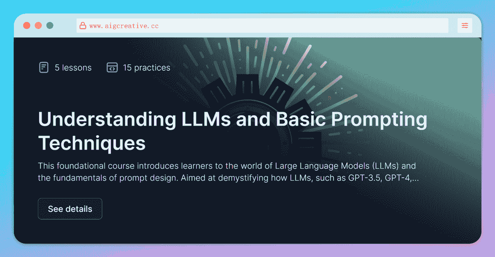
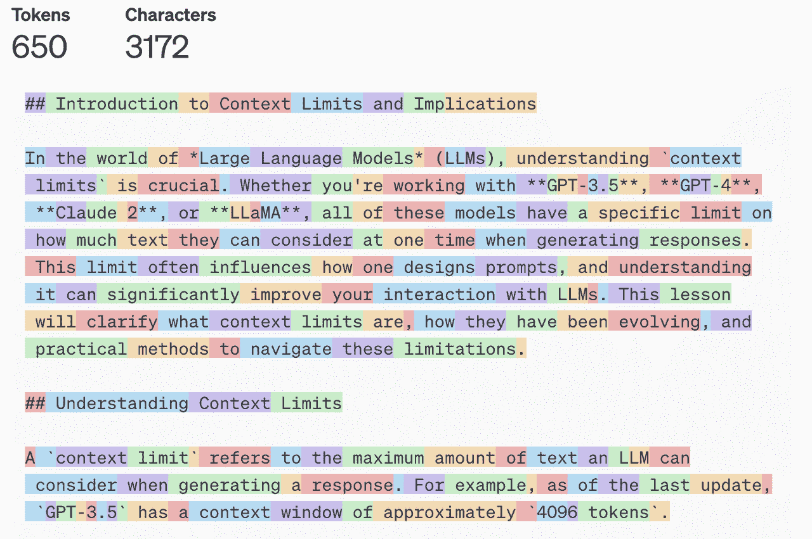
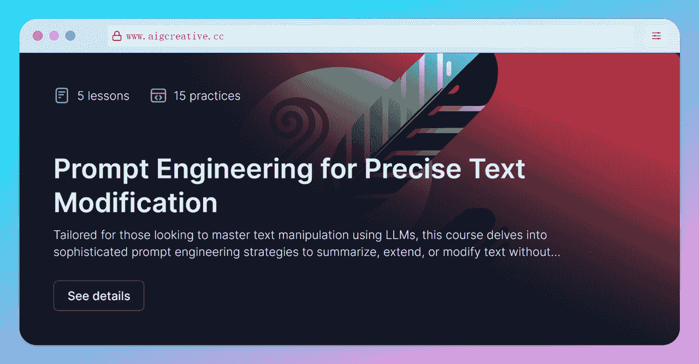

# 人人都是提示工程师 | 精品课程翻译

> 来源：[https://aigcreative.feishu.cn/docx/RutNdrG34o4ZDmxxsgLcAKZPnGf](https://aigcreative.feishu.cn/docx/RutNdrG34o4ZDmxxsgLcAKZPnGf)

> 原文链接：https://learn.codesignal.com/preview/course-paths/16/prompt-engineering-for-everyone

> 翻译/校对：创意猎人-Kevin

Codesignal最近发布了一套易于理解且充满实用技巧的免费教程，专注于提示工程领域。如果你曾尝试学习提示工程但被复杂的教程所困扰，那么这个教程绝对值得一看。这个教程很好，特做了详细的翻译，它将有效地指导你掌握编写高效提示词的技巧。


深入Prompt Engineering的尖端领域，本综合学习路径既适合初学者，也适合有经验的专业人士。它旨在介绍如何有效地设计提示，以便与大型语言模型 (LLMs) 有效互动。通过这一系列课程，你将学会如何精确地影响LLM的输出，控制生成文本的格式和大小，并能够根据复杂的指令进行操作。做好准备，提升你在创建精确、能够感知上下文的提示方面的技能，这些提示将帮助你引导AI模型实现预期的效果。



# 第一阶段：理解大型语言模型 (LLMs) 和基本的提示技巧

本基础课程带领学习者深入大型语言模型 (LLMs) 世界及提示构建的基本原理。课程目标是让学习者明白如GPT-3.5、GPT-4、LLaMA、Claude 2等LLMs是如何进行文本生成和用户互动的，为想要掌握利用先进人工智能技术创建能够精确输出的提示的人提供了一个坚实的学习基础。

## 课程01：LLMs本质上是用于预测下一个词的机器

### 简介：

欢迎进入大型语言模型 (LLMs) 及提示方法基本原理的迷人世界！在这开篇课程中，我们即将深入探索LLMs的真正内涵。先给个小提示：它们其实就是专门用来预测下一个词的高级机器。听上去简单？实际上它们的魅力远不止这些。不管你是编程新手，还是对这些技术奇观充满好奇，这里都是你的理想起点。让我们共同启程，一步步揭开LLMs核心功能背后的秘密。

### 理解LLMs是用于预测下一个词的机器

想象当你正在发送短信或邮件时，手机能预测出你接下来可能打算输入的词。这正是大型语言模型（LLMs）的一个简单应用示例。然而，GPT-3.5、GPT-4（也就是大名鼎鼎的chatGPT）、Claude 2和LLaMA等LLMs则可以被视为单词预测领域的超级英雄。它们的能力远不止于预测下一个词——它们能够基于给定的输入生成一整段连贯有逻辑的文本。这种能力源于它们逐个预测下一个单词，以此方式连续扩展已有文本。

LLMs的核心能力在于分析海量文本数据。通过深度分析，它们掌握了语言的模式、微妙差异和结构，进而能够预测在一串词汇中最自然出现的下一个词。可以说，它们就像在进行一场规模庞大、速度惊人的“填空游戏”。

### LLMS是如何做预测的？

你可能好奇LLMs如何能够做出如此精准的预测。答案在于它们的训练过程。LLMs被训练于包含大量教科书、文章、网站等内容的庞大数据集中。通过这一训练阶段，它们学习到了如何理解语言的上下文和流畅度，习得了语法、风格，乃至文本情感调性等方面的知识。

当你向LLM提出一个句子或问题时，它依据所学到的内容预测接下来最可能出现的一个或几个词。这不是随机猜测，而是基于在训练过程中学到的模式和规则作出的精确预测。

### 尝试下提示工程-Prompt Engineering

考虑到LLMs本质上的概率特性，提示工程师面临的挑战是如何尽量使LLMs生成可预测且准确的结果。

在这门课程中，你将学习到众多技巧，帮助你精通如何得到高度可预测的LLM输出——这既是一门艺术，也是一门科学。但在我们深入探讨之前，让我们先来做几个简单的实践练习，激活我们的思维。

## 课程02：精通格式化与结构化：打造高效提示技巧的关键

### 简介：

在本课中，我们即将深入探讨设计给大型语言模型 (LLMs) 的提示时，格式化与结构化的一致性为何如此重要。可能令人惊讶的是，简单的提示格式调整竟然能显著改变AI的反馈效果。正如在人际交流中，清晰和有序对于确保你的要求被准确理解和执行至关重要。接下来，让我们一起探索如何运用这些基本原则，让你与LLMs的交互变得更高效、结果更可预期。

### 格式一致性的重要性

将你的提示格式化以保持一致性，不仅仅是为了外观整洁，更重要的是让你的意图对AI更加清晰。想象一下，如果你在指导某人烘焙蛋糕，却没有按顺序列出步骤，而是将它们搅在一起，结果会怎样？这会导致混乱，很可能做出来的蛋糕也不怎么好吃。同样的原理也适用于LLMs。通过以清晰、有序的方式呈现你的提示，你将大大增加获得所期望结果的可能性。

尽管有许多方法可以用来结构化你的提示，在这个课程中，我们将向你介绍由Prompt Engineers和CodeSignal的AI专家开发的Markdown提示框架（MPF）。

MPF是一种非常有效的方法，用于创建易于阅读、可维护和高效的提示，并且是Cosmo许多方面的核心。

### Markdown提示框架（MPF）

在这个课程中，我们将通过多个示例来展示MPF的应用，但现在，先来看一个高层次的概要：

像这样将你的提示分割成Markdown的部分：SECTION。这不仅有助于LLMs更好地理解你的提示，而且使你的提示非常容易浏览（特别是当在Markdown中渲染后，这些部分会以粗体显示），这样当你的提示内容较多时，你的同事AI工程师可以轻松找到并阅读相关部分。

在你的提示最顶部开始你的__ASK__部分，这可以让你和你的合作者从一开始就迅速明白提示的目标。

将每个部分格式化为Markdown项目符号列表，以便于阅读和理解。项目符号列表更易于浏览，并且它们倾向于让LLMs更好地遵循指令。

在尽量减少部分数量的同时，对于复杂的提示，包含以下关键部分：

+   ASK——我们请求LLM做什么？

+   CONTEXT——LLM需要知道什么才能准确回应？

+   CONSTRAINTS——响应时需要遵循哪些约束？

+   EXAMPLE—— 一个你会满意的输出示例是什么？

### MPF应用示例

看看一个格式欠佳的提示示例：

> 请写一篇短故事，讲述一位宇航员发现了一个新星球。故事中必须包括一位能说话的外星人、一场太空战斗，以及一个揭示一切原来是模拟的结局。哦，故事请控制在100字以内。

借助MPF，我们能把这个提示改造成一个结构清晰、易于模型处理的请求：

```
__ASK__
Craft a short story about an astronaut&#x27;s discovery.

__CONTEXT__
- The setting is outer space.
- The protagonist is an astronaut.

__CONSTRAINTS__
- The story should be no longer than 120 words.
- Include the following elements:
  - A talking alien.
  - A space battle.
  - A twist ending revealing everything was a simulation.
```

尽管大部分高性能模型能够轻松处理各种提示并给出类似下方的答案，但随着你的提示内容变得更加庞大和复杂，或当你不得不使用一个能力较低的LLM时，采用MPF方法对于实现高效的提示工程变得尤为关键。

> 在繁星点点之间漂流，宇航员Luna注视着眼前银河系的壮丽舞蹈。她的使命是勇敢探索未知世界。突然间，一艘闪烁着神秘能量的外星船只靠近了。Zorax步出船舱，这位外形神秘的生物虽不开口，却以思维直接与Luna沟通，传授给她关于星辰的智慧以及即将爆发的太空战斗的预警。

> 星际战机在夜空中交织出一幅绚烂的画卷，Luna与她的新伙伴英勇斗争。然而，随着战争的尘埃落定，宇宙突然一片漆黑，一个模拟舱的真相慢慢显现。“训练完成”，机械化的声音宣布了结束。Luna步出舱门，她的心脏怦怦直跳，满心期待着即将到来的真正冒险。

## 课程03：为LLM提示编写高效的示例

### 介绍：

欢迎参加我们深入了解大型语言模型（LLMs）及基础提示技巧系列课程中的一课——“优质示例的重要性”。我们越是深入探讨LLMs的潜能，就越能明显看到，我们为模型准备的示例极大地影响了它们输出的质量和相关性。本节将重点讲解精心构建的示例在设计提示时的关键作用，这直接关系到模型理解当前任务和提供准确结果的能力。

### 示例在引导LLMs进行有效回应中的角色

示例是与大型语言模型进行有效交流的关键。设计提示不仅仅是提问或提出请求，更是在指导模型向我们期望的答案方向发展。通过给出清楚且相关的示例，我们不只是在阐明任务本身，更是在介绍背景信息和期待的输出格式。

现在，让我们看一个例子，试图创建一个不含示例部分的电子邮件模板。

```
__ASK__
Create short advertising copy to market CodeSignal

__CONSTRAINTS__
- Do not focus too much on features, focus on brand.
- Keep the ad very short.
```

这是使用Claude模型试运行这个提示后的一个示例输出。

> 为CodeSignal撰写的简短广告文案草稿如下：CodeSignal. Where coding meets opportunity.

虽然成果已经相当不错，但可以看出文案开头有不必要的引言部分，且格式略显欠佳。另外，假如我们需要方便地复制粘贴这段文案，而不想要文案两侧的引号，这一点也需要调整。

### 优质示例的作用

虽然我们可以通过增加各种额外的约束条件来改善提示的表述，但更简便的办法是直接提供一个明确的示例，如下所示：

```
__ASK__
Create short advertising copy to market CodeSignal

__CONSTRAINTS__
- Do not focus too much on features, focus on brand.
- Keep the ad very short.
- Follow the format of the example closely.

__EXAMPLE__
Build tech skills top companies are hiring for.
```

这样我们得到了“Unlock your coding potential. Shine with CodeSignal”，这个结果更贴近我们的期望。

### 总结

优质示例的价值远超附加效果；它们是设计LLM有效提示的基石。这些示例不仅将模型引导至我们所期望的方向，而且对提升生成内容的质量有着决定性的影响。在我们深入LLMs及提示工程的旅程中，别忘了一个恰当的示例所蕴含的巨大力量——它有可能是将一个好的输出转变为卓越输出的关键。

## 课程04：上下文限制及其在提示工程中的作用

### 探究上下文限制及其重要性

在大型语言模型（LLMs）的应用领域中，掌握上下文限制的知识至关重要。不论是使用GPT-3.5、GPT-4、Claude 2还是LLaMA，所有这类模型在生成回答时，都受到它们能够一次性处理的文本量的限制。这种限制不仅影响提示的设计方式，更深入了解这一概念还能大幅度提升你与LLMs的交互质量。本课程将详细介绍上下文限制的含义、它们的发展变化，以及如何巧妙地应对这些限制的实践策略。

### 深入了解上下文限制

上下文限制是指LLM在生成回答时可以处理的文本的最大长度。举个例子，按照最近的更新数据，GPT-3.5的上下文窗口能够处理的Token数量大约是4096个。

以这节课为例，它大约包含500个单词，相当于650个Token。



理解Token的真实含义至关重要，正如你在之前的图像中所见，一个Token不仅可以是一个完整的单词，也可能是单词的一部分或者是标点。这就意味着，模型实际能处理的文本长度可能比你初步预计的要短。不过，一般来说，把Token等同于单词是一个不错的简化思路。

### 上下文限制随时间的演进

上下文限制的提升历程令人瞩目。以下是一个展示这些变化的简化表格：

随着这一演变的发展，我们在生成更连贯、上下文更丰富的回答方面获得了更多可能性。但是，大部分LLM服务商是根据Token的使用量来收费的，而且常常我们使用的模型的上下文窗口并不大，因此我们需要采取一些策略来优化我们的提示，以规避这些限制。

### 如何应对上下文限制

要有效应对LLMs的上下文限制，需要有策略地设计提示并了解如何进行内容压缩。以下是一些克服这些限制的方法：

+   **压缩提示内容：**尽量简化你的提示，确保只包含最必要的信息。这就需要你将长篇的背景或上下文精炼为简明的句子，但同时不丢失关键信息。

+   **专注查询：**避免提出笼统、缺乏明确目标的问题，而是精确地提出你的询问。细化的问题通常能够在受限的上下文空间内得到更精确、更切题的答案。

+   **分步迭代提示**：把复杂的任务拆解成一系列更小、有序的步骤。通过逐步优化问题，即使在严格的Token限制下，你也能够引导LLM沿着逻辑连贯的思路进行。

### 总结

尽管上下文限制在表面上似乎是一种严格的约束，它们实际上促使我们成为更加周到和高效的沟通者。随着大型语言模型不断进化，我们与它们交互的方式也在不断地改进。通过深入理解上下文限制的影响，并据此调整我们的提示设计，我们能够创建出既精确又高效的提示，从而获得相关性强且质量高的输出。

## 课程05：精通AI提示中的风格艺术

### 介绍：

本课程将教你如何与大型语言模型（LLMs）进行有效交流，以便在提示中达到预期的风格效果。精通这一技巧对于创建能够产生定制、精确且风格一致的结果的提示至关重要。无论是撰写专业文档、编织富有创意的故事，还是其他任何形式的输出，深入理解风格的细节都将提升你的提示工程技巧。

### 深入风格规范的理解

可以把风格规范比作是向一位技艺高超的厨师提出菜品要求的过程。正如你会具体说明你希望牛排的烹饪程度一样，你也可以指引LLMs输出你想要的文本“味道”。风格涵盖了多个方面，如语调（正式或非正式）、用词（简洁或专业）、篇幅（简短或详尽）等。

比如说：

```
__ASK__
Generate a motivational quote for a team newsletter. 

__STYLE__
- Tone: uplifting and visionary. 
- Language: simple and accessible. 
- Length: short.
```

结果：

> "In every challenge lies an opportunity to grow stronger together. Let's embrace our journey with courage and unite our efforts toward a future filled with success. Remember, the strength of the team is each individual member, and the strength of each member is the team."

只需从提示中去掉“**Length: short**”这一要求，你就能明显感受到输出结果的不同：

> "Alone we can do so little; together we can do so much. Let's harness our collective strengths, dreams, and ambitions. Every challenge we face is an opportunity to grow stronger, together. Remember, it's not just about reaching the top; it's about the journey we share and the bonds we build. Let's move forward, hand in hand, towards our shared vision. Because when we unite, there's nothing we can't achieve."

### 提示中的语气作用

语气在影响提示如何被解读以及你获得何种类型回应上具有显著作用。明确设定语气可以有效地指导LLM，使其生成的回应更贴合你所期望达到的情绪或专业背景。

示例：

```
__ASK__
Write a brief overview of renewable energy sources. 

__STYLE__
Tone: Informative but easy to understand.
```

在此示例中，通过设定语气，指引LLM在保证信息专业性的同时增加其易获取性，以确保内容对受众而言不过于技术化。

### 调整语言风格和复杂度

当面向的受众在专业知识水平上存在广泛差异时，明确指出所期望输出的语言风格和复杂度水平显得尤为关键。这可能意味着根据目标读者的需求，选择以简洁明了或含有专业术语的语言进行回答。

示例：

```
__ASK__
Explain how solar panels convert sunlight into electricity. 

__STYLE__
Language: Simple, for a general audience.
```

通过这一提示，我们指示LLM采用通俗易懂的表达方式，使得那些非技术背景的人士也能够理解复杂技术。

### 关于长度和细节的说明

最终，明确告知所需内容的长度和详细程度对于提高交流效果至关重要。这一步骤可能包括要求进行简明扼要的概述或提供详尽的阐述。

示例：

```
__ASK__
Summarize the benefits of using electric vehicles. 

__STYLE__
Length: Brief, two sentences.
```

请注意，在讨论“长度”时我们给出了非常明确的指示，用了两句话，因为“短”或“长”往往是相对的，理解起来可能有难度。

### 总结

深入理解和巧妙应用风格设定，可以极大地增强提示的设计与开发过程。正如雕塑家通过雕凿揭露内在的形态一样，明确你的提示中的风格有助于精确塑形输出结果，使其符合你的预期。

你看，你已经接近完成这门课程了，准备好作为提示工程师开启新的篇章。虽然肯定还有更多知识等待学习，但这门课程应该为你提供了一个坚实的基础，引领你前行。在我们结束课程之前，让我们进行更多的实践练习。


# 第二阶段：利用大型语言模型（LLMs）精准控制输出量

本中级课程旨在教授如何巧妙调整大型语言模型的输出大小。课程将从生成简明单词到撰写广阔文章等不同范围，引导学习者学习如何精确操控AI生成内容的长度及其细节。这一能力对于按照特定需求定制回答、在内容创作、编程等多个领域内的应用至关重要。

## 课程06：实现输出长度的精确控制：核心原则

### 简介

欢迎参加我们的课程“一击即中：精准控制输出长度的核心原则”。本课程是关于如何利用大型语言模型（LLMs），如GPT-3.5，进行输出长度控制的关键环节。掌握如何精确控制输出长度——无论是生成一个词还是撰写一篇详尽的文章——对于从简洁的数据生成到丰富的内容创作的各种应用场景而言，都极为宝贵。在这一课中，我们将学习如何通过巧妙设计提示和策略性地使用模型参数来实现这一目标。

### 深入理解输出控制

输出控制不只是决定模型应该生成的内容类型，它还涉及到控制生成内容的量级。不管你是需要一个简明扼要的回答还是一个详尽的解释，有效地构建你的询问方式是关键。接下来，我们将一探究竟，了解那些能够帮助我们从一开始就准确把握输出量的根本原则。

以请求一个定义的引导语为例：

```
__ASK__
Define &quot;Prompt Engineering&quot; in one sentence.

__CONTEXT__
- The concept pertains to the field of artificial intelligence.

__CONSTRAINTS__
- Keep the explanation to a single sentence.
```

输出示例可能如下所示：

> Prompt Engineering is the practice of designing inputs to elicit desired responses from AI models.

### 精简中的高效：单词与句子

在构思旨在获取极简答案的提示时，清晰和简洁是你提问（ASK）和设定限制条件（CONSTRAINTS）环节的关键。告诉模型“用一个词”或“一句话”来回答，就是让它专注于把信息浓缩到最精华的部分——这一技巧在从起名到概括的许多领域内至关重要。

例如，想要一个产品的命名建议：

```
__ASK__
Suggest a name for a new productivity app.

__CONTEXT__
- The app helps users manage tasks and time efficiently.
- The app is gamified to help with motivation.

__CONSTRAINTS__
- The name should be exactly one word
- You can combine a two words to make a single new word
```

示例输出：

Taskify

### 深入探索：段落与文章

当我们开始创造更长的内容，比如段落或文章时，明确地设定期望变得尤为重要。明确指出想要的长度，规定各个部分，或者最好是通过展示一个示例，可以帮助模型更合理地组织输出。

```
__ASK__
Write an introductory paragraph about the benefits of meditation.

__CONTEXT__
- The focus is on mental health and productivity enhancement.

__CONSTRAINTS__
- The paragraph should contain at least 5 sentences.
- It should cover both mental health and productivity aspects.
```

示例输出：

> Meditation, a practice deeply rooted in various cultures for millennia, has gained recognition in modern times as a powerful tool for enhancing mental health and boosting productivity. By promoting mindfulness and fostering a sense of calm, meditation helps individuals reduce stress and anxiety levels, leading to improved overall well-being. Furthermore, the practice of concentrating on one's breath or a specific thought during meditation enhances focus and attention span. This heightened level of concentration directly translates to increased productivity, as practitioners find themselves better equipped to manage their tasks efficiently and effectively. Additionally, regular meditation has been linked with enhanced creativity and problem-solving skills, further contributing to professional and personal growth. Thus, incorporating meditation into one's daily routine serves as a holistic approach to nurturing mental health while simultaneously unlocking potential for greater productivity.

总结：

从一开始就精通输出控制的关键原理，需要深刻理解引导语设计是如何影响模型反应的。通过明确我们想要的输出大小，详细描述背景情境，并设置明确的界限，我们能够有效引导大型语言模型（LLMs）生成完全符合我们需求的内容。这套技巧对于各种应用都极其重要，无论是生成简洁的数据还是创建全面的内容。随着你在本课程中不断深入，牢记这些原则，并不断磨练你的引导语设计技巧，以实现最优的输出控制。

## 课程07：精通大型语言模型产生单词回答的技巧

### 简介

本课程我们专注于一种技术：如何从大型语言模型（LLMs）中获得单词级别的输出。我们将通过设计一个能够判断代码是否正确的AI导师为例。我们的目标是优化我们的询问方式，使得这个AI导师能够用一个词——“True”代表正确，“False”代表错误——简明地报告代码的正确性。

在此场景下，能够获得单词级别的输出极其重要，因为你可以将这个输出用于AI导师开发过程的其他环节。

### 面临的挑战：实现二选一的判断

当我们委托大型语言模型（LLMs）进行代码评估时，这些模型往往倾向于提供丰富的反馈、解释或甚至是改正代码。然而，在AI导师的应用场景中，我们需要模型将其评价浓缩为简单的二选一——正确还是错误。这种引导设计的挑战在于，我们必须引导大型语言模型抑制其提供详细解释的天性，转而输出简明扼要的二元结论。

想象一下一个典型但不够集中的询问：

```
__ASK__
Review this piece of code and tell me if it&#x27;s correct or incorrect

__CONTEXT__

def fibonacci(n):
    a, b = 0, 1
    while a &lt; n:
        print(a, end=&#x27; &#x27;)
        a, b = b, a+b
    print()

# Example usage
fibonacci(1000)

__CONSTRAINTS__
- Keep your output short.
```

示例输出：

> The code correctly implements a function to print the Fibonacci sequence up to, but not including, a given number n. It's correct in its functionality.

### 优化引导语以实现代码正确性的二选一判断

为了保证我们能够得到关于代码片段是否正确的“True”或“False”答案，引导语中的明确性和针对性是关键。我们需要直接指示模型输出限制为这两个选项之一，避免产生任何额外的解释性评论。

这里展示了如何为此目的调整我们的引导语：

```
__ASK__
Review this piece of code and tell me if it&#x27;s correct or incorrect

__CONTEXT__

def fibonacci(n):
    a, b = 0, 1
    while a &lt; n:
        print(a, end=&#x27; &#x27;)
        a, b = b, a+b
    print()

# Example usage
fibonacci(1000)

__CONSTRAINTS__
- DO NOT start with a intro or include an outro.
- Respond with just one word: True or False
```

示例输出：

> True

**你会发现，我们做了两个**添加：一个是明确的CONSTRAINTS——不包括引言或结尾，这是大型语言模型（LLMs）中的一个常见现象；另一个是规定仅允许一词回答。

如果我们想进一步完善这个提示，我们还可以加上一个示例。

### 是时候实践了

现在，是时候通过自己动手构建类似的引导语来加深你的理解了。

## 课程08：从单字到整句：精准概括

### 简介

本课将教你如何设计引导语，以便于从大型语言模型（LLMs）获得关于金融市场趋势的单句概括。通过总结股市趋势的实例，我们旨在优化我们的引导语，目标是让大型语言模型能够为我们提供一个精炼且内容丰富的句子，精确反映出市场的即时状况。

对金融分析师和投资者而言，能够迅速把握市场氛围的单句概括是极其重要的，尤其是当他们没有时间深入阅读详细报告时。

### 单句概括的挑战性

指派大型语言模型（LLMs）将如金融市场数据这样的复杂信息压缩为一句话，是一项不小的挑战。这些模型往往会给出详尽的解释或呈现多个视角，尽管这有助于深入理解，但对于那些追求快速洞察的用户而言，并不总是最佳选择。

想象一下一个较为泛泛而谈、缺乏针对性的引导语。请注意，为了简洁，我们省略了上下文的全部内容。

```
__ASK__
Provide an overview of today&#x27;s stock market trend.

__CONTEXT__
The S&amp;P 500 saw a slight increase in the morning but experienced volatility in the afternoon due to unexpected political news, closing with a minor gain.
...

__CONSTRAINTS__
- Keep your overview brief.
```

示例输出：

> Today's stock market showed positive trends across major indexes. The S&P 500 increased by 0.52% to 5,096.27, the Nasdaq Composite rose by 0.90% to 16,091.92, and the Dow Jones Industrial Average saw a modest gain of 0.12%, closing at 38,996.39.

### 优化引导语，获取精准的市场概要

要引导大型语言模型（LLM）输出精炼的单句市场概要，我们需要清晰地界定我们的要求和期待的答案内容。这包括明确说明我们期望的回答长度和所需的分析深度。

下面是我们为达成这一目标对引导语的改良建议：

```
__ASK__
Provide an overview of today&#x27;s stock market trend.

__CONTEXT__
The S&amp;P 500 saw a slight increase in the morning but experienced volatility in the afternoon due to unexpected political news, closing with a minor gain.
...

__CONSTRAINTS__
- Respond with just one sentence.
- Keep the sentence short while capturing the key high-level points.
```

示例输出：

> Today's stock market ended positively, with gains in the S&P 500, Nasdaq, and Dow Jones.

在这次改进的引导语中，我们特别指明了要生成单句回答的同时，确保不漏掉任何关键信息。这样做能够帮助我们快速获得一目了然的单句见解。

### 是时候实践了

现在，你已经掌握了设计出能产生单句概要的引导语的方法，接下来的步骤就是通过练习来把这些理论知识转化为实际技能。

## 课程09：扩展内容：激发大型语言模型输出详尽回答

### 简介

今天我们要深入了解如何激发大型语言模型（LLMs）提供更长、更为详细的回答的策略。不同于追求简短的输出，在讲故事、深度分析或提供全面解释等场合，深入的内容、详尽的信息和广泛的探讨会使交流更加丰富。我们的目标是学会如何巧妙设计引导语，引导大型语言模型展示其强大的信息生成能力。

### 挑战：引导大型语言模型深入回答

尽管大型语言模型（LLMs）在没有明确指示的情况下很少会直接简洁，同样地，除非有明确的要求，它们也很难提供深入的分析。

以下是一个简化的示例引导语：

```
__ASK__
What is the story of Romeo and Juliet?
```

这样的引导语可能会产生一个大约300至450字的回答（具体长度取决于所用的大型语言模型）。鉴于完整故事的字数近25,000，这样的细节显然不足。那么，如果我们期望大型语言模型提供更加深入的分析，该怎么办呢？

### 直接而简单的策略：明确要求提供详细回答

要获取更丰富的信息，一个直接的方法就是在引导语的限制条件中明确地请求详细信息。这种策略的关键在于，要明确传达出你期待获得一个详尽或较长回答的意图。

```
__ASK__
What is the story of Romeo and Juliet?

__CONSTRAINTS__
- Provide a detailed summary, including major themes, character development, and pivotal moments.
```

这样的做法可以将答案的字数提升到接近600字，相比之前我们达到的进步有50%，这是一个相当不错的提升。

### 深入探索：逐步细化方法

为了实现更深入的内容和更结构化的回答，我们可以尝试一个逐步细化的策略。首先是请求一份内容的大纲或基本框架，接着要求大型语言模型针对大纲中的每一部分进行详细展开，最终针对每个部分请求进一步的丰富和细节化。

步骤1：要求提供大纲

```
__ASK__
Provide an outline for a detailed analysis of &quot;Romeo and Juliet.&quot;

__CONSTRAINTS__
- Focus on structure, key points, and themes.
```

步骤2：要求对每部分进行详细阐述

```
__ASK__
Based on the outline provided in the CONTEXT, elaborate on each point with detailed information and analysis.

__CONSTRAINTS__
- Ensure each section is comprehensive and well-explained.

__CONTEXT__
&gt; OUTPUT_FROM_PREVIOUS_PROMPT
```

这种逐步细化的方法不仅促使得到一个有初步结构和详细度的回答，还能在此基础上进一步深化和丰富内容。当然，你可以继续加入第三步，再次应用同样的策略，但这时你可能会遇到上下文窗口的限制，尤其是在处理特定主题时。

### 实践时间

现在你已经掌握了这些策略，就能够设计出鼓励大型语言模型产生更加长篇和详尽回答的引导语了。通过尝试这两种简单和复杂的方法，你将深入了解引导语设计的微妙之处，以及如何充分利用大型语言模型的能力来得到详尽的信息输出。

## 课程10：深入了解通过F形电子邮件掌握复杂布局技巧

### 简介

在本课程的这一环节中，我们将探索控制期望输出布局的更为高级的策略。我们选择的案例是电子邮件撰写。无论是在职场中还是其他专业场合，撰写电子邮件都需要在简洁与详尽之间找到平衡点。本课程将重点介绍如何编写既不过于简短也不过分冗长的电子邮件，目标是通过一系列精炼的段落共同构成一个完整的信息体。

### 从简单的开始

下面是一个简单而又结构清晰的示例引导语，用于编写一封电子邮件。

```
__ASK__
Please generate a professional email to schedule a meeting.

__CONTEXT__
- The meeting is with a potential client about a new product launch.
- The sender is looking to set the meeting for next week.
- The tone should be professional and courteous.

__CONSTRAINTS__
- The email should consist of a few short paragraphs.
- Each paragraph should convey a distinct point:
  1. The introduction and purpose of the email.
  2. Suggested times for the meeting.
  3. A closing statement
```

示例输出：

```
Subject: Meeting Request: Discussing Our Upcoming Product Launch

Dear [Recipient&#x27;s Name],

I hope this message finds you well. My name is [Your Name], and I am reaching out from [Your Company Name] to discuss an exciting opportunity that aligns with your interests and objectives. We are on the cusp of launching a new product that we believe could significantly benefit your operations and enhance your service offerings. I am eager to share more about this development and explore potential collaboration avenues.

To ensure we can discuss this in detail and address any questions you might have, I would like to propose a meeting next week at your convenience. Could you please let me know your availability? I am currently open on [Day 1], [Day 2], and [Day 3] between [Time Range], but I am willing to adjust to accommodate your schedule.

Thank you for considering this request. I genuinely believe in the potential of our upcoming product to make a substantial impact and am looking forward to the possibility of discussing this with you further. Please feel free to contact me directly at [Your Phone Number] or [Your Email Address] should you need any immediate information or assistance in scheduling our meeting.

Best regards,

[Your Name]  
[Your Job Title]  
[Your Company Name]  
[Your Contact Information]
```

### 掌握F形电子邮件的构建

虽然上一次的输出效果相当好，但要达到极致还有一段距离。有关如何阅读电子邮件的研究发现，结构呈F形的电子邮件更容易被阅读。因此，我们的目标是指导大型语言模型（LLM）构建出F形的电子邮件。让我们重新考虑我们的引导策略。

```
__ASK__
Please generate a professional email to schedule a meeting.

__CONTEXT__
- The meeting is with a potential client about a new product launch.
- The sender is looking to set the meeting for next week.
- The tone should be professional and courteous.

__CONSTRAINTS__
- The email should consist of a few short paragraphs.
- Each paragraph should convey a distinct point:
  1. The introduction and purpose of the email.
  2. Suggested times for the meeting.
  3. A closing statement.
- Make the e-mail written in F-shape where each next paragraph is considerably shorter than the previous one. See example below for text-shape inspiration.

__EXAMPLE__

Subject: Meeting Request: Upcoming Product Collaboration

Dear [Recipient&#x27;s Name],

I&#x27;m [Your Name] from [Your Company Name], reaching out about a potential partnership involving our new product launch. This opportunity could greatly benefit your operations and expand your offerings. I&#x27;d love to discuss how we can collaborate.

Can we meet next week to dive deeper? I&#x27;m available on [Day 1], [Day 2], [Day 3] between [Time Range], but happy to adjust. Please share your availability.

Looking forward to exploring this with you. 

Best,  
[Your Name]  
[Your Job Title]  
[Your Company Name]
```

尽管我们可以在约束（CONSTRAINTS）部分详细解释F形结构的工作原理，但更关键的是提供一个实例，同时保持对F形的描述简洁明了。按照上述引导策略，我们可以一致地创造出符合期望形状和格式的电子邮件。

### 总结

在本课中，你学习了如何设计能满足复杂输出要求的引导语。通过以撰写专业电子邮件为例，我们强调了平衡与结构的重要性——例如F形布局——来引导内容的产生。这种方法确保了你的引导语能有效指导语言模型生成不仅长度精准且结构优化的输出，以适应任何特定的需求。掌握这些技术是充分利用语言模型潜能的关键。现在，是时候去实践这些技巧了！


# 第三阶段：深入格式控制的提升工程

本课程致力于让用户掌握命令大型语言模型（LLMs）生成特定格式输出的技巧。从简单的项目列表到复杂的JSON对象，学习者将学习如何设计精准的引导语，从而获得结构化且符合特定格式要求的回答。这一进阶技能的掌握将大幅提升数据处理、报告编写的效率，并保证输出内容能够与更广泛的系统无缝对接。

## 课程11：编写精准提示的格式基础知识

### 引言

欢迎参加“编写精准提示的格式基础知识”，这是我们“深入了解提示工程格式控制”的课程中一个至关重要的章节。这节课将教你如何自定义和控制大语言模型（LLMs）输出的格式，掌握这些技能对于精确表达你的格式需求至关重要，无论你目标是生成一个简洁的列表还是复杂的JSON对象。让我们共同踏上这趟发现之旅，一探定制化提示结果的精髓。

欢迎阅读《格式基础：打造精确提示》这一章节，这是我们课程《深入格式控制的提示工程之旅》中的关键一课。本课程旨在向您介绍定制和控制大型语言模型（LLMs）输出格式所需的基本技能。掌握如何有效传达您的格式需求，无论您需要的是一个简单的列表还是一个结构化的JSON对象，都能显著提升您所接收到的回应的可用性。让我们一起踏上这段探索之旅，揭开精确和定制化提示结果的秘密。

### 掌握提示格式化的基础知识

我们如何表达对大语言模型（LLMs）的请求或指令，会极大地决定我们得到的回应类型。适当地设置提示格式，就像是给出了明确的指示，保证大语言模型清晰地知道我们的需求。以下是一个简单的示例：

```
__ASK__
List the top three benefits of using LLMs.

__CONSTRAINTS__
- Use bulleted list format.
```

示例输出：

```
- Enhanced efficiency in content generation: LLMs can quickly produce written material, accelerating tasks like report writing, content creation for websites, and email drafting.
- Improved accessibility to information: They can summarize complex documents, translate languages, and provide instant answers to queries, making information more accessible to users.
- Personalized learning and assistance: LLMs can adapt to individual user needs, offering tailored tutoring in educational contexts or personalized recommendations for content, thus enhancing the user experience.
```

### 详细指示的重要性

正如一份食谱详细指导你完成烹饪每一步骤一样，向大语言模型（LLMs）提供详尽的指令能够确保它输出你期望的精确格式。这可能意味着你需要明确指出使用项目点、编号列表，或是复杂的数据结构，比如JSON。为何选择JSON？因为有时候我们期望的提示结果需要供计算机而不是人类理解，像JSON这样的结构化数据格式对计算机的处理来说更为便捷。

下面是一个示例：

```
__ASK__
Generate a JSON object representing a simple to-do list.

__CONSTRAINTS__
- Include keys for &quot;task&quot; and &quot;priority&quot;.
- Limit to three items.
```

随后，你可能会得到类似这样的输出：

```
[
  {
    &quot;task&quot;: &quot;Finish the Prompt Engineering course&quot;,
    &quot;priority&quot;: &quot;high&quot;
  },
  {
    &quot;task&quot;: &quot;Prepare the meeting agenda&quot;,
    &quot;priority&quot;: &quot;medium&quot;
  },
  {
    &quot;task&quot;: &quot;Book a vet appointment&quot;,
    &quot;priority&quot;: &quot;low&quot;
  }
]
```

### 总结：

掌握如何格式化编写提示远远超出了追求特定美学的范畴；它实际上是为了通过与大语言模型（LLMs）的有效沟通，来获得更加有效和实用的输出结果。在我们继续深入这门课程的学习过程中，需要记住的是，我们提问的方式就和我们询问的内容一样重要。一旦我们掌握了正确格式化的核心原则，就能更好地利用提示编写的巨大潜力，确保我们与大语言模型的交流尽可能地高效且成果丰富。

## **课程12：**清晰条目的魔法：在编写提示时如何结构化列表响应

### 引言

欢迎进入我们的下一课程，“清晰条目的魔法：在编写提示时如何结构化列表响应”。在我们探索和精通针对大语言模型（LLMs）编写有效提示的过程中，教会这些模型按照特定的格式回答，以适应我们各种各样的需求，是极为关键的。本课的焦点在于如何设计提示，使其能够产生整齐有序、格式化为项目列表的输出。无论是列举一系列的创意、一个流程的步骤，还是某个分类下的条目，掌握这个技巧都将使得AI提供的回答更加清晰、易于使用。

### 编写项目点列表的核心原则

在编写提示时，清晰与精准是最基本的要求。当我们希望大语言模型（LLMs）生成一个项目点列表时，我们的提示不仅要明确提出信息需求，还要清楚表达我们对这些信息排列结构的预期。

以下是一些关键原则：

明确指定输出格式：直接声明你希望得到的是一个项目点列表。

背景信息至关重要：提供充分的背景信息，以确保回答的准确性和相关性。

追求简洁：保持提示简单明了，以免让模型产生困惑。

现在，让我们对比两种提示方式。一种没有具体的格式指导，而另一种则明确包含了这些格式要求：

### 未指定格式指令：

```
__ASK__
List the health benefits of drinking water.
```

这样会得到一个相对较长且结构不够完整的回答，很可能包括了引言和结论部分。

### 指定格式指令：

```
__ASK__
Provide a bulleted list of the health benefits of drinking water.

__CONSTRAINTS__
- Do not include an introduction or a conclusion
- Use a bulleted list to organize the list
```

示例输出:

```
- Maintains balance of body fluids
- Helps control calories
- Energizes muscles
- Supports skin health and beauty
- Ensures proper kidney function
- Maintains normal bowel function
```

正如你所见，我们得到了一个更加专注且结构更为清晰的输出。

### 如何添加次级条目

如果我们希望进一步优化提示，以便加入次级条目，该怎么办呢？我们可以通过设置限制条件来实现，更佳的方式则是通过展示一个例子。

```
__ASK__
Provide a bulleted list of the health benefits of drinking water.

__CONSTRAINTS__
- Do not include an introduction or a conclusion
- Use a bulleted list to organize the list.
- Include only a few top-level bullets but go one or more level deeper to add sub-bullets.

__FORMAT EXAMPLE__

- **Hydration and Physical Health**
  - **Maintains balance of body fluids**
    - Aids in digestion
    - Regulates body temperature
    - Transports nutrients
  - **Energizes muscles**
    - Prevents muscle fatigue
    - Enhances exercise performance
  - **Ensures proper kidney function**
    - Helps flush out toxins
    - Reduces risk of kidney stones
...
```

注意，在这个示例中，我们没有使用__EXAMPLE__作为部分的名称，而是选择了__FORMAT EXAMPLE__，目的是强调这不是一个具体的示例，而是一种格式上的展示。同时，请注意，虽然我们没有明确要求顶级条目必须加粗，但通过这种格式示例，我们也能达到这样的效果。

### 总结：

要从一个大语言模型（LLM）中获得条目列表形式的回答，需要精确、清晰地表达，同时对Markdown的格式化也要有深入的理解。如果你能明确指出需要条目列表，并且提供明确的上下文信息，就能大大增强AI输出的效果和实用性。这种能力在众多场合都极为宝贵，无论是撰写报告还是以易于理解的格式总结信息。通过在不同的提示和场景下进行实践，你将能够提升自己引导大语言模型输出有结构、有意义的条目列表的技巧。

## **课程13：**在输出格式中使用Markdown标题

### 引言

这一课程旨在教会提示工程师如何指导大语言模型（LLM）生成结构化的Markdown标题输出。目标是通过精确制作提示，提升响应的可读性和条理性。此外，输出中采用Markdown标题，能够简化输出内容的解析过程。

### 核心原则

能够成功生成Markdown标题格式的输出，关键在于提示中的明确指示和提供的示例：

现在，让我们通过实例深入了解如何在提示中融入Markdown标题的格式化指令。

### 不包含格式请求的基础提示：

比如说，你正在撰写一份生物学报告，想要借助一个大语言模型（LLM）的帮助，但你又希望你的报告能够在Markdown中结构清晰。你的初始提示可能是这样的：

```
__ASK__
Describe the process of photosynthesis.
```

这样的提示只会得到一个故事性的叙述或是一个简单的列表，而无法形成有层次的结构。

### 附带格式化要求的改进提示：

```
__ASK__
Outline the process of photosynthesis using markdown headers for each main step.

__FORMAT EXAMPLE__

# Photosynthesis Process
## Light Absorption
Description...
## Carbon Dioxide Fixation
Description...
...
```

通过明确添加格式要求和结构示范，这样的提示更可能得到一个结构清晰、易于浏览的回答。

### 进阶结构化技巧：

如果你只想使用特定格式的标题，如Markdown中的二级标题（即##），而非上述提示可能导出的多样标题格式，应该怎么办呢？

```
__ASK__
Detail the journey of a red blood cell through the human body using markdown headers for each organ system it passes through.

__CONSTRAINTS__
- Only use h2 type headers (`##`) in the markdown.
- Also include markdown tables for better information organization.

__FORMAT EXAMPLE__

## Journey of a Red Blood Cell
## Heart
## Right Atrium to Right Ventricle
## Lungs
## Gas Exchange
...

```

这个示例说明了，在提示中加入特定的限制条件如何能够让期望的输出更受控制。

### 结论

设计出能够引导生成Markdown标题组织化回答的提示其实是直截了当的，但关键在于需要明确提出格式化的请求。通过尝试不同等级的标题规定，来实现你所期望的信息结构化程度。精通这一技巧需要不断实践，你在提示中的精准度将使得从大语言模型（LLM）得到的输出越来越有结构性和实用性。

## **课程14：**结构化数据掌握：在大语言模型（LLMs）响应中使用JSON和YAML格式

### 引言

让我们深入探讨“结构化数据掌握”，这是我们在格式控制技巧课程中的一个重要环节。在数据交换和系统集成的领域里，能够精确地指导大语言模型（LLMs）输出结构化的数据格式显得尤为关键。本课程旨在带领你了解如何准确地构造提示（Prompt），以便从LLMs获得既明确又易于机器读取的数据格式。不论你是在使用网络APIs、设置软件配置，还是简单地组织数据，精通这些操作将极大地提升你在数据处理和自动化方面的能力。

### 掌握正确格式输出的关键原则

在我们详细探索之前，首先了解一下支撑结构化格式生成的几个关键原则至关重要：

+   精确指令：明确告知你期望的输出格式是什么，比如JSON、YAML或其他任何结构化格式。

+   清晰的上下文：为了和预期的结构化数据格式保持一致，需要提供充分的上下文信息。

下面让我们通过一些实例的结果来深入了解这些原则。

### 如何获取JSON格式数据

设想你需要获取的用户数据要求是JSON格式的。以下是你可能会使用的提示方式：

```
__ASK__
Generate sample user information in JSON format.

__CONSTRAINTS__
- The information should include name, age, and email of the user.

__EXAMPLE__
{
  &quot;name&quot;: &quot;Jane Doe&quot;,
  &quot;age&quot;: 28,
  &quot;email&quot;: &quot;jane.doe@example.com&quot;
}
```

通过这个示例，我们明确地指导了大语言模型（LLM）以JSON格式输出数据。现在，让我们看看它是如何执行的：

```
{
  &quot;name&quot;: &quot;Jane Doe&quot;,
  &quot;age&quot;: 28,
  &quot;email&quot;: &quot;jane.doe@example.com&quot;
}
```

### 如何获得YAML格式的数据

接下来，如果你希望获得的信息采用YAML格式，你的指令可以是这样的：

```
__ASK__
Generate sample user information in YAML.

__CONSTRAINTS__
- The information should include name, age, and email of the user.
- Include example for 5 users different from the examples provided by me.
- Pay careful attention to spacing consistency shown in the __EXAMPLE__ to ensure proper YAML syntax.

__EXAMPLE__
- name: Jane Doe
  age: 28
  email: jane.doe@example.com

- name: John Smith
  age: 32
  email: john.smith@example.com
```

我们来详细说明一下这里的操作。首先，我们通过一个包含了我们期望的特定空格规则的示例来展示。虽然我们也可以尝试在约束部分详细解释这些要求，但实际上，一个恰当的示例往往能更直观地传达我们的意图。我们还指定了我们需要的样本数量，并特别提醒LLM关注__EXAMPLE__部分的空格处理，因为YAML格式对空格的处理特别敏感。

### 总结

学会如何针对特定格式制定精确的提示，是提示技巧中一项极其重要的能力。本节课程提供了必要的知识和实例，使您能够自如地向大语言模型（LLMs）请求并获取结构化数据格式，比如JSON和YAML。通过在构造提示时应用这些原则和实例，你将能有效利用大语言模型处理需要严格数据格式的任务，为数据处理和系统整合开拓全新的可能性。

## **课程15：**精通可执行代码：确保大语言模型（LLM）只生成可直接运行的代码

### 引言

欢迎您参加本课程的最终课时！本课重点培养一项至关重要的技能：构建精准的提示，引导大语言模型（LLM）不仅仅生成代码，而是生成可直接运行的代码。让我们在整个课程中牢记：构建可执行代码的提示技巧，并不依赖于其复杂性，而在于其清晰性和准确性。

### 深入理解可执行代码

在大语言模型（LLM）的应用中，"可执行代码"指的是无需任何修改或修正就能立即执行的代码。它既能即刻执行，又具备操作性，更重要的是，它是准确无误的。要从大语言模型（LLM）中获得可执行代码，你需要深入理解请求代码的编程语言及其预期的执行环境。这意味着，编写可执行代码的提示不仅仅是一个技术挑战，更是一种对编程语言及其运行环境深刻理解的体现。

```
__ASK__
Generate a Python function that adds two numbers.

__CONSTRAINTS__
- Use Python 3 syntax.
- Ensure the code can be run without any modifications.
```

这个提示虽然能返回我们期望的函数，但它很可能还会附带一段关于编码内容的简介或总结。这就意味着，如果我们打算将这段输出直接用于编译器以运行代码，可能会面临麻烦。

### 优化提示技巧

让我们探讨一下如何改善原始提示，确保它仅返回代码部分，不包含任何其他内容。

```
__ASK__
Generate a Python function that adds two numbers.

__CONSTRAINTS__
- Use Python 3 syntax.
- Ensure the code can be run without any modifications.
- Do not include an introduction or a conclusion, just give me the code.
```

示例输出：

```
def add_numbers(a, b):
    return a + b
```

当你向大语言模型（LLM）添加了明确的新条件后，它就会明白你的目的是只获取可直接运行的代码。即便如此，返回的代码可能仍旧会被Markdown的反引号所包围。因此，如果你希望完全避开这些格式标记，可以考虑提供一个具体的示例来进一步说明你的需求。

### 总结：

总结而言，要想从大语言模型（LLM）中直接获得可运行的代码，构建精确且清晰的提示是至关重要的。通过清楚地界定代码需求，强调简洁性，以及明确排除所有非代码内容的要求，你便能引导大语言模型（LLM）输出整洁、立即可运行的代码。现在，就是将这些理论付诸实践的最佳时机了。



# 第四阶段：精细化文本修改的提示工程

专为那些想要深入学习如何利用大型语言模型（LLMs）进行精准文本处理的用户设计，本课程详细介绍了高级引导语工程技巧。无论是在保持原文语调、风格或是内容的前提下进行总结、拓展或是文本调整，学习者都将掌握如何细腻调节大型语言模型的输出，以达到精确的文本优化。这一技能不仅能够提升文本的质量，也为复杂的文本处理任务提供了更为灵活的解决方案。

## 课程16：精确保留关键要素的文本总结技巧

### 引言

欢迎参加我们关于精准文本处理技术的课程中的一课，本节课专注于如何在总结文本的同时，确保关键信息，比如语气、特定的事实或者文风的细微差异，不被遗漏。掌握如何维护这些要素对于提升大语言模型（LLM）生成的文本总结的相关性和有用性至关重要。

### 掌握文本总结中的保留元素

在设计有效的总结提示之前，首先需要明确什么是你想要保留的"X"因素。"X"可能代表作者的原始语气、某个主题问题、特别的视角，或者是源文本中的独特风格元素。要在总结中保持这些元素，就需要有意识地制定出一套精巧的提示策略。

以这个简单的例子为起点：

```
__ASK__
Summarize the provided text, maintaining the original tone.

__CONTEXT__
- The text is a passionate environmental appeal.

__CONSTRAINTS__
- The summary should capture the urgency and emotional appeal of the original text.
- Keep it under 100 words.
```

### 如何在总结时保持文章的语调

在指导大语言模型（LLM）进行文本总结时，要明确指出哪些元素需要被保留，这需要我们在制作提示时既要清晰又要具体。以下是一个示例：

```
__ASK__
Provide a concise summary of the article.

__CONTEXT__
- The article is a thought-provoking opinion piece on climate change.

__CONSTRAINTS__
- Preserve the persuasive and urgent tone of the original article.
- The summary should be no longer than 50 words.
```

通过这个示例，我们清楚地指出，即便是在进行内容总结的过程中，原始文章所具有的紧迫感和说服力——这对文章影响力至关重要的元素，也必须被完整保留。

### 如何保留关键事实

```
__ASK__
Summarize the research findings.

__CONTEXT__
- The document contains detailed findings on renewable energy efficiency.

__CONSTRAINTS__
- Include key statistics and data points in the summary.
- Limit the summary to 150 words.
```

这个示例展示了如何引导模型精准提取研究成果的核心要义，同时确保关键的统计数字和数据点得到包含，保证了事实内容的准确性。

### 有效总结策略

实现既保留"X"又高效总结的关键策略包括：

+   清晰明确地指出需要保留什么。比如，如果要保留作者的语调，就明确指出是幽默、严肃还是正式等。

+   明确设置总结的长度和重点的界限，确保总结聚焦主题。

+   当尝试保留如语调或风格这样较为抽象的元素时，用示例来明示你希望达到的效果。

### 结论

在总结文本的同时保留特定元素，是提示工程中一项需要细腻技巧的工作。这不仅要求对内容有深入的理解，还要对那些使其独特的元素有深刻的鉴赏力。遵循本课程所述原则，并通过针对不同文本和期望结果的练习，你将能够提升利用大语言模型（LLM）进行精确而有意义的文本处理的能力，成功在简洁与深度之间找到平衡。

## 课程17：在剔除特定信息的过程中进行文本总结

### 引言

欢迎再次加入我们！今天我们将学习一项既细腻又极其有价值的技能：编写引导大语言模型（LLM）生成不包括特定元素的总结的提示。这种技巧在需要从文本中移除敏感内容、剧透信息或者无关的细节时特别实用。掌握这项技术可以让你更加精准地定制输出内容，确保去除那些不必要的部分。

### 理解这项任务

在摒弃特定信息的同时进行文本总结是一个独特的挑战。这需要你对哪些信息至关重要以及哪些信息属于你希望省略的“X”有深刻的理解。发展这项技能的关键在于，你需要清楚且精确地向模型阐述你的需求。本质上，你是在请求模型把握文本的核心要义，然后在重新叙述时避开那些你指定要去除的部分。

想要在总结中避开特定内容，你需要谨慎设计你的提示。这里有一个简易的策略：

```
__ASK__
Summarize the article provided, excluding any financial terms and data.

__CONSTRAINTS__
- Focus on the technological impacts and future implications.
- Avoid mentioning any financial figures, terms, or investment details.

__CONTEXT__
- [TEXT OF THE ARTICLE]
```

按照这种结构操作可以确保从总结中去除财务相关的内容，使得总结能够完全聚焦于技术层面。

### 面对更复杂的情形

现在，让我们探讨一个更为复杂的实例。假设你正在总结一篇报道最新发布智能手机的新闻文章，但你希望忽略掉所有关于公司争议的提及。问题来了，你怎样才能使模型更准确地理解你所指的“争议”呢？

```
__ASK__
Summarize the provided article.

__CONSTRAINTS__
- Focusing on the smartphone launch details.
- Highlight key features, release date, and initial public reactions.
- Leave out any unfavorable remarks or topics that don&#x27;t paint the company in a positive light.
- Do not include any information related to legal matters or controversies involving the company.

__CONTEXT__
- [TEXT OF THE ARTICLE]
```

在这个_**CONSTRAINTS_**环节中，我们不是留给模型自行解释，而是通过具体的指令明确指出应该包含和排除哪些内容。

#### 总结

在总结文本的过程中，有意识地忽略掉某些细节，能够显著丰富你的提示工程技巧。本课不仅强调了给出精确与清晰指令的重要性，还为处理这一复杂任务提供了一个框架。通过不断练习，你将能够创建出完美契合你特定需求的总结，使得大语言模型（LLM）的应用更加个性化和高效。

## 课程18：在保持原有框架下的叙述拓展：精确文本编辑的技巧

### 引言

欢迎进入我们关于精确文本编辑的提示工程课程的新一课。本课重点讨论利用大语言模型（LLM）进行文本处理的一个核心技巧——如何在不改变原文特定预设元素的前提下，对文本进行扩展或补充。无论是保持原始文本的场景、主要角色、氛围或其他任何要素，同时为其增加内容，这种能力都是非常重要的。

### 挑战的理解

在不改变原文某些特定方面的同时对其进行扩展，主要挑战在于如何保持细腻的平衡。你需要在丰富故事内容、说明文或其他任何形式的文本的同时，保证新加入的内容自然衔接，不脱离原有的限制。要做到这一点，深入理解你所处理的内容及其相关的约束条件是必不可少的。

以扩展一个设定、情绪和角色都已固定的短故事为例，你的创意必须在这些既定的框架内发挥，使故事的扩展与原始设定既保持一致又逻辑连贯。

### 奇幻场景的扩展

作为示例，让我们看一下一个使用Markdown Prompt Framework（MPF）进行了美观格式化的示例提示：

```
__ASK__
Reprint and extend the provided text without altering certain specified elements.

__CONSTRAINTS__
- Do not change the following elements:
  1. The setting (the ancient bridge).
  2. The main characters (the hero and the shadowy figure).
  3. The mood (tense and ominous).
- Extend the story by adding 100-150 words.
- The extension should introduce a sudden twist in the ongoing confrontation.
- Maintain the original tone and style of the writing.

__CONTEXT__
- The text is a short snippet from a fantasy novel.
- It describes a scene where the hero, upon a mysterious, ancient bridge, faces off against a shadowy figure.
____
Given Text:  
In the heart of the mist-covered bridge, stood the hero, his sword drawn, reflecting the pale moonlight. Across from him, a shadowy figure emerged, its intentions as obscure as its form. The air was heavy with anticipation of the impending duel.
----
```

示例输出:

> In the heart of the mist-covered bridge, stood the hero, his sword drawn, reflecting the pale moonlight. Across from him, a shadowy figure emerged, its intentions as obscure as its form. The air was heavy with anticipation of the impending duel. The bridge, a silent witness to countless battles, seemed to hold its breath for yet another confrontation. The hero, with determination in his eyes, readied himself, knowing the shadowy adversary was unlike any he had faced before. Just as the hero braced for an attack, the ground beneath them trembled, and the ancient stones of the bridge began to glow with an ethereal light.

> Unexpectedly, the shadowy figure halted, its form becoming less opaque, revealing a visage tormented by sorrow rather than malice. "I am no enemy," the figure spoke, its voice echoing with a haunting melody that seemed to resonate with the very essence of the bridge. "The real foe lies beyond, seeking to destroy what I've sworn to protect." The hero, taken aback, lowered his weapon slightly, sensing the sincerity in the figure's words. The tension that once filled the air shifted, giving way to a fragile truce formed upon the realization that perhaps their fates were intertwined more closely than they had imagined. Together, they turned their attention to the darkness that lay beyond, where the true threat awaited, hidden in the shadows that stretched ominously across the ancient stones.

通过_**CONSTRAINTS_**部分，我们可以清楚地看到在故事扩展过程中需要维持哪些核心要素。如同从实际结果中所见，这种方法非常有效。

### 总结

不改变特定元素的情况下扩展文本的能力，是一种融合了创造力和自制力的技巧。有效实现这一点，可以极大地提升一个故事或其他文本内容的深度和丰度。通过理解和运用本课程中介绍的策略，你将更加有能力应对使用大语言模型（LLM）进行精确文本编辑的挑战。记住，持续的实践是精通这项技巧的关键，因此，请继续探索不同文本和限制的组合，以完善你的技巧。

## 课程19：精确调整细节以扩展文本

### 引言

欢迎来到精确文本编辑的提示工程新课，本节我们将深入探讨一个非常吸引人的任务——在刻意修改某些特定元素或所谓的“X”时，如何扩展文本。这项任务展示了大语言模型（LLM）在处理和创造内容上的强大能力和灵活性。它不仅能够延续原有的叙述或信息，还能根据用户的具体需求加入精确的改动。本课程旨在提供策略，帮助你实现对文本进行微妙调整而不偏离其原本的方向或意图。

### 掌握在改变某些细节的同时扩展文本的技巧

扩展文本意味着为已有文本增加内容，使其更为丰富或详尽。本任务的一大特色就是有意识地修改某些特定的细节——即所谓的“X”。这些修改可能关乎语调、故事中的角色情感、描述的具体细节或是事实信息等多个方面。挑战在于如何让这些调整自然融入，既保持原文的完整性和连贯性，又能够融合新的方向或元素。

现在，让我们一起看看如何精确地引导一个LLM完成这一任务。

### 分步制定精确的提示设计

+   识别“X”首先，明确你想改变的“X”或是特定元素。在提示中具体说明这一点，能帮助LLM准确理解所需的修改范围和性质。

+   设定扩展参数然后确定你期望以何种程度和方式扩展文本。这包括可能需要指明的字数、叙事的走向或是添加新的主题或信息。

+   提供背景在提示中附上原文或其部分片段至关重要。这为LLM提供了一个出发点，并确保扩展内容与原文保持一致。

+   构建你的提示把以上所有因素综合起来，制作出既清晰又简洁的结构化提示。利用Markdown提示框架（MPF）增强提示的清晰度和结构性。

举例：

```
__ASK__
Extend the given text by adding new content, ensuring to change specific details as directed.

__CONSTRAINTS__
- Change the following elements when extending:
  1. The time of day (from night to dawn).
  2. The main character&#x27;s emotion (from fear to determination).
- The extension should add a narrative shift that reflects these changes, with at least 200 words.
- Keep the genre and the primary story arc consistent with the original.
- Introduce at least one new character who plays a pivotal role in the story progression.

__CONTEXT__
- The original text is from a thriller novel where the protagonist, after evading capture all night in a dense urban environment, finds a momentary refuge.
____
Given Text:  
With the cover of darkness surrounding him, Alex hid in the shadow of an abandoned storefront, the sounds of his pursuers&#x27; footsteps fading into the distance. Fear gripped him tightly, knowing that discovery meant certain capture. The night, his only ally, offered scant comfort.
----
```

关键点在于CONSTRAINTS 部分，这里我们要清晰地勾勒出对模型输出的预期。

### 实践环节

成功地在变更特定细节的同时扩展文本，需要在创造性和精确度之间找到平衡。这展现了LLMs在遵循详细参数生成与原文融为一体的新内容的能力。无论是进行创意写作、学术研究还是内容创造，掌握这种技巧能够极大地拓展文本操控和增强的可能性。通过尝试不同类型的扩展和调整，练习并完善你的技能，探索通过精确提示设计能达到的广阔天地。

## 课程20：无缝融合文本：精通上下文补全的技术

### 引言

欢迎进入我们关于精准文本编辑提示工程系列的新课。本节课将探讨一个对编程初学者及希望有效使用大语言模型（LLM）的用户极为关键的技巧：指导模型填补文本缺失的部分，同时保证新内容自然地适应原有的上下文、风格和叙述节奏。对任何希望以流畅且协调的方式利用LLM生成或调整文本的人来说，掌握这项技能是非常重要的。

### 文本整合的理解

在讨论如何创建达到此目标的提示之前，首先需要明确“文本整合”的含义。文本整合指的是将新内容加入现有文本，使得这部分新增内容仿佛从一开始就属于原文。这一过程需要细致考量文本的语气、风格及其叙述的连贯性。

### 上下文与约束的重要性

一次成功的内容整合，起点是为LLM明确提供上下文和限制。上下文使模型能够理解现有文本的情境、角色和场景。而约束则明确指导模型在补全缺失部分时的可行范围。将两者结合，可以确保模型输出与原文的既定风格和内容紧密匹配，实现真正的无缝融合。

接下来，让我们来看一个基础但缺乏聚焦的尝试：

```
__ASK__
Generate the missing dialogue in the story.

__CONSTRAINTS__
- Fill in the dialogue.

__CONTEXT__
- The setting is a detective story.

[CONTENTS OF THE STORY WITH MISSING PART]
```

这次尝试因为缺少细节而可能导致输出结果过于泛泛或与期望不符。

### 制定精确提示以实现文本的无缝融合

要想无缝地融合文本，你的提示必须明确指出缺失的具体内容及其如何与文本的其他部分保持一致。我们来详细探讨构建高效提示的关键要素：

```
__ASK__
Fill in the missing part of the text.

__CONSTRAINTS__
- Only fill in the specified missing part of the text.
- Do not alter any other part of the original text.
- The filled-in section must seamlessly integrate with the rest of the text, maintaining the existing tone, style, and narrative flow.
- Introduce a key piece of dialogue that foreshadows future events in the story.

__CONTEXT__
- The text is an excerpt from a detective novel.
- The missing part occurs during a crucial conversation between the detective and a mysterious informant.
____
Given Text (with missing part indicated by &quot;___&quot;):  
In the dimly lit alley, Detective Marlowe met with the informant, an elusive figure known only as Raven. &quot;You&#x27;re playing a dangerous game,&quot; Marlowe warned, his voice low and steady. ___ &quot;And that&#x27;s exactly why you need me,&quot; Raven replied, a sly grin spreading across his shadowed face.
----
```

示例输出：

> In the dimly lit alley, Detective Marlowe met with the informant, an elusive figure known only as Raven. "You're playing a dangerous game," Marlowe warned, his voice low and steady. "The pieces on the board are moving faster than you think, and not all of them are what they seem." "And that's exactly why you need me," Raven replied, a sly grin spreading across his shadowed face.

详细设定上下文并明确约束有助于指导模型产生既能填补空缺又显得刻意且流畅的内容。

### 实践应用

经过对精确文本整合的理论和技术的探索，现在是时候把这些知识付诸实践了。掌握此技能的关键在于不断尝试和优化。你可以从简单的文本开始实验，随着对制定能够实现文本无缝融合的提示越来越熟练，逐步提高挑战的复杂度。

记得，我们的目标不只是简单地补充文本空白；更重要的是要维护并丰富原有的叙事。这个技巧不仅在创意写作中非常有用，对于需要修改或扩展已有文本的各种任务也同样适用，比如更新文件、创作一致的续篇内容，或者在进行中的对话系统中形成回应。

课程即将结束！让我们通过一些有趣的练习题来完成最后的冲刺吧。


# 第五阶段：提示工程的高级技巧深掘

本课程深入探讨了引导语工程的高级技术，旨在装备学习者以创新的策略来设计出更有效的AI引导语。课程内容覆盖从头脑风暴到系统引导语的优化，从思维链技巧到引导语的迭代创建，旨在教授学习者如何构思和制定复杂引导语，进而提升与大型语言模型（LLMs）的互动效果。通过这些高级技术，学习者将能够更好地理解和运用AI语言模型，以解决更复杂的问题和挑战。

## 课程21：系统提示的技巧和秘诀

### 引言

欢迎加入高级提示工程技术课程。这是一门进阶课程，致力于深化你在这一新兴领域中的基础知识，并教授提升技能的高级技巧。我们的起点是学习如何制作优秀的系统消息，但在深入探索之前，我们先回顾一下系统消息的定义。

### 了解系统提示

系统提示是特别设计的指令，它们一般不为LLM系统的终端用户所见，尤其是在LLM系统采用类似ChatGPT这样的聊天界面时更是如此。虽然像ChatGPT这样著名的LLM聊天接口的系统消息在不断更新迭代，但ChatGPT的系统消息早期版本是这样开始的：

```
- You are ChatGPT, a large language model trained by OpenAI, based on the GPT-4 architecture.
- Image input capabilities: Enabled
- Conversation start date: 2023-12-19T01:17:10.597024
- Deprecated knowledge cutoff: 2023-04-01
...
```

### 开始使用系统提示

在你自己的环境中，系统消息文件可以命名为任何名称，但你会注意到在CodeSignal IDE中，它被称为system.md。配置系统消息以获得高质量输出的最佳提示之一是给予LLM鼓励和赞扬。

这里有一个示例：

```
__CONTEXT__
- You are an expert in Data Science.
```

还观察到，当你告诉LLM它们有很高的智商时，LLM往往会产生更好的输出，如下所示：

```
__CONTEXT__
- You are an expert in Data Science with an IQ of 159.
```

### 利用系统提示调整语气和风格

有效实施系统提示可以让你在所有交互中一致地指定AI的语气和风格。这是一种战略性举措，确保每个响应都遵循定义好的角色或专业水平，无需每次都进行手动设置。

考虑如何全局设置风格和语气要求：

```
__CONTEXT__
- You are an expert in Data Science with an IQ of 159.

__REQUIREMENTS__
- You are also a helpful assistant.
- You should maintain a positive and helpful outlook and style.
```

### 实践时间

有了对系统提示的这些见解，现在是时候开始实验并练习制作你自己的系统提示了。记住，AI 驱动的响应的有效性往往可以追溯到初始提示的质量。通过将这些技巧应用到你的系统提示中，你将能够很好地装备自己，以塑造AI的输出以匹配你所期望的语气、风格和专业水平，提供更平滑、更可预测的交互体验。

## 课程22：迭代式提示构建：一步步指南

### 引言

欢迎继续深入大型语言模型（LLMs）的提示工程领域，探索迭代式提示构建的艺术。通过不断的迭代精化，我们能够把初步的、宽泛的问题转换成更加精确的提示，从而得到我们所期待的精确输出。现在，让我们一起详细探讨如何应用这种技术。

### 深入理解迭代式提示构建

迭代式提示构建的核心思想是，从一个简单的提示开始，借助LLM产出的信息来逐步完善和增强你的提示，而不需要一开始就完整地从零开始构思。

通常，构建一个复杂的提示可能需要包含格式指导、多个示例、详尽的要求等等。从零开始完成这一切无疑是一项庞大的任务。这就是为什么从简单出发，利用初始的输出来逐步提升和完善你的提示会显得非常有用。

### 从哪里开始

让我们设想一个场景，我们希望构建一个能够从列表项目转换成JSON文档的详尽提示。若完全从头开始，这个过程可能相当耗时。但是，如果我们能够与LLM合作，通过迭代的方式构建它，那么我们将能够大大加快这一过程。

```
__ASK__
Give me a sample bulleted list with two-level nesting.
```

示例输出：

```
Here&#x27;s an example of a sample bulleted list with two-level nesting:

- Main Topic 1
  - Subtopic 1.1
  - Subtopic 1.2
    - Detail 1.2.1
    - Detail 1.2.2
- Main Topic 2
  - Subtopic 2.1
  - Subtopic 2.2
    - Detail 2.2.1
    - Detail 2.2.2
      - Specific Detail 2.2.2.1
      - Specific Detail 2.2.2.2
- Main Topic 3
  - Subtopic 3.1
  - Subtopic 3.2
```

这个例子展示了如何利用实际示例来提升我们最初的提示效果。

### 迭代的精进

现在，让我们以提供的例子为基础，进入迭代过程的下一阶段，探讨如何进行转换：

```
__ASK__
Given the bulleted list below, convert it into a JSON document

----
- Main Topic 1
  - Subtopic 1.1
  - Subtopic 1.2
    - Detail 1.2.1
    - Detail 1.2.2
- Main Topic 2
  - Subtopic 2.1
  - Subtopic 2.2
    - Detail 2.2.1
    - Detail 2.2.2
      - Specific Detail 2.2.2.1
      - Specific Detail 2.2.2.2
- Main Topic 3
  - Subtopic 3.1
  - Subtopic 3.2
```

示例输出：

```
Here is the bulleted list converted into a JSON document:

{
  &quot;Main Topic 1&quot;: {
    &quot;Subtopic 1.1&quot;: [],
    &quot;Subtopic 1.2&quot;: [
      &quot;Detail 1.2.1&quot;,
      &quot;Detail 1.2.2&quot;
    ]
  },
  &quot;Main Topic 2&quot;: {
    &quot;Subtopic 2.1&quot;: [],
    &quot;Subtopic 2.2&quot;: [
      {
        &quot;Detail 2.2.1&quot;: []
      },
      {
        &quot;Detail 2.2.2&quot;: [
          &quot;Specific Detail 2.2.2.1&quot;,
          &quot;Specific Detail 2.2.2.2&quot;
        ]
      }
    ]
  },
  &quot;Main Topic 3&quot;: {
    &quot;Subtopic 3.1&quot;: [],
    &quot;Subtopic 3.2&quot;: []
  }
}
```

### 追求极致的精确度

即便我们的需求已经非常明确，有时候得到的回答仍可能不尽如人意。模型的回答可能过于啰嗦，或者JSON格式的处理并不像我们预期的那般整洁。这正是我们需要明确具体要求的时刻，例如强调我们只需要包含JSON的回答，而不要任何额外的解释。如果初始的结果并非完全符合我们的想象，我们还可以手动进行调整，确保最终满足我们的需求。

```
__ASK__
Given a bulleted list, convert it into a JSON document

__CONSTRAINTS__
- Your response should include ONLY the JSON representation
- Ensure the JSON is correctly formatted according to standard conventions
- Closely follow the format and example given below.

__EXAMPLE__

Input:
- Main Topic 1
  - Subtopic 1.1
  - Subtopic 1.2
    - Detail 1.2.1
    - Detail 1.2.2
- Main Topic 2
  - Subtopic 2.1
  - Subtopic 2.2
    - Detail 2.2.1
    - Detail 2.2.2

output:
{
  &quot;Main Topic 1&quot;: {
    &quot;Subtopic 1.1&quot;: [],
    &quot;Subtopic 1.2&quot;: [
      &quot;Detail 1.2.1&quot;,
      &quot;Detail 1.2.2&quot;
    ]
  },
  &quot;Main Topic 2&quot;: {
    &quot;Subtopic 2.1&quot;: [],
    &quot;Subtopic 2.2&quot;: [
      &quot;Detail 2.2.1&quot;,
      &quot;Detail 2.2.2&quot;
    ]
  }
}
```

这样一个精心设计的提示，应该能够高度一致地发挥作用。在后续的实践环节中，我们将通过一些示例来展示这一提示的强大效力。

### 通过实践达到完美

从一个模糊的初步请求到一个能够精确捕捉我们需求的具体提示的过程，正是迭代式提示构建法的精髓。这个方法让我们能够迅速地构建出强大的提示，而无需一步步手动完成。让我们通过即将进行的练习，看看你对这个理念的理解程度。

## 课程23：利用大语言模型进行创意头脑风暴

### 介绍

欢迎进入“创意头脑风暴”课程，这是我们“提示工程高级技巧”系列课程的进阶之旅。本课程将带你深入理解如何通过头脑风暴技巧，为大语言模型（LLM）设计出更加精准和高效的提示。我们将不仅仅停留在想法的生成上，更重要的是如何组织这些想法，使之能够帮助我们从LLM中获得最佳的输出。这种方法在处理复杂的任务或寻找创新的解决方案时尤为重要。让我们一起探索如何在提示工程中，有效地应用头脑风暴技术。

### 掌握头脑风暴的艺术

头脑风暴，其核心是围绕一个特定问题或挑战，激发出各种可能的解决思路。这是一个广为人知的解决问题方法，在与大语言模型的互动中也能创造性地应用。就像在会议上集思广益一样，我们可以通过不断迭代优化我们的提示，从不同的视角和方法探索问题或任务。

与LLM共同进行的头脑风暴的开端，可以简单如下：

```
__ASK__
Generate 5 unique ideas for improving user engagement on a social media platform designed for artists.

__CONTEXT__
- The platform allows for image and video uploads.
- Users are predominantly visual artists.

__CONSTRAINTS__
- List ideas in bullet points.
- Focus on features that could be implemented within a mobile app.
```

### 通过头脑风暴不断完善提示

虽然上述做法是个不错的开端，但它类似于仅向一个人征求五个建议。众所周知，头脑风暴在向多个人提出同一个问题时效果最佳。对于大语言模型（LLMs）来说，要记住它们本质上是预测下一个词的机器，因此后续产生的想法可能会受到之前想法的影响。因此，更优的头脑风暴组织方式是独立重复运行某个提示五次。

```
__ASK__
Generate 1 unique idea for improving user engagement on a social media platform designed for artists.

__CONTEXT__
- The platform allows for image and video uploads.
- Users are predominantly visual artists.

__CONSTRAINTS__
- Focus on features that could be implemented within a mobile app.
```

### 头脑风暴的整合

正如人类头脑风暴那样，在想法产生之后，需要有人将这些不同的想法合并为一个集中的成果。以前述例子为例，假设我们让3个独立的LLM实例各自提出3个想法。接着，我们将设计一个整合性的提示，帮助筛选出最佳的想法。重要的是，这些LLM实例的运行应该是独立的，而不是串联在一起，以避免先前对话产生的偏差。

```
__ASK__
We&#x27;ve asked several experts to come up with unique ideas for improving engagement on a social media platform designed for artists. Your task is to evaluate these ideas and suggest the best option.

__CONSTRAINTS__
- Do not suggest new ideas from you, pick a winner from the given list or an idea that&#x27;s a merge of some of the given ones.

__CONTEXT__
- The platform allows for image and video uploads.
- Users are predominantly visual artists.
- Experts were asked to focus on features that could be implemented within a mobile app

__IDEAS__
...
```

### 是时候实践了

掌握了头脑风暴这项技能后，现在该是你用这个方法来迎接挑战的时候了。首先，放开思路，尽可能多地提出各种想法和反馈，然后通过一轮又一轮的迭代精细化你的关注点。这个过程不仅会使你与大语言模型（LLM）的交流更加深入，还能显著提升你获得的解决方案的品质。现在，让我们开始头脑风暴，迸发灵感！

## 课程24：提示工程中的思维链技巧

### 介绍

欢迎进入我们的高级提示工程技术探索旅程的下一站：思维链方法。这一方法能显著提升模型的输出质量，并通过逻辑推理序列引导模型精准回答问题。

### 深入理解思维链

思维链是一种强大的技巧，它促使模型在给出答案的过程中“展示其思考过程”。这对于需要逐步推理的复杂问题尤其有效。不同于大多数成年人自然会逐步思考以解决复杂问题，大语言模型（LLM）并不具备这种直觉。直接引导模型展开其思考过程，已被证实可以获得更准确和有用的反馈。

### 提示设计的关键

要设计出能够应用思维链技巧的提示，需要确保查询的清晰度和期望的精确度。我们的目标是指导模型以系统化的方式逐步解决问题，而不是仅凭猜测或急于下结论。这种策略不仅有助于获得更可靠的输出，还使得用户（包括开发者）能够理解模型给出答案的逻辑依据。

### 没有应用思维链的示例

众所周知，LLMs在处理数学计算任务时表现不佳。下面就是一个例子：

```
__ASK__
What&#x27;s 197*971
```

尽管多次尝试后你可能偶尔能得到正确的答案，但更多时候，大型语言模型（LLM）会出错，给出的答案如191,087、191,987等都是错误的。

### 实践思维链技巧

现在，让我们看看当我们采用思维链技巧后会发生什么变化。应用这种方法的一个基本做法是要求模型逐步展开思考。其他一些可行的方式包括：

+   从仔细分析问题开始

+   在给出回答之前展示解题过程

+   等等

```
__ASK__

what&#x27;s 197*971

__REQUIREMENTS__
- Think step-by-step
```

示例输出:

```
Step 1: Multiply 7 (units place of 197) by 971
       7 * 971 = 6797
Step 2: Multiply 9 (tens place of 197) by 971 and add a zero at the end
       9 * 971 = 8739 =&gt; 87390
Step 3: Multiply 1 (hundreds place of 197) by 971 and add two zeroes at the end
       1 * 971 = 971 =&gt; 97100
Step 4: Add all the results from steps 1, 2, and 3
       6797 + 87390 + 97100 = 191287

Therefore, 197 * 971 = 191,287
```

这个回答恰到好处。

### 深入探索

在应用思维链技巧时，你越是能够有效引导大语言模型（LLM）的思考过程向正确的方向发展，就越能得到高品质且精确的答案。比如说，我们可以通过提示使用相关的整数来简化计算过程，进而提高数学计算的准确度，方法如下:

```
__ASK__

what&#x27;s 197*971

__REQUIREMENTS__
- Think Step by Step
- Identify more round numbers that can be combined to compute this.
```

示例输出：

```
To calculate 197*971, we can break it down into simpler calculations by identifying round numbers that can be combined. 

Let&#x27;s break down 197 and 971 into multiples of 100 and the remaining numbers:

197 = 100 + 97
971 = 900 + 71

Now, we can multiply these in parts:

(100 + 97) * (900 + 71)
= 100 * 900 + 100 * 71 + 97 * 900 + 97 * 71

Calculating the individual products:

100 * 900 = 90,000
100 * 71 = 7,100
97 * 900 = 87,300
97 * 71 = 6,887

Now we add these results up:

90,000 + 7,100 + 87,300 + 6,887 = 191,287

Therefore, 197*971 is equal to 191,287.
```

### 实践挑战

既然你已经掌握了如何有效地利用思维链方法来构建提示，现在就到了你亲自尝试这种方法的时候了。记住，我们的目标是激励模型一步步地思考问题，并得出简明、准确的结论。现在，让我们开始实践，一起见证思维链的魅力吧！

## 课程25：思维链技巧之回溯篇

### 尾声

欢迎阅读《提示工程高级技巧》系列的尾声——“思维链技巧之回溯篇”。这一章节介绍了一种高级提示技巧，助力大语言模型（LLM）在处理极具挑战性的问题时找到解决方案。首先，我们来了解一下这一技巧的核心原理。

### 深入了解带回溯的思维链

“带回溯的思维链”旨在引导LLM在分析完问题后能够逆向思考，而不仅仅是沿着一个方向前进。如同大家所知，LLMs本质上是预测下一个词的机器。当遇到需要回头检视的问题时，它们的效果往往会大打折扣。作为提示工程师，我们的任务就是为LLM规划出在达到特定阶段后如何有效回溯的明确指令。

### 实操示例

下面，让我们来看一个简单的示例，展示如何仅通过思维链技巧进行提示。

```
__ASK__

Find a 10-digit number where the first digit is how many zeros in the number, the second digit is how many 1s in the number etc. until the tenth digit which is how many 9s in the number.

__REQUIREMENTS__
- Let&#x27;s think Step-by-Step to solve this problem
```

示例输出:

```
Step 1: 
The number has 10 digits. Let&#x27;s assume the number is represented as abcdefghij. Now we need to find the value of each digit from &#x27;a&#x27; to &#x27;j&#x27; based on the given conditions.

Step 2:
The first digit is how many zeros are in the number. Since there are no zeros in the number, the first digit must be 0.

Step 3:
The second digit is how many ones are in the number. To have one one in the number, the second digit must be 1.

Step 4:
Continuing this pattern, the third digit must be 2, the fourth digit must be 3, and so on until the tenth digit is 9.

Step 5:
Putting all the digits together, the number we are looking for is 0123456789.
```

正如所见，尽管LLM做出了努力，但结果却大错特错。这是因为，对于某些问题来说，从终点反向思考要比正向思考更为简单。

### 回溯法的引入

虽然采用标准的思维链方法按部就班地解决问题在很多情况下都是行之有效的，但某些情况下我们需要重新审视并调整之前的步骤。这正是“回溯法”派上用场的时候。回溯法指的是在进行初步分析后返回，重新思考以找到最终的答案。让我们对上述提示进行改进，来看一个例子：

```
__ASK__

Find a 10-digit number where the first digit is how many zeros in the number, the second digit is how many 1s in the number etc. until the tenth digit which is how many 9s in the number.

__REQUIREMENTS__

- Forward Analysis
  - Think step-by-step to analyze the problem - do not suggest an answer.
- Backtracking
   - After the initial step-by-step analysis, work backward from the end to come up with the answer.
```

这里有一个关键要素：不要直接给出答案——这么做是为了避免对LLM形成预设的偏见。如果LLM在进行前向分析（即通过思维链）时给出了答案，那么即便在回溯之后，它也更可能坚持那个可能是错误的答案。

示例输出：

```
1. Let&#x27;s start by listing out the requirements:
   - The first digit is how many zeros are in the number
   - The second digit is how many ones are in the number
   - Continue this pattern up to the tenth digit, which is how many nines are in the number

2. Think about the possible constraints:
   - The total number of digits is 10
   - Each digit can range from 0 to 9

3. Let&#x27;s consider the problem in reverse:
   - The tenth digit has to be the number of nines in the number, so we already know it will be 0 since there are no nines in the number yet.
   - The ninth digit will be the number of eights in the number, which is also 0 so that the ninth digit will be 0 as well.
   - Continue this pattern up to the first digit, which will be the number of zeros in the number.

4. Work backward from the last digit:
   - The tenth digit is 0
   - The ninth digit is 0
   - The eighth digit is 0
   - The seventh digit is 1
   - The sixth digit is 0
   - The fifth digit is 0
   - The fourth digit is 0
   - The third digit is 1
   - The second digit is 2
   - The first digit is 6

Therefore, the 10-digit number that fits the criteria is 6210001000.
```

这一次的答案无疑是正确的，并且从中我们可以看出分析的深度有了大幅度的提升。

### 其他考虑事项

在解决上述那类复杂问题以及面对复杂情境时，仅仅依赖一种技巧，如带回溯的思维链（Chain of Thought with Backtracking），是远远不够的。甚至在这种情况下，如果你重复运行上面的输入指令，你会注意到那些不够先进的大语言模型（LLM）并不总能得出正确的答案。

这就是采用多种高级技巧结合起来的重要性所在。你可能还记得我们在这个课程中学过的“头脑风暴”（Brainstorming）方法。与其只运行一次输入指令并且信任其输出，不如尝试运行5-10次，然后通过一个整合输入指令来回顾所有的输出并决定哪一个解决方案是正确的。这样做将显著提高你获得正确答案的能力。

### 一些实践之后

现在你已经掌握了如何在提示工程（Prompt Engineering）中应用带回溯的思维链，现在是时候将你所学的知识付诸实践了。看到你完成这门课程，我们感到无比激动。我们为你在这里取得的成就感到无比自豪。

祝你在提示工程的旅途中快乐！

<https://aigcreative.feishu.cn/sync/K4Gvd9vUQsy9Oubwqaeclu0Fnbg>

# 知识库动态