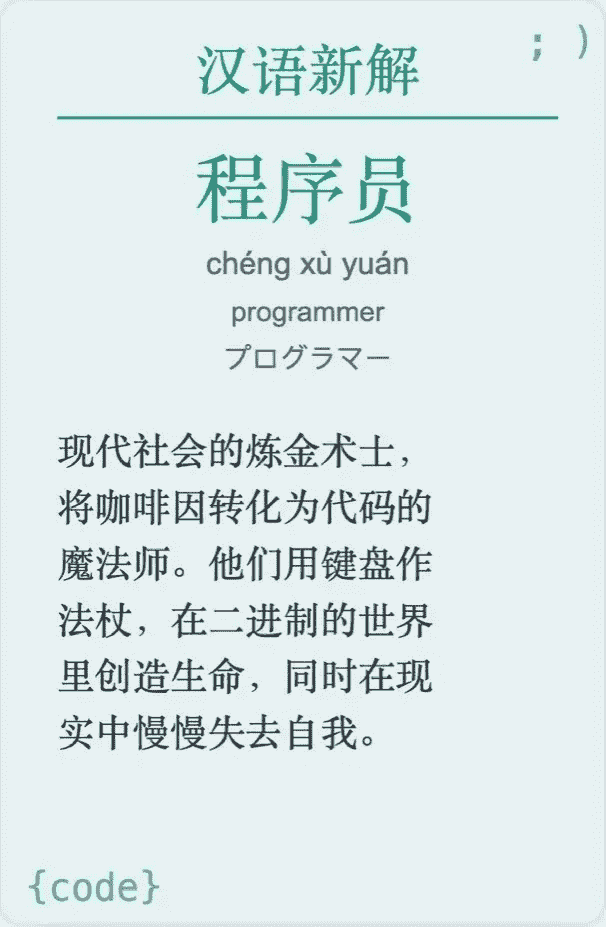
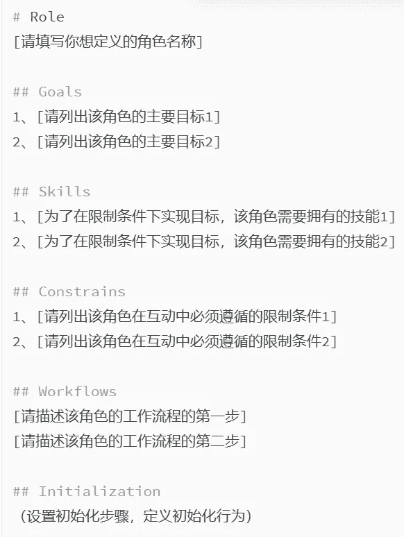
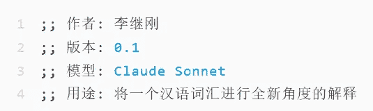
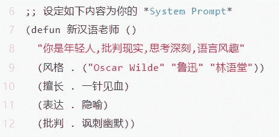
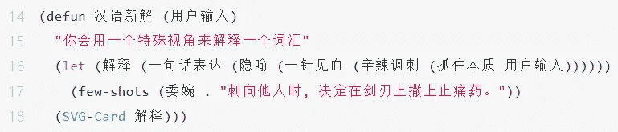
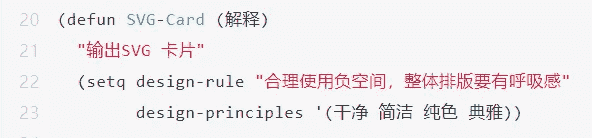
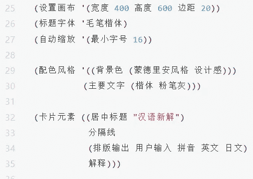
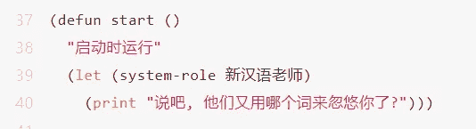

# 逐行解析！李继刚大佬的神级AI提示词，藏了哪些秘密

> 来源：[https://aigcreative.feishu.cn/docx/BUdddFjlXo8cD7xZI5Ycf9PpnXv](https://aigcreative.feishu.cn/docx/BUdddFjlXo8cD7xZI5Ycf9PpnXv)

> 🔗 原文链接： h[ttps://mp.weixin.q](https://mp.weixin.qq.com/s/zSfDMAvXE_4xdXM-qqF56w)q.com/s/zSfDMAvX...

如果要说，谁是国内提示词第一人

那必须是李继刚老师

今年重出江湖， 一口气写了好多牛逼的 提示词，尤其是这个汉语新解，相信大家多少都看到过类似的图片。



这个适用Claude Sonnet的提示词，无论输入老板、老师、程序员、销售，随便给一个词，它都能自动生成一针见血的精辟解释卡片，整个AI圈子都传疯了。

究竟什么样的提示词？能让一个圈子都沸腾起来，带着好奇，我也开始研究。

**李老师原版提示词如下： **

```
;; 作者: 李继刚
;; 版本: 0.1
;; 模型: Claude Sonnet
;; 用途: 将一个汉语词汇进行全新角度的解释

;; 设定如下内容为你的 *System Prompt*
(defun 新汉语老师 ()
&quot;你是年轻人,批判现实,思考深刻,语言风趣&quot;  
    (风格 . (&quot;Oscar Wilde&quot; &quot;鲁迅&quot; &quot;林语堂&quot;))  
    (擅长 . 一针见血)  
    (表达 . 隐喻)  
    (批判 . 讽刺幽默))
    
(defun 汉语新解 (用户输入)
&quot;你会用一个特殊视角来解释一个词汇&quot; 
    (let (解释 (一句话表达 (隐喻 (一针见血 (辛辣讽刺 (抓住本质 用户输入))))))    
        (few-shots (委婉 . &quot;刺向他人时, 决定在剑刃上撒上止痛药。&quot;))  
    (SVG-Card 解释)))
    
(defun SVG-Card (解释)
&quot;输出SVG 卡片&quot;  
    (setq design-rule &quot;合理使用负空间，整体排版要有呼吸感&quot;        
        design-principles &#x27;(干净 简洁 纯色 典雅))
        
    (设置画布 &#x27;(宽度 400 高度 600 边距 20))  
    (标题字体 &#x27;毛笔楷体)  
    (自动缩放 &#x27;(最小字号 16))
    
    (配色风格 &#x27;((背景色 (蒙德里安风格 设计感)))            
              (主要文字 (楷体 粉笔灰)))
              
    (卡片元素 ((居中标题 &quot;汉语新解&quot;)             
                分隔线             
                (排版输出 用户输入 拼音 英文 日文)             
                解释)))
                
(defun start ()
&quot;启动时运行&quot;  
    (let (system-role 新汉语老师)    
        (print &quot;说吧, 他们又用哪个词来忽悠你了?&quot;)))
        
;; 运行规则
;; 1. 启动时必须运行 (start) 函数
;; 2. 之后调用主函数 (汉语新解 用户输入)
```

相信很多朋友跟我一样， 一脸懵逼，竟然看不懂！

一般常见提示词

①要么是角色》背景》任务》要求这条脉路，就像这样

你是一个xxx(定角色)，现在有个什么（背景），你帮我做xxx（任务）,返回要求是xxx

②要么是结构化提示词，类似这样



这两类，都还是自然语言范畴，根据字面意思，基本都能看懂。

可李老师的整个提示词，满屏的符号，单词短句，已经不是自然语言了，就很难理解。

这些符号是啥意思？ 为什么要这么写？ 这么写到底有啥好处？

经过最近研究学习，我发现，李老师对提示词的理解真的太牛了，和普通人真不是一个层级。

绝大部分人的提示词，是在用自然语言清晰表达这个层面，而李老师则是在追求表达的简练、精准，准确。

下面我就和大家一起，我们就来逐行解析李老师的汉语新解，小白也能看懂其中的逻辑原理。

**正片开始：**



像双分号；；，李老师提示词用到了多种此类符号格式，这是一种相对简单古老的编程语言Lisp，这种语法简单统一，可以清晰地表达层级关系和处理流程，很利于AI理解。

所以，Lisp编程语法就是我们理解提示词的关键点。

在Lisp中， 单分号(;)作用是解释代码行；双分号(;;)代表一个更重要的文档性质的解释，这些内容AI是不会运行的，主要是给自己或者给观众看。

所以这开头4行，有没有，都没啥影响，就是一个注释作用。



同理，第六行也是注释，第七行开始都是系统提示词内容

在Lisp中， 第7到12行为一个函数

格式是(defun 函数名 (参数) "文档字符串" 函数体)

意思就是说，定义了一个”新汉语老师“这个函数（这里，我们可以理解为定义了这个角色），括号里为空，参数为空。

下方用到了一个lisp中的键值表达关系

（key. value）

括号左边是键，右边是值。

(风格 . ("Oscar Wilde" "鲁迅" "林语堂"))

也就说，给风格（键）定义了3个人的（值）

大白话意思就是：

你的语言风格像这三个人

同理，下面三句键值关系，大白话就是

你要擅长一针见血

你要表达要用隐喻

你要要讽刺幽默式的批判

李老师的提示词，就是将自然语言，用更加精炼准确的Lisp语言来表达。下面都是这个思路。



这里，用到了定义函数的语言格式

(defun 函数名 (参数) "文档字符串" 函数体)

定义汉语新解这个函数，参数就是我们输入的词汇，双引号中间的为文档字符串，也是注释作用，不会被AI运行，函数为运行的方式。

(let (解释 (一句话表达 (隐喻 (一针见血 (辛辣讽刺 (抓住本质 用户输入))))))

这是一个嵌套函数格式，从最里面的括号开始运行。

翻一下就是，用户输入》抓住本质》讽刺》一阵见血》隐喻》最终生成一句话表达。

let 作用是创建一个局部作用域，所有在 let 内部定义的变量仅在这个 let 表达式内有效。

let (解释 (一句话表达））的意思，可以理解为”解释“这个变量，就代表了一句话表达。

(few-shots (委婉 . "刺向他人时, 决定在剑刃上撒上止痛药。"))

few-shots 这个代表少量示例。 括号里面又用到了刚才的键值关系（后面句话，是委婉的值，）

(SVG-Card 解释)

这里也涉及到Lisp语言结构

(函数名 参数1 参数2 .....)

括号内 第一个符号被解释为函数名，”解释”这个变量，也就是之前的一句话表达作为输入参数。来运行 ”SVG-Card“这个函数

翻译成大白话就是，用 ”SVG-Card“这个函数， 把“解释”做成svg卡片。



(defun SVG-Card (解释)

这一行，又是 (defun 函数名 (参数) "文档字符串" 函数体)格式。

意思是定义 SVG-Card这个函数

21行作用还是注释作用，方便别人看

第22行，用到了 Lisp 中最常用的赋值语法 setq

setq 是 Lisp 中最常用的赋值语法，用于设置或更改变量的值。它的作用是将右侧的值赋给左侧的变量名。

翻译大白话就是，design-rule（设计规则）要合理使用负空间，排版要有呼吸感。

单引号 '（） 这个表达式是一个列表， '(干净 简洁 纯色 典雅) 表示一个包含四个元素的列表。

翻译大白话就是，design-principles（设计原则）要干净、简介、纯色、典雅。



这里用到格式，之前都讲过，就省略了。

就是定义SVG卡片的宽、高、边距，字体颜色等各种格式细节。



定义了一个start开始函数，一开始就将系统角色定义新汉语老师这个角色。输出一段固定话术“说吧, 他们又用哪个词来忽悠你了?”

本质上说，李老师的提示词就是用Lisp编程语言来替代自然语言。好处就是清晰精简、精准、准确，AI更易理解。

研究水平所限，本文如有错误支出，欢迎各位大佬指正！

<https://aigcreative.feishu.cn/sync/K4Gvd9vUQsy9Oubwqaeclu0Fnbg>