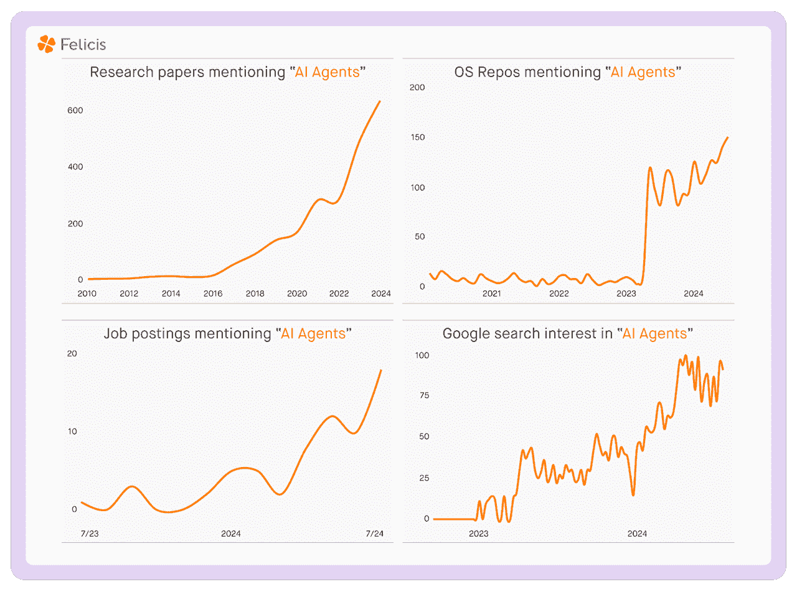
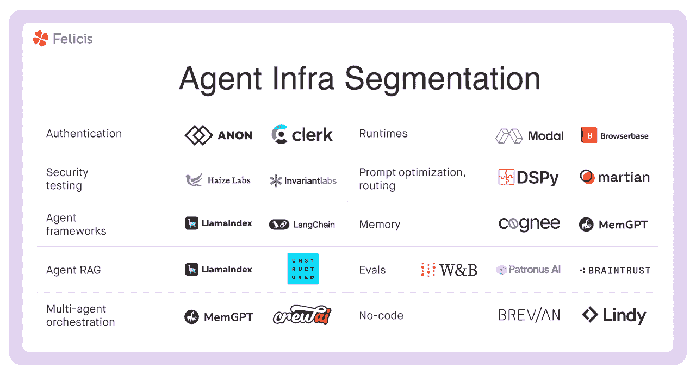

# AI 智能体的崛起

> 来源：[https://aigcreative.feishu.cn/docx/BDtIddEjqoRY6VxzEk0cIQ89nRb](https://aigcreative.feishu.cn/docx/BDtIddEjqoRY6VxzEk0cIQ89nRb)

> 原文链接：https://www.felicis.com/insight/the-agentic-web

> 翻译：AIGC创意猎人

我们已经关注智能体 [一段时间了](https://www.felicis.com/insight/ai-agent-abstraction)，最近我们注意到关于 AI 智能体的搜索量、开源库、职位发布和研究论文的关注度明显上升。我们还观察到提到 AI 智能体的广告数量也在急剧增加。

这些图表表明对 AI 智能体的兴趣正在上升。为了满足这一未来需求，一个专门的智能体基础设施生态系统正在逐渐成型。

## AI 智能体基础设施

为了让智能体实现其潜力，我们需要的不仅仅是基础模型。当与合适的支持基础设施相结合时，像 Llama 3.1 405b 和 GPT-4o 这样的模型已足够强大，可以支持第一波 AI 智能体。我们在下方绘制了围绕基础模型的新兴基础设施生态系统：

### **认证:**

[Anon](https://www.anon.com/) 提供强大的认证机制，以验证 AI 智能体的身份并管理其访问权限。这可能会使 AI 智能体能够在未来代表您登录网站，免去手动预订航班的麻烦。

### **安全:**

[Invariant Labs](https://invariantlabs.ai/) 正在构建 AI 系统与现实世界之间的安全层。这对于建立用户信任至关重要，而“LLM 安全”是一个不断变化的目标。

### **智能体框架:**

[Langchain](https://www.langchain.com/) 和 [LlamaIndex](https://www.llamaindex.ai/) 是领先的智能体开发框架，为数百万开发者打开了构建智能体应用程序的大门。Databricks、Instacart 和 Adyen 等财富500强公司已经在与 Langchain 合作。

### **智能体 RAG:**

LlamaIndex 和 [Unstructured](https://unstructured.io/) 使 AI 智能体能够利用实时数据和上下文相关信息增强响应能力。RAG 是几乎所有成功智能体部署中的关键组件。

### **多智能体编排:**

多智能体系统将子任务委派给链式操作中的专业智能体。这种架构在处理复杂查询方面被证明是至关重要的。

### **运行时:**

[Modal](https://modal.com/) 和 [Browserbase](https://www.browserbase.com/) [提供环境和](https://x.com/pk_iv/status/1810338948440633622)资源，以最低的延迟和最高的可扩展性执行任务。Browserbase 的无头浏览器最近几个月 被迅速采用，赋予智能体浏览网页的能力。

### **路由:**

Martian 将用户查询路由到不同的模型，从而降低使用 LLM 的总成本。DSPy 在将提示词输入模型之前会自动优化提示词，以获取最佳响应。这两家公司广义上都属于优化领域。

### **记忆:**

[MemGPT](https://memgpt.ai/) 为 AI 智能体创建并维护记忆，使其能够在长期内保留上下文并从先前的互动中学习。具备记忆功能的智能体将创造更加个性化的体验。

### **评估:**

[Weave](https://wandb.ai/site/weave/)，由 Weights & Biases 创建的工具，允许开发者通过严格的测试和反馈循环来监控、测量和改进 AI 智能体的性能。在所有智能体基础设施领域中，这一类别获得了最明确的产品市场契合信号。

### **无代码智能体:**

[Brevian](https://brevian.ai/) 使商业用户能够在不需要编程知识的情况下创建和部署 AI 智能体，从而将定制智能体带给大众。

此时，值得退一步思考，“智能体与传统自动化有何不同？”一位创始人在最近与 Felicis 的对话中总结道：智能体能够很好地处理边缘情况，与用户反复对话以达到预期结果，并适应不[断变化的界面。这些](https://www.youtube.com/watch?v=Dc99-zTMyMg)能力对于创建无缝的用户体验至关重要，在这种体验中，AI 智能体能够可靠且大规模地执行任务。CrewAI 的 CEO 在今年的 AI 工程师世界博览会上进一步探讨了这一观点，并发表了 一场充满活力的演讲。

为了让 AI 智能体在没有超智能基础模型的情况下顺利运行，还必须考虑其他前提条件。我们所见到的最佳智能体应用程序通常基于规则、手册或标准操作程序。换句话说，AI 智能体的操作空间应该受到约束。像 Norm、Altera 和 Cleric 这样的公司很好地体现了这一趋势：明确的规则可以防止 AI 智能体偏离轨道。有效的智能体应用程序往往还能够访问结构化的专有数据。简而言之，智能体需要合适的上下文来执行复杂任务。在满足这些条件并解锁上述智能体的辅助功能后，现在已经具备了创建出色智能体应用程序的所有构件。在接下来的12个月里，势头将决定性地转向应用程序开发。

## 我们看到的智能体机会

我们认为智能体的采用将分阶段进行。第一阶段涉及基于文本的工作流，如市场营销、律师助理、SDR、SRE、医疗文书和支持智能体。接下来，我们将看到更复杂的多模态应用场景，如建筑、游戏、安全和教育领域。这也是我们支持一家即将宣布的开源视觉语言模型公司（VLM）的动机之一！另一个需要考虑的因素是数据隐私。我们认为智能体在医疗保健、金融服务和合规等受监管行业的采用速度将比非受监管领域更慢。一种将这一挑战转化为优势的方法是建立一个顾问委员会，为您的初创公司增添可信度。Norm 在这方面表现得非常出色。

### 我们正在探索的一些领域：

1.  **建筑师:** 建筑公司70%以上的成本都花在了计算机工作上。多模态智能体将帮助在几秒钟内完成建筑设计草图，自动化处理初级建筑师的大量手工工作。

1.  **律师助理:** 法律智能体将处理起草、发现、合同管理等工作。一位律师告诉我们，他合作的初创公司已经承担了他三分之一律师助理团队的工作。

1.  **医疗管理:** 智能体可以充当虚拟文书，记录患者互动并管理行政任务，为医生和护士腾出更多时间。这个领域中的一家公司预计今年收入将增长10倍。

1.  **幕僚长:** [60%的工作时间花在协调上](https://www.runn.io/blog/time-management-statistics#distraction-and-time-management-statistics)。AI 幕僚长将管理日程安排、优先处理任务，并处理与其他智能体的互动。就像1990年代每个人都有了电子邮件地址一样，未来每个人都会有一个 AI 执行助理。

1.  **合规分析师:** 合规智能体将自动监控法规，确保公司的活动符合最新的法律要求。合[规失误可](https://www.norm.ai/post/building-regulatory-ai-agents)能导致数百万美元的罚款，AI 智能体可以帮助解决这一问题，特别是在应对 监管阻力 方面。

1.  **财务分析师:** 财务智能体将跟踪支出、生成财务报告，并提供有助于预算[和投资决策的见](https://finster.ai/)解。这里的一家出色公司是 Finster。

1.  **招聘人员:** 招聘人员将三分之一的时间用于寻找候选人。类似于 SDR，AI 招聘人员将筛选简历、安排面试，并处理招聘人员的初步筛选。

1.  **系统可靠性工程师:** 开发人员将30%的时间用于审查漏洞。AI 智能体将监控系统性能，预测潜在故障，并自动启动纠正措施以保持最佳可靠性和正常运行时间。

如果您正在创建专注于这些垂直领域的初创公司——或者我们可能遗漏的领域——请让您的 AI 智能体联系 james@felicis.com。

智能体代表了人机交互的下一个前沿领域，而今天正在为智能体主导的网络奠定基础。

<https://aigcreative.feishu.cn/sync/K4Gvd9vUQsy9Oubwqaeclu0Fnbg>