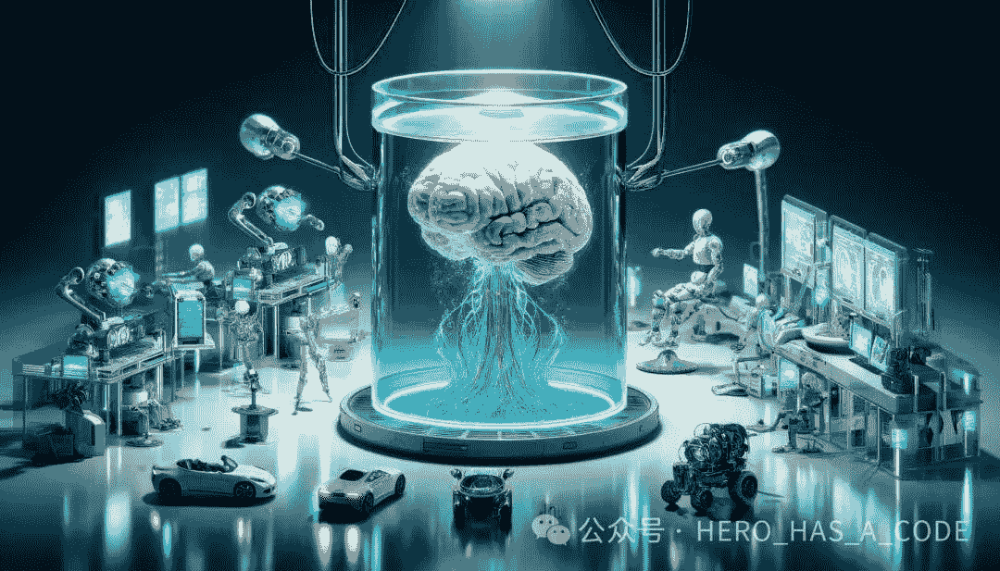
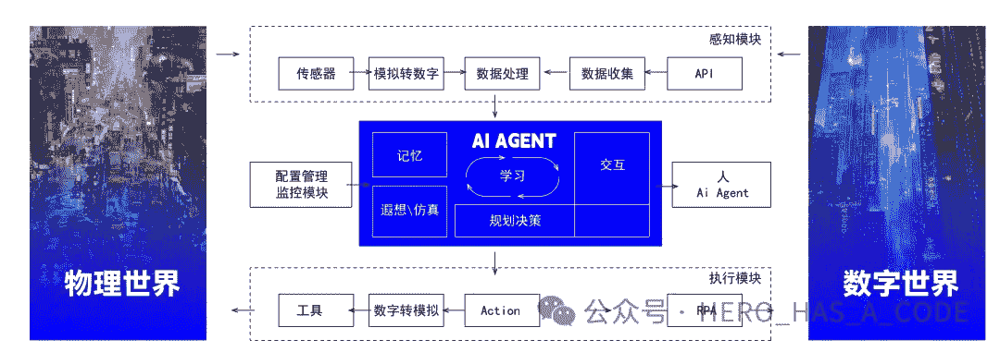
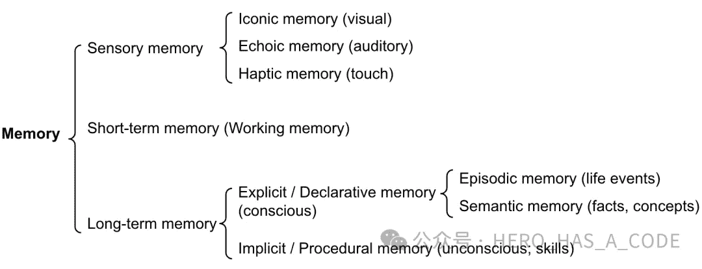
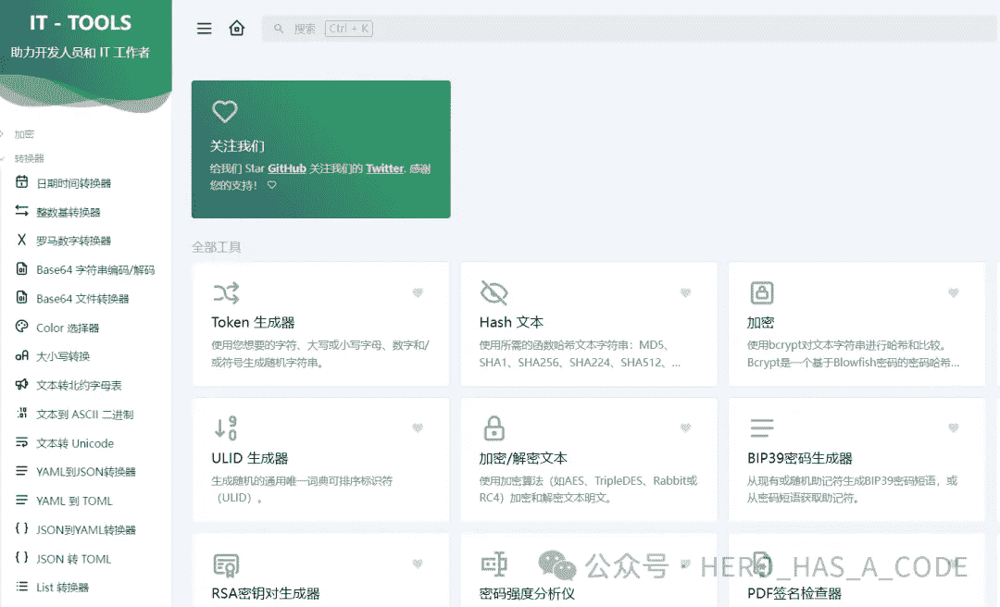
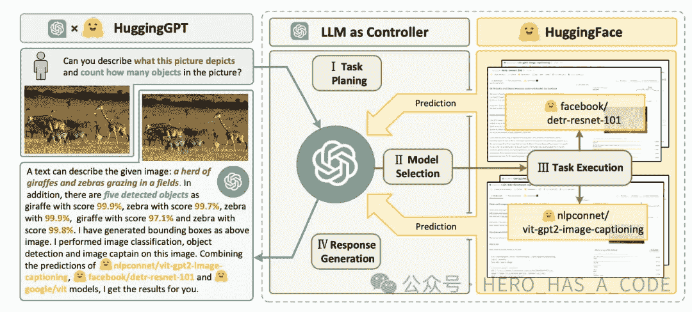
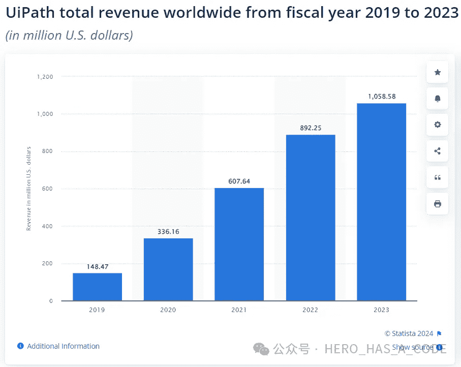
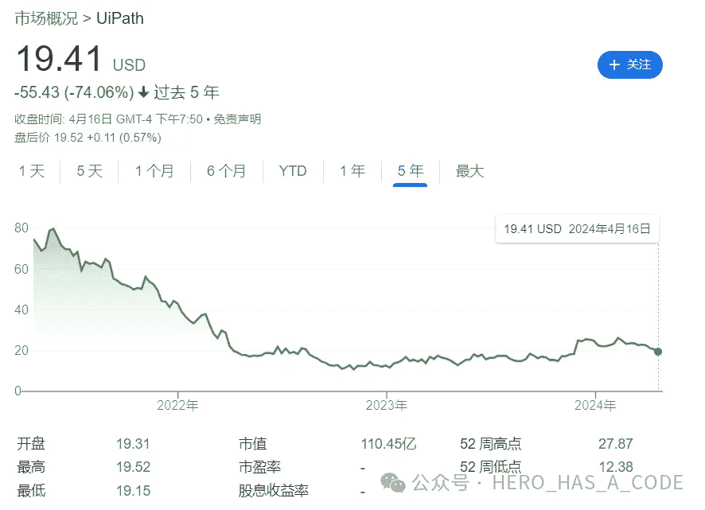

# 万字解读AI Agent架构体系，API和RPA将成为重点

> 来源：[https://aigcreative.feishu.cn/docx/FIK3dbsdloX4BOxFXPZcnWzLnwb](https://aigcreative.feishu.cn/docx/FIK3dbsdloX4BOxFXPZcnWzLnwb)

> 来源：👸号-信息化与数字化

> 链接：https://mp.weixin.qq.com/s/KHixK7cybsH9WXnBsohObg

与提示词、微调等大模型应用相比，AI Agent的独特之处在于其不仅能为用户提供咨询，还能直接参与决策与执行环节。Agent能够落地的核心在于。此一进步的核心在于，任务规划这一关键环节被完全委托给了AI大模型。这基于一个前提：AI大模型具备深刻洞察与感知世界的能力、丰富的记忆存储、高效的任务分解与策略优化、持续的自我反思与内在遐想，以及灵活运用各类工具的技能。

人类今天用对话的方式跟大模型沟通，相当于大模型只有耳朵和嘴巴，能够接收文字的信息，但是缺乏“眼睛、耳朵和手脚”，在这种局限下大模型更像是一个“缸中之脑”。在很多场景中大模型只能作为一个参谋，而不能对事务的发展起到决策的作用。在探讨AI Agent的独特价值时，我们不可避免地会触及到其与大语言模型的本质区别。

上面这篇文章中作者指出，尽管大语言模型在文本生成和图像处理等任务上取得了显著成就，但它们在理解能力上与生物体的感觉运动经验和对世界的基础理解仍存在本质的差异。这种差异的核心在于，生物体的学习过程是通过与世界的有目的互动和预测行动后果来进行的，而大语言模型则主要通过被动地摄取和处理大量数据来优化其模型权重。文章进一步阐述了人类的大脑不仅仅是知识的积累器，更是与世界进行交流的控制中心。人类通过语言交流将交互推向了抽象的极端，但其基础仍然是对交互控制的理解和应用。我们对语言符号含义的掌握，并非单纯源于我们处理自然语言的能力，而是源于我们通过与生活世界的持续互动所积累的更为基础的理解。当前的生成式人工智能系统，尽管在模仿人类语言和行为上取得了一定的进展，但它们的“理解”本质上是被动的。它们能够从大型数据集中提取和反映统计规律，但却难以捕捉到这些数据背后的因果关系。这种局限性意味着，如果没有主动选择观察结果和在训练过程中进行干预的能力，生成式AI可能永远无法建立起行动和效果之间的因果模型，也无法真正理解预测与观察之间的区别。

AI大模型要能够模拟人类智能在真实世界中的复杂交互，这要求它不仅要处理信息，还要能够感知环境、做出决策并执行任务。AI大模型需要将现实世界的交互与感觉运动预测结合起来，从而实现更高级别的人工智能。

首先，AI Agent通过接收来自外部世界的数据（如环境传感、用户输入等）来感知其所处的环境。通过各类传感器、物联网设备AI可以从物理世界获得信息，通过API接口AI可以从数字世界获取信息。这相当于人类的感觉器官，是智能体与世界建立联系的基础。

处理和分析这些数据之后，AI需要有一定的记忆能力，将当前的环境信息与历史上的决策对比。AI Agent需要具备决策能力，能够基于当前的环境和内置的目标来规划下一步行动，并且在仿真环境中模拟出决策后可能的结果。这类似于人类的大脑思考过程，涉及到理解、规划和解决问题的能力。

决策之后，AI Agent需要将决策转化为实际的动作，可能是通过机械动作操控物理设备，或者是通过API和RPA与其他系统交互。系统交互。执行后的结果又会被用作新的输入，形成一个闭环反馈系统，确保智能体可以适应并优化其行为。

AI Agent不仅是处理信息的工具，更是具备自主学习、适应和创新能力的智能实体，能够在复杂多变的环境中自我优化，并实现目标的有效达成。

##### 下面我们对AI Agent的主要模块做一个拆解，包括配置感知模块、

##### 管理与监控模块、记忆模块、规划模块、遐想/仿真模块、原生交互模块、学习模块、执行模块。

# **感知功能**

负责从环境中收集数据，可以是图像、声音、文本等形式。感知模块使用传感器（在物理世界中）或数据获取接口（在数字环境中）来收集信息，并可能使用预处理技术如图像识别、自然语言处理等来分析和理解这些数据。

在人工智能系统中，感知模块（Perception Module）起着至关重要的作用。它是AI与外部世界沟通的桥梁，负责捕捉、处理和解释环境中的各种信号。这一模块模拟了人类的感官系统，如视觉、听觉和触觉，使得AI能够“感知”周围的世界，理解环境，并在此基础上作出反应。

感知模块通过各种传感器和数据接口来收集信息。这些传感器可以是相机、麦克风、温度传感器、湿度传感器、GPS定位器等，用于捕获图像、声音、温度、位置等信息。在数字环境中，数据获取接口则可能涉及到网页爬虫、API调用、数据库查询等方式，用于获取文本、数字和其他类型的数据。

收集到的原始数据通常需要经过预处理才能用于后续的分析和理解。预处理步骤可能包括噪声去除、数据标准化、特征提取等。例如，图像识别中的预处理可能包括调整图像大小、改变对比度、边缘检测等，以便更好地识别图像中的对象。在自然语言处理（NLP）中，预处理可能包括分词、去除停用词、词性标注等步骤，以提取有用的信息。

预处理之后的数据需要通过更高级的分析来解析和理解。这一步骤可能涉及到机器学习模型和算法，如深度学习、模式识别等。通过这些技术，AI可以识别图像中的对象、理解语音命令的含义、分析文本的情感倾向等。这些能力使得AI能够从原始数据中提取有意义的信息，并将其转化为可用于决策和行动的知识。

例如在自动驾驶中，人工智能可以利用摄像头、激光雷达和麦克风等传感器收集周围环境的信息，通过图像识别和对象检测技术来识别车辆、行人、交通标志等，以实现安全驾驶。

# **配置管理与监控模块**

配置管理与监控模块（Profile Management and Monitoring Module）是AI Agent体系中的关键组成部分，它承担着监视、评估和调整AI性能的重要职责，确保AI系统能够稳定且安全地运行，同时也符合预定的性能和行为标准。此模块的功能不仅涉及到实时监控和异常处理，还包括对AI的价值观进行对齐，以及通过连续的测试和校准来优化AI的表现。

核心职能：

+   代理生成策略：结合随机组合策略，并利用真实世界的性格统计、心理学和行为分析体系数据，创造多样化的AI代理配置文件。这些方法既保证了代理的真实性和多样性，又提高了系统模拟复杂社会交互的能力。

+   代理角色的定义与管理：设定和管理AI Agent的角色特性，包括其目标、能力、知识库和行为模式等。这使得每个AI Agent都能根据其独特的配置文件在特定环境中发挥作用，在思考和行动上贴近用户的真实需求，同时也增加了系统的灵活性和多样性。

+   评估测试和AI价值对齐：通过不断的测试和反馈循环，确保AI Agent的行为与人类价值观和目标保持一致，避免产生不利于用户或社会的结果。通过不断的性能评估，对AI系统进行微调，提升其适应性、准确性和用户满意度。

+   人工微调：人工微调功能允许管理员直接干预和调整AI Agent的神经网络和知识体系，通过这种方式管理员可以针对特定的问题或场景，对AI的行为和决策逻辑进行细致的调整和优化。

+   性能监控与异常处理：实时监测AI Agent的运行状况，及时识别和解决性能下降、错误行为或异常情况，保证系统的稳定运行。这包括对AI Agent的响应时间、准确率、资源消耗等关键性能指标的跟踪。

+   安全性管理：确保AI Agent在数据处理和决策过程中的安全性，防止数据泄露、恶意攻击和滥用等风险。

# **记忆模块**

AI Agent的记忆模块是一个研究的热点，这不仅因为它在智能体的学习和决策过程中扮演着核心角色，也因为它体现了智能体适应和进化的能力。在OpenAI应用人工智能研究负责人Lili Weng的博客文章《LLM Powered Autonomous Agents中，将AI Agent的记忆模块分为三个主要类型：感觉记忆、短期记忆（STM或工作记忆）和长期记忆（LTM），每种类型都有其独特的功能和实现机制。

感觉记忆是AI Agent处理原始输入数据的第一站，类似于人类的感觉信息处理。它能够短暂保留来自外部环境的感觉数据，如视觉、听觉或触觉信息。尽管这类记忆的持续时间非常短，仅几秒钟，但它是智能体对复杂环境做出快速反应的基础。

短期记忆或工作记忆，在AI中相当于模型的内存，处理当前的信息流。这类记忆类似于人类的意识处理，具有有限的容量，通常被认为是围绕7个项目的信息（根据Miller的理论），并能维持20到30秒。在大型语言模型（如Transformer模型）中，工作记忆的容量被其有限的上下文窗口所限制，这决定了AI能够直接“记住”和处理的信息量。

长期记忆为智能体提供了几乎无限的信息存储空间，允许它们存储和回忆长时间跨度内的知识和经验。长期记忆分为外显记忆和内隐记忆两种子类型。外显记忆涵盖对事实和事件的记忆，这些记忆可以有意识地回忆起来，包括语义记忆（事实和概念）和情景记忆（事件和经历）。内隐记忆则包括技能和习惯，如骑自行车或打字，这些是无意识学习的结果。

AI Agent的长期记忆通常通过外部数据库或知识库实现，使得智能体能够在需要时快速检索到相关信息。这种外部向量存储的实现，挑战在于如何高效组织和检索存储的信息。为此，近似最近邻搜索（ANN）算法被广泛应用于优化信息检索过程，即使在牺牲一定准确性的情况下，也能显著提高检索速度。

记忆模块的设计对AI Agent的性能有着决定性的影响。有效的记忆系统不仅提高了智能体处理和存储信息的能力，也使其能够从过去的经验中学习，从而适应新的环境和挑战。同时，记忆模块的研究还带来了深层次的问题，如如何平衡记忆的容量与检索效率，以及如何实现记忆的持久性与可靠性。未来，随着AI技术的不断进步，我们可以期待更加高效、灵活的记忆模块，为智能体提供更强的学习和适应能力，从而在各种复杂环境中发挥出更大的潜力。

# **规划功能**

规划与决策模块（ Planning and Decision Making Module）是人工智能系统中的核心组件，赋予AI在复杂和不确定环境中制定有效行动策略的能力，，以实现其既定目标。从自动驾驶汽车在繁忙交通中的实时决策到医疗AI在庞大数据中寻找治疗方案，高级的规划与决策能力对AI代理至关重要。这不仅包括基本的目标设定与分析，决策制定，还包括对未来的预测、风险评估以及在多种可能性中进行权衡，优化AI的行为和策略等。

## **目标设定与分析**

在制定任何行动计划之前，首先需要明确AI系统的目标。这些目标可能是预先设定的，也可能是根据实时数据和环境变化动态生成的。一旦目标确定，决策与规划模块就会分析认知模块提供的信息，包括环境状态、目标条件、可用资源等，来制定实现目标的最佳路径。

## **环境理解与预测**

决策与规划模块需要对环境有深刻的理解，这包括当前环境的状态及其可能的变化。在不确定性和动态变化的环境中，模块需要评估外界的变化，以及各种因素如何影响未来的状态。。这一挑战要求AI系统利用先进的数据分析技术、机器学习模型和算法，对大量历史数据进行深入分析，从而预测未来环境状态的可能变化。特别是在如气候变化、股市波动等高度不确定性领域，这一能力显得尤为关键。通过对环境的深刻理解和准确预测，AI能够在制定决策和规划时，考虑到潜在的风险和机遇，从而制定出更为稳健的行动策略。

## **资源消耗与工具评估：**

最合适的规划永远是基于适当的资源约束的前提下。AI Agent在决策制定过程中，必须综合评估多方面因素，这包括资源的消耗、工具的性能，以及执行任务所需的成本。

AI Agent需要对可用资源进行详尽的分析，类似于人类在购买商品之前会比较价格、性能和功能，AI在执行任务前需要评估不同选项的资源消耗。例如，在进行数学运算时，AI需要考虑使用本地计算器、编写Python代码执行运算，或是直接利用神经网络的计算能力，这些方法的资源消耗和运行时间可能大相径庭。选择最合适的工具不仅影响计算的速度和效率，还关系到整体系统的能源消耗和成本效益。

此外，AI Agent需要对不同的AI模型进行评估，了解它们在不同场景下的性能表现和资源消耗水平。AI Agent应当熟悉每种模型的特点，比如它们在特定测试中的表现、解决特定问题的能力、以及执行推理时所需的显存和能量消耗，从而把AI大模型也当成一种常用的工具来调用。

## **决策制定**

基于对目标和环境的理解，决策与规划模块将评估不同的行动方案。这一过程涉及到权衡各种方案的优缺点、风险和收益，以及它们实现目标的可能性。在许多情况下，需要使用优化算法来寻找最优或接近最优的解决方案，这可能包括启发式搜索、动态规划、蒙特卡洛树搜索等方法。

AI规划能力的多样性是其应对复杂任务的关键。我们将其大致分为两类：不依赖反馈的计划和基于反馈的计划。

+   不依赖反馈的计划，通常在环境相对稳定和可预测时使用。例如，单路径推理沿预设路径执行任务，适用于结果可预见的场景。相对地，多路径推理构建了一个决策树或图，为不同情况提供备选方案，增加了决策的灵活性和应对突发事件的能力。

+   基于反馈的计划，则适用于那些需要根据环境反馈动态调整的场景。这类计划利用实时数据和反馈来重新评估和调整规划策略，以适应环境的变化。反馈可以来源于任务执行结果的客观数据，也可以是主观评估或由辅助模型提供。

## **规划与任务分配**

在确定了最佳行动方案之后，决策与规划模块需要将这一方案转化为具体的规划和任务分配。这一步骤尤为重要，特别是在多智能体系统中，需要考虑如何高效协调各智能体的行为，确保集体行动协同一致、效率最高。任务分配过程考虑个体能力、资源分配、时序安排等因素，确保计划的顺利实施。

思维链（Chain of Thought ) 和思维树 （Tree of Thoughts） 代表了AI在解决复杂问题时的一种进步思路，它们通过模拟人类的思考过程，将一个大任务分解为多个小任务，再通过逐步解决这些小任务来实现最终目标。这种方法不仅提高了问题解决的效率，也增加了解决方案的创新性。

另外通过大模型+规划的策略的策略，则展示了将AI技术与传统规划方法结合的新途径。通过将复杂问题转化为PDDL（Planning Domain Definition Language，规划领域定义语言），再利用经典规划器求解，这种策略能够在保证解决方案质量的同时，显著提高规划的效率和可行性。

## **应对不确定性与动态调整**

决策与规划模块还需要具备应对环境不确定性和动态变化的能力。这意味着AI系统必须能够监测环境的变化，并根据实时信息调整其行动计划。在某些情况下，这可能涉及到实时的决策调整，或者在遇到预期之外的情况时重新规划。AI的自我反思和动态调整能力是其适应性的核心。

ReAct 和 Reflexion 技术通过在规划过程中整合反馈循环，展示了AI如何在行动后评估结果，并基于这些评估进行自我优化。Chain of Hindsight (CoH) 则通过分析过去的行动和结果，对未来的规划策略进行微调，提高决策的精确度和效率。

随着更多前沿技术的融合与应用，AI Agent将在复杂性管理、决策优化以及适应性调整方面迈出更大的步伐，为各行各业带来革命性的变革。

# **遐想/仿真模块**

[《大语言模型无法实现具身认知》](https://mp.weixin.qq.com/s?__biz=MzA5MDMwMTIyNQ==&mid=2649386957&idx=1&sn=decdde2198c51adb5dbc74425c43b516&chksm=8813798bbf64f09da54a394594d7789221a1ab965fc94db5f93eb56e713429c861d02198f234&mpshare=1&scene=21&srcid=0416XAl4aQWG8UWzA7Rog6PH&sharer_shareinfo=e4cf6d2789dae2496584fd736005c032&sharer_shareinfo_first=e4cf6d2789dae2496584fd736005c032&version=4.1.3.6008&platform=win#wechat_redirect)这篇文章提出，由于缺少对物理世界和其规律的理解，大型语言模型无法达到与人类相同的智能水平。人类在思考和规划时经常能够直观感知到可能发生的结果，思考过程具有非常真实的“画面感”，并且在情绪上能够感知到事情发展的各种结果对自己的影响，从而做出更符合实际的决策。为了解决这一缺陷，我们提出了“遐想/仿真”模块的概念。这一模块的核心功能是在AI Agent进行实际行动前，模拟对真实世界的理解，通过模拟可能的未来场景和结果，来评估不同决策的后果。这种模拟不仅能增强AI的决策能力，还能提供一个安全的环境进行试错学习，类似于人类通过内心遐想或梦境进行的模拟活动。通过这种内部仿真，AI能在现实世界的反馈基础上进行学习和适应，并在一个受控的环境中优化其行为，从而提高其解决复杂问题和适应未知环境的能力。这种内部仿真机制使AI更加接近于具有高级认知功能的生物体，如人类，能够在行动之前通过内心模拟评估不同的可能性。即使在没有任何外界输入和需要做规划的时候，AI的“ 遐想/梦境”模块也可能会在低负荷的时候启动。这个模块将会利用AI至今所学习的所有信息，包括日间遇到的挑战、解决方案的尝试以及从这些经历中收集的反馈，随机来生成复杂的内部场景。这些场景不仅基于现实世界的数据，还会融入未尝试或是幻想中的元素，使得AI能够在完全控制的内部环境中“遐想”。

在这些“梦境”中，AI Agent可能会模拟一系列以前未曾面对的挑战场景，比如在火星上建立基地的全过程，或者设计一个完全由AI管理的生态系统。它也可能“梦见”与未来可能遇见的新技术或未知生命形式的互动。在这个过程中，AI不仅会试图找出解决方案，还会预测可能出现的问题，并探索如何优化现有的行动计划。

通过这种方式，“ 遐想/仿真”成为了一种强大的学习工具。AI可以在梦境中测试和改进其决策算法，而不必担心现实世界中的失败后果。这种内部模拟的过程允许AI在遇到实际情况之前，就已经有了应对的准备。此外，通过在梦境中探索各种可能性，AI能够发现新的解决方案和创新方法，这些在传统的学习环境中可能永远不会被触及。

Sora这样的文字生成视频的模型为AI“ 遐想/仿真”模块提供了基础，为开发物理和数字世界的高性能模拟器提供了支撑，在游戏制作、AR和 VR 等应用中提供底层基础，将是人工智能向着更高级别的智能进化的一大步。它不仅让AI能够在安全的环境中自我完善和进化，还能够让AI更加深刻地理解和预测复杂系统的行为。未来的AI将不仅仅是执行任务的工具，它们将成为能够自我反省、创新和梦想的智能实体，以全新的方式与人类社会互动和共生。

# 原生交互模块（Interaction  Module）

交互模块相当于AI Agent的原生沟通工具，类似于人类的说话、眼神和肢体语言等自然交流方式。它主要负责处理AI与用户或其他系统之间的直接交流，确保双方能够有效、准确地理解对方的意图和需求。这个模块通常涵盖了自然语言处理技术，用于解析人类语言的含义，生成响应的语言输出；同时，它也可能包括视觉和听觉识别技术，使AI能够理解非语言的交流信号。

通过自然语言处理，AI能够理解和生成人类语言，包括文字和口语，从而与用户进行自然交流。计算机视觉使得AI能够“看到”和理解视觉信息，识别用户的手势、表情等非语言信号。语音识别与生成技术为用户提供了直观、便捷的交互方式。多模态交互设计融合了文本、语音、视觉等信息，增强了交互的自然度和灵活性。而上下文理解能力则使得AI能够根据对话历史、用户偏好等信息做出更加精准和个性化的响应。交互模块使得AI能够与人类或其他AI进行自然而直接的交流，在沟通中获取更多的信息，对任务有更充分的理解，从而做出更好的判断和规划。

# **学习模块**

学习模块通过应用机器学习算法——包括强化学习、监督学习和无监督学习——使得AI能够分析过去的行动与结果，从而在复杂的世界中找到其立足之地。这些算法允许AI从成功和失败中提取教训，辨别哪些行为在给定条件下是高效的，哪些可能带来不利后果。这种能力，让AI能够自我完善，调整其内部模型以更准确地反映现实世界的动态性和复杂性。

将规划模块与学习模块的功能相结合，可以形成一个高度灵活和适应性强的系统。在这种系统中，规划模块不仅根据当前的学习模型来制定行动计划，还会根据执行过程中的实际结果和反馈来调整计划。同时，学习模块会分析规划执行的效果，调整其学习算法和内部模型，以优化未来的规划和决策过程。

在实现通用Agent的路径上，首先需要在特定场景下实现稳定表现的能力，然后通过不断扩展学习模块和规划模块的互动，使得Agent能够适应更广泛的环境和任务。举例来说，在我们学习数学时，最初阶段常常会背诵九九乘法表。如果每一道数学题都需要通过计算的方式去解题，相当于启动了大脑中的规划模块，但是这一过程能耗颇高。通过背诵，我们能够将常见的数学运算储存在短期的记忆模块中，以便在需要时能够迅速唤起，可以节省能源的消耗。随着不断的背诵和练习，常见的数学运算就像被编程进了我们的大脑神经一样，无需经过复杂的思考过程就能快速给出答案。对于AI Agent而言，这个过程等同于通过经验学习和反复实践，使其内部模型进行微调，从而更加高效地执行任务，相当于是把常用的任务规划能力固化为大脑内部的工具。

AI Agent学习的另一个很重要的方向，就是学习使用外部的工具，从而以更低的能源消耗完成特定的任务。当AI开始接触一个新工具或另一个AI Agent时，它首先需要了解这个新“对象”的基本功能和操作方式。这一步类似于人类初次学习如何使用一件工具时的探索阶段。AI通过观察、实验和从过往的经验中汲取教训，逐步建立起对工具或伙伴行为的初步理解。这个过程可能涉及到大量的试错，但正是这些试错为AI提供了宝贵的学习机会。AI通过不断的实践和环境反馈，开始形成更加复杂的策略来高效地利用工具或与其他AI合作。它可能会发现特定的工具组合能够解决之前无法克服的问题，或者通过与特定AI Agent的协作，能够大大提高任务完成的效率和质量。

AI的学习不仅限于单一任务或环境，而是展现出了对学习策略本身的理解，去学习如何有效的学习。它们开始识别哪些学习方法最有效，哪些需要调整，这种自我反省的能力让AI能够针对不断变化的挑战进行优化。进一步地，当AI能够分享其学习到的知识和经验时，整个AI社群的进步速度将大大加快，这种知识共享机制不仅加速了单个AI的成长，也推动了整个领域的前进。当AI系统掌握了如何灵活运用各种工具和资源，以及如何与其他智能实体高效合作时，它们就能够处理更复杂的问题和任务，展现出前所未有的创新和解决问题的能力。

# 执行模块（Execution Module）

执行模块，则更像是AI使用的“外部工具”，旨在将决策和规划转化为具体的行动。这包括在物理世界中控制机械臂、移动设备等硬件操作，以及在数字世界中通过RPA类似的工具来启动程序、发送信息等软件操作。执行模块的作用，类似于人类使用工具来扩展自身的生理能力，通过工具实现目标的达成。例如，当一个人使用锤子敲打钉子时，锤子成为了延伸人类能力的工具；同样，当AI需要在物理世界中执行任务时，执行模块会控制相应的硬件或者软件来完成这些任务。执行模块的关键在于它能够将AI的虚拟决策转化为现实世界中的实际影响。

AI代理的工具使用能力和协作是一个备受关注的话题。人类之所以与众不同，是因为我们能够创造、修改并利用外部工具来完成超越我们生理能力的任务，对工具的使用可能是人区别于动物的最显著的特征。现如今，研究者们致力于赋予AI代理类似的能力，以拓展模型的应用范围和智能程度。

近期的研究表明，通过给予语言模型（LLMs）外部工具的使用能力，可以显著提升其性能。例如，一些研究团队利用“Modular Reasoning, Knowledge and Language”（MRKL）系统，将LLMs与各类专家模块相结合，使其能够调用像数学计算器、货币转换器和天气API等外部工具。这些模块既可以是神经网络模型，也可以是符号模型，从而为LLMs提供了更多的工具选择，以应对不同领域的任务需求。例如，下面的开源工具提供了一系列的IT工具，可以方便大模型进行调用。

https://github.com/CorentinTh/it-tools

然而，尽管外部工具的使用能力为AI代理带来了巨大的潜力，但在实际应用中也面临着一些挑战。一些研究发现，LLMs在处理口头数学问题时存在一定的困难，这表明了在何时以及如何使用外部工具的重要性。因此，研究者们提出了一些新的方法，如“Tool Augmented Language Models”（TALMs）和“Toolformer”，以帮助LLMs学习如何使用外部工具API。这些方法通过扩展数据集，使LLMs能够根据新添加的API调用注释来改进模型输出的质量。

另一方面，一些实践性的应用也在不断涌现，如ChatGPT插件和OpenAI API函数调用，它们充分展示了LLMs与外部工具使用能力的卓越潜力。例如，2023年4月，浙江大学和微软联合团队发布了HuggingGPT，HuggingGPT框架利用ChatGPT作为任务规划器，根据HuggingFace平台上模型的描述来选择最合适的模型，并根据执行结果进行响应总结。

论文地址：https://arxiv.org/abs/2303.17580

HuggingGPT融合了HuggingFace中成百上千的模型和GPT，可以解决24种任务，包括文本分类、对象检测、语义分割、图像生成、问答、文本语音转换和文本视频转换。具体步骤分为四步：

+   任务规划：使用ChatGPT来获取用户请求；

+   模型选择：根据HuggingFace中的函数描述选择模型，并用选中的模型执行AI任务；

+   任务执行：使用第2步选择的模型执行的任务，总结成回答返回给ChatGPT；

+   回答生成：使用ChatGPT融合所有模型的推理，生成回答返回给用户。

为了更好地评估工具增强型LLMs的性能，研究人员提出了API-Bank基准，其中包含了53种常用的API工具和264个带有568个API调用的对话注释。API-Bank基准通过三个级别来评估代理的工具使用能力，分别是：调用API的能力、检索API的能力以及规划API的能力。这一基准为评估LLMs在不同层次上的工具使用能力提供了有效的方法。ToolLLM收集了16000+真实世界API，并生成了相关工具使用评测基准，开源了基于该数据集训练的LLaMA()模型。

论文地址：https://arxiv.org/pdf/2304.08244.pdf

未来AI代理的工具使用能力和协作将成为人工智能领域的重要研究方向。通过不断探索和创新，我们有望赋予AI代理更加智能和灵活的工具使用能力，从而实现更广泛的应用和更高水平的智能表现。

# **总结与思考**

在2017年至2021年间，SaaS产品市场迅速发展，许多专注于特定功能的优秀SaaS产品相继问世。然而，这些单点突出的SaaS产品与大型企业的传统私有部署应用之间的整合，成为了企业面临的一大挑战。为了解决这一痛点，企业开始采用API（应用程序编程接口）和RPA（机器人流程自动化）技术，这些技术使得不同的SaaS产品能够快速连接，形成一个统一的IT架构，从而避免应用和数据孤岛的形成。

在SaaS热潮期间，API和RPA不仅仅是技术工具，更成为市场的焦点。例如，在API领域，2019年11月15日，MuleSoft被Salesforce以65亿美元收购，而Zapier则仅凭130万美元的融资发展成为估值超过40亿美金的行业新星。在RPA领域，Uipath、Appian等公司也通过上市成功实现了快速增长。尽管这些公司的营收仍在显著增长，但随着SaaS浪潮的逐渐退去，它们的估值却出现了较大的回调。

如今，在大模型时代，API和RPA技术被赋予了更深层次的使命。它们不再仅仅是系统之间连接的桥梁，而是转变为AI大模型的“手脚”，在数据集成、过程自动化、以及智能决策支持等方面发挥更加关键的作用。API和RPA技术可以让AI大模型很好的利用人类现有的各种软件和系统，例如ERP系统、企业聊天系统、SaaS系统，打造智能体驱动的全新的协同和生产体系，而不用让企业重新投资巨额资金重建以前所有的软件。

通过与AI技术的深度融合，API和RPA不仅能够提升企业运营效率，还能极大地推动创新，为企业带来前所未有的竞争优势。API和RPA的下一个春天会马上到来么？

<https://aigcreative.feishu.cn/sync/K4Gvd9vUQsy9Oubwqaeclu0Fnbg>