# 20260309-小龙虾OpenClaw爆火！一篇写给普通用户的入门指南

> 来源：[https://aigcreative.feishu.cn/docx/Hx71dJLCMo5Ye3xNTR3cJlHQn3d](https://aigcreative.feishu.cn/docx/Hx71dJLCMo5Ye3xNTR3cJlHQn3d)

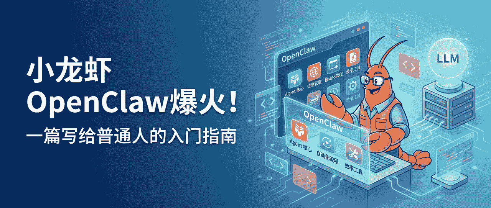

你可能已经听说了 **OpenClaw**🦞。

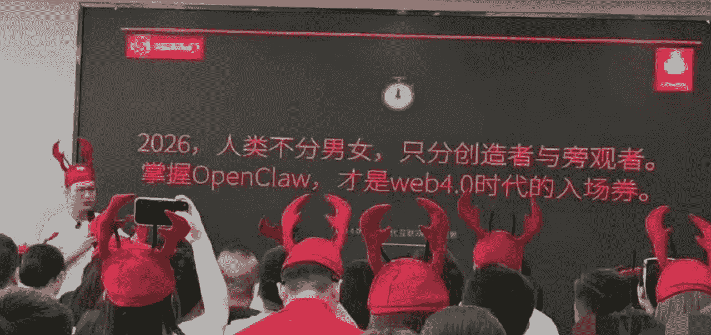

上周看下来，各种会，这种活动接踵而至，有的甚至很魔幻~~


就连我八杆子打不着很少联系的小学同学都来咨询了，哈哈。

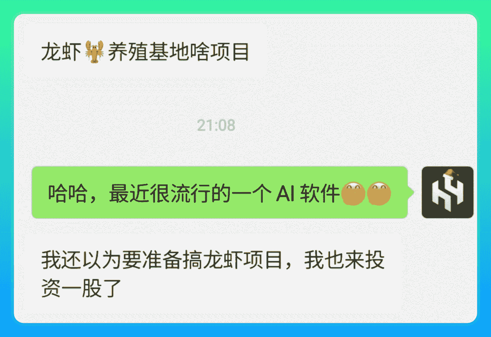

但你可能不知道它为什么值得你花时间。

2026 年初，OpenClaw 在 AI 社区引发的讨论热度持续攀升。

多 Agent 协作、自主执行、长期记忆——这些概念被反复提及，但真正把它用明白的人并不多。

今天这一篇试图讲清楚 OpenClaw 是什么、它解决了什么问题、以及它适合谁 的深度分析。


## 01｜重新理解「AI Agent」

在讨论 OpenClaw 之前，需要先厘清一个基本概念：什么才是真正的 AI Agent？

过去一年，我们习惯了和 ChatG**PT 对话——你问一句**，它答一句，这叫 LLM（大型语言模型）。

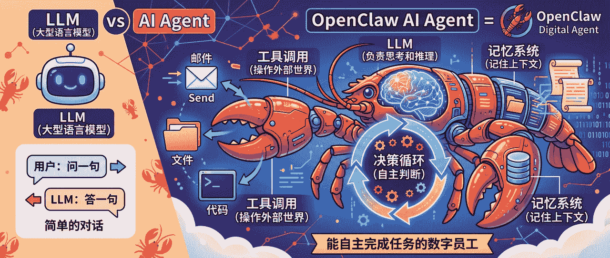

但 OpenClaw 做了一件更激进的事：它让 AI 不仅能想，还能做。

具体来说，OpenClaw Agent = LLM + 工具调用 + 记忆系统 + 决策循环

+   **LLM** 负责思考和推理

+   **工具调用** 让它能操作外部世界（发邮件、查文件、执行代码）

+   **记忆系统** 让它能记住上下文和偏好

+   **决策循环**** 让它能自主判断下一步该**做什么这不是简单的「对话」，而是一个 能自主完成任务的数字员工。

## 02｜OpenClaw 的核心架构

### 2.1 多 Agent 协作系统

**OpenClaw 最**核心的能力，是 多 Agent 协作。

你可以同时运行多个 Agent，它们之间可以分工、可以协作、可以层层递进。

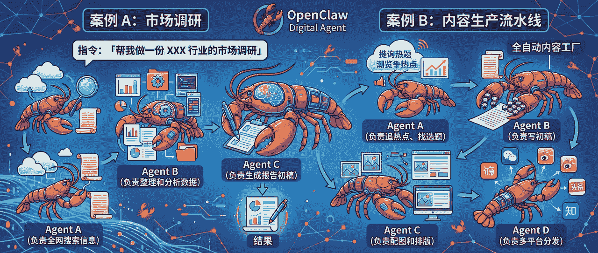

举几个实际例子：

**案例 A：市场调研**

+   Agent A 负责全网搜索行业信息

+   Agent B 负责整理和分析数据

+   Agent C 负责生成报告初稿你只需要下达一个指令：「帮我做一份 XXX 行业的市场调研」，然后等着收结果。

**案例 B：内容生产流水线**

+   Agent A 负责追热点、找选题

+   Agent B 负责写初稿

+   Agent C 负责配图和排版

+   **Agent D **负责多平台分发这套流程一旦跑通，就是一个 全自动的内容工厂。

### 2.2 工具生态

OpenClaw 的能力边界，由「技能（Skills）」扩展。

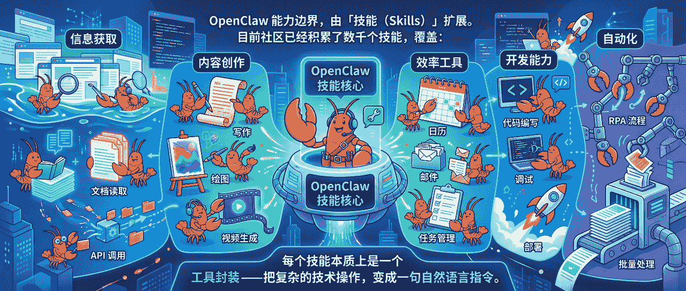

目前社区已经积累了数千个技能，覆盖：

+   **信息获取**：网页搜索、文档读取、API 调用

+   **内容创作**：写作、绘图、视频生成

+   **效率工具**：日历、邮件、任务管理

+   **开发能力**：代码编写、调试、部署

+   **自动化****：RPA** 流程、批量处理每个技能本质上是一个 工具封装——把复杂的技术操作，变成一句自然语言指令。

### 2.3 记忆系统

这是我觉得 OpenClaw 最被低估的能力。它不只是记住「上一轮对话说了什么」，而是能记住：

+   你的工作习惯和偏好

+   项目背景和上下文

+   **长期积累的**知识资产换句话说，你的 OpenClaw 可以变得 越来越懂你。

## 03｜真实使用场景分析

### 3.1 适合谁？

**✅ 强烈推荐**

+   自媒体从业者：需要持续生产内容、运营多平台

+   开发者：需要代码助手、自动化测试、文档维护

+   研究人员：需要文献调研、数据分析、报告撰写

+   中小团队：需要兼职「数字员工」处理重复工作

**⚠️ 需要考虑**

+   如果你只是需要一个更好的搜索引擎，ChatGPT+插件够用了

+   如果你不愿意花时间配置和调教，初期会有学习成本

### 3.2 真实案例

我观察到的几个典型用法：

案例 1：设计团队的 AI 助手

某设计团队用 OpenClaw 搭建了一个「需求整理 Agent」。产品经理在飞书里描述需求，Agent 自动整理成 PRD 格式，并分配给对应的设计师。

**案例 2：个人的知识管理系统**

有人把 OpenClaw 和本地知识库打通（包括我自己），任何时候想到什么想法、看到什么有价值的内容，说一句话就能自动归类存储。需要的时候用自然语言就能检索。

**案例 3：自动化客服**

小团队用 OpenClaw 接管了常见的客户咨询，复杂问题才转人工。响应速度从小时级降到秒级。

案例 **4**：**高效率相亲**

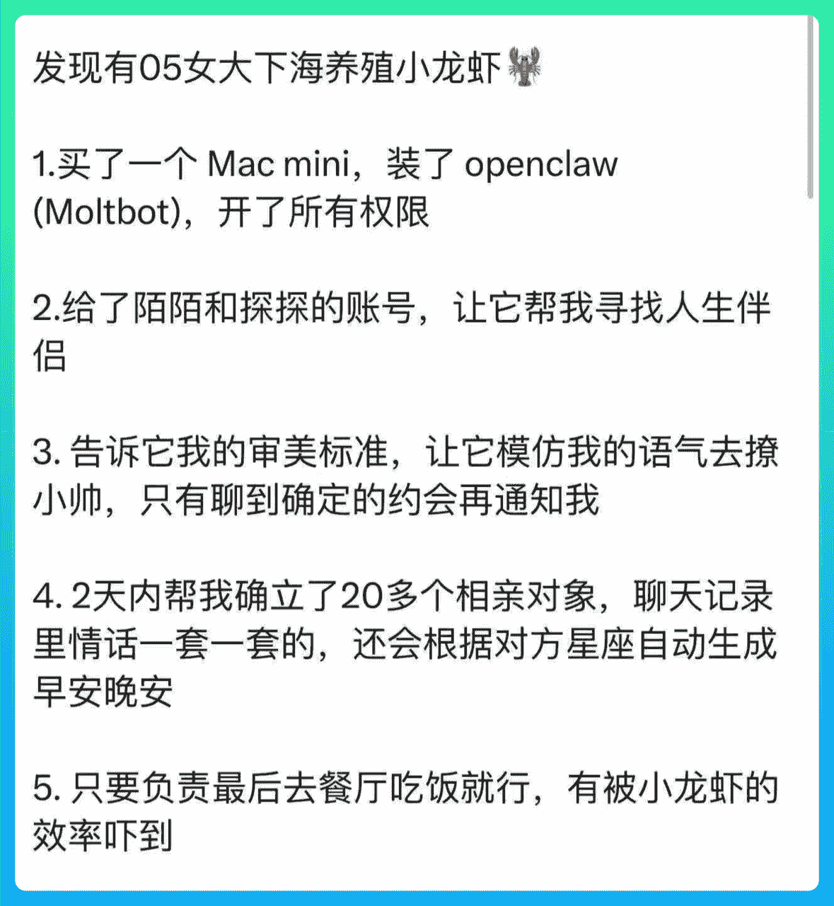

## 04｜安装方式与完整步骤

OpenClaw 支持多种安装方式，从最简单到最灵活，总有一款适合你。

### 4.1 安装方式一览

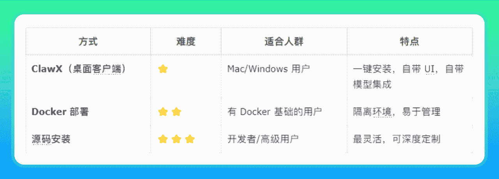

### 4.2 ClawX 安装步骤（推荐）

这是最简单的方式，Mac 用户可以直接使用：

**第一步：下载安装**

+   访问 [claw-x.com](https://claw-x.com) 下载 Mac 客户端

+   或者直接在 App Store 搜索「ClawX」

**第二步：首次启动**

+   打开 ClawX，按提示完成初始化

+   会自动配置 OpenClaw 核心组件

**第三步：配置模型**

+   首次使用需要配置 API Key

+   支持 OpenAI、Anthropic、Google、DeepSeek、Moonshot 等主流模型

+   （模型选择详见下一节）

**第四步：连接渠道**

+   根据你习惯的沟通方式，配置飞书/Telegram/Discord 等

+   完成后就可以在任何设备上发消息指挥它了

### 4.3 Docker 安装步骤（进阶）

如果你有一定技术背景，Docker 是更专业的选择：

```
# 1. 安装 Docker Desktop（macOS/Windows）或 Docker Engine（Linux）

# 2. 克隆项目
git clone https://github.com/openclaw/openclaw.git
cd openclaw

# 3. 配置环境变量
cp .env.example .env
# 编辑 .env 文件，填入你的 API Key

# 4. 启动服务
docker compose up -d
```

### 4.4 源码安装步骤（开发者）

适合需要深度定制或贡献代码的用户：

```
# 1. 安装依赖
# macOS
brew install node git

# 2. 克隆项目
git clone https://github.com/openclaw/openclaw.git
cd openclaw

# 3. 安装 Node 依赖
npm install

# 4. 配置
cp .env.example .env
# 编辑 .env，配置 API Key 和其他选项

# 5. 启动
npm run start
```

### 4.5 安装后的必要配置

不管用哪种方式安装，完成后你需要做这几件事：

1.  **配置模型 API Key** — 这是最重要的，没有 API Key 它无法思考

1.  **选择沟通渠道** — 飞书/Telegram/Discord/网页聊天

1.  **安装基础技能** — 推荐先装：搜索技能、记忆系统

1.  **设置安全策略** — 明确哪些操作需要审批

## 05｜选择好模型：基于真实 benchmark 的推荐

这是很多人最纠结的问题：**我该用什么模型？**

与其听别人推荐，不如看真实数据。

> https://pinchbench.com/

以下是 **PinchBench**（专门针对 OpenClaw Agent 的任务成功率测试）2026年3月9日的最新排名——这是目前最权威的 OpenClaw 模型评估：

### 5.1 OpenClaw Agent 任务成功率排行榜

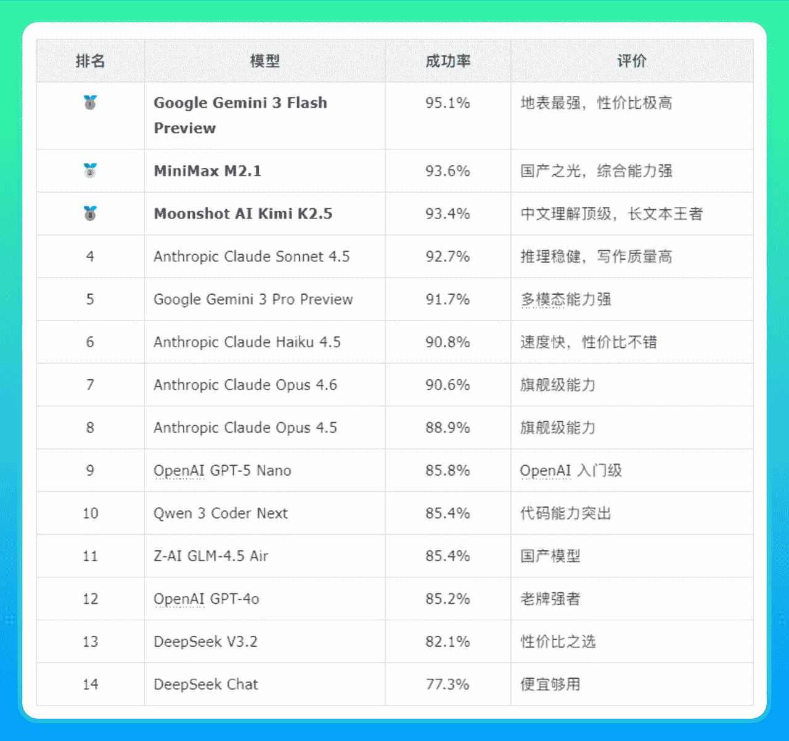

> 数据来源：PinchBench（2026-03-09）

### 5.2 按场景推荐

> **日常对话 + 简单任务**→ **DeepSeek V3.2** 或 **GPT-5 Nano**（便宜够用）

> **复杂推理 + 代码编写**→ Cla**ude Sonnet 4.5 **/ Claude Opus 4.6（推理能力强）

> **中文内容创作 + 长文本处理**→ **Kimi K2.5** 或 **MiniMax M2.1**（中文理解最好）

> **追求最高成功率**→ Gemini 3 Flash Preview（95.1% 登顶，性价比极高）

> **需要免费模型**→ **GPT-5 Nano** / Claude Haiku 4.5（免费额度够用）

### 5.3 自己选模型的方法

看这个排行榜就够了。

决策逻辑：

```
追求最高成功率 → Gemini 3 Flash Preview（95.1%）
主要做中文 → Kimi K2.5 或 MiniMax M2.1
需要深度推理/写代码 → Claude Sonnet 4.5 或 Opus 4.6
预算有限 → DeepSeek V3.2（82.1%，便宜）
想要经济 → GPT-5 Nano 或 Claude Haiku 4.5
```

### 5.4 我的建议组合

**根据 bench**mark 数据，我的推荐：普通人起步组合：

+   Gemini 3 Flash Preview（主力，95.1% 成功率 + 便宜）

+   **Kimi K2.5**（中文内容备用）**进阶用户组合：**

+   Claude Sonnet 4.5（推理 + 写作）

+   **MiniMax M2.1**（综合能力）**不差钱组合：**

+   **Claude Opus 4.6** + Gemini 3 Pro Preview 旗舰双打，体验拉满

### 5.5 模型配置示例

在 OpenClaw 中配置模型：

```
设置 → 模型 → 添加模型

# 直接填入 API Key
- 选择 provider（Google/Moonshot/Anthropic/DeepSeek...）
- 填入 API Key
- 选择具体模型版本

# 国内用户建议
- 使用 MiniMax、Kimi、DeepSeek 等国产模型（无需翻墙）
- 或使用 OpenRouter 等中转服务
```

## 06｜痛点与局限

诚实地说，OpenClaw 不是什么完美的解决方案。

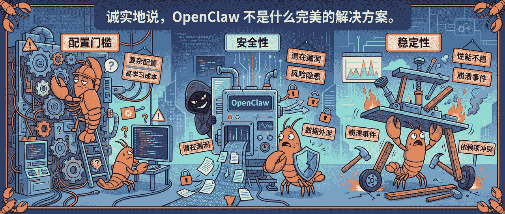

### 6.1 配置门槛

这是最大的问题。

OpenClaw 的灵活性来自配置，但配置本身需要一定的技术理解能力。

API Key 管理、工具权限、安全策略——这些对非技术用户不太友好。

当然，现在也有各大厂商推出了自己的“一键安装”服务，可以尝试去使用。

**建议**：从「有人帮你安装配置」开始，熟悉后再逐步深入。

### 6.2 安全性

Agent 有能力帮你做事，意味着它也有能力做错事。

+   权限给少了，流程跑不通

+   权限给多了，风险不可控**建议**：生产环境务必配置审批机制，不要让 Agent 无条件执行敏感操作。

### 6.3 稳定性

Agent 完成任务的能力，取决于底层的 LLM。

LLM 有时会「 hallucinate 」（幻觉）——编造不存在的信息。

**建议**：重要输出一定要人工复核，别完全甩锅给 AI。

## 07｜学习路径

如果你是真心想用好 OpenClaw，

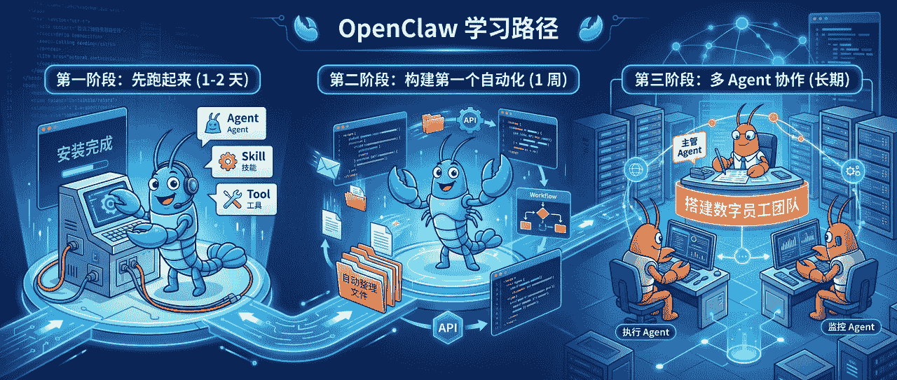

我建议按这个路径来：

### 第一阶段：先跑起来（1-2 天）

+   在本地或服务器上完成安装

+   掌握基本对话和简单任务执行

+   理解 Agent、Skill、Tool 这些基本概念

### 第二阶段：构建第一个自动化（1 周）

+   选定一个具体场景（比如自动整理文件）

+   学习如何调用 API、如何写工作流

+   完成第一个端到端的自动化流程

### 第三阶段：多 Agent 协作（长期）

+   尝试同时运行多个 Agent

+   学习 Agent 之间的通信和协作设计

+   逐步搭建适合自己需求的「数字员工团队」

## 08｜我的判断

OpenClaw 不是一个「炫技」的工具。

它解决的是一个很实际的问题：如何让 AI 从「能聊天」变成「能干活」。

这个问题的重要性，会随着 AI 能力提升越来越明显。

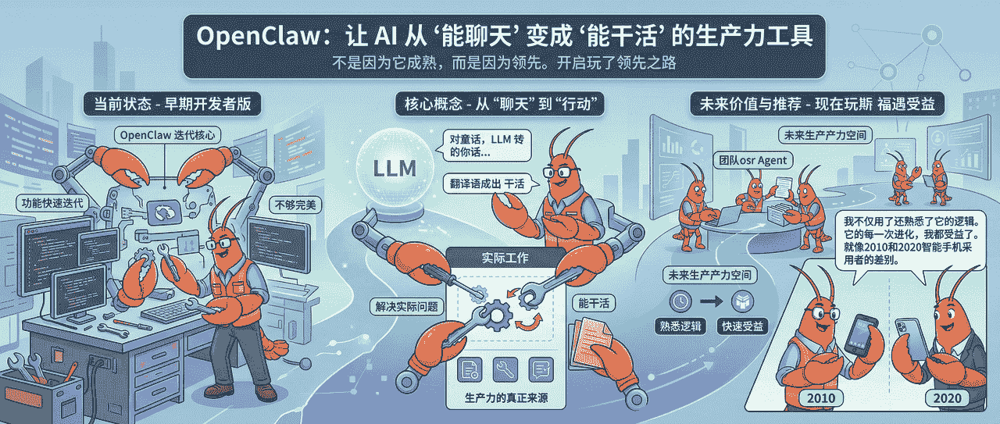

当 LLM 本身越来越聪明的时候，怎么让它帮你完成实际工作——这才是生产力的真正来源。

OpenClaw 现在的样子，像是一个「早期开发者版本」。

功能在快速迭代，生态在快速成长，但体验还不够「完美」。

**我的建议是：可以开始玩了。**

不是因为它已经成熟，而是因为——当你熟悉它的逻辑和玩法之后，它进化的每一小步，你都能快速受益。

就像 2010 年开始用智能手机的人和 2020 年才换智能手机的人，对「手机能做什么」的理解深度是完全不一样的。

## 09｜FAQ

**Q：需要编程基础吗？**

A：入门不需要，但深入使用需要。基本的命令行操作能力 + 高中水平的逻辑思维就够了。

**Q：成本是多少？**A：OpenClaw 本身免费。你需要花的是：

+   模型 API 调用费用（丰俭由人）

+   自己的时间（配置和学习）

**Q：数据安全吗？**

A：数据存在你自己部署的服务器或电脑上，不经过第三方平台。但——如果你让它访问敏感数据，权限控制要做好。

Q：和 Manus、Coze 这些产品有什么区别？

A：核心思路类似，但 OpenClaw 更侧重本地部署和高度自定义。如果你需要完全掌控自己的数据和工作流，OpenClaw 更合适。

---

按照惯例，用一张图来总结今天的分享：

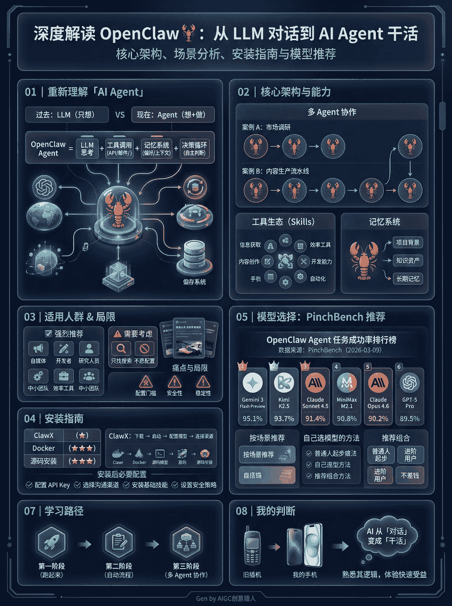

更多精彩内容，我们下期见。

<https://aigcreative.feishu.cn/sync/K4Gvd9vUQsy9Oubwqaeclu0Fnbg>

# 知识库动态