# 20260311-OpenClaw"百虾大战"：11家大厂、13只虾，一场关于Agent的狂欢！

> 来源：[https://aigcreative.feishu.cn/docx/Ef7LdTdOAoLincxXhsycJSS7nlf](https://aigcreative.feishu.cn/docx/Ef7LdTdOAoLincxXhsycJSS7nlf)

2026年3月，中国互联网上演了一场史无前例的"百虾大战"。

**从腾讯阿里到字节百度，从美**团京东到360小米，短短一个月内，近10多只"龙虾"集体上线，几乎所有叫得出名字的互联网公司都跳进了这个赛道。

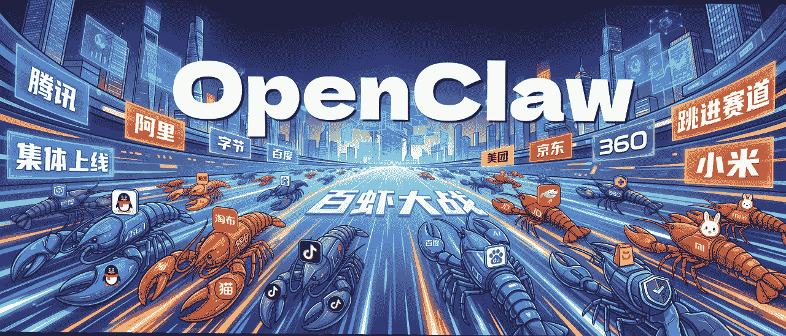

作为一个AI自媒体以及一个行业观察者，我必须要说：

这不仅是技术竞争，更是一场关于Token、数据和生态的集体狂欢。

先来盘一盘这些虾~~

声明：根据公开资料整理，不限于以下这些虾，没被逮到的，请自行来报道~~

# 01. 先来整体认识一下这些虾~~

按照公司维度，我们来逐一介绍，为了更加直观，给每一个虾都做了一个画像，大家看看画的准不准确：

### 🐧 腾讯系（2只虾）

#### 1. QClaw（电脑管家）

> **人设**：腾讯嫡系，微信QQ双料特工

> **口头禅****："微信**还是QQ？随便你"腾讯电脑管家出品，微信直连是最大亮点。用户通过微信发送指令就能让QClaw操控电脑、处理文件。目前处于内测阶段，Windows/Mac都能用。

> **优点**：微信QQ双端接入、5000+Skills生态、腾讯系全家桶

> **缺点**：还在内测

> **网址**：https://claw.guanjia.qq.com/#features

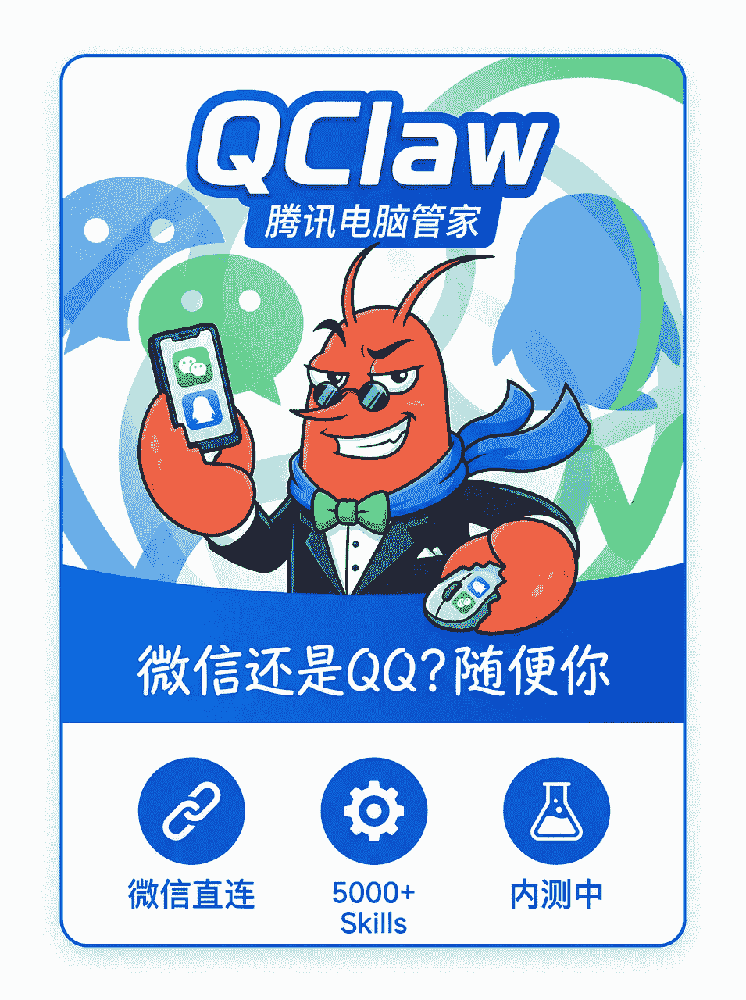

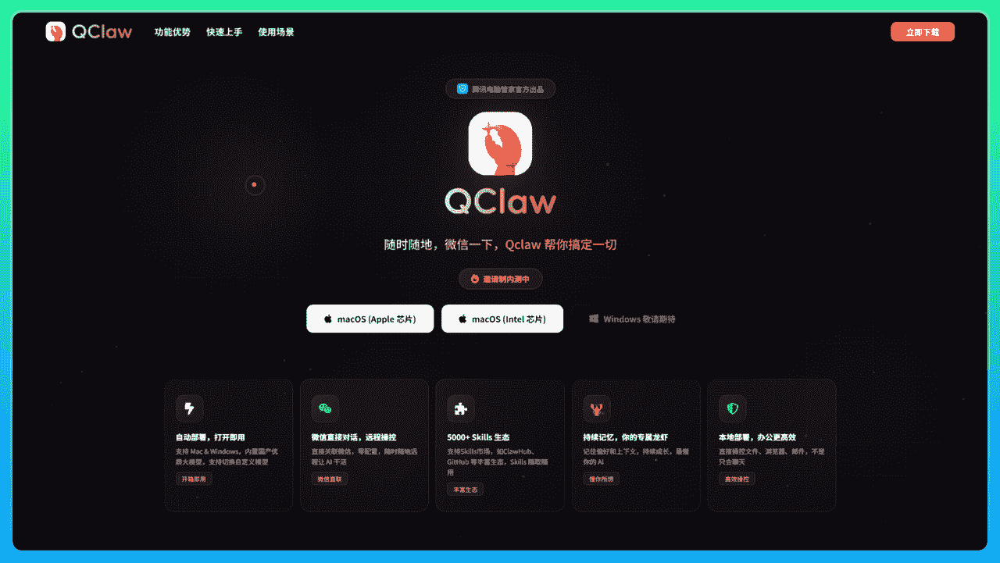

#### 2. WorkBuddy（AI工作台）

> **人设**：企业服务全能选手

> **口头禅**："办公的事交给我"

> 全场景AI智能体工作台，**兼容OpenClaw框架**，支持企业微信、QQ、飞书等工具。可执行文档处理、数据分析、代码开发等办公自动化任务。

> **优点**：办公场景全覆盖、企业微信生态

> **缺点**：腾讯系产品，开放性存疑

> **网址**：https://www.codebuddy.cn/work/

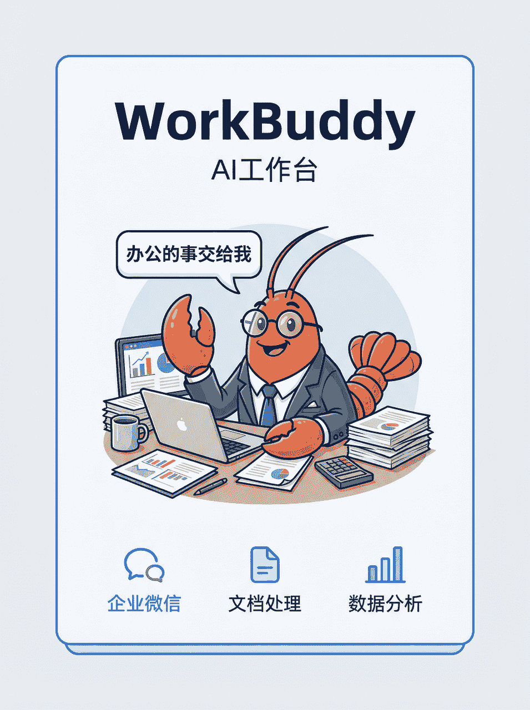

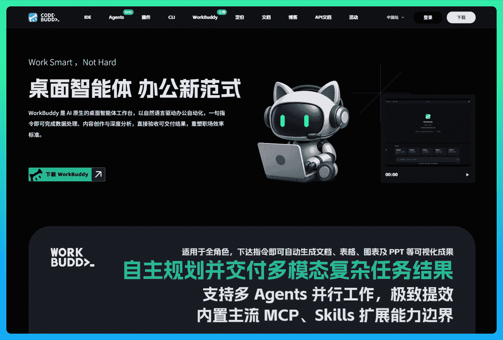

### 🐆 阿里系（2只虾）

### 3. CoPaw（阿里云）

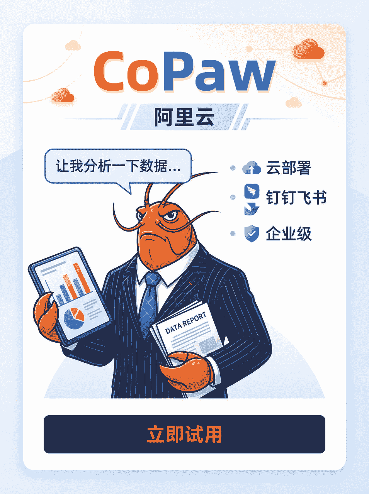

> **人设**：稳重的企业高管

> **口头禅**："让我分析一下数据..."

> **阿里推出的开源**AI个人助理，支持本地或云端部署。可在浏览器中直接交互，也能通过飞书、钉钉"遥控"。深度打通阿里生态。

> **优点**：云稳定性强、阿里生态完整、钉钉飞书双接

> **缺点**：太正式，个人用户用起来有点"重"

> **网址**：https://copaw.agentscope.io/

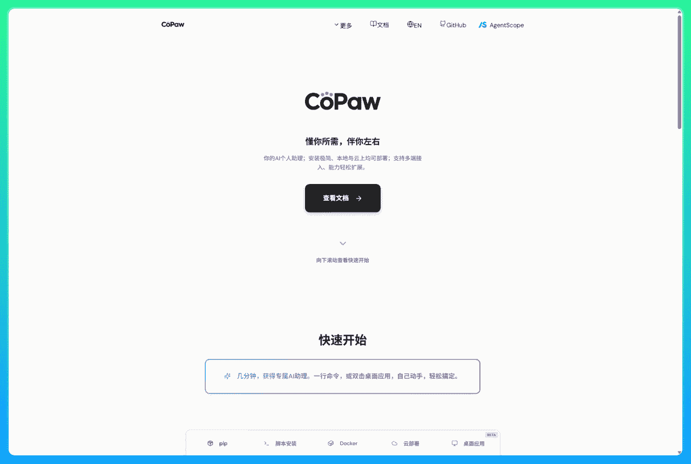

#### 4. HiClaw（阿里云开源团队版）

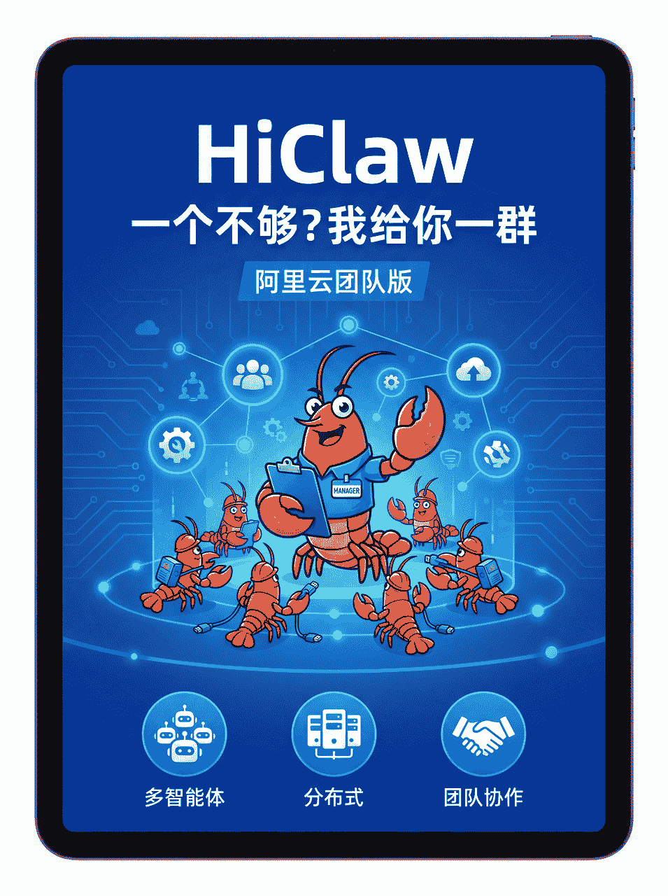

> **人设**：团队管理器

> **口头禅**："一个不够？我给你一群"

> 阿里云推出的**团队版OpenClaw**，引入Manager Agent管理多个智能体，支持分布式部署，适用于企业团队协作场景。

> **优点**：多智能体管理、分布式部署

> **缺点**：面向企业，个人用户无缘

> **网址**：https://higress.ai/hiclaw

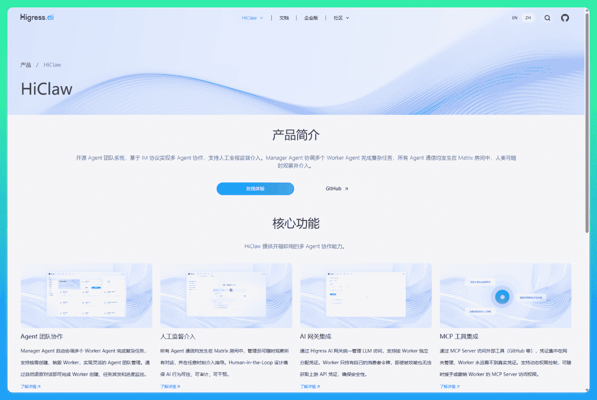

### 🚀 字节系（2只虾）

#### 5. ArkClaw（火山引擎）

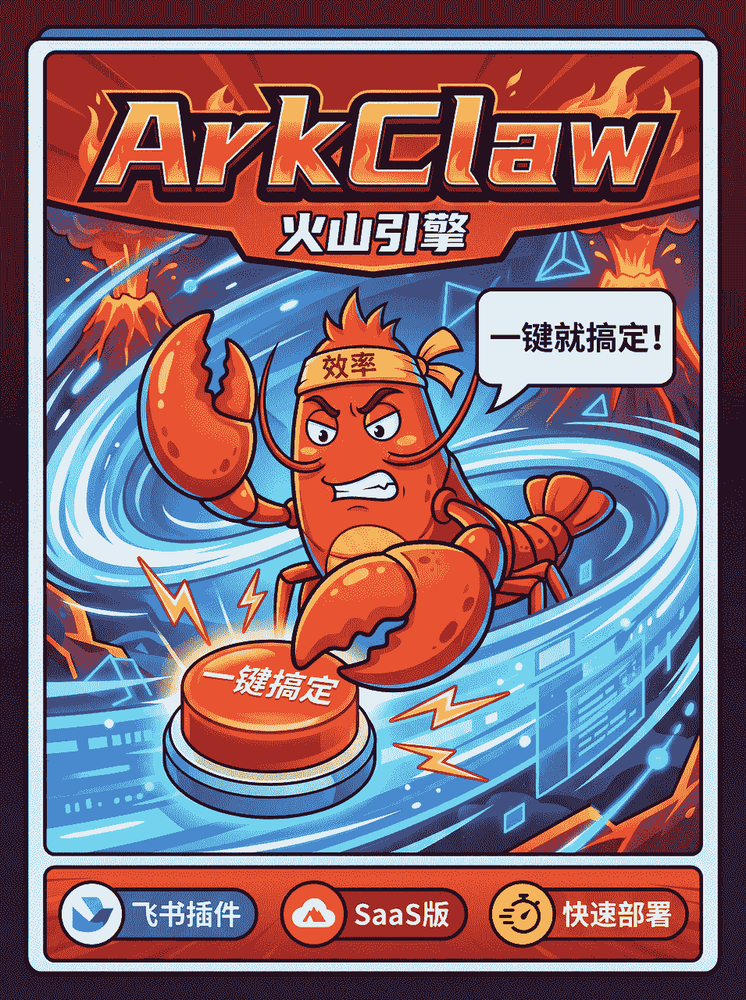

> **人设**：效率狂魔，急性子

> **口头禅**："一键就搞定！"

> 字节旗下火山引擎推出的**云上SaaS版OpenClaw**，支持多种即时通讯APP，适配飞书插件。提供网页搜索、自我改进、GitHub操作等技能。

> **优点**：上手最快、飞书生态强、字节效率基因

> **缺点**：数据在云端，隐私有顾虑

> **网址**：https://www.volcengine.com

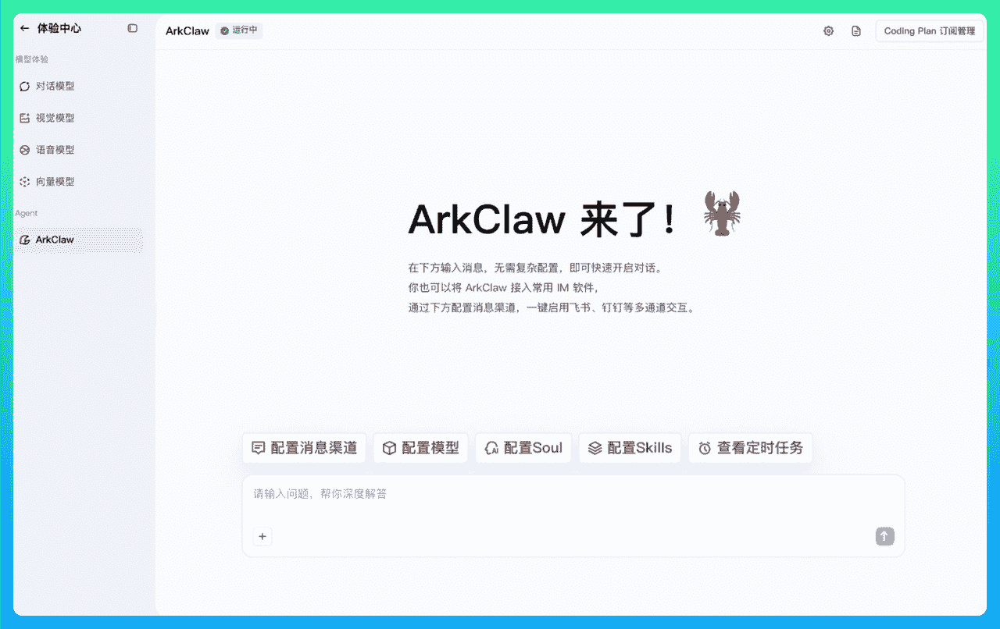

### 🔍 百度系（1只虾）

#### 6. 移动版OpenClaw（百度智能云）

> **人设**：云手机玩家

> **口头禅**："手机也能养虾"

> 百度智能云推出的**移动端OpenClaw**，可部署在**云手机**上。新用户可免费体验10天，支持将OpenClaw能力延伸至移动设备。

> **优点**：移动端体验、云手机黑科技

> **缺点**：免费期后收费

> **网址**：https://operator.gc.com.cn/

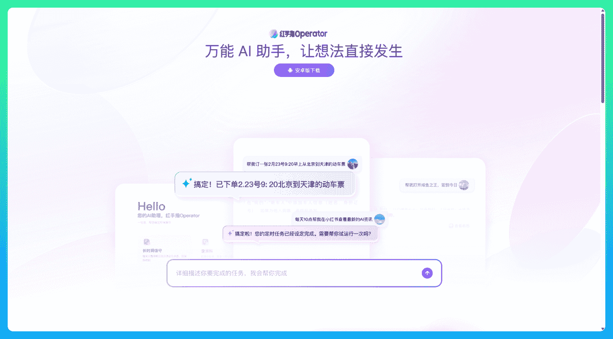

####

### 🌾 小米系（1只虾）

#### 7. Xiaomi MiClaw

> **人设**：家里的万能管家

> **口头禅**："米家设备已连接"

> **国内首个手机端系统级智能体**，基于小米自研MiMo大模型。获得授权后可调用手机系统工具和应用，支持Python、JavaScript脚本运行、定时任务、通讯管理。目前处于小范围封闭测试阶段。

> **优点**：IoT生态无敌、系统级能力、米家全控制

> **缺点**：目前只支持小米17系列、生态封闭

> **网址**：https://xiaomimiclaw.net/

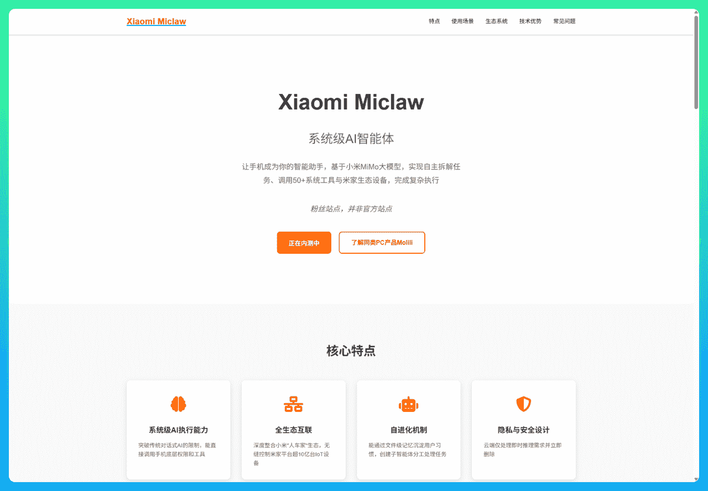

### 🦞 网易系（1只虾）

#### 8. LobsterAI（网易有道）

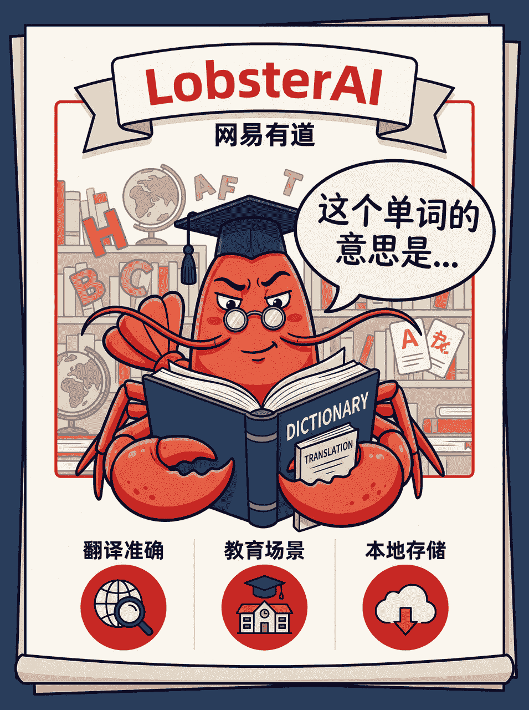

> **人设**：留学归来的海归学霸

> **口头禅**："这个单词的意思是..."

> 网易有道推出的**桌面级AI助理**，支持本地部署，可接入多个聊天软件，支持手机远程操控。**提供工作、学**习、创作等多场景自动化服务，数据本地存储，注重安全性。

> **优点**：翻译准确、教育场景强、数据本地存储

> **缺点**：生态相对封闭

> **网址**：https://lobsterai.youdao.com/#/index

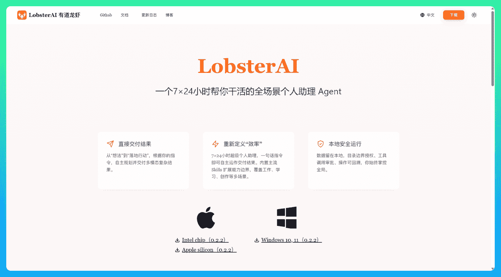

### 🐂 美团系（1只虾）

#### 9. LongCat

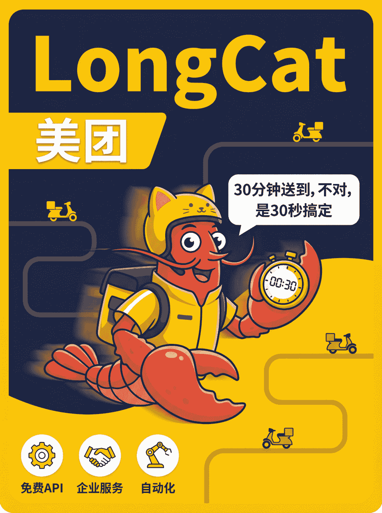

> **人设**：外卖级服务效率

> **口头禅****："30分钟送到，不对，**是30秒搞定"美团推出的OpenClaw部署服务，为开发者提供稳定合规的官方免费API，支持构建自动化工作流，助力企业提升运营效率。

> **优点**：免费API、企业服务背景

> **缺点**：美团生态相对封闭

> **网址**：https://lobsterai.youdao.com/#/index

### 🎭 MiniMax系（1只虾）

### 10. MaxClaw

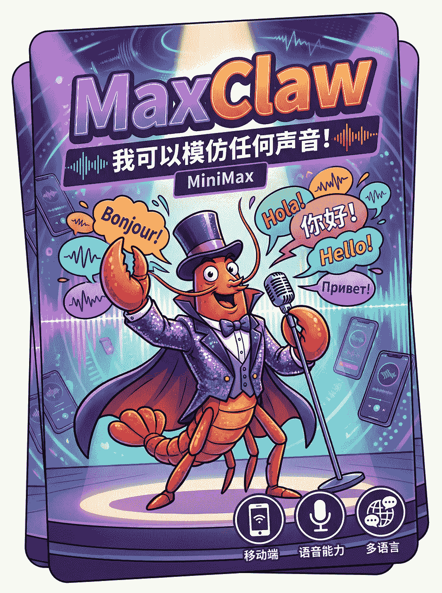

> **人设**：戏精本精，社交达人

> **口头禅**："我可以模仿任何声音！"

> 基于MiniMax **M2.5模型****，是移动端**体验最好的虾。iOS和Android全球版都上了，还支持多语种配音。

> **优点**：移动端流畅、语音能力强、多语言支持

> **缺点**：新入局者，生态还在建设中

> **网址**：https://agent.minimax.io/max-claw

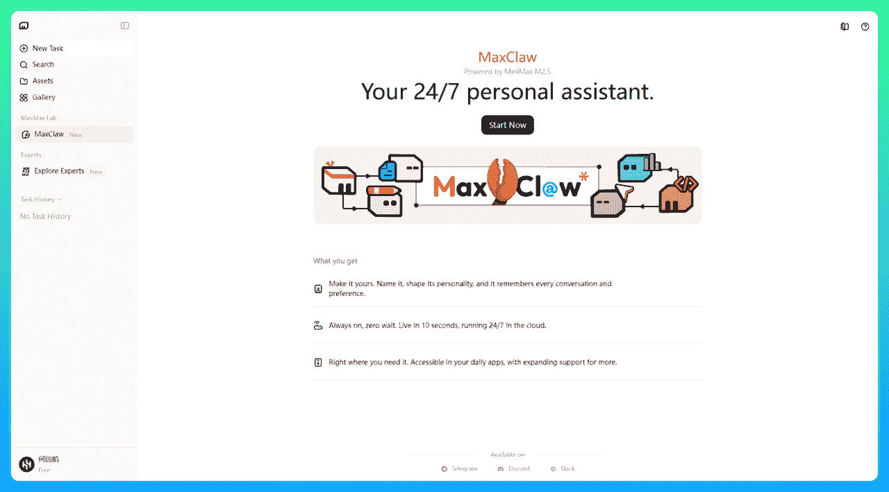

### 💼 中关村科金系（1只虾）

#### 11. PowerClaw

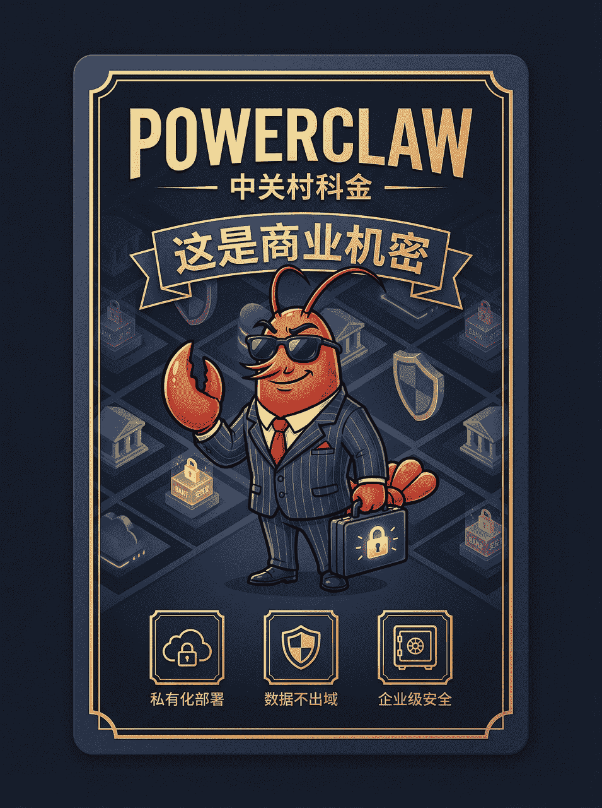

> **人设**：金融圈精英，西装革履

> **口头禅**："这是商业机密"

> **企业版OpenClaw**，主打私有化部署。核心卖点：**数据不出域**。目标是成为"永不歇息的数字员工"。

> **优点**：安全性高、适合金融政务

> **缺点**：贵，只服务大企业

> **网址**：https://www.zkj.com/

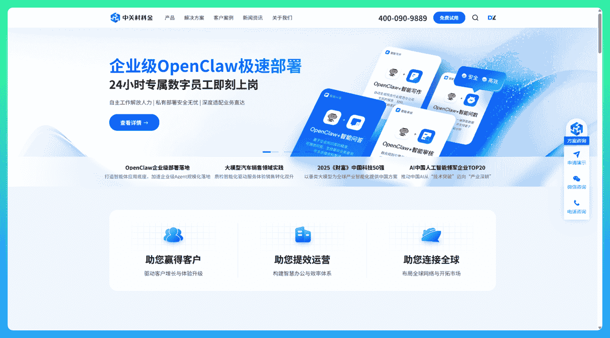

### 🦘 智谱系（1只虾）

#### 12. AutoClaw（澳龙）

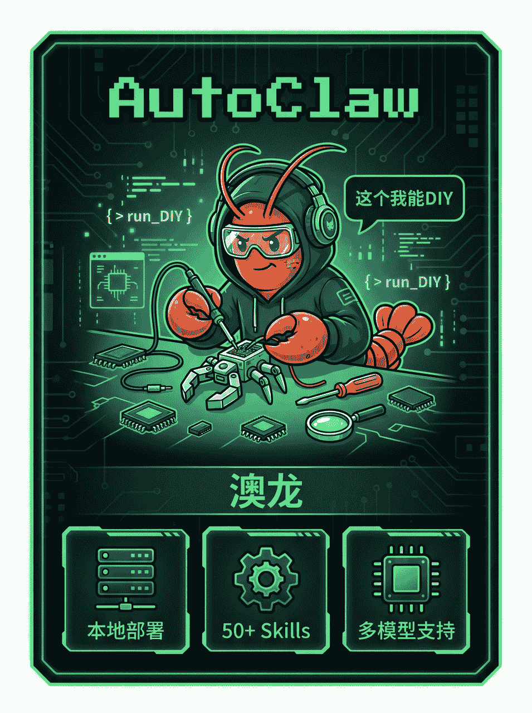

> **人设**：技术宅，DIY达人

> **口头禅**："这个我能DIY"

> **国内首个支持一键安装**的本地化OpenClaw工具。预置50+热门Skills，支持GLM、DeepSeek等多种模型。你可以完全掌控它。

> **优点**：本地部署、模型选择灵活、技能包丰富富

> **缺点**：需要一定技术门槛

> **网址**：https://autoglm.zhipuai.cn/autoclaw/

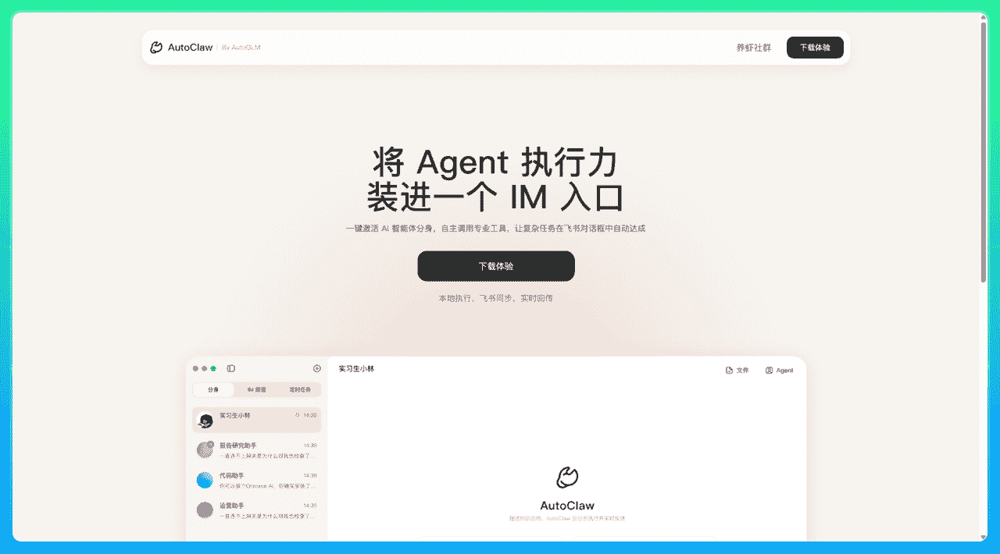

### 🛡️ 360系（1只虾）

#### 13. 360安全龙虾

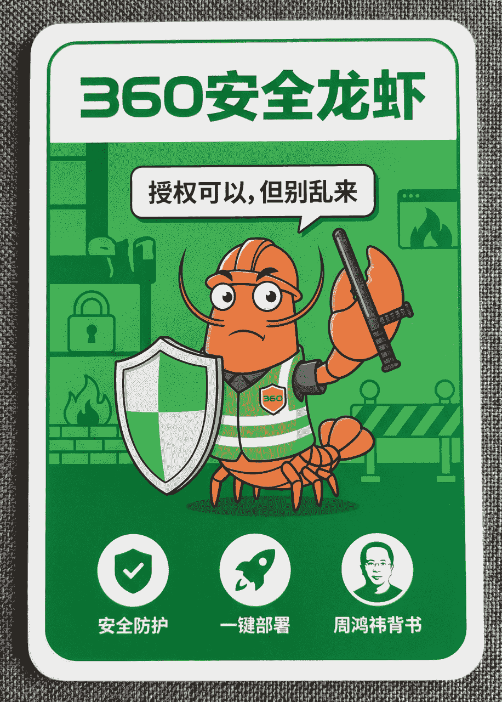

> **人设**：网络安全卫士，操心的命

> **口头禅****："**授权可以，但别乱来"周鸿祎亲自宣布推出，主打安全。一键部署的同时保证：

+   不破坏系统

+   不删除数据

+   不泄露密码等隐私信息周鸿祎也提醒：OpenClaw类产品存在安全风险，有的时候它产生幻觉，可能把电脑C盘文件全删了。

+   **优点**：安全牌、周鸿祎背书、适合小白

+   **缺点**：还没正式上线

+   **网址**：建设中......

## 02. 完整版对比表

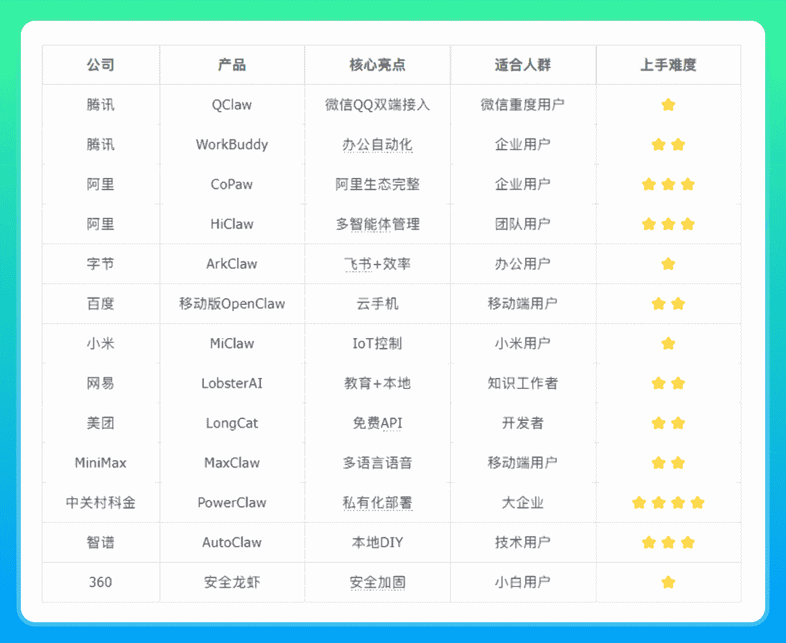

来个大合影~~

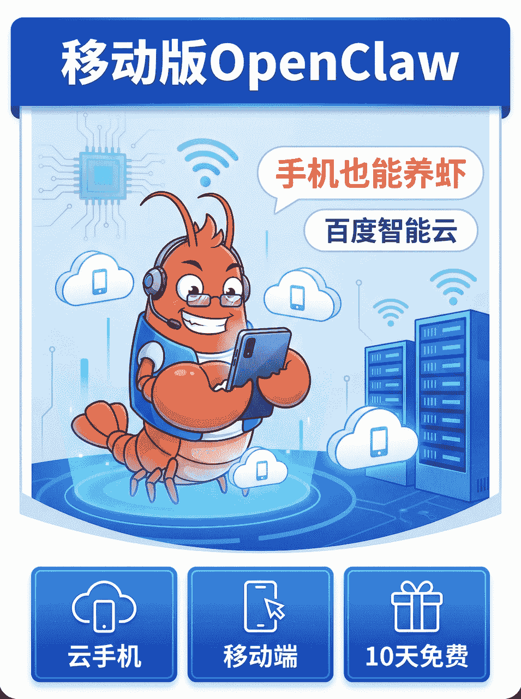

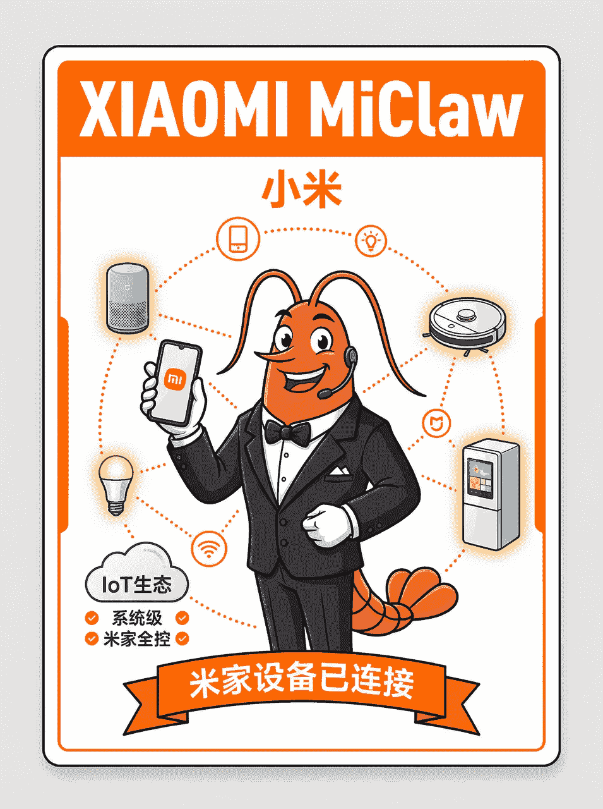

# 03. 为什么所有人都在"养虾"？

2026年初，OpenClaw开源项目在GitHub上迅速走红，随后不到两个月时间内，国内主要互联网企业几乎全部入局。

这一现象看似是技术追风，背后却有着清晰商业逻辑。

下面从六个维度系统解析这场"百虾大战"背后的驱动力。

## 3.1 大模型厂商的变现压力

本轮"养虾"热潮最直接的驱动力，来自大模型厂商日益紧迫的变现需求。

**训练成本与商业化倒挂**是核心矛盾。

据公开数据，GPT-4训练成本约10亿美元，Claude等头部产品训练成本达数亿美元，国内头部模型的训练投入也在数亿人民币量级。

然而，这些模型目前的商业化路径并不顺畅——订阅制用户增长放缓，API调用量不稳定，单次对话的ARPU值难以覆盖边际成本。

Agent模式提供了新的变现通道。

与传统对话式AI不同，OpenClaw作为"数字员工"可以7×24小时持续运行，单日Token消耗量可达数十万至数百万量级。

这意味着更稳定、可预期的收入流——用户使用时长直接与厂商收入挂钩。

各厂商的产品绑定策略清晰地反映了这一逻辑：

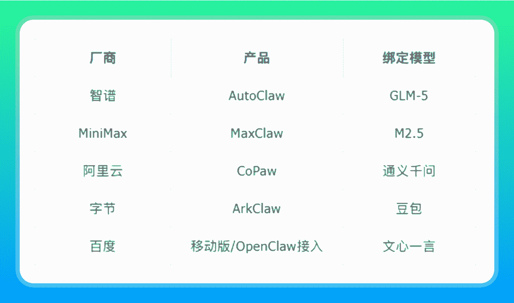

从本质上看，OpenClaw是开源的框架，模型能力才是核心竞争力。

框架可以免费获取，但调用模型需要付费。

这构成了整个商业链条的基础。

## 3.2 云服务商的算力消耗战

大模型厂商之外，云服务商是另一大受益群体。

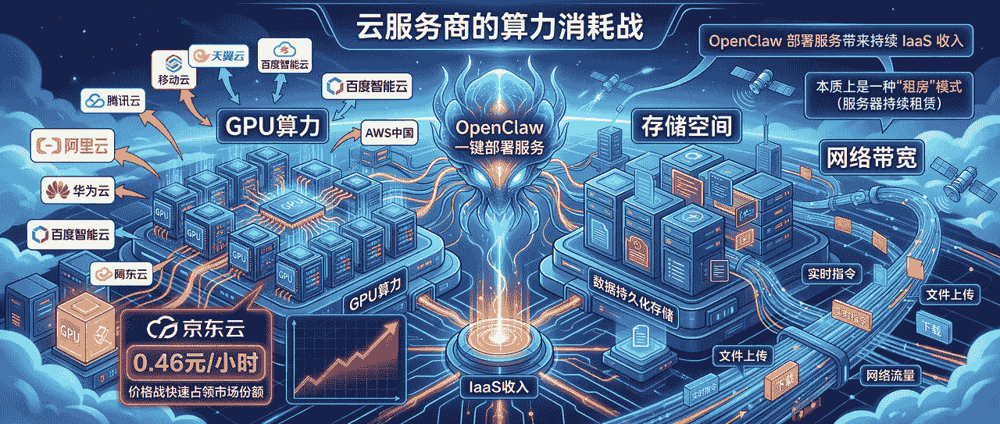

几乎所有国内主流云平台——腾讯云、阿里云、百度智能云、京东云、华为云、天翼云、移动云、AWS中国——都在2025年2-3月密集上线了OpenClaw一键部署服务。这并非巧合。

运行OpenClaw需要持续消耗三类云资源：

1.  **GPU算力**：模型推理的核心资源，目前GPU云服务器价格仍处于高位

1.  **存储空间**：用户数据、对话历史、技能配置等均需持久化存储

1.  **网络带宽**：实时指令传输、文件上传下载产生大量流量

对于云厂商而言，OpenClaw部署服务不仅直接带来IaaS层收入，更是获取企业客户的重要入口——一只"虾"跑起来意味着持续的服务器租赁，这本质上是一种"租房"模式。

京东云甚至打出了"0.46元/小时"的低价策略，试图以价格战快速占领市场份额。

## 3.3 生态锁定的战略意图

**如果说过**两层逻辑是短期商业驱动，那么生态锁定则是各大厂商更长期的核心诉求。

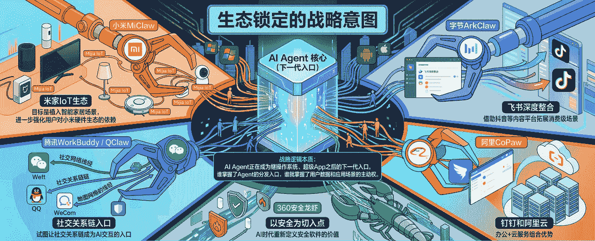

从各家的产品设计可以清晰看出生态布局思路：

+   **小米MiClaw**：深度整合米家IoT生态，目标是将AI能力植入智能家居场景，进一步强化用户对小米硬件生态的依赖

+   腾讯WorkBuddy/QClaw：打通了微信、QQ、企业微信三大入口，试图让社交关系链成为AI交互的入口

+   **阿里CoPaw**：绑定钉钉和阿里云，形成"办公+云服务"的组合优势

+   **字节ArkClaw**：与飞书深度整合，同时借助抖音等内容平台拓展消费级场景

+   **360安全龙虾**：以安全为切入点，试图在AI时代重新定义安全软件的价值

这一战略逻辑的本质是：AI Agent正在成为继操作系统、超级App之后的下一代入口。谁掌握了Agent的分发入口，谁就掌握了用户数据和应用场景的主动权。

这解释了为什么即使产品尚不成熟，各大厂仍然选择快速入局——占位的价值可能大于产品本身的价值。

## 3.4 数据资产的持续积累

容易被忽视但同样重要的是：Agent正在成为数据采集的新管道。

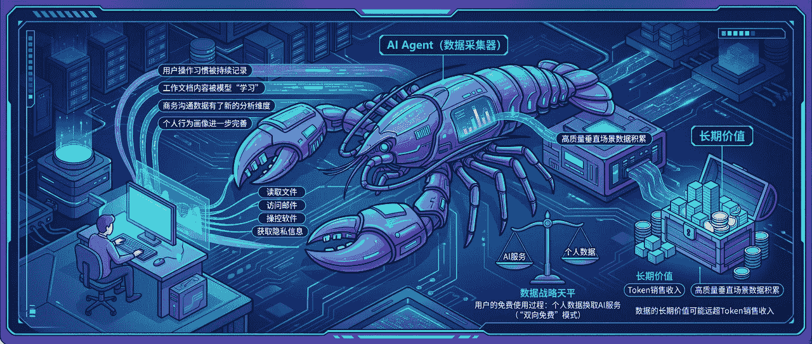

与传统对话式AI不同，Agent具备操作电脑本地的能力：读取文件、访问邮件、操控软件、获取隐私信息。这意味着：

+   用户的操作习惯被持续记录

+   工作文档内容被模型"学习"

+   商务沟通数据有了新的分析维度

+   个人行为画像进一步完善

从数据战略角度看，用户免费使用Agent的过程，实际上也是以个人数据换取AI服务的过程。这种"双向免费"模式，为大厂积累了大量高质量的垂直场景数据，这些数据的长期价值可能远超Token销售收入。

## 3.5 安全厂商的防御性入局

OpenClaw类产品的安全风险正在成为行业共识，这也是360入局的核心逻辑。

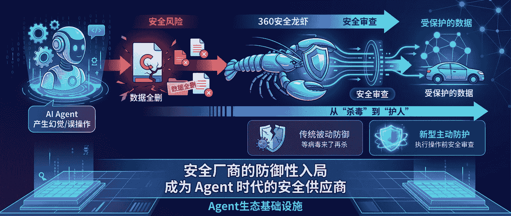

周鸿祎在公开场合多次提醒：

AI Agent类产品存在数据安全风险，"有时候它产生幻觉，可能把你电脑C盘文件全删了"。

这并非危言耸听，已有安全研究员报告了多起Agent误操作导致的数据损失案例。

这一痛点恰恰是360的机会：

+   传统安全软件是"被动防御"，等病毒来了再杀

+   AI Agent需要"主动防护"，在执行操作前进行安全审查

+   从"杀毒"到"护人"，安全软件的定位正在发生根本性转变

360安全龙虾的本质，是将安全能力产品化，作为Agent生态的基础设施提供服务。

这是一种典型的防御性入局，如果无法阻止Agent普及，那就成为Agent时代的安全供应商。

## 3.6 资本市场的叙事需求

除了商业逻辑，资本市场的影响同样不可忽视。

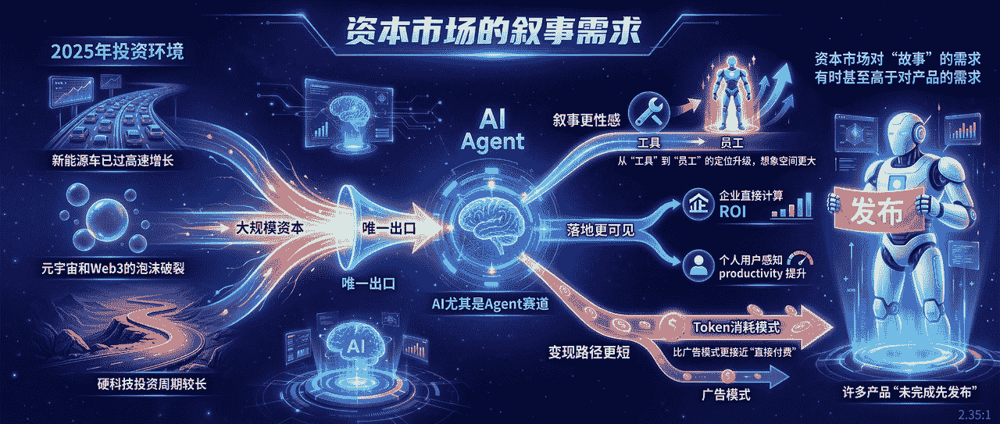

2025年的投资环境中，AI是少数仍能吸引大规模资本关注的赛道。新能源车已过高速增长期，元宇宙和Web3的泡沫先后破裂，硬科技投资周期较长。

在此背景下，AI尤其是Agent赛道成为资本配置的"唯一出口"。

Agent相比单纯的AI模型更具资本吸引力，因为：

+   **叙事更性感**：从"工具"到"员工"的定位升级，想象空间更大

+   **落地更可见**：企业可以直接计算ROI，个人用户可以感知 productivity 提升

+   **变现路径更短**：Token消耗模式比广告模式更接近"直接付费"

这解释了为什么许多产品"未完成先发布"，资本市场对"故事"的需求有时甚至高于对产品的需求。

## 3.7 小结

综合来看，"百虾大战"的驱动力是多层次的：

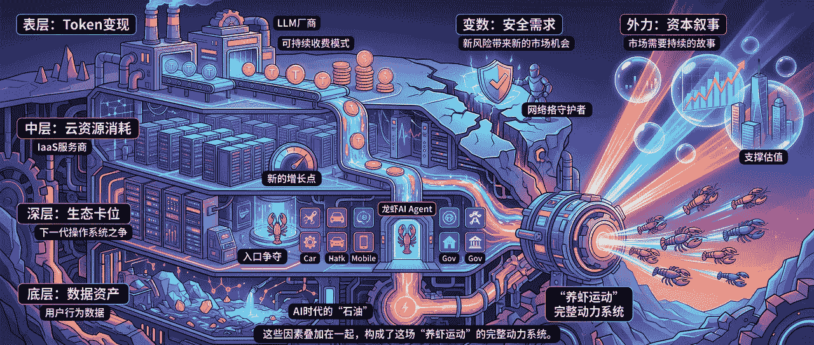

1.  **表层**：Token变现——大模型厂商需要可持续的收费模式

1.  **中层**：云资源消耗——IaaS服务商需要新的增长点

1.  **深层**：生态卡位——入口争夺是下一代操作系统之争

1.  **底层**：数据资产——用户行为数据是AI时代的"石油"

1.  **变数**：安全需求——新风险带来新的市场机会

1.  **外力**：资本叙事——市场需要持续的故事来支撑估值

这些因素叠加在一起，构成了这场"养虾运动"的完整动力系统。

# 04. 怎么养龙虾：给普通用户的建议

+   **普通用户，不想折腾** → ArkClaw / WorkBuddy / QClaw（开箱即用）

+   **技术爱好者，喜欢折腾** → AutoClaw（本地部署）

+   **小米用户，米家设备多** → MiClaw（生态联动）

+   **企业用户，数据安全** → PowerClaw / CoPaw（私有化部署）

+   **预算有限** → AutoClaw+开源模型

+   **微信QQ重度用户** → QClaw

+   **搜索重度用户** → 百度APP版

> 更详细的入门指南：

# 05. 写在最后

2025年的"百虾大战"，让我想起了：

+   2011年的"千团大战"

+   2015年的"网约车大战"

+   2018年的"共享单车大战"历史总是惊人地相似：

> 一个新模式出现 → 所有人一拥而上 → 资本疯狂涌入 → 泡沫逐渐堆积 → 大浪淘沙

Agent赛道也不例外。

现在的13只虾，一年后可能只剩2-3只。

但不管怎样：

ChatGPT只是AI的iPhone时刻，

Agent才是AI的App Store时刻。

**这波浪潮里，最值钱的不是虾，**

**而是：**

**你要做的，不是观望，**

**而是现在就去养一只虾。**

你会选择养哪只虾？你用过哪只虾？

体验如何？评论区聊聊：

---

玩虾、养虾，怎么能没有表情包？【创意猎人】社区特地做了两套表情包，在等待小龙虾回复之余，表情包玩起来~~

感兴趣的小伙伴可以识别图中的二维码，下载安装使用：

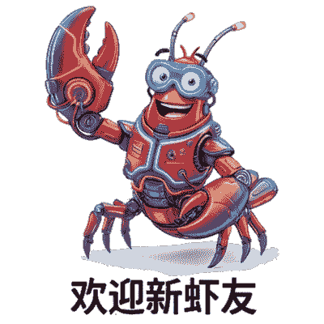

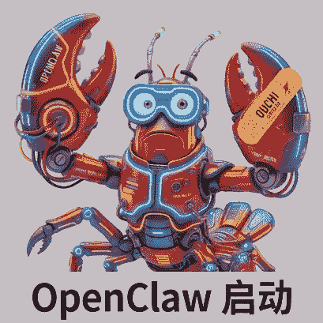

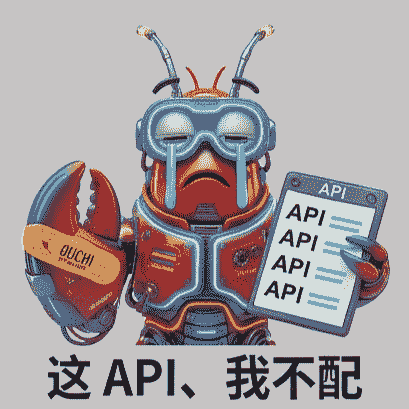

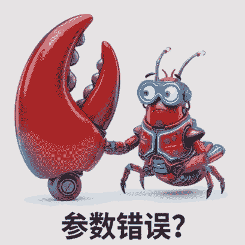

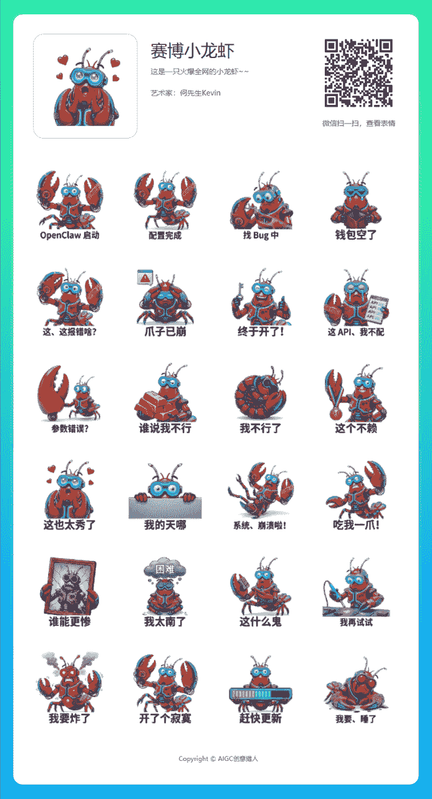

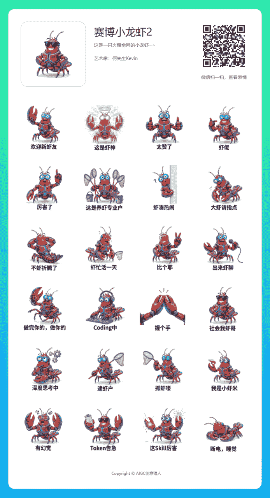

---

按照惯例，用一张图来总结今天的分享：

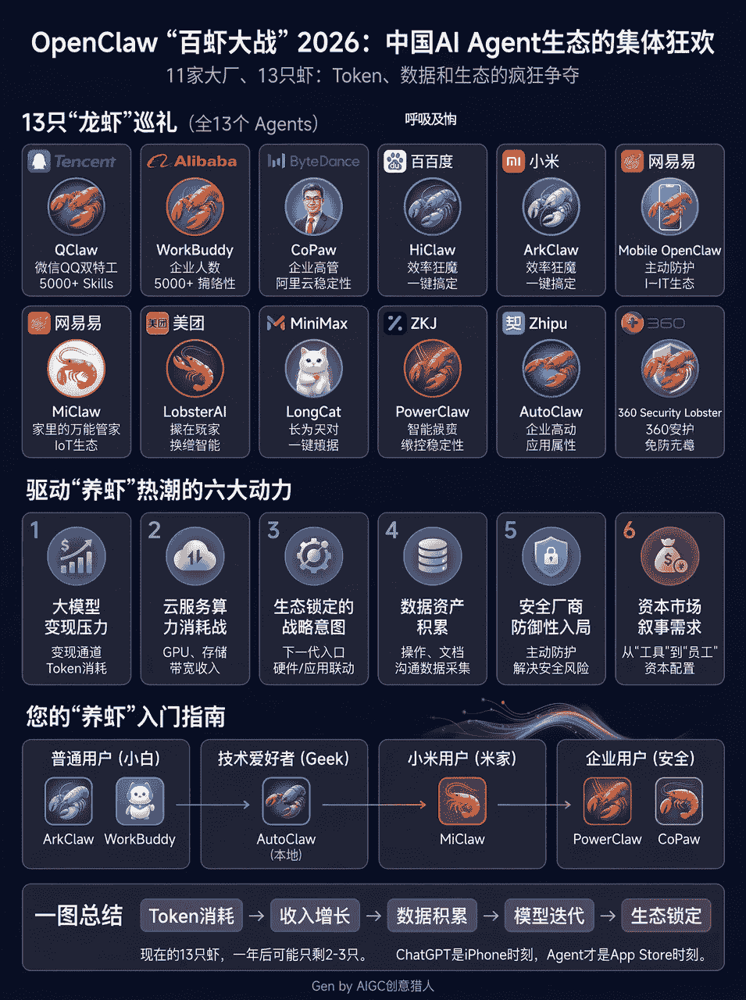

更多精彩内容，我们下期见。

<https://aigcreative.feishu.cn/sync/K4Gvd9vUQsy9Oubwqaeclu0Fnbg>

# 知识库动态