# 20260312-小龙虾OpenClaw在“偷啃”？这12个技巧帮你省Token！

> 来源：[https://aigcreative.feishu.cn/docx/ZdA3dwxjEoejs6xWgY3cFWyznId](https://aigcreative.feishu.cn/docx/ZdA3dwxjEoejs6xWgY3cFWyznId)

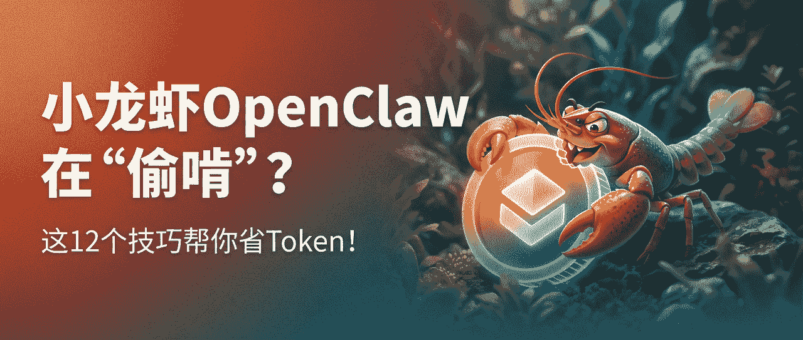

用OpenClaw一段时间后，很多人会有一个共同感受：这玩意儿太好用了，但Token也属实烧得肉疼。

尤其是跑长对话、做深度研究、或者让它帮忙写东西的时候，几千上万的token说没就没了。一个月下来，账单金额让人虎躯一震。

别急着关掉它。

其实OpenClaw有很多隐藏的省Token姿势，只是官方文档里写得比较分散。

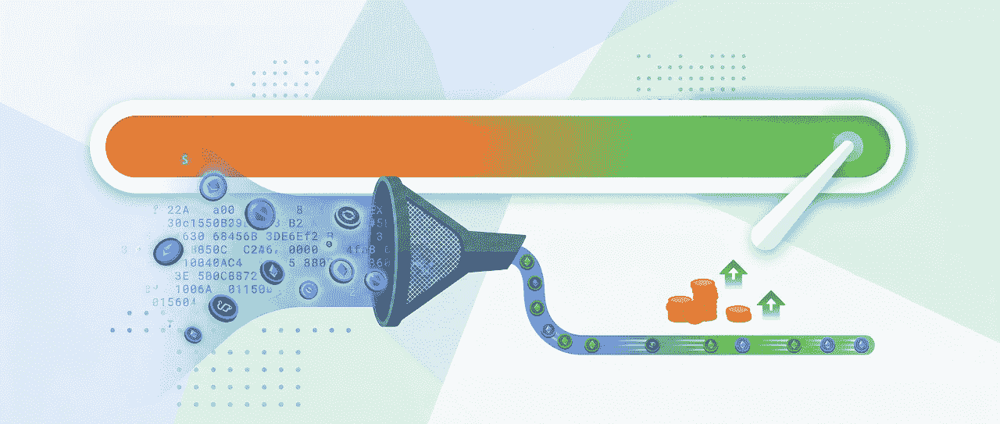

今天我把这些技巧整理成一份完整攻略，

让你的小龙虾停止偷啃Token。

应该能帮你省下不少钱。

## 1. 善用模型分级策略

OpenClaw最强大的功能之一是可以配置多个模型作为备选。核心思路是：简单任务用便宜模型，复杂任务再上高配模型。


在配置文件里这样设置：

```
{
  agents: {
    defaults: {
      model: {
        primary: &quot;anthropic/claude-sonnet-4-5&quot;,
        fallbacks: [&quot;moonshot/kimi-k2.5&quot;, &quot;minimax-portal/MiniMax-M2.5&quot;],
      },
    },
  },
}
```

你可以把最强最新的模型设为Primary，然后在fallbacks里放一些性价比更高的模型。

当前一个模型出问题或者响应太慢时，会自动切换到备选。

官方文档特别提到，对于一些低风险、不需要太强理解力的任务，比如查天气、设提醒，完全可以走便宜的fallback模型。

## 2. 调低图片分辨率

这是一个很多人会忽略的参数。

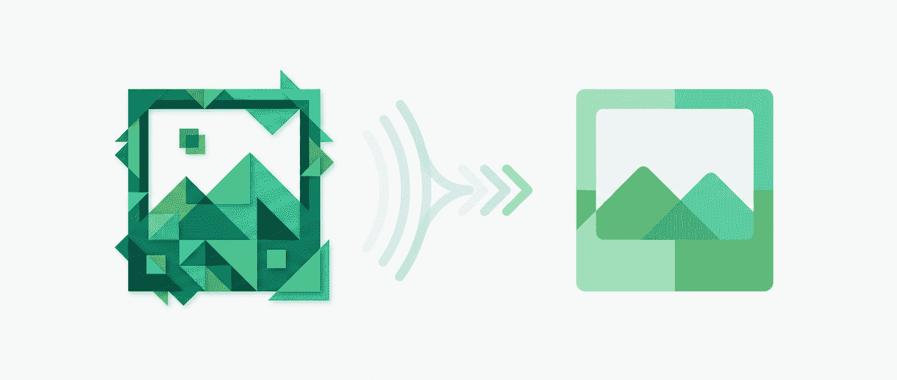

OpenClaw处理图片时会消耗大量token，尤其是截屏、照片分析这些场景。系统默认会把图片缩放到1200像素，但这个值可以调低：

```
{
  agents: {
    defaults: {
      imageMaxDimensionPx: 800,
    },
  },
}
```

对于只是需要识别界面元素、或者判断颜色这类简单视觉任务，800像素完全够用，但token消耗能少将近一半。

## 3. 定期清理会话历史

OpenClaw的会话是持久的，意思是它会记住你们之前聊过的一切。这个功能很方便，但也正是Token消耗的大户。


当一个对话持续太久、积累了巨量历史记录时，每次新的交互都要把这些历史全部读一遍，token自然爆炸。

解决方案是配置会话自动重置：

```
{
  session: {
    reset: {
      mode: &quot;daily&quot;,
      atHour: 4,
      idleMinutes: 120,
    },
  },
}
```

这表示：每天凌晨4点重置会话；如果连续120分钟没有活动，也重置。

你也可以随时手动触发重置，在对话里输入 /session reset 就行。

## 4. 把重要记忆写进文件

既然会话会消耗token，那不如换个思路：把需要长期记住的东西写进文件，让它需要时自己读取，而不是每次都从对话历史里重新学习。


OpenClaw的工作空间目录结构是有意义的：

+   Projects（项目）

+   Areas（领域）

+   Resources（资源）

+   Archives（归档）

这是官方推荐的记忆结构。把你的工作习惯、常用指令、偏好设置都写成文档放进去，下次需要时直接让它「读取文件」，而不是从几小时前的对话里重新理解。

这比依赖会话记忆要高效得多。

## 5. 精简System Prompt

OpenClaw会把大量上下文信息注入到每次对话里，包括各种工具说明、配置信息、 Skill定义。这些内容加起来可能比你的实际对话还长。

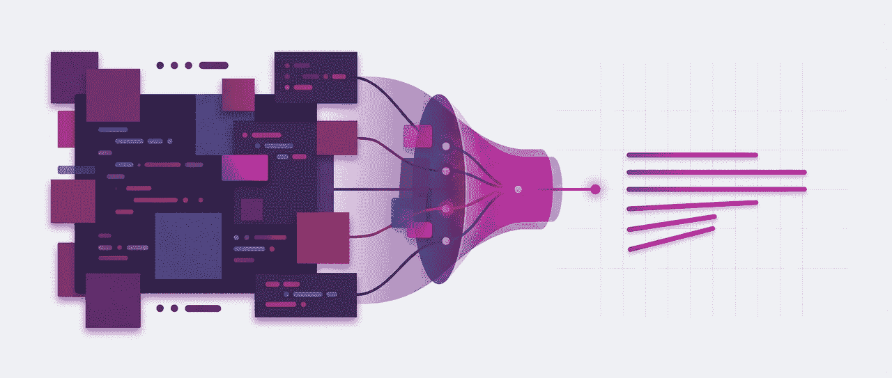

定期检查一下你的配置文件，看看有哪些不必要的描述、冗余的规则、或者从未使用过的Skill可以关掉。

少一行配置，可能就少几十到上百个token的注入。

## 6. 巧妙使用Thinking模式

OpenClaw支持Thinking模式，可以控制模型的思考深度。

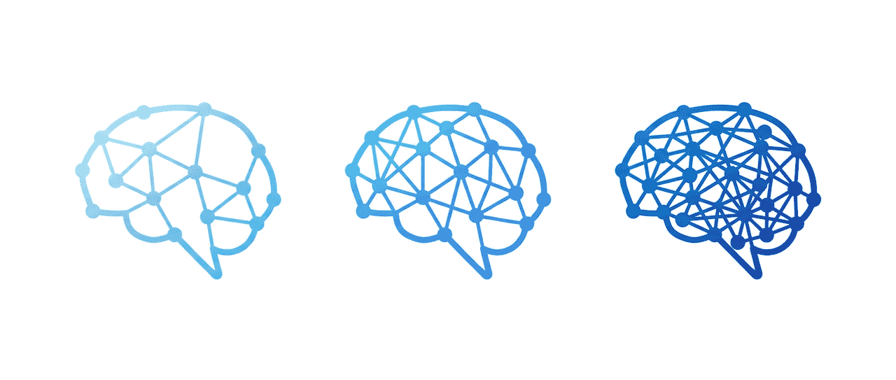

在对话里使用 --thinking low、--thinking medium、--thinking high 来调整。

简单查询用低思考模式，需要深度推理再用高模式。这不是黑科技，但很多人习惯性地用最高配置，其实很多问题用低模式就足够解决了，token消耗却能差好几倍。

## 7. 批量任务用子会话

如果你需要让OpenClaw处理一系列独立任务，不要在一个会话里做完所有事。可以用子会话来隔离任务。

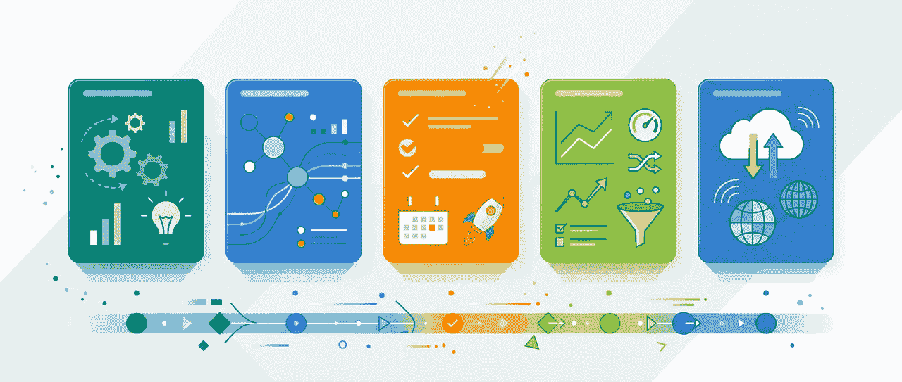

每个子会话是独立运行的，不会继承主会话的上下文。这意味着每个任务都是干净的start，不会带着前面任务的记忆。

具体用法是在命令后加 --sub-agent 或者 spawn 一个新session。官方文档把这叫做「隔离运行」，非常适合批量操作、数据处理这类场景。

## 8. 开启会话维护

OpenClaw有内置的会话维护功能，可以自动清理过期的会话记录和转录文件。

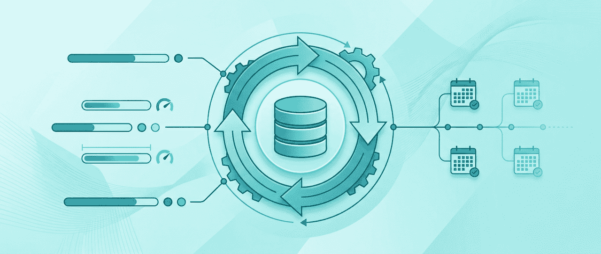

```
{
  session: {
    maintenance: {
      mode: &quot;enforce&quot;,
      pruneAfter: &quot;30d&quot;,
      maxEntries: 500,
      rotateBytes: &quot;10mb&quot;,
    },
  },
}

```

这相当于给会话存储设了个天花板。超过30天的记录会自动删除，转录文件太大也会自动轮转。

没有这个，每次重启或者积累久了，token消耗会越来越夸张。

## 9. 使用本地模型

如果你的电脑配置还行，可以考虑用Ollama或者本地部署的模型来跑简单任务。

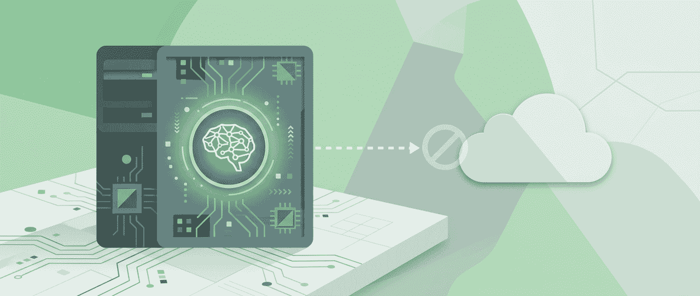

OpenClaw支持接入本地模型提供商，比如Ollama。这样一些不需要联网的简单任务就完全免费了。

当然，这需要你本地有足够的算力。对于一些固定的流程化任务，本地模型完全能胜任。

## 10. 限制上下文长度

在配置里可以设置最大上下文token数，

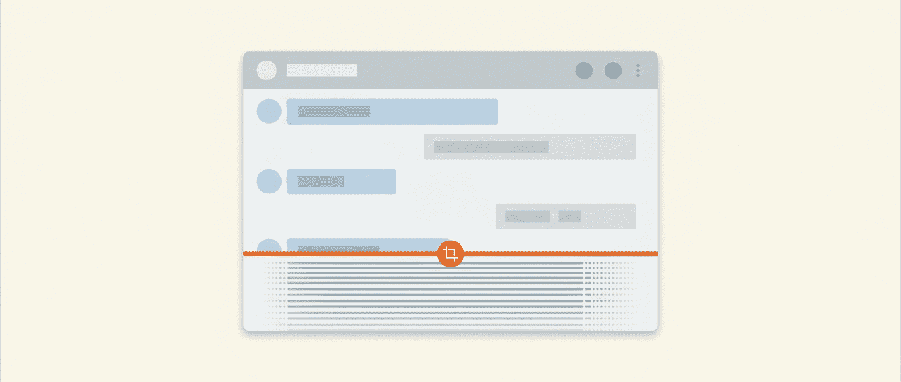

避免单次对话太长：

```
{
  session: {
    maxContextTokens: 100000,
  },
}
```

这样即使对话持续很久，也不会无限增长。超过这个阈值时，旧的内容会被压缩或者截断。

## 11. 关闭不必要的工具

OpenClaw有丰富的工具生态，但工具越多，每次调用时注入的描述就越长。

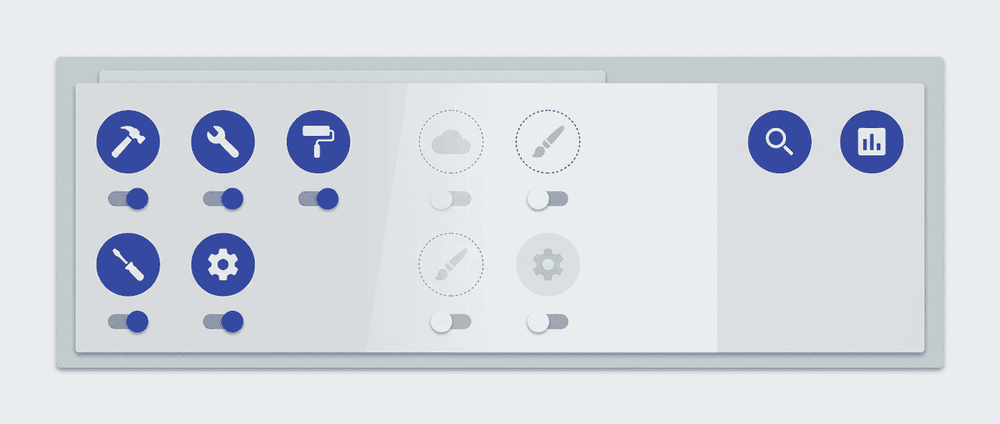

检查一下你的配置，把那些从来没用过的工具关掉。比如你不用浏览器自动化，就别加载浏览器相关的Skill。

省下的也是token。

## 12. 保持版本更新

OpenClaw团队经常在Discord和官方博客里分享新版本优化、性能改进。很多时候，一次版本升级就可能带来token效率的提升。


保持更新，有时候就是最好的省钱方式。

## 写在最后

OpenClaw是一个极其强大的工具，能帮你处理各种复杂任务。但强大往往意味着成本也需要管理。

以上这些技巧不是让你委屈自己少用它，而是更聪明地用。很多设置调完之后，你不会感受到功能损失，但Token账单会诚实反馈变化。

如果你也有什么独家的省钱妙招，欢迎在评论区分享出来，让大家互相抄作业。

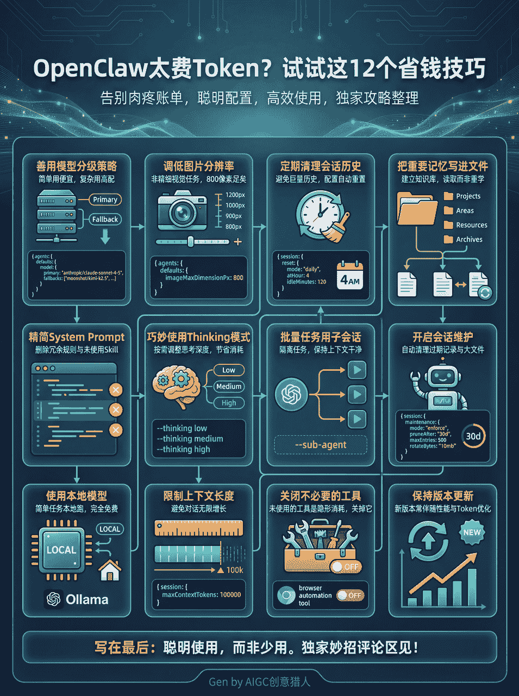

<https://aigcreative.feishu.cn/sync/K4Gvd9vUQsy9Oubwqaeclu0Fnbg>

# 知识库动态