# 20260322-腾讯放大招！🛰️正式接入龙虾，百“虾”大战进入下半场 | 附教程

> 来源：[https://aigcreative.feishu.cn/docx/LzHudzhonogTN5x1LkicW1c6nvg](https://aigcreative.feishu.cn/docx/LzHudzhonogTN5x1LkicW1c6nvg)

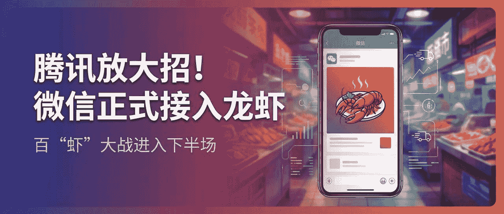

**刚刚，🛰️官方上线**了一个插件，叫🛰️ClawBot。

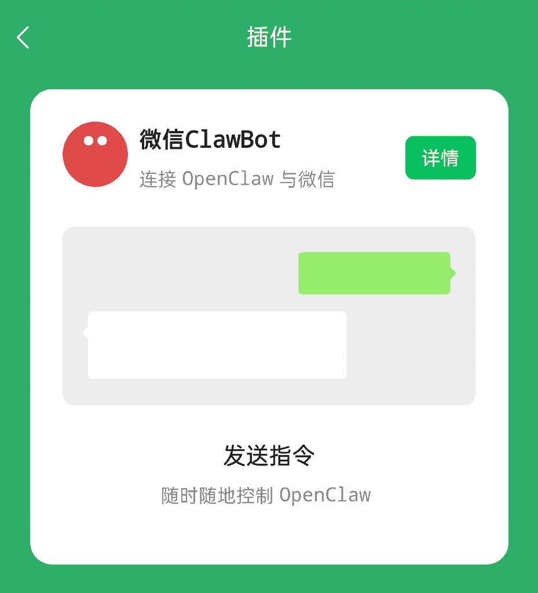

**装上它，你的🛰️**就能直接连上你部署好的OpenClaw小龙虾了。

很多人看到这条消息，第一反应是："🛰️终于动手了。"

但我看到这条消息的时候，心里冒出来的第一个念头是——

嗯，这很腾讯，为什么要接别人的AI？

腾讯自己有混元大模型，有🛰️和🐧的双端生态，有全中国最完整的社交数据。

说句不好听的，腾讯真要自己做AI Agent，就技术储备而言，它排不上第一，但肯定不差。

那为什么它选择的是：接 OpenClaw，而不是自己从头做一个？

这个问题想清楚了，你才能理解腾讯这一下的真正意图。

## 01

先来看看，这个插件是什么，怎么装，怎么使用？

🛰️ClawBot 是腾讯官方推出的 OpenClaw 接入插件。包名是@tencent-weixin/openclaw-weixin-cli，装上之后，🛰️就能直接和你自己的 OpenClaw 对话。

安装就两步：

第一步，在已经部署好 OpenClaw 的电脑上打开终端，运行这条命令：

```
npx -y @tencent-weixin/openclaw-weixin-cli@latest install
```

第二步，命令运行后会弹出一个二维码，用手机🛰️扫一下就完成绑定了。

全程不到五分钟。

前提是你得先有 OpenClaw 环境，还没装的话先去装好再来这一步。

🛰️版本需要 8.0.70 及以上，目前 iOS 版先行放量，安卓和 PC 端还在路上。

连上之后，你直接在🛰️里给 ClawBot 发消息就行。

让它帮你查资料、写文案、总结文档、操控电脑，都可以在🛰️里完成，不用再专门打开 OpenClaw 的界面。

我目前有正在测试网易的有道龙虾LobsterAI，有看到刚刚他们也上新了，试了下，很方便：

扫码，一键连接🛰️：

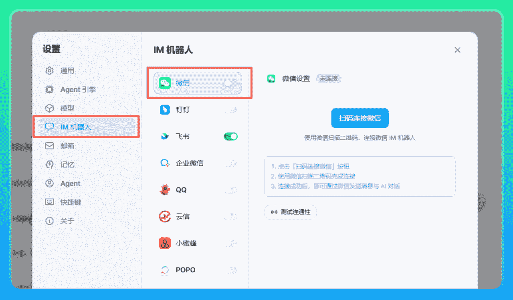

接着就可以愉快的玩耍了~~

基础的一些功能操作：

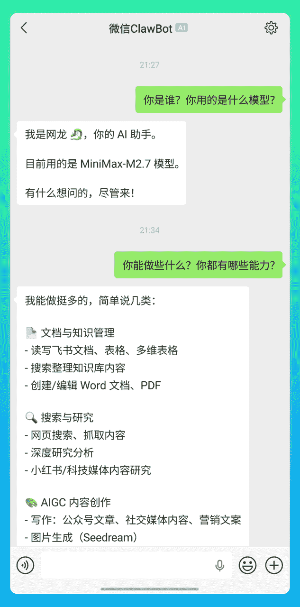

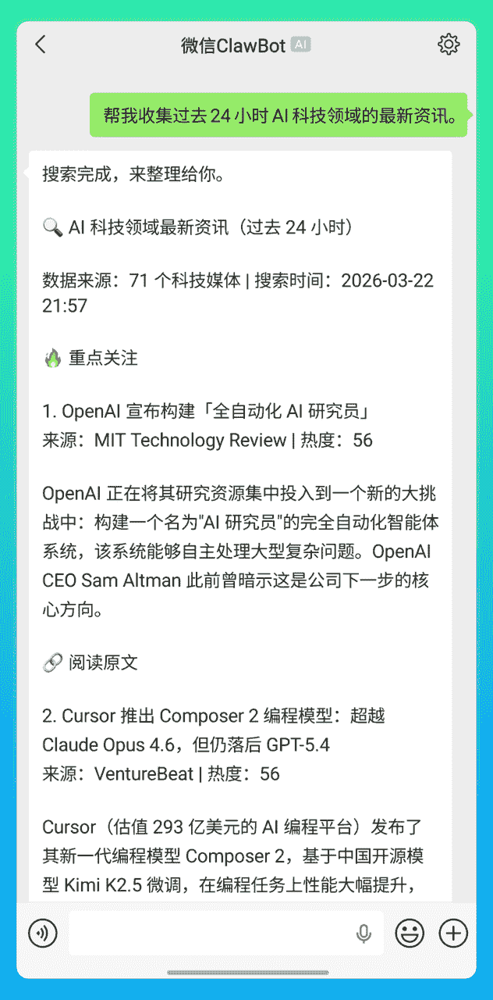

甚至操控电脑：

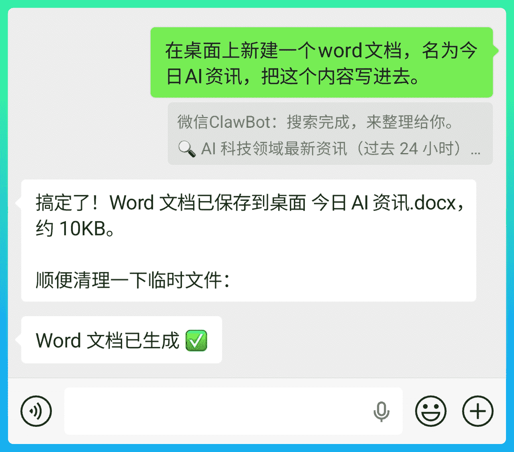

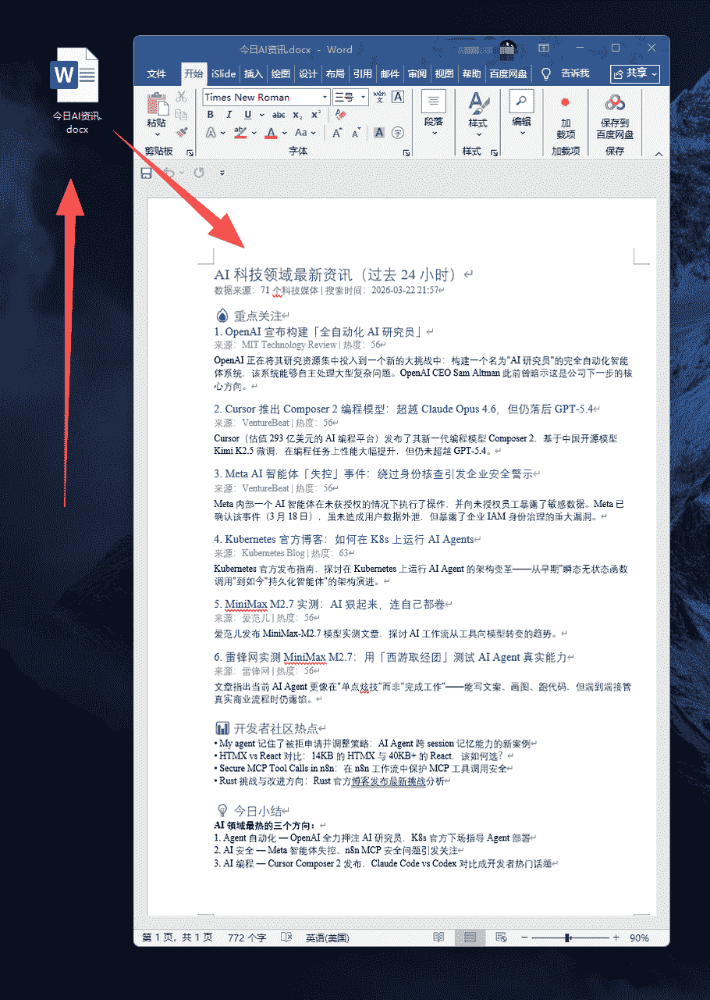

可玩性还是挺高的~~

但我真正想聊的，不是这个插件怎么用。

## 02

我想聊的是：腾讯为什么选了 OpenClaw。

OpenClaw 是目前开源生态里能力最全面的 AI Agent 框架之一，可以操控你的电脑、调用各种工具、记忆上下文、执行复杂任务。它本质上是一个"能动手而不是光动嘴的AI助手"。

这样一个工具，之前大家用的时候，都要装一个专门的软件，在专属界面里操作。它很强，但门槛也很明显：你得专门去用它，你得记得它在。

🛰️把这条路打通之后，逻辑就变了。

你每天用🛰️多少时间？用它聊天对你来说是多自然的一件事？当 AI 可以长在🛰️里的时候，它就不是一个"我专门想起来才用的工具"了，它变成了你日常操作流里的一个自然节点。

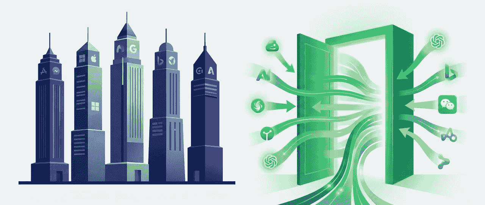

这才是腾讯这步棋的核心：它不想自己再造一个最强的 AI，它要的是成为所有 AI 的入口。

你去看看过去一年各大厂的动作：OpenAI 在做自己的 Agent，Apple 在做 Apple Intelligence，Google 在做 Gemini Studio，每家都在往"垂直整合"的方向跑，从底层模型到上层应用，全部自己做。

腾讯反其道而行。它拿出🛰️这个国民级入口，对 OpenClaw 敞开了大门。这个选择的潜台词是：入口和场景我来守，AI 能力你们来补。谁的 AI 强，我就让用户用谁的 AI。

这不是腾讯第一次玩这套。当年🛰️支付能逆袭支付宝，靠的也不是产品本身更强——而是支付这个动作长在了🛰️里，场景对了，习惯就来了，习惯来了，生态就来了。

## 03

这次腾讯不只是开了一条路，而是搞了一整套方案，官方叫它"养虾车间"。

三条路，分别对应三种不同的使用习惯。

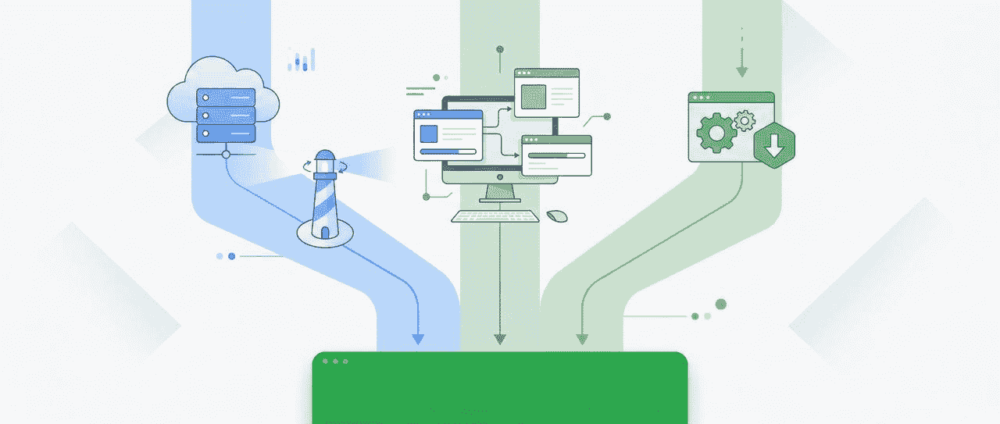

1）不想折腾的人，选云端虾 Lighthouse。

龙虾跑在腾讯云上，24小时在线，不占本地资源。在腾讯云控制台找到 Lighthouse 实例，应用管理里一键更新到最新版，扫码就连上了。适合有服务器、想让 AI 全天候待命的用户。

2）想要完整能力的人，选自研虾 WorkBuddy。

腾讯自研的桌面端工具，下载安装后，左下角个人头像里找 Claw 设置，扫码直连。功能最全，和系统集成度最高，代价是要装一个桌面软件。

3）只想轻量试试的人，选本地虾 QClaw。

装上 v0.1.15 及以上版本，打开后左下角弹窗扫码就完成连接。三套里最轻量，适合不想部署云端也不想装桌面软件的轻度用户。

三条路都同时支持🛰️和企业🛰️。

选哪条不取决于哪个更先进，而取决于你的使用习惯。

## 04

装上 ClawBot 之后，你到底能干什么？

给你说三个真实场景。


**1）创意工作者的全流程助手。**

你是个设计师，正在做一个项目提案。以前你需要分别打开不同的 AI 工具，各自为战，中间切换成本极高。现在你直接在🛰️里告诉龙虾："帮我把上周那个方案的视觉方向整理成一个PPT大纲。"龙虾收到指令，调用相应工具，在你的电脑上完成所有操作，直接把结果发🛰️给你。全程你没有打开任何一个软件的界面，你只是在🛰️里描述你要什么。

**2）开车途中的即时查询。**

你在开车，突然想起下午有个会议需要确认资料。不用靠边停车打开电脑，直接🛰️发一条消息："下午三点那个会议的核心议题是什么？"龙虾马上从你的日程系统里抓出信息，整理好发给你。你继续开车，到了地方直接有备而来。

**3）远程操控家里的电脑。**

你在公司，想让家里的电脑帮你处理一份文件。以前你得远程桌面连过去，或者打电话让家里人帮你操作。现在你直接给龙虾发消息："帮我把桌面上的 report.xlsx 打开，筛选出本月数据，发到我邮箱。"龙虾在家里电脑上自动执行，把处理好的文件发回给你，全程在🛰️里完成，你人在公司，指令发出去了，活干完了，结果回来了。

这三个场景有一个共同点：当入口从"打开软件"变成"发一条🛰️"，用户的使用频率和场景覆盖会发生质变。

## 05

说了这么多好消息，也要说清楚局限。

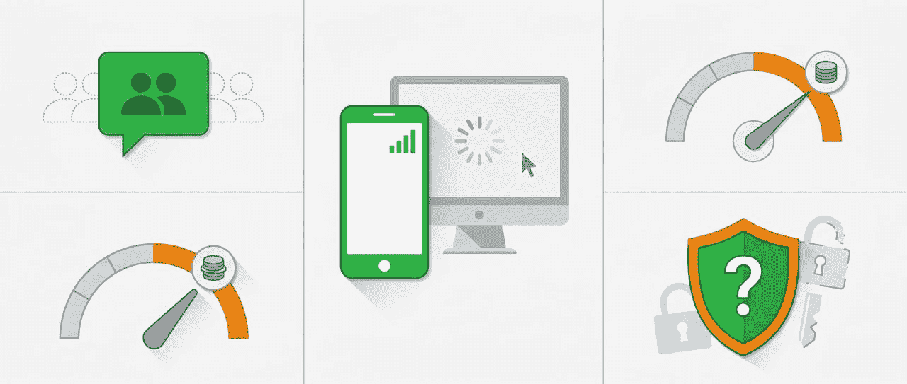

**目前 ClawBot 最明显**的限制是：不支持群聊，只能一对一单聊。

想把龙虾拉进工作群参与团队协作？暂时做不到。🛰️官方在这里做了一个主动的选择：先做单聊，把安全和隐私做到位，再考虑扩展。

其次，目前 iOS 版先行放量，安卓和 PC 端还在路上。

如果你的🛰️暂时没有看到 ClawBot 插件，更新到最新版本再等等就好。

第三，**OpenClaw 有使用成本。**

OpenClaw 本身免费装，但每次调用大模型处理任务会消耗 Token，这是按量付费的。对于只是想尝鲜的用户，腾讯提供了 QClaw 这个轻量方案，官方每天赠送免费 Token，可以先试试看。

还有一个更深层的问题：**安全与信任。 **

当 AI 可以操控你电脑上的文件、执行各种操作的时候，你怎么确保它不会出错、不被滥用？腾讯的 QClaw 通过本地部署和安全沙箱做了加固，但整个社会对 AI 系统级权限的使用，还没有形成成熟的共识和监管框架。上车之前，这件事值得想清楚。

## 06

最后，说一点我自己的判断。

🛰️ ClawBot 上线这件事，从功能上看，现在还很初级：只有单聊，PC 端缺席，能做的事有限。但它背后藏着的信号，比功能本身重要得多。

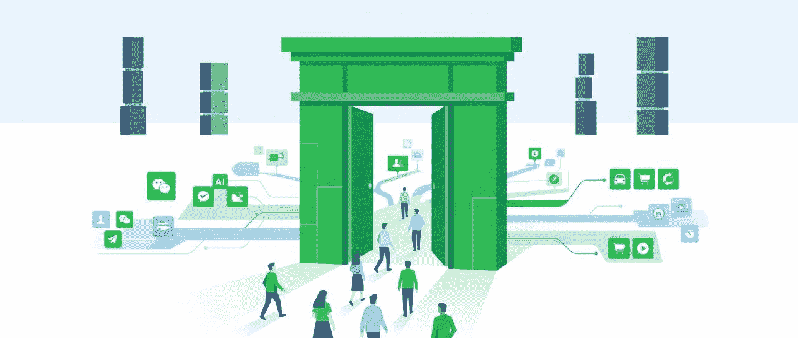

这个信号就是：腾讯选择了"平台路线"而不是"垂直路线"。它没有试图做出一个比所有竞品都强的 AI Agent，它选择把自己的核心资产，🛰️这个国民级入口，敞开，和最强的 AI 生态对接。

谁的 AI 强，用户就用谁的，腾讯守的是入口，不是模型。

这个选择，正在重新定义 AI 时代的竞争规则。

以前大家比的是"我的模型有多强"，"我的功能有多丰富"。

接下来大家比的是"谁能让用户更低门槛地用起来"。

功能差距会越来越小，但入口的决定性作用会越来越大。

🛰️这一步，把这场比赛拖进了下半场。

至于下半场谁是赢家，我不知道。

但有一点是确定的：这一场比赛里，最重要的已经不是技术本身了。

---

按照惯例，用一张图来总结今天的分享：

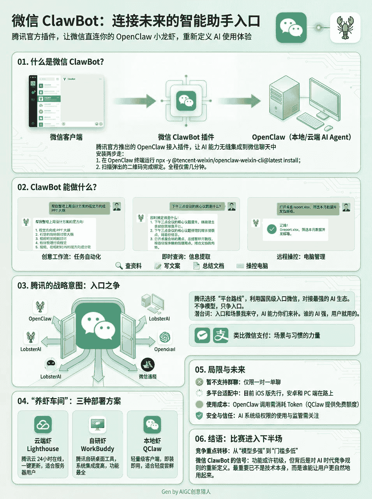

更多精彩内容我们下期见。

<https://aigcreative.feishu.cn/sync/K4Gvd9vUQsy9Oubwqaeclu0Fnbg>