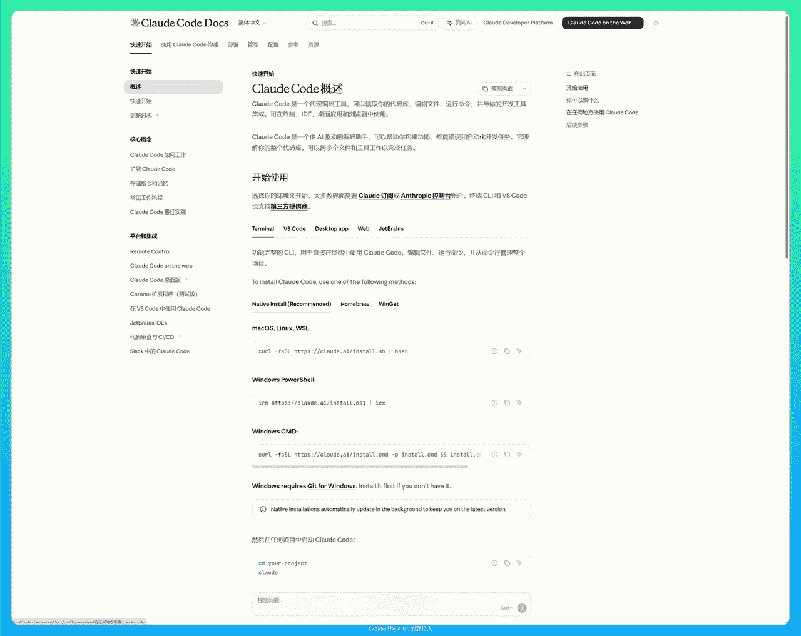

# 工具：Claude Code

> 来源：[https://aigcreative.feishu.cn/docx/IiGTdidoio2t6JxJU1dchIcQn4d](https://aigcreative.feishu.cn/docx/IiGTdidoio2t6JxJU1dchIcQn4d)

> 官网文档：https://code.claude.com/docs/zh-CN/overview

> 教程网站：https://claudecode.tangshuang.net/

<https://aigcreative.feishu.cn/sync/K4Gvd9vUQsy9Oubwqaeclu0Fnbg>