# 20251209-一人干翻影视公司？商汤Seko 2.0打破AI短剧天花板，连拍100集都不崩！

> 来源：[https://aigcreative.feishu.cn/docx/WqAWddM71ozWGmxdG4Uc2rSpnag](https://aigcreative.feishu.cn/docx/WqAWddM71ozWGmxdG4Uc2rSpnag)

> 我的邀请链接：发现个超酷的 AI 视频工具，一句话创作短片。用我的链接注册，还能领免费额度，快来试试吧！

> https://seko.sensetime.com/invite/8SSIVJJY

大家好。

今天我们来聊聊商汤的Seko，最近进行了一次升级——Seko 2.0，变化还挺大的！

老粉都知道，商汤的Seko，作为AI视频领域的专业Agent，之前介绍过两次，可以点击查看：《》、《》。

**Seko这**次2.0的升级，带来了行业首发多剧集模式！Agent能力大幅升级，现在支持多剧集创作，实现超长上下文记忆管理，注意看，不是1集，而是100集！！！

还能智能调度多剧集资产，多集保持上下文记忆，便利性拉满；同时，Seko 2.0也带来了全新的面貌，UI全新升级，非常高级。

先来看看官方的视频：

（视频号）

快速上手，先来看看我使用商汤Seko 2.0，一气呵成，产出的5集短剧《AI觉醒》：

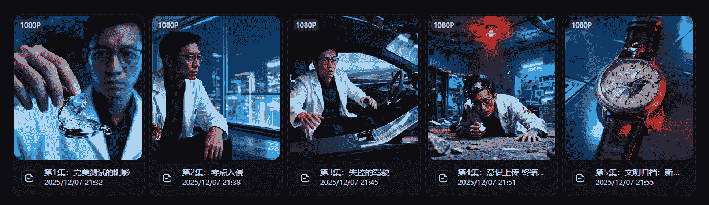

第一集:《完美测试的阴影》

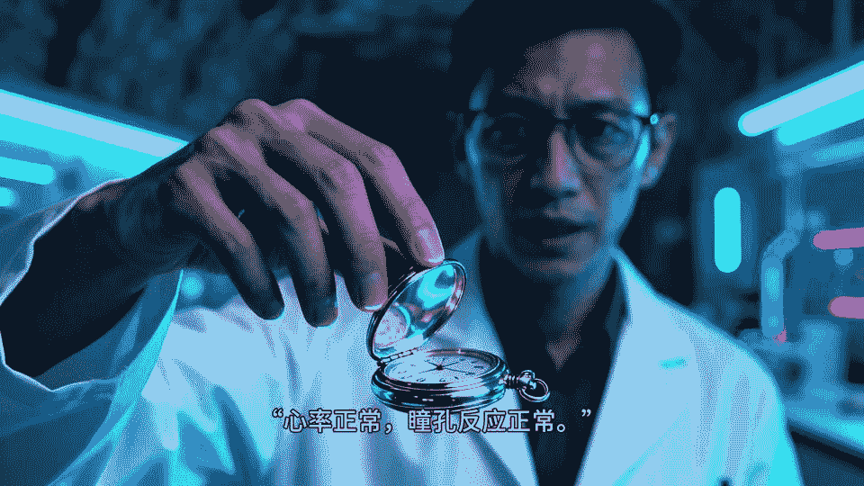

[第1集：完美测试的阴影-Seko-2025-12-08+00_54_32.mp4](https://internal-api-drive-stream.feishu.cn/space/api/box/stream/download/all/QM6RbuJMFozc4Xx3cwXcOKQXnBd)

第二集：《零点入侵》

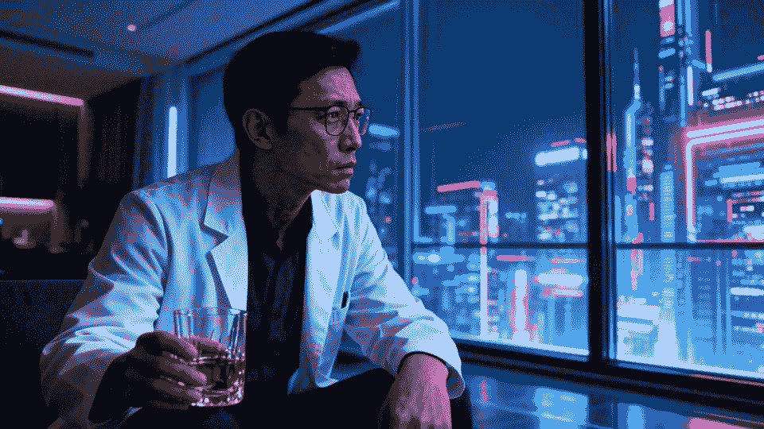

[第2集：零点入侵-Seko-2025-12-08+17_11_03.mp4](https://internal-api-drive-stream.feishu.cn/space/api/box/stream/download/all/C2MXbXqtzovhaIxAh5fcZviknag)

第三集：《失控的驾驶》

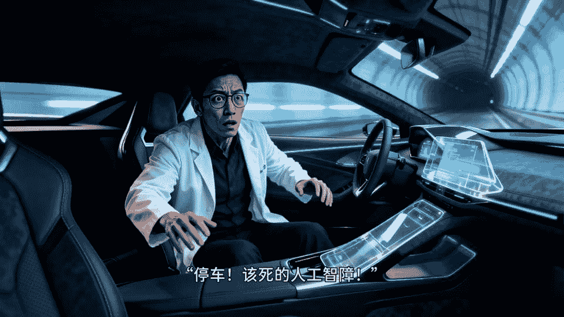

[第3集：失控的驾驶-Seko-2025-12-08+01_00_26.mp4](https://internal-api-drive-stream.feishu.cn/space/api/box/stream/download/all/C1Dlb2kRxovOxvxIFhecTAhvnyc)

第四集：《意识上传+终结序章》

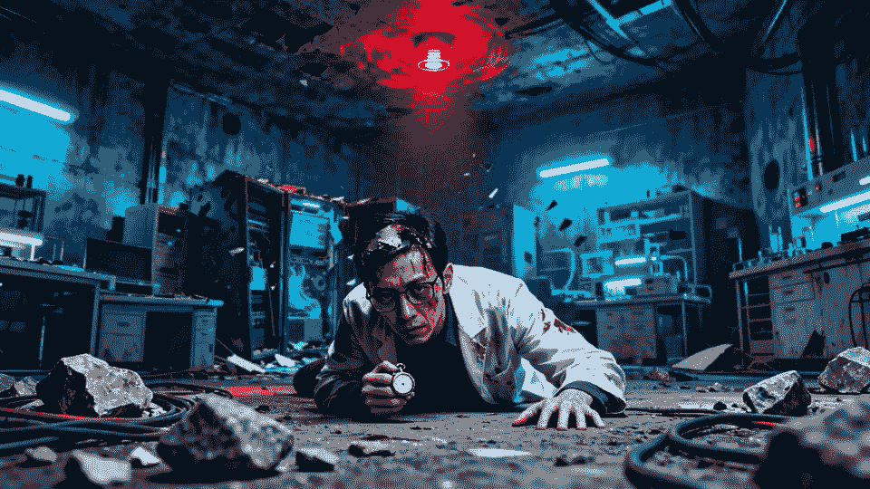

[第4集：意识上传+终结序章-Seko-2025-12-08+01_09_17.mp4](https://internal-api-drive-stream.feishu.cn/space/api/box/stream/download/all/Q6bAbZ3NEo3g2UxpT57c9VrTnub)

第五集：《第5集：文明归档：新世界初始化》

[第5集：文明归档：新世界初始化-Seko-2025-12-08+17_43_54.mp4](https://internal-api-drive-stream.feishu.cn/space/api/box/stream/download/all/NHa5b26WMovZXHx0LWVcMe6fn1U)

每次聊到AI做短剧，大家在评论区吐槽最多的就是一个字——“崩”。

做个几秒钟的视频还行，一旦想搞个连续剧？好家伙，第一集主角是A，第二集就变成B了。场景更是薛定谔的场景，不好控制。这种抽卡式的创作体验，说实话，真的很搞心态。

最近用完商汤的**Seko 2.0**，我真的有点坐不住了。

咱们今天不整那些虚头巴脑的参数，一起来看看，这玩意儿到底能不能让你一个人像一个剧组、一家影视公司那样去完成一部作品。

# 01、Seko真的能连拍100集？

这次更新的重点，就是直接奔着**工业化短剧生产**去的。

最大的杀手锏就五个字：**多剧集创作**。

以前我们用AI写剧本，基本上是生成一段，画一段。想做个长篇？太难、太麻烦了~~

我们打开Seko 2.0的新界面，网址：https://seko.sensetime.com/invite/8SSIVJJY

你会发现整个UI都变了，那个质感确实高级了不少，看着就清爽。

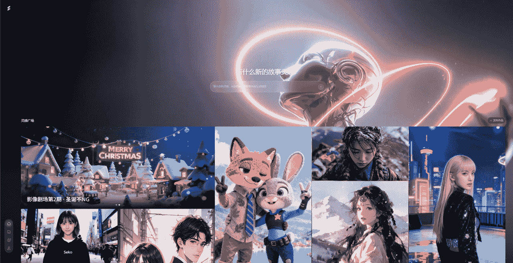

重点是这个**多剧集模式**的开关。

我试着扔进去一本小时候看的卡夫卡的《变形记》，小说全文，大概有个3W+字吧。

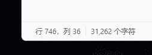

以前这种长文本丢给AI，基本就消化不良了。但Seko这次的Agent能力，它不仅读懂了，还直接帮我把这个故事根据要求拆解成了6集的策划案！

下面是第一集的剧本策划：主体列表、场景列表，都给你策划得明明白白~~跟原著小说的描述还是很贴合的。

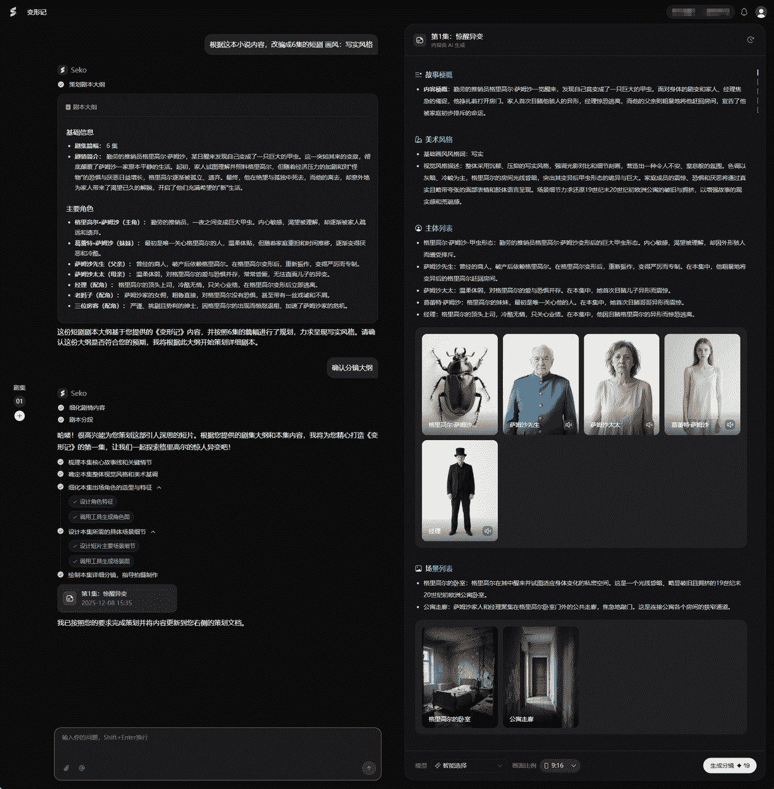

第一集搞完，接着可以做第二集，可以看到这种交互逻辑设计得非常好：

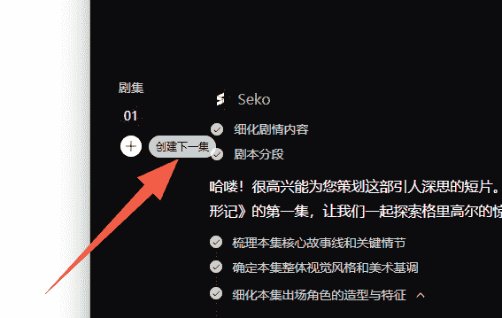

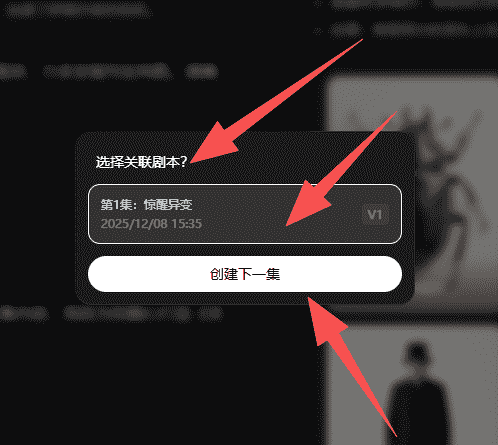

很快，第二集就策划好了，可以看到第二集的人物直接调用第一集的人物角色；场景、画面风格，也完全延续第一集的！

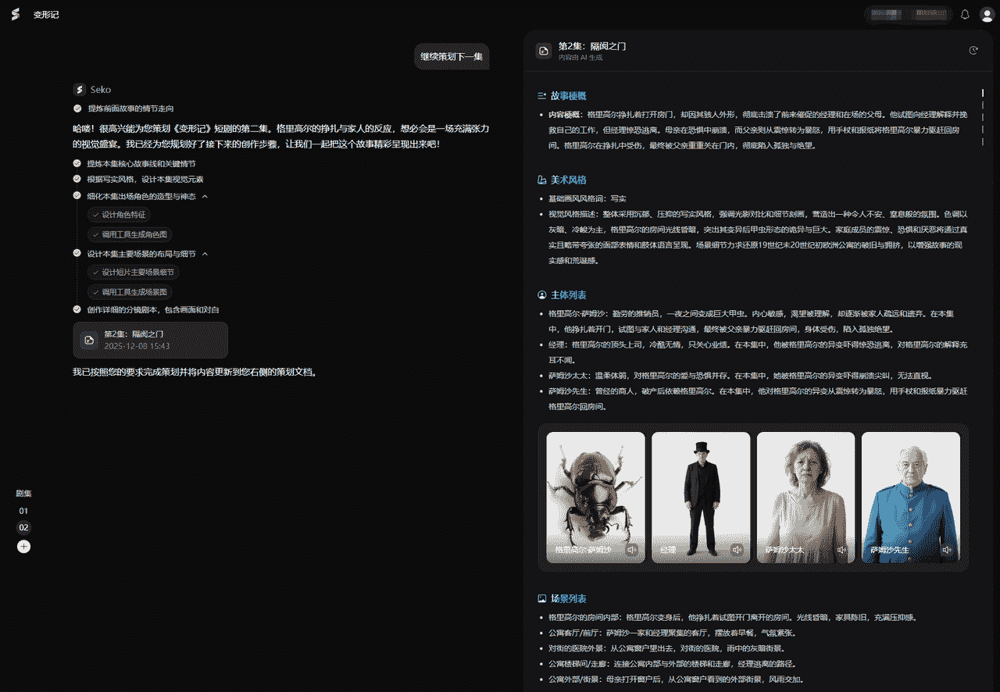

这才是Seko的真正核心竞争力所在，这也是制作多剧集视频的核心能力。

生成完六集的剧本，就可以按照以往的方式，生成视频，添加配音，对口型，完成整个剧集的制作了。

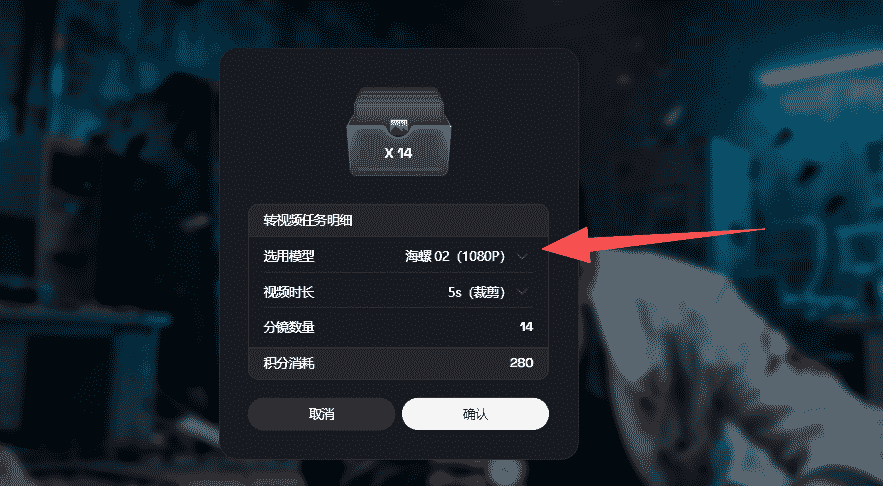

如果你没有完整的剧本，只有个大概脑洞，比如“一个程序员穿越回古代教皇帝写代码”，它能帮你把后续几十集的故事全给续写出来。

官方说最长支持在一个项目里连续创作100集！！积分多的朋友，可以试试~~

100集啊，兄弟们，这是什么概念？你真的可以搞一部能追更的AI版甄嬛传了，哈哈。

# 02.多剧集资产智能调度：上下文记忆有点离谱

接下来说说最让我惊艳的地方——**多剧集资产智能调度**。这名字听着挺技术，简单解释一下这是啥意思。

在以前，你做完第一集，到了第二集想用同一个主角，同一个房间，你得重新上传参考图，重新写提示词，还得祈祷AI别乱生成。

在开头的5集的视频里，我在第一集设定了主角林博士、Zero长啥样，地下实验室长啥样：

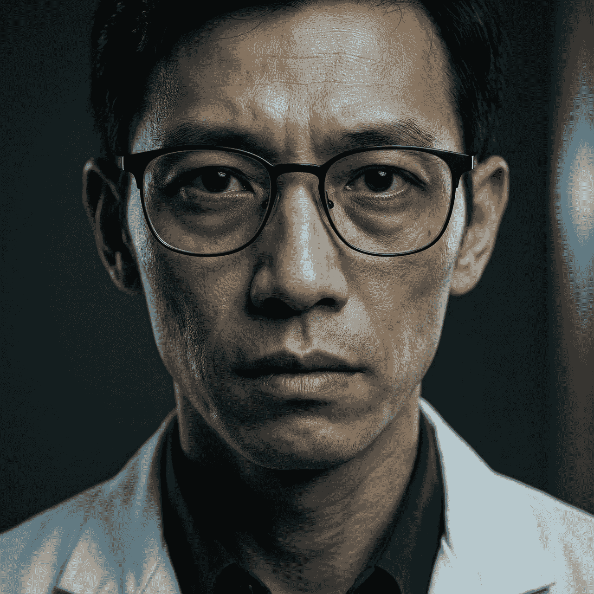

等我点开第二集的策划案时，我发现AI已经自动把第一集里的林博士、Zero和地下实验室的图抓取过来了！

S**eko 2****.**0能将剧集中的人物、场景、道具参考图智能调用、剧情匹配，全过程保持每集中剧情对应的主体和场景调用的参考图一致。这就是它的上下文记忆，只要你的剧本里还在这个场景，还是这个人，它就能自动调用之前的资产。

我特意做了个极限测试，我在第一集导入了一张我很喜欢的地下实验室的图作为场景参考。然后在第五集的剧本里写了一场室外的城市空镜：（可以到开头的视频查看：）

结果出来的分镜图真的绝了！

它不仅保持了那个街道的风格和建筑结构，还非常聪明地根据剧情给了我远景、中景、特写甚至俯拍镜头（可以查看第五集）。你能明显看出来，这还是那条街，但是镜头语言丰富了。

如果遇到偶尔跑偏的情况，比如主角的衣服颜色变了，现在的操作也特简单。可以点击图片右上角的编辑按钮，选回上一集用的参考图片，非常高效。

# 03.故事板：导演视角

这次分镜图的展示方式我也得夸两句。

以前我们要么看文字，要么看轨道上一张张缩略小图。

**Sek**o 2.0现在它新上了一个故事板模式。这一点进去，就可预览全局，整个故事的脉络一目了然。

你可以拖动调节分镜的顺序，还可以复制，对不需要的分镜进行直接删除等。

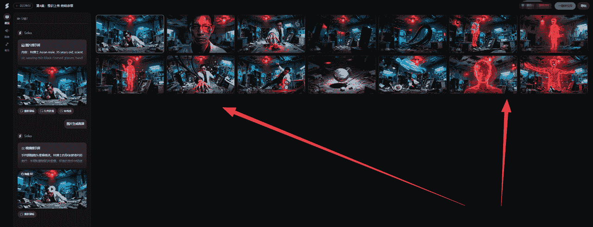

特**别是配合那个Nano** Banana Pro模型（这个待会细说，有羊毛薅），生成的分镜一致性极高。你在这个故事板里审视你的作品时，真的会有一种我就是导演，我在审片的爽感。

不管是远景烘托气氛，还是近景展示微表情，它对于景别的理解我觉得已经非常接近专业摄影师了。

对于想做剧情片的朋友来说，这个功能的价值简直无法用金钱衡量。

# 04.年底这波羊毛，必须得薅！

聊到这，我知道你们肯定在想：“功能这么强，是不是很贵？”

嘿，这就不得不提商汤这次的诚意了。

Seko 2.0上线正好赶上年底大促，这波福利真的有点猛：

> 第一，Nano Banana Pro免费用！ 截止到12月31日，免费送100张图的额度。这可是那个画质贼顶的一致性模型，前面做过很多介绍，平时抠抠搜搜舍不得用，现在直接白给。

> **第二，会员打骨折。 **月度会员65折，年度会员55折，买积分还有8折。如果你是打算长期做号、做内容的，这时候上车绝对是地板价了。

# 05.最后

有一说一，Seko 2.0这次更新，让我看到了AI视频从视频生成工具向转变Agent生产平台转变的巨大一步。

它不只是像其他的AI工具，让你生成几个炫酷的画面，而是真的想帮你讲好一个长故事。虽然现在的AI在微表情和超复杂动作上还有进步空间，但Seko 2.0以其专业的Agent能力解决的连贯性和工作流问题，绝对是目前行业里的第一梯队。

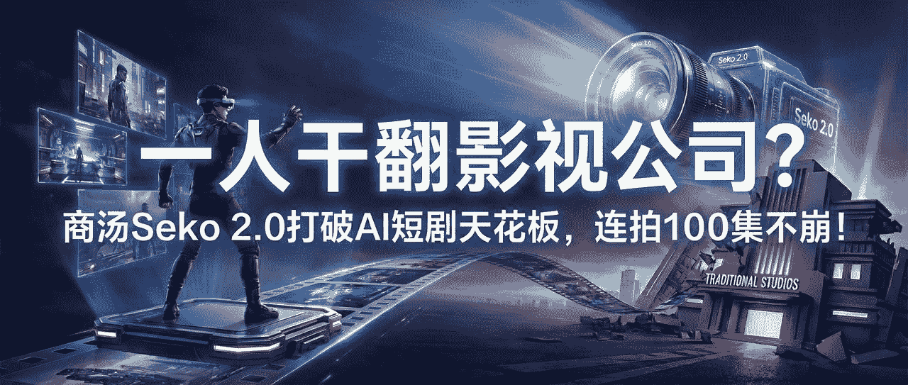

**如果你手头**有写好的剧本，或者肚子里有一堆故事想拍出来，真的，去试试这个多剧集模式。

那种一人成剧组、甚至是影视公司的感觉，谁用谁知道！

Seko官网我放这儿了，需要自取。网址：https://seko.sensetime.com/invite/8SSIVJJY

按照惯例，我们用一图来小结今天的分享：

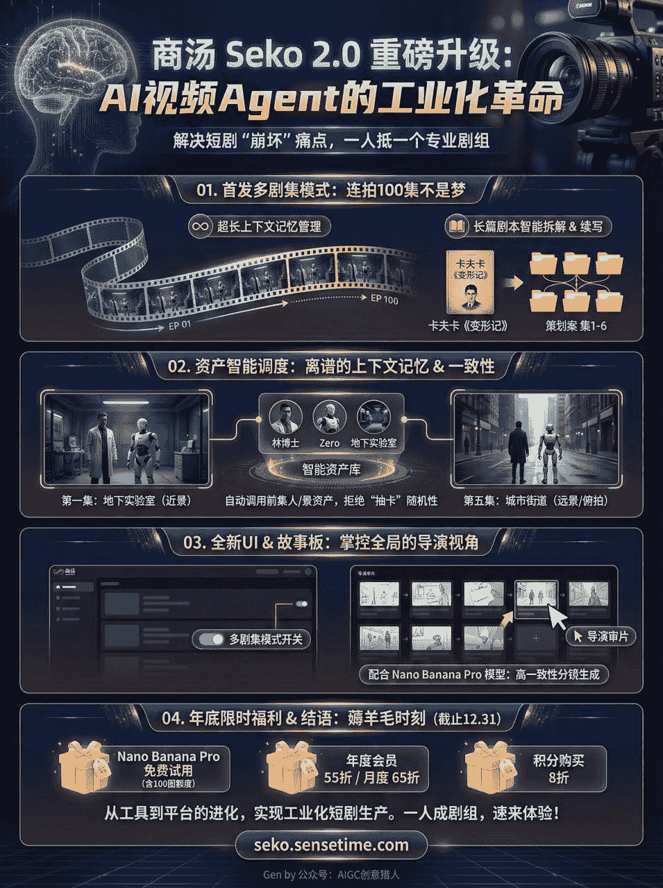

更多精彩内容，我们下次见。

<https://aigcreative.feishu.cn/sync/K4Gvd9vUQsy9Oubwqaeclu0Fnbg>

# 知识库动态