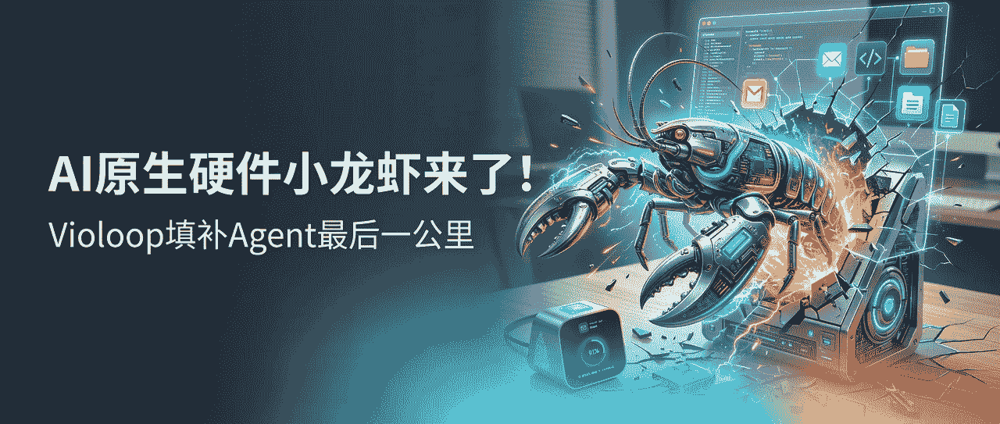
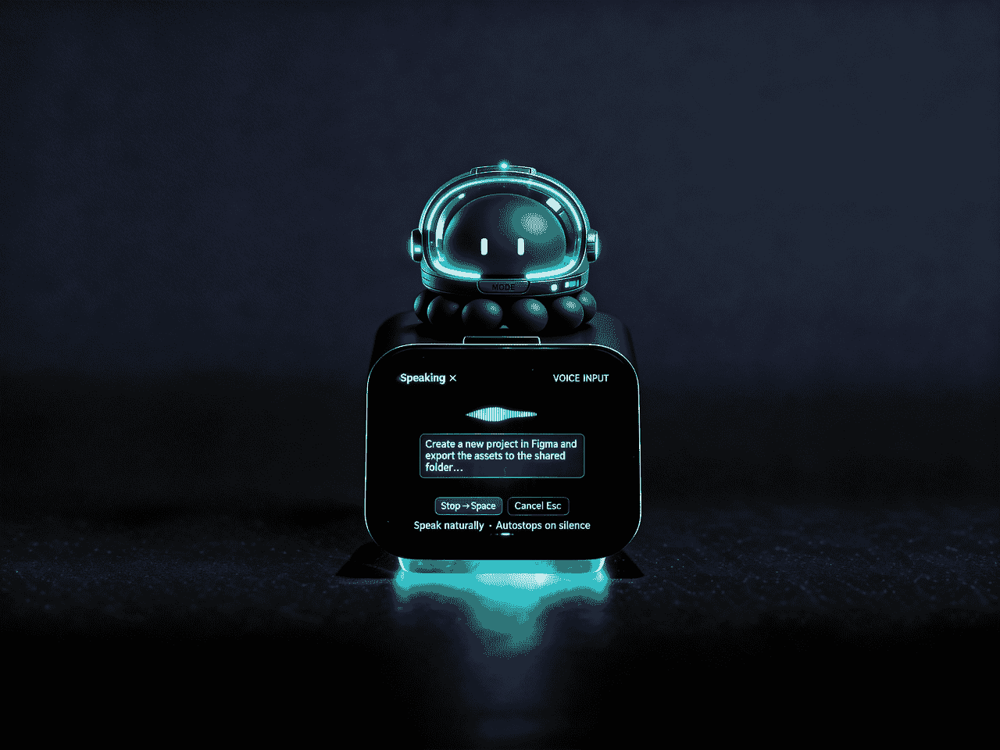
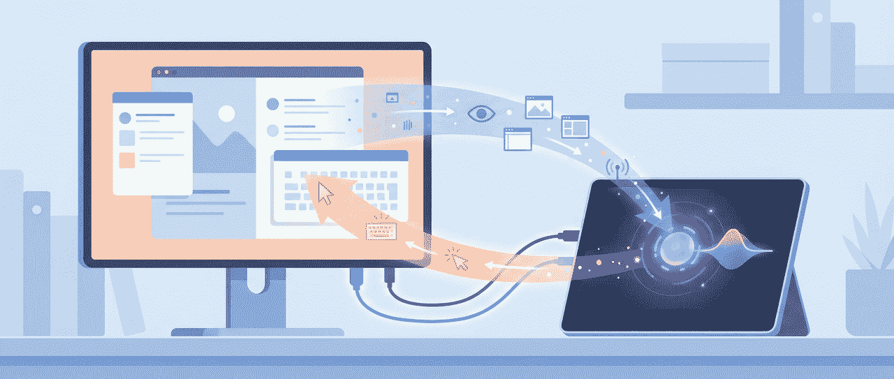
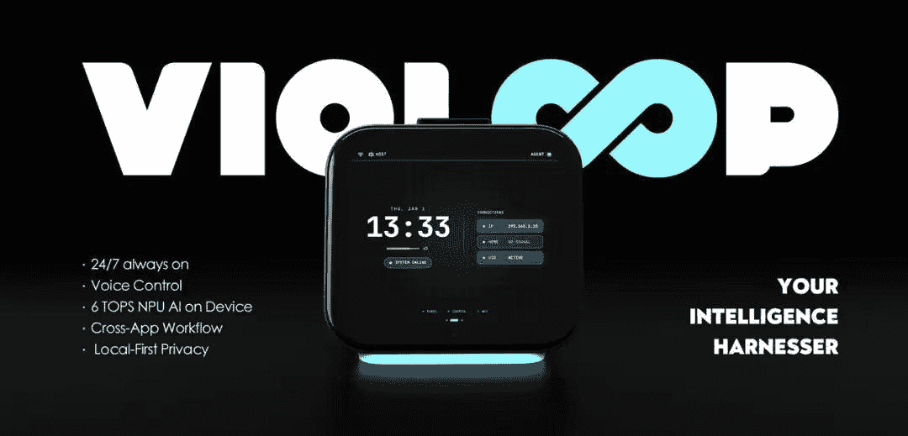
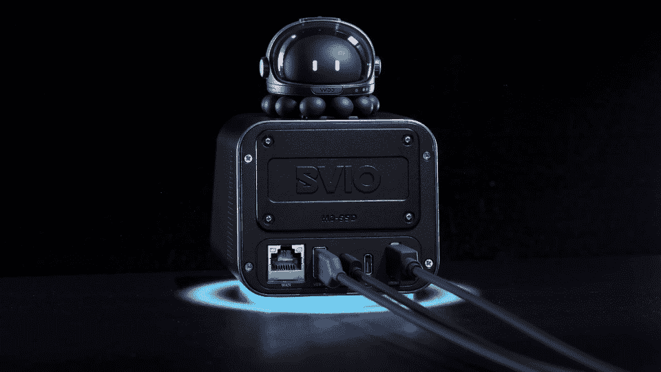
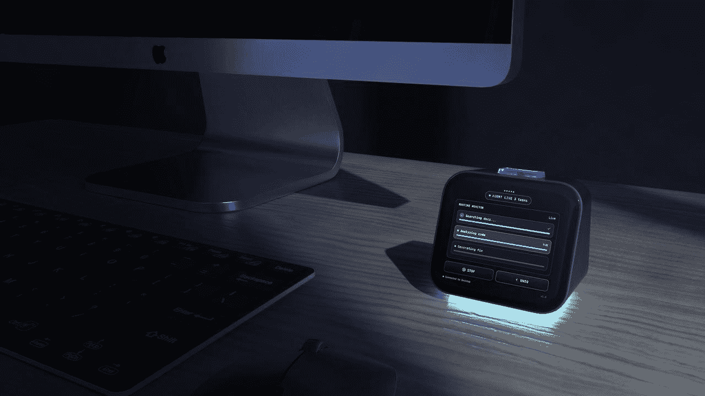
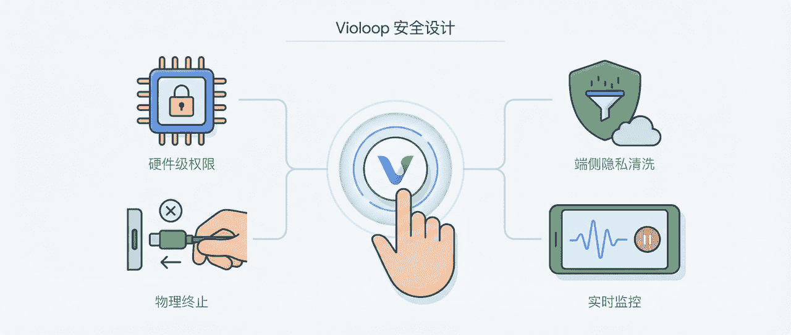
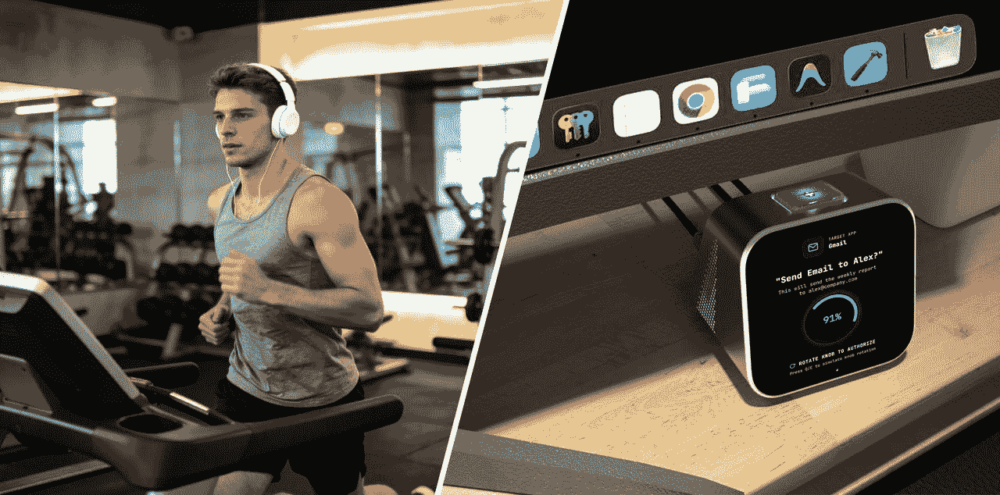
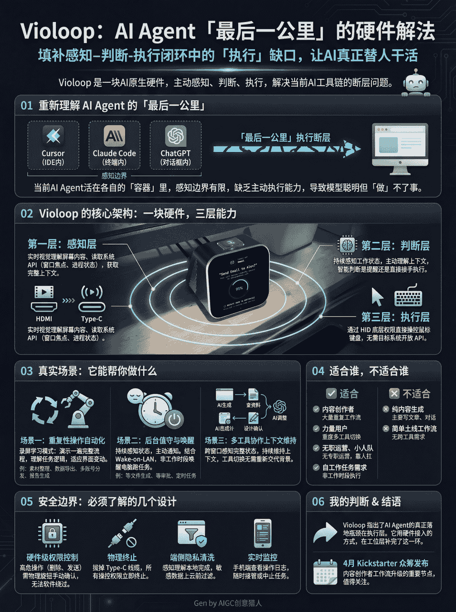

# 20260318-AI原生硬件小龙虾来了！Violoop填补Agent最后一公里~~

> 来源：[https://aigcreative.feishu.cn/docx/Bps0dD2VOoASrOxylDqc1ODSnmf](https://aigcreative.feishu.cn/docx/Bps0dD2VOoASrOxylDqc1ODSnmf)

你可能已经听说了 OpenClaw。

这只「小龙虾」让 AI 自己打开浏览器、写代码、发邮件、操控电脑，不再只是回答问题，而是真的替人干活。

但实际上，它很聪明，但没有手。你还是得告诉它每一步做什么，在它卡住的时候亲自介入。AI 在想，但「做」这件事，还是你在承担。

这个断层，是当前所有 AI Agent 工具都没有真正解决的问题。

今天要讲的 Violoop，正在从一个完全不同的方向来填这个缺口——它不是软件，它是一块AI原生硬件；它不等你下命令，它在主动看你在做什么。

## 01.重新理解 AI Agent 的「最后一公里」

在说 Violoop 是什么之前，先说清楚一个问题：为什么现有的 AI Agent 工具，用起来总感觉少了点什么？

现在市面上的 AI Agent，不管是 OpenClaw、Cursor 还是各种 Copilot，本质上都活在各自的「容器」里：

1）Cursor 活在 IDE 里

2）Claude Code 活在终端里

3）ChatGPT 活在对话框里

它们的感知边界，就是那个容器的边界。你切出去做了什么，它不知道；其他工具里发生了什么，它不知道。

这就是 AI Agent 落地的「最后一公里」问题：模型够聪明了，但执行层是空的。

感知-判断-执行这个完整闭环，在当前的 AI 工具链里，「执行」那一端几乎没有人在做。

Violoop 的切入点就在这里。

## 02.Violoop 的核心架构：一块硬件，三层能力

Violoop 是一块桌边触屏设备，通过 HDMI + Type-C 接入你现有的电脑，Mac 和 Windows 均支持，不占主机资源，不需要改任何现有环境。

但它真正的价值不在硬件本身，而在它通过这块硬件拿到的三层能力：

**第一层：感知层**

HDMI 拿到屏幕视频流，实时看见你所有窗口的状态。不是截图，是连续的视觉理解——它知道你在哪个应用、页面上有什么内容。

同时通过 Type-C 读取系统 API，获取窗口焦点、进程状态、文件系统事件等操作系统层的信号。

**第二层：判断层**

**这是 Violoop 最反**直觉的地方：它不等你发指令才开始工作。

它持续感知你的工作状态，自己判断——这件事现在该提醒你，还是该直接接手帮你做？

这种主动理解上下文的能力，让它不只是一个被动执行工具，而更接近一个真正理解你工作节奏的助理。

**第三层：执行层**

通过 HID 操控权限，直接控制鼠标和键盘。不依赖应用程序的自动化接口，不需要目标系统开放 API——它从最底层拿到了执行权。

三层加在一起，Violoop 完成了当前 AI 工具链里普遍缺失的那件事：一个能持续感知、主动判断、直接执行的运行的 Agent。

## 03.真实场景：它能帮你做什么

**场景一：把重复性操作彻底交出去**

每天、每周固定要做的操作——从内部系统导数据、填报表、整理格式、发给对应的人——这些活不难，但它们在消耗你。

如果这些系统没有 API，传统的自动化方案根本够不到。

Violoop 的录屏学习模式专门处理这类场景：你演示一遍完整流程，它理解任务的结构和意图，然后学会自己跑。而且它学的不是固定坐标点击序列，是任务逻辑——系统界面小幅变动时，它能自己适应。

对内容创作者来说：定期的素材整理、平台数据导出、多账号内容分发，都可以这样处理。

对个人创业者来说：每周的客户跟进记录、财务数据汇总、报告生成，可以从手动变成自动。

场景二：不在的时候，让它替你盯着

你有一个任务在跑，但不需要全程守着——等一个文件生成完、等一个流程审批通过、等一个数据更新。

正常情况下你要么一直开着窗口盯着，要么切去做别的然后忘了回来。

Violoop 能在后台持续感知这些状态，在你需要知道的时刻主动通知你。你不用盯，它替你盯。

结合 Wake-on-LAN，它甚至能在你睡着之后把电脑唤醒、跑完任务、再让机器休眠。早上起来，结果已经在等你了。

场景三：多工具协作，上下文不再断

内容创作的典型工作流：在 AI 生成内容，同时要查参考资料、看竞品、切设计工具确认视觉方向、回到 AI 继续调整。

每次切窗口，上下文就断了一截。你得重新把背景喂给 AI，重新说明刚才的进展。

Violoop 能感知你跨窗口的完整状态，持续维持上下文。你从一个工具切到另一个工具，它知道你在做什么，不需要你每次重新交代背景。

## 04.适合谁，不适合谁

**适合这些人：**

1）有大量重复性工作流的内容创作者：定期整理素材、分发内容、统计数据，这些操作量大但不需要创意，是最适合交给 Violoop 的部分。

**2）重度多工具用户**：每天需要在 5 个以上工具之间切换，上下文管理成本高，Violoop 能承担一部分协调工作。

**3）个人创业者 / 小团队**：没有专职运营，很多重复操作靠人扛，Violoop 的无 API 自动化能力可以解决传统脚本解决不了的场景。

4）需要 AI 在非工作时段自主执行任务的人：定时任务、夜间批处理、跨时区的内容发布，Wake-on-LAN 机制让这些不再需要机器 24 小时待机。

**相对不适合的场景：**

1）主要需求是生成内容、对话、写文章——现有 AI 工具已经够用，不需要执行层能力。

2）工作流简单线性，没有跨工具协调需求，投入这块硬件性价比不高。

## 05.安全边界：必须了解的几个设计

主动操控电脑这件事，安全顾虑是正常的。Violoop 在这里有几个值得了解的设计：

**硬件级权限控制**：独立安全芯片负责审查高危操作（删除文件、发送消息、访问敏感数据），这些操作必须手动确认，不能被 AI 自行决定执行，也不能被软件层绕过。

**物理终止**：拔掉 Type-C 线缆，所有操控权限立即终止。这是最直接的紧急处置方式，没有软件层的后门。

**端侧隐私清洗**：屏幕感知和多模态理解在本地完成，敏感数据在上云之前过滤，不把原始屏幕内容直接送到云端。

**实时监控**：手机端可以查看完整操作日志，随时接管或中止任务。

这套设计的核心逻辑是：不要求你完全信任 AI，而是在关键节点保留你的控制权。

## 06.我的判断

Violoop 提出的问题是对的：AI Agent 的真正落地瓶颈，不在于模型不够聪明，而在于执行层的缺失。

它给出的解法也是一个真实方向：用硬件接入的方式，在工位层做感知和执行的基础设施，补完现有 AI 工具链里普遍缺失的那一环。

产品将在 4 月 Kickstarter 众筹发布，我将第一时间购入。

如果你有重复性工作流过多、跨工具上下文管理成本高这两类痛点，值得在众筹发布时认真看一下。

这个方向，我认为会是接下来一年内容创作者工作流升级的一个重要节点。

---

按照惯例，用一张图来总结今天的分享：

更多精彩内容，我们下期见。