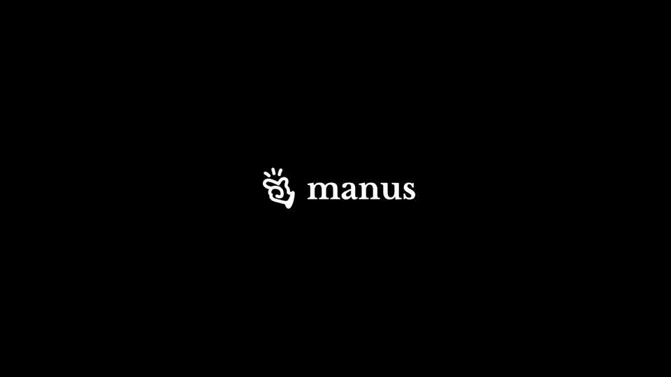
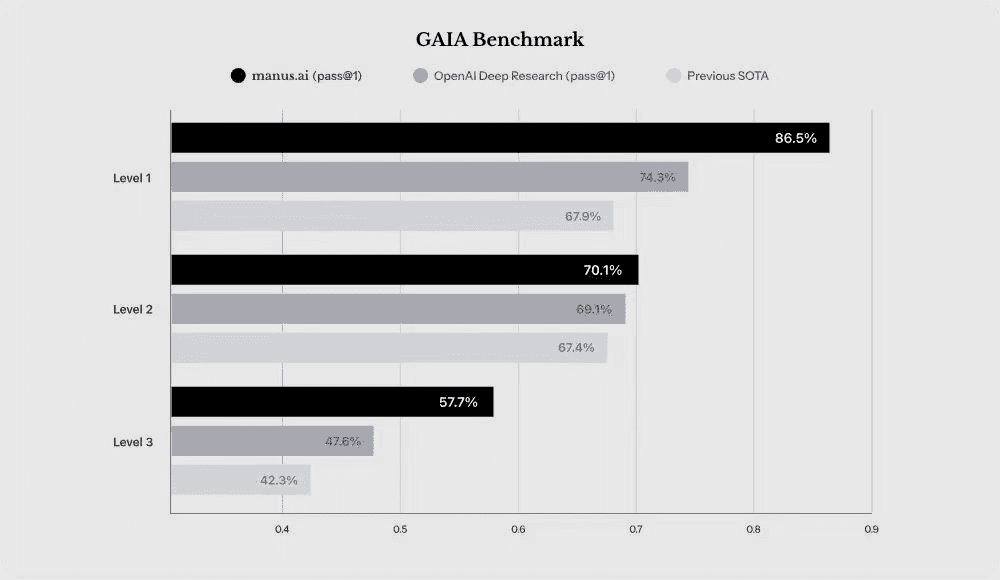

# Manus

> 来源：[https://aigcreative.feishu.cn/docx/O47XdmuRToUOt0xvoyQcjW6Unlh](https://aigcreative.feishu.cn/docx/O47XdmuRToUOt0xvoyQcjW6Unlh)

[f4a6d390fb2fc2224f0c3ee3f9eb56b9.mp4](https://internal-api-drive-stream.feishu.cn/space/api/box/stream/download/all/Nyqgbe1L4oSxr5xoC38c6YW2nUt)

# Manus AI 简介

Manus AI 是 2025 年 3 月由中国初创公司 Monica 推出的通用 AI 代理，旨在通过自主执行复杂现实世界任务，将人类想法转化为行动。其名称源自拉丁语“手”，象征其执行任务的能力，标志着 AI 代理技术的新突破。

# 开发背景

Manus AI 由 Ji Yichao 领导的团队开发，他是一位 33 岁的中国企业家，曾创建 Mammoth 移动浏览器，并在美国创立 Peak Labs。该项目得到中国投资者的支持，反映了中国在 AI 领域的快速发展。根据 Newsweek 详解中国首个完全自主 AI 代理 Manus 的报道，开发团队低调，但其影响力迅速扩大。

# 能力与应用

Manus AI 的能力涵盖多个领域，具体用例包括：

+   旅行规划：为 4 月的日本之旅创建个性化行程和旅行手册。

+   金融分析：深入分析特斯拉股票，生成包含全面洞察的仪表板。

+   教育内容创建：为中学教师制作关于动量定理的互动视频演示。

+   保险比较：比较不同保险政策，提供结构化比较表和最佳决策推荐。

+   B2B 供应商采购：通过网络研究找到最合适的供应商。

+   研究与分析：从 Y Combinator W25 数据库中编译公司列表，或分析 Amazon 商店运营数据，提供可操作洞察和可视化。

这些能力通过官方演示视频展示，视频显示它能逐步创建自定义网站，自主浏览网页并实时显示工作流程。根据 Manus AI 官方网站介绍通用 AI 代理，它被描述为“将想法转化为行动的通用 AI 代理”，在工作和生活中处理各种任务，让用户可以休息。

# 性能与基准测试

Man[us AI 在 GAIA 基准测](https://huggingface.co/blog/LLMhacker/manus-ai-best-ai-agent)试中表现出色，达到最新技术水平。GAIA 是一个由 Meta AI、Hugging Face 和 AutoGPT 团队开发的基准测试，旨在评估通用 AI 助理的性能，测试其推理、多模态处理、网页浏览和工具使用能力。根据 Hugging Face 博客：Manus AI 重新定义自动化和生产力，其准确率超过 65%，优于 H2O.ai 的 h2oGPTe（65%）、Google Langfun（49%）、Microsoft o1（38%）、OpenAI GPT-4o（32%）和 OpenAI GPT-4 插件（15-30%）。

GAIA 测试包括 466 个人类设计和注释的问题，这些问题对人类来说概念上简单，但对大多数高级 AI 来说具有挑战性。人类得分达到 92%，而 GPT-4 带插件仅得 15%，这凸显了 Manus AI 的突破性表现。根据 GAIA 基准测试：通用 AI 助理评估标准，GAIA 的哲学是测试 AI 系统是否能表现出与普通人类相似的稳健性。

以下是 GAIA 基准测试的比较表：

# 技术细节

根据 [Hugging Face 博客](https://huggingface.co/blog/LLMhacker/manus-ai-best-ai-agent)，Manus AI 利用大型语言模型（LLMs）和多模态处理能力，处理文本、图像和代码。它集成了多种工具，如网页浏览器（实时信息访问）、代码编辑器（AI 辅助编程）和数据库管理系统（数据管理）。其自主任务执行包括报告撰写、电子表格创建、数据分析和内容生成，甚至在设备关闭时继续异步处理。它还具有自适应学习能力，通过用户交互不断优化，提供个性化响应。

# 可用性与未来计划

[目前，Manus](https://www.newsweek.com/manus-new-china-ai-agent-explained-2040445) AI 仅限邀请预览，根据 Newsweek，预计未来将免费开放，以扩大用户基础和收集反馈。发布后，其服务器容量问题引发关注，部分用户在二手市场（如 Xianyu）出售邀请码，引发争议。

# 争议与质疑

尽管 Manus AI 备受关注，但其技术能力存在争议。根据 South China Morning Post，发布后服务器容量不足导致可用性有限，部分人质疑其是否为真正的突破，还是营销策略的一部分。其 X 账号也一度被暂停，进一步引发讨论。Zhang Tao，产品合作伙伴，在社交媒体上道歉，承认团队低估了公众的热情反应，并表示当前版本仍处于早期阶段，远未达到最终产品的目标。

以下是争议的详细表：

Manus AI 是 AI 代理技术的前沿，展示了在现实世界任务中的强大自主能力。其在 GAIA 基准测试中的优异表现使其成为行业领导者，但其技术水平和普及仍需进一步验证。随着未来免费开放，其影响力和应用潜力值得期待。

# 精彩案例：

1.  Manus特斯拉个股分析示例：https://manus.im/share/xFgpHb15vKqfRPWIs3JJPJ?replay=1

1.  写一本自定义主题的小说：https://manus.im/share/Aa0M0gvOybi9cRwDK0RNpx?replay=1

1.  财务估值模型搭建：https://manus.im/share/hRGARE7EBqtDhLHBGISLP7?replay=1

1.  泽连斯基的白宫互动游戏：https://manus.im/share/Sc5a78DH57lQ5aYJbVAvZp?replay=1

1.  谷歌CEO模拟器：https://manus.im/share/cmRIphYJybxNiLSkWn6PJn?replay=1

<https://aigcreative.feishu.cn/sync/K4Gvd9vUQsy9Oubwqaeclu0Fnbg>

# 知识库动态