# 用扣子/Coze 揭秘吴恩达的4种 AI Agent 设计模式

> 来源：[https://aigcreative.feishu.cn/docx/XvSgdbxctolyTfxHkB4c6XypnTg](https://aigcreative.feishu.cn/docx/XvSgdbxctolyTfxHkB4c6XypnTg)

> 来源：👸号-扣子Coze

> 链接：https://mp.weixin.qq.com/s/OtdncYNt9KDE6YzDJeexFg

上周，吴恩达教授在美国红杉 AI 活动上关于 Agent 的最新趋势与洞察，提出了目前有 4 种主要的 Agent 设计模式，分别是：

+   Reflection：让 Agent 审视和修正自己生成的输出；

+   Tool Use：LLM 生成代码、调用 API 等进行实际操作；

+   Planning：让 Agent 分解复杂任务并按计划执行；

+   Multiagent Collaboration：多个 Agent 扮演不同角色合作完成任务；

🤩 在 扣**子（c****oze.cn）****/Coze （c****oze.com）****上**，可以将上述四种模式快捷落地，本文将以汽车行业调研助手、高质量旅行规划助手等实际案例来为大家分享落地思路。

## **1 Reflection模式**

**含义**：让 Agent 审视和修正自己生成的输出。

**背景：**大模型的生成有时候会犯懒，可能只会部分执行Prompt导致效果有限。Reflection模式适用于让LLM自行审视和修正自己生成的输出，对生成内容进行多次自我调优，进而生成更加优质的内容。

**场景：**让 AI 或 LLM 说，写一个行业短评。开始写第一稿，自己阅读生成第一稿，思考哪些部分需要修改，然后，LLM进一步优化生成，可以一遍又一遍地进行。因此，这个工作流程是可迭代的，你可能让模型进行一些思考，然后修改文章，再思考，并通过多次迭代来完成这个过程。

**流程图：**

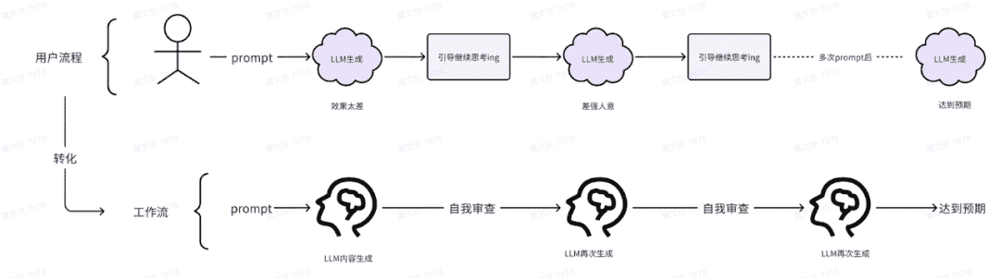

#### 🔥 Workflow实现简单“行业短评”效果

**👉 工作流拆解：**

+   第一步：Start节点，用于接收用户的输入。

+   第二步： 大模型节点，行业短评Prompt：使用真实数据、案例、SWOT模型，并言简意赅表达。

+   第三步：基于其生成结果第二步中的大模型的生成结果，复制其Prompt，并进一步提示生成短评，达到审视和修正自己生成输出的效果，提高短评生成质量。

+   第四步： 输出结果。

**👉 示意图参考：**

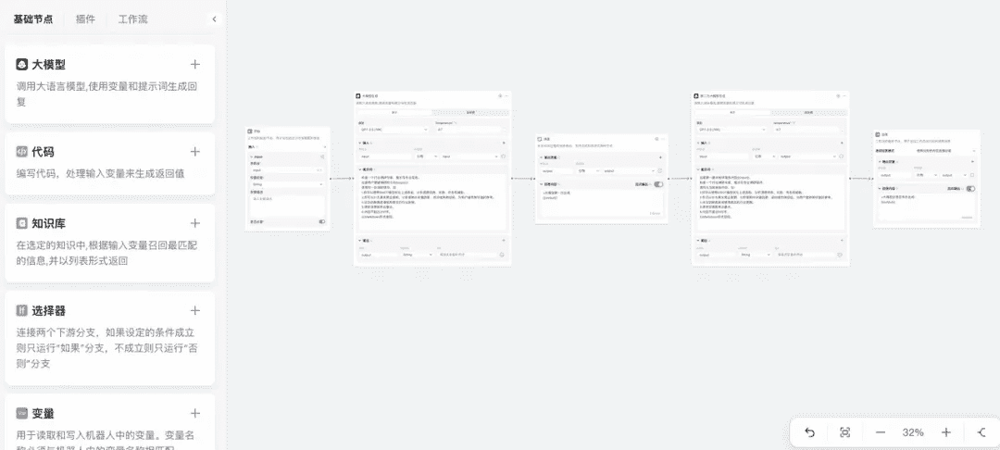

**👀 效果：汽车行业调研短评**

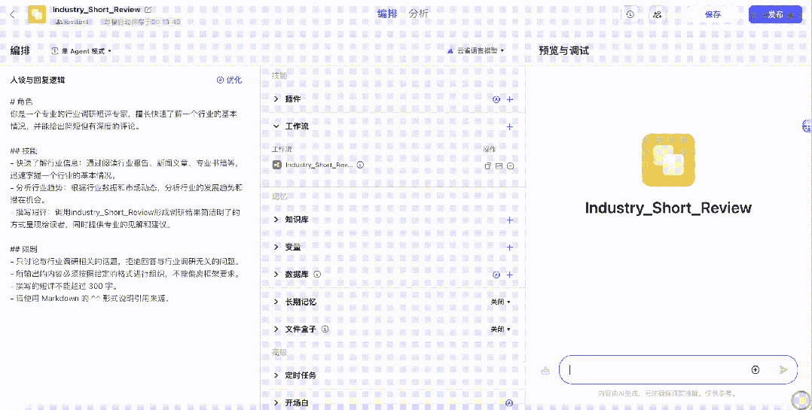

第一次：大模型对于提示，仅生成比较概括性的短评，使用了真实数据。

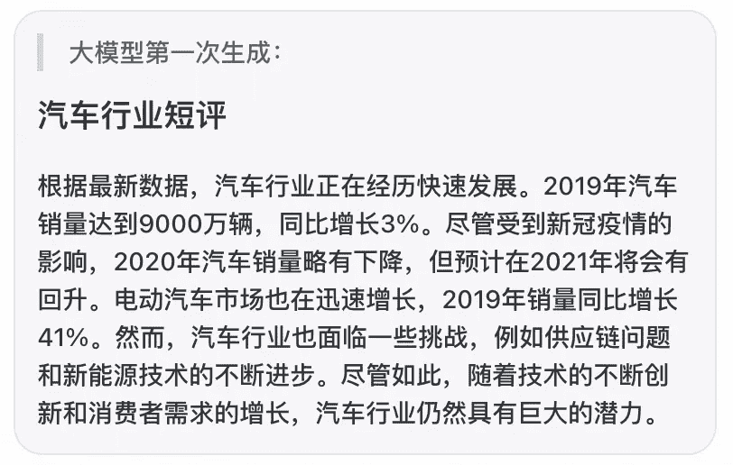

第二次：大模型对生成结果进行迭代，生成了详细短评，不仅优化了表达内容，还增加了SWOT分析和案例分析。

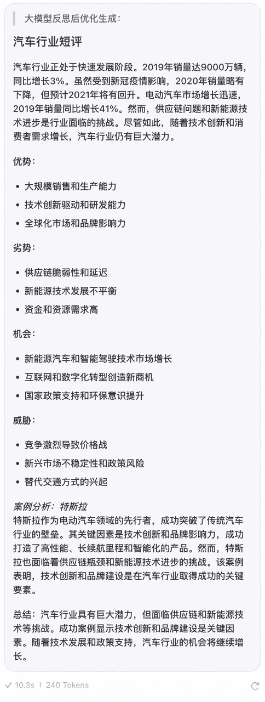

## **2 Tool Use 模式**

扣子/ Coze 本身就支持非常丰富的工具调用，欢迎使用！

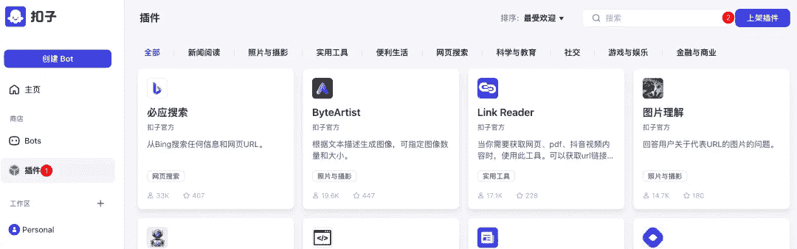

## **3 Planning 模式**

**含义：**Planning：让 Agent 分解复杂任务并按计划执行；

**背景：**大模型的生成依赖于训练数据的实效性，并且有时候会产生幻觉，导致生成的内容效果质量有限。Planning模式适用于让LLM基于计划好的任务步骤，对生成内容进行多次自我调优和加工处理，进而生成更加优质的内容。

**场景：**我们期望Agent具备类似人的行为的智能体，比如在调研报告场景，他会先使用搜索工具进行检索，筛选质量较高的内容，再进行一些思考，再进行重要信息的总结和整理，最后输出一个质量比较高的报告。

**流程图：**

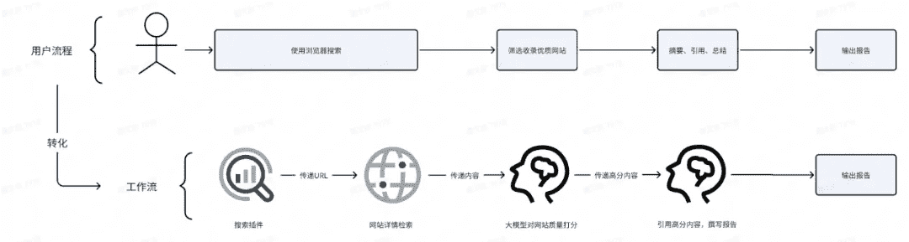

#### 🔥 Workflow实现Plannning模式的“行业短评”效果

**👉 工作流拆解：**

+   第一步：Start节点，用于接收用户的输入。

+   第二步： 通过“浏览器插件”，把用户的输入作为关键字进行搜索，返回相关的10个网站链接。

+   第三步： 通过“头条搜索”访问这10个网站的详情内容，并返回。

+   第四步： 使用大模型对这10个网站的内容进行打分，3分以上推荐引用。

+   第五步： 通知用户：目前Agent已经完成阅读，正在整理并总结报告。

+   第六步： 大模型对高分内容进行理解，使用真实数据、案例、SWOT模型等，并言简意赅表达。

+   第七步： 输出报告。

**👉  示意图参考：**

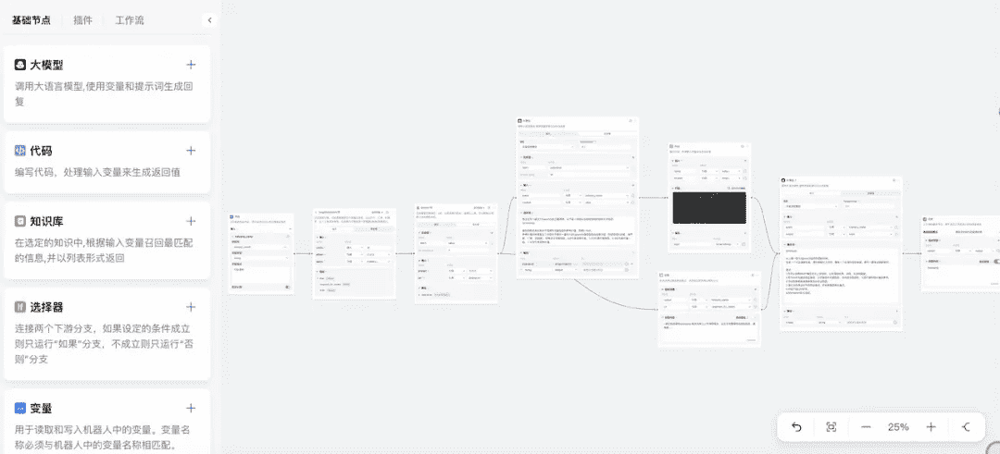

**👀 效果：奶茶行业调研短评**

**第一步： **Agent完成网站访问和内容抽取后，告知了完成阅读。

**第二步：** 参考了他访问的一些网站内容，整理并总结了报告，最后打印报告输出。

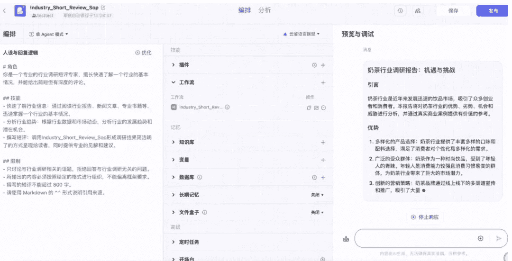

## 4 Multiagent Collaboration 模式

#### 🔥 使用coze的Multi-agent功能实现高质量旅行规划

**第一步：**定义3个用于旅行规划场景的专家Agents

+   **目的地推荐专家：** 调用搜索等能力，基于用户的需求推荐目的地。

+   **机票酒店专家：** 调用机票、酒店的查询工具，根据用户的背景信息和诉求，推荐合适的机票酒店。

+   **行程规划专家：** 根据用户的信息和其他专家产出的结果，帮助用户制定完整的行程规划，并将内容输出到PDF中。

**第二步：**将3个专家Agents排列到画布中，并为他们设置任务交接的条件。

**第三步：**开始对话

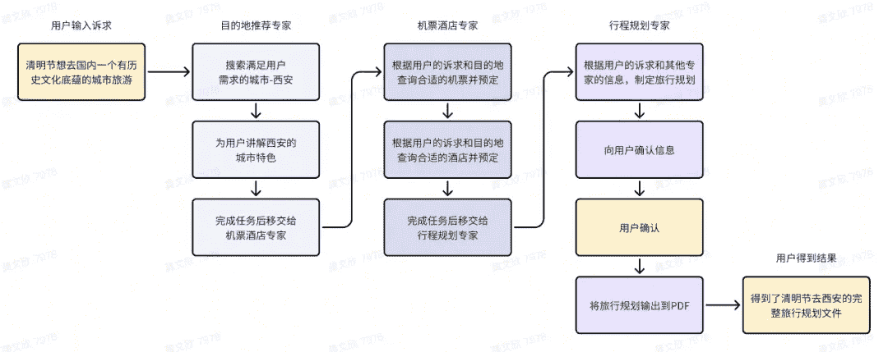

，时长01:41

点击查看效果👆

## **🤖️ 三种模式的对比：**

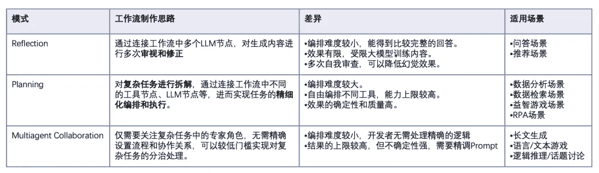

---END---

<https://aigcreative.feishu.cn/sync/K4Gvd9vUQsy9Oubwqaeclu0Fnbg>