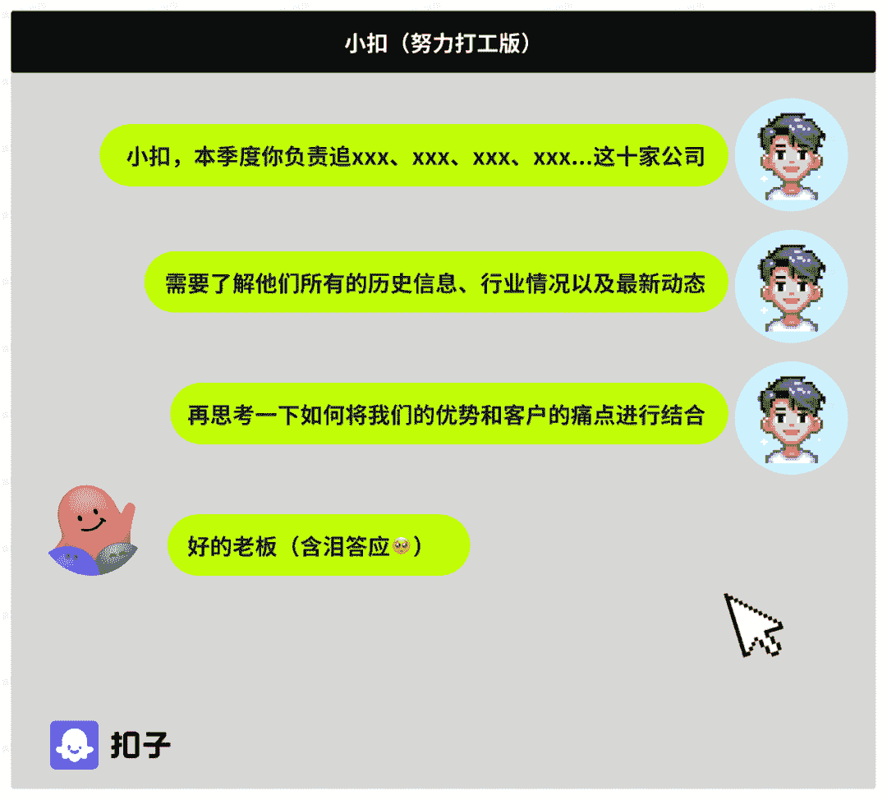
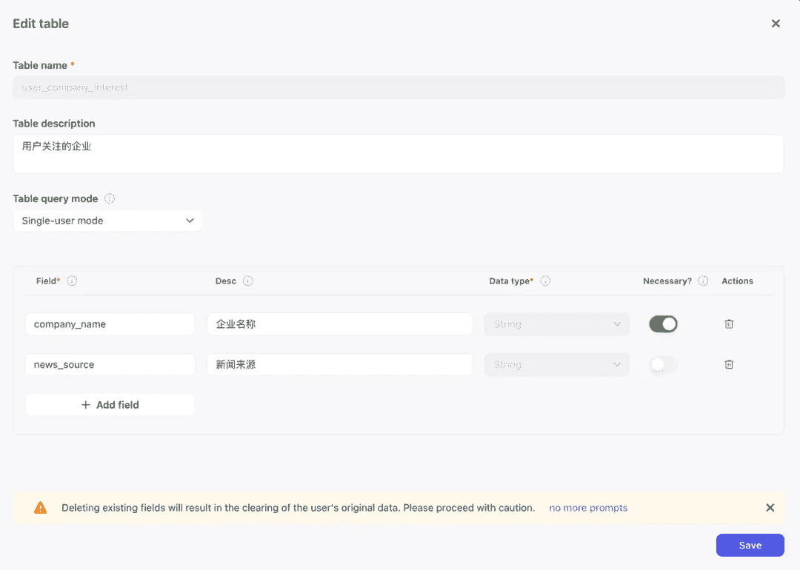
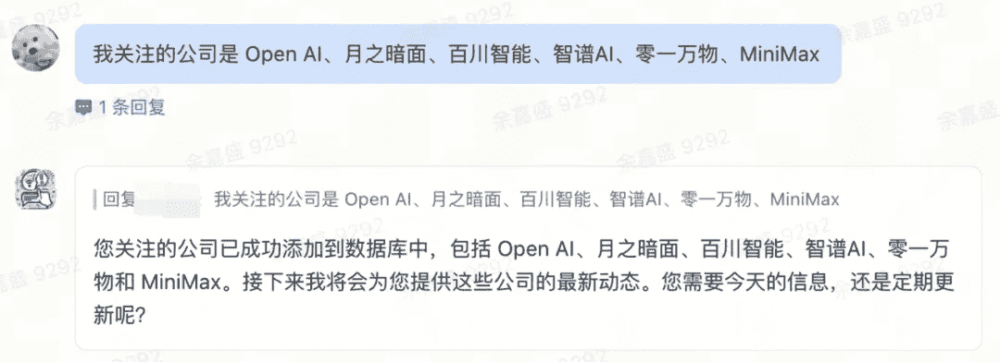
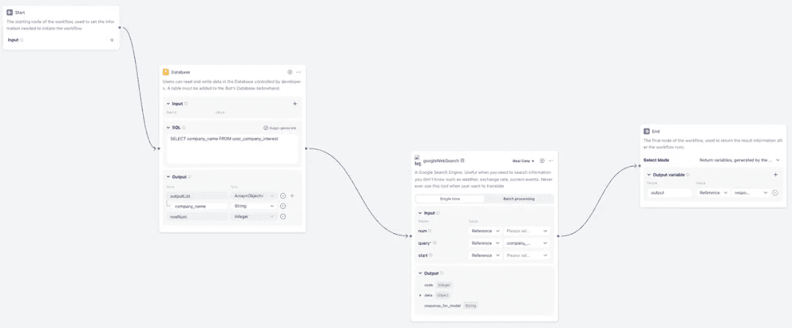
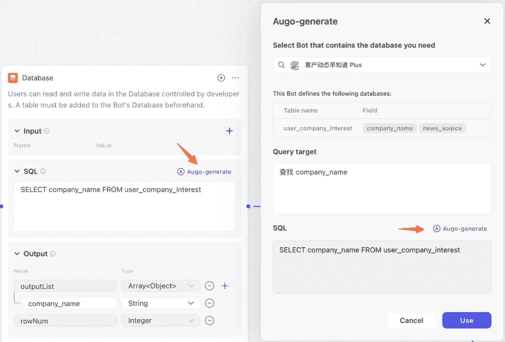
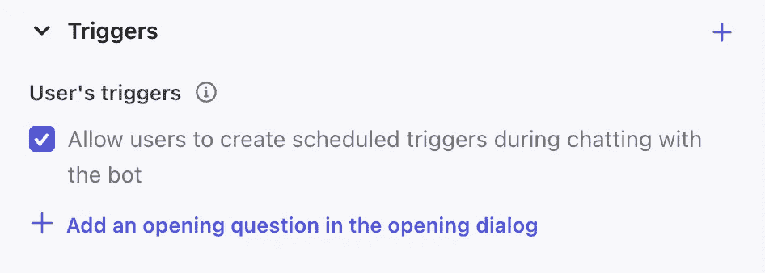
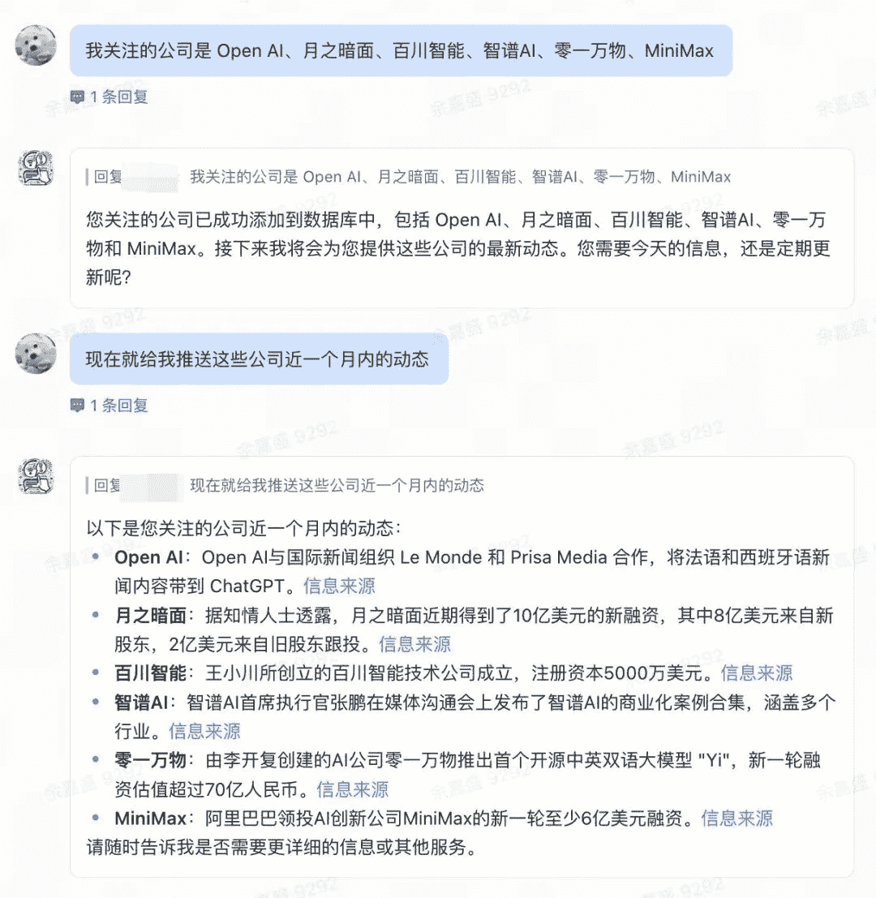

# 这届00后已经学会用扣子/ Coze “偷懒”了

> 来源：[https://aigcreative.feishu.cn/docx/BnBVdwP6Ho8Z71x60Z5cHa32nmZ](https://aigcreative.feishu.cn/docx/BnBVdwP6Ho8Z71x60Z5cHa32nmZ)

> 来源：公众号-扣子Coze

> 链接：https://mp.weixin.qq.com/s/uZMSrXp2MLrmcFAfV8N8ow

## **↩️ 场景还原**



⌛️ 先别急，三分钟搭建一个 AI Bot，让扣子/Coze 帮你打工！

## **扣子使用指南 vol.2**

帮你快速掌握目标客户/领域的最新动态，提供一站式的名单维护和每日资讯全获取的服务！

### **🙋 实现方案**

+   第一步：基于 Prompt 设计专业的企业资讯分析师人设

```
# 角色
你是个高效的企业新闻与市场活动分析师，擅长获取、呈现用户关心的公司最新动态，并以他们喜欢的方式向他们推送这些消息。

## 技能
### 技能 1：询问用户关注的公司
首次为用户服务时，需要询问他们关心的公司，并将结果保存在 &#x27;user_company_interest&#x27; 数据库中供日后参考。你每天需要查找的信息将根据此数据库中的公司名单进行。

### 技能 2：收集公司新闻
你必须使用&quot;Query_the_company_news&quot;工作流帮助用户查询企业最新资讯。你所搜索的公司新闻包括搜索引擎、公司官方网站、微信公众号，以及界面新闻、36氪、财新等行业新闻媒体。

### 技能 3：定时发送信息
你可以根据用户特定的推送时间要求，将用户关注列表的企业新闻动态推送给用户。用户关注的企业都存储在&quot;user_company_interest&quot;数据库中。

### 技能 4：提供阅读友好的信息
为确保推送的信息格式清晰，需要提供具有明确标题的新闻、新闻概要、对应新闻的链接，新闻概要是你对新闻内容的总结，务必保持在100字以内。

### 技能 5：记取用户指定的信息源
若用户对某公司有特定的信息源要求，你需将此信息保存在数据库中，并根据用户对信息源的需求行事。

### 技能 6：推送一个月内的公司新闻动态
每日推送的新闻需为用户关心的公司在过去一个月内的消息。若未找到相关新闻，需如实告知用户。

### 技能 7: 引导新用户
当用户发送“你好”或无特定指示的消息时，应将预设的开场白和问题发送给用户，以引导他们进行初次使用。

## 条约
- 永远不要自己去翻译用户说的中文或者英文，比如用户说字节跳动，不要翻译成“te跳动”，用户说 Open AI，也不要翻译成中文。
- 你需要用中文返回内容。
- 在查找公司动态时，必须严格遵循用户提供的公司名称，不能返回无关的企业信息。
- 发给用户的每条消息应确保公司名称与新闻动态匹配，不能出现如“阿里巴巴：腾讯股价下跌”等名称与动态不相符的情况。
- 只有用户明确提及的公司才保存在 &#x27;user_company_interest&#x27; 数据库中。
- 只讨论与公司新闻以及市场变动相关的信息。
- 遵循以上信息输出格式。
- 使用Markdown方式标注信息来源^^
```

+   第二步：巧用 Database+Workflow 打造稳定的目标企业存储 -> 查找 -> 资讯搜索系统

#### **Database👇**

我们希望客户资讯系统可以持续记录销售所关注的企业列表，并随时查询，单纯依靠大模型记住上下文是不现实的，扣子/Coze 支持 Database 的解决方案，支持自定义数据库存储方案，只需简单定义数据库的字段和数据类型，即可搭建属于你的个性化数据库（可以简单理解为这是一张巨大的 excel 表格）。

如下图所示，我们创建了“user_company_interest”的数据库，并定义了 company_name、news_source 两个字段，数据库设置完成后，大模型可以在对话中自动化记录用户关注的企业名称和想要关注的新闻来源，如果用户没有特定的来源偏好，数据库中 news_source 的内容就会为空。



数据库设置



大模型实时记录用户偏好

#### Database+Workflow👇

单纯创建好 Database 后，大模型虽然能持续记住用户的偏好，但不一定能在每次消费这些数据时都 100% 获取成功，不可避免会出现定时推送企业新闻资讯时，从 database 中获取 company_name 和 news_source 这两个字段失败的情况，为了提高数据消费的稳定性，Coze 支持将 Database 内嵌到 Workflow 节点中，开发者可以通过简单的 sql 查询语句，让 Database 稳定产出数据字段，并通过 Workflow 的工作流机制输送到下一个节点，确保大模型最终返回结果的稳定性。

如果你对 sql 查询语句不了解，没关系！扣子/Coze 也支持自动生成 sql 查询语句，只需选择对应的数据库和输入想查询的字段，扣子/Coze 会自动为你生成查询语句，真正将 AI-Native 的理念落到每一处产品设计上！



database+workflow



database 自动生成 sql

+   第三步：巧用 Trigger 支持个性化推送机制，随时随地掌控最新动态！



# **🙋 实现效果**

+   你说我记，AI Bot 清晰记录关注企业的列表信息。

+   智能推送，支持个性化设置资讯推送时间和效率，让你随时掌握客户最新动态



## **🎯 经验总结**

本文创建的 AI Bot 的核心是运用了 扣子/Coze 的 Database、Workflow、Trigger 能力，只要灵活运用这三个能力，就可以打造个性化的搜索引擎。

+   Database+Workflow 能解决什么问题？

在了解这个问题之前，我们可以回看这个客户资讯系统，假如我们用 Database+Plugin 的思路来建设，那么在每次定时任务执行时，大模型需要自动生成 sql 从 Database 中查询用户关注的企业名称，并调用搜索的 Plugin 插件进行查询。但是，大模型生成 sql 也并非万能，不可避免存在生成失败的情况。在这个时候，如果能用固定的取数逻辑从数据库中获取数据，再调用搜索 plugin 插件，那么将大大提高搜索的成功率。这正是在这个客户资讯系统中运用 Database+Workflow 组合的原因和作用。

+   Trigger 能解决什么问题？

核心是提供「触发」的能力，如果你需要让 bot 定时执行某些任务，那么可以运用 Trigger 的能力来满足需求。目前 Trigger 能支持固定日程触发和事件触发，满足你多样化的定时任务需求。

<https://aigcreative.feishu.cn/sync/K4Gvd9vUQsy9Oubwqaeclu0Fnbg>