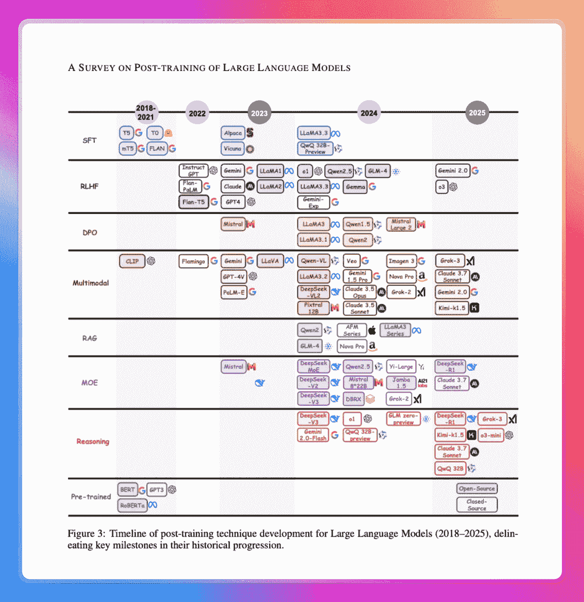

# AI大模型

> 来源：[https://aigcreative.feishu.cn/docx/BsfzdbbXVoYdGPxyooFcXEEBnzq](https://aigcreative.feishu.cn/docx/BsfzdbbXVoYdGPxyooFcXEEBnzq)

# 大模型认知基础

## 前言

ChatGPT-4的发布在各个领域引起了巨大的轰动，因为它在人工智能技术中达到了一个新的高度。从ChatGPT发布以来，国内外都迎来了新一轮大模型浪潮。那么，有科技小白会问：

GPT就是大模型吗？

ChatGPT和大模型之间是什么关系？

大模型现状发展如何？

## AI 大模型

AI大模型是“人工智能预训练大模型”的简称，一种机器学习模型，包含了“预训练”和“大模型”两层含义，二者结合产生了一种新的人工智能模式。即模型在大规模数据集上完成了预训练后无需微调，或仅需要少量数据的微调，就能直接支撑各类应用。

大模型一般指1亿以上参数的模型，但是这个标准一直在升级，目前万亿参数以上的模型也有了。大语言模型（Large Language Model，LLM）是针对语言的大模型。

2021年8月，李飞飞、Percy Liang等百来位学者联名发布了文章：On the Opportunities and Risks of Foundation Models[1]，提出“基础模型”(Foundation Models)的概念：基于自监督学习的模型在学习过程中会体现出来各个不同方面的能力，这些能力为下游的应用提供了动力和理论基础，称这些大模型为“基础模型”。简单理解就是智能化模型训练的底座。具体应用场景不同分为小模型和大模型。

### AI大模型的发展历程

大模型也从2012年的萌芽期，发展到2016年的AI1.0时期，再到2022年ChatGPT带来的AI2.0时期，模型参数均较前一代有数量级的飞跃，如OpenAI最新发布的多模态预训练大模型GPT-4约有超过2000亿参数，谷歌最新推出“通才”大模型PaLM-E，拥全球已公开的最大规模的5620亿参数，能够表现出更优秀的性能和应用价值。目前，国内AI大模型研发和应用领域也正迎来高速发展热潮，科技部新一代人工智能发展研究中心也随即发布了《中国人工智能大模型地图研究报告》，各类 AI 大模型产品层出不穷，“千模大战”已经打响。

### AI大模型可以做什么

AI大模型可以学习和处理更多的信息，比如图像、文字、声音等，也可以通过训练，完成各种复杂的任务。比如智能语音助手和图像识别软件都会用到AI大模型。

## 国内外有哪些大模型

### 国外公司

OpenAI：OpenAI是一家人工智能研究公司，拥有多个大型语言模型，包括GPT等。

Google：Google拥有很多大型深度学习模型，包括BERT、Transformer等。

Facebook：Facebook拥有很多大型深度学习模型，包括XLM-R、RoBERTa等。

Microsoft：Microsoft拥有很多大型深度学习模型，包括Turing-NLG、DialoGPT等。

特斯拉：成立X.AI公司，为了探索宇宙的奥秘

苹果：正式官宣加入大模型阵营，建立自己的框架来创建大语言模型“Ajax”,苹果还创建了一个聊天机器人服务“Apple GPT”，股价再次突破新高

### 国内公司

一面狂热，一面冷峻是最好的形容。在过去的几个月里，各大厂相继出招，先是3月16日，百度率先发布“文心一言”，期望对标ChatGPT；再到阿里巴巴旗下超大规模语言模型“通义千问”开放内测，万维和商汤科技分别发布大模型产品；创新工场CEO李开复、前搜狗CEO王小川、前京东AI掌门人周伯文、前美团联合创始人王慧文等行业大佬纷纷宣布下场，国产大模型赛道竞争激烈。

大模型的建造离不开综合算力资源、算法人才、数据积累及产品先发几大核心要素。事实也正是如此，只有大厂才有大量资金和人才发展算力、算法、数据，也最有机会率先落地大模型。

## **大模型的测试与评价**

### **测试**

+   大模型的测试需要考虑以下几个方面：

+   模型的准确性：模型在测试数据集上的表现

+   模型的鲁棒性：模型对噪声、对抗样本等干扰的抵抗能力

+   模型的效率：模型的运行速度和资源消耗

### **评价**

+   大模型的评价需要考虑以下几个方面：

+   模型的性能：模型在特定任务上的表现

+   模型的泛化能力：模型在不同数据集上的表现

+   模型的公平性：模型是否对所有用户公平

+   模型的安全性和可靠性：模型是否安全可靠

### **常用的测试和评价指标**

+   准确率：模型预测正确的比例

+   精确率：模型预测为正例的样本中，真实正例的比例

+   召回率：真实正例中，被模型预测为正例的比例

+   F1分数：精确率和召回率的调和平均值

+   BLEU分数：机器翻译模型的评价指标

+   ROUGE分数：文本摘要模型的评价指标

## 专业名词大全

> 更细专业名词，见文档——》：[AI术语名词](https://aigcreative.feishu.cn/wiki/PdYvwhWUiiZldck67ywccRMsnD2?from=from_copylink)

1、算法：

类比碳基物种，硅基物种的大脑就是模型。我们现在说的算法（比如Transformer）代表大脑（模型）的能力，Transformer的出现确实极大程度地推动了AI的发展。但现阶段，在处理多模态数据时还有很大挑战，在算法层面未来一定会有新的突破。

2、模型参数：

一个刚出生的人类幼崽随着年龄的增长，大脑本身在增长，模型参数的数量增加可以类比人类大脑本身的成长和成熟；随着人类幼崽成长中接触的事物增加，大脑的认知在改变，参数的数值可以类比人类利用外界信息给自己构建的认知。

3、训练数据：

人类成长过程中对认知的构建，70%是通过视觉，20%是通过听觉，其他包括味觉、触觉、嗅觉等等，通过这些感官接受这个世界的信息来构建对世界的了解。模型的训练数据某种程度类比于这些信息，你让模型看到了多少和什么质量的数据，决定了他未来的认知，即参数的数量和数值。

4、Token：

我们常常会听到Token这个词，Token的概念相当于文字，一个中文文字对应一个token，比如冰激凌，对应三个token：冰+激+凌；一个英文的字符对应一个token，比如icecream，对应两个token：ice+cream。

5、175B、60B、540B等：

这些一般指参数的个数，B是Billion/十亿的意思，175B是1750亿参数，这是ChatGPT大约的参数规模。

6、强化学习：（Reinforcement Learning）一种机器学习的方法，通过从外部获得激励来校正学习方向从而获得一种自适应的学习能力。

7、 基于人工反馈的强化学习（RLHF）：

（Reinforcement Learning from Human Feedback）构建人类反馈数据集，训练一个激励模型，模仿人类偏好对结果打分，这是GPT-3后时代大语言模型越来越像人类对话核心技术。

8、涌现：

（Emergence）或称创发、突现、呈展、演生，是一种现象。许多小实体相互作用后产生了大实体，而这个大实体展现了组成它的小实体所不具有的特性。研究发现，模型规模达到一定阈值以上后，会在多步算术、大学考试、单词释义等场景的准确性显著提升，称为涌现。

9、泛化：

（Generalization）模型泛化是指一些模型可以应用（泛化）到其他场景，通常为采用迁移学习、微调等手段实现泛化。

10、微调：

（FineTuning）针对大量数据训练出来的预训练模型，后期采用业务相关数据进一步训练原先模型的相关部分，得到准确度更高的模型，或者更好的泛化。

11、指令微调：

（Instruction FineTuning），针对已经存在的预训练模型，给出额外的指令或者标注数据集来提升模型的性能。

12、思维链：

（Chain-of-Thought，CoT）。通过让大语言模型（LLM）将一个问题拆解为多个步骤，一步一步分析，逐步得出正确答案。需指出，针对复杂问题，LLM直接给出错误答案的概率比较高。思维链可以看成是一种指令微调。

<https://aigcreative.feishu.cn/sync/K4Gvd9vUQsy9Oubwqaeclu0Fnbg>

# 知识库动态