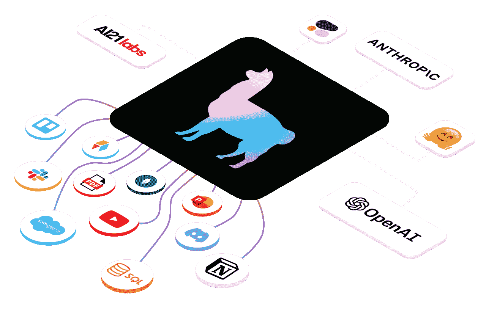
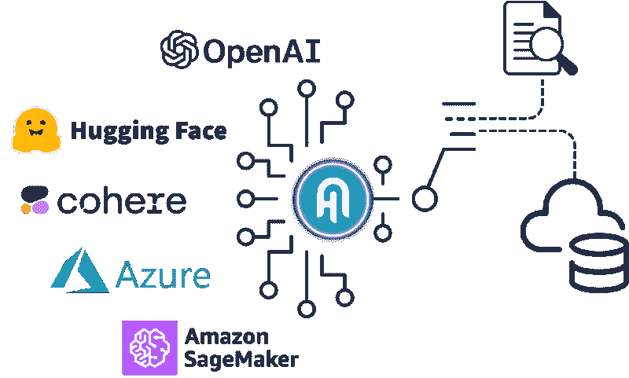

# 2024年大模型应用开发框架

> 来源：[https://aigcreative.feishu.cn/docx/GtyrdgzjjoC2lVxEqzTcNf3KnAf](https://aigcreative.feishu.cn/docx/GtyrdgzjjoC2lVxEqzTcNf3KnAf)

> 作者：CSDN-程序猿危机

> 原文链接：https://blog.csdn.net/elite1991/article/details/136004786

> 延伸阅读：

# 大模型开发框架 LangChain最全总结系列

> https://blog.csdn.net/ailiandeziwei/article/details/137647589?utm_medium=distribute.pc_relevant.none-task-blog-2~default~baidujs_baidulandingword~default-0-137647589-blog-136004786.235^v43^pc_blog_bottom_relevance_base7&spm=1001.2101.3001.4242.1&utm_relevant_index=1

> 自从chatgpt问世以来，全球就进入了AI新时代，大家都在开发自己的大模型LLM，但是由于开发大模型需要昂贵的硬件成本，因此只有头部互联网科技companies才有能力玩大模型，国外以openai，google，Meta，Microsoft为首，国内以华为，百度，360，抖音，讯飞为首，总体上国内大模型能力要落后于国外大模型。更多的开发者以及小公司专注于大模型应用的开发，开发这些应用少不了一些开发框架的支持，可以support开发者快速落地应用，今天就来讲讲3个最火的开发框架。

# 大模型应用有哪些

目前有AIGC，RAG，Agent三大领域，都能带来不错商业价值。

+   AIGC （AI Generated Content）

AI自己动手创作各种各样的内容，比如图片、视频、音乐、文字、代码等等，这些都需要借助对应的LLM来完成，你只需要输入相对应的prompt（提示词），LLM就会按你的要求生成对应的内容。在文字生成领域比较厉害的模型是gpt4，文心一言，在图片生成领域主要有DALL-E2，Stable Diffusion。在生成音视频方面有Whisper，AudioLM，在生成代码方面有Codex，Alphacode。

+   RAG（Retrieval Augmented Generation）检索增强生成

当你使用LLM时他只能基于自己训练的数据来回答你的问题，这就意味着它不能回答你自己数据相关的问题，为了解决这个问题就出现了RAG，就是将自己的私有数据提供给大模型，让大模型回答自己的问题，相当于增强了大模型的知识库，也帮助自己更快查询文档相关内容。当然由于大模型对话token的限制，RAG应用也存在很多问题，这个我们在后面的文章中再详细展开。

+   Agent （代理）

因为大模型不具备联网以及处理一些特殊问题的能力，因此它并不能完美处理各种用户的输入，因此我们需要代理function，帮助大模型去处理它处理不了的问题，以此增强大模型的能力。举个例子，你问大模型今天天气怎么样，这需要去联网查询天气服务，如果没有代理层，它只能回答过去的天气数据，不过现在好多大模型都加入了联网功能，你的问题在它的知识库找不到答案时都会自动通过搜索引擎查询相关结果，然后再自己总结输出。另一个例子，大模型其实不擅长数学相关计算，此时就可以通过代理调用相关计算代码块，运行得到计算结果返回给用户。以上只是简单的举例，后面文章我会继续对Agent进行说明。

# Langchain

Langchain算是最火的AI应用开发框架了。它主要包括了4大模块：

+   LangChain Libraries: Python 和JavaScript库.，包含一些接口以及常用模块组件：

+   模型（models） : LangChain 支持的各种模型类型和模型集成。

+   提示（prompts） : 包括提示管理、提示优化和提示序列化。

+   内存（memory） : 内存是在链/代理调用之间保持状态的概念。LangChain 提供了一个标准的内存接口、一组内存实现及使用内存的链/代理示例。

+   索引（indexes） : 与您自己的文本数据结合使用时，语言模型往往更加强大——此模块涵盖了执行此操作的最佳practices。

+   链（chains） : 链不仅仅是单个 LLM 调用，还包括一系列调用（无论是调用 LLM 还是不同的实用工具）。LangChain 提供了一种标准的链接口、许多与其他工具的集成。LangChain 提供了用于常见应用程序的端到端的链调用。

+   代理（agents） : 代理涉及 LLM 做出行动决策、执行该行动、查看一个观察结果，并重复该过程直到完成。LangChain 提供了一个标准的代理接口，一系列可供选择的代理，以及端到端代理的示例。

+   LangChain Templates: 为各种任务提供易于部署的参考架构。

+   LangServe: 用于部署 LangChain 链的 REST API 库。

+   LangSmith: 开发人员平台可让您调试、测试、评估和监控基于任何 LLM 框架构建的链，并与 LangChain 无缝集成。

我们主要用到的还是 LangChain的python库，基于他们提供的库，你可以完成如下应用：

+   自治代理（autonomous agents） : 长时间运行的代理会采取多步操作以尝试完成目标。 AutoGPT 和 BabyAGI就是典型代表。

+   代理模拟（agent simulations） : 将代理置于封闭环境中观察它们如何相互作用，如何对事件作出反应，是观察它们长期记忆能力的有趣方法。

+   个人助理（personal assistants） : 主要的 LangChain 使用用例。个人助理需要采取行动、记住交互并具有您的有关数据的知识。

+   问答（question answering） : 第二个重大的 LangChain 使用用例。仅利用这些文档中的信息来构建答案，回答特定文档中的问题。

+   聊天机器人（chatbots） : 由于语言模型擅长生成文本，因此它们非常适合创建聊天机器人。

+   查询表格数据（tabular） : 如果您想了解如何使用 LLM 查询存储在表格格式中的数据（csv、SQL、数据框等），请阅读此页面。

+   代码理解（code） : 使用 LLM 查询来自 GitHub 的源代码。

+   与 API 交互（apis） : 使LLM 能够与 API 交互非常强大，以便为它们提供更实时的信息并允许它们采取行动。

+   提取（extraction） : 从文本中提取结构化信息。

+   摘要（summarization） : 将较长的文档汇总为更短、更简洁的信息块。一种数据增强生成的类型。

+   评估（evaluation） : 生成模型是极难用传统度量方法评估的。 一种新的评估方式是使用语言模型本身进行评估。 LangChain 提供一些用于辅助评估的提示/链。

# LlamaIndex

LlamaIndex 是一个数据框架，可用于基于 LLM 的应用程序，以摄取、构建和访问私有或特定领域的数据。它可以在 Python（这些文档）和 Typescript 中使用，对chatgpt支持比较好，里面的一些默认prompt都是基于chatgpt的，如果你使用其他模型，需要自己修改这些prompt。

LlamaIndex 提供以下工具：

+   数据连接器从其本机源和格式引入现有数据。这些可以是 API、PDF、SQL 等等。

+   数据indexes以中间表示形式构建数据，这些表示形式对 LLM 来说既简单又高效。

+   引擎提供对data的自然语言访问。例如：

+   查询引擎是用于knowledge增强输出的强大检索接口。

+   聊天引擎是用于与数据进行多消息“来回”交互的对话interface。

+   数据代理是由 LLM 驱动的knowledge工作者，通过工具进行增强，从简单的帮助程序functions到 API 集成等。

+   应用程序集成将 LlamaIndex 重新绑定到生态系统的其余部分。这可能是 LangChain、Flask、Docker、ChatGPT 或…别的东西！

不同于Langchian提供各种各样的工具，LlamaIndex 专注于解决RAG领域的问题，LlamaIndex 采用一种不同的方法，称为检索增强生成 （RAG）。LlamaIndex 没有要求 LLM 立即生成答案，而是：

1.  首先从数据源中检索information，

1.  将其作为上下文添加到您的问题中，然后

1.  要求 LLM 根据丰富的提示进行回答。

RAG overcomes了微调方法的所有三个weaknesses：

+   不涉及培训，所以很便宜。

+   只有在您提出request时才会获取数据，因此数据始终是最新的。

+   LlamaIndex 可以向您显示检索到的文档，因此更值得信赖。

# Haystack

Haystack是一个开源framework，用于构建生产就绪的LLM应用程序，检索增强的生成管道和最先进的搜索系统，这些系统可以智能地处理大型文档集合。它包含以下基本组件：

+   节点

Haystack提供了各种节点，每个节点执行不同类型的任务。这些通常由最新的 LLM 和变压器模型提供支持。在代码方面，它们是具有可直接调用的方法的 Python 类。例如，要使用 ，您需要做的就是为其提供文档、专为问答而设计的问答和查询。PromptNodePromptTemplate

使用 Haystack 节点在这个级别上工作是一种动手实践的approach。它为您提供了一种非常直接的方式来操作输入和check输出。这对于探索、原型设计和调试非常有用。

+   管道

Haystack建立在这样一种理念之上，即伟大的系统不仅仅是其各部分的总和。通过组合不同的节点，您可以创建功能强大且可定制的系统。管道是使这种模块化方法发挥作用的关键。

将节点添加到管道时，可以定义数据如何从一个节点流向下一个节点，直到管道达到最终结果。除了简化数据流逻辑之外，这还允许复杂的路由选项，例如涉及决策节点的路由选项。

+   代理

代理是一个非常通用的、基于提示的组件，它使用大型语言模型，并采用推理来回答超出提取式或生成式问答能力的复杂问题。它对于必须组合来自多个源的信息才能得出答案的多跃点问答方案特别有用。

当代理收到查询时，它会形成一个行动计划，其中包含它必须完成的步骤。然后，它从选择正确的工具开始，并继续使用每个工具的输出作为下一个工具的输入。它循环使用这些工具，直到达到最终答案。

代理可以使用 Haystack 管道、节点和 Web 查询作为工具来增强其解决最复杂搜索任务的能力。

+   Rest API

要部署搜索系统，您需要的不仅仅是一个 Python 脚本。您需要一种service，该服务可以保持运行状态，在请求传入时处理请求，并可由许多不同的应用程序调用。为此，Haystack 附带了一个旨在在生产环境中工作的 REST API。

# 如何选择

## Langchian

+   优点：

+   灵活性和可扩展性：高度可定制的模块化架构允许构建复杂的定制 Gen AI 应用程序。

+   可扩展性：可高效处理大型data集和要求苛刻的应用。

+   缺点：

+   学习曲线较长： 其灵活性要求对 NLP 和系统design有更深入的了解。

+   用户界面不友好： 与其他frameworks相比，可能需要更多精力来设置和管理。

## LlamaIndex

+   优点：

+   简化搜索和检索： 为 Gen AI 应用程序有效搜索和检索相关data。

+   易用性：简单的 API 和直观的interface使其易于设置和使用。

+   与 Hugging Face 集成： 与 Hugging Face 模型和数据集无缝集成。

+   缺点：

+   功能有限： 主要侧重于数据检索，不太适合复杂的 NLP 任务。

+   黑盒性质： 内部运作可能不太透明，妨碍微调和定制。

## Haystack

+   优点：

+   全面的 NLP 管道： 支持各种 NLP 任务，如信息提取、问题解答和情感分析。

+   灵活定制： 允许根据特定需求定制 NLP 管道。

+   缺点：

+   设置更复杂： 与 LlamaIndex 相比，需要更多的配置和集成。

+   资源密集： 对于资源有限的environments来说，计算成本可能很高。

## 总结

如果你是新手对于LLM相关知识不清楚，只是想着试试，你可以从langchain开始，他们的文档对新手比较友好，一些概念也比较简单，代码也便于理解，可以帮助你入门简单的LLM应用。如果你已经具备相关LLM知识，并且具备coding能力，想要开发商业应用，你可以使用LlamaIndex，因为它帮你封装好了很多解决RAG问题的组件，你可以直接使用，但是你需要自己调式，修改一些prompt以满足自己应用的要求。最后如果你能接受Haystack的代码style你可以选择使用它，我个人感觉它的代码风格很难让人接受，使用起来有点难受，能力和LlamaIndex 差不多，但是更加灵活，你可以自己定义各种处理流程。

<https://aigcreative.feishu.cn/sync/K4Gvd9vUQsy9Oubwqaeclu0Fnbg>