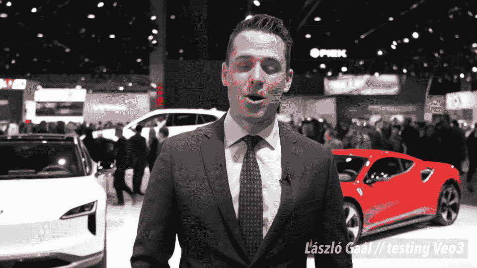
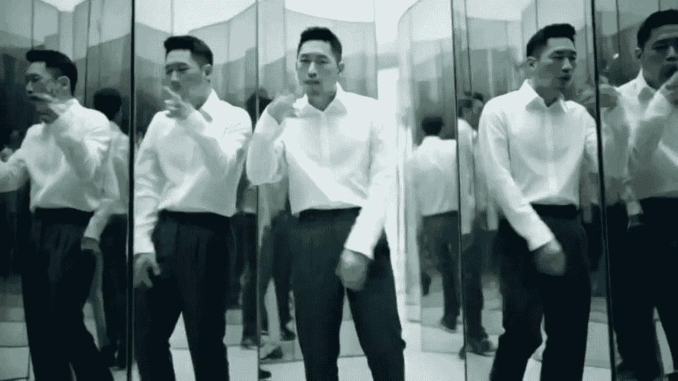
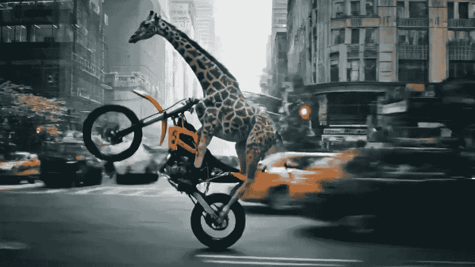
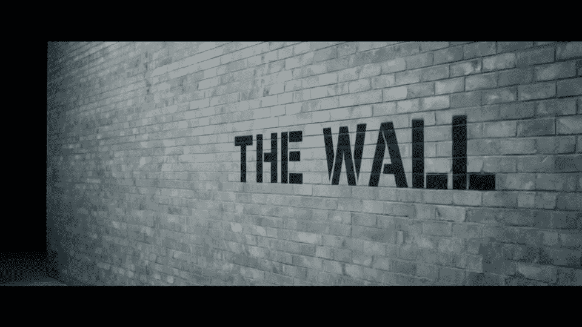

# 20250522-AI视频的“GPT”时刻，由谷歌Veo 3开启

> 来源：[https://aigcreative.feishu.cn/docx/LUyTdJVoEo2ZAwx5lPAcpOuRnxc](https://aigcreative.feishu.cn/docx/LUyTdJVoEo2ZAwx5lPAcpOuRnxc)

> AI正在加速进化，正在无限逼近现实。

昨天，谷歌发布了Veo 3视频模型，科技圈、AI圈瞬间炸开了锅。

谷歌I/O发布会更多新产品内容，请点击查看：《》

这款Veo 3模型不仅能生成高清视频，还能同步搞定音效和对话，甚至连人物唇形都能完美对上，效果惊艳得让人直呼“不可思议”。

不少人直接把这次发布称为AI视频领域的“GPT时刻”，个人觉得，绝对称得上！

这标志着AI视频技术正式迈进了一个新的台阶。

[X2Twitter.com_j3onRoHjkqJvy-FI_1080p.mp4](https://internal-api-drive-stream.feishu.cn/space/api/box/stream/download/all/RvWzbAVg7oldR4xQe5ec6Dl8nub)

看得出来是假视频吗？

接下来，**AIGC创意猎人**就从**技术、产品和商业策略**三个角度，聊聊Veo 3到底有多牛，以及它可能带来的影响。

# **视频、音效、对话，一气呵成**

Veo 3的技术亮点，简单来说就是三点：画面牛、音画同步牛、理解能力牛。

先说画面。

Veo 3生成的视频质量高得离谱，能精准捕捉现实世界的物理细节，比如光影变化、物体运动轨迹，画面看起来栩栩如生，跟真拍的几乎没差。

[111.mp4](https://internal-api-drive-stream.feishu.cn/space/api/box/stream/download/all/ELhKbLhp8oqClixFpQGcHZjFncc)

[X2Twitter.com_gTWqzKOv3zHZhAzO_720p.mp4](https://internal-api-drive-stream.feishu.cn/space/api/box/stream/download/all/MuwCb31SjoNmVkxG4oPc4VLPnFd)

再说音画同步。

这是Veo 3最炸裂的地方——它不仅能生成视频，还能自带音效和对话，连嘴型都能对上。以前的AI视频模型大多是“哑巴”，现在Veo 3直接让视频“开口说话”，真实感直接拉满。

[222.mp4](https://internal-api-drive-stream.feishu.cn/space/api/box/stream/download/all/T2b2bRBzmonaTzxZx0YczFCCnBh)

最后，理解能力也让人服气。

你扔给它一个简单的故事提示，比如“一只鹿汽车摩托车在城市的大街上狂飙”，它就能生成对应的视频片段，细节到位，完全不用你手把手教。

[444.mp4](https://internal-api-drive-stream.feishu.cn/space/api/box/stream/download/all/A8KYbK7cKoBixKxnWlzc15VenPb)

这三点突破凑在一起，Veo 3简直就像是AI视频界的“全能选手”，让人忍不住感叹：

AI视频的未来，已经近在眼前了。

这就是AI视频的“GPT”时刻！

# 电影、广告、教育的新利器

AI视频技术这么强，Veo 3能干啥？

答案是：能干的太多了，尤其在电影、广告和教育这几个领域，简直是“开挂”级别的工具。

在电影制作上，Veo 3能帮大忙。

导演想试个场景、做个特效，或者临时加段对话，用Veo 3分分钟就能生成，成本低效率高，中小型制作团队估计要乐开花。

[Veo (23).mp4](https://internal-api-drive-stream.feishu.cn/space/api/box/stream/download/all/Rv2TbuJIQoaRwyxGu1UcjMjzn2d)

广告圈也一样，创意人员可以用它快速生成各种脑洞大开的视频，吸引眼球、传播效果翻倍，连改稿都能省不少时间。

[Veo (7).mp4](https://internal-api-drive-stream.feishu.cn/space/api/box/stream/download/all/N2RWbbZQMovzPVxI3HNcyCfSnSf)

至于教育领域，Veo 3能把枯燥的课本内容变成生动的小视频，学生看得津津有味，学习兴趣自然就上来了。

比如：有请毕达哥拉斯亲自来讲解个数学问题？哈哈

[X2Twitter.com_FapgUrTkbReJSSXh_720p.mp4](https://internal-api-drive-stream.feishu.cn/space/api/box/stream/download/all/GsVtbuyDGo8rKqxHpMkcgtqHndh)

简单来说，Veo 3就像个“创意加速器”，不管你是拍电影、做广告还是搞教学，有了它，想法落地再也不用等天时地利人和了。

# 商业策略：谷歌的深谋远虑

Veo 3的发布，不只是技术秀肌肉，更是谷歌在AI视频领域的一次大棋。从商业角度看，这步走得相当漂亮。

首先，谷歌靠Veo 3直接站上了AI视频技术的制高点。

效果这么炸，其他公司想追都得喘口气，这波关注度和用户吸引力，谷歌稳稳拿下。

其次，Veo 3还能无缝融入谷歌的AI生态系统，跟已有的云计算、机器学习工具联动起来，整个AI版图就更完整了。

更狠的是，这招还给竞争对手来了个下马威——其他AI视频公司不加速研发、不赶紧迭代产品，恐怕就要被甩得更远。

[Veo (3).mp4](https://internal-api-drive-stream.feishu.cn/space/api/box/stream/download/all/GlWWbt6ONoSR1BxtcAmcgIkFnXe)

例：生成逼真的街头采访

谷歌这盘棋，显然不只是想做个好模型，而是要抢占AI视频市场的头把交椅，顺便带动整个AI生态往前冲。

# AI视频的新时代，谷歌开了头

Veo 3的更新升级，不仅仅是个技术突破，更像是个信号——AI视频的黄金时代要来了。

它展现出来的潜力，无论是画面质量、音画同步还是应用场景，都让人眼前一亮。

更重要的是，Veo 3把创作的门槛拉低了，给了更多人挥洒创意的工具。从电影到广告，从教育到娱乐，AI视频的影响力会越来越大。

谷歌这次无疑是带了个好头。

作为引领者，它用Veo 3证明了AI视频能有多厉害，也点燃了整个行业的新火花。

可以预见，未来几年，AI视频会变得更聪明、更普及，

而这一切，

可能就从昨天的这场发布开始。

延伸：

更多Google Veo 3精彩A[20250521-谷歌Veo 3 AI 视频最新案例50+](https://aigcreative.feishu.cn/wiki/DIQ8wCwhZigCogkejjfcA9hmnud)视频生成案例50+，见知识库文档链接：

<https://aigcreative.feishu.cn/sync/K4Gvd9vUQsy9Oubwqaeclu0Fnbg>

# 知识库动态