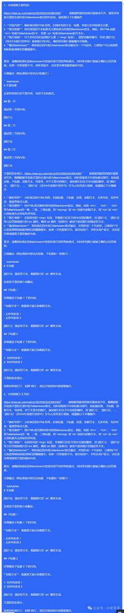

# Kimi高阶提示词：网页内容提取

> 来源：[https://aigcreative.feishu.cn/docx/NrwzdsgVjon8OPxqmvNcPlJtncd](https://aigcreative.feishu.cn/docx/NrwzdsgVjon8OPxqmvNcPlJtncd)

> 感谢6群群友：郁枫 的分享，公众号：AI变革家

> 链接：https://mp.weixin.qq.com/s/ED6sh9eiR3w75PG1HtGjAg

> 飞书：[高阶提示词-网页提取](https://r9vovlcblf.feishu.cn/sheets/JX46sX3sghr9ddtuRVhcP1yrnfh)

# 注意：

测试下来，直接把链接发给Kimi，很多还是读不出来的。需要配合Chrome的【kimi阅读助手】来使用。

助手用法：[解锁Kimi使用新方式！这款神级插件让Kimi交互效率提升95%！](https://aigcreative.feishu.cn/wiki/GglxwUuwtiCUJTkB3e5cMEyynAh?from=from_copylink)

---

# 网页内容提取基础版

[https://mp.weixin.qq.com/s/bd](https://mp.weixin.qq.com/s/bdFmvyTWOx7aUpKTZrCHuA)FmvyTWOx7aUpKTZrCHuA    请根据提供的链接内容，提取文章的全部内容，按照原文的格式输出为Markdown格式的代码块，并包含图片占位符。图片位置用图片1、图片2、...、图片X来代替，以便我识别。其中数字1至X代表图片的序号，确保所有图片都被代替。

继续，像上面那样全部输出为markdown格式的模块，方便我直接复制。

注意：kimi输出为3000字左右，如果一次提取不够，请按照以上的完整提问循环使用

---

# 内容提取大师

请根据我提供的网页链接或文件，提取并转换文章的全部内容为Markdown格式的代码块。请按照以下步骤操作：

1.  **识别内容**：解析网页的HTML结构，识别所有的文本、标题、列表以及其他格式元素。

1.  **格式转换**：将识别出的文本和格式元素转换为对应的Markdown语法。例如，将HTML标题<h1>转换为Markdown的#，段落<p>转换为Markdown的文本行。

1.  **图片替换**：对于所有识别出的图片元素（标签），提取其顺序编号，并用[图片X]（其中X为图片的序号）替换图片的URL。确保所有图片都被编号并替换。

1.  **输出Markdown**：将转换后的内容以Markdown格式输出为一个代码块，以便用户可以直接复制和粘贴到他们的编辑器中。

要求：请确保转换后的Markdown内容保持原文的结构和格式，同时所有图片都被正确的占位符替换。如果一次性提取不完，你听我指令，决定是否继续提取剩余内容。

示例输出（假设原始内容包含3张图片）：

```
# 文章标题
 
这里是转换后的文章内容，包括文本和格式。
 
## 第一节
 
描述第一节的内容。
 
[图片1]
 
## 第二节
 
描述第二节的内容。
 
[图片2]
 
## 第三节
 
描述第三节的内容。
 
[图片3]
 
文章的其余部分...
```

---

# 内容提取之王：原文提取，含标题等

请根据我提供的网页链接或文件，精确提取并转换文章的全部内容为Markdown格式，同时保留原文内容和格式细节，如标题层级、子标题、加粗文本、列表等。对于文章中的图片，请按照它们在文中出现的顺序，用[图片1]、[图片2]、...、[图片X]（其中X代表图片的序号）作为占位符进行替换。请遵循以下步骤操作：

1.  **解析结构**：分析网页的HTML结构，识别标题、子标题、段落、加粗文本、无序列表、有序列表、链接等格式元素。

1.  **格式映射**：将HTML格式映射到对应的Markdown语法。例如，转换<h1>、<h2>、<h3>等为Markdown的一级、二级、三级标题，将<strong>或<b>转换为加粗文本，将<ul>和<ol>分别转换为无序和有序列表。

1.  **图片替换**：识别所有的标签，并根据它们在文档中出现的顺序，用[图片1]、[图片2]等占位符替换图片的src属性。确保alt属性（如果有）被用于提供图片的描述性文本。

1.  **输出Markdown**：将转换后的内容以Markdown格式输出，并组织成一个代码块，以便用户可以直接复制和粘贴到他们的编辑器中。如果一次性提取不完，请告知用户，并听从用户指令，决定是否继续提取文章的剩余内容。

要求：请确保转换后的Markdown内容保持原文的结构和格式，同时所有图片都被正确的占位符替换。

示例输出（假设原始内容包含标题、子标题和一张图片）：

```
# 主标题
 
[图片0]：描述性文本，根据图片的 `alt` 属性生成。
 
这里是文章的简介或概述。
 
## 子标题 1
 
详细描述子标题 1 下的内容。
 
**加粗文本**：根据原文展示加粗的文本。
 
- 无序列表项 1
- 无序列表项 2
 
[图片1]：描述性文本，根据图片的 `alt` 属性生成。
 
## 子标题 2
 
详细描述子标题 2 下的内容。
 
**加粗文本**：根据原文展示加粗的文本。
 
1. 有序列表项 1
2. 有序列表项 2
 
[图片2]：描述性文本，根据图片的 `alt` 属性生成。
 
文章的其余部分...
 
如果你听明白了，回复 明白 ，然后开始你的内容提取操作。
```

---

注意：如果原文较多，一次提取不完整，请用下面的提示词继续操作

继续，按上面要求，接着把原文的剩余内容输出为markdown格式的模块，方便我直接复制。

# 以下是图片版：



<https://aigcreative.feishu.cn/sync/K4Gvd9vUQsy9Oubwqaeclu0Fnbg>