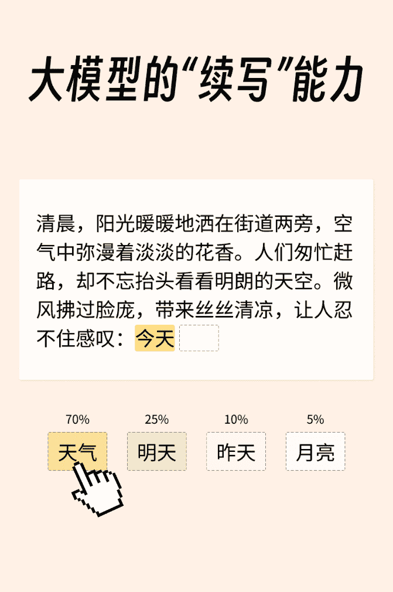
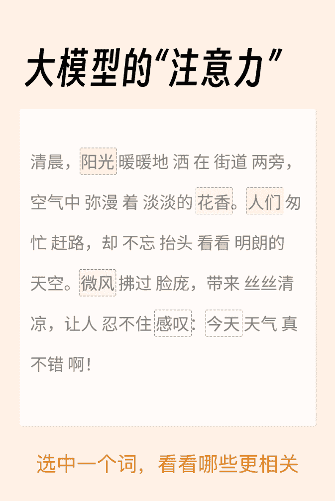
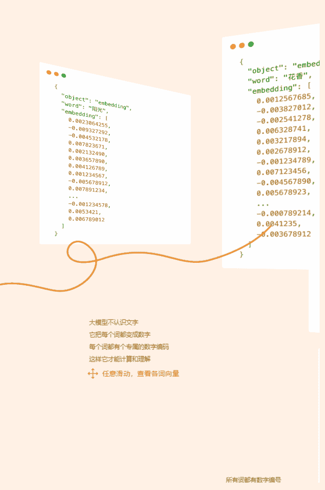
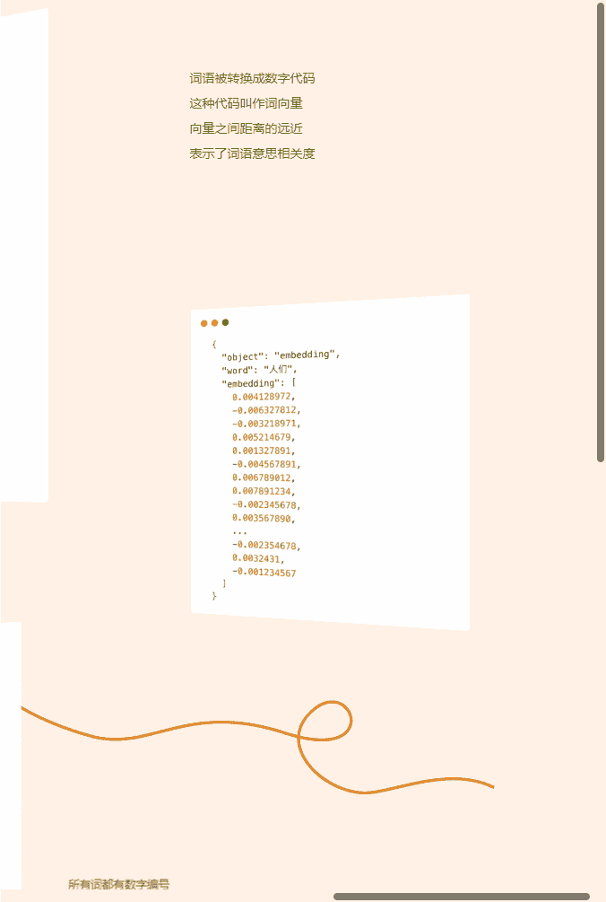
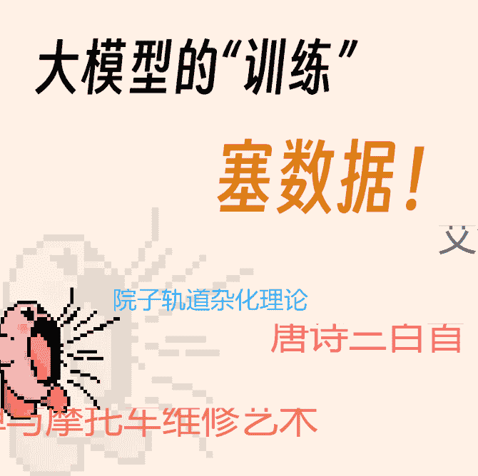
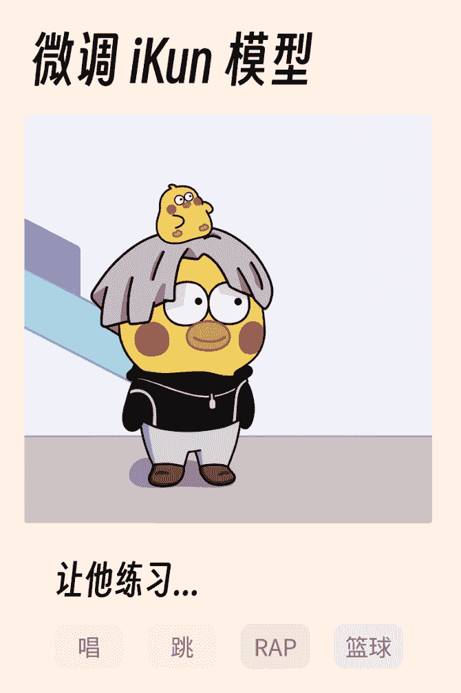

# 中学生都能看懂：10 分钟搞懂ChatGPT的工作原理...

> 来源：[https://aigcreative.feishu.cn/docx/QzkxdbpVvo8ulcxLgP9cXunznnb](https://aigcreative.feishu.cn/docx/QzkxdbpVvo8ulcxLgP9cXunznnb)

> 原文链接： [https://mp.weixin.](https://mp.weixin.qq.com/s/HpScA-jTbIfS94ERIgQWnA)qq.com/s/HpScA-jT...

> 作者：赛博禅心、小互AI

一种全新的交互方式带你理解大语言模型的工作原理...

# 我们先来普及一些专业名词，方便你下面好理解

#

ChatGPT 是由 OpenAI 开发的一种大语言模型（Large Language Model, LLM），其核心基于深度学习中的 Transformer 架构。

ChatGPT 的全称为 （ Chat Generative Pre-trained Transformer）

Chat： 就是聊天的意思，意思你可以通过 聊天的形式和它对话

Generative： 生成式，意思是它的回答内容都是生成的

Pre-trained： 预训练，它通过学习大量的文字资料，学会了人类语言的基本用法规律。

Transformer： 是一种使用 自注意力 （Self-Attention）机制的神经网络结构,也就是它的“大脑”，它通过 自回归 （Auto-regressive）的方式来预测下一个词（token）。这种结构能让它在处理文字时，更好地理解前后文的关系。

---

这些名词都太过专业...

下面我们将以 「交互演示」 方式：

尝试帮你在 10 分钟内，来让你理解大模型的基本原理和专业名词。

在阅读的过程中，请注意这些词汇...

---

# 大模型的“生成”，不过是续写

大模型，能够写一篇很长的内容：不过是“文字接龙”的小游戏。

简单来说，就是： 根据前面的内容，预测下一个词是什么，然后把这个词接上，再预测，再接上，循环往复 。（你也可以管这个叫： 自回归 ）

这里有一个简单的演示，可以点击下面图像中的 天气 来试试

大模型就这么一个个词的猜，直到猜完一整篇文章。

不过这里就有了一个新问题：

AI 是如何判断哪个词可能性最大？又是如何理解我们写的内容呢？

---

# 大模型自己“划重点” ：所谓的“注意力”

AI 在“续写”时，不会对所有词都一视同仁， 它会“划重点”！ 这项能力叫做 “注意力机制” ：把注意力更多地放在重要的词语上。

在下面的演示中，请分别点击  阳光  花香  人们   微风  感叹  或者  今天 ， 来看看大模型都关注到了什么。

通过注意力机制，AI 能够理解句子中词语之间的关系，从而更好地“续写”出通顺的内容。

但问题又来了：AI 是怎样去辨别，哪些内容彼此更相似呢？

---

# AI 眼中文字，是一串串数字

我们能看懂文字，但 AI 看见的却是一串串数字。 因为 AI 会先把每个词变成一个数字编号，这个过程叫做 “词嵌入” (Word Embedding)，也叫“词向量”。

在 GPT 中，每个词或符号（Token）都会被转换成一个向量（“Embedding”）。

这些向量就像是 GPT “理解”文字的基石，因为计算机只能理解数字，通过它们来进行各种计算、理解上下文并最终生成答案。

简单来说，当 GPT 读进一段文字时，会先把这段文字转换成一个个最小的符号（称为 Token）。然后， 模型会为每个 Token 分配一个向量，用数字来表示这个 Token 的含义、语气等信息。

文字→Token→向量

+   比方说，英语里的一个单词，中文中的一个字或词，或者标点符号等，都会被看作一个 Token。

+   每个 Token 都会被映射到一个“向量”，你可以想象它是一个包含许多数字的列表（例如 768 个数字或者更多），每个数字代表这段文字在某个“方向”上的特征。

+   这些特征的数值最开始是随机的，后来通过大量训练，“让句子读起来更通顺、更有意义”的向量会被慢慢调节成合适的数值。

为什么要把文字变成向量？

举个例子：比如“猫”和“狗”这两个词，我们知道它们都是动物，也都很可爱，但在叫声上有所不同。而 AI 却不懂这些，它看到的一切信息，都是被从不同纬度标记的。假设标记数字的取值范围是 -1 到 1：

+   对于“猫”来说：“喵喵叫”这个特征可能对应的数字是 0.99，因为猫确实会喵喵叫；“可爱”这个特征对应的数字可能是 0.8，因为猫通常被认为是可爱的。

+   对于“狗”来说：“喵喵叫”这个特征对应的数字可能只有 0.3，因为它不太常发出这种叫声；但 “可爱”这个特征也对应 0.8，和猫一样。

这像这样， AI 在一通数值比较后，就知道“猫”和“狗”一样可爱，但叫声不同。

拖动下面的图像位置 ，查看和理解各个词汇的 向量

大模型不认识文字

它把每个词都变成数字

每个词都有个专属的数字编码

这样它才能计算和理解

所有词都有数字编号

这编号代表着词的意思

意思差不多的那些词

它们的编号也会更接近

词语被转换成数字代码

这种代码叫作词向量

向量之间距离的远近

表示了词语意思相关度

于是，通过大量的 “词嵌入” ，AI 就能“理解”词语的含义，然后开始干活了。

---

# 塞数据，然后吸收 - 大模型是这样训练的

那么， 词嵌入的值，是如何得到的呢？答案是：“预训练” 。你可以把它想象成 AI 在正式工作前，先进行大量的“阅读”学习。而这个学习过程中，也诞生了我们之前提到的“数字身份证” (词嵌入)。

但这个“阅读”过程，不仅仅是“塞”数据，还包含了 AI 的“消化吸收”，就像星之卡比一样。

在这个“阅读 + 吸收”的过程中，大模型不仅学习语言规律，还为每个词生成“数字身份证”（词嵌入）。但要知道，这些“身份证”并非一成不变，而是随着“阅读”不断优化。例如，读到“猫”和“狗”常一起出现，它就会让这两个词的“身份证”更接近。

这种 “阅读”加“吸收”的过程，就是大模型的“训练”，使 AI 逐步掌握语言规律，并构建出包含“数字身份证”的庞大“词汇库”。

---

# “专项训练” - 从“通才”到“专才”

如果把“预训练”比作“通识教育”，那么 “微调” 就像是“专业培训”：让大模型成为领域专家。

比如，我们手里有一个训练时长两年半的大模型，非常善于背带裤穿搭。

如果我们想得到一个“iKun 模型”，也就是让它精通唱、跳、RAP 和篮球，就需要定向的进行一些微调。 在微调过程中，每个词的“数字身份证”也会发生变化。

体验：在下图中，让 iKun 练习 唱 跳 Rap 或者 篮球

现在，iKun 经过“微调”，就是一个合格的大模型了，立刻出道！

现在，想必你已经完全了解大模型“生成内容”的几个关键概念了：

+   根据前文预测下一个词的“ 续写 ”

+   关注重点词语的“ 注意力 ”

+   将文字转换成数字的“ 词嵌入 ”

+   海量学习的“ 预训练 ”

+   针对特定任务的“ 微调 ”

正是通过这些过程，我们得到了各式各样的大模型，而且非常聪明！

---

# 后记

这篇文章，是我第一次尝试通过「交互演示」，来做更直[观的信息表达，思](https://mp.weixin.qq.com/s?__biz=MzkzNDQxOTU2MQ==&mid=2247493515&idx=1&sn=ff7089d391a68b6aeecee906cf56a3c7&scene=21#wechat_redirect)路源自于之前的思考：《 人类的认知协议 》。后续还有一篇《世界的物理接口》，正在结合 OpenAI 的一些没宣传的内容，进行优化，很快就好完工。

如果你觉得本篇有点用，可以把它转给你身边的小朋友，又或者...正准备学习 AI 的大朋友们 ，感谢！

<https://aigcreative.feishu.cn/sync/K4Gvd9vUQsy9Oubwqaeclu0Fnbg>