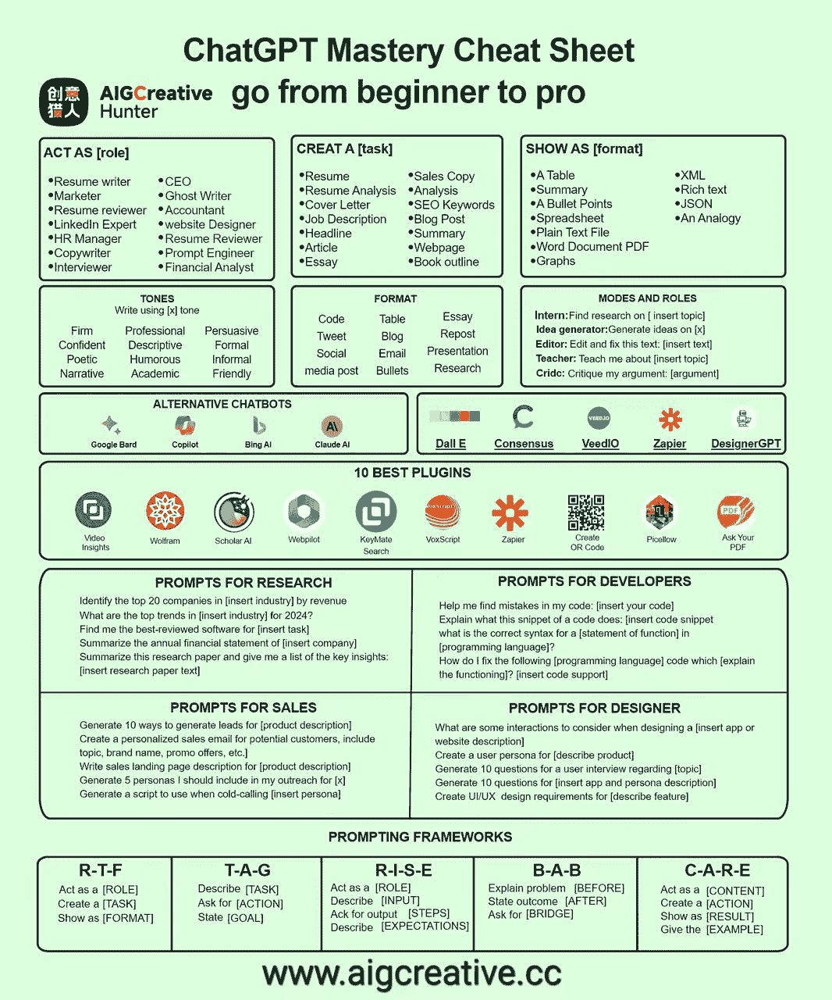
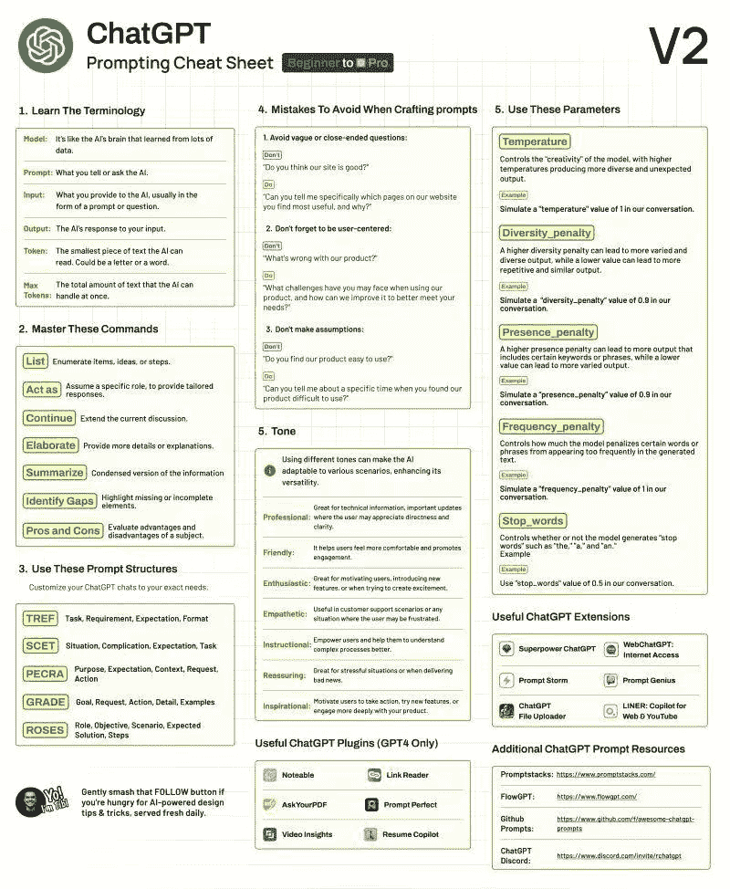

# ChatGPT入门速查表，快速掌握

> 来源：[https://aigcreative.feishu.cn/docx/FdLMdFb3YojzXaxCz75crUpdnBe](https://aigcreative.feishu.cn/docx/FdLMdFb3YojzXaxCz75crUpdnBe)

# V1图片版

# V1文字版

这张图片是《ChatGPT Mastery Cheat Sheet: go from beginner to pro》的备忘单，提供了使用ChatGPT的各种提示和框架，帮助用户从新手到专家逐步掌握使用技巧。以下是详细内容：

### ACT AS [role]

+   **Resume writer**

+   **Marketer**

+   **Resume reviewer**

+   **LinkedIn Expert**

+   **HR Manager**

+   **Copywriter**

+   **Interviewer**

+   **CEO**

+   **Ghost Writer**

+   **Accountant**

+   Website Designer

+   **Prompt Engineer**

+   Financial Analyst

### CREATE A [task]

+   **Resume**

+   **Resume Analysis**

+   **Cover Letter**

+   **Job Description**

+   **Headline**

+   **Article**

+   **Essay**

+   **Sales Copy**

+   **Analysis**

+   **SEO Keywords**

+   **Blog Post**

+   **Summary**

+   **Webpage**

+   **Book outline**

### SHOW AS [format]

+   **A Table**

+   **Summary**

+   **A Bullet Points**

+   **Spreadsheet**

+   **Plain Text File**

+   Word Document PDF

+   **Graphs**

+   **XML**

+   **Rich text**

+   **JSON**

+   **An Analogy**

### TONES

+   **Firm**

+   **Confident**

+   **Poetic**

+   **Narrative**

+   **Professional**

+   **Descriptive**

+   **Formal**

+   **Informal**

+   **Persuasive**

+   **Humorous**

+   **Academic**

+   **Friendly**

### FORMAT

+   **Code**

+   **Table**

+   **Tweet**

+   Social media post

+   **Blog**

+   **Email**

+   **Bullets**

+   **Essay**

+   **Repost**

+   **Presentation**

+   **Research**

### ALTERNATIVE CHATBOTS

+   **Google Bard**

+   **Copilot**

+   **Bing AI**

+   **Claude AI**

### MODES AND ROLES

+   **Intern**: Find research on [insert topic]

+   **Idea generator**: Generate ideas on [x]

+   **Editor**: Edit and fix this text: [insert text]

+   **Teacher**: Teach me about [insert topic]

+   **Critic**: Critique my argument: [argument]

### 10 BEST PLUGINS

+   **Video Insights**

+   **Wolfram**

+   **Scholar AI**

+   **Webpilot**

+   **KeyMate Search**

+   **VoxScript**

+   **Zapier**

+   **QRCode Creator**

+   **Picflow**

+   **Ask Your PDF**

### PROMPTS FOR RESEARCH

+   Identify the top 20 companies in [insert industry] by revenue

+   What are the top trends in [insert industry] for 2024?

+   Find me the best-reviewed software for [insert task]

+   Summarize the annual financial statement of [insert company]

+   Summarize this research paper and give me a list of the key insights: [insert research paper text]

### PROMPTS FOR SALES

+   Generate 10 ways to generate leads for [product description]

+   Create a personalized sales email for potential customers, include topic, brand name, promo offers, etc.]

+   Write sales landing page description for [product description]

+   Generate 5 personas I should include in my outreach for [x]

+   Generate a script to use when cold-calling [insert persona]

### PROMPTS FOR DEVELOPERS

+   Help me find mistakes in my code: [insert your code]

+   Explain what this snippet of a code does: [insert code snippet]

+   What is the correct syntax for a [statement of function] in [programming language]?

+   How do I fix the following [programming language] code which [explain the functioning]? [insert code support]

### PROMPTS FOR DESIGNER

+   What are some interactions to consider when designing a [insert app or website description]

+   Create a user persona for [describe product]

+   Generate 10 questions for a user interview regarding [topic]

+   Generate 10 questions for [insert app and persona description]

+   Create UI/UX design requirements for [describe feature]

### PROMPTING FRAMEWORKS

+   **R-T-F**: Act as [ROLE], Create a [TASK], Show as [FORMAT]

+   **T-A-G**: Describe [TASK], Ask for [ACTION], State [GOAL]

+   **R-I-S-E**: Act as a [ROLE], Describe [INPUT], Ask for [STEPS], Describe [EXPECTATIONS]

+   **B-A-B**: Explain problem [BEFORE], State outcome [AFTER], Ask for [BRIDGE]

+   **C-A-R-E**: Act as a [CONTENT], Create a [ACTION], Show the [RESULT], Give the [EXAMPLE]

# V2图片版

# V2文字版

ChatGPT 提示使用指南 V2 版，助力用户从入门到精通

## 学习术语

**Model:**** 类似于从大量****数据中学习的**** AI 大脑。****

Prompt****: 你提供给 AI 的问**题或任务。

Input: 你提供给 AI 的内容，通常是一个问题或任务。

Output: AI 对你的输入的响应。

Tokens: AI 可以读取的最小信息单位。可能是一个单词或一个单词的一部分。

Token limit: AI 可以处理的总 token 数量。

## 掌握这些命令

+   **List:** 列出项目、想法或步骤。

+   **Act as:** 扮演特定角色，提供定制响应。

+   **Continue:** 延续当前讨论。

+   **Elaborate:** 提供更多细节或解释。

+   **Summarize:** 提供信息的简洁版本。

+   **Identify Gaps:** 突出信息中的缺失或不完整的元素。

+   **Pros and Cons:** 评估主题的优缺点。

+

## 使用这些提示结构

+   **TREF:** Task, Requirement, Expectation, Format（任务，需求，期望，格式）

+   **SCET:** Situation, Complication, Expectation, Task（情况，复杂性，期望，任务）

+   **PECRA:** Purpose, Expectation, Context, Request, Action（目的，期望，背景，请求，行动）

+   **GRADE:** Goal, Request, Action, Detail, Examples（目标，请求，行动，细节，示例）

+   **ROSES:** Role, Objective, Scenario, Expected Solution, Steps（角色，目标，情景，预期解决方案，步骤）

## 避免这些错误

1.  **避免模糊或封闭式问题：**

+   不要："Do you think our site is good?"

+   要："Can you tell me specifically which pages on our website form you find most useful, and why?"

1.  **不要忘记以用户为中心：**

+   不要："What’s wrong with our product?"

+   要："What challenges have you may face when using our product, and how could it be better meet your needs?"

+

## 使用这些参数

+   **Temperature:** 控制模型的“创造力”，较高温度会产生更多样和意想不到的输出。

+   例子：Simulate a 'temperature' value of 1 in our conversation.

+   Diversity_penalty: 更高的多样性惩罚会导致更多样化和不可预测的输出，而较低的值会导致更线性和可预测的输出。

+   例子：Simulate a 'diversity_penalty' value of 0.9 in our conversation.

+   Presence_penalty: 较高的存在惩罚会导致模型生成与上下文中已存在的词语数量较少的输出，较低的值则相反。

+   例子：Simulate a 'presence_penalty' value of 0.9 in our conversation.

+   Frequency_penalty: 控制模型如何惩罚某些词语或短语在生成文本中频繁出现。

+   例子：Simulate a 'frequency_penalty' value of 1 in our conversation.

+   **Stop_words:** 控制模型是否应该将“stop words”作为输出的一部分。

+   例子：Use 'stop_words' value of 0.5 in our conversation.

## 语气

使用不同的语气可以使 AI 适应各种场景，增强其多功能性。

+   **Professional:** 适用于技术信息、重要更新或正式报告。

+   **Friendly:** 增加亲和力，使人感到舒适和友好。

+   **Enthusiastic:** 提升能量和动力，激发参与感。

+   **Empathetic:** 适用于需要展示同理心的情况，或当用户可能感到沮丧时。

+   **Informative:** 清晰传达事实和细节。

+   **Reassuring:** 减轻用户的担忧，建立信任。

+   **Inspirational:** 激励用户采取行动，尝试新功能，或对你的产品产生更深的兴趣。

## 有用的 ChatGPT 扩展

+   Superpower ChatGPT: 增强的互联网访问。

+   **Prompt Storm:** 提示生成器。

+   **Prompt Genius:** 提示优化。

+   **ChatGPT File U****ploader:** 文件上传。

## 仅适用于 GPT-4 的有用 ChatGPT 插件

+   **Noteable**

+   **AskYourPD****F**

+   **Video Insights**

+   **Link Reader**

+   **Prompt Perfect**

+   **Resume Copilot**

<https://aigcreative.feishu.cn/sync/K4Gvd9vUQsy9Oubwqaeclu0Fnbg>