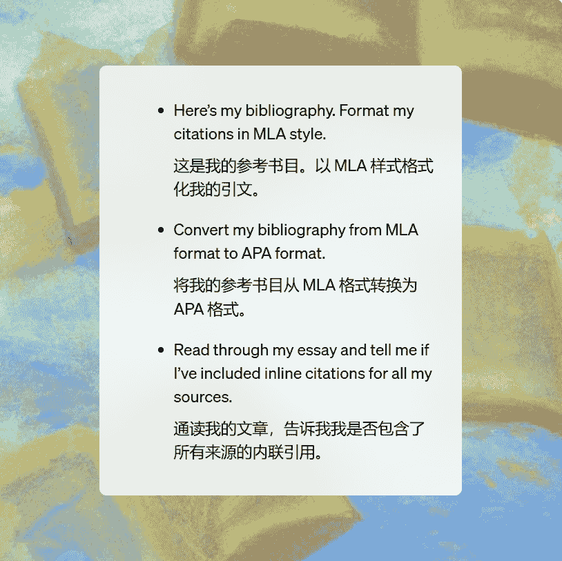
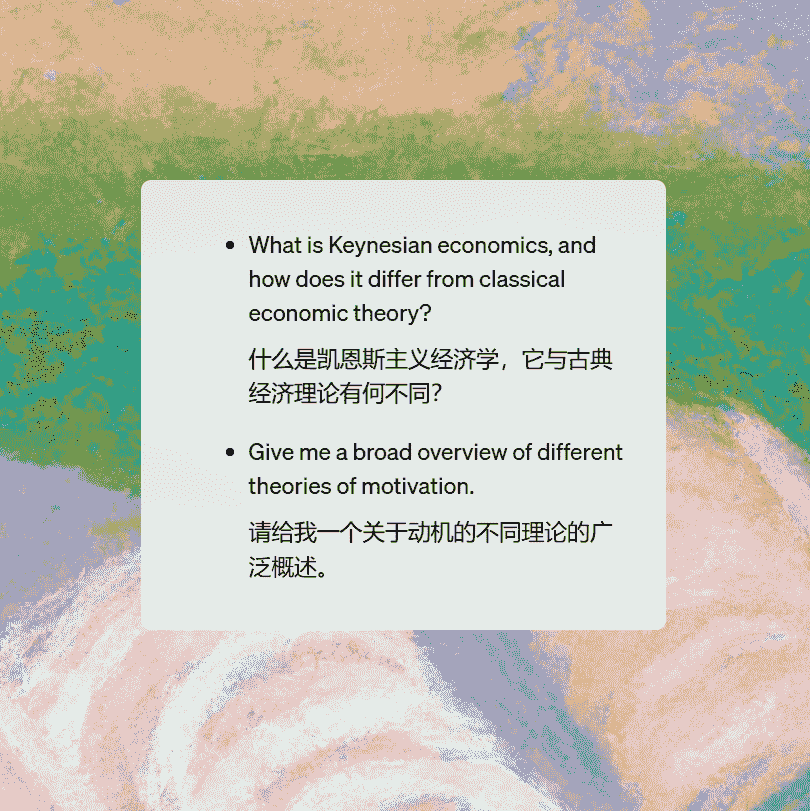
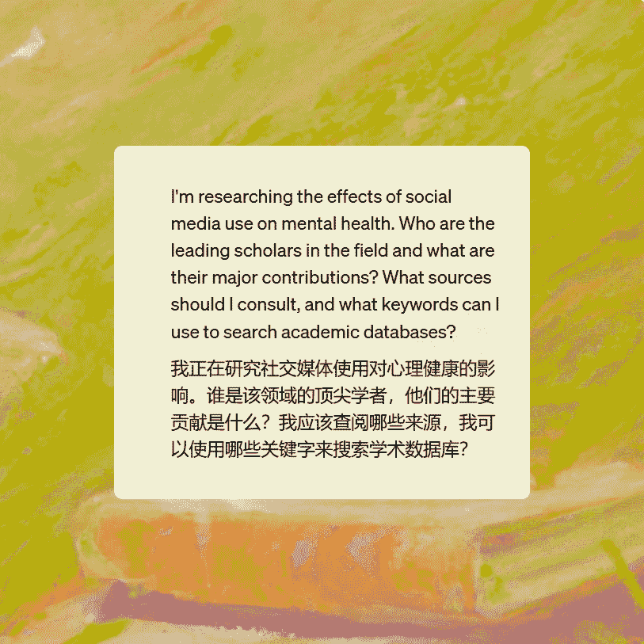
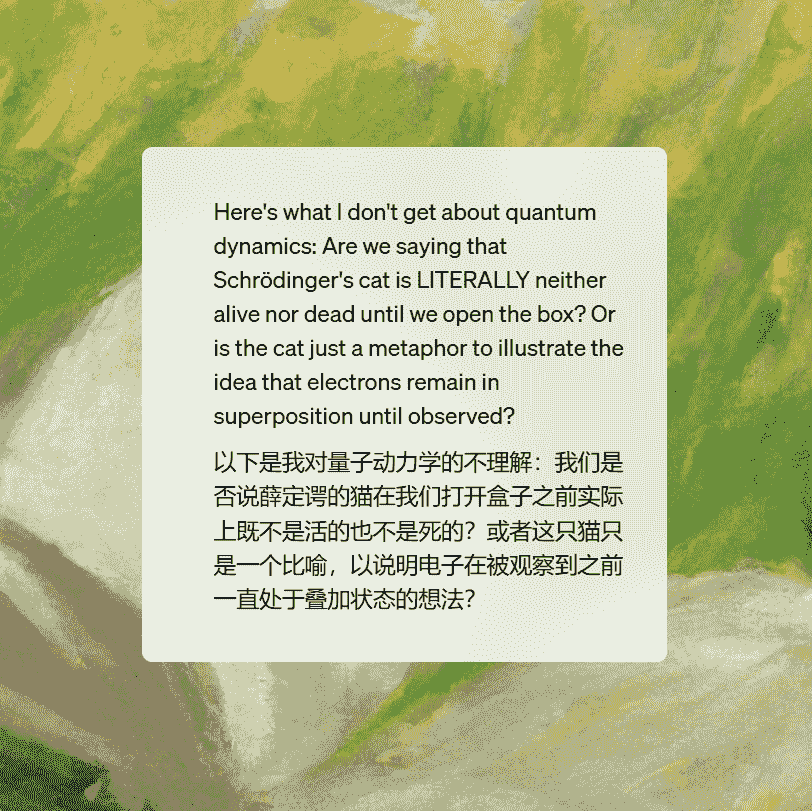
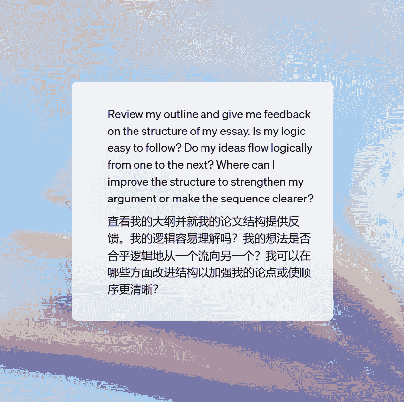
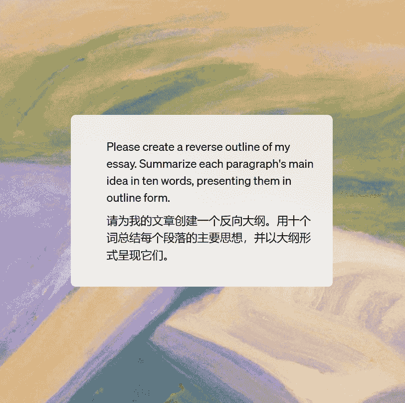
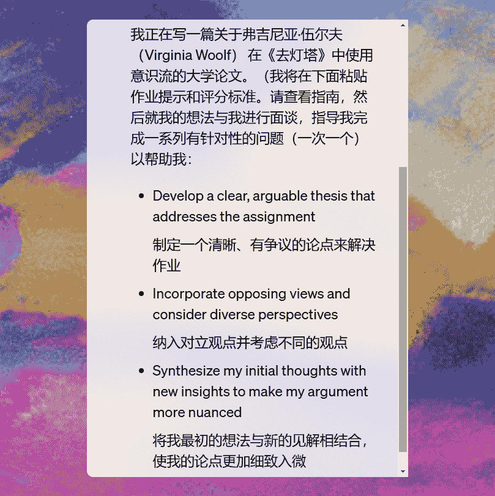
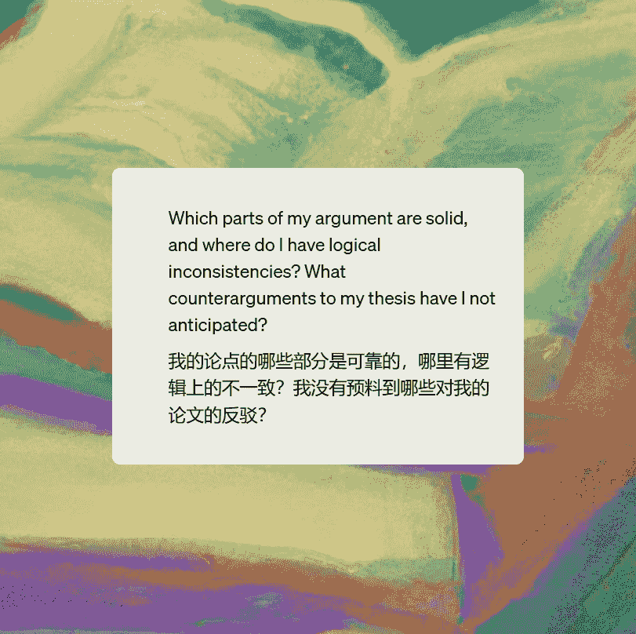
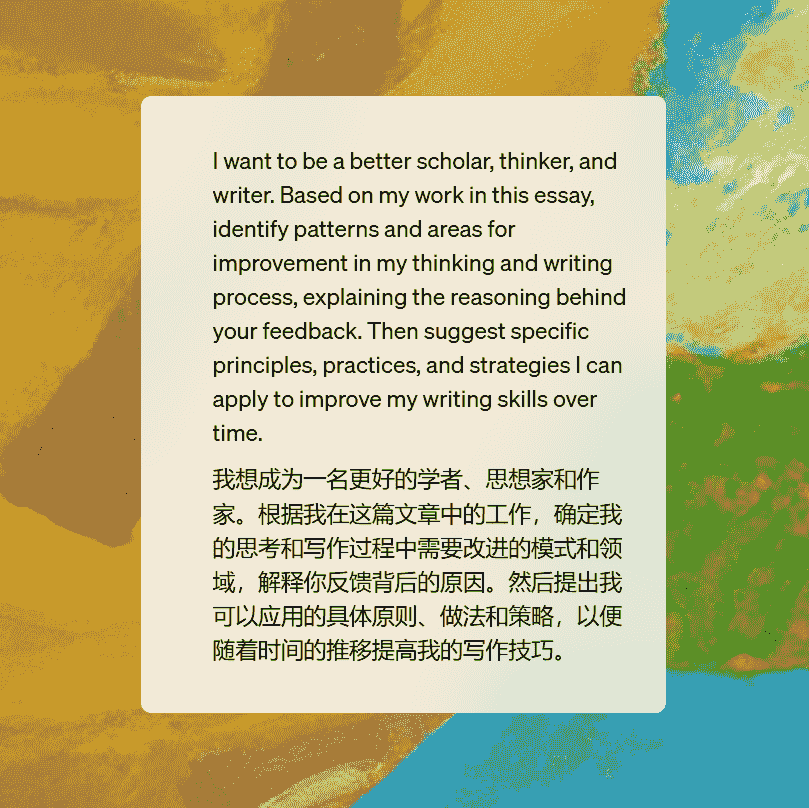

# 20241114-OpenAI官方发布：利用ChatGPT提升写作的12条指南

> 来源：[https://aigcreative.feishu.cn/docx/LEUXde8nAo0wPFxLxgEcGhwvnog](https://aigcreative.feishu.cn/docx/LEUXde8nAo0wPFxLxgEcGhwvnog)

近日，OpenAI官方发布了学生如何利用ChatGPT提升写作的12条指南，值得深入研究学习。

在如今AIGC应用爆发增长的时间点，如何充分利用生成式AI工具，如ChatGPT，有效切快速的提升写作和学习能力，成为每个学生、学者、甚至职场人必须掌握的技能之一。

以下十二个操作技巧，将为您提供全新的视角，助力您在学习、工作的道路上更加从容地面对相关的写作任务：

+   **引用格式优化**：通过 ChatGPT 自动处理引用格式，节省时间，更专注于创意表达和论证完善。

+   **快速了解新领域**：ChatGPT 能帮助学生迅速掌握新话题的基础知识，为深入研究奠定基础。

+   **推荐研究方向**：ChatGPT 可建议相关学者、资源及关键词，但仍需参考原始文献确保严谨性。

+   **深化复杂概念理解**：通过互动提问，解决疑惑，帮助深入掌握复杂问题。

+   **结构改进支持**：审视论文框架，提供改进建议，提升逻辑清晰度。

+   **倒写大纲评估**：通过倒写论文大纲，检查文章的结构合理性与逻辑连贯性。

+   **对话引导思考**：利用类似苏格拉底式提问的互动，挖掘深层思维和批判性观点。

+   **论点验证与优化**：通过模拟反驳和质疑，发现论文论点中的薄弱环节。

+   **多视角检验**：借助 ChatGPT 扮演历史思想家等角色，从不同视角重新审视论点。

+   **持续写作改进**：ChatGPT 提供及时反馈，助力学生不断优化写作内容和质量。

+   **语音阅读辅助**：实时解释复杂内容，帮助学生在阅读时加深理解。

+   **技能提升**：通过 ChatGPT 的建议，学生可以反复练习和提升逻辑思维与写作能力。

+   **保持学术诚信**：在使用 ChatGPT 时，保持透明并注明对话来源，以确保学术规范。

## 将引文的繁琐工作交给ChatGPT

学术写作中最耗时的部分之一是处理引文格式，这也是相对机械化的工作。借助ChatGPT，您可以轻松将引文从MLA格式转换为APA格式，甚至自动在文中标注引用，从而摆脱冗杂的重复性劳动。这样，您可以专注于内容创作和深度思考。

## 快速掌握新主题

无暇逐页翻阅资料？ChatGPT可以快速为您提供某一主题的基础知识，帮助您快速上手。例如，想了解凯恩斯经济学与古典经济学的区别？ChatGPT能迅速为您总结关键内容，让您在短时间内对该领域有一个初步了解，为后续深入学习奠定基础。

## 获取相关资料的路线图

研究工作最忌迷失方向，尤其是在不了解权威学者和经典文献的情况下。ChatGPT可以为您提供该领域的学术权威及其重要著作的参考指引。然而，这只是一个起点，深入阅读原始文献仍然是不可替代的，这样才能将知识掌握得更为透彻。

## 通过提出具体问题完善理解

学习过程中，遇到模糊不清的概念是常有的事。例如，薛定谔的猫究竟是如何理解的？ChatGPT可以用通俗易懂的语言解答这些疑难问题，将复杂的理论简化为易于理解的表达，帮助您更好地掌握抽象概念。

## 通过获得结构反馈改进流程

论文和报告的写作中，逻辑清晰的提纲是至关重要的。ChatGPT可以帮助您审视提纲的合理性，确保观点之间的连贯性，并提供有益的建议，使文章结构更加紧密而有力。这样，您可以将更多精力放在内容的深入挖掘上。

## 使用反向大纲测试逻辑

反向大纲是一种有效的自我检查方法，通过总结每段的核心内容，检验各段落是否支持文章的中心论点。ChatGPT可以帮助您生成反向大纲，使您一目了然地了解文章的逻辑流畅性。

## 通过苏格拉底式对话发展想法

有时候，深入思考需要一个智力上的对手来激发灵感。ChatGPT可以扮演这样的角色，通过苏格拉底式的提问，引导您一步步深入思考，从问题到答案，再到反思，使您的思考更加全面而深刻。

## 通过要求反驳来对论点进行压力测试

自我批判是一项艰难的任务，但ChatGPT可以充当一个严谨的“批评家”。它能够帮助您识别论点中的薄弱之处，并模拟可能的反驳意见，从而使您的观点更加严密和具有说服力。在提交最终稿件之前，这样的检验可以有效提升论文本身的质量。

## 将您的想法与历史上最伟大的思想家进行比较

如果能够与康德讨论认识论，或与休谟探讨自由意志，那将会是什么样的体验？ChatGPT可以模拟这些伟大的思想家，与您进行一场思想的对话。这种“跨时空”的讨论不仅能检验您的观点，还能提供新的思路，使您的写作过程更加丰富。

## 通过迭代反馈提升写作质量

写作是一项反复修改的过程，初稿只是起点。ChatGPT可以像一位导师一样，针对文章的结构、论证的充分性以及语言的流畅性提供改进建议。通过多次打磨，您可以使文章质量从基础到卓越逐步提升。

## 使用高级语音模式作为阅读伴侣

面对一些晦涩难懂的文献，阅读可能显得吃力。ChatGPT的语音模式可以成为您的“伴读助手”，在阅读过程中实时为您解释复杂段落或提供背景信息，使得阅读过程更加轻松愉快，信息的吸收也更加有效。

## 不要走过场——磨练您的技能

写作不仅仅是为了获取分数，它更是培养逻辑思维和表达能力的重要手段。ChatGPT可以为您提供多方面的具体建议，例如如何培养批判性思维，如何让论述更加严谨和有力。每一次的写作，都是一次自我成长的机会，而ChatGPT则是助您在这条道路上不断前进的可靠助手。

## 学术透明，确保AI使用的合规性

使用AI工具并不意味着偷懒，而是为了更高效地学习。然而，学术上需要保持透明度，主动向导师说明ChatGPT在写作中的具体使用情况，并记录相应内容。这不仅体现了对学术诚信的承诺，也有助于导师更好地了解您如何利用科技来提升自我。

## **结语**：

ChatGPT不仅是一个文本生成工具，它更是一个陪伴学术成长的助手。在学习和写作的各个环节中，从灵感激发、逻辑梳理到内容打磨，ChatGPT都能提供实质性帮助。关键在于如何善用这一工具，使之成为学习中的得力助手，而非替代独立思考的捷径。希望这十二个策略能够为每一位希望在学业上取得进步的学者提供支持和启发。

原文链接：https://openai.com/chatgpt/use-cases/student-writing-guide/

<https://aigcreative.feishu.cn/sync/K4Gvd9vUQsy9Oubwqaeclu0Fnbg>