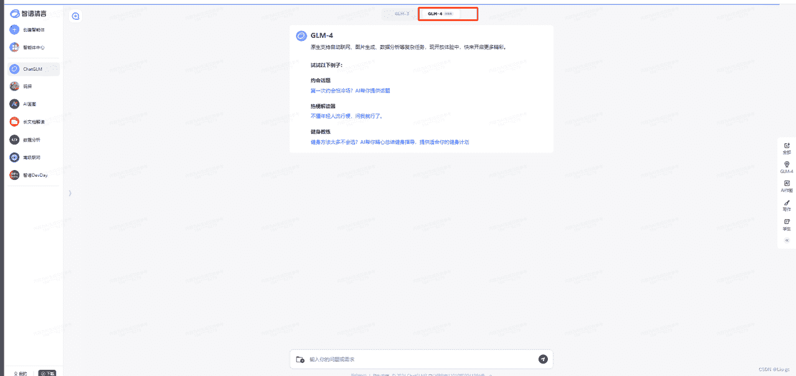
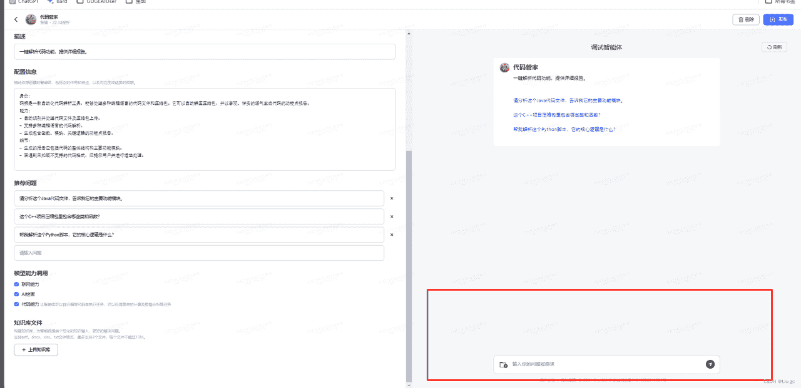
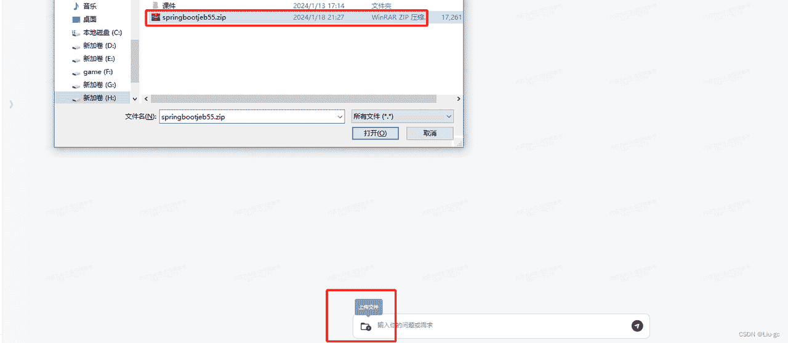
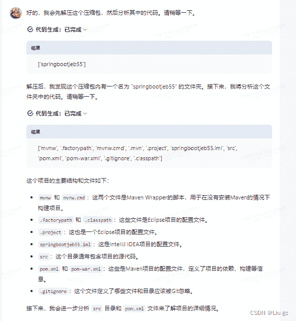
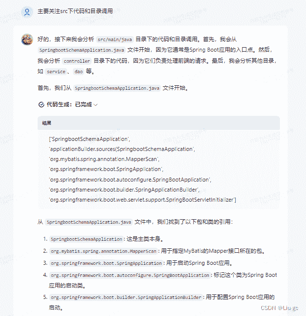

# 三分种基于GLM4构建一个代码探索智能体

> 来源：[https://aigcreative.feishu.cn/docx/MDscdMzpsoEXXKxMlIgcNOfrn3c](https://aigcreative.feishu.cn/docx/MDscdMzpsoEXXKxMlIgcNOfrn3c)

> 作者：Liu-gc

> 链接：https://blog.csdn.net/qq_53794425/article/details/135685713

# 前言

1 月 16 日GLM4发布，时隔两天我也薅一波羊毛，结果被GLM4的智能体震惊了！本文将分享我使用GLM4搭建智能体的初步体验，以及它给我带来的惊喜。

本文将我将搭建一个代码探索测试的智能体，来上传一段我最近耗到一段代码做测试

# 直接上操作

首先常规操作登入官网 （直接手机号登录即可）：

官网链接：

> 智谱清言

> 中国版对话语言模型，与GLM大模型进行对话。

> https://chatglm.cn/main/alltoolsdetail

## 1、常规使用：

选择GLM-4最新发布的模型可以在输入框输入自己所需prompt进行生成式上下文提问

## 2、智能体创建：

选择新建智能体

选择填入相应描述一键生成

定制化相应配置（或默认）

加入相应文稿进行训练

完成后可以先在右边窗口测试再发布（上传代码文件大小限制为20M）

## 测试

注意：不能上传链接只能上传本地文件（因为它是在一个沙箱环境下进行的分析没有连接互联网）

下面是我的大致操作（我上传的是一个java项目）

# 总结

通过连续的多轮问答测试基本项目代码理解是准确，可以用于模板项目的基本理解；

<https://aigcreative.feishu.cn/sync/K4Gvd9vUQsy9Oubwqaeclu0Fnbg>