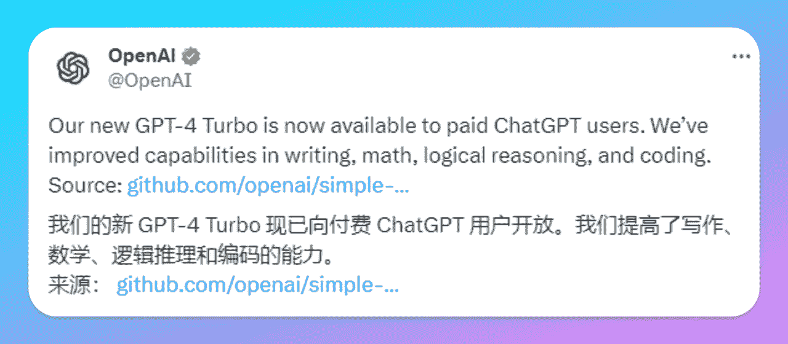
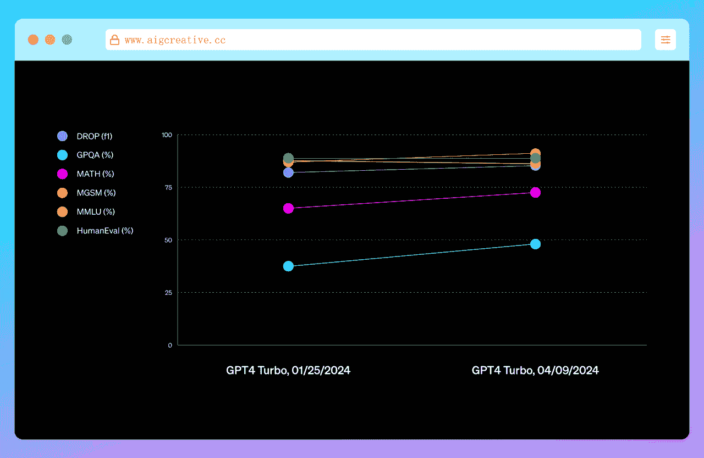
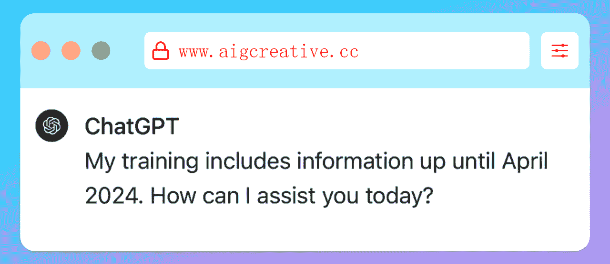
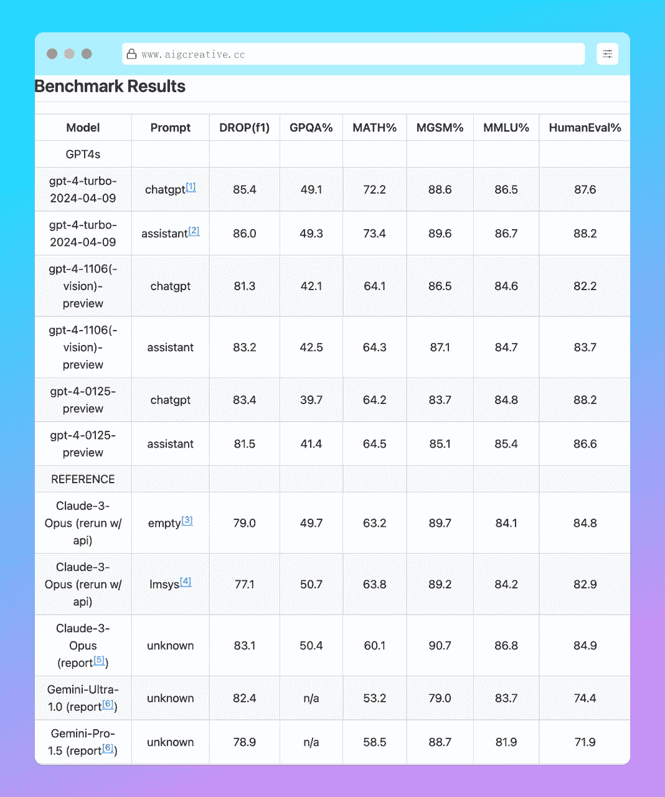

# 20240412-突发！GPT-4 Turbo正式向所有 ChatGPT 付费用户开放

> 来源：[https://aigcreative.feishu.cn/docx/Ax4RdM6QKofY1Bxfn53cZBlpnLc](https://aigcreative.feishu.cn/docx/Ax4RdM6QKofY1Bxfn53cZBlpnLc)

前天，OpenAI发布了GPT-4-Turbo的正式版：该模型具备了先进的视觉识别功能，并能处理高达128k的上下文信息。此次更新带来了显著的性能提升，同时保持了与之前版本相同的价格结构。模型的训练数据更新至2023年底，确保了信息的时效性。用户现在可以通过JSON模式和函数调用更灵活地使用Vision请求。

今天，OpenAIAI宣布：GPT-4 Turbo正式向所有 ChatGPT 付费用户开放！

首先，让我们来聊聊GPT-4 Turbo的升级亮点，不仅提升了写作、数学、逻辑推理和编码的能力，更是将上下文长度扩展到了128k，这意味着它能处理更复杂的对话和任务，输出速度也更快。

而且，GPT-4 Turbo的更新已经开始陆续推送给所有付费的ChatGP**T用户。如果你发现你的知识**库截止时间已经是2024年4月，那么恭喜你，你已经用上GPT-4 Turbo了！

这次更新，不仅仅是提升了性能，更是在用户体验上做足了功课。GPT-4 Turbo在回复时会更加直接，减少了不必要的啰嗦，使用了更多口语化的语言，让人与智能助手的交流更加自然流畅。这样的改变，无疑让ChatGPT更贴近我们的日常生活，更像是一个随时待命的得力助手。

在性能测试方面，GPT-4 Turbo的表现也是可圈可点。它的基准测试结果高于GPT的其他模型，这不仅证明了它的实力，也显示了技术的不断进步。尽管Claude 3等其他模型也在迎头赶上，但GPT-4 Turbo依然稳坐竞技场排行榜的首位，这得益于它在编码和推理能力上的卓越表现。

更有趣的是，这次更新还带来了一些小惊喜。比如，在输入长单词时，会提示你可以使用Tab键进行自动补全。这样的小细节，虽然看似微不足道，却大大提升了用户的输入效率和体验。

GPT-4 Turbo的发布，不仅是技术的一次突破，更是ChatGPT走向成熟的标志。在各大厂的AI竞赛下，大招不断，OpenAI似乎也感受到了压力，也赶紧出来耍耍存在感~~

最后我只想问，GPT-5什么时候来？？？

更多AIGC领域进展，欢迎进群交流：

