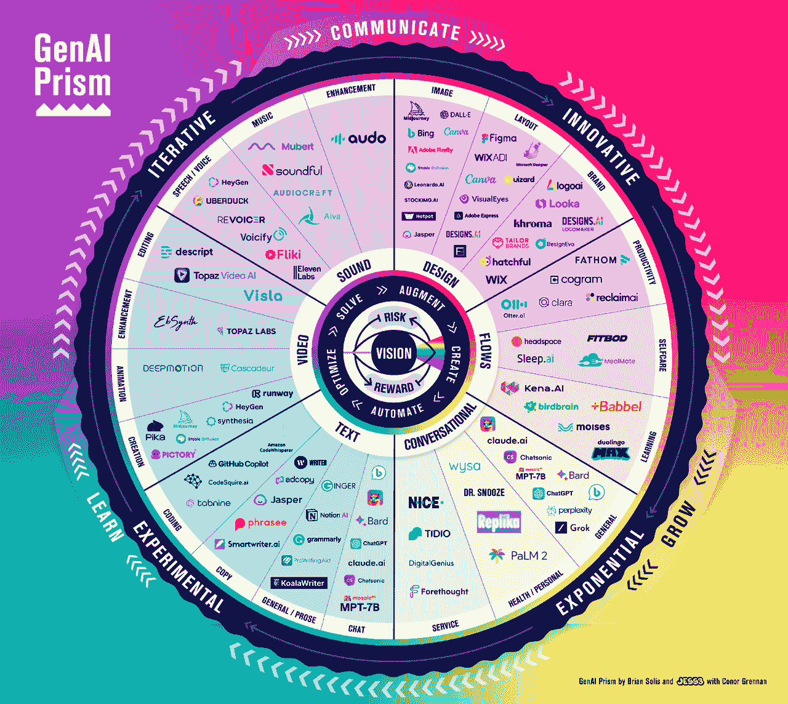
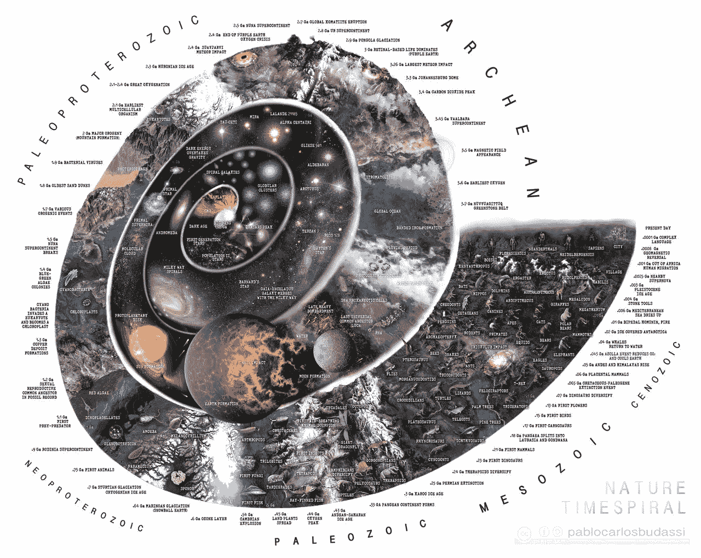
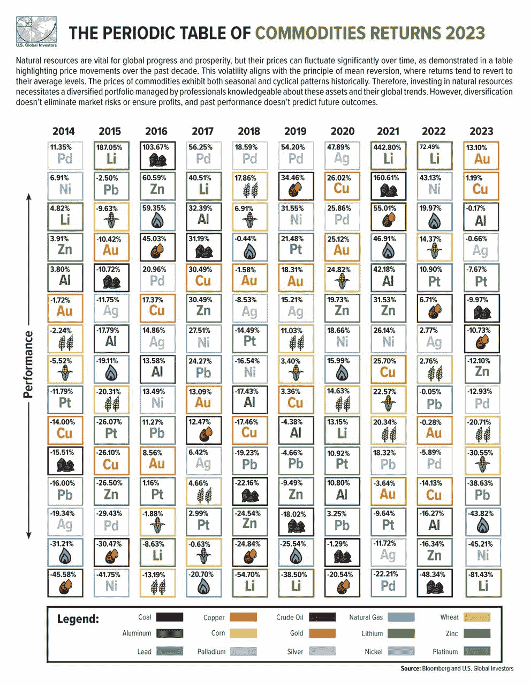
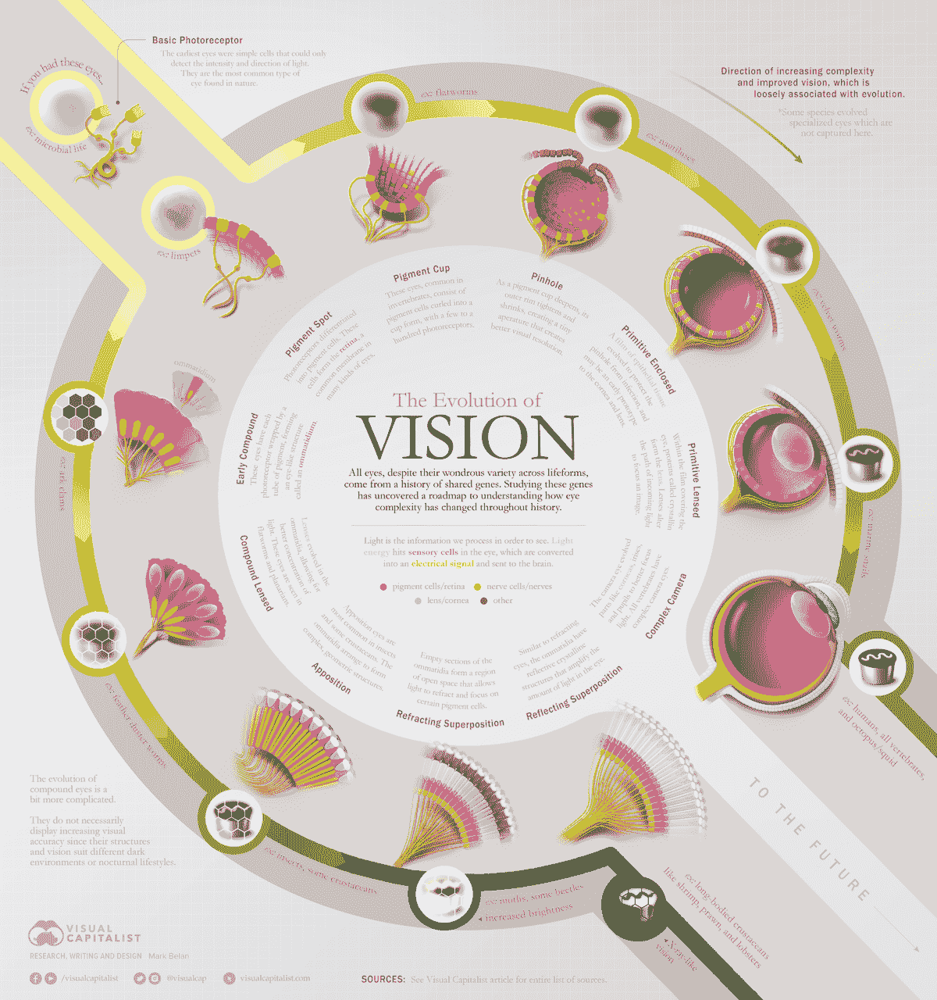
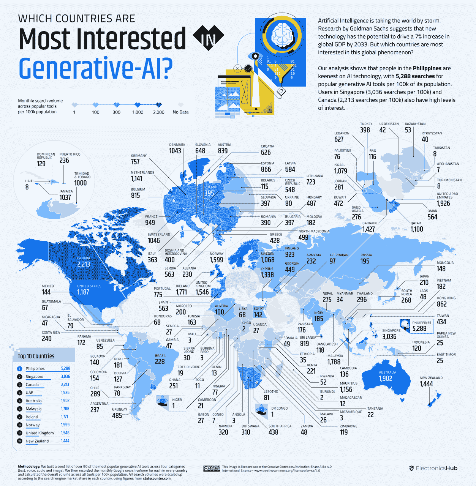

# 20240517-ChatGPT 4o视觉能力实测，未来真是无限可能

> 来源：[https://aigcreative.feishu.cn/docx/Ji3CdCtRpoDIpfx5EjucdbA8nl6](https://aigcreative.feishu.cn/docx/Ji3CdCtRpoDIpfx5EjucdbA8nl6)

这张图名为“GenAI Prism”，展示了生成式人工智能（Generative AI）技术在各个领域的应用和相关公司。以下是详细解读：

### 图的布局

+   **中心**: 视觉（Vision），围绕着风险（Risk）和奖励（Reward）的核心概念。

+   **内圈**: 六大关键能力——解决（Solve）、优化（Optimize）、增强（Augment）、创建（Create）、自动化（Automate）、流（Flows）。

+   **外圈**: 各个应用领域和相关公司/产品。

### 应用领域及相关公司/产品

图中的应用领域由不同颜色和方向的箭头标注，展示了生成式AI技术在多个领域的应用：

#### 1. **视频 (Video)**

+   **编辑 (Editing)**

+   Descript, Topaz Video AI, Visla

+   增强 (Enhancement)

+   DeepMotion, Elai Synth, HeyGen, Synthesia

+   **制作 (Creation)**

+   Runway, Pictory, Pika

#### 2. **音频 (Sound)**

+   **音乐 (Music)**

+   Mubert, Soundful, AudioCraft

+   增强 (Enhancement)

+   Aiva

+   语音/音频 (Speech/Voice)

+   HeyGen, Uberduck, Revoicer, Fliki, Voicify

#### 3. **图像 (Image)**

+   **生成 (Generation)**

+   DALL·E, Midjourney, Bing, Canva, Adobe Firefly

+   **设计 (Design)**

+   Figma, Wix ADI, Looka, Logoai, Khroma

+   增强 (Enhancement)

+   Topaz Labs, Lensa AI

#### 4. **文本 (Text)**

+   **生成 (Generation)**

+   GitHub Copilot, Writer, Jasper, ChatGPT

+   **编辑 (Editing)**

+   Grammarly, Hemingway

+   增强 (Enhancement)

+   Smartwrite.ai, KoalaWriter

#### 5. 对话 (Conversational)

+   **聊天 (Chat)**

+   ChatGPT, Bard, Claude.ai, Replika

+   **客服 (Service)**

+   Tidio, DigitalGenius

#### 6. 生产力 (Productivity)

+   工作流程 (Workflows)

+   Thatchful, Fathom, CogniGraph

+   **安全 (Secure)**

+   Reclaim.ai, MetaMate

#### 7. 健康/个人成长 (Health/Personal)

+   **健康 (Health)**

+   Headspace, Sleep.ai, Wysa

+   个人成长 (Personal Growth)

+   Babbel, Wysa, Ollie.ai

### 使用方向

+   沟通 (Communicate): 生成式AI在沟通和内容创建中的应用，如视频、音频、图像、文本的生成和编辑。

+   **创新 (Innovative)**: 生成式AI在设计、增强和生产力工具中的应用。

+   **成长 (Grow)**: 生成式AI在对话系统、健康和个人成长中的应用。

+   实验 (Experimental): 生成式AI在编程和代码生成中的应用。

+   **学习 (Learn)**: 生成式AI在教育和知识问答中的应用。

### 其他细节

+   **圆心**: 包含视觉、风险和奖励，表明AI技术的发展需要权衡风险与收益。

+   **外圈箭头**: 表示技术的发展方向，如“沟通 (Communicate)”、“创新 (Innovative)”、“成长 (Grow)”等。

### 总结

这张图通过细分领域和应用方向，展示了生成式人工智能技术在多个行业和应用场景中的广泛应用，突出了一些知名公司和其产品，提供了一个全面的生成式AI生态系统视图。这对于理解生成式AI技术在实际应用中的广泛性和潜力非常有帮助。

这张图名为“Nature Timespiral”，展示了地球从形成至今的地质和生物演化历史。图形采用螺旋形状，详细描述了不同地质时代的重要事件。以下是对这张图的详细解读：

### 主要地质时代

图中的时间螺旋从中心向外延伸，代表地球从最早的地质时代到现代的演变过程。主要的地质时代包括：

#### 1. **冥古宙 (Hadean)**

+   **特点**: 地球的形成及早期发展阶段，包括月球的形成和地壳的初步稳定。

+   **重要事件**:

+   45亿年前: 地球形成

+   44亿年前: 月球形成

+   40亿年前: 最早的地壳形成

#### 2. **太古宙 (Archean)**

+   **特点**: 生命的起源和早期生物的发展。

+   **重要事件**:

+   38亿年前: 最早的生命迹象

+   35亿年前: 蓝藻和光合作用的出现

+   32亿年前: 最早的大陆形成

#### 3. 元古宙 (Proterozoic)

+   **特点**: 地球大气层中的氧气增加和多细胞生物的出现。

+   **重要事件**:

+   25亿年前: 氧化事件（Great Oxidation Event）

+   18亿年前: 真核生物的出现

+   10亿年前: 首个超级大陆罗迪尼亚（Rodinia）形成

#### 4. 显生宙 (Phanerozoic)

+   **特点**: 复杂生命的爆发和生物多样性的快速发展。

+   **主要时期**:

+   **古生代 (Paleozoic)**:

+   5.4亿年前: 寒武纪生命大爆发

+   4.4亿年前: 第一次陆地植物出现

+   2.5亿年前: 二叠纪大灭绝

+   **中生代 (Mesozoic)**:

+   2.2亿年前: 恐龙的出现

+   1.45亿年前: 第一批鸟类出现

+   6500万年前: 白垩纪-第三纪大灭绝，恐龙灭绝

+   **新生代 (Cenozoic)**:

+   5000万年前: 哺乳动物的快速进化

+   200万年前: 最早的智人出现

### 重要的自然现象和变化

+   **大陆漂移和板块构造**: 随着时间的推移，地球上的大陆不断移动和重新组合，形成了现代的大陆分布。

+   **气候变化**: 不同时期的气候变化，包括冰期和温暖期，对生物进化产生了深远影响。

+   **生物大灭绝事件**: 图中标注了多次生物大灭绝事件，这些事件大大改变了地球上的生命形式和生态系统。

### 图中的标注和说明

+   **天文学事件**: 图中还展示了许多天文学事件，如银河系的演变和太阳系的形成。

+   **重要地质事件**: 各个地质时代的关键地质事件，如火山活动和冰期。

+   **生物演化**: 生物从最早的单细胞生物到复杂的多细胞生物，以及从海洋生物到陆地生物的演变过程。

### 总结

这张“Nature Timespiral”图通过螺旋形状展示了地球及其生命形式从最早期到现代的演变过程。图中详细标注了每个地质时代的重要事件和自然现象，帮助我们全面理解地球的演化历史及其对现代生态系统的影响。这种视觉化的展示方式使得复杂的地质和生物演化历史更易于理解和记忆。

这张图名为“2023年商品回报周期表”，展示了从2014年至2023年各类大宗商品的年回报率。这种周期表形式的图表通过不同颜色和位置来表示各年各类商品的表现，提供了一个直观的比较视图。以下是详细解读：

### 图表结构

+   纵轴 (Performance): 代表年回报率，从最高到最低排列。

+   **横轴 (Years)**: 代表年份，从2014年到2023年。

+   **颜色编码 (Legend)**: 不同颜色代表不同的商品类别，如煤炭、铜、原油、天然气、小麦、铝、玉米、黄金、锂、锌、铅、钯、白银、镍、铂金。

### 每年商品回报率表现

图表每一列代表一个年份，每一个单元格代表该年某一商品的回报率。以下是对部分年份和商品表现的详细解读：

#### 2014年

+   **表现最好的商品**: 钯 (Pd)，回报率为11.35%

+   **表现最差的商品**: 石油 (Oil)，回报率为-45.58%

#### 2015年

+   **表现最好的商品**: 锂 (Li)，回报率为187.05%

+   **表现最差的商品**: 石油 (Oil)，回报率为-30.47%

#### 2016年

+   **表现最好的商品**: 锌 (Zn)，回报率为60.59%

+   **表现最差的商品**: 天然气 (Nat.Gas)，回报率为-26.06%

#### 2017年

+   **表现最好的商品**: 钯 (Pd)，回报率为56.25%

+   **表现最差的商品**: 糖 (Sugar)，回报率为-22.16%

#### 2018年

+   **表现最好的商品**: 小麦 (Wheat)，回报率为20.49%

+   **表现最差的商品**: 天然气 (Nat.Gas)，回报率为-38.50%

#### 2019年

+   **表现最好的商品**: 镍 (Ni)，回报率为34.08%

+   **表现最差的商品**: 天然气 (Nat.Gas)，回报率为-25.54%

#### 2020年

+   **表现最好的商品**: 银 (Ag)，回报率为47.89%

+   **表现最差的商品**: 原油 (Crude Oil)，回报率为-20.54%

#### 2021年

+   **表现最好的商品**: 锂 (Li)，回报率为442.80%

+   **表现最差的商品**: 钯 (Pd)，回报率为-22.21%

#### 2022年

+   **表现最好的商品**: 锂 (Li)，回报率为72.49%

+   **表现最差的商品**: 铂金 (Pt)，回报率为-12.06%

#### 2023年

+   **表现最好的商品**: 黄金 (Au)，回报率为13.10%

+   **表现最差的商品**: 铅 (Pb)，回报率为-30.55%

### 总结

这张“2023年商品回报周期表”通过颜色和位置的变化，清晰地展示了过去十年中各类商品的年回报率。可以看到，商品回报率具有显著的波动性和周期性特征，不同年份表现最佳和最差的商品变化较大。这种视图可以帮助投资者理解商品市场的历史表现和潜在的趋势，从而做出更明智的投资决策。

这张图名为“视觉的进化”，展示了各种生物眼睛的复杂性是如何随着时间推移而发展的。下面我将详细解读图中的内容。

### 基本信息

+   **标题**: The Evolution of Vision（视觉的进化）

+   **描述**: 所有眼睛，无论其多样性如何，都是从共享基因的历史中衍生出来的。研究这些基因揭示了理解眼睛复杂性如何在历史上发生变化的途径。

### 进化方向

+   **复杂性和视觉能力的提高**: 图中显示了从简单到复杂的视觉系统的演变过程，箭头指向复杂度增加和视觉能力提升的方向。

### 视觉进化的主要阶段

1.  基本光感受器 (Basic Photoreceptor):

+   最原始的光感受器细胞只能够感受光的存在与否。

+   示例: 色素点 (Pigment Spot)，如单细胞生物的眼点。

1.  色素杯 (Pigment Cup):

+   形成凹陷的色素杯，有助于感知光的方向。

+   示例: 平板虫的眼点。

1.  针孔眼 (Pinhole Eye):

+   进化出了小孔，有助于形成简单的图像。

+   示例: 带有简单成像能力的贝类。

1.  原始透镜眼 (Primitive Lens Eye):

+   进化出了透镜，能够聚焦光线，形成更清晰的图像。

+   示例: 部分软体动物。

1.  复杂透镜眼 (Complex Lens Eye):

+   具有复杂的透镜系统和视网膜，能形成高分辨率的图像。

+   示例: 大多数脊椎动物，如哺乳动物和鸟类。

### 特殊进化路线

+   复眼 (Compound Eye):

+   由多个小眼（小透镜）组成，每个小眼负责一个视角，形成广角视野。

+   示例: 昆虫和甲壳类动物。

+   演变包括：

+   折射超位置眼 (Refracting Superposition): 如昆虫和一些甲壳类动物。

+   反射超位置眼 (Reflecting Superposition): 如某些甲虫和蛾类。

### 光信息处理

+   **光处理**: 光信息通过感觉细胞处理，转化为电信号并传送到大脑。

+   **颜色编码**:

+   图中使用了颜色编码来表示不同的眼睛结构：

+   **粉红色**: 色素细胞/视网膜

+   **蓝色**: 透镜/角膜

+   **黄色**: 神经细胞/神经

+   **灰色**: 其他结构

### 进化的关键点

+   **共同基因**: 所有眼睛都来源于共享的基因，这些基因在不同生物中随着时间推移演变成了各种复杂的视觉系统。

+   **适应环境**: 眼睛的进化受到环境需求的驱动，比如捕食、躲避捕食者、寻找配偶等。

### 未来方向

+   **持续演化**: 图中提到眼睛的复杂性还在不断进化，未来可能会有更先进的视觉系统出现。

这张图通过详细的视觉化展示了从简单到复杂的眼睛是如何在不同生物中进化的，并解释了每个阶段的功能和示例。这对于理解生物视觉系统的多样性和进化过程非常有帮助。

这张图名为“哪个国家对生成式人工智能最感兴趣？”，展示了全球各国对生成式人工智能（Generative AI）的兴趣程度。图中通过每10万人口的月度搜索量来表示各国对生成式AI工具的关注度，并用不同的颜色深浅表示搜索量的多少。以下是对这张图的详细解读：

### 图表结构

+   **颜色编码**: 不同深浅的蓝色表示不同的搜索量，蓝色越深表示搜索量越高。

+   **搜索量标记**: 每个国家的搜索量标记在国家区域上。

+   **Top 10 国家**: 左下角列出了对生成式AI最感兴趣的前10个国家。

### 全球总体兴趣情况

+   **最高兴趣国家**: 菲律宾，每10万人有5288次搜索

+   **其他高兴趣国家**: 新加坡（3036次）、加拿大（2213次）、阿联酋（1926次）、澳大利亚（1902次）

### 各大洲情况

#### 北美洲

+   **加拿大**: 2213次搜索

+   **美国**: 1187次搜索

+   **墨西哥**: 144次搜索

#### 南美洲

+   **巴西**: 289次搜索

+   **阿根廷**: 237次搜索

#### 欧洲

+   **德国**: 757次搜索

+   **英国**: 1444次搜索

+   **法国**: 715次搜索

+   **意大利**: 1046次搜索

+   **西班牙**: 897次搜索

+   **波兰**: 395次搜索

#### 亚洲

+   **菲律宾**: 5288次搜索

+   **新加坡**: 3036次搜索

+   **印度**: 1788次搜索

+   **日本**: 148次搜索

+   **中国**: 434次搜索

+   **韩国**: 268次搜索

#### 大洋洲

+   **澳大利亚**: 1902次搜索

+   **新西兰**: 1444次搜索

#### 非洲

+   **南非**: 438次搜索

+   **尼日利亚**: 17次搜索

### 关键观察

1.  **菲律宾**: 对生成式AI工具的兴趣最强，每10万人有5288次搜索，远超其他国家。

1.  **新加坡和加拿大**: 也是对生成式AI非常感兴趣的国家，分别有3036次和2213次搜索。

1.  **美国和英国**: 作为科技大国，也有较高的搜索量，分别为1187次和1444次。

1.  **欧洲国家**: 德国、法国、意大利、西班牙等主要欧洲国家对生成式AI有相当的兴趣。

1.  **亚洲**: 除了菲律宾和新加坡，印度、日本、中国和韩国也显示出对生成式AI的显著兴趣。

1.  **大洋洲**: 澳大利亚和新西兰对生成式AI的兴趣也很高，分别有1902次和1444次搜索。

### 总结

这张图表明了全球各国对生成式AI的兴趣差异，突出显示了菲律宾、新加坡和加拿大等国的高度关注。生成式AI作为一种新兴技术，受到了全球广泛的关注和搜索，这反映了人们对其潜力和应用前景的浓厚兴趣。

<https://aigcreative.feishu.cn/sync/K4Gvd9vUQsy9Oubwqaeclu0Fnbg>