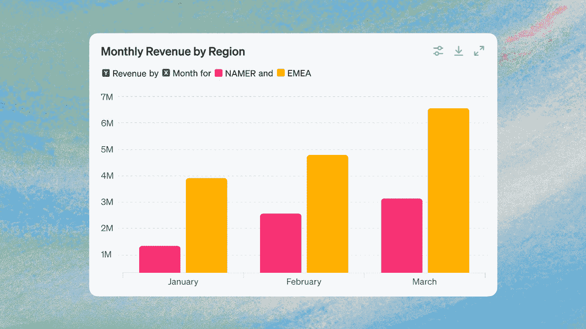

# 20240517-OpenAI发布办公神器，ChatGPT可以帮你高效处理Excel了！

> 来源：[https://aigcreative.feishu.cn/docx/Z1vTdavRtoEtOwxryXycdsTrnab](https://aigcreative.feishu.cn/docx/Z1vTdavRtoEtOwxryXycdsTrnab)

今早，OpenAI宣布未来几周内，其新旗舰AI模型GPT-4o将为ChatGPT Plus、Team和Enterprise用户提供数据分析增强功能。

无论是大型数据集合并、数据分析、创建图表、挖掘数据信息，都能一句话召唤ChatGPT执行。

如果你的工作中有一个助手，它不仅能帮你快速处理繁琐的数据，还能让你的报告看起来更加专业，是不是听起来很棒？

### **直接从云端获取数据，效率翻倍**

首先，ChatGPT 4.0允许用户直接从Google Drive和Microsoft OneDrive上传文件，这意味着数据分析师不再需要将文件下载到本地，再进行上传。这一改进大大提高了工作效率，尤其是对于那些需要处理大量数据的专业人士来说，无疑是一大福音。

### **实时互动表格，让数据分析更直观**

ChatGPT 4.0的另一个亮点是其交互式表格功能。用户可以创建一个可扩展的全屏表格，实时跟踪分析过程。这种直观的展示方式，让数据分析师能够更清晰地理解数据变化，同时也方便他们提出后续问题或深入分析。

### **定制化图表，让演示更专业**

此外，ChatGPT 4.0还提供了定制化图表的功能。用户可以根据需要，定制条形图、折线图、饼图和散点图等，并在对话中与这些图表互动。这不仅提升了数据的可视化效果，也使得数据分析师能够更专业地进行演示和报告。

### **安全与隐私，始终是核心**

在享受便捷的同时，数据安全和隐私保护也是OpenAI公司关注的重点。ChatGPT 4.0承诺不会使用来自ChatGPT和企业用户的任何数据进行训练，ChatGPT Plus用户还可以通过数据控制选项选择退出训练。这些措施无疑增加了用户对ChatGPT 4.0的信任度。

### 数据分析师的未来：失业还是升级？

那么，ChatGPT 4.0的这些更新是否意味着数据分析师的职位将受到威胁？其实不然。正如The Carlyle Group的副总裁David Vaughn所说，ChatGPT已经成为他分析客户数据的工具之一，它帮助他处理了Excel无法应对的庞大复杂数据集，让他能够更深入地进行数据探索，从而更快地获得有价值的洞察。

Afterpay的市场营销经理Lauren Nowak也分享了她的看法，她认为ChatGPT不仅帮助她更好地理解数据，还让她的工作更加充实，帮助她学习，同时释放出更多时间来专注于工作的战略部分。

### **结语**

ChatGPT 4.0的更新，无疑为数据分析领域带来了新的活力。它不是取代数据分析师，而是成为了他们的超级助手，帮助他们更高效、更专业地完成工作。随着人工智能技术的不断进步，我们可以预见，未来的数据分析师将与AI更加紧密地合作，共同推动数据分析领域的发展。而对于OpenAI公司来说，如何在提供强大功能的同时，确保用户的数据安全和隐私，将是其未来发展的关键。

<https://aigcreative.feishu.cn/sync/K4Gvd9vUQsy9Oubwqaeclu0Fnbg>