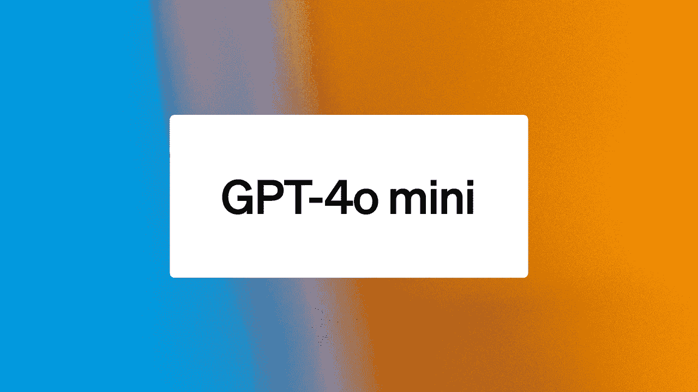
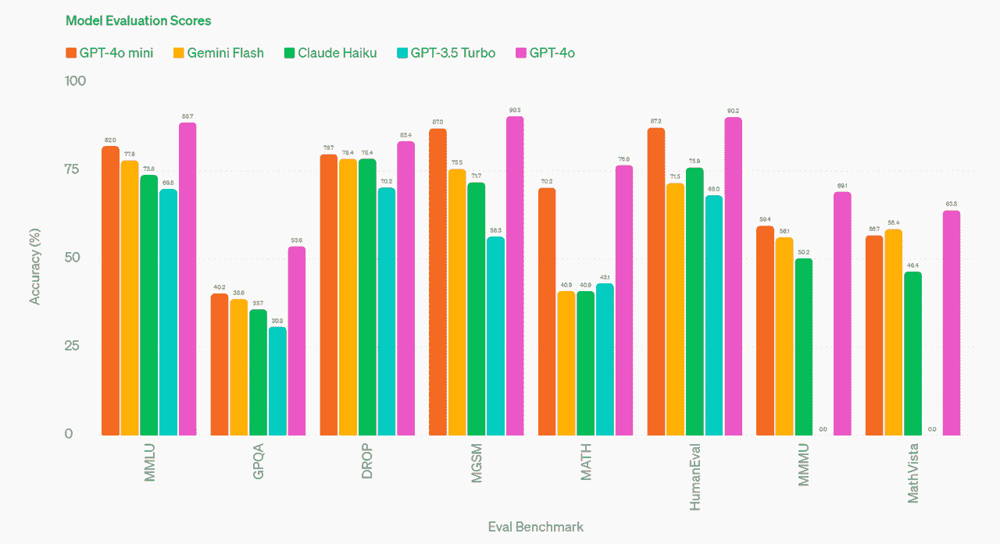

# 20240719-OpenAl新推出GPT-4o mini：最强大且性价比最高的小型模型

> 来源：[https://aigcreative.feishu.cn/docx/LCpudfYzIoh947xROPdclA93n0g](https://aigcreative.feishu.cn/docx/LCpudfYzIoh947xROPdclA93n0g)

**7月18日，OpenAI宣布推出了他们最新的小型智能模型——GPT-4o mini。这款模型不仅在成本上**大幅降低，更在性能上实现了质的飞跃。GPT-4o mini的推出，标志着人工智能技术的普及化和低成本化迈出了坚实的一步。

**价格亲民，性能卓越**

GPT-4o mini的定价策略极具竞争力。每百万输入令牌仅需15美分，每百万输出令牌60美分。相比之前的前沿模型，这一价格降低了一个数量级，比GPT-3.5 Turbo便宜超过60%。这一价格策略无疑将极大地推动AI技术在更广泛领域的应用。

**多任务处理，应用广泛**

GPT-4o mini的低成本和低延迟使其能够处理多种任务，如串联或并行调用多个模型（例如调用多个API）、传递大量上下文给模型（例如完整的代码库或对话历史），或通过快速、实时的文本响应与客户互动（例如客户支持聊天机器人）。

**支持文本和视觉，未来更多可能**

目前，GPT-4o mini支持文本和视觉输入输出，未来还将支持文本、图像、视频和音频的输入输出。模型具有128K令牌的上下文窗口，每个请求支持高达16K的输出令牌，并具有截至2023年10月的知识。得益于与GPT-4o共享的改进分词器，处理非英文文本现在更具成本效益。

**学术基准测试中表现优异**

在学术基准测试中，GPT-4o mini在文本智能和多模态推理方面超越了GPT-3.5 Turbo和其他小型模型。

在推理任务方面，GPT-4o mini 在涉及文本和视觉的推理任务中表现优异。在一个名为MMLU的文本智能和推理基准测试中，GPT-4o mini 得分为82.0%，相比之下，Gemini Flash 得分为77.9%，Claude Haiku 得分为73.8%。

在数学和编程能力上，GPT-4o mini 也表现得非常出色。在测量数学推理能力的MGSM测试中，GPT-4o mini 得分为87.0%，而Gemini Flash 得分为75.5%，Claude Haiku 得分为71.7%。在衡量编程性能的HumanEval测试中，GPT-4o mini 得分为87.2%，相比之下，Gemini Flash 得分为71.5%，Claude Haiku 得分为75.9%。

在多模态推理方面，GPT-4o mini 同样表现强劲。在一个多模态推理评估（MMMU）中，GPT-4o mini 得分为59.4%，相比之下，Gemini Flash 得分为56.1%，Claude Haiku 得分为50.2%。

**安全性内置，持续改进**

安全性是GPT-4o mini设计的核心。从预训练阶段开始，就通过过滤不希望模型学习或输出的信息（如仇恨言论、成人内容、主要聚合个人信息的网站和垃圾邮件）来增强模型的安全性。在后训练阶段，通过使用人类反馈的强化学习（RLHF）等技术，使模型的行为与我们的政策保持一致，从而提高模型响应的准确性和可靠性。

随着AI智能的显著进步和成本的大幅降低，我们有理由相信，GPT-4o mini将为开发者提供更高效、更经济的AI应用构建和扩展方式。未来，AI模型将更无缝地集成到每个应用程序和每个网站中，GPT-4o mini正是这一愿景的先行者。

<https://aigcreative.feishu.cn/sync/K4Gvd9vUQsy9Oubwqaeclu0Fnbg>