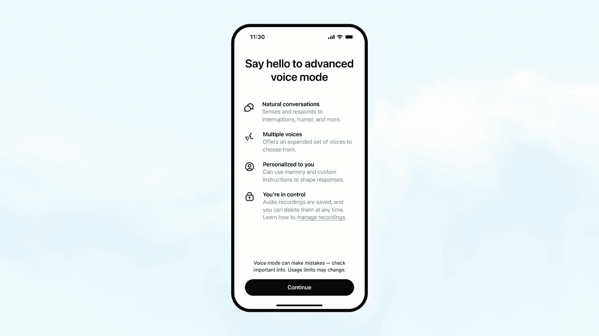

# 20240925-ChatGPT高级语音模式上线：50多种语言功能，5种新声音惊艳亮相！

> 来源：[https://aigcreative.feishu.cn/docx/OvBLdrCH7o1xYNxFP3fcFUXHnKA](https://aigcreative.feishu.cn/docx/OvBLdrCH7o1xYNxFP3fcFUXHnKA)

OpenAI正式宣布，ChatGPT的高级语音功能将面向所有Plus和团队用户推出。虽然这项功能会分阶段在一周内完成上线，但很多用户已经迫不及待想要体验这场语音技术的革新。

[1.mp4](https://internal-api-drive-stream.feishu.cn/space/api/box/stream/download/all/ILS0bAY64ol2HoxH0qxcM1B8nQb)

这次升级不仅增加了五种全新的语音，还让互动更加个性化。更令人惊喜的是，ChatGPT现在能说50多种语言的“对不起，我迟到了”。这种简单但实用的小功能，在全球用户中引发了极大兴趣。无论你身处何地，说哪种语言，ChatGPT都能给你贴心的反馈。

### 五种新声音，个性十足

AI的声音是否会过于“机械”？这是很多用户关心的问题。这次的语音更新，OpenAI给出了漂亮的答案。新增的五种声音风格各异，不再千篇一律。无论是温和、热情，还是正式、活泼，总有一种能适合你的需求。

[2.mp4](https://internal-api-drive-stream.feishu.cn/space/api/box/stream/download/all/PBKCbr9E0oMPL0x4HP3cQ3QGnkb)

这种多样化的声音选择，让用户能够根据不同场景和偏好，选择最适合的音色。例如，处理工作任务时，你可能需要严肃、清晰的语音，而在休闲对话中，活泼自然的语音会让互动更轻松愉快。这种灵活性大大提升了AI助手的实际应用场景。

### 记忆功能加持，语音交互更智能

这次更新的另一个重磅亮点就是记忆功能的加入。借助这一功能，ChatGPT不再是一个仅仅“执行指令”的工具，而更像是一个能够长期“记住”用户偏好的助手。

[3.mp4](https://internal-api-drive-stream.feishu.cn/space/api/box/stream/download/all/Ln7Nb9Nd0o0T37xAILMcHTnYnad)

过去，你可能需要反复告知AI你的需求，比如你喜欢哪种语调、常用的指令或是某些个性化设置。而现在，ChatGPT能记住这些细节，下次互动时，它会自动调整，直接为你提供最符合习惯的体验。这不仅节省了用户时间，还增加了交互的便利性和个性化程度。

### 全球用户支持，跨语言沟通无障碍

值得一提的是，ChatGPT这次的语音升级不仅提升了语音的自然度，还对不同语言的口音做了深度优化。无论是英语、法语、西班牙语，还是其他小众语言，这次升级都能让语音助手的发音更接近母语水平，沟通更加自然。

[4.mp4](https://internal-api-drive-stream.feishu.cn/space/api/box/stream/download/all/YLJeboi4ko6z3Ixo7TVckhntnad)

不过，OpenAI也透露，目前欧盟地区（包括英国、瑞士、冰岛、挪威等）暂时无法使用这项高级语音功能。虽然这些地区的用户可能会稍晚一步体验到这项功能，但可以预见，这样的升级不会让他们失望。

### 更加“聪明”的未来助手

从五种新声音到记忆功能的引入，这次更新展示了ChatGPT不断追求更加自然、智能的方向。OpenAI并没有仅仅满足于“能对话”，而是致力于让AI真正融入用户的日常生活。这次的升级，正是他们迈出的又一大步。

随着技术的不断进化，语音助手不再只是工具，它将逐渐成为我们生活中更贴心、更智能的伙伴。这次更新只是一个开始，未来的AI语音技术，或许将以更加惊人的方式改变我们与科技的互动方式。

<https://aigcreative.feishu.cn/sync/K4Gvd9vUQsy9Oubwqaeclu0Fnbg>