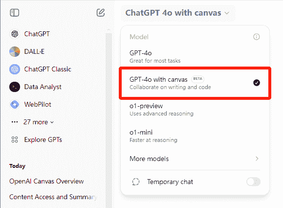
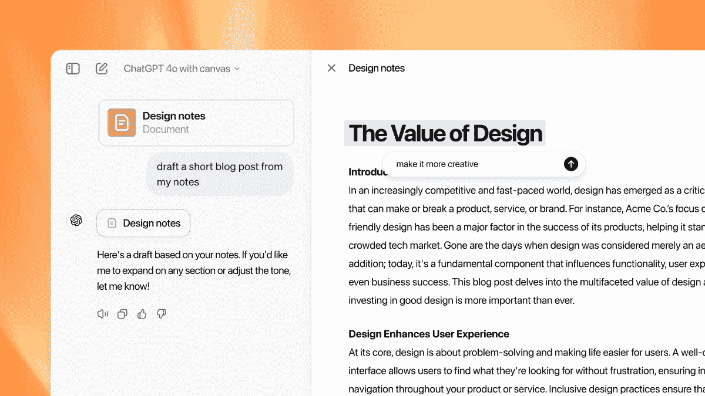
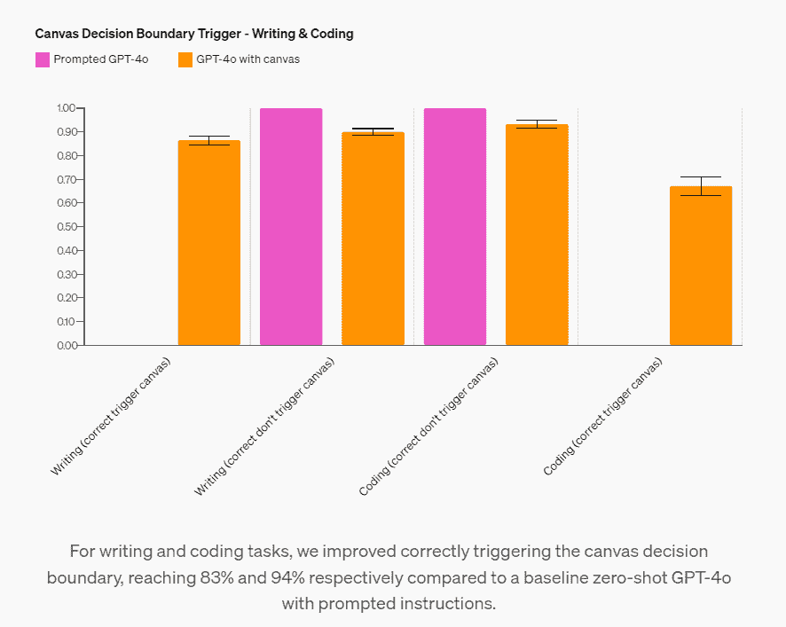
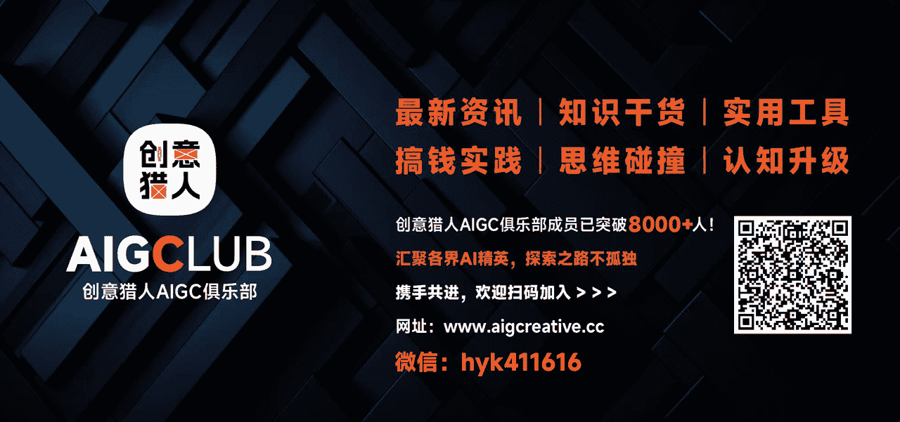

# 20241004-重磅！ChatGPT发布全新交互界面Canvas，开启人机协作的全新时代！

> 来源：[https://aigcreative.feishu.cn/docx/Y88wdWQisoc1i8xvaxPciIVVnwf](https://aigcreative.feishu.cn/docx/Y88wdWQisoc1i8xvaxPciIVVnwf)

凌晨，OpenAI重磅更新了ChatGPT新增功能——Canvas，为写作和编程带来前所未有的协作体验。

与传统的对话框模式相比，Canvas提供了一个独立的工作空间，让用户可以与AI在同一个“画布”上并肩工作，共同创作、编辑、优化。无论是写作、编程，还是更复杂的项目，Canvas都旨在帮助用户提升效率和质量。

### Canvas是什么？

Canvas是OpenAI为解决复杂创作需求设计的新界面，它超越了简单的对话形式，提供了一种全新的工作方式。

这个界面以项目为中心，不论是撰写文章、代码编写，还是大规模编辑任务，Canvas都能通过一系列智能功能进行精准辅助。通过这个独立的窗口，用户可以直接对文本或代码进行编辑、调整，甚至可以让AI在特定的部分进行深度参与——就像与一位专业的编辑或代码审查员并肩工作。

**Canvas**基于OpenAI最新的GPT-4o模型，并在全球范围内逐步向ChatGPT Plus和团队用户推出，企业和教育用户将在下周获得使用权限，所有免费用户也将在Canvas完成Beta测试后可以体验这款创新工具。

### Canvas如何改变工作方式？

传统的聊天界面在处理日常任务时已经非常出色，但当涉及到更复杂的工作，比如长篇写作、持续迭代的编程项目时，其局限性也显现出来。而Canvas正是为填补这些空白而设计的。

对于写作者来说，Canvas不仅能辅助文本创作，还能提供多种实用的功能，如：

+   **建议修改**：AI可以根据上下文提供具体的编辑建议，帮助提升文本的结构和流畅性；

+   **调整文本长度**：根据需求自动缩短或扩展文本；

+   **修改阅读难度**：根据读者水平调整文本难易度，从学龄前到研究生水平不等；

+   **语法和清晰度检查**：自动检查并优化文本的语言逻辑、语法和表达一致性，确保内容最终达到专业水平；

+   **添加表情符号**：智能地添加表情符号，使内容更加生动有趣。

对于开发者而言，Canvas可以为代码的多次迭代提供极大的便利，帮助用户清晰地追踪修改内容，简化调试流程。功能包括：

+   **代码审查**：AI会给出代码改进建议，帮助优化效率；

+   **添加日志**：自动插入调试语句，帮助开发者跟踪代码执行流程；

+   **添加注释**：为代码自动添加清晰的注释，方便未来的维护和理解；

+   **修复错误**：智能检测并修复代码中的问题；

+   **语言移植**：将代码翻译为JavaScript、Python、Java、C++等多种语言，实现跨平台开发。

### AI成为真正的创意合作者

Canvas不仅仅是一个工具，更像是一位主动参与的创意合作者。通过训练，GPT-4o具备了在用户需要时自动启动Canvas的能力，并能根据项目的具体需求进行个性化帮助。这意味着在需要详细修改时，AI能够做出精准的局部调整，而在需要整体重写时，它也能够进行全面的改写。

为了确保这种协作的顺利进行，OpenAI的研究团队开发了多个核心行为模式，包括智能识别何时触发Canvas、生成多样化的内容、执行精确的目标性修改和重写文本或代码。在这背后，OpenAI进行了超过20次的内部自动化评估，并利用合成数据加快了模型训练，从而使Canvas在写作和编码任务中均表现出色。

例如，在写作任务中，Canvas的触发准确率达到了83%，而在编程任务中，这一数字高达94%。不仅如此，Canvas在进行目标性编辑的能力上比传统的GPT-4o提升了18%。这些成果表明，Canvas大幅提升了AI的协作能力，真正实现了从“助手”到“合作伙伴”的转变。

### 为什么Canvas如此重要？

Canvas的发布标志着ChatGPT的人机协作的全新时代。以前，我们更多地将ChatGPT视为一种聊天对话工具，用来解决具体的任务。但随着Canvas的推出，ChatGPT的角色发生了质的飞跃，它成为了一个可以与我们共同工作、创作和改进的协作者。

对于创作者和开发者来说，Canvas提供了一种全新的工作方式。无论你是在编写长篇文章、撰写代码，还是进行其他需要反复修改和迭代的项目，Canvas都能提供强大的支持，帮助你大幅提高工作效率。

此外，Canvas还在不断进化，未来它将变得更加强大。OpenAI承诺会继续优化Canvas的功能，进一步推动人机协作的边界，让AI在更多领域为人类创造更大的价值。

<https://aigcreative.feishu.cn/sync/K4Gvd9vUQsy9Oubwqaeclu0Fnbg>