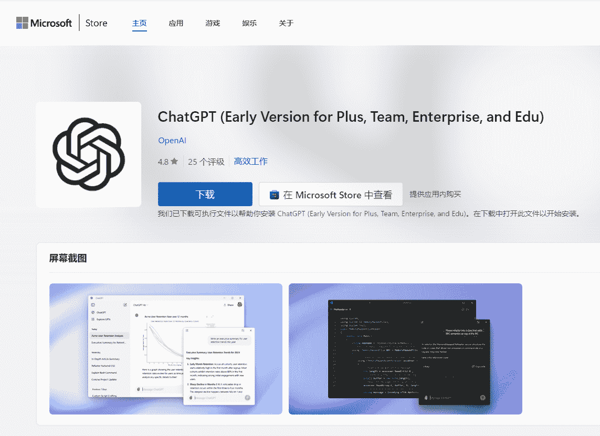
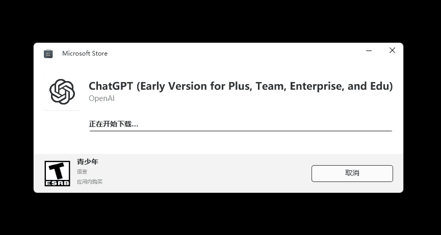
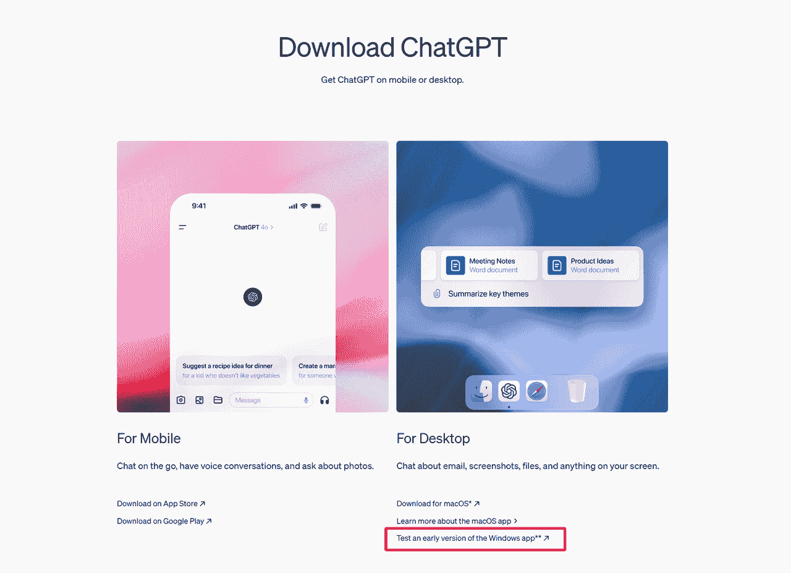
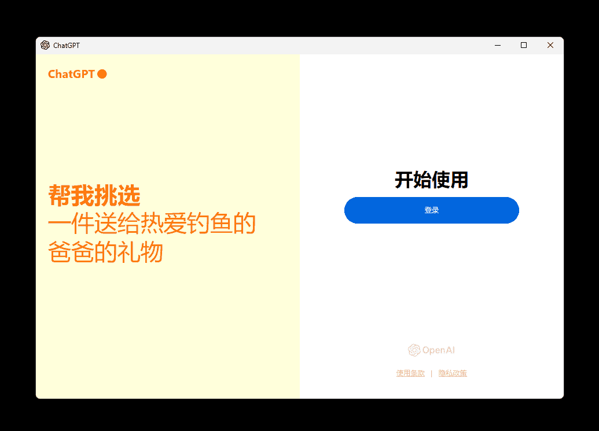
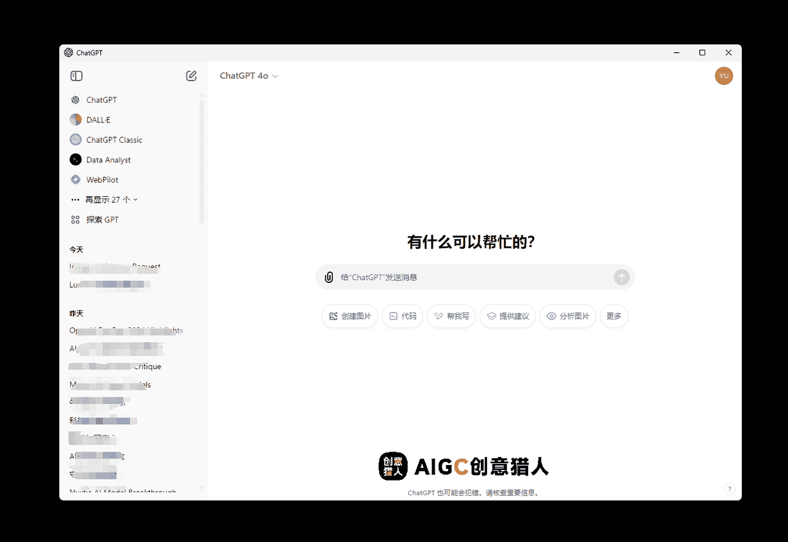

# 20241018-重磅！ChatGPT正式开放Windows版本下载，办公新神器来了！

> 来源：[https://aigcreative.feishu.cn/docx/MuWZdzmOCoHTpxxv7n6ckpeanKb](https://aigcreative.feishu.cn/docx/MuWZdzmOCoHTpxxv7n6ckpeanKb)

今天，OpenAI正式发布了Windows版的ChatGPT桌面应用，像Office一样方便的AI助手终于来了！从现在开始，所有的ChatGPT Plus、Enterprise、Team和Edu用户都可以在Windows上体验到这个强大工具的早期版本。

从功能上看，Windows版ChatGPT完全配得上这波期待。

通过快捷键“Alt + Space”组合，一秒启动，无论是文件分析、对话搜索还是创意文本生成，它都能轻松应对。而且，和Office的无缝配合让它成为办公的新宠，这意味着处理日常办公任务时，能极大提高效率。

## 新时代的办公助手

其实，OpenAI早已将ChatGPT推向了Mac平台，随着Windows版本的上线，桌面办公生态的全面覆盖已经迈出了重要一步。特别是在现如今远程办公和混合办公盛行的时代，像ChatGPT这样兼具智能与实用的AI工具已经从“好用”变成了“必备”。

那么，这次Windows版本到底有哪些亮点呢？

## 极致便捷的启动方式，秒变效率达人

还记得那些手动打开各种工具、软件的烦恼吗？现在可以说再见了。ChatGPT的Windows版可以直接通过快捷键Alt + Space召唤。

这不仅节省了寻找软件的时间，还大大提升了任务处理的流畅性。从创意文案到复杂的文件分析，无论你面对的是简单的对话，还是要生成高质量的内容，它都能在几秒钟内搞定。

此外，ChatGPT的Windows版还提供了类似“Companion Chat”的快捷功能，让你能够通过一个小窗口实现任务的快速切换，甚至支持多窗口操作，简直是多任务办公的福音。

## 用户反馈：期待与小小遗憾并存

随着Windows版本的发布，全球用户一片欢呼。有人说“终于等到了”，有人兴奋地表示已经下载了。而在各种社交平台上，大家的评价也颇有趣。有人感叹“终于Windows用户也有福了！”有人则对字体大小的调整功能提出了一点小小的改进建议：“当前的字体有点小，希望能在设置中直接修改字体大小。”

这反映了用户们对细节的关注与期许，尽管这个版本还处在测试阶段，但对于办公党来说，能够与日常办公软件无缝切换，已经足够令人兴奋。

## AI与办公，未来就在眼前

总的来说，ChatGPT Windows版的发布为我们的办公生活打开了新的大门。它不仅带来了效率上的提升，也为日常任务的处理提供了全新的思路。从此，AI助手不再是未来的幻想，而是真正融入了我们的工作方式。

期待它更多的功能优化。

<https://aigcreative.feishu.cn/sync/K4Gvd9vUQsy9Oubwqaeclu0Fnbg>