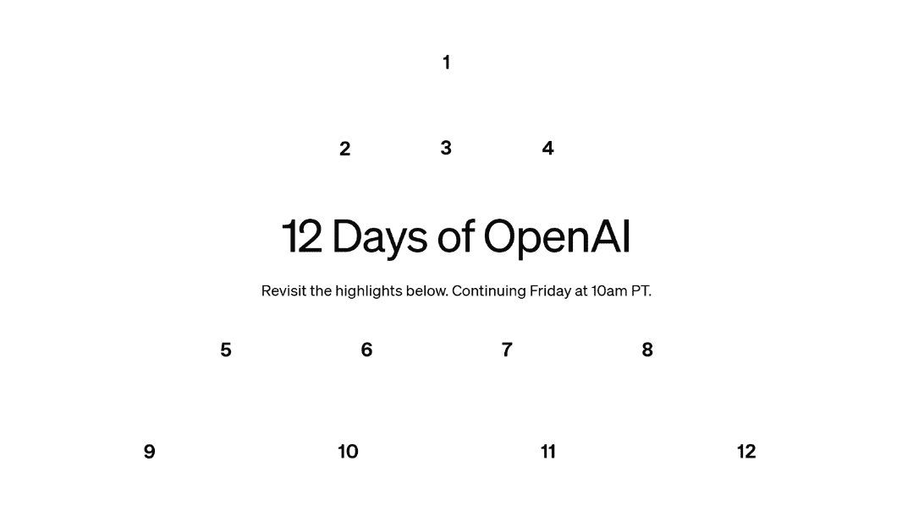
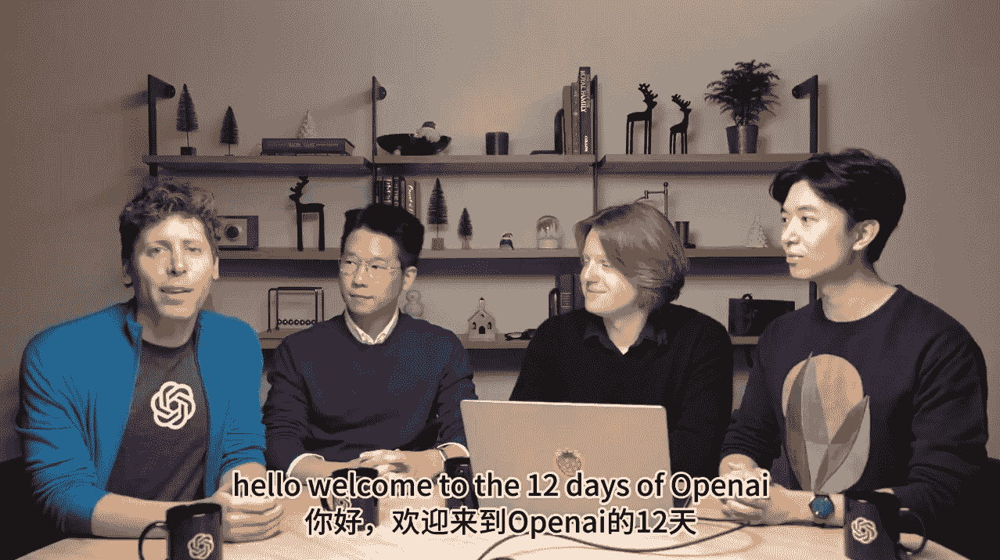
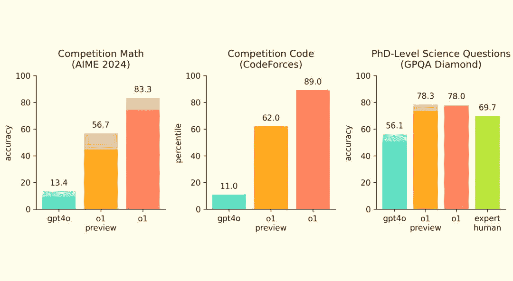
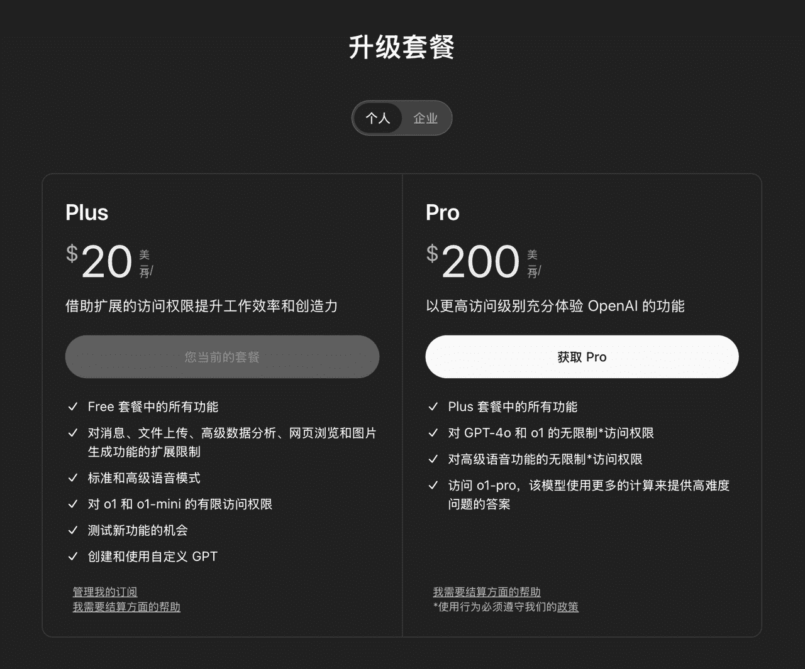

# 20241206-OpenAI Day 1/12：发布o1模型和ChatGPT Pro，网友：又短又快？

> 来源：[https://aigcreative.feishu.cn/docx/X1zwd9wsdoO64MxKdhOcIlMondg](https://aigcreative.feishu.cn/docx/X1zwd9wsdoO64MxKdhOcIlMondg)

12月5日，OpenAI开启了连续12天的技术发布活动，首日便抛出了两枚“重磅炸弹”：全新的o1推理模型和高端订阅服务ChatGPT Pro。

无论是前者在复杂任务中的卓越表现，还是后者面向专业用户的精准定位，都让业内对OpenAI的战略野心有了更深刻的认识。

以及大家对奥特曼的营销（saocaozuo）也有了新的认识，怕是营销鬼才雷布斯看了，也直呼内行。

下面随【创意猎人】一起来看看：

### o1模型：让AI真正“聪明起来”

推理能力是人工智能发展的下一个重要方向，而o1模型正是这一领域的新里程碑。

据OpenAI介绍，新发布的o1模型的特别之处在于其在解决复杂问题时的表现明显优于此前的版本。无论是数学、科学研究，还是编程任务，它都展现出了卓越的能力。

最令人惊叹的是，o1模型在数学奥林匹克测试中的正确率高达83%。这一结果不仅是模型推理能力的体现，也让我们看到了AI在解决专业领域难题时的潜力。例如，在药物研发中，AI可以快速分析复杂数据；在工程设计中，它能够为结构优化提供独特见解。

### ChatGPT Pro：专业用户的生产力新标配

同时登场的还有高端订阅服务ChatGPT Pro。定价200美元/月的服务或许让普通用户望而却步，但其瞄准的是那些在科研、工程、数据分析等领域对AI需求极高的专业人群。

ChatGPT Pro提供了三大亮点：

1.  **无限制的GPT-4o访问**，让用户不受限制地调用最强大的语言模型；

1.  专为高负载任务设计的o1专业模式，加速复杂问题的解答；

1.  **高级语音交互模式**，提高多任务处理效率，让用户的工作更为流畅。

这一服务不仅帮助用户节省了时间，更成为高强度工作中的有力助手。对于那些需要处理海量数据、解决复杂问题的行业，例如金融、医学和科研领域，ChatGPT Pro无疑是一项值得投资的工具。

### 背后的逻辑：OpenAI的版图扩张计划

OpenAI这次简短的的发布会透露出一个非常明确的信息：OpenAI不满足于只做技术领先者，而是想成为行业规则的制定者。从通用语言模型到面向垂直行业的专业解决方案，OpenAI正在逐步扩大AI的应用场景。

接下来，OpenAI还将在未来11天陆续发布新产品和新功能，其中包括备受关注的文本生成视频工具Sora，以及文件上传、网页浏览等更多实用功能。

这场科技“盛宴”刚刚开始，而AI的未来也正在被重新定义。

一起拭目以待。

<https://aigcreative.feishu.cn/sync/K4Gvd9vUQsy9Oubwqaeclu0Fnbg>