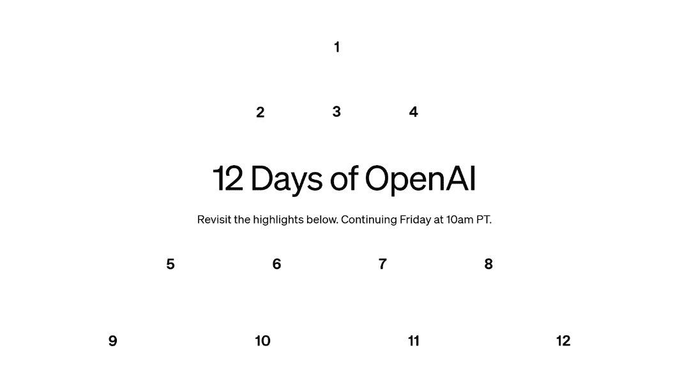
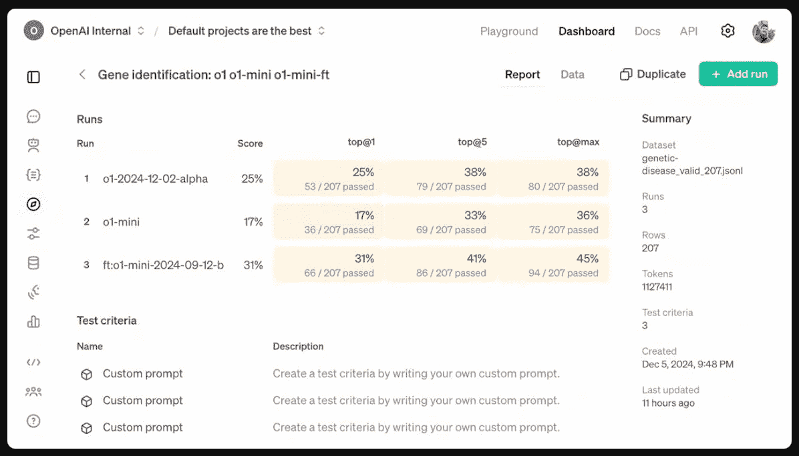
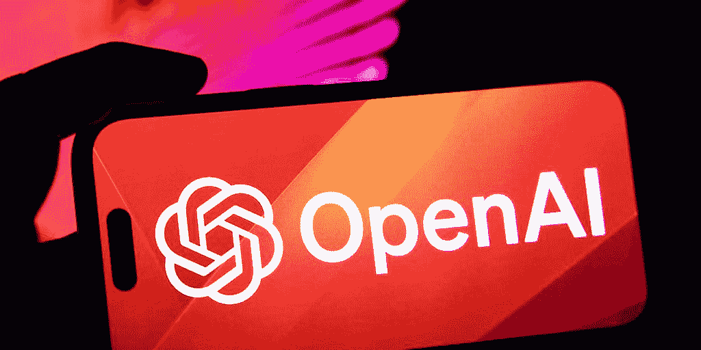

# 20241207-OpenAI Day 2/12：支持用户强化微调，微调后的o1-mini反超o1正式版！

> 来源：[https://aigcreative.feishu.cn/docx/YZbydlbENoqQGvxqsytchAVHnod](https://aigcreative.feishu.cn/docx/YZbydlbENoqQGvxqsytchAVHnod)

12月5日，OpenAI开启了连续12天的技术发布活动，今天是直播第二天。

可谓是过于平淡，没有什么波澜。但也还是需要来围观一下~~

OpenAI推出了【强化微调(Reinforcement Fine-Tuning)】，它可以让你用极少的训练数据，为特定的复杂任务构建专家模型，微调后的o1-mini得分提高80%，反超o1正式版！

如果你从事法律、金融、医疗等领域，面对复杂场景时时常感到无从下手，那么这个计划可能会成为你的秘密武器。

## 什么是强化微调？

一句话：强化学习 + 微调 + 专业领域高质量的数据集 = 行业专家能够定制自己的专业级 AI 模型，即便是 o1-mini 也能通过强化微调在特定领域上超过 o1，物美价廉。

说白了，这是一种专门为解决高难度任务设计的AI训练方式。过去，我们使用AI大多是“广撒网”，希望模型能在各个领域表现尚可。但在某些细分领域，比如需要精确判断和复杂推理的法律合约分析、医疗诊断、保险评估等，大部分AI显得“不够聪明”。

这时候，就需要强化微调技术出马了！

特点：

1、只需几十到几千个高质量数据

2、评分机制持续优化模型表现，通过参考答案评估模型输出，支持自定义评分标准

3、增强模型在特定领域的推理能力和准确性，通用AI变专家AI

4、提供完整网页操作界面，可实时监控模型性能变化

OpenAI表示，该计划的核心是通过大量高质量任务训练AI模型，让它们不仅懂“皮毛”，还精通“内核”。更重要的是，这些任务的评分标准已经过严密设计，确保训练出的AI不偏不倚、能言善辩。

## **哪些人能参与？**

如果你以为这个计划只是开放给AI极客，那就错了。OpenAI特别强调，他们欢迎以下领域的研究机构、企业和大学参与其中：

法律：AI律师助理或合同分析工具的深度优化；

金融：精准的风控模型、自动化的投资建议；

医疗：智能诊断、精准治疗辅助；

工程：复杂技术文档解析或自动化设计方案生成。

这些都是强化微调大显身手的好地方。如果你能提供专属数据集，OpenAI甚至会特别青睐！

参与者有机会抢先体验OpenAI强化微调API的“Alpha版”，在实际项目中测试这项技术的实力。不仅如此，OpenAI还希望参与者提供使用反馈，帮助优化API，确保明年正式上线时，这项技术更加成熟强大。

## 背后的深意：垂直领域的AI战场

近年来，AI大模型在通用领域呼风唤雨，但在细分行业的“深水区”，仍然存在不小的挑战。OpenAI此举正是瞄准了这些场景：当大家都在追求“广覆盖”时，他们反其道而行，选择“深耕细作”。

这不仅是一种技术策略，更是一种商业策略。未来的AI市场，极有可能由那些能够在特定领域提供精准解决方案的技术主导。而OpenAI显然不愿错过这个机会。

根据OpenAI透露的时间表，强化微调技术预计将在2025年全面开放。在此之前，这项计划无疑是一次限量版的“提前预订”。

申请通道已经开放，有兴趣的机构需要尽快行动，毕竟名额有限。

<https://aigcreative.feishu.cn/sync/K4Gvd9vUQsy9Oubwqaeclu0Fnbg>