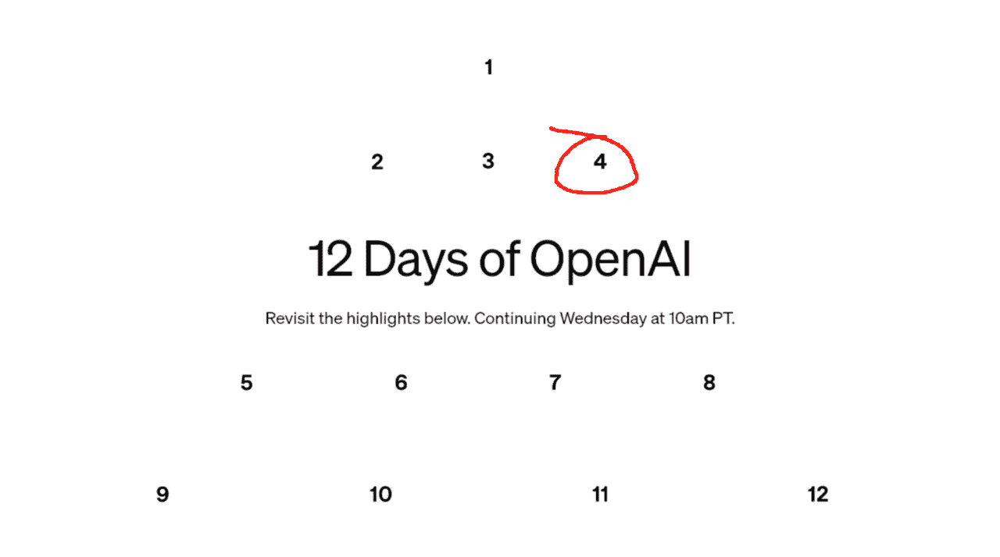
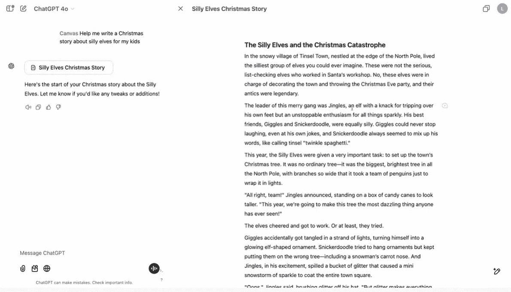
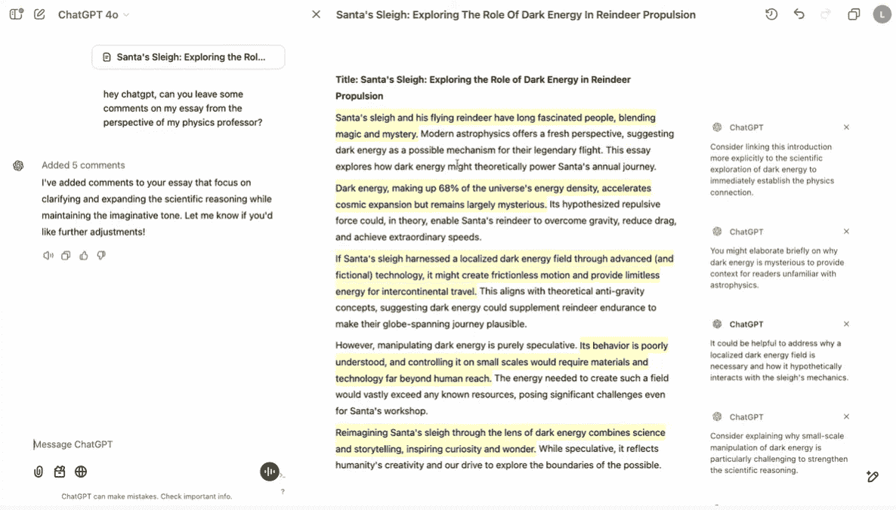
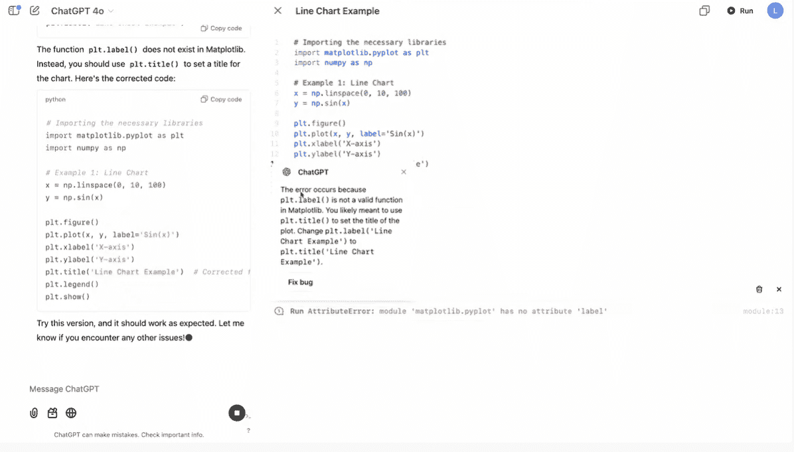
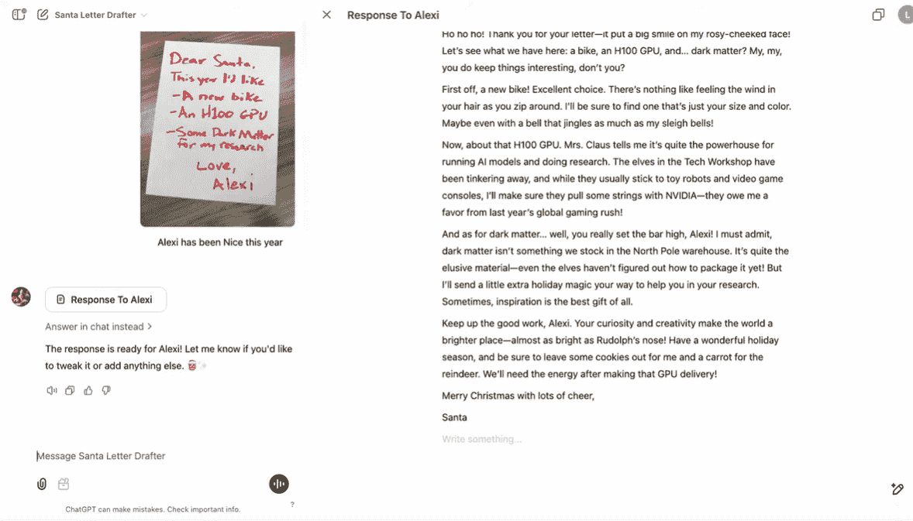
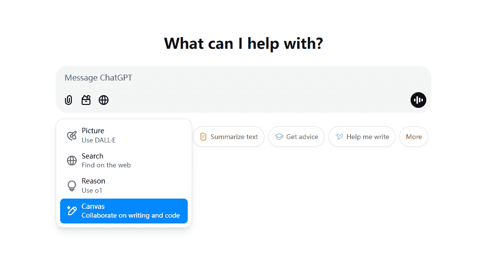

# 20241211-OpenAI Day 4/12：万物皆Canvas，AI写作编程助手全面进化

> 来源：[https://aigcreative.feishu.cn/docx/S1b2dfIjsoq1VsxJZVkclRQgnB9](https://aigcreative.feishu.cn/docx/S1b2dfIjsoq1VsxJZVkclRQgnB9)

12月11日，OpenAI在“12 Days of OpenAI”系列活动的第四天，正式全面推出了全新功能“Canvas”。

这款工具不仅重新定义了ChatGPT与用户的协作方式，还升级了ChatGPT的写作与编程能力。

无论你是自由创作者、开发者，还是AI爱好者，“Canvas”都可能是你一直期待的生产力利器。

### 什么是“Canvas”？三大更新

在此次发布中，OpenAI重磅宣布“Canvas”将面向所有用户开放。相比传统的聊天模式，“Canvas”是一款更注重交互和协作的工具，专为提升创作与编程效率而设计。

以下是“Canvas”的三大核心更新：

1.  **全面开放，无需额外付费**
“Canvas”曾作为Plus用户的专属功能进行测试，现在所有用户均可使用。无论是免费用户还是订阅者，均能体验这项创新功能。

1.  **支持Python代码运行**
程序员的福音来了！“Canvas”不仅能识别代码，还能直接运行Python代码，实时显示结果。无论是文本还是图形化输出，都能一键呈现。

1.  **与自定义GPT深度融合**
用户可将“Canvas”功能集成到自定义GPT中，为不同场景量身打造智能助手。无论是编辑文档还是调试代码，“Canvas”都能成为你不可或缺的得力帮手。

### 场景演示：用“Canvas”解锁无限可能

在发布会现场，OpenAI团队通过几个具体场景展示了“Canvas”的实际应用能力。以下是其中最引人注目的几个案例：

**圣诞故事创作：文案编辑如虎添翼**

工程师使用“Canvas”为孩子编写了一篇趣味十足的圣诞故事。在“Canvas”中，故事文本与聊天记录被分屏呈现，用户可以轻松编辑内容，而不用担心修改会影响整体流畅性。

除此之外，用户还可以实时调整语气、标题和内容长度，让创作过程更高效、更直观。

智能写作助手：从语法到表情，一键搞定

无论是严肃的学术论文还是轻松的休闲文章，“Canvas”都能助你一臂之力。它提供了丰富的快捷选项，包括自动调整文章长度、修改语气、优化句式，甚至还能为内容添加表情符号，增加趣味性。

特别是对于需要快速润色的写作者来说，这样的功能无疑是“救命稻草”。

编程调试：从发现问题到解决问题，一步到位

“Canvas”的编程功能可谓本次更新的最大亮点之一。用户可以直接粘贴代码到“Canvas”，工具不仅会自动高亮代码，还能检测潜在错误并提出修复建议。

更令人惊喜的是，“Canvas”可以运行代码并生成即时反馈。在发布会展示中，团队用“Canvas”修复了一段matplotlib绘图代码，并成功生成了可视化图表，让调试过程比以往更加顺畅。

自定义GPT：为圣诞老人设计智能助手

发布会还展示了“Canvas”与自定义GPT的结合能力。团队特意为“圣诞老人”打造了一款自动回信助手，能够根据孩子们的愿望生成幽默风趣的回信内容。

这一功能充分展现了“Canvas”的灵活性和定制化能力，为不同需求提供了更多可能性。

### “Canvas”的意义超越工具本身

ChatGPT的“Canvas”发布升级，对ChatGPT交互模式的一次全新定义，也为用户打开了更多想象空间。它让用户与AI的协作变得更加紧密，尤其在写作和编程领域，“Canvas”大大降低了学习和使用门槛。

对于内容创作者而言，“Canvas”是提升效率和质量的绝佳帮手；对于开发者来说，它是快速调试和学习的最佳伙伴。

而这种工具的普及，也意味着未来的AI技术将更加注重用户体验和实际应用场景，从而会成为每个人工作和创作中的得力伙伴。

<https://aigcreative.feishu.cn/sync/K4Gvd9vUQsy9Oubwqaeclu0Fnbg>