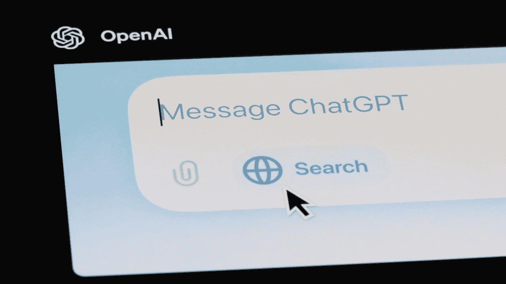
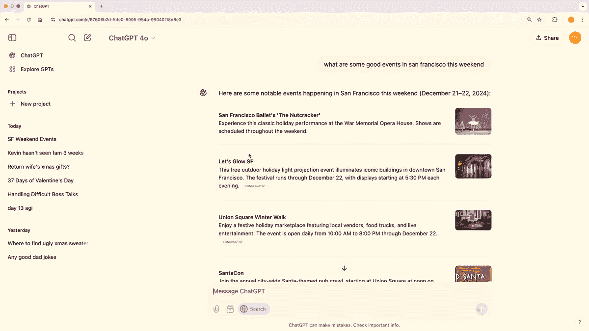

# 20241214-OpenAI Day 8/12：ChatGPT搜索功能，语音搜索功能

> 来源：[https://aigcreative.feishu.cn/docx/RzNRdylalotgp9xMoDmcAeafnib](https://aigcreative.feishu.cn/docx/RzNRdylalotgp9xMoDmcAeafnib)

今天是OpenAI马拉松式发布会第8天。

OpenAI宣布，其备受期待的ChatGPT搜索功能将对全球用户全面开放，标志着人工智能在搜索领域的又一次重大飞跃。

基于先进的GPT-4o模型，ChatGPT搜索功能让用户能够以聊天机器人的形式，实时获取互联网上的最新信息。

此前，ChatGPT搜索功能仅限于ChatGPT Plus和Team的付费用户，但如今，所有用户均可免费享受这一服务，只需一个OpenAI账户。

“两个月前，我们为付费用户推出了这项功能，现在，我激动地宣布，我们将免费向所有人提供这项服务。”OpenAI的首席产品官凯文·韦尔在直播中表示，ChatGPT搜索已成为他日常工作中不可或缺的工具。

ChatGPT搜索的全面开放，不仅意味着用户可以随时随地获取最新信息，还预示着搜索方式的革新。

用户现在可以通过点击聊天界面底部的地球图标，轻松启动网络搜索功能，将ChatGPT设为浏览器的默认搜索引擎，享受更加便捷的网络体验。

此外，OpenAI正在将ChatGPT搜索与高级语音模式相结合，使得用户能够通过语音指令搜索网络，并以自然流畅的对话形式获得答案。无论是即将到来的假期天气，还是最新的股市动态，ChatGPT都能提供即时反馈。

为了进一步增强ChatGPT搜索的功能，OpenAI已经与多家顶级新闻和数据提供商建立了合作关系，使用户能够在ChatGPT中直接查看股票行情、体育赛事得分、天气预报等关键信息。

在ChatGPT取得巨大成功后，科技公司纷纷将生成式人工智能融入各类服务，在线搜索领域也不例外。微软和谷歌等科技巨头也在其搜索产品中加入了更多的人工智能对话功能，以应对这一新兴趋势。

OpenAI的首席执行官山姆·奥特曼对ChatGPT搜索功能给予了高度评价，认为这是自ChatGPT首次亮相以来“我们推出的最喜爱的功能”。

他强调，ChatGPT搜索不仅提供了一种更快速、更简便的信息获取方式，而且预示着未来搜索查询能够动态展示定制化的网页内容，极大地提升用户的个性化搜索体验。

随着ChatGPT搜索功能的全面开放和语音搜索服务的新增，OpenAI正引领着搜索领域的新潮流，为用户带来更加丰富和多元的网络体验。

<https://aigcreative.feishu.cn/sync/K4Gvd9vUQsy9Oubwqaeclu0Fnbg>