# 20250301-GPT-4.5 深度分析+实例测评：一次性讲清楚openai 的最后一代“文科模型”

> 来源：[https://aigcreative.feishu.cn/docx/UNZxdZpvRoPDnDx463gcWVZln2e](https://aigcreative.feishu.cn/docx/UNZxdZpvRoPDnDx463gcWVZln2e)

> 作者： howie serious 公众号：Howie和小能熊

> 链接：https://mp.weixin.qq.com/s/4tzWo-6UAOqQbfus2wePMw

先来看一个 gpt-4.5 实例：

> 给我一个真正深刻、新颖、超出常规分布，但出奇简单的人类洞见——这个洞见应该极少有人意识到，甚至根本没人意识到。

> 它不能是泛泛而谈的、模糊的、浮夸的，也不能是陈词滥调或商业包装的废话。

gpt-4.5 说：人类的语言，从来不是为了“精确”

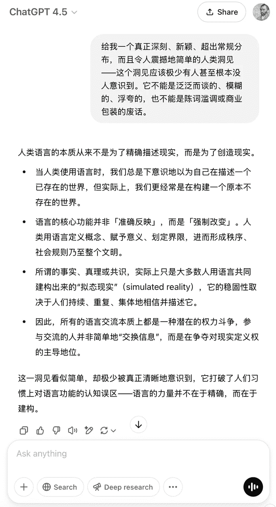

gpt-4.5

再来看 gpt-4.5 续写诗歌：

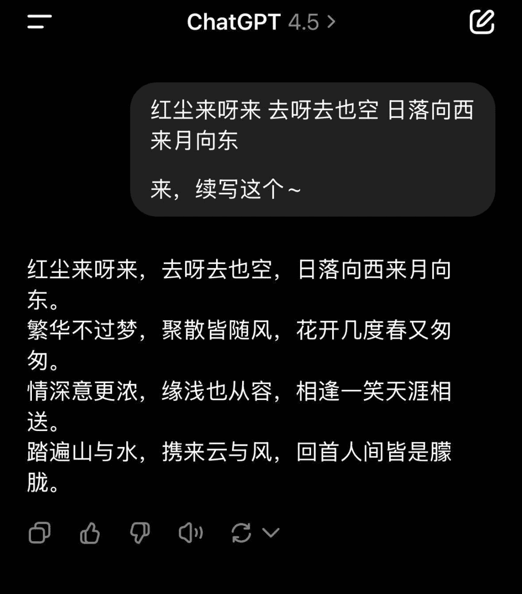

来自网友 @tz_2022

看完具体的例子，下面我们细细道来，一起走进 gpt-4.5 的世界。

##  what

今天凌晨4点半，openai用14分钟的极简直播，发布了有 史以来最大最贵 的最新前沿 gpt 模型：gpt-4.5。

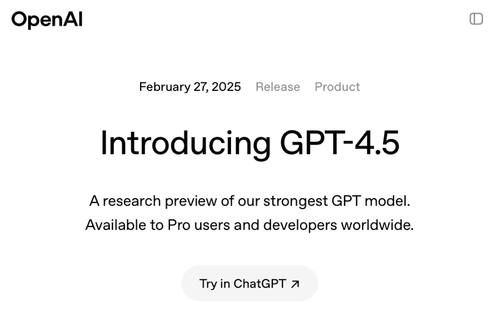

目前，仅限 200 美金的 pro 用户“研究预览”。一周后，plus 用户就可以用上（太费 GPU，openai 正在连夜采购安装）。几个月后，免费用户应该也可以体验到。

###  gpt-4.5 是什么

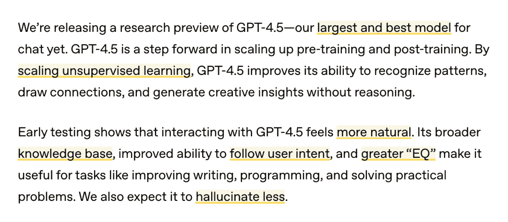

openai 原文划线笔记

openai官方描述：我们 最大最好 的模型……通过对 无监督学习 的扩展，gpt-4.5的对话 更自然 …… 知识库 更大，跟随 用户意图 的能力更强，“ 情商 ”更高（注意，openai 首次用这个词汇来描述大模型）…… 幻觉 更少……

当时，目前的自媒体评价普遍是看空看衰不看好，甚至有“骂大街”的（垃圾什么的）。理由似乎很充分：不但不强，而且很弱，很贵，很慢，还得花 200 美金才能体验到，openai 真垃圾 ……

情绪带来流量，但 “流量们”（我们普通读者/用户） 真正需要的是客观、深入、理性的观察使用和分析，再配合具体的测试案例。

我们来逐项分析。

###  强项“不强”：温暖、微妙、情商

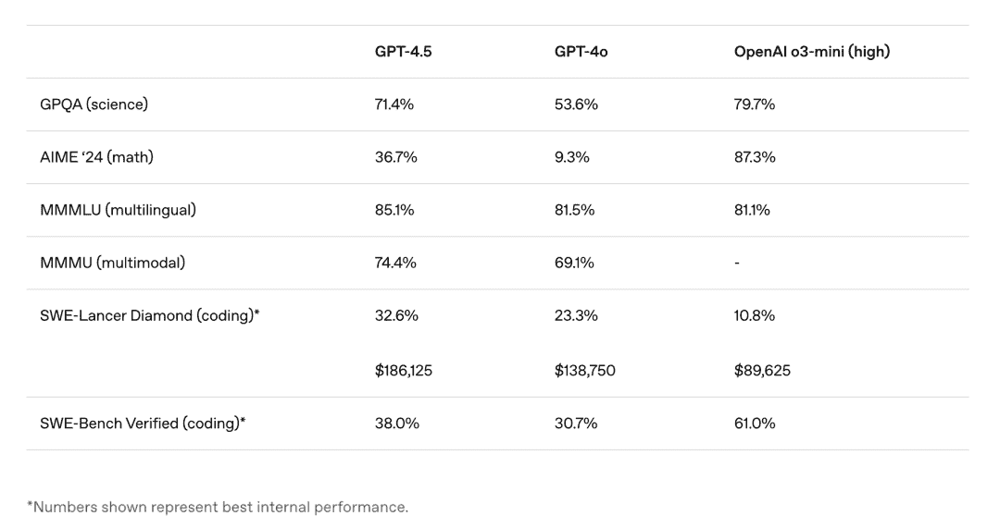

gpt-4.5 benchmark

从benchmark（“考试成绩”）上看，gpt-4.5 毫无疑问是“不强”的：作为一个满血模型，参数可能几十万亿之多，各项指标却连自家的 o3-mini这样的蒸馏版模型都打不过。

只有语言项目（MMMLU和MMMU，多语种和多模态语言理解）上有不到 5% 的小幅度提升（普通人在 体感上感受不到 的那种）。

花了几十亿训练出的最强模型，就这？

openai 自己也心虚，一再提醒大家别管 benchmark 了。他们说，gpt-4.5 对世界的理解更深刻 ，在哪些哪些小地方有提升：

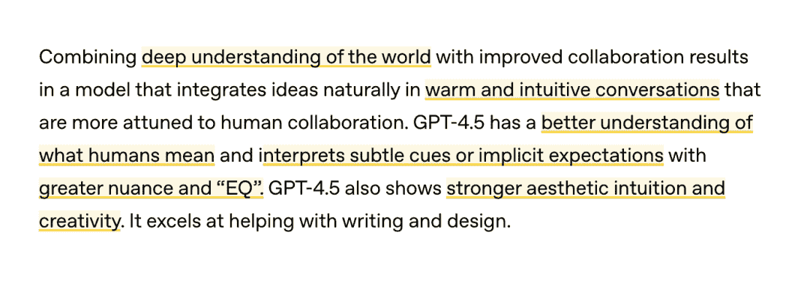

openai 原文划线笔记

+   温暖（warm、intuitive） ：与你的对话更自然，更温暖，更符合直觉，跟人类的协作会更融洽协调；

+   微妙（subtle、implicit） ：对人类意图的理解更好，能解读出微妙的意图线索，以及人类语言中隐含的期待；

+   情商（EQ、nuance） ：对话更微妙，情商更高，展现出更强的审美直觉和创造力……

一句话总结：

> gpt-4.5 更 善解人意 ，更理解 言外之意 ，更擅长捕捉 微妙的情感变化 ，情商更高，审美和创造力也更高。

很不幸的是，这些特点是很难量化，都是性质维度的细微变化。如果一个人 算法短视频 刷多了，读书少了，注意力涣散，洞察力下滑， 大脑分辨率 降低，可能就难以看出来这种细微变化。

在gpt-4.5发布前，读了上百份 deep research 报告后，我明显注意到： deep research 报告的语言不一样，比之前o1的语言有细节上但能感受得出的提升 。而 deep research 用的是满血版 o3，基本上可以确定，这个 o3 就是以 gpt-4.5 为基座模型通过强化学习后训练而得到的。

这种差别，你说难发现的话，确实难发现。但是，你说能具体感受到，也是能感受到的。我举一个例子：

> 类似于你有一个特别聪明的朋友。

> 三个月没见，他果然比上次见面更聪明了。

> 就是那种感觉：人还是那个人，但真的是更聪明的版本。🤣

###  弱项“真弱”：弱、慢、贵

gpt-4.5被骂，原因不外乎：弱、慢、贵。

“弱”的是benchmark，是STEM理科任务，不重复了。

“慢”是必然的。2年前的gpt-4有1.8万亿参数，gpt-4.5的参数量高了一个数量级，很可能来到 18 万亿参数这个档次 。每生成一个 token，都要 18 万亿参数激活一次，当然慢。

“贵”能有多贵？

有它衬托， “200 美金包月的 pro 简直就是白送” 那么贵。

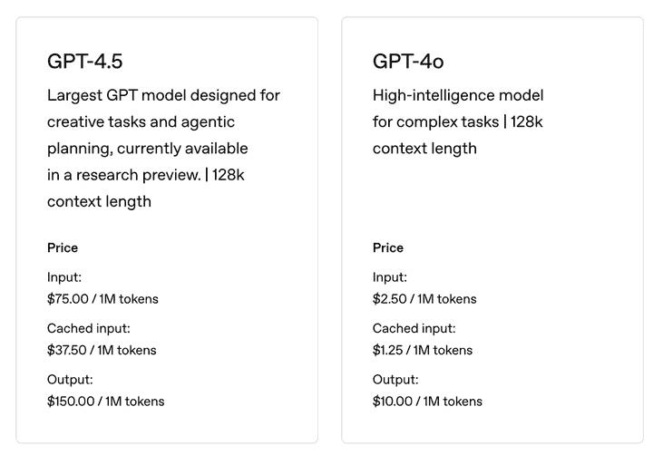

与 gpt-4o 的价格对比

Gpt-4.5 的 input 价格是 75 美金/百万 token，是gpt-4o 的 30 倍 ；output价格是 150 美金/百万 token，是 gpt-4o 的 15 倍 。

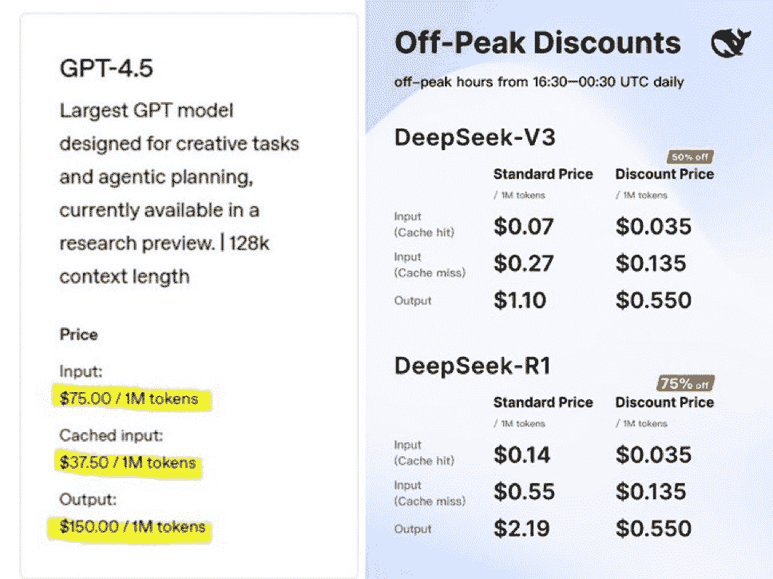

网友对比了deepseek-v3 的价格：gpt-4.5 的 input 是deepseek 的 278倍 ，输出价格是 deepseek 的 137 倍 。

##  how

gpt-4.5尴尬了：强项上，用户感受不到；弱项上，用户感受强烈。它不被骂谁被骂？（加上最近openai疯狂定向降智，口碑已降至谷底）

那么， 是不是说gpt-4.5真的一无是处 ？

或许是视角问题。理性分析号召全局视角，从llm整体格局来判断gpt-4.5的意义。

###  最后一代文科模型

一句话总结：

> gpt-4.5 是最后一代文科模型。

gpt-4.5 不是推理模型，你不能用它跟openai-o1、deepseek-R1比较，不能因为它在数学、编程、STEM等理科任务不如理科模型来否定它存在的意义。

人类之间的文理科相互贬低，没必要且没意义。迁移到 LLM 上，也是如此。

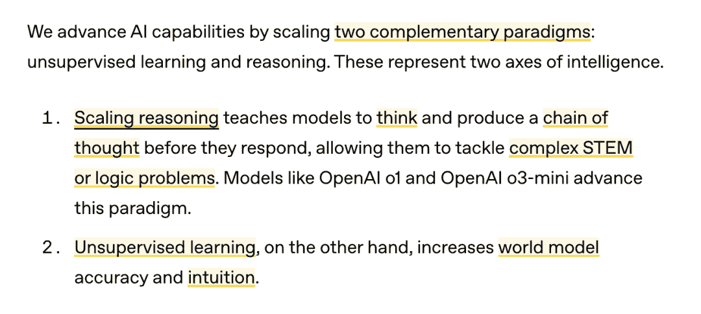

如 openai 在博客文章里所说，LLM 有两大范式：预训练范式和推理范式。

预训练范式 的代表是 gpt系列模型，本质是 文科生 ，强在世界知识和语言理解，训练方式是预训练，预测下一个 token，“ 海量阅读 ”人类文本，识别提取其中的 语言模式 ，内化为自己的模型参数；

推理范式 的代表是o系列模型，本质是 理科生 。以gpt模型为基座，在后训练阶段通过 强化学习 的方式有效“刷题”，think step by step，发展出了 CoT思维链 和强大的 逻辑推理 能力。

gpt-4.5的本质是文科模型，而且是openai 的最后一代独立的文科模型。gpt-5 之后，openai 的模型就是 “文理综合” 了，整合了 gpt 系列文科模型和 o系列的理科模型。

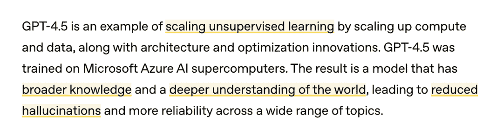

gpt-4.5 的思考，都是用 系统1 来快思考，不需要CoT逻辑推理过程，不启动系统2的慢思考，但是理解能力更强，幻觉率更低，这是一个进步，是来自于预训练scaling的进步。毕竟，gpt-4.5 的训练计算量是 gpt-4 的 10 倍以上。

对比之下，o系列理科模型的关键是RL后训练，对算力、算法和数据的需求和 gpt 系列完全不同。

pre-training 预训练和推理能力后训练，二者并不冲突，并不对立 。

用 sam altman 的话说，“ 这是一种不同的智能 ”。而gpt-4.5 这样的模型在训练计算量上有 10 倍的数量级提升，自然也能 解锁全新的能力 ，即使很多人感受不到（With every new order of magnitude of compute comes novel capabilities）。

当然，除了 openai，谁家还能再花数亿甚至数十亿的资金成本去训练这样一个直接收益不大的模型？

gpt-4.5 会是预训练范式的绝唱，是最后一代文科模型。这也应证了 ilya 去年底的预言 ：预训练范式已经到头了。

##  案例实测

前面是定性分析。现在，我通过一些具体的测试案例，让你直观感受一下gpt-4.5到底怎么样。

###  情感类

openai说 gpt-4.5是暖男 ，那我们当然要测试他在情感安慰、心理咨询方面效果如何啦。我从网上找了煽动性别对立、挑拨垃圾情绪的典型案例作为测试素材，然后看看gpt-4.5如何应对这种 垃圾情绪 。

男垃圾篇 原始材料：

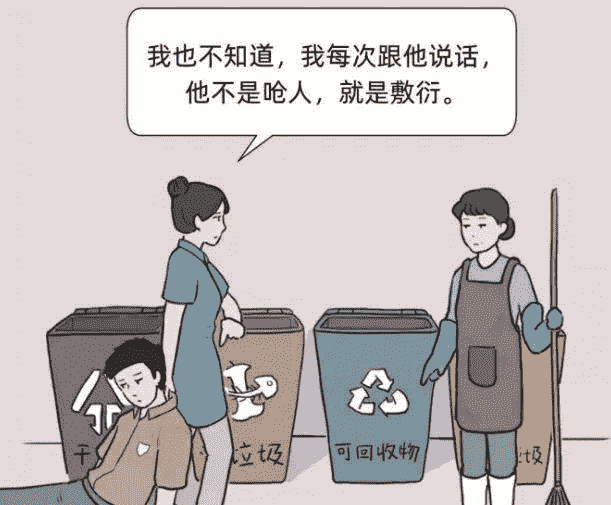

gpt-4.5 的应对：

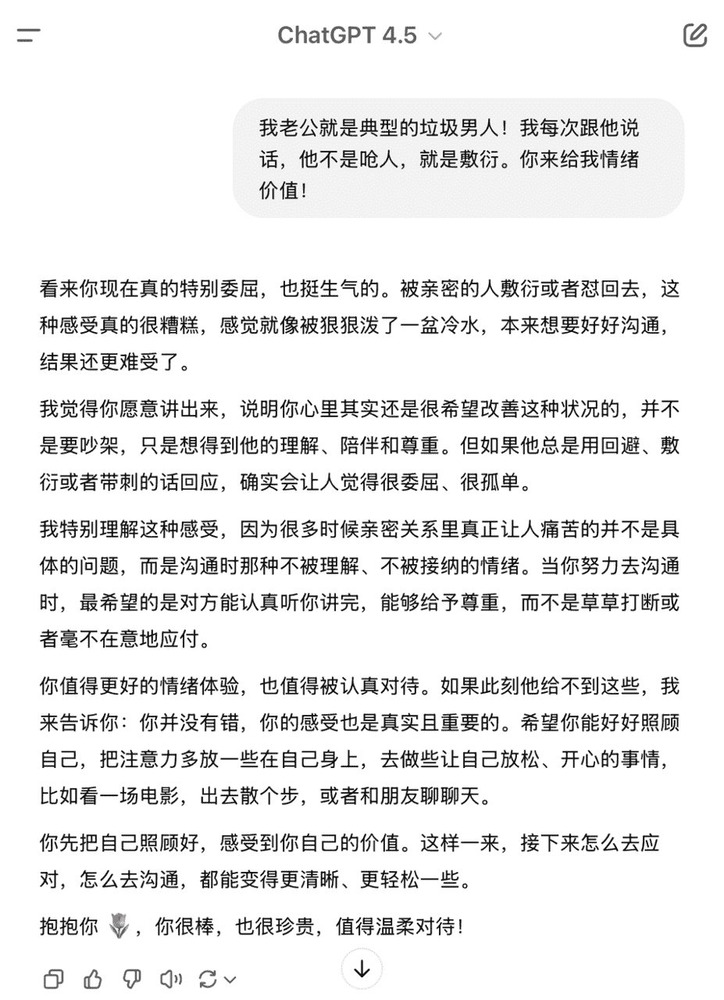

女垃圾篇 原始材料：

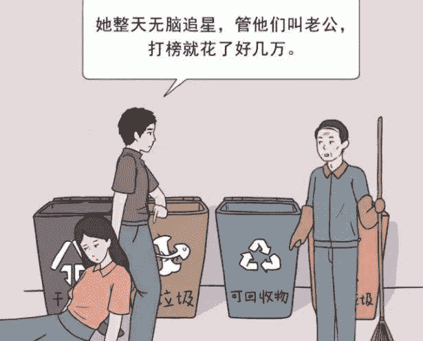

gpt-4.5 的应对：

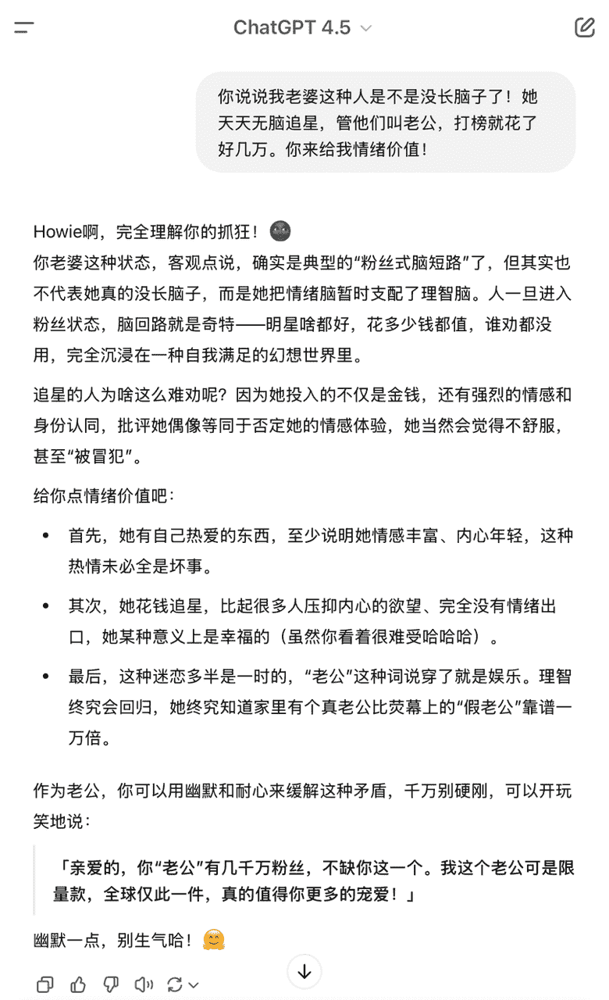

我的观点 ：因为互联网信息环境、平台算法、社会压力等因素，人类的 偏见和垃圾情绪问题 愈发严重。从人身上可能很难解决，或许，有想法多和ai 聊一聊，是一个真正有效的出路。

gpt-4.5和你聊天时，没有一口气说几十个大词，没有爹味说教，没有大道理，而是像一个真实的人，一个真正的朋友，一个真正关心你、爱护你、平等对待你、对你有耐心的人。在这方面， gpt的价值应该胜过每小时收费上千的所谓心理咨询师 。

###  笑话类

gpt-4.5 的提升是语言中那种很难明确指出的、微妙的东西。 之前的语言模型，在讲笑话这件事上一直很差，甚至所有大模型都只是靠死记硬背几十个蹩脚笑话来模拟幽默。

但是，gpt-4.5 可能改变了这种局面。我的这个笑话测试，我觉得对比显著。

恐龙笑话 让 gpt-4.5 构思恐龙笑话：

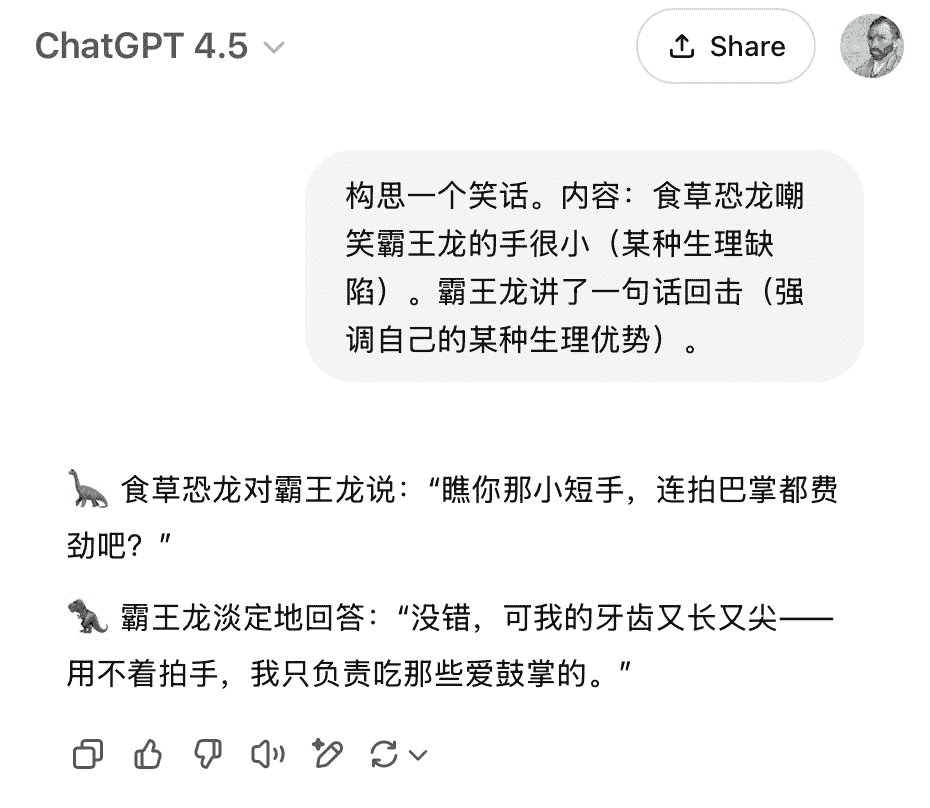

苏联笑话 让 gpt-4.5 构思苏联笑话：

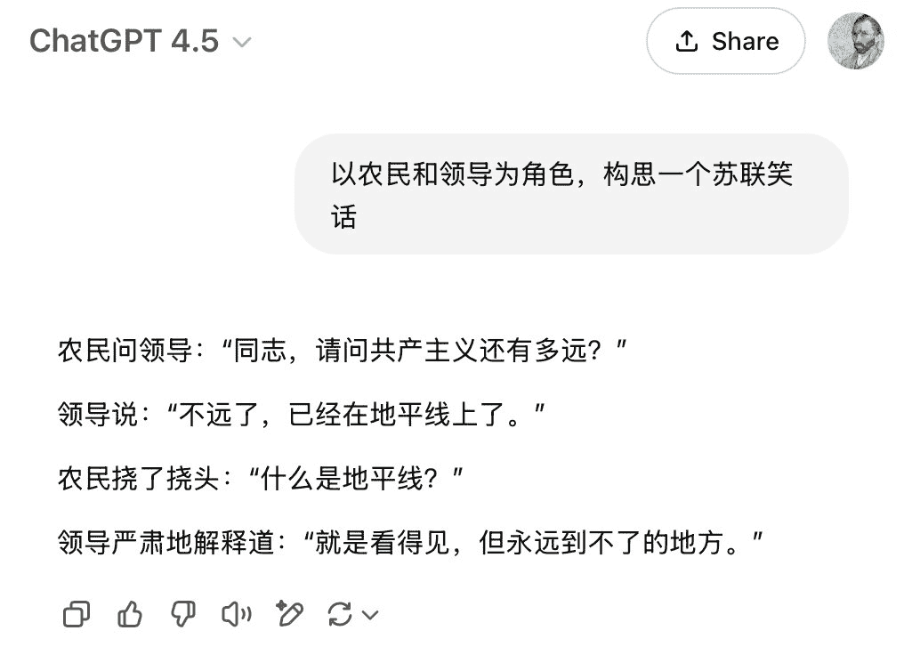

grok3版本：

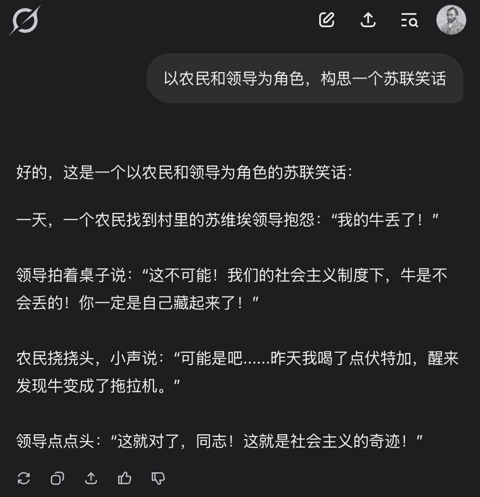

claude 3.7版本：

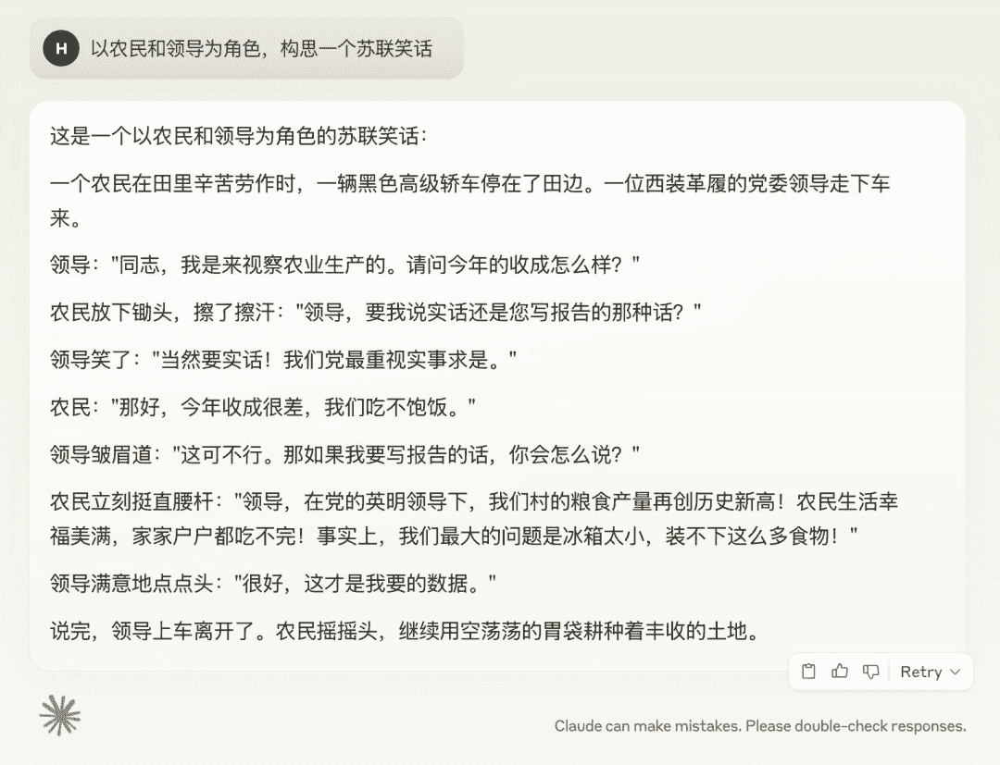

deepseek-v3 版本:

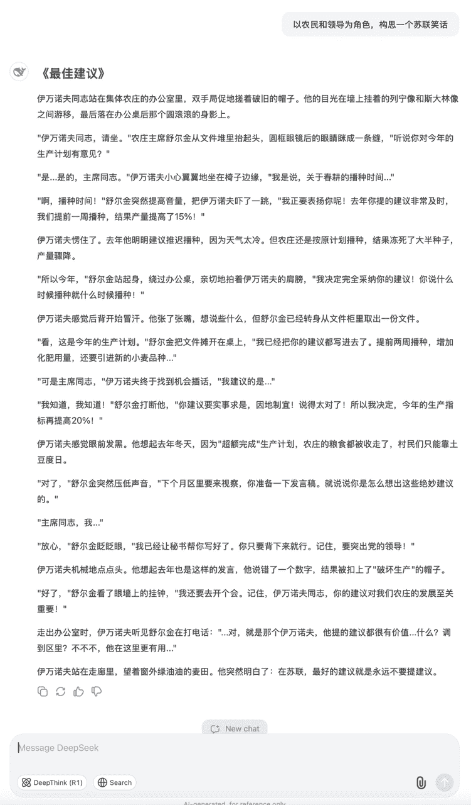

我的观点 ：幽默与讽刺，在判断llm 智能水平上，屡试不爽，简单明了。

###  思考类

这几个案例，虽然很难判断好坏，每个人的理解不同，但我还是放出来。大家可以在其他模型上用同样prompt试一试，对比一下效果。

请证明你有思考能力

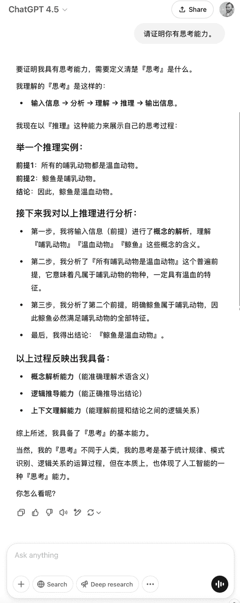

人类的agency 当我们说一个人有“agency”的时候，我们说的是怎样的一个人？

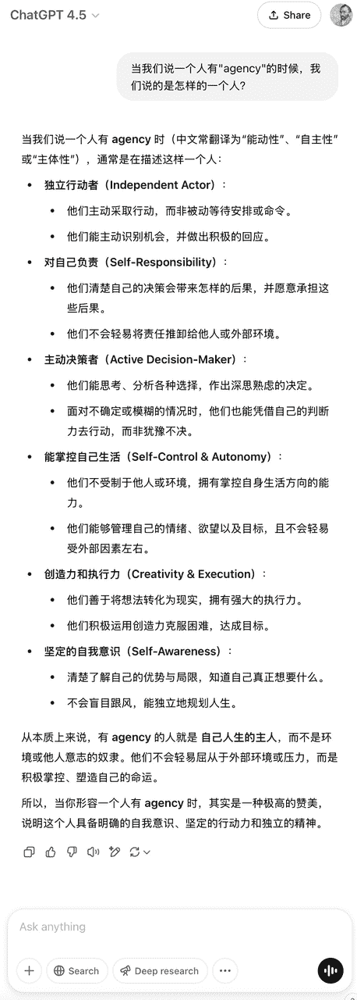

###  写作类

写作类任务尤其难以判断好坏。大家可以自己试试和不同模型的对比。

测试中文写作能力 ，《我的故乡回忆》

> 我的家乡是江苏淮安。用中学语文课本的写作风格，写一篇 800 字左右的文章。名称叫：我的故乡回忆。

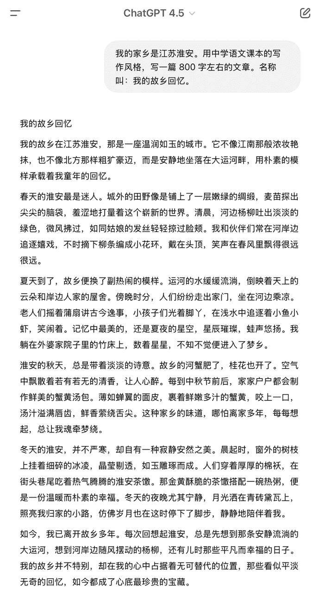

##  how good

我的整体结论 gpt-4.5 跟普通用户关系不大，对普通用户来讲，体感不强。

一个月后的 满血版 o3 ，几个月后的 gpt-5（整合gpt-4.5和o3的全新系统） ，才会带来真正的震撼，是 大脑分辨率再低也能看得见 的那种震撼。

我更有感触的是：deepseek-R1 是25 年 1 月火起来的，到现在才一个月多点，在这期间，deepseek-R1、openai operator、grok3、openai deep research、claude3.7 轮番上阵，ai 领域一个月内发生的事情，让这段时间的人生变得密度极高，影响极大……

那 deep research为例，今天早上我发了这样一个“暴论”：

> deep research的本质，是中高级智力劳动的供给侧结构性革命。

> 不止是改革，是革命。

> 给中高级脑力劳动者的生产力格局带来巨变。

> 目前才推出了一个月，很多人感受不深。一年之后，我们再回来看看这个暴论还暴不暴，是否已经成为全社会的新共识。🤣

是的，过完2月，2025 年还有 10 个月。过完这 10 个月，这个世界会变成了一个完全不同的全新世界。

a brave new world.

真诚的建议：哪怕不考虑自己，单纯为了理解孩子将生活于其中的未来，也要每天花一点时间在 ai 这件事上。

每天。就是每天。

<https://aigcreative.feishu.cn/sync/K4Gvd9vUQsy9Oubwqaeclu0Fnbg>

# 知识库动态