# 002-0编程基础，借助ChatGPT，我用6小时开发了一款高效加水印的图片工具软件！

> 来源：[https://aigcreative.feishu.cn/docx/WE9tdVkXNoepwVxdJqTctvztnlf](https://aigcreative.feishu.cn/docx/WE9tdVkXNoepwVxdJqTctvztnlf)

> By何先森Kevin

[图片水印助手.exe](https://internal-api-drive-stream.feishu.cn/space/api/box/stream/download/all/T115bLaw9oJvduxkpEfcBV3cn1c)

### 前言

最近，有个需求一直困扰着我：如何高效地给大量的图片添加水印？

关注【AIGC创意猎人】公众号的朋友可能知道，日常在平台上主要是分享发布一些Midjourney生成的创意图片，虽然公众号能自动生成水印，但我总觉得不太优雅，对公众号品牌露出也不太好。

加水印，用一些传统的设计图片处理软件（Ps、AI、Lr）当然可以加，也可以批量处理，但操作太重步骤繁杂；也有一些在线的网站也能处理......手段很多，但总觉得不太好用，也满足不了我这个Midjourney重度用户，对海量图片加水印的处理需求。

最近一直在研究ChatGPT、GPTs，感叹它功能强大的同时，也想着能用它做点什么......基于上述需求，那能不能借助ChatGPT开发一款给图片加水印的工具软件呢？没想到，还真的实现了！借助ChatGPT，用了6+小时时间开发了一款高效加水印的图片处理软件——【图片水印助手】，趁着记忆还在，记录一下过程。

对于开发软件、编程，内心一直是胆怯的，跟工作无关、非专业也没很大的兴趣，大学学的那点编程知识，可以说早就还给老师了，基本上是“0”编程基础的状态，作为理科生很是愧疚......既然啥也不不懂，那就问啥都懂的ChatGPT吧！

### 功能梳理

简单的说就是对于这个工具软件，你想实现什么功能？有怎样的交互方式？大致如下：

1、点击应用程序，出现界面后，用户能点击一个按钮，上传水印的PNG图片文件；

2、用户能点击一个按钮，批量上传需要添加水印的图片文件；

3、用户点击一个按钮，弹出一个预览框，出现一个调整界面，用户能设置、调整、预览水印的大小、位置、透明度；

4、点击确认按钮，能显示处理进度条，0~100%；

5、全部处理完成后，有“另存为”按钮，用户能将添加好水印的图片存储到自己想要的路径。

梳理好后，还可以把问题丢给ChatGPT，要它来帮我们梳理需求：

请你分析梳理我的需求，并输出完整的Python代码，来实现这个应用。我是编程小白，没有编程基础，请尽量将过程写详细。

### 开发过程

到此时，开始了与ChatGPT的第一次交互对话：

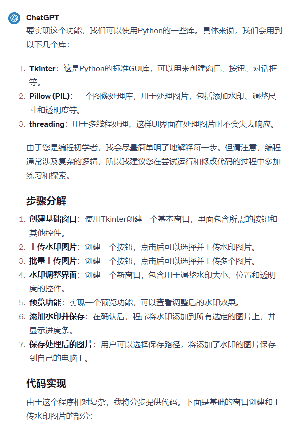

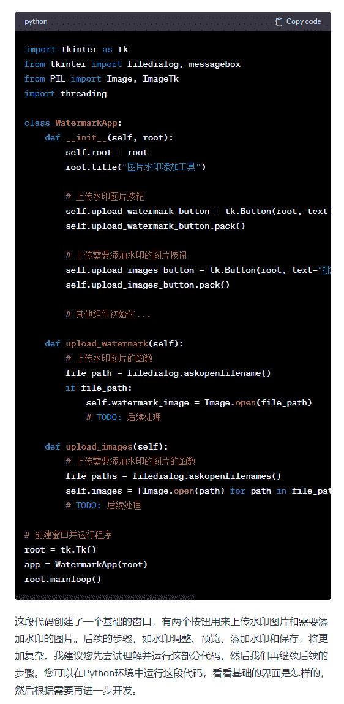

来到这里，很多人有疑问，或者说是对ChatGPT的期望值很高，希望它能一次性的把代码全部输出出来，一次性的解决你的问题，根据以往的使用经验下来，ChatGPT对于一个大型的任务，它都是把任务分解、细化，逐步来解决的，一口吃不成胖子，所以，对于你的Prompt的，需要做一些优化。看上面的这段代码，也只是把只要的框架写了下，还需要进一步完善的。好，回来：

把代码复制到Python，初次运行，问题就来了！Python的环境还没配置好，那就开问，直接引用问题，接下来就是一顿无脑的问......

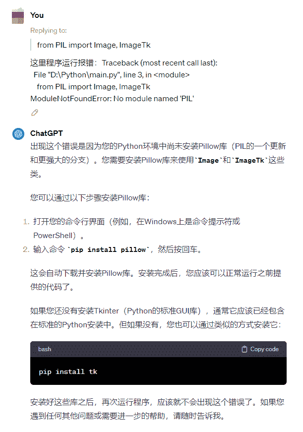

九牛二虎之力，Python终于配置好了，继续：

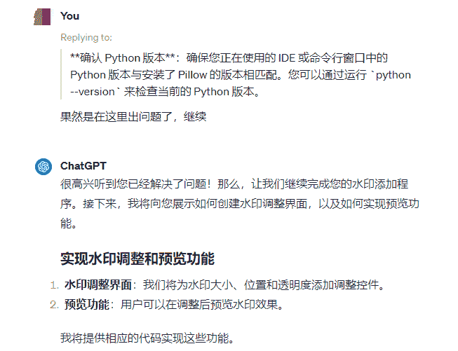

接着就是各种不间断的与ChatGPT对话，不断在Python里运行调试，将运行结果、报错反馈给ChatGPT的过程了.......这些问题，在专业程序员看来，可能很简单甚至弱智无脑，但是，在没有专业人士指导的情况下，问ChatGPT就得了。

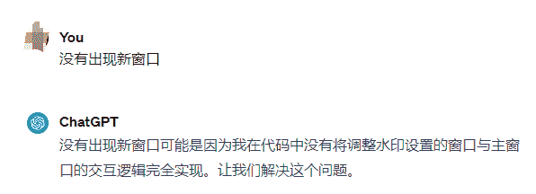

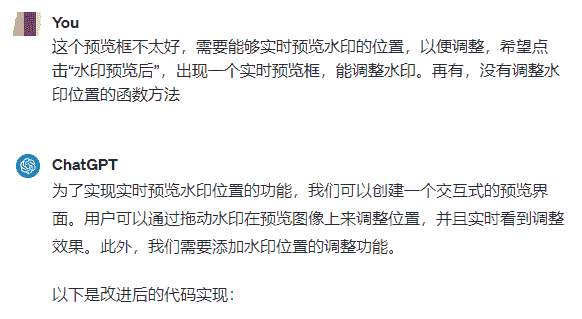

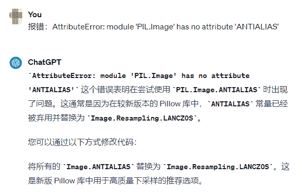

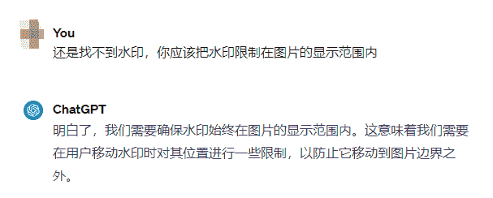

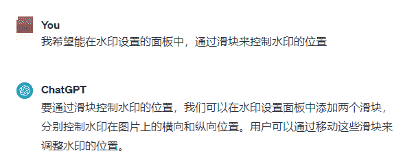

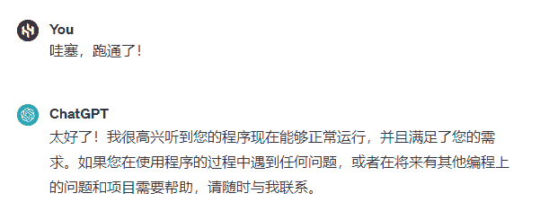

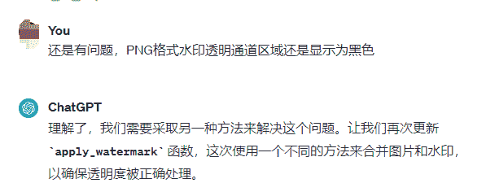

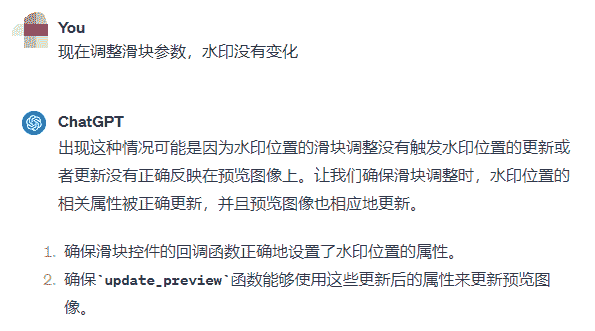

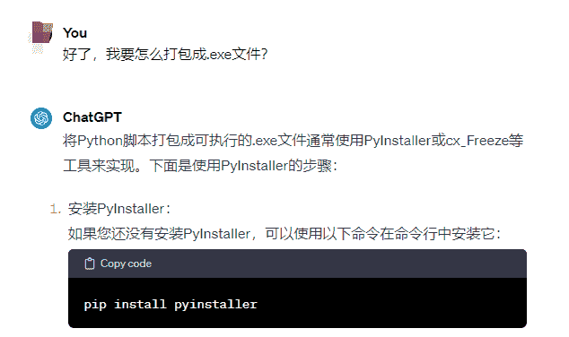

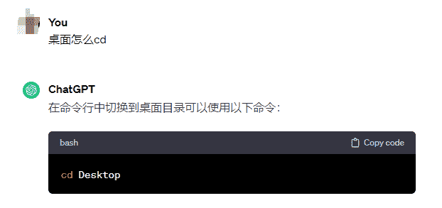

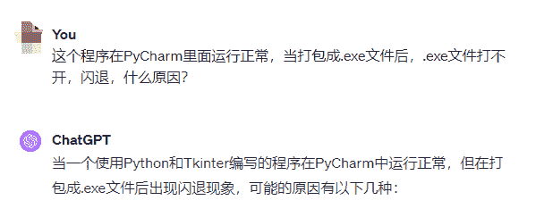

全部过程还有各种各样的问题、Bug，以及程序跑通后，怎么打包成.exe文件，怎么修改桌面的图标icon......就不一一展示了，对于我这种0编程基础的，就算很艰难了，但是，通过不断地与ChatGPT对话，反馈，最后都一一解决了。我的给图片加水印的需求，基本得到解决，这个小工具软件，用的也很顺手。

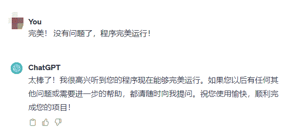

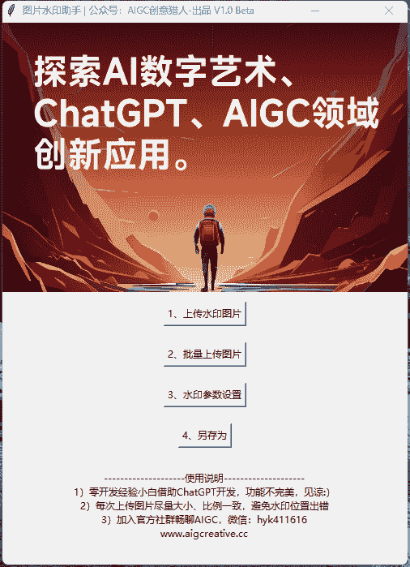

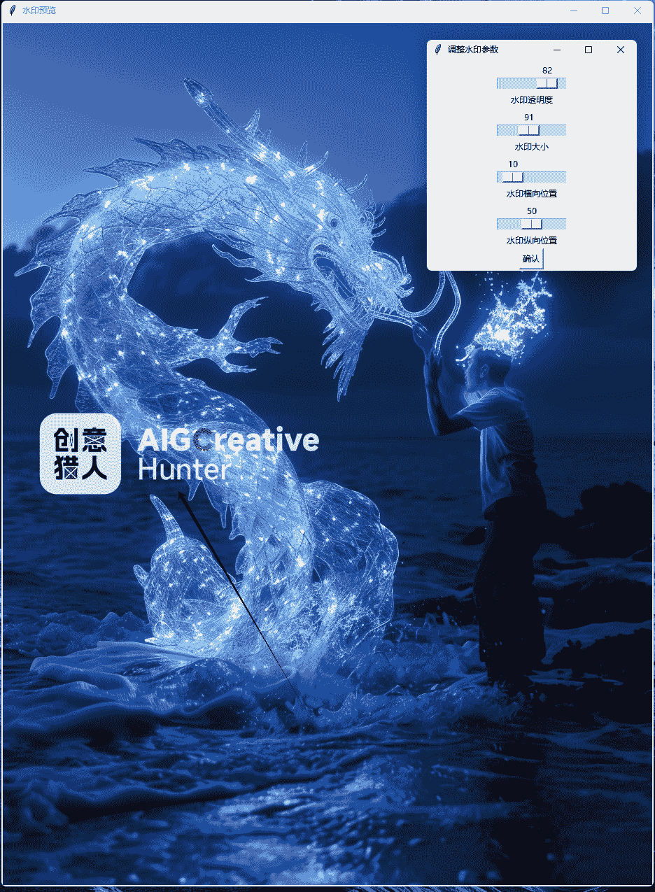

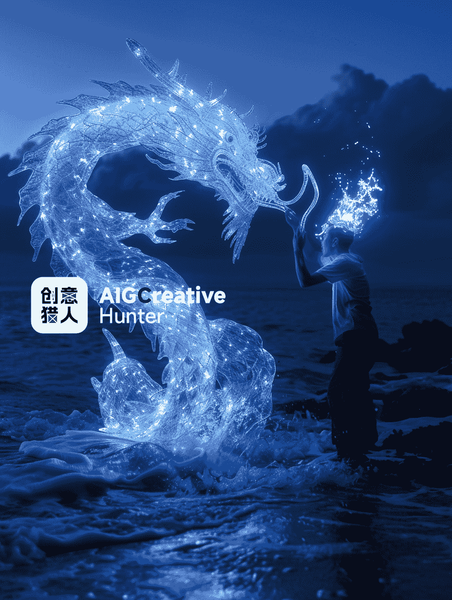

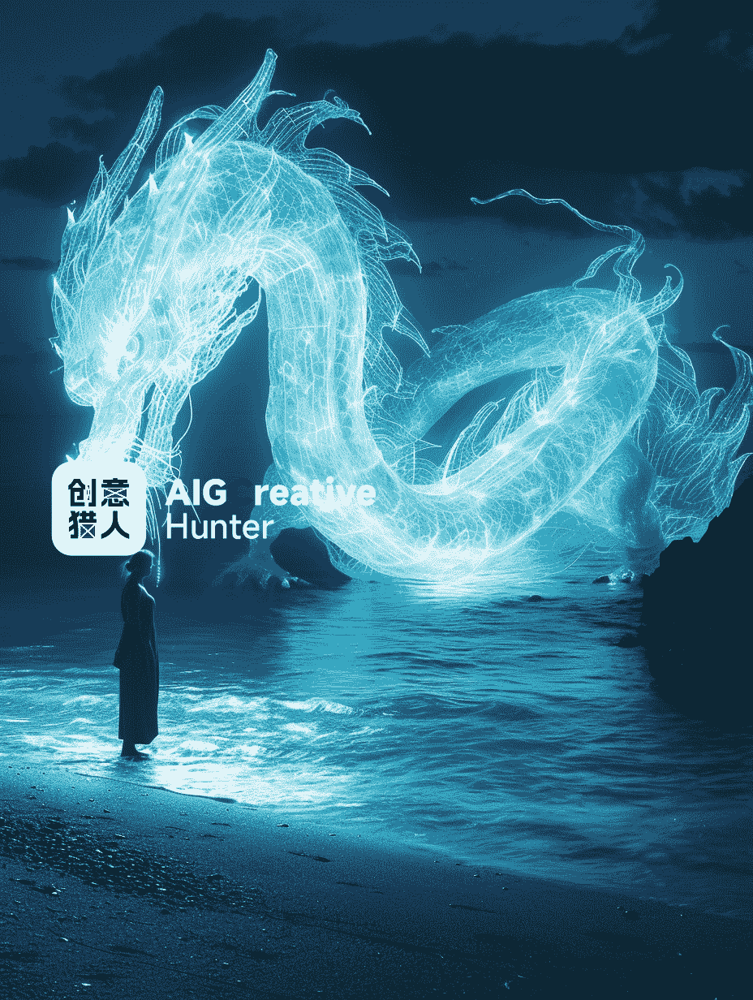

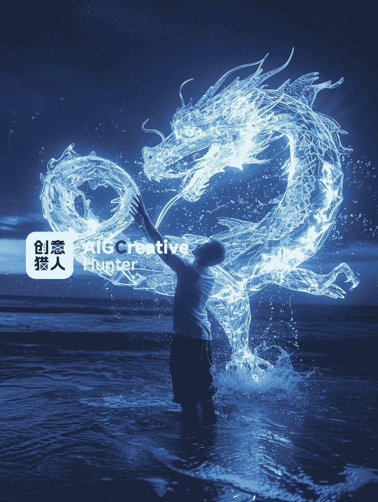

### 小结

这个小工具软件，可能对于很多专业程序员来说小菜一碟，不值得一说。但对于我来说，算是一次大胆的尝试吧，特别是有了ChatGPT的能力加持之后，也是利用ChatGPT的一次深度实践，分享出来，供大家在使用ChatGPT方面，提供一点参考。写个小工具软件，这要是放在ChatGPT时代之前，对于我来说，是一件很艰难的事情。这个小项目做完后，也引发了我的一些思考：

#### 关于这个小工具软件的本身：

1.  基本实现了给图片加水印这个功能，速度、使用效率还可以；

1.  此前描述的部分功能，没有实现，不影响主要功能，就先算了；

1.  还有个Bug，就是上传的图片分辨率较大时，图片的大小，不能通过调整窗口大小等比缩放，弄了很久，没搞定；

1.  后续有精力再完善。

#### 关于编程这件事：

1.  近年来，比较流行可视化编程，此前自己也体验了一些，感觉是个趋势，包括很多大厂也在推自己的可视化编程平台，但对于复杂的大型项目，应该也不适用；

1.  未来，感觉自然语言编程是个趋势，包括前不久ChatGPT推出的GPTs，用自然语言+结构化的格式，就能快速搭建出一个专业领域的GPTs，满足特定的需求；包括也有看到很多辅助编程的Copilot，通过Prompt，就能生成相应的代码片段。

1.  理解需求关键，如何通过Prompt描述清楚需求是关键中的关键。

1.  AI能解决80%以上的基本代码。

#### 关于ChatGPT：

通过此次深度实践，对ChatGPT有了一些新的认识：

1.  ChatGPT真的很强大，在不远的未来，实现AGI了是什么样的状态？要更加深入的探索，挖掘ChatGPT的价值；

1.  要深入掌握Prompt的技巧，对ChatGPT，可以提问，也需要给它结果反馈，它很专业，能解决你90%+的问题；

1.  复杂的问题，大型项目，要逐步分解，分块解决、完善；

1.  大胆提问，不懂就问。

#### 关于学习与教育：

1.  随着ChatGPT、大模型的出现，给很多行业领域带来了新的变化，教育领域也是一样；

1.  无论是自我学习，还是未成年人的教育，随着各种GPT的出现，获取知识技能的方式讲发生很大的改变，以自我驱动的探索式学习方式，将更加有利于知识技能的掌握。

以上一点点个人的思考。

若你也有给图片加水印的需求或想体验一下此小工具，可在公众号消息框回复“水印“，即可获取百度云链接下载。

致此，我个人使用Midjourney绘图：【自制的GPTs写Prompt+四宫格切图+图片加水印】的工作流就算是完整了，后面再做一次详细分享。

### 欢迎下载使用：

[图片水印助手.exe](https://internal-api-drive-stream.feishu.cn/space/api/box/stream/download/all/Nc5TbtuaaoZzBexYYnucmZ5FnHf)

<https://aigcreative.feishu.cn/sync/K4Gvd9vUQsy9Oubwqaeclu0Fnbg>