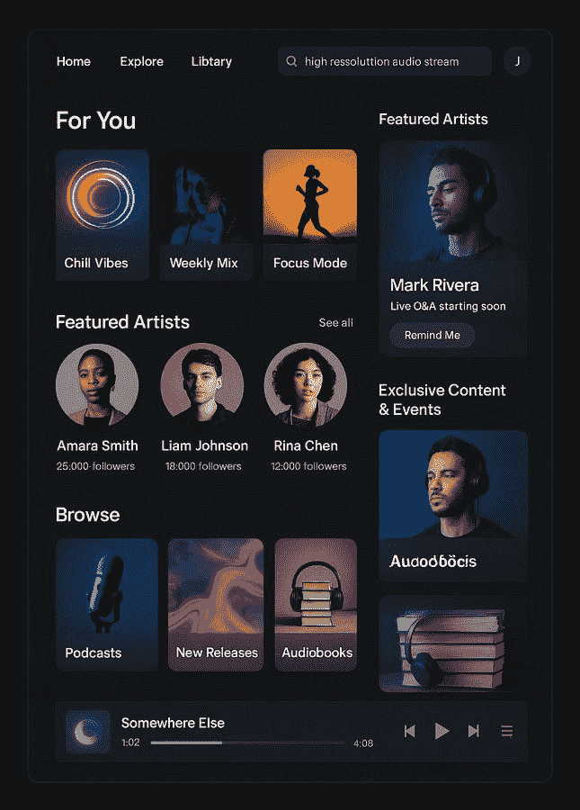
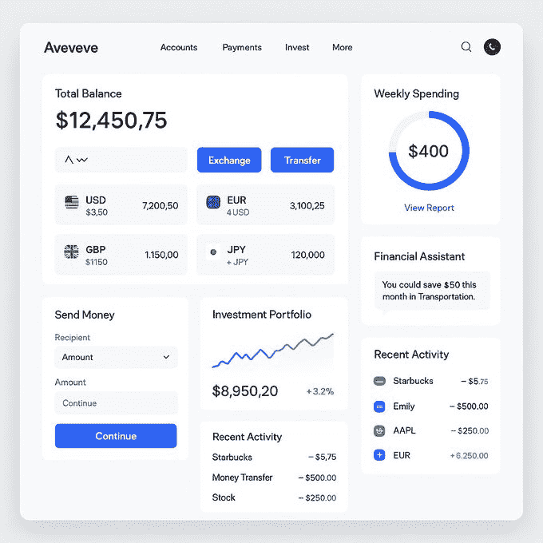
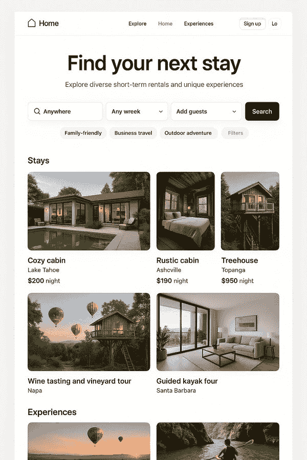
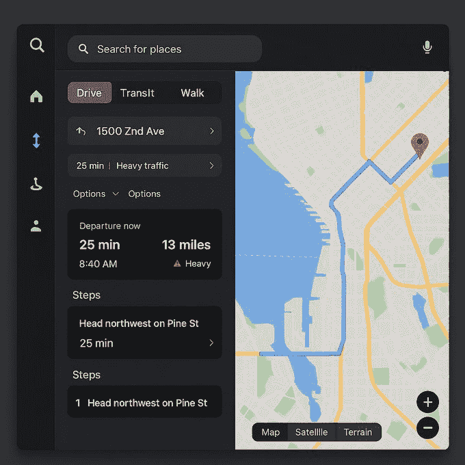
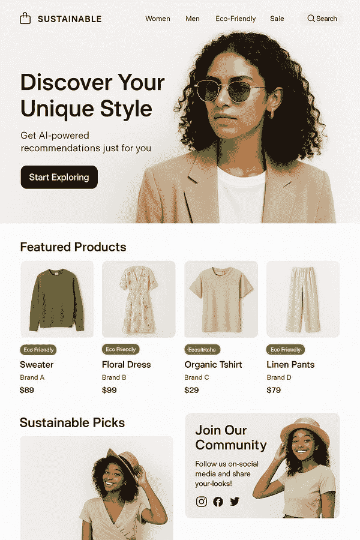
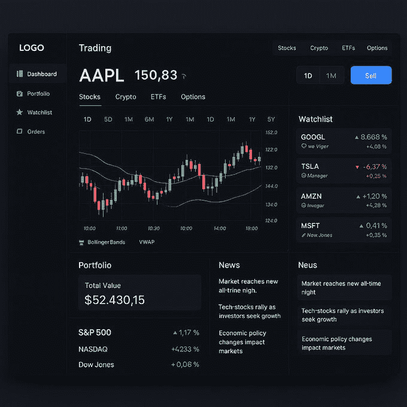
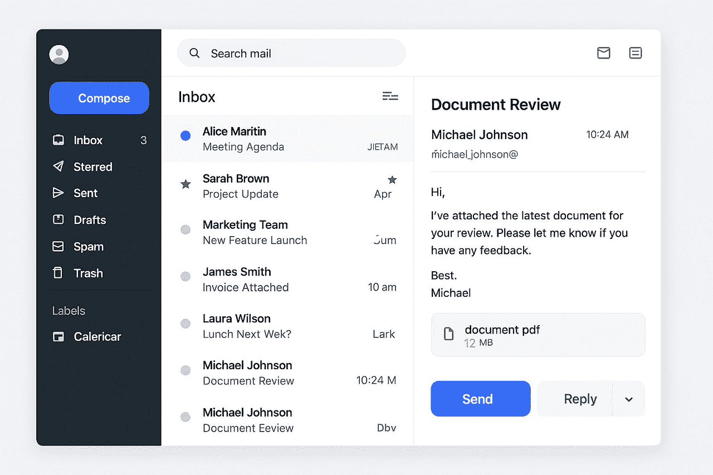
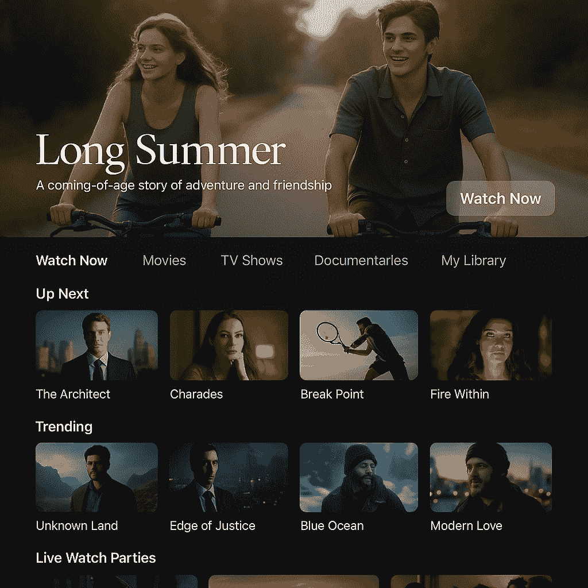
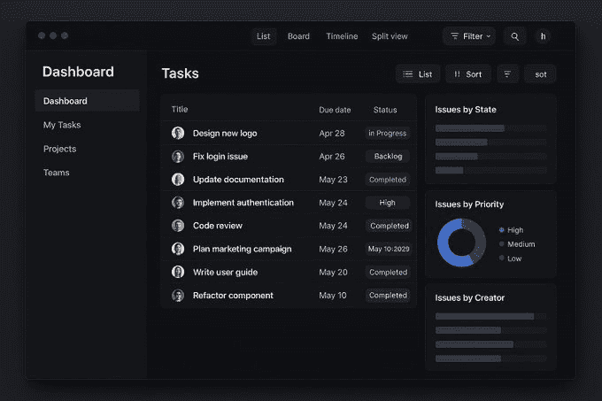
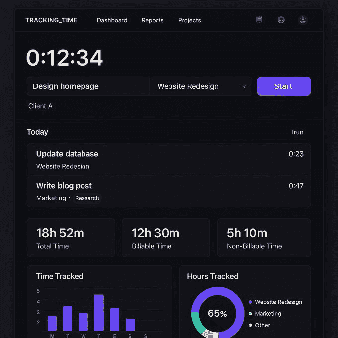

# 018-ChatGPT 4o多模态文生图高级提示词

> 来源：[https://aigcreative.feishu.cn/docx/Ggr1d9M0EoTt4Ox6CQncMsbLnQe](https://aigcreative.feishu.cn/docx/Ggr1d9M0EoTt4Ox6CQncMsbLnQe)

## Music Streaming App 音乐流媒体应用程序

```
Prompt:

The goal is to create a music streaming platform that rivals Spotify by offering a personalized, community-driven, and high-quality listening experience. This app will differentiate itself through enhanced social features, superior sound quality, and a focus on supporting independent artists while maintaining affordability and accessibility for users worldwide.

Key Goals and Objectives
Primary Goals:
Provide access to a vast library of music, podcasts, audiobooks, and exclusive content.
Deliver advanced personalization through AI-driven recommendations and mood-based playlists.
Support independent artists with tools for promotion, monetization, and direct fan engagement.

Secondary Goals:
Offer high-resolution audio streaming for audiophiles.
Integrate social features like collaborative playlists, live listening sessions, and artist-fan interactions.
Ensure offline playback and compatibility across devices.

Target Audience

Primary Users:
Millennials and Gen Z (ages 18–34) seeking personalized music experiences.
Audiophiles interested in high-quality sound streaming.
Independent artists looking for platforms to grow their audience.

Demographics:
Global reach with a focus on urban, tech-savvy individuals who value music discovery and community engagement.

Competitor Analysis

Spotify:
Strengths: Extensive library (100M+ songs), curated playlists like Discover Weekly, social sharing features.
Weaknesses: Lack of lossless audio; privacy concerns due to data collection.

Apple Music:
Strengths: Hi-res lossless audio and spatial sound; seamless integration with iOS devices.
Weaknesses: Limited social features; higher subscription costs.

Tidal:
Strengths: HiFi audio quality; artist-friendly payment model.
Weaknesses: Smaller user base compared to Spotify; fewer curated playlists.
SoundCloud:
Strengths: Focus on independent artists; user-uploaded content.
Weaknesses: Limited mainstream music catalog; less polished interface.

Design Requirements

Functional Needs:
Vast music library with curated playlists tailored to user preferences (e.g., mood-based or activity-based).
High-resolution audio streaming (lossless quality) for premium subscribers.
Social features like collaborative playlists, live listening parties, and artist Q&A sessions.
Tools for independent artists to upload tracks, track analytics, and monetize directly through fan subscriptions or donations.

Visual Design:
Clean interface with customizable themes (light/dark mode).
Dynamic album art visuals and interactive playlists for an engaging user experience.
Intuitive navigation for discovering new music, podcasts, or audiobooks.
```



## Personal Finance / Online Bank 个人理财/网上银行

```
The goal is to develop a web app offering a comprehensive digital banking platform with a focus on multi-currency accounts, investment tools, and seamless international transactions. This competitor will differentiate itself by prioritizing user privacy, enhanced financial education, and tailored solutions for diverse customer needs, including families, frequent travelers, and small business owners.

Key Goals and Objectives
Primary Goals:
Provide multi-currency accounts with competitive exchange rates and low fees.
Offer robust investment options, including stocks, ETFs, and cryptocurrencies.
Facilitate instant international money transfers with transparent pricing.

Secondary Goals:
Enhance user engagement with AI-driven financial insights and budgeting tools.
Introduce family-friendly features like shared accounts and parental controls.
Offer business banking solutions tailored to SMEs, including invoicing and expense tracking.

Target Audience

Primary Users:
Tech-savvy millennials (ages 18–35) seeking convenient financial solutions.
Frequent travelers and expats managing finances across multiple currencies.
Small business owners requiring cost-effective banking tools.

Demographics:
Global reach with a focus on urban professionals in Europe, North America, and Asia.
Users who value transparency, low fees, and innovative financial services.

Competitor Analysis

Revolut:
Strengths: Comprehensive product offerings (multi-currency accounts, investments), strong brand recognition.
Weaknesses: Privacy concerns due to extensive data collection; limited focus on family-oriented features.

N26:
Strengths: Simple interface and strong customer support.
Weaknesses: Fewer investment options compared to Revolut.

Wise (formerly TransferWise):
Strengths: Transparent fees for international transfers.
Weaknesses: Limited banking features beyond money transfers.
Design Requirements

Functional Needs:
Multi-currency accounts supporting at least 40 currencies with interbank exchange rates.
AI-powered financial assistant for budgeting, savings goals, and spending insights.
Investment platform offering stocks, ETFs, crypto assets, and precious metals.
Instant peer-to-peer transfers within the app and low-cost external transfers.

Visual Design:
Clean and modern interface optimized for both desktop and mobile devices.
Customizable dashboards allowing users to prioritize frequently used features.
Light/dark mode options for user comfort.
```



## Short term rental app 短期租赁应用程序

```
The goal is to create a web app offering a platform for short-term rentals and unique travel experiences. This competitor will differentiate itself through enhanced trust, transparency, and curated offerings tailored to specific traveler needs, such as families, business professionals, and adventure seekers.

Key Goals and Objectives
Primary Goals:
Provide a diverse range of accommodations, including whole-home rentals, shared spaces, and unique stays (e.g., treehouses, glamping).
Offer curated travel experiences and activities hosted by locals.
Build a strong trust framework with robust verification processes for hosts and guests.

Secondary Goals:
Enhance user experience with advanced search filters (e.g., pet-friendly, remote work amenities).
Support sustainable tourism initiatives by promoting eco-friendly stays.
Integrate seamless payment systems with flexible cancellation policies.

Target Audience

Primary Users:
Millennials and Gen Z travelers seeking authentic experiences.
Families looking for spacious accommodations.
Business professionals needing reliable short-term rentals with work-friendly amenities.
Digital nomads blending work and leisure travel (bleisure).

Demographics:
Age: 18–45 years old for accommodations; broader age range (18–60) for experiences.
Gender: Balanced audience (54% female, 46% male).
Psychographics: Adventurous, experience-seeking individuals who value personalization and affordability.

Competitor Analysis

Airbnb:
Strengths: Global brand recognition, diverse listings, user-friendly platform.
Weaknesses: Regulatory challenges, inconsistent quality across listings.

Vrbo:
Strengths: Focus on whole-home rentals for families.
Weaknesses: Limited options for solo travelers or unique stays.

Booking .com:
Strengths: Integration of hotels and peer-to-peer rentals.
Weaknesses: Less emphasis on unique local experiences.
Design Requirements

Functional Needs:
Advanced search filters (e.g., budget range, amenities like Wi-Fi or kitchens).
Verified listings with host ratings and reviews to ensure transparency.
Interactive maps showing nearby attractions and activities.
Customizable trip itineraries combining stays with local experiences.

Visual Design:
Clean interface with intuitive navigation for booking stays or experiences.
Light/dark mode options for accessibility.
High-quality visuals showcasing properties and activities.
```



## Maps 地图


# Navigation and Mapping App 导航与地图应用

The aim is to design a web app offering a user-friendly, privacy-focused, and feature-rich navigation and mapping platform. This app will differentiate itself by emphasizing offline capabilities, real-time updates, and personalized route planning while addressing common criticisms of Google Maps, such as privacy concerns and data dependency.

## Key Goals and Objectives

### Primary Goals:
- Provide accurate navigation for driving, walking, cycling, and public transport.
- Offer robust offline functionality with downloadable maps for entire regions or countries.
- Deliver real-time traffic updates, hazard alerts, and route optimization.

### Secondary Goals:
- Prioritize user privacy by avoiding unnecessary data collection.
- Include customizable features like route preferences (e.g., avoiding tolls or highways) and multi-stop route planning.
- Support integration with third-party apps (e.g., ride-sharing services, travel planners).

## Target Audience

### Primary Users:
- Travelers seeking reliable navigation in areas with limited internet connectivity.
- Privacy-conscious individuals who prefer alternatives to Google’s data-driven ecosystem.
- Commuters, delivery drivers, and logistics professionals needing precise routing and real-time updates.

### Demographics:
- Age: 18–60 years old.
- Tech-savvy individuals, frequent travelers, and professionals in urban and rural areas.

## Competitor Analysis

### Google Maps:
- Strengths: Comprehensive global coverage, real-time updates, integration with Google’s ecosystem.
- Weaknesses: Heavy reliance on user data; inconsistent offline performance in remote areas.

### Waze:
- Strengths: Community-driven traffic alerts and real-time updates.
- Weaknesses: Limited offline functionality; focused primarily on drivers.

### HERE WeGo:
- Strengths: Excellent offline maps; intuitive interface for international travelers.
- Weaknesses: Limited community-driven updates compared to competitors.

## Design Requirements

### Functional Needs:
- Turn-by-turn navigation with voice guidance for driving, walking, cycling, and public transport.
- Offline maps with detailed information on streets, landmarks, and points of interest (POIs).
- Real-time traffic updates integrated with hazard alerts (e.g., accidents, road closures).
- Multi-stop route planning with options to customize routes based on user preferences.

### Visual Design:
- Clean interface with a focus on simplicity and usability.
- Customizable themes (e.g., light/dark mode).
- High-quality visuals for maps (satellite view, terrain view) with smooth zooming.



# Clothes e-commerce 服装电商

The goal is to create a fashion e-commerce platform offering a personalized, user-friendly, and sustainable shopping experience. This app will differentiate itself through a focus on eco-friendly products, advanced AI-driven styling recommendations, and seamless integration with social media platforms while maintaining affordability and accessibility for users across Europe.

## Key Goals and Objectives

### Primary Goals:
- Provide a vast selection of fashion products from established brands and emerging designers.
- Offer advanced personalization through AI-driven styling recommendations based on user preferences and purchase history.
- Emphasize sustainability by highlighting eco-friendly products and promoting responsible fashion practices.

### Secondary Goals:
- Integrate social features like influencer partnerships, user-generated content, and live shopping events.
- Ensure seamless checkout processes with flexible payment options and fast shipping.
- Support small businesses and independent designers through dedicated platforms or marketplaces.

## Target Audience

### Primary Users:
- Young adults (18–35) interested in fashion, sustainability, and social media.
- Environmentally conscious consumers seeking eco-friendly fashion options.
- Fashion enthusiasts looking for unique styles from emerging designers.

### Demographics:
- Global reach with a focus on urban, tech-savvy individuals in Europe who value fashion and sustainability.

## Competitor Analysis

### Zalando:
- Strengths: Wide product range, strong brand recognition, user-friendly interface.
- Weaknesses: Limited focus on sustainability; less emphasis on social features.

### ASOS:
- Strengths: Extensive product offerings; strong social media presence.
- Weaknesses: Higher return rates due to sizing issues; less focus on eco-friendly products.

### H&M:
- Strengths: Affordable prices; strong brand identity.
- Weaknesses: Criticized for unsustainable practices; less emphasis on online personalization.

### Farfetch:
- Strengths: Luxury brand offerings; strong focus on high-end fashion.
- Weaknesses: Higher price points; less accessible to budget-conscious consumers.

## Design Requirements

### Functional Needs:
- Advanced search and filtering options for sustainable products (e.g., organic materials, second-hand items).
- AI-powered styling recommendations based on user preferences, body type, and purchase history.
- Social features like influencer collaborations, user-generated content showcases, and live shopping events.
- Seamless checkout process with multiple payment options (e.g., Klarna, PayPal).

### Visual Design:
- Clean interface with customizable themes (light/dark mode).
- High-quality product visuals with 360-degree views and detailed product information.
- Intuitive navigation for discovering new brands, trends, or sustainable products.



# Trading app 交易应用程序

The objective is to create a modern, intuitive, and feature-rich trading web app that caters to both beginner and advanced traders. The app will emphasize simplicity, customization, and real-time data to provide users with a seamless trading experience while differentiating itself from competitors like Robinhood.

## Key Goals and Objectives

### Primary Goals:
- Offer real-time trading capabilities across multiple asset classes (stocks, crypto, ETFs, options).
- Provide advanced tools like customizable dashboards, technical analysis charts, and market insights.
- Ensure accessibility across devices with a responsive web design.

### Secondary Goals:
- Incorporate educational resources for beginner traders.
- Introduce gamification elements to boost engagement without trivializing financial decisions.
- Maintain low transaction fees to attract cost-conscious users.

## Target Audience

### Primary Users:
- Beginner investors seeking educational tools and simplified trading processes.
- Experienced traders requiring advanced analytics, real-time data, and customizable features.

### Demographics:
- Age: 20–50 years old.
- Tech-savvy individuals interested in personal finance and investments.
- Income: Middle to high-income earners.

## Competitor Analysis

### Robinhood:
- Strengths: Simplified UI, low fees, mobile-first approach.
- Weaknesses: Limited customization for advanced traders; lacks robust educational content.

### E*TRADE:
- Strengths: Advanced charting tools; comprehensive research resources.
- Weaknesses: Higher fees; less beginner-friendly interface.

### Webull:
- Strengths: Advanced tools for experienced traders; paper trading for beginners.
- Weaknesses: Overwhelming interface for new users.

## Design Requirements

### Functional Needs:
- Real-time market data with sub-second updates.
- Advanced charting tools (candlestick, Heikin Ashi) with multiple indicators (Bollinger Bands, VWAP).
- Customizable dashboards with widgets for watchlists, portfolio performance, and newsfeeds.
- Seamless trade execution directly from charts or watchlists.

### Visual Design:
- Minimalist design emphasizing clarity and usability.
- Light and dark modes for user comfort.
- Intuitive navigation with clear calls-to-action for both beginners and experts.



# Graphic design software 平面设计软件


```
The objective is to create a web-based design and prototyping platform that combines the robust editing  with the collaborative, real-time features. This app will cater to both individual designers and teams, offering tools for graphic design, UI/UX design, and prototyping in a seamless, browser-based environment.

Key Goals and Objectives
Primary Goals:
Provide advanced graphic editing tools (layers, masks, brushes) for pixel-perfect designs.
Enable real-time collaboration for teams with features like shared libraries, annotations, and version control.
Offer prototyping tools to create interactive designs with transitions and animations.

Secondary Goals:
Support offline editing with cloud-sync capabilities.
Integrate with popular design ecosystems (e.g., Adobe Creative Cloud, developer tools like GitHub).
Ensure cross-platform compatibility across devices and browsers.

Target Audience

Primary Users:
Graphic designers, UI/UX designers, web designers.
Product managers and developers collaborating on digital products.
Small businesses and startups seeking cost-effective design solutions.

Demographics:
Age: 20–45 years old.
Tech-savvy professionals in creative industries or product development.

Competitor Analysis

Photoshop:
Strengths: Advanced raster editing tools, extensive plugin ecosystem.
Weaknesses: Steep learning curve, limited collaboration features.

Figma:
Strengths: Real-time collaboration, browser-based accessibility.
Weaknesses: Limited offline functionality, resource-intensive for large projects.

Adobe XD:
Strengths: Seamless integration with Adobe’s ecosystem.
Weaknesses: Requires plugins for full functionality.
Design Requirements

Functional Needs:
Layer-based editing with masks and blending modes.
Vector editing tools for scalable designs (pen tool, shapes).
Prototyping features with interactive elements (clickable hotspots, animations).
Shared libraries for reusable components like styles, colors, and fonts.
Real-time collaboration with branching/merging capabilities.

Visual Design:
Clean and intuitive interface with minimal distractions.
Light/dark mode options for user comfort.
Responsive design for use on desktops, tablets, and large-screen devices.
```

# Email client 电子邮件客户端

```
The goal is to create a web-based email service offering a streamlined, privacy-focused, and feature-rich platform. The app will emphasize user control, advanced organizational tools, and seamless integration with productivity workflows while addressing common pain points such as cluttered interfaces and privacy concerns.

Key Goals and Objectives
Primary Goals:
Provide a clean, intuitive interface for managing emails efficiently.
Enhance user privacy with end-to-end encryption and minimal data collection.
Offer advanced organizational tools such as smart folders, customizable labels, and AI-powered search.

Secondary Goals:
Integrate productivity tools like calendars, task management, and document collaboration.
Support multiple email accounts with unified inbox functionality.
Deliver offline capabilities for composing and managing emails without internet access.

Target Audience

Primary Users:
Professionals seeking secure email solutions for work.
Privacy-conscious individuals looking for alternatives to Gmail.
Small businesses requiring collaborative email tools integrated with productivity features.

Demographics:
Age: 25–55 years old.
Tech-savvy users who value simplicity, security, and efficiency.

Competitor Analysis

Gmail:
Strengths: Integration with Google Workspace, powerful search functionality, extensive features.
Weaknesses: Privacy concerns due to data collection; cluttered interface for some users.

ProtonMail:
Strengths: End-to-end encryption and strong privacy focus.
Weaknesses: Limited free plan features; less intuitive interface compared to Gmail.

Outlook:
Strengths: Integration with Microsoft Office tools; Focused Inbox for organization.
Weaknesses: Ads in free version; requires Microsoft subscription for advanced features.
Design Requirements

Functional Needs:
End-to-end encryption for all emails and attachments.
Smart organizational tools such as auto-labeling, snoozing, and email prioritization based on importance.
Unified inbox for managing multiple accounts in one place.
Advanced search functionality powered by AI to quickly locate emails based on keywords or context.

Visual Design:
Minimalist interface with customizable themes (light/dark mode).
Logical layout with clear navigation menus to reduce clutter.
High-quality visuals for attachments and embedded media previews.
```



# Streaming platform 流媒体平台

```
The objective is to create a streaming service offering a diverse library of content, personalized recommendations, and innovative features that enhance the viewing experience. This platform will differentiate itself through a focus on niche content, community engagement, and flexible pricing models while maintaining affordability and accessibility for users worldwide.

Key Goals and Objectives
Primary Goals:
Provide a vast library of movies, TV shows, documentaries, and original content.
Offer advanced personalization through AI-driven recommendations based on user behavior and preferences.
Support community features like live watch parties, discussion forums, and user-generated content.

Secondary Goals:
Introduce flexible pricing models (e.g., à la carte content selection, tiered subscriptions).
Ensure seamless integration with various devices (smart TVs, mobile apps, gaming consoles).
Offer high-quality video streaming with options for 4K, HDR, and Dolby Atmos.

Target Audience

Primary Users:
Young adults (18–35) seeking diverse content options and social features.
Niche audiences interested in independent films, documentaries, or international content.
Families looking for affordable entertainment solutions with parental controls.

Demographics:
Global reach with a focus on urban, tech-savvy individuals who value content discovery and community engagement.

Competitor Analysis

Netflix:
Strengths: Extensive content library, strong brand recognition, user-friendly interface.
Weaknesses: Increasing costs; limited focus on niche content or community features.

Amazon Prime Video:
Strengths: Integration with Amazon ecosystem; additional benefits like free shipping.
Weaknesses: Confusing interface; less emphasis on social features.

Hulu:
Strengths: Strong focus on TV shows; affordable pricing options.
Weaknesses: Limited international content; fewer original titles compared to Netflix.
Disney+:
Strengths: Exclusive Disney, Pixar, Marvel, and Star Wars content; family-friendly focus.
Weaknesses: Limited content diversity beyond Disney franchises.

Design Requirements

Functional Needs:
Advanced search and recommendation algorithms based on user viewing history and ratings.
Community features like live watch parties with real-time chat, user reviews, and ratings.
Flexible pricing models allowing users to choose specific content bundles or à la carte options.
High-quality video streaming with support for 4K, HDR, and Dolby Atmos.

Visual Design:
Clean interface with customizable themes (light/dark mode).
Dynamic content showcases highlighting new releases, user favorites, and trending titles.
Intuitive navigation for discovering new content or accessing personalized recommendations.
```



# Task board / project management app 任务看板/项目管理应用程序


# 任务管理与生产力看板应用

```
The goal is to design a sleek, intuitive, and efficient web app dashboard tailored for task management and productivity tracking. The dashboard will prioritize speed, simplicity, and aesthetics while delivering actionable insights to users.

Key Goals and Objectives
Primary Goals:
Provide users with real-time data analytics to track tasks, team performance, and project milestones.
Enable seamless navigation across multiple views (list, board, timeline, split-screen).
Integrate actionable filters for quick decision-making.

Secondary Goals:
Support light and dark modes with customizable themes.
Ensure compatibility across browsers and operating systems.
Offer collaboration tools for sharing dashboards and inviting team members.

Target Audience

Primary Users: Tech companies, product development teams, remote or hybrid teams.

Demographics: Professionals aged 25–45 who value efficiency and data-driven decision-making.

Needs:
Fast-paced workflows.
Clear visualization of tasks and goals.
Tools to improve team alignment.

Competitor Analysis

Linear:
Known for its speed and simplicity in issue tracking and project planning.
Offers structured layouts with high visual hierarchy23.

Geckoboard:
Focuses on customizable dashboards with live updates and integrations8.
Polymer:
Provides pre-built templates for task management insights1.

Design Requirements

Functional Needs:
Real-time updates on key metrics (e.g., issues by state, priority, creator).
Interactive filters to drill down into data points.
Fullscreen analysis mode for detailed insights.

Visual Design:
Minimalist interface with reduced visual noise2.
High contrast themes with customizable branding options8.
Structured layouts integrating headers, side panels, and meta properties2.
```



# Time Tracking App 时间追踪应用程序

```
The goal is to design a sleek, modern time-tracking app offering a dark mode experience. This app will focus on simplicity, advanced automation, and customization while addressing common pain points like manual input, limited reporting, and lack of personalization. It will cater to freelancers, teams, and businesses seeking a stylish yet functional time management solution.
Key Goals and Objectives

Primary Goals:
Provide an intuitive time-tracking interface optimized for dark mode with visually appealing aesthetics.
Offer advanced features like automated time tracking, smart reminders, and AI-driven insights.
Deliver robust reporting tools with customizable analytics for productivity tracking and billing.

Secondary Goals:
Ensure seamless integration with popular project management tools (e.g., Trello, Asana) and calendars.
Support offline tracking with automatic syncing when reconnected.
Prioritize user privacy with secure data storage and encryption.
Target Audience
Primary Users:
Freelancers managing billable hours across multiple clients.
Teams in creative or tech industries needing real-time productivity insights.
Small businesses requiring accurate time logs for payroll or invoicing.
Demographics:
Age: 25–45 years old.
Tech-savvy professionals who value aesthetics, functionality, and efficiency.
Competitor Analysis
Toggl Track:
Strengths: Simple interface, offline tracking, cross-platform availability.
Weaknesses: Manual input can be tedious; limited reporting options; lacks visual customization.
Clockify:
Strengths: Free plan for unlimited users; basic project management features.
Weaknesses: Outdated interface; lacks advanced automation tools.
Timeneye:
Strengths: User-friendly interface; good integrations with Slack and Trello.
Weaknesses: Limited automation; lacks offline capabilities.
Design Requirements
1.Functional Needs:
One-click time tracking with options for manual entry and automated tracking based on activity detection.
Smart reminders to start or stop timers based on user behavior or calendar events.
Customizable reports that visualize productivity trends, billable hours, and project progress in an aesthetically pleasing format.
Multi-layered task organization (e.g., projects, clients, tags) for detailed tracking.

Visual Design:
A fully optimized dark mode as the default theme with high contrast and vibrant accent colors for readability.
Minimalist dashboard design with smooth animations and intuitive navigation.
Dynamic visualizations (e.g., charts, graphs) to represent tracked time data clearly.

Technical Aspects:
Cross-platform compatibility (web app + mobile apps for iOS/Android).
Offline tracking capabilities with automatic syncing when online.
Integration with popular tools like Google Calendar, QuickBooks, Slack, and Notion.
Unique Features

Dark Mode First Design:
The app is built around a dark mode aesthetic by default but offers light mode as an optional setting for users who prefer it.

AI-Powered Time Suggestions:
Intelligent prompts based on past activity to suggest what users are working on or remind them to log time if idle.

Automated Time Categorization:
Automatically tag tasks based on keywords or recurring patterns in user behavior (e.g., “emails” tagged as admin work).

Customizable Dashboards:
Allow users to tailor their dashboards by pinning frequently used projects or reports for quick access.

Focus Mode Integration:
Built-in Pomodoro timer with focus analytics to help users stay productive while tracking their work.
```



<https://aigcreative.feishu.cn/sync/K4Gvd9vUQsy9Oubwqaeclu0Fnbg>

# 知识库动态
