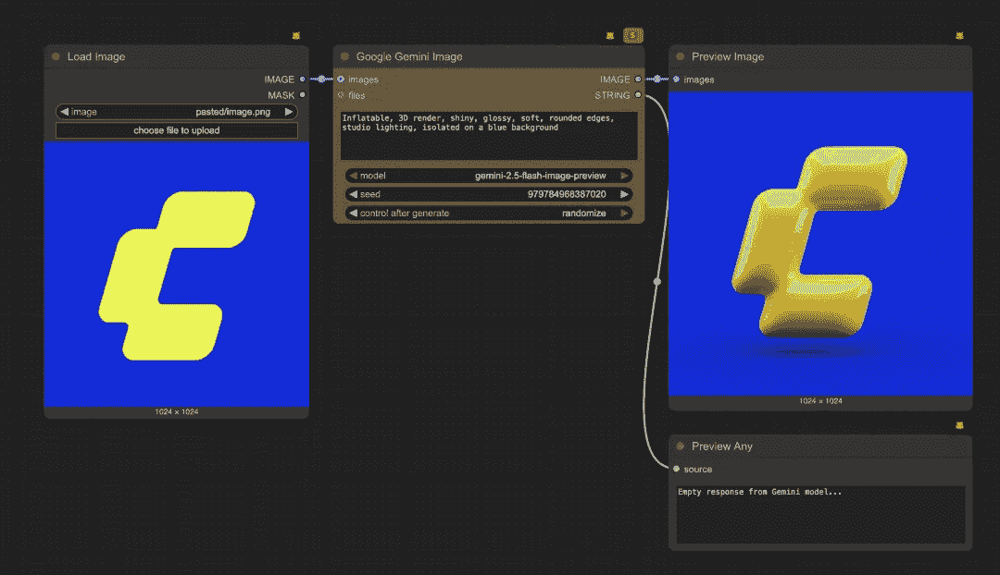

# 20250828-Nano-banana 现可在 ComfyUI 中通过 API 节点调用!

> 来源：[https://aigcreative.feishu.cn/docx/K8xldqQhXo5IDPxSmgPcrSsTnmB](https://aigcreative.feishu.cn/docx/K8xldqQhXo5IDPxSmgPcrSsTnmB)

> 原文链接： https://mp.weixin.qq.com/s/HmYzInDGrUced5mhmVsPcQ

> 来源：公众号-ComfyUI中文

ComfyUI 现已原生支持 nano-banana API 节点 , 这让你可以将最前沿的图像编辑生成能力直接集成到你的工作流中，所有操作都可在 ComfyUI 内完成。

### **模型亮点**

+   高度的角色一致性与细节表现

+   同时支持 **文生图 **和 **图生图**

+   可同时输出文本内容

+   分辨率与宽高比可自定义

### **快速开始**

1.  将 ComfyUI 升级到 nightly 即最新的代码提交（Stable 和 Desktop 版支持即将发布）

1.  在画布上双击，并搜索添加 Google Gemini Image 节点， 或在 模板 -> 图像API 搜索找到 Google Gemini Image 模板

工作流： https://raw.githubusercontent.com/Comfy-Org/workflow_templates/refs/heads/main/templates/api_google_gemini_image.json

## **示例展示**

Nano-banana 结合 Wan 2.2 示例

Close

**观看更多**

更多

退出全屏

切换到横屏模式

[🎦 点击观看视频](https://mpvideo.qpic.cn/0bc3feb74aad3eady2vnn5ufgkod7yuqh7qa.f10002.mp4?dis_k=472e3cbe601e8fb7f4f679c20fd43d7d&dis_t=1756390228&play_scene=10120&auth_info=dYiJ9eILQHhK6IywnX1ANn4uM1lkHUg4US90bRBEezZIbis1TTZ6cx9DG39gHAMPcTpl&auth_key=859e5978a39761337e97cdcef7ca98fd&vid=wxv_4138794251465261061&format_id=10002&support_redirect=0&mmversion=false)

> 无法获取音频链接

Video Details

## **计费说明**

该模型通过 API 计费，费用取决于输入和输出的 token 数量，我们计价方式与 google 官方保持一致

https://cloud.google.com/vertex-ai/generative-ai/pricing#token-based-pricing

查看我们的官方 API 定价文档：https://docs.comfy.org/zh-CN/tutorials/api-nodes/pricing

一如既往，愿你享受在 ComfyUI 中创作的乐趣

## **ComfyUI 官方渠道**

1.  官方微信公众号：本账号，发布官方博客及重大社区更新

1.  官方微信群（用户群/节点开发者群）：关注本账号获即可获取入群二维码

1.  Discord中文：https://discord.gg/uRByrnqbeS

除此之外，感谢大量社区用户对ComfyUI使用案例、资讯、教程的创作、翻译和分享。欢迎第三方ComfyUI社区和群组和我们共享信息传达。社区与企业合作请联络：jozhangsh。

**其他官方频道**

**X ****: htt****ps://x.com/C****omfyUI****

Blog**** : https:****//b****log.**comfy.org/

Youtube每周直播 ：https://www.youtube.com/@comfyorg

Forum : https://forum.comfy.org/

Email : Hello@comfy.org

Bilibili : https://space.bilibili.com/3546886659115008

微博 : https://weibo.com/8018380704/PEwFsaOqZ

小红书 : https://www.xiaohongshu.com/user/profile/605847e4000000000100343e

<https://aigcreative.feishu.cn/sync/K4Gvd9vUQsy9Oubwqaeclu0Fnbg>

# 知识库动态